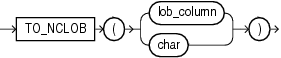

## TO\_NCLOB

Syntax



> ```
> TO_NCLOB(lob_column | char)
> ```
>
> [  
> Copyright © 1996, 2025, Oracle and/or its affiliates.](https://docs.oracle.com/en/database/oracle/oracle-database/dcommon/html/cpyr.htm)


Purpose

`TO_NCLOB` converts `CLOB` values in a LOB column or other character strings to `NCLOB` values. `char` can be any of the data types `CHAR`, `VARCHAR2`, `NCHAR`, `NVARCHAR2`, `CLOB`, or `NCLOB`. Oracle Database implements this function by converting the character set of `char` from the database character set to the national character set.

See Also:

Appendix C in [Oracle Database Globalization Support Guide](https://docs.oracle.com/pls/topic/lookup?ctx=en/database/oracle/oracle-database/21/sqlrf&id=NLSPG-GUID-AFCE41ED-775B-4A00-AF38-C436776AE0C5) for the collation derivation rules, which define the collation assigned to the character return value of this function

Examples

The following example inserts some character data into an `NCLOB` column of the `pm.print_media` table by first converting the data with the `TO_NCLOB` function:

```
INSERT INTO print_media (product_id, ad_id, ad_fltextn)
   VALUES (3502, 31001, 
      TO_NCLOB('Placeholder for new product description'));
```