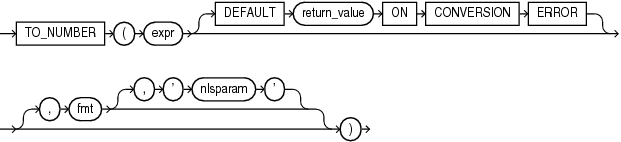

## TO\_NUMBER

Syntax



> ```
> TO_NUMBER(expr [ DEFAULT return_value ON CONVERSION ERROR ]
>   [, fmt [, 'nlsparam' ] ])
> ```
>
> [  
> Copyright © 1996, 2025, Oracle and/or its affiliates.](https://docs.oracle.com/en/database/oracle/oracle-database/dcommon/html/cpyr.htm)


Purpose

`TO_NUMBER` converts `expr` to a value of `NUMBER` data type.

`expr` can be any expression that evaluates to a character string of type `CHAR`, `VARCHAR2`, `NCHAR`, or `NVARCHAR2`, a numeric value of type `NUMBER`, `BINARY_FLOAT`, or `BINARY_DOUBLE`, or null. If `expr` is `NUMBER`, then the function returns `expr`. If `expr` evaluates to null, then the function returns null. Otherwise, the function converts `expr` to a `NUMBER` value.

- If you specify an `expr` of `CHAR`, `VARCHAR2`, `NCHAR`, or `NVARCHAR2` data type, then you can optionally specify the format model `fmt`.
- If you specify an `expr` of `BINARY_FLOAT` or `BINARY_DOUBLE` data type, then you cannot specify a format model because a float can be interpreted only by its internal representation.

Refer to " [Format Models](Format-Models.md) " for information on number formats.

The `'nlsparam'` argument in this function has the same purpose as it does in the `TO_CHAR` function for number conversions. Refer to [TO\_CHAR (number)](TO_CHAR-number.md) for more information.

This function does not support `CLOB` data directly. However, `CLOB` s can be passed in as arguments through implicit data conversion.

See Also:

" [Data Type Comparison Rules](Data-Type-Comparison-Rules.md) " for more information.

Examples

The following examples convert character string data into a number:

```
UPDATE employees SET salary = salary + 
   TO_NUMBER('100.00', '9G999D99')
   WHERE last_name = 'Perkins';
```
```
SELECT TO_NUMBER('-AusDollars100','L9G999D99',
   ' NLS_NUMERIC_CHARACTERS = '',.''
     NLS_CURRENCY            = ''AusDollars''
   ') "Amount"
     FROM DUAL;

    Amount
----------
      -100
```

The following example returns the default value of `0` because the specified expression cannot be converted to a `NUMBER` value:

```
SELECT TO_NUMBER('2,00' DEFAULT 0 ON CONVERSION ERROR) "Value"
  FROM DUAL;

   Value
--------
       0
```