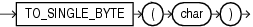

## TO\_SINGLE\_BYTE

Syntax



> ```
> TO_SINGLE_BYTE(char)
> ```
>
> [  
> Copyright © 1996, 2025, Oracle and/or its affiliates.](https://docs.oracle.com/en/database/oracle/oracle-database/dcommon/html/cpyr.htm)


Purpose

`TO_SINGLE_BYTE` returns `char` with all of its multibyte characters converted to their corresponding single-byte characters. `char` can be of data type `CHAR`, `VARCHAR2`, `NCHAR`, or `NVARCHAR2`. The value returned is in the same data type as `char`.

Any multibyte characters in `char` that have no single-byte equivalents appear in the output as multibyte characters. This function is useful only if your database character set contains both single-byte and multibyte characters.

This function does not support `CLOB` data directly. However, `CLOB` s can be passed in as arguments through implicit data conversion.

See Also:

- " [Data Type Comparison Rules](Data-Type-Comparison-Rules.md) " for more information.
- Appendix C in [Oracle Database Globalization Support Guide](https://docs.oracle.com/pls/topic/lookup?ctx=en/database/oracle/oracle-database/21/sqlrf&id=NLSPG-GUID-AFCE41ED-775B-4A00-AF38-C436776AE0C5) for the collation derivation rules, which define the collation assigned to the character return value of `TO_SINGLE_BYTE`

Examples

The following example illustrates going from a multibyte `A` in UTF8 to a single byte ASCII `A`:

```
SELECT TO_SINGLE_BYTE( CHR(15711393)) FROM DUAL; 

T 
- 
A
```