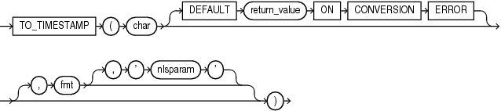

## TO\_TIMESTAMP

Syntax



> ```
> TO_TIMESTAMP(char [ DEFAULT return_value ON CONVERSION ERROR ]
>   [, fmt [, 'nlsparam' ] ])
> ```
>
> [  
> Copyright © 1996, 2025, Oracle and/or its affiliates.](https://docs.oracle.com/en/database/oracle/oracle-database/dcommon/html/cpyr.htm)


Purpose

`TO_TIMESTAMP` converts `char` to a value of `TIMESTAMP` data type.

For `char`, you can specify any expression that evaluates to a character string of `CHAR`, `VARCHAR2`, `NCHAR`, or `NVARCHAR2` data type.

The optional `DEFAULT` `return_value` `ON` `CONVERSION` `ERROR` clause allows you to specify the value this function returns if an error occurs while converting `char` to `TIMESTAMP`. This clause has no effect if an error occurs while evaluating `char`. The `return_value` can be an expression or a bind variable, and it must evaluate to a character string of `CHAR`, `VARCHAR2`, `NCHAR`, or `NVARCHAR2` data type, or null. The function converts `return_value` to `TIMESTAMP` using the same method it uses to convert `char` to `TIMESTAMP`. If `return_value` cannot be converted to `TIMESTAMP`, then the function returns an error.

The optional `fmt` specifies the format of `char`. If you omit `fmt`, then `char` must be in the default format of the `TIMESTAMP` data type, which is determined by the `NLS_TIMESTAMP_FORMAT` initialization parameter. The optional `'nlsparam'` argument has the same purpose in this function as in the `TO_CHAR` function for date conversion.

This function does not support `CLOB` data directly. However, `CLOB` s can be passed in as arguments through implicit data conversion.

See Also:

" [Data Type Comparison Rules](Data-Type-Comparison-Rules.md) " for more information.

Examples

The following example converts a character string to a timestamp. The character string is not in the default `TIMESTAMP` format, so the format mask must be specified:

```
SELECT TO_TIMESTAMP ('10-Sep-02 14:10:10.123000', 'DD-Mon-RR HH24:MI:SS.FF')
   FROM DUAL;

TO_TIMESTAMP('10-SEP-0214:10:10.123000','DD-MON-RRHH24:MI:SS.FF')
---------------------------------------------------------------------------
10-SEP-02 02.10.10.123000000 PM
```

The following example returns the default value of NULL because the specified expression cannot be converted to a `TIMESTAMP` value, due to an invalid month specification:

```
SELECT TO_TIMESTAMP ('10-Sept-02 14:10:10.123000'
       DEFAULT NULL ON CONVERSION ERROR,
       'DD-Mon-RR HH24:MI:SS.FF',
       'NLS_DATE_LANGUAGE = American') "Value"
  FROM DUAL;
```

See Also:

[`NLS_TIMESTAMP_FORMAT`](https://docs.oracle.com/pls/topic/lookup?ctx=en/database/oracle/oracle-database/21/sqlrf&id=REFRN10131) initialization parameter for information on the default `TIMESTAMP` format and " [Datetime Format Models](Format-Models.md) " for information on specifying the format mask