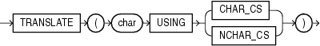

## TRANSLATE... USING

Syntax



> ```
> TRANSLATE ( char USING
>           { CHAR_CS | NCHAR_CS }
>           )
> ```
>
> [  
> Copyright © 1996, 2025, Oracle and/or its affiliates.](https://docs.oracle.com/en/database/oracle/oracle-database/dcommon/html/cpyr.htm)


Purpose

`TRANSLATE`... `USING` converts `char` into the character set specified for conversions between the database character set and the national character set.

Note:

The `TRANSLATE`... `USING` function is supported primarily for ANSI compatibility. Oracle recommends that you use the `TO_CHAR` and `TO_NCHAR` functions, as appropriate, for converting data to the database or national character set. `TO_CHAR` and `TO_NCHAR` can take as arguments a greater variety of data types than `TRANSLATE`... `USING`, which accepts only character data.

The `char` argument is the expression to be converted.

- Specifying the `USING` `CHAR_CS` argument converts `char` into the database character set. The output data type is `VARCHAR2`.
- Specifying the `USING` `NCHAR_CS` argument converts `char` into the national character set. The output data type is `NVARCHAR2`.

This function is similar to the Oracle `CONVERT` function, but must be used instead of `CONVERT` if either the input or the output data type is being used as `NCHAR` or `NVARCHAR2`. If the input contains UCS2 code points or backslash characters (\\), then use the `UNISTR` function.

See Also:

- [CONVERT](CONVERT.md) and [UNISTR](UNISTR.md)
- Appendix C in [Oracle Database Globalization Support Guide](https://docs.oracle.com/pls/topic/lookup?ctx=en/database/oracle/oracle-database/21/sqlrf&id=NLSPG-GUID-AFCE41ED-775B-4A00-AF38-C436776AE0C5) for the collation derivation rules, which define the collation assigned to the character return value of `TRANSLATE`... `USING`

Examples

The following statements use data from the sample table `oe.product_descriptions` to show the use of the `TRANSLATE`... `USING` function:

```
CREATE TABLE translate_tab (char_col  VARCHAR2(100),
                            nchar_col NVARCHAR2(50));
INSERT INTO translate_tab 
   SELECT NULL, translated_name
      FROM product_descriptions
      WHERE product_id = 3501;

SELECT * FROM translate_tab;

CHAR_COL             NCHAR_COL
-------------------- --------------------------------------------------
. . .
                     C pre SPNIX4.0 - Sys
                     C pro SPNIX4.0 - Sys
                     C til SPNIX4.0 - Sys
                     C voor SPNIX4.0 - Sys
. . .

UPDATE translate_tab 
   SET char_col = TRANSLATE (nchar_col USING CHAR_CS);

SELECT * FROM translate_tab;

CHAR_COL                  NCHAR_COL
------------------------- -------------------------
. . .
C per a SPNIX4.0 - Sys    C per a SPNIX4.0 - Sys
C pro SPNIX4.0 - Sys      C pro SPNIX4.0 - Sys
C for SPNIX4.0 - Sys      C for SPNIX4.0 - Sys
C til SPNIX4.0 - Sys      C til SPNIX4.0 - Sys
. . .
```