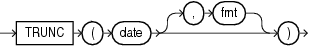

## TRUNC (date)

Syntax

trunc\_date::=



> ```
> TRUNC(date [, fmt ])
> ```
>
> [  
> Copyright © 1996, 2025, Oracle and/or its affiliates.](https://docs.oracle.com/en/database/oracle/oracle-database/dcommon/html/cpyr.htm)


Purpose

The `TRUNC` (date) function returns `date` with the time portion of the day truncated to the unit specified by the format model `fmt`. This function is not sensitive to the `NLS_CALENDAR` session parameter. It operates according to the rules of the Gregorian calendar. The value returned is always of data type `DATE`, even if you specify a different datetime data type for `date`. If you omit `fmt`, then the default format model ' `DD` ' is used and the value returned is `date` truncated to the day with a time of midnight. Refer to " [ROUND and TRUNC Date Functions](ROUND-and-TRUNC-Date-Functions.md) " for the permitted format models to use in `fmt`.

Examples

The following example truncates a date:

```
SELECT TRUNC(TO_DATE('27-OCT-92','DD-MON-YY'), 'YEAR')
  "New Year" FROM DUAL;
 
New Year
---------
01-JAN-92
```

Formatting Dates using TRUNC: Examples

In the following example, the `TRUNC` function returns the input date with the time portion of the day truncated as specified in the format model:

```
WITH dates AS (   
  SELECT date'2015-01-01' d FROM dual union   
  SELECT date'2015-01-10' d FROM dual union   
  SELECT date'2015-02-01' d FROM dual union   
  SELECT timestamp'2015-03-03 23:45:00' d FROM dual union   
  SELECT timestamp'2015-04-11 12:34:56' d FROM dual    
)   
SELECT d "Original Date",   
       trunc(d) "Nearest Day, Time Removed",   
       trunc(d, 'ww') "Nearest Week", 
       trunc(d, 'iw') "Start of Week",   
       trunc(d, 'mm') "Start of Month",   
       trunc(d, 'year') "Start of Year"   
FROM dates;
```

In the following example, the input date values are truncated and the `TO_CHAR` function is used to obtain the minute component of the truncated date values:

```
WITH dates AS (   
  SELECT date'2015-01-01' d FROM dual union   
  SELECT date'2015-01-10' d FROM dual union   
  SELECT date'2015-02-01' d FROM dual union   
  SELECT timestamp'2015-03-03 23:45:00' d FROM dual union   
  SELECT timestamp'2015-04-11 12:34:56' d FROM dual    
)   
SELECT d "Original Date",   
       trunc(d) "Date with Time Removed",   
       to_char(trunc(d, 'mi'), 'dd-mon-yyyy hh24:mi') "Nearest Minute",   
       trunc(d, 'iw') "Start of Week",   
       trunc(d, 'mm') "Start of Month",   
       trunc(d, 'year') "Start of Year"  
FROM dates;
```

The following statement alters the date format for the current session:

```
ALTER SESSION SET nls_date_format = 'dd-mon-yyyy hh24:mi';
```

In the following example, the data is displayed in the new date format:

```
WITH dates AS (   
  SELECT date'2015-01-01' d FROM dual union   
  SELECT date'2015-01-10' d FROM dual union   
  SELECT date'2015-02-01' d FROM dual union   
  SELECT timestamp'2015-03-03 23:44:32' d FROM dual union   
  SELECT timestamp'2015-04-11 12:34:56' d FROM dual    
)   
SELECT d "Original Date",   
       trunc(d) "Date, time removed",   
       to_char(trunc(d, 'mi'), 'dd-mon-yyyy hh24:mi') "Nearest Minute",   
       trunc(d, 'iw') "Start of Week",   
       trunc(d, 'mm') "Start of Month",   
       trunc(d, 'year') "Start of Year"   
FROM dates;
```