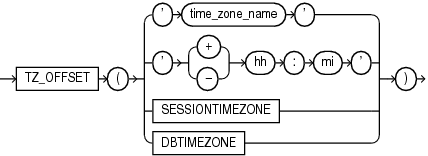

## TZ\_OFFSET

Syntax



> ```
> TZ_OFFSET({ 'time_zone_name'
>           | '{ + | - } hh : mi'
>           | SESSIONTIMEZONE
>           | DBTIMEZONE
>           }
>          )
> ```
>
> [  
> Copyright © 1996, 2025, Oracle and/or its affiliates.](https://docs.oracle.com/en/database/oracle/oracle-database/dcommon/html/cpyr.htm)


Purpose

`TZ_OFFSET` returns the time zone offset corresponding to the argument based on the date the statement is executed. You can enter a valid time zone region name, a time zone offset from UTC (which simply returns itself), or the keyword `SESSIONTIMEZONE` or `DBTIMEZONE`. For a listing of valid values for `time_zone_name`, query the `TZNAME` column of the `V$TIMEZONE_NAMES` dynamic performance view.

Note:

Time zone region names are needed by the daylight saving feature. These names are stored in two types of time zone files: one large and one small. One of these files is the default file, depending on your environment and the release of Oracle Database you are using. For more information regarding time zone files and names, see [Oracle Database Globalization Support Guide](https://docs.oracle.com/pls/topic/lookup?ctx=en/database/oracle/oracle-database/21/sqlrf&id=NLSPG014).

See Also:

- Appendix C in [Oracle Database Globalization Support Guide](https://docs.oracle.com/pls/topic/lookup?ctx=en/database/oracle/oracle-database/21/sqlrf&id=NLSPG-GUID-AFCE41ED-775B-4A00-AF38-C436776AE0C5) for the collation derivation rules, which define the collation assigned to the character return value of `TZ_OFFSET`

Examples

The following example returns the time zone offset of the US/Eastern time zone from UTC:

```
SELECT TZ_OFFSET('US/Eastern') FROM DUAL;

TZ_OFFS
-------
-04:00
```