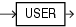

## USER

Syntax



> ```
> USER
> ```
>
> [  
> Copyright © 1996, 2025, Oracle and/or its affiliates.](https://docs.oracle.com/en/database/oracle/oracle-database/dcommon/html/cpyr.htm)


Purpose

`USER` returns the name of the session user (the user who logged on). This may change during the duration of a database session as Real Application Security sessions are attached or detached. For enterprise users, this function returns the schema. For other users, it returns the database user name. If a Real Application Security session is currently attached to the database session, then it returns user `XS$NULL`.

This function returns a `VARCHAR2` value.

Oracle Database compares values of this function with blank-padded comparison semantics.

In a distributed SQL statement, the `UID` and `USER` functions together identify the user on your local database. You cannot use these functions in the condition of a `CHECK` constraint.

See Also:

- [Oracle Database 2 Day + Security Guide](https://docs.oracle.com/pls/topic/lookup?ctx=en/database/oracle/oracle-database/21/sqlrf&id=TDPSG20302) for more information on user `XS$NULL`
- Appendix C in [Oracle Database Globalization Support Guide](https://docs.oracle.com/pls/topic/lookup?ctx=en/database/oracle/oracle-database/21/sqlrf&id=NLSPG-GUID-AFCE41ED-775B-4A00-AF38-C436776AE0C5) for the collation derivation rules, which define the collation assigned to the character return value of `USER`

Examples

The following example returns the session user and the user's UID:

```
SELECT USER, UID FROM DUAL;
```