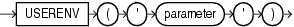

## USERENV

Syntax



> ```
> USERENV('parameter')
> ```
>
> [  
> Copyright © 1996, 2025, Oracle and/or its affiliates.](https://docs.oracle.com/en/database/oracle/oracle-database/dcommon/html/cpyr.htm)


Purpose

Note:

`USERENV` is a legacy function that is retained for backward compatibility. Oracle recommends that you use the `SYS_CONTEXT` function with the built-in `USERENV` namespace for current functionality. See [SYS\_CONTEXT](SYS_CONTEXT.md) for more information.

`USERENV` returns information about the current session. This information can be useful for writing an application-specific audit trail table or for determining the language-specific characters currently used by your session. You cannot use `USERENV` in the condition of a `CHECK` constraint. Table 7-12 describes the values for the `parameter` argument.

All calls to `USERENV` return `VARCHAR2` data except for calls with the `SESSIONID`, `SID`, and `ENTRYID` parameters, which return `NUMBER`.

Table 7-12 Parameters of the USERENV Function

| Parameter | Return Value |
| --- | --- |
| `CLIENT_INFO` | `CLIENT_INFO` returns up to 64 bytes of user session information that can be stored by an application using the `DBMS_APPLICATION_INFO` package.  Caution: Some commercial applications may be using this context value. Refer to the applicable documentation for those applications to determine what restrictions they may impose on use of this context area.  See Also: [Oracle Database Security Guide](https://docs.oracle.com/pls/topic/lookup?ctx=en/database/oracle/oracle-database/21/sqlrf&id=DBSEG14002) for more information on application context, [CREATE CONTEXT](CREATE-CONTEXT.md), and [SYS\_CONTEXT](SYS_CONTEXT.md) |
| `ENTRYID` | The current audit entry number. The audit entryid sequence is shared between fine-grained audit records and regular audit records. You cannot use this attribute in distributed SQL statements. |
| `ISDBA` | `ISDBA` returns ' `TRUE` ' if the user has been authenticated as having DBA privileges either through the operating system or through a password file. |
| `LANG` | `LANG` returns the ISO abbreviation for the language name, a shorter form than the existing ' `LANGUAGE` ' parameter. |
| `LANGUAGE` | `LANGUAGE` returns the language and territory used by the current session along with the database character set in this form:  ``` language_territory.characterset ``` |
| `SESSIONID` | `SESSIONID` returns the auditing session identifier. You cannot specify this parameter in distributed SQL statements. |
| `SID` | `SID` returns the session ID. |
| `TERMINAL` | `TERMINAL` returns the operating system identifier for the terminal of the current session. In distributed SQL statements, this parameter returns the identifier for your local session. In a distributed environment, this parameter is supported only for remote `SELECT` statements, not for remote `INSERT`, `UPDATE`, or `DELETE` operations. |

See Also:

Appendix C in [Oracle Database Globalization Support Guide](https://docs.oracle.com/pls/topic/lookup?ctx=en/database/oracle/oracle-database/21/sqlrf&id=NLSPG-GUID-AFCE41ED-775B-4A00-AF38-C436776AE0C5) for the collation derivation rules, which define the collation assigned to the character return value of `USERENV`

Examples

The following example returns the `LANGUAGE` parameter of the current session:

```
SELECT USERENV('LANGUAGE') "Language" FROM DUAL;

Language
-----------------------------------
AMERICAN_AMERICA.WE8ISO8859P1
```