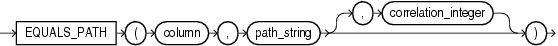
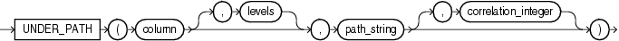

## XML Conditions

XML conditions determine whether a specified XML resource can be found in a specified path.

### EQUALS\_PATH Condition

The `EQUALS_PATH` condition determines whether a resource in the Oracle XML database can be found in the database at a specified path.

Use this condition in queries to `RESOURCE_VIEW` and `PATH_VIEW`. These public views provide a mechanism for SQL access to data stored in the XML database repository. `RESOURCE_VIEW` contains one row for each resource in the repository, and `PATH_VIEW` contains one row for each unique path in the repository.

equals\_path\_condition::=



> ```
> EQUALS_PATH
>     (column, path_string [, correlation_integer ])
> ```
>
> [  
> Copyright © 1996, 2025, Oracle and/or its affiliates.](https://docs.oracle.com/en/database/oracle/oracle-database/dcommon/html/cpyr.htm)


This condition applies only to the path as specified. It is similar to but more restrictive than `UNDER_PATH`.

For `path_string`, specify the (absolute) path name to resolve. This can contain components that are hard or weak resource links.

The optional `correlation_integer` argument correlates the `EQUALS_PATH` condition with its ancillary functions `DEPTH` and `PATH`.

See Also:

UNDER\_PATH Condition, [DEPTH](DEPTH.md), and [PATH](PATH.md)

Example

The view `RESOURCE_VIEW` computes the paths (in the `any_path` column) that lead to all XML resources (in the `res` column) in the database repository. The following example queries the `RESOURCE_VIEW` view to find the paths to the resources in the sample schema `oe`. The `EQUALS_PATH` condition causes the query to return only the specified path:

```
SELECT ANY_PATH FROM RESOURCE_VIEW
   WHERE EQUALS_PATH(res, '/sys/schemas/OE/www.example.com')=1;

ANY_PATH
-----------------------------------------------
/sys/schemas/OE/www.example.com
```

Compare this example with that for UNDER\_PATH Condition.

### UNDER\_PATH Condition

The `UNDER_PATH` condition determines whether resources specified in a column can be found under a particular path specified by `path_string` in the Oracle XML database repository. The path information is computed by the `RESOURCE_VIEW` view, which you query to use this condition.

Use this condition in queries to `RESOURCE_VIEW` and `PATH_VIEW`. These public views provide a mechanism for SQL access to data stored in the XML database repository. `RESOURCE_VIEW` contains one row for each resource in the repository, and `PATH_VIEW` contains one row for each unique path in the repository.

under\_path\_condition::=



> ```
> UNDER_PATH (column [, levels ], path_string
>              [, correlation_integer ]
>            )
> ```
>
> [  
> Copyright © 1996, 2025, Oracle and/or its affiliates.](https://docs.oracle.com/en/database/oracle/oracle-database/dcommon/html/cpyr.htm)


The optional `levels` argument indicates the number of levels down from `path_string` Oracle should search. For `levels`, specify any nonnegative integer.

The optional `correlation_integer` argument correlates the `UNDER_PATH` condition with its ancillary functions `PATH` and `DEPTH`.

Example

The view `RESOURCE_VIEW` computes the paths (in the `any_path` column) that lead to all XML resources (in the `res` column) in the database repository. The following example queries the `RESOURCE_VIEW` view to find the paths to the resources in the sample schema `oe`. The query returns the path of the XML schema that was created in [XMLType Table Examples](CREATE-TABLE.md):

```
SELECT ANY_PATH FROM RESOURCE_VIEW
   WHERE UNDER_PATH(res, '/sys/schemas/OE/www.example.com')=1;

ANY_PATH
----------------------------------------------
/sys/schemas/OE/www.example.com/xwarehouses.xsd
```