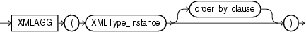

## XMLAGG

Syntax



> ```
> XMLAGG(XMLType_instance [ order_by_clause ])
> ```
>
> [  
> Copyright © 1996, 2025, Oracle and/or its affiliates.](https://docs.oracle.com/en/database/oracle/oracle-database/dcommon/html/cpyr.htm)


Purpose

`XMLAgg` is an aggregate function. It takes a collection of XML fragments and returns an aggregated XML document. Any arguments that return null are dropped from the result.

`XMLAgg` is similar to `SYS_XMLAgg` except that `XMLAgg` returns a collection of nodes but it does not accept formatting using the `XMLFormat` object. Also, `XMLAgg` does not enclose the output in an element tag as does `SYS_XMLAgg`.

Within the `order_by_clause`, Oracle Database does not interpret number literals as column positions, as it does in other uses of this clause, but simply as number literals.

See Also:

[XMLELEMENT](XMLELEMENT.md) and [SYS\_XMLAGG](SYS_XMLAGG.md)

Examples

The following example produces a `Department` element containing `Employee` elements with employee job ID and last name as the contents of the elements:

```
SELECT XMLELEMENT("Department",
   XMLAGG(XMLELEMENT("Employee", 
   e.job_id||' '||e.last_name)
   ORDER BY last_name))
   as "Dept_list"     
   FROM employees e
   WHERE e.department_id = 30;

Dept_list
-------------------------------------------------------------
<Department>
  <Employee>PU_CLERK Baida</Employee>
  <Employee>PU_CLERK Colmenares</Employee>
  <Employee>PU_CLERK Himuro</Employee>
  <Employee>PU_CLERK Khoo</Employee>
  <Employee>PU_MAN Raphaely</Employee>
  <Employee>PU_CLERK Tobias</Employee>
</Department>
```

The result is a single row, because `XMLAgg` aggregates the rows. You can use the `GROUP` `BY` clause to group the returned set of rows into multiple groups:

```
SELECT XMLELEMENT("Department",
      XMLAGG(XMLELEMENT("Employee", e.job_id||' '||e.last_name)))
   AS "Dept_list"
   FROM employees e
   GROUP BY e.department_id;

Dept_list
---------------------------------------------------------
<Department>
  <Employee>AD_ASST Whalen</Employee>
</Department>

<Department>
  <Employee>MK_MAN Hartstein</Employee>
  <Employee>MK_REP Fay</Employee>
</Department>

<Department>
  <Employee>PU_MAN Raphaely</Employee>
  <Employee>PU_CLERK Khoo</Employee>
  <Employee>PU_CLERK Tobias</Employee>
  <Employee>PU_CLERK Baida</Employee>
  <Employee>PU_CLERK Colmenares</Employee>
  <Employee>PU_CLERK Himuro</Employee>
</Department>
. . .
```