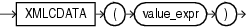

## XMLCDATA

Syntax



> ```
> XMLCDATA ( value_expr )
> ```
>
> [  
> Copyright © 1996, 2025, Oracle and/or its affiliates.](https://docs.oracle.com/en/database/oracle/oracle-database/dcommon/html/cpyr.htm)


Purpose

`XMLCData` generates a CDATA section by evaluating `value_expr`. The `value_expr` must resolve to a string. The value returned by the function takes the following form:

```
<![CDATA[string]]>
```

If the resulting value is not a valid XML CDATA section, then the function returns an error.The following conditions apply to `XMLCData`:

- The `value_expr` cannot contain the substring `]]>`.
- If `value_expr` evaluates to null, then the function returns null.

See Also:

[Oracle XML DB Developer's Guide](https://docs.oracle.com/pls/topic/lookup?ctx=en/database/oracle/oracle-database/21/sqlrf&id=ADXDB1620) for more information on this function

Examples

The following statement uses the `DUAL` table to illustrate the syntax of `XMLCData`:

```
SELECT XMLELEMENT("PurchaseOrder",
   XMLAttributes(dummy as "pono"),
   XMLCdata('<!DOCTYPE po_dom_group [
   <!ELEMENT po_dom_group(student_name)*>
   <!ELEMENT po_purch_name (#PCDATA)>
   <!ATTLIST po_name po_no ID #REQUIRED>
   <!ATTLIST po_name trust_1 IDREF #IMPLIED>
   <!ATTLIST po_name trust_2 IDREF #IMPLIED>
   ]>')) "XMLCData" FROM DUAL;
 
XMLCData
----------------------------------------------------------
<PurchaseOrder pono="X"><![CDATA[
<!DOCTYPE po_dom_group [
   <!ELEMENT po_dom_group(student_name)*>
   <!ELEMENT po_purch_name (#PCDATA)>
   <!ATTLIST po_name po_no ID #REQUIRED>
   <!ATTLIST po_name trust_1 IDREF #IMPLIED>
   <!ATTLIST po_name trust_2 IDREF #IMPLIED>
   ]>
  ]]>
</PurchaseOrder>
```