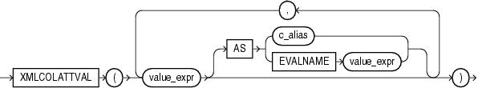

## XMLCOLATTVAL

Syntax



> ```
> XMLCOLATTVAL
>   (value_expr [ AS { c_alias  | EVALNAME value_expr } ]
>     [, value_expr [ AS { c_alias  | EVALNAME value_expr } ]
>       ]...
>   )
> ```
>
> [  
> Copyright © 1996, 2025, Oracle and/or its affiliates.](https://docs.oracle.com/en/database/oracle/oracle-database/dcommon/html/cpyr.htm)


Purpose

`XMLColAttVal` creates an XML fragment and then expands the resulting XML so that each XML fragment has the name `column` with the attribute `name`.

You can use the `AS` clause to change the value of the `name` attribute to something other than the column name. You can do this by specifying `c_alias`, which is a string literal, or by specifying `EVALNAME` `value_expr`. In the latter case, the value expression is evaluated and the result, which must be a string literal, is used as the alias. The alias can be up to 4000 characters if the initialization parameter `MAX_STRING_SIZE` `=` `STANDARD`, and 32767 characters if `MAX_STRING_SIZE` `=` `EXTENDED`. See " [Extended Data Types](Data-Types.md) " for more information.

You must specify a value for `value_expr`. If `value_expr` is null, then no element is returned.

Restriction on XMLColAttVal

You cannot specify an object type column for `value_expr`.

Examples

The following example creates an `Emp` element for a subset of employees, with nested `employee_id`, `last_name`, and `salary` elements as the contents of `Emp`. Each nested element is named `column` and has a `name` attribute with the column name as the attribute value:

```
SELECT XMLELEMENT("Emp",
   XMLCOLATTVAL(e.employee_id, e.last_name, e.salary)) "Emp Element"
   FROM employees e
   WHERE employee_id = 204;

Emp Element
--------------------------------------------------------------------
<Emp>
  <column name="EMPLOYEE_ID">204</column>
  <column name="LAST_NAME">Baer</column>
  <column name="SALARY">10000</column>
</Emp>
```

Refer to the example for [XMLFOREST](XMLFOREST.md) to compare the output of these two functions.