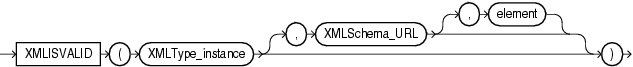

## XMLISVALID

Syntax



> ```
> XMLISVALID ( XMLType_instance [, XMLSchema_URL [, element ]] )
> ```
>
> [  
> Copyright © 1996, 2025, Oracle and/or its affiliates.](https://docs.oracle.com/en/database/oracle/oracle-database/dcommon/html/cpyr.htm)


Purpose

`XMLISVALID` checks whether the input `XMLType_instance` conforms to the relevant XML schema. It does not change the validation status recorded for `XMLType_instance`.

If the input XML document is determined to be valid, then `XMLISVALID` returns 1; otherwise, it returns 0. If you provide `XMLSchema_URL` as an argument, then that is used to check conformance. Otherwise, the XML schema specified by the XML document is used to check conformance.

- `XMLType_instance` is the XMLType instance to be validated.
- `XMLSchema_URL` is the URL of the XML schema against which to check conformance.
- `element` is the element of the specified schema against which to check conformance. Use this if you have an XML schema that defines more than one top level element, and you want to check conformance against a specific one of those elements.

See Also:

[Oracle XML DB Developer's Guide](https://docs.oracle.com/pls/topic/lookup?ctx=en/database/oracle/oracle-database/21/sqlrf&id=ADXDB4105) for information on the use of this function, including examples