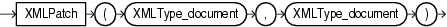

## XMLPATCH

Syntax



> ```
> XMLPATCH ( XMLType_document, XMLType_document )
> ```
>
> [  
> Copyright © 1996, 2025, Oracle and/or its affiliates.](https://docs.oracle.com/en/database/oracle/oracle-database/dcommon/html/cpyr.htm)


Purpose

The `XMLPatch` function is the SQL interface for the XmlPatch C API. This function patches an XML document with the changes specified. A patched `XMLType` document is returned.

- For the first argument, specify the name of the input `XMLType` document.
- For the second argument, specify the XMLType document containing the changes to be applied to the first document. The changes should conform to the Xdiff XML schema. You can supply the XML output from the Oracle XML Developer's Kit Java method `diff()`.

See Also:

[Oracle XML Developer's Kit Programmer's Guide](https://docs.oracle.com/pls/topic/lookup?ctx=en/database/oracle/oracle-database/21/sqlrf&id=ADXDK2520) for more information on using this function, including examples, and [Oracle Database XML C API Reference](https://docs.oracle.com/pls/topic/lookup?ctx=en/database/oracle/oracle-database/21/sqlrf&id=CAXML6192) for information on the XML APIs for C

Examples

The following example patches an `XMLType` document with the changes specified in another `XMLType` and returns a patched `XMLType` document:

```
SELECT XMLPATCH(
XMLTYPE('<?xml version="1.0"?>
<bk:book xmlns:bk="http://example.com">
   <bk:tr>
        <bk:td>
                <bk:chapter>
                        Chapter 1.
                </bk:chapter>
        </bk:td>
        <bk:td>
                 <bk:chapter>
                        Chapter 2.
                </bk:chapter>
        </bk:td>
   </bk:tr>
</bk:book>'),
XMLTYPE('<?xml version="1.0"?>
<xd:xdiff xsi:schemaLocation="http://xmlns.oracle.com/xdb/xdiff.xsd
  http://xmlns.oracle.com/xdb/xdiff.xsd"
  xmlns:xd="http://xmlns.oracle.com/xdb/xdiff.xsd"
  xmlns:xsi="http://www.w3.org/2001/XMLSchema-instance"
  xmlns:bk="http://example.com">
  <?oracle-xmldiff operations-in-docorder="true" output-model="snapshot"
    diff-algorithm="global"?>
  <xd:delete-node xd:node-type="element"
   xd:xpath="/bk:book[1]/bk:tr[1]/bk:td[2]/bk:chapter[1]"/>
</xd:xdiff>')
)
FROM DUAL;
```