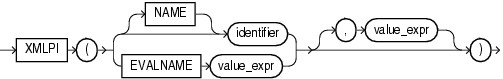

## XMLPI

Syntax



> ```
> XMLPI
>  ( { ( [ NAME ] identifier ) | ( EVALNAME value_expr ) } 
>      [ , value_expr ]
>  )
> ```
>
> [  
> Copyright © 1996, 2025, Oracle and/or its affiliates.](https://docs.oracle.com/en/database/oracle/oracle-database/dcommon/html/cpyr.htm)


Purpose

`XMLPI` generates an XML processing instruction using `identifier` and optionally the evaluated result of `value_expr`. A processing instruction is commonly used to provide to an application information that is associated with all or part of an XML document. The application uses the processing instruction to determine how best to process the XML document.

You must specify a value for Oracle Database to use an the enclosing tag. You can do this by specifying `identifier`, which is a string literal, or by specifying `EVALNAME` `value_expr`. In the latter case, the value expression is evaluated and the result, which must be a string literal, is used as the identifier. The identifier does not have to be a column name or column reference. It cannot be an expression or null. It can be up to 4000 characters if the initialization parameter `MAX_STRING_SIZE` `=` `STANDARD`, and 32767 characters if `MAX_STRING_SIZE` `=` `EXTENDED`. See " [Extended Data Types](Data-Types.md) " for more information.

The optional `value_expr` must resolve to a string. If you omit the optional `value_expr`, then a zero-length string is the default. The value returned by the function takes this form:

```
<?identifier string?>
```

`XMLPI` is subject to the following restrictions:

- The `identifier` must be a valid target for a processing instruction.
- You cannot specify `xml` in any case combination for `identifier`.
- The `identifier` cannot contain the consecutive characters `?>`.

See Also:

[Oracle XML DB Developer's Guide](https://docs.oracle.com/pls/topic/lookup?ctx=en/database/oracle/oracle-database/21/sqlrf&id=ADXDB1620) for more information on this function

Examples

The following statement uses the `DUAL` table to illustrate the use of the `XMLPI` syntax:

```
SELECT XMLPI(NAME "Order analysisComp", 'imported, reconfigured, disassembled')
   AS "XMLPI" FROM DUAL;
 
XMLPI
--------------------------------------------------------------------------------
<?Order analysisComp imported, reconfigured, disassembled?>
```