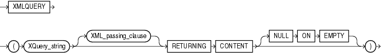
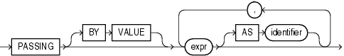

## XMLQUERY

Syntax



> ```
> XMLQUERY
>  ( XQuery_string 
>    [ XML_passing_clause ] 
>    RETURNING CONTENT [NULL ON EMPTY] 
>  )
> ```
>
> [  
> Copyright © 1996, 2025, Oracle and/or its affiliates.](https://docs.oracle.com/en/database/oracle/oracle-database/dcommon/html/cpyr.htm)


XML\_passing\_clause::=



> ```
> PASSING [ BY VALUE ] 
>     expr [ AS identifier ]
>       [, expr [ AS identifier ] 
>       ]...
> ```
>
> [  
> Copyright © 1996, 2025, Oracle and/or its affiliates.](https://docs.oracle.com/en/database/oracle/oracle-database/dcommon/html/cpyr.htm)


Purpose

`XMLQUERY` lets you query XML data in SQL statements. It takes an XQuery expression as a string literal, an optional context item, and other bind variables and returns the result of evaluating the XQuery expression using these input values.

- `XQuery_string` is a complete XQuery expression, including prolog.
- The `expr` in the `XML_passing_clause` is an expression returning an `XMLType` or an instance of a SQL scalar data type that is used as the context for evaluating the XQuery expression. You can specify only one `expr` in the `PASSING` clause without an identifier. The result of evaluating each `expr` is bound to the corresponding identifier in the `XQuery_string`. If any `expr` that is not followed by an `AS` clause, then the result of evaluating that expression is used as the context item for evaluating the `XQuery_string`. If `expr` is a relational column, then its declared collation is ignored by Oracle XML DB.
- `RETURNING` `CONTENT` indicates that the result from the XQuery evaluation is either an XML 1.0 document or a document fragment conforming to the XML 1.0 semantics.
- If the result set is empty, then the function returns the SQL `NULL` value. The `NULL` `ON` `EMPTY` keywords are implemented by default and are shown for semantic clarity.

See Also:

[Oracle XML DB Developer's Guide](https://docs.oracle.com/pls/topic/lookup?ctx=en/database/oracle/oracle-database/21/sqlrf&id=ADXDB1620) for more information on this function

Examples

The following statement specifies the `warehouse_spec` column of the `oe.warehouses` table in the `XML_passing_clause` as a context item. The statement returns specific information about the warehouses with area greater than 50K.

```
SELECT warehouse_name,
EXTRACTVALUE(warehouse_spec, '/Warehouse/Area'),
XMLQuery(
   'for $i in /Warehouse
   where $i/Area > 50000
   return <Details>
             <Docks num="{$i/Docks}"/>
             <Rail>
               {
               if ($i/RailAccess = "Y") then "true" else "false"
               }
             </Rail>
          </Details>' PASSING warehouse_spec RETURNING CONTENT) "Big_warehouses"
   FROM warehouses;

WAREHOUSE_ID Area      Big_warehouses
------------ --------- --------------------------------------------------------
           1     25000
           2     50000
           3     85700 <Details><Docks></Docks><Rail>false</Rail></Details>
           4    103000 <Details><Docks num="3"></Docks><Rail>true</Rail></Details>
 . . .
```