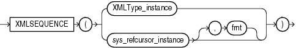

## XMLSEQUENCE

Note:

The `XMLSEQUENCE` function is deprecated. It is still supported for backward compatibility. However, Oracle recommends that you use the `XMLTABLE` function instead. See [XMLTABLE](XMLTABLE.md) for more information.

Syntax



> ```
> XMLSEQUENCE( XMLType_instance
>            | sys_refcursor_instance [, fmt ]
>            )
> ```
>
> [  
> Copyright © 1996, 2025, Oracle and/or its affiliates.](https://docs.oracle.com/en/database/oracle/oracle-database/dcommon/html/cpyr.htm)


Purpose

`XMLSequence` has two forms:

- The first form takes as input an `XMLType` instance and returns a varray of the top-level nodes in the `XMLType`. This form is effectively superseded by the SQL/XML standard function `XMLTable`, which provides for more readable SQL code. Prior to Oracle Database 10g Release 2, `XMLSequence` was used with SQL function `TABLE` to do some of what can now be done better with the `XMLTable` function.
- The second form takes as input a `REFCURSOR` instance, with an optional instance of the `XMLFormat` object, and returns as an `XMLSequence` type an XML document for each row of the cursor.

Because `XMLSequence` returns a collection of `XMLType`, you can use this function in a `TABLE` clause to unnest the collection values into multiple rows, which can in turn be further processed in the SQL query.

See Also:

[Oracle XML DB Developer's Guide](https://docs.oracle.com/pls/topic/lookup?ctx=en/database/oracle/oracle-database/21/sqlrf&id=ADXDB1620) for more information on this function, and [XMLTABLE](XMLTABLE.md)

Examples

The following example shows how `XMLSequence` divides up an XML document with multiple elements into `VARRAY` single-element documents. In this example, the `TABLE` keyword instructs Oracle Database to consider the collection a table value that can be used in the `FROM` clause of the subquery:

```
SELECT EXTRACT(warehouse_spec, '/Warehouse') as "Warehouse"
   FROM warehouses WHERE warehouse_name = 'San Francisco';

Warehouse
------------------------------------------------------------
<Warehouse>
  <Building>Rented</Building>
  <Area>50000</Area>
  <Docks>1</Docks>
  <DockType>Side load</DockType>
  <WaterAccess>Y</WaterAccess>
  <RailAccess>N</RailAccess>
  <Parking>Lot</Parking>
  <VClearance>12 ft</VClearance>
</Warehouse>

1 row selected.

SELECT VALUE(p)
   FROM warehouses w, 
   TABLE(XMLSEQUENCE(EXTRACT(warehouse_spec, '/Warehouse/*'))) p
   WHERE w.warehouse_name = 'San Francisco';

VALUE(P)
----------------------------------------------------------------
<Building>Rented</Building>
<Area>50000</Area>
<Docks>1</Docks>
<DockType>Side load</DockType>
<WaterAccess>Y</WaterAccess>
<RailAccess>N</RailAccess>
<Parking>Lot</Parking>
<VClearance>12 ft</VClearance>

8 rows selected.
```