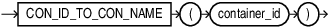

## CON\_ID\_TO\_CON\_NAME

Syntax



> ```
> CON_ID_TO_CON_NAME (container_id)
> ```
>
> [  
> Copyright © 1996, 2025, Oracle and/or its affiliates.](https://docs.oracle.com/en/database/oracle/oracle-database/dcommon/html/cpyr.htm)


Purpose

`CON_ID_TO_CON_NAME` takes as an argument a container `CON_ID` and returns the container `NAME`.

For `CON_ID` you must specify a number or an expression that resolves to a number. The function returns a `NUMBER` value.

This function is useful in a multitentant container database (CDB). If you use this function in a non-CDB, then it returns 0.

Example

```
SELECT CON_ID, NAME FROM V$CONTAINERS;
    CON_ID         NAME 
   –--------       –------------
       1           CDB$ROOT
       2           PDB$SEED
       3           CDB1_PDB1
       4           SALESPDB
```

The following statement returns the container `NAME` given the container `CON_ID` 4:

```
SELECT CON_ID_TO_CON_NAME(4) "CON_NAME" FROM DUAL;
     CON_NAME
     –-------
     SALESDB
```