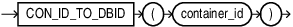

## CON\_ID\_TO\_DBID

Syntax



> ```
> CON_ID_TO_DBID(container_id)
> ```
>
> [  
> Copyright © 1996, 2025, Oracle and/or its affiliates.](https://docs.oracle.com/en/database/oracle/oracle-database/dcommon/html/cpyr.htm)


Purpose

`CON_ID_TO_DBID` takes as an argument a container `CON_ID` and returns the container `DBID`. For `CON_ID` you must specify a number or an expression that resolves to a number. The function returns a `NUMBER` value.

This function is useful in a multitentant container database (CDB). If you use this function in a non-CDB, then it returns 0.

Example

```
SELECT CON_ID, NAME, DBID FROM V$CONTAINERS;

CON_ID      NAME           DBID
–------     –-----------   –--------------
   1        CDB$ROOT       2048400776
   2        PDB$SEED       2929762556
   3        CDB1_PDB1      3483444080
   4        SALESPDB       2221053340
```

The following statement returns the container `DBID` given the container `CON_ID` 4:

```
SELECT CON_ID_TO_DBID(4) FROM DUAL;
    DBID
    –------------
    2221053340
```