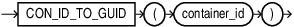

## CON\_ID\_TO\_GUID

Syntax



> Enter a short description of your topic here (optional).
>
> This is the start of your topic.
>
> [  
> Copyright © 1996, 2025, Oracle and/or its affiliates.](https://docs.oracle.com/en/database/oracle/oracle-database/dcommon/html/cpyr.htm)


Purpose

`CON_ID_TO_GUID` takes as an argument a container `CON_ID` and returns the container's `GLOBAL UNIQUE ID` ( `GUID`). For `CON_ID` you must specify a number or an expression that resolves to a number. The function returns a `NUMBER` value.

This function is useful in a multitentant container database (CDB).

Example

The following query displays the `CON_ID`, `NAME` and `GUID` for all containers in a CDB:

```
SELECT CON_ID, NAME, GUID FROM V$CONTAINERS;

CON_ID      NAME           GUID
–------     –-----------   –--------------
   1        CDB$ROOT       A8C0E03CB11A132FE0532684E80A96B3
   2        PDB$SEED       A8DA5D32F8F5590DE053C4E15A0A6EED
   3        CDB1_PDB1      A8DA63CEAD385A5BE053C4E15A0A774A
   4        SALESPDB       A8DA9AB18CE85BD0E053C4E15A0AE2C3
```

The following statement returns the container `GUID` given the container `CON_ID` 4:

```
SELECT CON_ID_TO_GUID(4) "CON_GUID" FROM DUAL;
    CON_GUID
    –----------------
    A8DA9AB18CE85BD0E053C4E15A0AE2C3
```