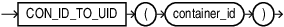

## CON\_ID\_TO\_UID

Syntax



> Enter a short description of your topic here (optional).
>
> This is the start of your topic.
>
> [  
> Copyright © 1996, 2025, Oracle and/or its affiliates.](https://docs.oracle.com/en/database/oracle/oracle-database/dcommon/html/cpyr.htm)


Purpose

`CON_ID_TO_UID` takes as an argument a container `CON_ID` and returns the container's `UNIQUE ID` ( `UID`). For `CON_ID` you must specify a number or an expression that resolves to a number. The function returns a `NUMBER` value.

This function is useful in a multitentant container database (CDB).

Example

The following query displays the `CON_ID`, `NAME` and `CON_UID` for all containers in a CDB:

```
SELECT CON_ID, NAME, CON_UID FROM V$CONTAINERS;

CON_ID      NAME           CON_UID
–------     –-----------   –--------------
   1        CDB$ROOT       1
   2        PDB$SEED       2929762556
   3        CDB1_PDB1      3483444080
   4        SALESPDB       2221053340
```

The following statement returns the container `CON_UID` given the container `CON_ID` 4:

```
SELECT CON_ID_TO_UID(4) "PDB_UID" FROM DUAL;
    PDB_UID
    –------------
    2221053340
```