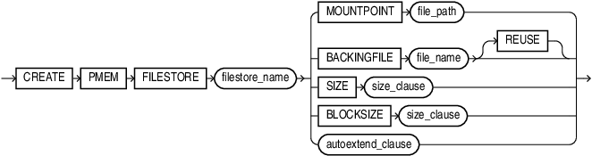

## CREATE PMEM FILESTORE

Purpose

You can create a persistent memory file store with this statement.

Prerequistes

You must have `SYSDBA` privileges to execute `CREATE PMEM FILESTORE`.

You must execute this statement from `CDB$ROOT`.

Syntax

create\_pmem\_filestore::=



> ```
> CREATE PMEM FILESTORE filestore_name
>   ( (MOUNTPOINT file_path)
>   | (BACKINGFILE file_name [ REUSE ])
>   | (SIZE size_clause)
>   | (BLOCKSIZE size_clause)
>   | autoextend_clause
>   )
> ```
>
> [  
> Copyright © 1996, 2025, Oracle and/or its affiliates.](https://docs.oracle.com/en/database/oracle/oracle-database/dcommon/html/cpyr.htm)


Semantics

MOUNTPOINT

`file_path` contains the final directory name and must match the PMEM file store name. If there is no match, the statement will fail.

You must start database instance with at least `NOMOUNT` mode.

It is recommeded to use a `spfile` for the database `init.ora` file.

When you use a `spfile`, the `CREATE PMEM FILESTORE` command automatically writes the necessary `init.ora` parameters into the `spfile` to remember the configuration. If you do not use a `spfile`, you must explicitly add the required parameters to `init.ora` so that the next database instance startup will automatically mount the PMEM file store.

Example

```
CREATE PMEM FILESTORE cloud_db_1 MOUNTPOINT ‘/corp/db/cloud_db_1’ 
    BACKINGFILE ‘/var/pmem/foo_1.’ SIZE 2T BLOCKSIZE 8K 
    AUTOEXTEND ON NEXT 10G MAXSIZE 3T
```