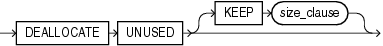

## deallocate\_unused\_clause

Purpose

Use the `deallocate_unused_clause` to explicitly deallocate unused space at the end of a database object segment and make the space available for other segments in the tablespace.

You can deallocate unused space using the following statements:

- `ALTER` `CLUSTER` (see [ALTER CLUSTER](ALTER-CLUSTER.md)`)`
- `ALTER` `INDEX`: to deallocate unused space from the index, an index partition, or an index subpartition (see [ALTER INDEX](ALTER-INDEX.md)`)`
- `ALTER` `MATERIALIZED` `VIEW`: to deallocate unused space from the overflow segment of an index-organized materialized view (see [ALTER MATERIALIZED VIEW](ALTER-MATERIALIZED-VIEW.md))
- `ALTER` `TABLE`: to deallocate unused space from the table, a table partition, a table subpartition, the mapping table of an index-organized table, the overflow segment of an index-organized table, or a LOB storage segment (see [ALTER TABLE](ALTER-TABLE.md)`)`

Syntax

deallocate\_unused\_clause::=



> ```
> DEALLOCATE UNUSED [ KEEP size_clause ]
> ```
>
> [  
> Copyright © 1996, 2025, Oracle and/or its affiliates.](https://docs.oracle.com/en/database/oracle/oracle-database/dcommon/html/cpyr.htm)


([size\_clause::=](size_clause.md))

Semantics

This section describes the semantics of the `deallocate_unused_clause`. For additional information, refer to the SQL statement in which you set or reset this clause for a particular database object.

You cannot specify both the `deallocate_unused_clause` and the `allocate_extent_clause` in the same statement.

Oracle Database frees only unused space above the high water mark (the point beyond which database blocks have not yet been formatted to receive data). Oracle deallocates unused space beginning from the end of the object and moving toward the beginning of the object to the high water mark.

If an extent is completely contained in the deallocation, then the whole extent is freed for reuse. If an extent is partially contained in the deallocation, then the used part up to the high water mark becomes the extent, and the remaining unused space is freed for reuse.

Oracle credits the amount of the released space to the user quota for the tablespace in which the deallocation occurs.

The exact amount of space freed depends on the values of the `INITIAL`, `MINEXTENTS`, and `NEXT` storage parameters. Refer to the [storage\_clause](storage_clause.md) for a description of these parameters.

KEEP integer

Specify the number of bytes above the high water mark that the segment of the database object is to have after deallocation.

- If you omit `KEEP` and the high water mark is above the size of `INITIAL` and `MINEXTENTS`, then all unused space above the high water mark is freed. When the high water mark is less than the size of `INITIAL` or `MINEXTENTS`, then all unused space above `MINEXTENTS` is freed.
- If you specify `KEEP`, then the specified amount of space is kept and the remaining space is freed. When the remaining number of extents is less than `MINEXTENTS`, then Oracle adjusts `MINEXTENTS` to the new number of extents. If the initial extent becomes smaller than `INITIAL`, then Oracle adjusts `INITIAL` to the new size.
- In either case, Oracle sets the value of the `NEXT` storage parameter to the size of the last extent that was deallocated.