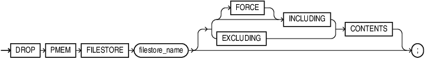

## DROP PMEM FILESTORE

Purpose

You can drop a PMEM file store with this command.

Syntax

drop\_pmem\_filestore::=



> ```
> DROP PMEM FILESTORE filestore_name
>   [ FORCE INCLUDING CONTENTS
>   | { INCLUDING | EXCLUDING } CONTENTS
>   ]  ";"
> ```
>
> [  
> Copyright © 1996, 2025, Oracle and/or its affiliates.](https://docs.oracle.com/en/database/oracle/oracle-database/dcommon/html/cpyr.htm)


Semantics

INCLUDING CONTENTS

Specify `INCLUDING CONTENTS` to confirm that Oracle should remove all the files in the PMEM file store.

EXCLUDING CONTENTS

Specify `EXCLUDING CONTENTS` to ensure that Oracle drops the PMEM file store only when the file store is empty.

FORCE

Specify `FORCE` along with `INCLUDING CONTENTS` if you suspect that the file store is corrupt.

Note that this option does not check if the file store has content in it prior to deleting it.

If you specify neither `INCLUDING CONTENTS` nor `EXCLUDING CONTENTS`, you must ensure that the file store is empty. `EXCLUDING CONTENTS` is the default behavior.

Example

```
DROP PMEM FILESTORE cloud_db_1 EXCLUDING CONTENTS
```