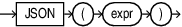

## JSON Type Constructor

Syntax



> ```
> JSON ( expr )
> ```
>
> [  
> Copyright © 1996, 2025, Oracle and/or its affiliates.](https://docs.oracle.com/en/database/oracle/oracle-database/dcommon/html/cpyr.htm)


Purpose

You can use the JSON data type constructor `JSON` to parse textual JSON input ( a scalar, object, or array), and return it as an instance of type `JSON`.

Input values must pass the `IS JSON` test. Input values that fail the `IS JSON` test are rejected with a syntax error.

To filter out duplicate input values, you must run the `IS JSON (WITH UNIQUE KEYS)` check on the textual JSON input before using the `JSON ` constructor.

You can use the constructor `JSON` only if database initialization parameter `compatible` is atleast `20`.

expr

The input in `expr` must be a syntactically valid textual representation of type `VARCHAR2`, `CLOB` and `BLOB`. It can also be a literal SQL string. A SQL `NULL` input value results in a JSON type instance of SQL `NULL`.

See Also:

[JSON Data Type Constructor](https://docs.oracle.com/pls/topic/lookup?ctx=en/database/oracle/oracle-database/21/sqlrf&id=ADJSN-GUID-F04556DD-B435-425E-8EA6-FBE636FEEA2C)