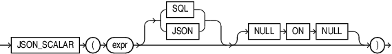

## JSON\_SCALAR

Syntax



> ```
> JSON_SCALAR "(" expr [ SQL | JSON ] [ NULL ON NULL ] ")"
> ```
>
> [  
> Copyright © 1996, 2025, Oracle and/or its affiliates.](https://docs.oracle.com/en/database/oracle/oracle-database/dcommon/html/cpyr.htm)


Purpose

`JSON_SCALAR` accepts a SQL scalar value as input and returns a corresponding JSON scalar value as a `JSON` type instance. In particular, the value can be of an Oracle-specific JSON-language type, such as a date, which is not part of the JSON standard.

The argument to `JSON_SCALAR` can be an instance of any of these SQL data types: `VARCHAR2`, `RAW`, `CLOB`, `BLOB`, `DATE`, `TIMESTAMP`,` INTERVAL YEAR TO MONTH`, `INTERVAL DAY TO SECOND`, `NUMBER`, `BINARY_DOUBLE`, or `BINARY_FLOAT`.

The returned `JSON` type instance is a JSON-language scalar value supported by Oracle.

You can use the `JSON_SCALAR` function, only if the database initialization parameter `compatible` is at least `20`. Otherwise it raises an error.

See Also:

- See [Oracle SQL Function JSON\_SCALAR](https://docs.oracle.com/pls/topic/lookup?ctx=en/database/oracle/oracle-database/21/sqlrf&id=ADJSN-GUID-5EAC1ADD-E138-4488-9FB0-7C245F87CBFD)