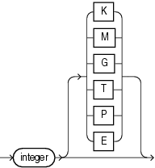

## size\_clause

Purpose

The `size_clause` lets you specify a number of bytes, kilobytes (K), megabytes (M), gigabytes (G), terabytes (T), petabytes (P), or exabytes (E) in any statement that lets you establish amounts of disk or memory space.

Syntax

size\_clause::=



> ```
> integer [ K | M | G | T | P | E ]
> ```
>
> [  
> Copyright © 1996, 2025, Oracle and/or its affiliates.](https://docs.oracle.com/en/database/oracle/oracle-database/dcommon/html/cpyr.htm)


Semantics

Use the `size_clause` to specify a number or multiple of bytes. If you do not specify any of the multiple abbreviations, then the `integer` is interpreted as bytes.

Note:

Not all multiples of bytes are appropriate in all cases, and context-sensitive limitations may apply. In the latter case, Oracle issues an error message.