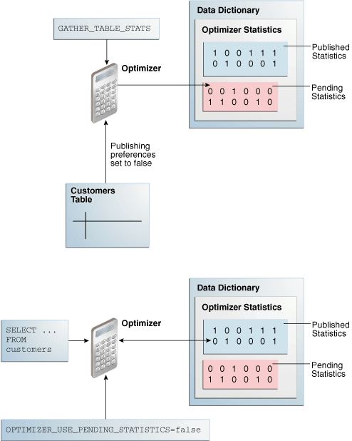

### 15.1 Locking and Unlocking Optimizer Statistics

You can lock statistics to prevent them from changing.

After statistics are locked, you cannot make modifications to the statistics until the statistics have been unlocked. Locking procedures are useful in a static environment when you want to guarantee that the statistics and resulting plan never change. For example, you may want to prevent new statistics from being gathered on a table or schema by the `DBMS_STATS_JOB` process, such as highly volatile tables.

When you lock statistics on a table, all dependent statistics are locked. The locked statistics include table statistics, column statistics, histograms, and dependent index statistics. To overwrite statistics even when they are locked, you can set the value of the `FORCE` argument in various `DBMS_STATS` procedures, for example, `DELETE_*_STATS` and `RESTORE_*_STATS`, to `true`.

#### 15.1.1 Locking Statistics

The `DBMS_STATS` package provides two procedures for locking statistics: `LOCK_SCHEMA_STATS` and `LOCK_TABLE_STATS`.

Assumptions

This tutorial assumes the following:

- You gathered statistics on the `oe.orders` table and on the `hr` schema.
- You want to prevent the `oe.orders` table statistics and `hr` schema statistics from changing.

To lock statistics:

1. Start SQL\*Plus and connect to the database as the `oe` user.
2. Lock the statistics on `oe.orders`.
	For example, execute the following PL/SQL program:
	```
	BEGIN
	  DBMS_STATS.LOCK_TABLE_STATS('OE','ORDERS');
	END;
	/
	```
3. Connect to the database as the `hr` user.
4. Lock the statistics in the `hr` schema.
	For example, execute the following PL/SQL program:
	```
	BEGIN
	  DBMS_STATS.LOCK_SCHEMA_STATS('HR');
	END;
	/
	```

See Also:

[Oracle Database PL/SQL Packages and Types Reference](https://docs.oracle.com/pls/topic/lookup?ctx=en/database/oracle/oracle-database/21/tgsql&id=ARPLS-GUID-77225DE6-28D1-4064-9531-87BB1CFB4405) to learn about the `DBMS_STATS.LOCK_TABLE_STATS` procedure

#### 15.1.2 Unlocking Statistics

The `DBMS_STATS` package provides two procedures for unlocking statistics: `UNLOCK_SCHEMA_STATS` and `UNLOCK_TABLE_STATS`.

Assumptions

This tutorial assumes the following:

- You locked statistics on the `oe.orders` table and on the `hr` schema.
- You want to unlock these statistics.

To unlock statistics:

1. Start SQL\*Plus and connect to the database as the `oe` user.
2. Unlock the statistics on `oe.orders`.
	For example, execute the following PL/SQL program:
	```
	BEGIN
	  DBMS_STATS.UNLOCK_TABLE_STATS('OE','ORDERS');
	END;
	/
	```
3. Connect to the database as the `hr` user.
4. Unlock the statistics in the `hr` schema.
	For example, execute the following PL/SQL program:
	```
	BEGIN
	  DBMS_STATS.UNLOCK_SCHEMA_STATS('HR');
	END;
	/
	```

See Also:

[Oracle Database PL/SQL Packages and Types Reference](https://docs.oracle.com/pls/topic/lookup?ctx=en/database/oracle/oracle-database/21/tgsql&id=ARPLS-GUID-690DF3FA-E225-4959-8836-5458F17217D5) to learn about the `DBMS_STATS.UNLOCK_TABLE_STATS` procedure

### 15.2 Publishing Pending Optimizer Statistics

By default, the database automatically publishes statistics when the statistics collection ends.

Alternatively, you can use [pending statistics](glossary.md) to save the statistics and not publish them immediately after the collection. This technique is useful for testing queries in a session with pending statistics. When the test results are satisfactory, you can publish the statistics to make them available for the entire database.

#### 15.2.1 About Pending Optimizer Statistics

The database stores pending statistics in the data dictionary just as for published statistics.

By default, the optimizer uses published statistics. You can change the default behavior by setting the `OPTIMIZER_USE_PENDING_STATISTICS` initialization parameter to `true` (the default is `false`).

The top part of the following graphic shows the optimizer gathering statistics for the `sh.customers` table and storing them in the data dictionary with pending status. The bottom part of the diagram shows the optimizer using only published statistics to process a query of `sh.customers`.

Figure 15-1 Published and Pending Statistics



> A box with the text "GATHER\_TABLE\_STATS" points down to an Optimizer icon. This icon points right to a box labeled "Optimizer Statistics." This box contains two boxes. One box has the callout "Published Statistics." The other box has the callout "Pending Statistics." A box labeled "Customers Table" points up to an Optimizer icon. The arrow is labeled "Publishing preferences set to FALSE." Underneath this set of icons is another set of icons. The Optimizer icon is pointed to by a box containing the text "SELECT... FROM customers." A box containing the text "OPTIMIZER\_USE\_PENDING\_STATISTICS=FALSE" points up to the Optimizer icon. The same Data Dictionary box that appears in the top set of icons is joined to the Optimizer icon by a double-headed arrow.


In some cases, the optimizer can use a combination of published and pending statistics. For example, the database stores both published and pending statistics for the `customers` table. For the `orders` table, the database stores only published statistics. If `OPTIMIZER_USE_PENDING_STATS = true`, then the optimizer uses pending statistics for `customers` and published statistics for `orders`. If `OPTIMIZER_USE_PENDING_STATS = false`, then the optimizer uses published statistics for `customers` and `orders`.

See Also:

[Oracle Database Reference](https://docs.oracle.com/pls/topic/lookup?ctx=en/database/oracle/oracle-database/21/tgsql&id=REFRN10288) to learn about the `OPTIMIZER_USE_PENDING_STATISTICS` initialization parameter

#### 15.2.2 User Interfaces for Publishing Optimizer Statistics

You can use the `DBMS_STATS` package to perform operations relating to publishing statistics.

The following table lists the relevant program units.

Table 15-1 DBMS\_STATS Program Units Relevant for Publishing Optimizer Statistics

| Program Unit | Description |
| --- | --- |
| `GET_PREFS` | Check whether the statistics are automatically published as soon as `DBMS_STATS` gathers them. For the parameter `PUBLISH`, `true` indicates that the statistics must be published when the database gathers them, whereas `false` indicates that the database must keep the statistics pending. |
| `SET_TABLE_PREFS` | Set the `PUBLISH` setting to `true` or `false` at the table level. |
| `SET_SCHEMA_PREFS` | Set the `PUBLISH` setting to `true` or `false` at the schema level. |
| `PUBLISH_PENDING_STATS` | Publish valid pending statistics for all objects or only specified objects. |
| `DELETE_PENDING_STATS` | Delete pending statistics. |
| `EXPORT_PENDING_STATS` | Export pending statistics. |

The initialization parameter `OPTIMIZER_USE_PENDING_STATISTICS` determines whether the database uses pending statistics when they are available. The default value is `false`, which means that the optimizer uses only published statistics. Set to `true` to specify that the optimizer uses any existing pending statistics instead. The best practice is to set this parameter at the session level rather than at the database level.

You can use access information about published statistics from data dictionary views. Table 15-2 lists relevant views.

Table 15-2 Views Relevant for Publishing Optimizer Statistics

| View | Description |
| --- | --- |
| `USER_TAB_STATISTICS` | Displays optimizer statistics for the tables accessible to the current user. |
| `USER_TAB_COL_STATISTICS` | Displays column statistics and histogram information extracted from `ALL_TAB_COLUMNS`. |
| `USER_PART_COL_STATISTICS` | Displays column statistics and histogram information for the table partitions owned by the current user. |
| `USER_SUBPART_COL_STATISTICS` | Describes column statistics and histogram information for subpartitions of partitioned objects owned by the current user. |
| `USER_IND_STATISTICS` | Displays optimizer statistics for the indexes accessible to the current user. |
| `USER_TAB_PENDING_STATS` | Describes pending statistics for tables, partitions, and subpartitions accessible to the current user. |
| `USER_COL_PENDING_STATS` | Describes the pending statistics of the columns accessible to the current user. |
| `USER_IND_PENDING_STATS` | Describes the pending statistics for tables, partitions, and subpartitions accessible to the current user collected using the `DBMS_STATS` package. |

#### 15.2.3 Managing Published and Pending Statistics

This section explains how to use `DBMS_STATS` program units to change the publishing behavior of optimizer statistics, and also to export and delete these statistics.

Assumptions

This tutorial assumes the following:

- You want to change the preferences for the `sh.customers` and `sh.sales` tables so that newly collected statistics have pending status.
- You want the current session to use pending statistics.
- You want to gather and publish pending statistics on the `sh.customers` table.
- You gather the pending statistics on the `sh.sales` table, but decide to delete them without publishing them.
- You want to change the preferences for the `sh.customers` and `sh.sales` tables so that newly collected statistics are published.

To manage published and pending statistics:

1. Start SQL\*Plus and connect to the database as user `sh`.
2. Query the global optimizer statistics publishing setting.
	Run the following query (sample output included):
	```
	sh@PROD> SELECT DBMS_STATS.GET_PREFS('PUBLISH') PUBLISH FROM DUAL;
	PUBLISH
	-------
	TRUE
	```
	The value `true` indicates that the database publishes statistics as it gathers them. Every table uses this value unless a specific table preference has been set.
	When using `GET_PREFS`, you can also specify a schema and table name. The function returns a table preference if it is set. Otherwise, the function returns the global preference.
3. Query the pending statistics.
	For example, run the following query (sample output included):
	```
	sh@PROD> SELECT * FROM USER_TAB_PENDING_STATS;
	 
	no rows selected
	```
	This example shows that the database currently stores no pending statistics for the `sh` schema.
4. Change the publishing preferences for the `sh.customers` table.
	For example, execute the following procedure so that statistics are marked as pending:
	```
	BEGIN
	  DBMS_STATS.SET_TABLE_PREFS('sh', 'customers', 'publish', 'false');
	END;
	/
	```
	Subsequently, when you gather statistics on the `customers` table, the database does not automatically publish statistics when the gather job completes. Instead, the database stores the newly gathered statistics in the `USER_TAB_PENDING_STATS` table.
5. Gather statistics for `sh.customers`.
	For example, run the following program:
	```
	BEGIN
	  DBMS_STATS.GATHER_TABLE_STATS('sh','customers');
	END;
	/
	```
6. Query the pending statistics.
	For example, run the following query (sample output included):
	```
	sh@PROD> SELECT TABLE_NAME, NUM_ROWS FROM USER_TAB_PENDING_STATS;
	 
	TABLE_NAME                       NUM_ROWS
	------------------------------ ----------
	CUSTOMERS                           55500
	```
	This example shows that the database now stores pending statistics for the `sh.customers` table.
7. Instruct the optimizer to use the pending statistics in this session.
	Set the initialization parameter `OPTIMIZER_USE_PENDING_STATISTICS` to `true` as shown:
	```
	ALTER SESSION SET OPTIMIZER_USE_PENDING_STATISTICS = true;
	```
8. Run a workload.
	The following example changes the email addresses of all customers named Bruce Chalmers:
	```
	UPDATE  sh.customers 
	  SET   cust_email='ChalmersB@company.example.icom' 
	  WHERE cust_first_name = 'Bruce' 
	  AND   cust_last_name = 'Chalmers';
	COMMIT;
	```
	The optimizer uses the pending statistics instead of the published statistics when compiling all SQL statements in this session.
9. Publish the pending statistics for `sh.customers`.
	For example, execute the following program:
	```
	BEGIN
	  DBMS_STATS.PUBLISH_PENDING_STATS('SH','CUSTOMERS');
	END;
	/
	```
10. Change the publishing preferences for the `sh.sales` table.
	For example, execute the following program:
	```
	BEGIN
	  DBMS_STATS.SET_TABLE_PREFS('sh', 'sales', 'publish', 'false');
	END;
	/
	```
	Subsequently, when you gather statistics on the `sh.sales` table, the database does not automatically publish statistics when the gather job completes. Instead, the database stores the statistics in the `USER_TAB_PENDING_STATS` table.
11. Gather statistics for `sh.sales`.
	For example, run the following program:
	```
	BEGIN
	  DBMS_STATS.GATHER_TABLE_STATS('sh','sales');
	END;
	/
	```
12. Delete the pending statistics for `sh.sales`.
	Assume you change your mind and now want to delete pending statistics for `sh.sales`. Run the following program:
	```
	BEGIN
	  DBMS_STATS.DELETE_PENDING_STATS('sh','sales');
	END;
	/
	```
13. Change the publishing preferences for the `sh.customers` and `sh.sales` tables back to their default setting.
	For example, execute the following program:
	```
	BEGIN
	  DBMS_STATS.SET_TABLE_PREFS('sh', 'customers', 'publish', null);
	  DBMS_STATS.SET_TABLE_PREFS('sh', 'sales', 'publish', null);
	END;
	/
	```

### 15.3 Creating Artificial Optimizer Statistics for Testing

To provide the optimizer with user-created statistics for testing purposes, you can use the `DBMS_STATS.SET_*_STATS` procedures. These procedures provide the optimizer with artificial values for the specified statistics.

#### 15.3.1 About Artificial Optimizer Statistics

For testing purposes, you can manually create artificial statistics for a table, index, or the system using the `DBMS_STATS.SET_*_STATS` procedures.

When `stattab` is null, the `DBMS_STATS.SET_*_STATS` procedures insert the artificial statistics into the data dictionary directly. Alternatively, you can specify a user-created table.

Caution:

The `DBMS_STATS.SET_*_STATS` procedures are intended for development testing only. Do not use them in a production database. If you set statistics in the data dictionary, then Oracle Database considers the set statistics as the “real” statistics, which means that statistics gathering jobs may not re-gather artificial statistics when they do not meet the criteria for staleness.

Typical use cases for the `DBMS_STATS.SET_*_STATS` procedures are:

- Showing how execution plans change as the numbers of rows or blocks in a table change
	For example, `SET_TABLE_STATS` can set number of rows and blocks in a small or empty table to a large number. When you execute a query using the altered statistics, the optimizer may change the execution plan. For example, the increased row count may lead the optimizer to choose an index scan rather than a full table scan. By experimenting with different values, you can see how the optimizer will change its execution plan over time.
- Creating realistic statistics for temporary tables
	You may want to see what the optimizer does when a large temporary table is referenced in multiple SQL statements. You can create a regular table, load representative data, and then use `GET_TABLE_STATS` to retrieve the statistics. After you create the temporary table, you can “deceive” the optimizer into using these statistics by invoking `SET_TABLE_STATS`.

Optionally, you can specify a unique ID for statistics in a user-created table. The `SET_*_STATS` procedures have corresponding `GET_*_STATS` procedures.

Table 15-3 DBMS\_STATS Procedures for Setting Optimizer Statistics

| DBMS\_STATS Procedure | Description |
| --- | --- |
| `SET_TABLE_STATS` | Sets table or partition statistics using parameters such as `numrows`, `numblks`, and `avgrlen`.  If the database uses the In-Memory Column store, you can set `im_imcu_count` to the number of IMCUs in the table or partition, and `im_block_count` to the number of blocks in the table or partition. For an external table, `scanrate` specifies the rate at which data is scanned in MB/second.  The optimizer uses the cached data to estimate the number of cached blocks for index or statistics table access. The total cost is the I/O cost of reading data blocks from disk, the CPU cost of reading cached blocks from the buffer cache, and the CPU cost of processing the data. |
| `SET_COLUMN_STATS` | Sets column statistics using parameters such as `distcnt`, `density`, `nullcnt`, and so on.  In the version of this procedure that deals with user-defined statistics, use `stattypname` to specify the type of statistics to store in the data dictionary. |
| `SET_SYSTEM_STATS` | Sets system statistics using parameters such as `iotfrspeed`, `sreadtim`, and `cpuspeed`. |
| `SET_INDEX_STATS` | Sets index statistics using parameters such as `numrows`, `numlblks`, `avglblk`, `clstfct`, and `indlevel`.  In the version of this procedure that deals with user-defined statistics, use `stattypname` to specify the type of statistics to store in the data dictionary. |

See Also:

[Oracle Database PL/SQL Packages and Types Reference](https://docs.oracle.com/pls/topic/lookup?ctx=en/database/oracle/oracle-database/21/tgsql&id=ARPLS-GUID-F993ADFE-85A9-4939-84D1-CC7A6E5C56D2) to learn more about `DBMS_STATS.SET_TABLE_STATS` and the other procedures for setting optimizer statistics

#### 15.3.2 Setting Artificial Optimizer Statistics for a Table

This topic explains how to set artificial statistics for a table using `DBMS_STATS.SET_TABLE_STATS`. The basic steps are the same for `SET_INDEX_STATS` and `SET_SYSTEM_STATS`.

Note the following task prerequisites:
- For an object not owned by `SYS`, you must be the owner of the object, or have the `ANALYZE ANY` privilege.
- For an object owned by `SYS`, you must have the `ANALYZE ANY DICTIONARY` privilege or the `SYSDBA` privilege.
- When invoking `GET_*_STATS` for a table, column, or index, the referenced object must exist.

This task assumes the following:
- You have the required privileges to use `DBMS_STATS.SET_TABLE_STATS` for the specified table.
- You intend to store the statistics in the data dictionary.

1. In SQL\*Plus, log in to the database as a user with the required privileges.
2. Run the `DBMS_STATS.SET_TABLE_STATS` procedure, specifying the appropriate parameters for the statistics.
	Typical parameters include the following:
	- `ownname` (not null)
		This parameter specifies the name of the schema containing the table.
	- `tabname` (not null)
		This parameter specifies the name of the table whose statistics you intend to set.
	- `partname`
		This parameter specifies the name of a partition of the table.
	- `numrows`
		This parameter specifies the number of rows in the table.
	- `numblks`
		This parameter specifies the number of blocks in the table.
3. Query the table.
4. Optionally, to determine how the statistics affected the optimizer, query the execution plan.
5. Optionally, to perform further testing, return to Step 2 and reset the optimizer statistics.

#### 15.3.3 Setting Optimizer Statistics: Example

This example shows how to gather optimizer statistics for a table, set artificial statistics, and then compare the plans that the optimizer chooses based on the differing statistics.

This example assumes:
- You are logged in to the database as a user with DBA privileges.
- You want to test when the optimizer chooses an index scan.

1. Create a table called `contractors`, and index the `salary` column.
	```
	CREATE TABLE contractors (
	  con_id    NUMBER,
	  last_name VARCHAR2(50),
	  salary    NUMBER,
	  CONSTRAINT cond_id_pk PRIMARY KEY(con_id) );
	CREATE INDEX salary_ix ON contractors(salary);
	```
2. Insert a single row into this table.
	```
	INSERT INTO contractors VALUES (8, 'JONES',1000);
	COMMIT;
	```
3. Gather statistics for the table.
	```
	EXECUTE DBMS_STATS.GATHER_TABLE_STATS( user, tabname => 'CONTRACTORS' );
	```
4. Query the number of rows for the table and index (sample output included):
	```
	SQL> SELECT NUM_ROWS FROM USER_TABLES WHERE TABLE_NAME = 'CONTRACTORS'; 
	  NUM_ROWS
	----------
	         1
	SQL> SELECT NUM_ROWS FROM USER_INDEXES WHERE INDEX_NAME =  'SALARY_IX'; 
	  NUM_ROWS
	----------
	         1
	```
5. Query contractors whose salary is 1000, using the `dynamic_sampling` hint to disable dynamic sampling:
	```
	SELECT /*+ dynamic_sampling(contractors 0) */ * 
	FROM   contractors 
	WHERE  salary = 1000;
	```
6. Query the execution plan chosen by the optimizer (sample output included):
	```
	SQL> SELECT * FROM TABLE(DBMS_XPLAN.DISPLAY_CURSOR);
	SQL_ID    cy0wzytc16g9n, child number 0
	-------------------------------------
	SELECT /*+ dynamic_sampling(contractors 0) */ * FROM contractors WHERE
	salary = 1000
	Plan hash value: 5038823
	----------------------------------------------------------------------
	| Id  | Operation         | Name        |Rows|Bytes|Cost (%CPU)| Time|
	----------------------------------------------------------------------
	|   0 | SELECT STATEMENT  |             |   |    | 2 (100)|          |
	|*  1 |  TABLE ACCESS FULL| CONTRACTORS | 1 | 12 | 2   (0)| 00:00:01 |
	----------------------------------------------------------------------
	Predicate Information (identified by operation id):
	---------------------------------------------------
	   1 - filter("SALARY"=1000)
	19 rows selected.
	```
	Because only 1 row exists in the table, the optimizer chooses a full table scan over an index range scan.
7. Use `SET_TABLE_STATS` and `SET_INDEX_STATS` to simulate statistics for a table with 2000 rows stored in 10 data blocks:
	```
	BEGIN
	  DBMS_STATS.SET_TABLE_STATS( 
	    ownname => user
	  , tabname => 'CONTRACTORS'
	  , numrows => 2000
	  , numblks => 10 );
	END;
	/
	BEGIN 
	  DBMS_STATS.SET_INDEX_STATS( 
	    ownname => user
	  , indname => 'SALARY_IX'
	  , numrows => 2000 );
	END;
	/
	```
8. Query the number of rows for the table and index (sample output included):
	```
	SQL> SELECT NUM_ROWS FROM USER_TABLES WHERE TABLE_NAME = 'CONTRACTORS'; 
	  NUM_ROWS
	----------
	      2000
	SQL> SELECT NUM_ROWS FROM USER_INDEXES WHERE INDEX_NAME =  'SALARY_IX'; 
	  NUM_ROWS
	----------
	      2000
	```
	Now the optimizer believes that the table contains 2000 rows in 10 blocks, even though only 1 row actually exists in one block.
9. Flush the shared pool to eliminate possibility of plan reuse, and then execute the same query of `contractors`:
	```
	ALTER SYSTEM FLUSH SHARED_POOL;
	SELECT /*+ dynamic_sampling(contractors 0) */ * 
	FROM   contractors 
	WHERE  salary = 1000;
	```
10. Query the execution plan chosen by the optimizer based on the artificial statistics (sample output included):
	```
	SQL> SELECT * FROM TABLE(DBMS_XPLAN.DISPLAY_CURSOR);
	SQL_ID    cy0wzytc16g9n, child number 0
	-------------------------------------
	SELECT /*+ dynamic_sampling(contractors 0) */ * FROM contractors WHERE
	salary = 1000
	Plan hash value: 996794789
	---------------------------------------------------------------------------------
	|Id| Operation                           | Name      |Rows|Bytes|Cost(%CPU)|Time|
	---------------------------------------------------------------------------------
	| 0| SELECT STATEMENT                    |           |    |     |3(100)|        |
	| 1|  TABLE ACCESS BY INDEX ROWID BATCHED|CONTRACTORS|2000|24000|3 (34)|00:00:01|
	|*2|   INDEX RANGE SCAN                  |SALARY_IX  |2000|     |1  (0)|00:00:01|
	---------------------------------------------------------------------------------
	Predicate Information (identified by operation id):
	---------------------------------------------------
	   2 - access("SALARY"=1000)
	20 rows selected.
	```
	Based on the artificially generated statistics for the number of rows and block distribution, the optimizer considers an index range scan more cost-effective.