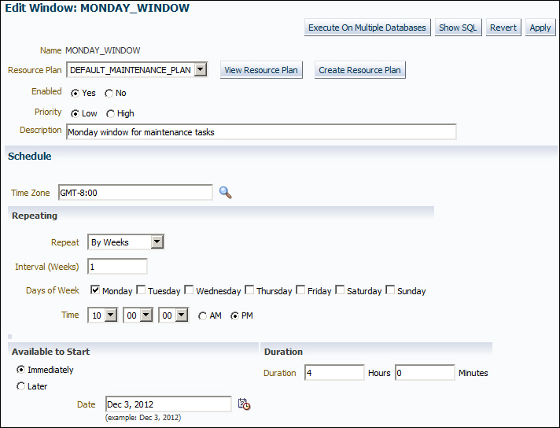
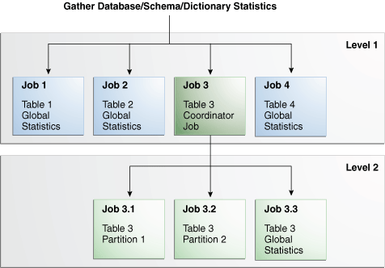
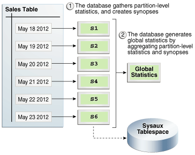
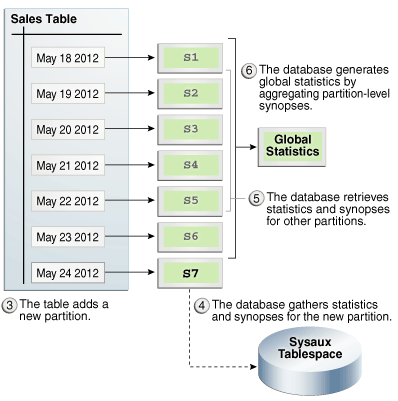
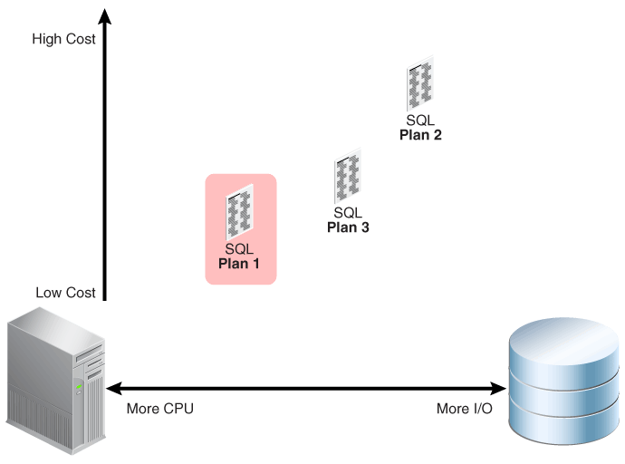
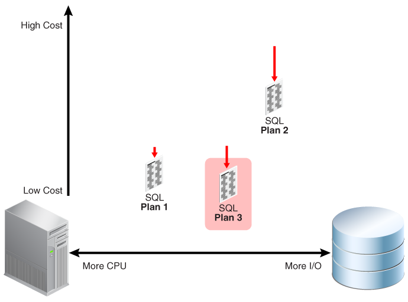
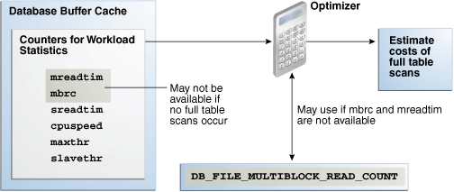
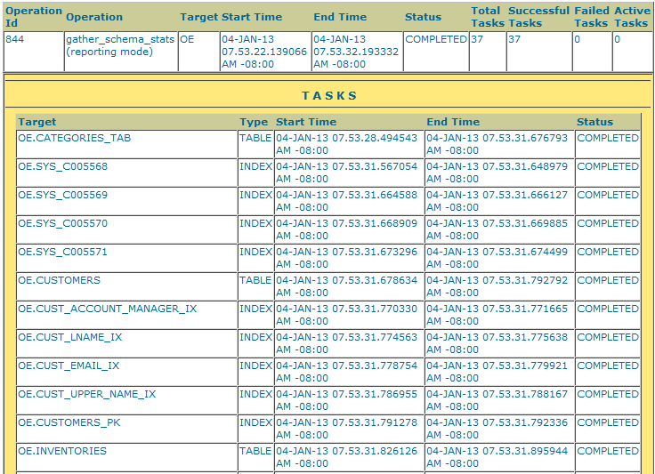

This chapter explains how to use the `DBMS_STATS.GATHER_*_STATS` program units.

See Also:

- " [Optimizer Statistics Concepts](optimizer-statistics-concepts.md) "
- " [Query Optimizer Concepts](query-optimizer-concepts.md) "
- [Oracle Database PL/SQL Packages and Types Reference](https://docs.oracle.com/pls/topic/lookup?ctx=en/database/oracle/oracle-database/21/tgsql&id=ARPLS-GUID-CA6A56B9-0540-45E9-B1D7-D78769B7714C) to learn about `DBMS_STATS.GATHER_TABLE_STATS`

### 13.1 Configuring Automatic Optimizer Statistics Collection

Oracle Database can gather optimizer statistics automatically.

#### 13.1.1 About Automatic Optimizer Statistics Collection

The automated maintenance tasks infrastructure (known as AutoTask) schedules tasks to run automatically in Oracle Scheduler windows known as maintenance windows.

Difference Between Automatic and Manual Statistics Collection

The principal difference is that automatic collection prioritizes database objects that need statistics. Before the maintenance window closes, automatic collection assesses all objects and prioritizes objects that have no statistics or very old statistics.

When gathering statistics manually, you can reproduce the object prioritization of automatic collection by using the `DBMS_AUTO_TASK_IMMEDIATE` package. This package runs the same statistics gathering job that is executed during the automatic nightly statistics gathering job.

How Automatic Statistics Collection Works

Automatic optimizer statistics collection runs as part of AutoTask. By default, the collection runs in all predefined maintenance windows. One window is scheduled for each day of the week.

To collect the optimizer statistics, the database calls an internal procedure that operates similarly to the `GATHER_DATABASE_STATS` procedure with the `GATHER AUTO` option. Automatic statistics collection honors all preferences set in the database.

When an automatic optimizer statistics collection task gathers data for a PDB, it stores this data in the PDB. This data is included if the PDB is unplugged. A common user whose current container is the CDB root can view optimizer statistics data for PDBs. A user whose current container is a PDB can view optimizer statistics data for the PDB only.

#### 13.1.2 Configuring Automatic Optimizer Statistics Collection Using Cloud Control

You can enable and disable all automatic maintenance tasks, including automatic optimizer statistics collection, using Cloud Control.

The default window timing works well for most situations. However, you may have operations such as bulk loads that occur during the window. In such cases, to avoid potential conflicts that result from operations occurring at the same time as automatic statistics collection, Oracle recommends that you change the window accordingly.

Prerequisites

Access the Database Home page, as described in " [Accessing the Database Home Page in Cloud Control](options-for-optimizer-statistics-gathering.md)."

To control automatic optimizer statistics collection using Cloud Control:

1. From the Administration menu, select Oracle Scheduler, then Automated Maintenance Tasks.
	The Automated Maintenance Tasks page appears.
	This page shows the predefined tasks. To retrieve information about each task, click the corresponding link for the task.
2. Click Configure.
	The Automated Maintenance Tasks Configuration page appears.
	By default, automatic optimizer statistics collection executes in all predefined maintenance windows in `MAINTENANCE_WINDOW_GROUP`.
3. Perform the following steps:
	1. In the Task Settings section for Optimizer Statistics Gathering, select either Enabled or Disabled to enable or disable an automated task.
		Note:
		Oracle strongly recommends that you not disable automatic statistics gathering because it is critical for the optimizer to generate optimal plans for queries against dictionary and user objects. If you disable automatic collection, ensure that you have a good manual statistics collection strategy for dictionary and user schemas.
		2. To disable statistics gathering for specific days in the week, check the appropriate box next to the window name.
		3. To change the characteristics of a window group, click Edit Window Group.
		4. To change the times for a window, click the name of the window (for example, MONDAY\_WINDOW), and then in the Schedule section, click Edit.
		The Edit Window page appears.
		

> The screenshot has the title "Edit Window: Monday Window." Underneath are the following buttons: Execute on Multiple Databases, Show SQL, Revert, and Apply. The name title has the value MONDAY\_WINDOW. The resource plan list shows DEFAULT\_MAINTENANCE\_PLAN. Next to this list are the following buttons: View Resource Plan, and Create Resource Plan. The Enabled label has the buttons Yes (checked) and No. The Priority label has the buttons Low (checked) and High. The Description box shows the text "Monday window for maintenance tasks."
>
> The Schedule section has a Time Zone box. This box contains the text "GMT-8:00." In the Repeat section, the list shows the value "By Weeks." The Interval (Weeks) box has the value "1." The Days of Week label shows check boxes for the days of the week, with Monday checked. The Time label has the time set at 10 p.m.
>
> The Available to Start section has the Immediately button selected, and the Later button unselected. The Date box has the text "Dec 3, 2012." In the Duration section, the Duration box is set to 4 Hours and 0 Minutes.

		In this page, you can change the parameters such as duration and start time for window execution.
		5. Click Apply.

See Also:

Online Help for Oracle Enterprise Manager Cloud Control

#### 13.1.3 Configuring Automatic Optimizer Statistics Collection from the Command Line

If you do not use Cloud Control to configure automatic optimizer statistics collection, then you must use the command line.

You have the following options:

- Run the `ENABLE` or `DISABLE` procedure in the `DBMS_AUTO_TASK_ADMIN` PL/SQL package.
	This package is the recommended command-line technique. For both the `ENABLE` and `DISABLE` procedures, you can specify a particular maintenance window with the `window_name` parameter.
- Set the `STATISTICS_LEVEL` initialization level to `BASIC` to disable collection of all advisories and statistics, including Automatic SQL Tuning Advisor.
	Note:
	Because monitoring and many automatic features are disabled, Oracle strongly recommends that you do not set `STATISTICS_LEVEL` to `BASIC`.

To control automatic statistics collection using DBMS\_AUTO\_TASK\_ADMIN:

1. In SQL\*Plus or SQL Developer, log in to the database as a user with administrative privileges.
2. Do one of the following:
	- To enable the automated task, execute the following PL/SQL block:
		```
		BEGIN
		  DBMS_AUTO_TASK_ADMIN.ENABLE (  
		    client_name  => 'auto optimizer stats collection'
		,   operation    => NULL
		,   window_name  => NULL 
		);
		END;
		/
		```
		- To disable the automated task, execute the following PL/SQL block:
		```
		BEGIN
		  DBMS_AUTO_TASK_ADMIN.DISABLE (  
		    client_name  => 'auto optimizer stats collection'
		,   operation    => NULL
		,   window_name  => NULL 
		);
		END;
		/
		```
3. Query the data dictionary to confirm the change.
	For example, query `DBA_AUTOTASK_CLIENT` as follows:
	```
	COL CLIENT_NAME FORMAT a31
	SELECT CLIENT_NAME, STATUS
	FROM   DBA_AUTOTASK_CLIENT
	WHERE  CLIENT_NAME = 'auto optimizer stats collection';
	```
	Sample output appears as follows:
	```
	CLIENT_NAME                     STATUS
	------------------------------- --------
	auto optimizer stats collection ENABLED
	```

To change the window attributes for automatic statistics collection:

1. Connect SQL\*Plus to the database with administrator privileges.
2. Change the attributes of the maintenance window as needed.
	For example, to change the Monday maintenance window so that it starts at 5 a.m., execute the following PL/SQL program:
	```
	BEGIN 
	  DBMS_SCHEDULER.SET_ATTRIBUTE (
	    'MONDAY_WINDOW'
	,   'repeat_interval'
	,   'freq=daily;byday=MON;byhour=05;byminute=0;bysecond=0'
	);
	END;
	/
	```

See Also:

- [Oracle Database PL/SQL Packages and Types Reference](https://docs.oracle.com/pls/topic/lookup?ctx=en/database/oracle/oracle-database/21/tgsql&id=ARPLS-GUID-8CD58D39-436B-4642-BAEB-00C651DE8A8F) to learn about the `DBMS_AUTO_TASK_ADMIN` package
- [Oracle Database Reference](https://docs.oracle.com/pls/topic/lookup?ctx=en/database/oracle/oracle-database/21/tgsql&id=REFRN-GUID-16B23F95-8644-407A-A6C8-E85CADFA61FF) to learn about the `STATISTICS_LEVEL` initialization parameter

### 13.2 Configuring High-Frequency Automatic Optimizer Statistics Collection

This lightweight task supplements standard automatic statistics collection.

#### 13.2.1 About High-Frequency Automatic Optimizer Statistics Collection

You can configure automatic statistics collection to occur more frequently.

Purpose of High-Frequency Automatic Optimizer Statistics Collection

AutoTask schedules tasks to run automatically in maintenance windows. By default, one window is scheduled for each day of the week. Automatic optimizer statistics collection (`DBMS_STATS`) runs in all predefined maintenance windows.

Statistics can go stale between two consecutive statistics collection tasks. If data changes frequently, the stale statistics could cause performance problems. For example, a brokerage company might receive tremendous data during trading hours, leading the optimizer to use stale statistics for queries executed during this period.

High-frequency automatic optimizer statistics collection complements the standard statistics collection job. By default, the collection occurs every 15 minutes, meaning that statistics have less time in which to be stale.

How High-Frequency Automatic Optimizer Statistics Collection Works

To enable and disable the high-frequency task, set the execution interval, and set the maximum run time, use the `DBMS_STATS.SET_GLOBAL_PREFS` procedure. The high-frequency task is “lightweight” and only gathers stale statistics. It does not perform actions such as purging statistics for non-existent objects or invoking Optimizer Statistics Advisor. The standard automated job performs these additional tasks.

Automatic statistics collection jobs that run in the maintenance window are not affected by the high-frequency jobs. The high-frequency task may execute in maintenance windows, but it will not execute while the maintenance window auto stats gathering job is executing. You can monitor the tasks by querying `DBA_AUTO_STAT_EXECUTIONS`.

#### 13.2.2 Setting Preferences for High-Frequency Automatic Optimizer Statistics Collection

To enable and disable the task, use `DBMS_STATS.SET_GLOBAL_PREFS`.

You can use `DBMS_STATS.SET_GLOBAL_PREFS` to set preferences to any of the following values:

- `AUTO_TASK_STATUS`
	Enables or disables the high-frequency automatic optimizer statistics collection. Values are:
	- `ON` — Enables high-frequency automatic optimizer statistics collection.
		- `OFF` — Disables high-frequency automatic optimizer statistics collection. This is the default.
- `AUTO_TASK_MAX_RUN_TIME`
	Configures the maximum run time in seconds of an execution of high-frequency automatic optimizer statistics collection. The maximum value is `3600` (equal to 1 hour), which is the default.
- `AUTO_TASK_INTERVAL`
	Specifies the interval in seconds between executions of high-frequency automatic optimizer statistics collection. The minimum value is `60`. The default is `900` (equal to 15 minutes).

To configure the high-frequency task, you must have administrator privileges.

To configure the high-frequency task:

1. Log in to the database as a user with administrator privileges.
2. To enable the high-frequency task, set the `AUTO_TASK_STATUS` preference to `ON`.
	The following example enables the automatic task:
	```
	EXEC DBMS_STATS.SET_GLOBAL_PREFS('AUTO_TASK_STATUS','ON');
	```
3. To set the maximum run time, set the `AUTO_TASK_MAX_RUN_TIME` preference to the desired number of seconds.
	The following example sets the maximum run time to 10 minutes:
	```
	EXEC DBMS_STATS.SET_GLOBAL_PREFS('AUTO_TASK_MAX_RUN_TIME','600');
	```
4. To set the frequency, set the `AUTO_TASK_INTERVAL` preference to the desired number of seconds.
	The following example sets the frequency to 8 minutes:
	```
	EXEC DBMS_STATS.SET_GLOBAL_PREFS('AUTO_TASK_INTERVAL','240');
	```

#### 13.2.3 High-Frequency Automatic Optimizer Statistics Collection: Example

In this example, you enable run DML statements, and then enable the high-frequency statistics collection job.

This example assumes the following:

- You are logged in to the database as an administrator.
- The statistics for the `sh` schema are fresh.
- High-frequency automatic optimizer statistics collection
	is not enabled.

1. Query the data dictionary for the statistics for the `sales` and `customers` tables (sample output included):
	```
	SET LINESIZE 170
	SET PAGESIZE 5000
	COL TABLE_NAME FORMAT a20
	COL PARTITION_NAME FORMAT a20
	COL NUM_ROWS FORMAT 9999999
	COL STALE_STATS FORMAT a3
	SELECT TABLE_NAME, PARTITION_NAME, NUM_ROWS, STALE_STATS
	FROM   DBA_TAB_STATISTICS
	WHERE  OWNER = 'SH'
	AND    TABLE_NAME IN ('CUSTOMERS','SALES')
	ORDER BY TABLE_NAME, PARTITION_NAME;
	TABLE_NAME           PARTITION_NAME       NUM_ROWS STA
	-------------------- -------------------- -------- ---
	CUSTOMERS                                    55500 NO
	SALES                SALES_1995                  0 NO
	SALES                SALES_1996                  0 NO
	SALES                SALES_H1_1997               0 NO
	SALES                SALES_H2_1997               0 NO
	SALES                SALES_Q1_1998           43687 NO
	SALES                SALES_Q1_1999           64186 NO
	SALES                SALES_Q1_2000           62197 NO
	SALES                SALES_Q1_2001           60608 NO
	SALES                SALES_Q1_2002               0 NO
	SALES                SALES_Q1_2003               0 NO
	SALES                SALES_Q2_1998           35758 NO
	SALES                SALES_Q2_1999           54233 NO
	SALES                SALES_Q2_2000           55515 NO
	SALES                SALES_Q2_2001           63292 NO
	SALES                SALES_Q2_2002               0 NO
	SALES                SALES_Q2_2003               0 NO
	SALES                SALES_Q3_1998           50515 NO
	SALES                SALES_Q3_1999           67138 NO
	SALES                SALES_Q3_2000           58950 NO
	SALES                SALES_Q3_2001           65769 NO
	SALES                SALES_Q3_2002               0 NO
	SALES                SALES_Q3_2003               0 NO
	SALES                SALES_Q4_1998           48874 NO
	SALES                SALES_Q4_1999           62388 NO
	SALES                SALES_Q4_2000           55984 NO
	SALES                SALES_Q4_2001           69749 NO
	SALES                SALES_Q4_2002               0 NO
	SALES                SALES_Q4_2003               0 NO
	SALES                                       918843 NO
	```
	The preceding output shows that none of the statistics are stale.
2. Perform DML on `sales` and `customers`:
	```
	-- insert 918K rows in sales
	INSERT INTO sh.sales SELECT * FROM sh.sales;
	-- update around 15% of sales rows 
	UPDATE sh.sales SET amount_sold = amount_sold + 1 WHERE amount_sold > 100;
	-- insert 1 row into customers
	INSERT INTO sh.customers(cust_id, cust_first_name, cust_last_name, 
	    cust_gender, cust_year_of_birth, cust_main_phone_number,  
	    cust_street_address, cust_postal_code, cust_city_id, 
	    cust_city, cust_state_province_id, cust_state_province, 
	    country_id, cust_total, cust_total_id) 
	  VALUES(188710, 'Jenny', 'Smith', 'F', '1966', '555-111-2222', 
	    '400 oracle parkway','94065',51402, 'Redwood Shores', 
	    52564, 'CA', 52790, 'Customer total', '52772');
	COMMIT;
	```
	The total number of `sales` rows increased by 100%, but only 1 row was added to `customers`.
3. Save the optimizer statistics to disk:
	```
	EXEC DBMS_STATS.FLUSH_DATABASE_MONITORING_INFO;
	```
4. Query the table statistics again (sample output included):
	```
	SELECT TABLE_NAME, PARTITION_NAME, NUM_ROWS, STALE_STATS 
	FROM   DBA_TAB_STATISTICS
	WHERE  OWNER = 'SH'
	AND    TABLE_NAME IN ('CUSTOMERS','SALES')
	ORDER BY TABLE_NAME, PARTITION_NAME;
	TABLE_NAME           PARTITION_NAME       NUM_ROWS STA
	-------------------- -------------------- -------- ---
	CUSTOMERS                                    55500 NO
	SALES                SALES_1995                  0 NO
	SALES                SALES_1996                  0 NO
	SALES                SALES_H1_1997               0 NO
	SALES                SALES_H2_1997               0 NO
	SALES                SALES_Q1_1998           43687 YES
	SALES                SALES_Q1_1999           64186 YES
	SALES                SALES_Q1_2000           62197 YES
	SALES                SALES_Q1_2001           60608 YES
	SALES                SALES_Q1_2002               0 NO
	SALES                SALES_Q1_2003               0 NO
	SALES                SALES_Q2_1998           35758 YES
	SALES                SALES_Q2_1999           54233 YES
	SALES                SALES_Q2_2000           55515 YES
	SALES                SALES_Q2_2001           63292 YES
	SALES                SALES_Q2_2002               0 NO
	SALES                SALES_Q2_2003               0 NO
	SALES                SALES_Q3_1998           50515 YES
	SALES                SALES_Q3_1999           67138 YES
	SALES                SALES_Q3_2000           58950 YES
	SALES                SALES_Q3_2001           65769 YES
	SALES                SALES_Q3_2002               0 NO
	SALES                SALES_Q3_2003               0 NO
	SALES                SALES_Q4_1998           48874 YES
	SALES                SALES_Q4_1999           62388 YES
	SALES                SALES_Q4_2000           55984 YES
	SALES                SALES_Q4_2001           69749 YES
	SALES                SALES_Q4_2002               0 NO
	SALES                SALES_Q4_2003               0 NO
	SALES                                      1837686
	SALES                                       918843 YES
	31 rows selected.
	```
	The preceding output shows that the statistics are not stale for `customers` but are stale for `sales`.
5. Configure high-frequency automatic optimizer statistics collection:
	```
	EXEC DBMS_STATS.SET_GLOBAL_PREFS('AUTO_TASK_STATUS','ON');
	EXEC DBMS_STATS.SET_GLOBAL_PREFS('AUTO_TASK_MAX_RUN_TIME','180');
	EXEC DBMS_STATS.SET_GLOBAL_PREFS('AUTO_TASK_INTERVAL','240');
	```
	The preceding PL/SQL programs enable high-frequency collection, set the maximum run time to 3 minutes, and set the task execution interval to 4 minutes.
6. Wait for a few minutes, and then query the data dictionary:
	```
	COL OPID FORMAT 9999
	COL STATUS FORMAT a11
	COL ORIGIN FORMAT a20
	COL COMPLETED FORMAT 99999
	COL FAILED FORMAT 99999
	COL TIMEOUT FORMAT 99999
	COL INPROG FORMAT 99999
	SELECT OPID, ORIGIN, STATUS, TO_CHAR(START_TIME, 'DD/MM HH24:MI:SS' ) AS BEGIN_TIME,
	       TO_CHAR(END_TIME, 'DD/MM HH24:MI:SS') AS END_TIME, COMPLETED, FAILED,
	       TIMED_OUT AS TIMEOUT, IN_PROGRESS AS INPROG
	FROM  DBA_AUTO_STAT_EXECUTIONS
	ORDER BY OPID;
	```
	The output shows that the high-frequency job executed twice, and the standard automatic statistics collection job executed once:
	```
	ID  ORIGIN               STATUS   BEGIN_TIME     END_TIME       COMP FAIL TIMEO INPRO
	--- -------------------- -------- -------------- -------------- ---- ---- ----- -----
	790 HIGH_FREQ_AUTO_TASK  COMPLETE 03/10 14:54:02 03/10 14:54:35  338    3     0     0
	793 HIGH_FREQ_AUTO_TASK  COMPLETE 03/10 14:58:11 03/10 14:58:45  193    3     0     0
	794 AUTO_TASK            COMPLETE 03/10 15:00:02 03/10 15:00:20   52    3     0     0
	```

### 13.3 Gathering Optimizer Statistics Manually

As an alternative or supplement to automatic statistics gathering, you can use the `DBMS_STATS` package to gather optimizer statistics manually.

See Also:

- " Configuring Automatic Optimizer Statistics Collection "
- [Oracle Database PL/SQL Packages and Types Reference](https://docs.oracle.com/pls/topic/lookup?ctx=en/database/oracle/oracle-database/21/tgsql&id=ARPLS059) to learn about the `DBMS_STATS` package

#### 13.3.1 About Manual Statistics Collection with DBMS\_STATS

Use the `DBMS_STATS` package to manipulate optimizer statistics. You can gather statistics on objects and columns at various levels of granularity: object, schema, and database. You can also gather statistics for the physical system.

The following table summarizes the `DBMS_STATS` procedures for gathering optimizer statistics. This package does not gather statistics for table clusters. However, you can gather statistics on individual tables in a [table cluster](glossary.md).

Table 13-1 DBMS\_STATS Procedures for Gathering Optimizer Statistics

| Procedure | Purpose |
| --- | --- |
| `GATHER_INDEX_STATS` | Collects index statistics |
| `GATHER_TABLE_STATS` | Collects table, column, and index statistics |
| `GATHER_SCHEMA_STATS` | Collects statistics for all objects in a schema |
| `GATHER_DICTIONARY_STATS` | Collects statistics for all system schemas, including `SYS` and `SYSTEM`, and other optional schemas, such as `CTXSYS` and `DRSYS` |
| `GATHER_DATABASE_STATS` | Collects statistics for all objects in a database |

When the `OPTIONS` parameter is set to `GATHER STALE` or `GATHER AUTO`, the `GATHER_SCHEMA_STATS` and `GATHER_DATABASE_STATS` procedures gather statistics for any table that has stale statistics and any table that is missing statistics. If a monitored table has been modified more than 10%, then the database considers these statistics stale and gathers them again.

Note:

As explained in " Configuring Automatic Optimizer Statistics Collection ", you can configure a nightly job to gather statistics automatically.

#### 13.3.2 Guidelines for Gathering Optimizer Statistics Manually

In most cases, automatic statistics collection is sufficient for database objects modified at a moderate speed.

Automatic collection may sometimes be inadequate or unavailable, as shown in the following table.

Table 13-2 Reasons for Gathering Statistics Manually

| Issue | To Learn More |
| --- | --- |
| You perform certain types of [bulk load](glossary.md) and cannot wait for the maintenance window to collect statistics because queries must be executed immediately. | " [Online Statistics Gathering for Bulk Loads](optimizer-statistics-concepts.md) " |
| During a nonrepresentative workload, automatic statistics collection gathers statistics for fixed tables. | " Gathering Statistics for Fixed Objects " |
| Automatic statistics collection does not gather system statistics. | " Gathering System Statistics Manually " |
| Volatile tables are being deleted or truncated, and then rebuilt during the day. | " Gathering Statistics for Volatile Tables Using Dynamic Statistics " |

##### 13.3.2.1 Guideline for Setting the Sample Size

In the context of optimizer statistics, sampling is the gathering of statistics from a random subset of table rows. By enabling the database to avoid full table scans and sorts of entire tables, sampling minimizes the resources necessary to gather statistics.

The database gathers the most accurate statistics when it processes all rows in the table, which is a 100% sample. However, larger sample sizes increase the time of statistics gathering operations. The challenge is determining a sample size that provides accurate statistics in a reasonable time.

`DBMS_STATS` uses sampling when a user specifies the parameter `ESTIMATE_PERCENT`, which controls the percentage of the rows in the table to sample. To maximize performance gains while achieving necessary statistical accuracy, Oracle recommends that the `ESTIMATE_PERCENT` parameter use the default setting of `DBMS_STATS.AUTO_SAMPLE_SIZE`. In this case, Oracle Database chooses the sample size automatically. This setting enables the use of the following:

- A hash-based algorithm that is much faster than sampling
	This algorithm reads all rows and produces statistics that are nearly as accurate as statistics from a 100% sample. The statistics computed using this technique are deterministic.
- Incremental statistics
- Concurrent statistics
- New histogram types

The `DBA_TABLES.SAMPLE_SIZE` column indicates the actual sample size used to gather statistics.

See Also:

- " [Hybrid Histograms](https://docs.oracle.com/en/database/oracle/oracle-database/21/tgsql/histograms.html#GUID-59C57EDF-E763-436A-9CB2-B59A536A10F7 "A hybrid histogram combines characteristics of both height-based histograms and frequency histograms. This \"best of both worlds\" approach enables the optimizer to obtain better selectivity estimates in some situations.") "
- [Oracle Database PL/SQL Packages and Types Reference](https://docs.oracle.com/pls/topic/lookup?ctx=en/database/oracle/oracle-database/21/tgsql&id=ARPLS-GUID-7BA4CA2E-013E-403B-9AB7-7AB62FE61FEE) to learn more about `DBMS_STATS.AUTO_SAMPLE_SIZE`

##### 13.3.2.2 Guideline for Gathering Statistics in Parallel

By default, the database gathers statistics with the parallelism degree specified at the table or index level.

You can override this setting with the `degree` argument to the `DBMS_STATS` gathering procedures. Oracle recommends setting `degree` to `DBMS_STATS.AUTO_DEGREE`. This setting enables the database to choose an appropriate degree of parallelism based on the object size and the settings for the parallelism-related initialization parameters.

The database can gather most statistics serially or in parallel. However, the database does not gather some index statistics in parallel, including cluster indexes, domain indexes, and bitmap join indexes. The database can use sampling when gathering parallel statistics.

Note:

Do not confuse gathering statistics in parallel with gathering statistics concurrently.

See Also:

- " About Concurrent Statistics Gathering "
- [Oracle Database PL/SQL Packages and Types Reference](https://docs.oracle.com/pls/topic/lookup?ctx=en/database/oracle/oracle-database/21/tgsql&id=ARPLS-GUID-7BA4CA2E-013E-403B-9AB7-7AB62FE61FEE) to learn more about `DBMS_STATS.AUTO_DEGREE`

##### 13.3.2.3 Guideline for Partitioned Objects

For partitioned tables and indexes, `DBMS_STATS` can gather separate statistics for each partition and global statistics for the entire table or index.

Similarly, for composite partitioning, `DBMS_STATS` can gather separate statistics for subpartitions, partitions, and the entire table or index.

To determine the type of partitioning statistics to be gathered, specify the `granularity` argument to the `DBMS_STATS` procedures. Oracle recommends setting `granularity` to the default value of `AUTO` to gather subpartition, partition, or global statistics, depending on partition type. The `ALL` setting gathers statistics for all types.

See Also:

" Gathering Incremental Statistics on Partitioned Objects "

##### 13.3.2.4 Guideline for Frequently Changing Objects

When tables are frequently modified, gather statistics often enough so that they do not go stale, but not so often that collection overhead degrades performance.

You may only need to gather new statistics every week or month. The best practice is to use a script or job scheduler to regularly run the `DBMS_STATS.GATHER_SCHEMA_STATS` and `DBMS_STATS.GATHER_DATABASE_STATS` procedures.

##### 13.3.2.5 Guideline for External Tables

Because the database does not permit data manipulation against external tables, the database never marks statistics on external tables as stale. If new statistics are required for an external table, for example, because the underlying data files change, then regather the statistics.

For external tables, use the same `DBMS_STATS` procedures that you use for internal tables. Note that the `scanrate` parameter of `DBMS_STATS.SET_TABLE_STATS` and `DBMS_STATS.GET_TABLE_STATS` specifies the rate (in MB/s) at which Oracle Database scans data in tables, and is relevant only for external tables. The `SCAN_RATE` column appears in the `DBA_TAB_STATISTICS` and `DBA_TAB_PENDING_STATS` data dictionary views.

See Also:

- " [Creating Artificial Optimizer Statistics for Testing](controlling-the-use-of-optimizer-statistics.md) "
- [Oracle Database PL/SQL Packages and Types Reference](https://docs.oracle.com/pls/topic/lookup?ctx=en/database/oracle/oracle-database/21/tgsql&id=ARPLS-GUID-17645D4E-279E-4C6F-9FF5-6AC909EDBCD3) to learn about `SET_TABLE_STATS` and `GET_TABLE_STATS`
- [Oracle Database Reference](https://docs.oracle.com/pls/topic/lookup?ctx=en/database/oracle/oracle-database/21/tgsql&id=REFRN-GUID-03D846F8-5906-42FE-983B-E3434F5545A7) to learn about the `DBA_TAB_STATISTICS` view

#### 13.3.3 Determining When Optimizer Statistics Are Stale

Stale statistics on a table do not accurately reflect its data. To help you determine when a database object needs new statistics, the database provides a table monitoring facility.

Monitoring tracks the approximate number of DML operations on a table and whether the table has been truncated since the most recent statistics collection. To check whether statistics are stale, query the `STALE_STATS` column in `DBA_TAB_STATISTICS` and `DBA_IND_STATISTICS`. This column is based on data in the `DBA_TAB_MODIFICATIONS` view and the `STALE_PERCENT` preference for `DBMS_STATS`.

Note:

Starting in Oracle Database 12c Release 2 (12.2), you no longer need to use `DBMS_STATS.FLUSH_DATABASE_MONITORING_INFO` to ensure that view metadata is current. The statistics shown in the `DBA_TAB_STATISTICS`, `DBA_IND_STATISTICS`, and `DBA_TAB_MODIFICATIONS` views are obtained from both disk and memory.

The `STALE_STATS` column has the following possible values:

- `YES`
	The statistics are stale.
- `NO`
	The statistics are not stale.
- null
	The statistics are not collected.

Executing `GATHER_SCHEMA_STATS` or `GATHER_DATABASE_STATS` with the `GATHER AUTO` option collects statistics only for objects with no statistics or stale statistics.

To determine stale statistics:

1. Start SQL\*Plus, and then log in to the database as a user with the necessary privileges.
2. Query the data dictionary for stale statistics.
	The following example queries stale statistics for the `sh.sales` table (partial output included):
	```
	COL PARTITION_NAME FORMAT a15
	SELECT PARTITION_NAME, STALE_STATS
	FROM   DBA_TAB_STATISTICS
	WHERE  TABLE_NAME = 'SALES'
	AND    OWNER = 'SH'
	ORDER BY PARTITION_NAME;
	 
	PARTITION_NAME  STA
	--------------- ---
	SALES_1995      NO
	SALES_1996      NO
	SALES_H1_1997   NO
	SALES_H2_1997   NO
	SALES_Q1_1998   NO
	SALES_Q1_1999   NO
	.
	.
	.
	```

See Also:

[Oracle Database Reference](https://docs.oracle.com/pls/topic/lookup?ctx=en/database/oracle/oracle-database/21/tgsql&id=REFRN23280) to learn about the `DBA_TAB_MODIFICATIONS` view

#### 13.3.4 Gathering Schema and Table Statistics

Use `GATHER_TABLE_STATS` to collect table statistics, and `GATHER_SCHEMA_STATS` to collect statistics for all objects in a schema.

To gather schema statistics using DBMS\_STATS:

1. Start SQL\*Plus, and connect to the database with the appropriate privileges for the procedure that you intend to run.
2. Run the `GATHER_TABLE_STATS` or `GATHER_SCHEMA_STATS` procedure, specifying the desired parameters.
	Typical parameters include:
	- Owner - `ownname`
		- Object name - `tabname`, `indname`, `partname`
		- Degree of parallelism - `degree`

Example 13-1 Gathering Statistics for a Table

This example uses the `DBMS_STATS` package to gather statistics on the `sh.customers` table with a parallelism setting of `2`.

```
BEGIN
  DBMS_STATS.GATHER_TABLE_STATS (  
    ownname => 'sh'
,   tabname => 'customers'
,   degree  => 2  
);
END;
/
```

See Also:

[Oracle Database PL/SQL Packages and Types Reference](https://docs.oracle.com/pls/topic/lookup?ctx=en/database/oracle/oracle-database/21/tgsql&id=ARPLS-GUID-CA6A56B9-0540-45E9-B1D7-D78769B7714C) to learn about the `GATHER_TABLE_STATS` procedure

#### 13.3.5 Gathering Statistics for Fixed Objects

Fixed objects are dynamic performance tables and their indexes. These objects record current database activity.

Unlike other database tables, the database does not automatically use dynamic statistics for SQL statement referencing `X$` tables when optimizer statistics are missing. Instead, the optimizer uses predefined default values. These defaults may not be representative and could potentially lead to a suboptimal execution plan. Thus, it is important to keep fixed object statistics current.

Oracle Database automatically gathers fixed object statistics as part of automated statistics gathering if they have not been previously collected. You can also manually collect statistics on fixed objects by calling `DBMS_STATS.GATHER_FIXED_OBJECTS_STATS`. Oracle recommends that you gather statistics when the database has representative activity.

Prerequisites

You must have the `SYSDBA` or `ANALYZE ANY DICTIONARY` system privilege to execute this procedure.

To gather schema statistics using GATHER\_FIXED\_OBJECTS\_STATS:

1. In SQL\*Plus or SQL Developer, log in to the database as a user with the necessary privileges.
2. Run the `DBMS_STATS.GATHER_FIXED_OBJECTS_STATS` procedure, specifying the desired parameters.
	Typical parameters include:
	- Table identifier describing where to save the current statistics - `stattab`
		- Identifier to associate with these statistics within `stattab` (optional) - `statid`
		- Schema containing `stattab` (if different from current schema) - `statown`

Example 13-2 Gathering Statistics for a Table

This example uses the `DBMS_STATS` package to gather fixed object statistics.

```
BEGIN
  DBMS_STATS.GATHER_FIXED_OBJECTS_STATS;
END;
/
```

See Also:

- " Configuring Automatic Optimizer Statistics Collection "
- [Oracle Database PL/SQL Packages and Types Reference](https://docs.oracle.com/pls/topic/lookup?ctx=en/database/oracle/oracle-database/21/tgsql&id=ARPLS-GUID-CA6A56B9-0540-45E9-B1D7-D78769B7714C) to learn about the `GATHER_TABLE_STATS` procedure

#### 13.3.6 Gathering Statistics for Volatile Tables Using Dynamic Statistics

Statistics for volatile tables, which are tables modified significantly during the day, go stale quickly. For example, a table may be deleted or truncated, and then rebuilt.

When you set the statistics of a volatile object to null, Oracle Database dynamically gathers the necessary statistics during optimization using dynamic statistics. The `OPTIMIZER_DYNAMIC_SAMPLING` initialization parameter controls this feature.

Assumptions

This tutorial assumes the following:

- The `oe.orders` table is extremely volatile.
- You want to delete and then lock the statistics on the `orders` table to prevent the database from gathering statistics on the table. In this way, the database can dynamically gather necessary statistics as part of query optimization.
- The `oe` user has the necessary privileges to query `DBMS_XPLAN.DISPLAY_CURSOR`.

To delete and the lock optimizer statistics:

1. Connect to the database as user `oe`, and then delete the statistics for the `oe` table.
	For example, execute the following procedure:
	```
	BEGIN
	  DBMS_STATS.DELETE_TABLE_STATS('OE','ORDERS');
	END;
	/
	```
2. Lock the statistics for the `oe` table.
	For example, execute the following procedure:
	```
	BEGIN
	  DBMS_STATS.LOCK_TABLE_STATS('OE','ORDERS');
	END;
	/
	```
3. You query the `orders` table.
	For example, use the following statement:
	```
	SELECT COUNT(order_id) FROM orders;
	```
4. You query the plan in the cursor.
	You run the following commands (partial output included):
	```
	SET LINESIZE 150
	SET PAGESIZE 0
	SELECT * FROM TABLE(DBMS_XPLAN.DISPLAY_CURSOR);
	SQL_ID  aut9632fr3358, child number 0
	-------------------------------------
	SELECT COUNT(order_id) FROM orders
	 
	Plan hash value: 425895392
	 
	---------------------------------------------------------------------
	| Id  | Operation          | Name   | Rows  | Cost (%CPU)| Time     |
	---------------------------------------------------------------------
	|   0 | SELECT STATEMENT   |        |       |     2 (100)|          |
	|   1 |  SORT AGGREGATE    |        |     1 |            |          |
	|   2 |   TABLE ACCESS FULL| ORDERS |   105 |     2   (0)| 00:00:01 |
	---------------------------------------------------------------------
	 
	Note
	-----
	   - dynamic statistics used for this statement (level=2)
	```
	The Note in the preceding execution plan shows that the database used dynamic statistics for the `SELECT` statement.

See Also:

- " [Configuring Options for Dynamic Statistics](options-for-optimizer-statistics-gathering.md) "
- " [Locking and Unlocking Optimizer Statistics](controlling-the-use-of-optimizer-statistics.md) " to learn how to gather representative statistics and then lock them, which is an alternative technique for preventing statistics for volatile tables from going stale

#### 13.3.7 Gathering Optimizer Statistics Concurrently

Oracle Database can gather statistics on multiple tables or partitions concurrently.

##### 13.3.7.1 About Concurrent Statistics Gathering

By default, each partition of a partition table is gathered sequentially.

When **concurrent statistics gathering mode** is enabled, the database can simultaneously gather optimizer statistics for multiple tables in a schema, or multiple partitions or subpartitions in a table. Concurrency can reduce the overall time required to gather statistics by enabling the database to fully use multiple processors.

Note:

Concurrent statistics gathering mode does not rely on parallel query processing, but is usable with it.

###### 13.3.7.1.1 How DBMS\_STATS Gathers Statistics Concurrently

Oracle Database employs multiple tools and technologies to create and manage multiple statistics gathering jobs concurrently.

The database uses the following:

- Oracle Scheduler
- Oracle Database Advanced Queuing (AQ)
- Oracle Database Resource Manager (the Resource Manager)

Enable concurrent statistics gathering by setting the `CONCURRENT` preference with `DBMS_STATS.SET_GLOBAL_PREF`.

The database runs as many concurrent jobs as possible. The Job Scheduler decides how many jobs to execute concurrently and how many to queue. As running jobs complete, the scheduler dequeues and runs more jobs until the database has gathered statistics on all tables, partitions, and subpartitions. The maximum number of jobs is bounded by the `JOB_QUEUE_PROCESSES` initialization parameter and available system resources.

In most cases, the `DBMS_STATS` procedures create a separate job for each table partition or subpartition. However, if the partition or subpartition is empty or very small, then the database may automatically batch the object with other small objects into a single job to reduce the overhead of job maintenance.

The following figure illustrates the creation of jobs at different levels, where Table 3 is a partitioned table, and the other tables are nonpartitioned. Job 3 acts as a coordinator job for Table 3, and creates a job for each partition in that table, and a separate job for the global statistics of Table 3. This example assumes that incremental statistics gathering is disabled; if enabled, then the database derives global statistics from partition-level statistics after jobs for partitions complete.

Figure 13-1 Concurrent Statistics Gathering Jobs



> At the top of the diagram is the text "Gather Database/Schema/Dictionary Statistics." An arrow leads down to a box labeled "Level 1." This arrow splits into four arrows, each pointing to a different box. The contents of the boxes are: "Job 1, Table 1, Global Statistics," "Job 2, Table, Global Statistics," "Job 3, Table 3 Coordinator Job," "Job 4, Table 4, Global Statistics." An arrow leads down from the Job 3 box to a box labeled "Level 2." This arrows splits into 3 arrows, each pointing to a different box. The contents of the boxes: "Job 3.1, Table 3, Partition 1," "Job 3.2, Table 3, Partition," and "Job 3.3, Table 3, Global Services."


See Also:

- " Enabling Concurrent Statistics Gathering "
- [Oracle Database PL/SQL Packages and Types Reference](https://docs.oracle.com/pls/topic/lookup?ctx=en/database/oracle/oracle-database/21/tgsql&id=ARPLS059) to learn about the `DBMS_STATS` package
- [Oracle Database Reference](https://docs.oracle.com/pls/topic/lookup?ctx=en/database/oracle/oracle-database/21/tgsql&id=REFRN10077) to learn about the `JOB_QUEUE_PROCESSES` initialization parameter

###### 13.3.7.1.2 Concurrent Statistics Gathering and Resource Management

The `DBMS_STATS` package does not explicitly manage resources used by concurrent statistics gathering jobs that are part of a user-initiated statistics gathering call.

Thus, the database may use system resources fully during concurrent statistics gathering. To address this situation, use the Resource Manager to cap resources consumed by concurrent statistics gathering jobs. The Resource Manager must be enabled to gather statistics concurrently.

The system-supplied consumer group `ORA$AUTOTASK` registers all statistics gathering jobs. You can create a resource plan with proper resource allocations for `ORA$AUTOTASK` to prevent concurrent statistics gathering from consuming all available resources. If you lack your own resource plan, and if choose not to create one, then consider activating the Resource Manager with the system-supplied `DEFAULT_PLAN`.

Note:

The `ORA$AUTOTASK` consumer group is shared with the maintenance tasks that automatically run during the maintenance windows. Thus, when concurrency is activated for automatic statistics gathering, the database automatically manages resources, with no extra steps required.

See Also:

[Oracle Database Administrator’s Guide](https://docs.oracle.com/pls/topic/lookup?ctx=en/database/oracle/oracle-database/21/tgsql&id=ADMIN11841) to learn about the Resource Manager

##### 13.3.7.2 Enabling Concurrent Statistics Gathering

To enable concurrent statistics gathering, use the `DBMS_STATS.SET_GLOBAL_PREFS` procedure to set the `CONCURRENT` preference.

Possible values are as follows:

- `MANUAL`
	Concurrency is enabled only for manual statistics gathering.
- `AUTOMATIC`
	Concurrency is enabled only for automatic statistics gathering.
- `ALL`
	Concurrency is enabled for both manual and automatic statistics gathering.
- `OFF`
	Concurrency is disabled for both manual and automatic statistics gathering. This is the default value.

This tutorial in this section explains how to enable concurrent statistics gathering.

Prerequisites

This tutorial has the following prerequisites:

- In addition to the standard privileges for gathering statistics, you must have the following privileges:
	- `CREATE JOB`
		- `MANAGE SCHEDULER`
		- `MANAGE ANY QUEUE`
- The `SYSAUX` tablespace must be online because the scheduler stores its internal tables and views in this tablespace.
- The `JOB_QUEUE_PROCESSES` initialization parameter must be set to at least `4`.
- The Resource Manager must be enabled.
	By default, the Resource Manager is disabled. If you do not have a resource plan, then consider enabling the Resource Manager with the system-supplied `DEFAULT_PLAN`.

Assumptions

This tutorial assumes that you want to do the following:

- Enable concurrent statistics gathering
- Gather statistics for the `sh` schema
- Monitor the gathering of the `sh` statistics

To enable concurrent statistics gathering:

1. Connect SQL\*Plus to the database with the appropriate privileges, and then enable the Resource Manager.
	The following example uses the default plan for the Resource Manager:
	```
	ALTER SYSTEM SET RESOURCE_MANAGER_PLAN = 'DEFAULT_PLAN';
	```
2. Set the `JOB_QUEUE_PROCESSES` initialization parameter to at least twice the number of CPU cores.
	In Oracle Real Application Clusters, the `JOB_QUEUE_PROCESSES` setting applies to each node.
	Assume that the system has 4 CPU cores. The following example sets the parameter to `8` (twice the number of cores):
	```
	ALTER SYSTEM SET JOB_QUEUE_PROCESSES=8;
	```
3. Confirm that the parameter change took effect.
	For example, enter the following command in SQL\*Plus (sample output included):
	```
	SHOW PARAMETER PROCESSES;
	NAME                             TYPE        VALUE
	-------------------------------- ----------- -----
	_high_priority_processes         string      VKTM
	aq_tm_processes                  integer     1
	db_writer_processes              integer     1
	gcs_server_processes             integer     0
	global_txn_processes             integer     1
	job_queue_processes              integer     8
	log_archive_max_processes        integer     4
	processes                        integer     100
	```
4. Enable concurrent statistics.
	For example, execute the following PL/SQL anonymous block:
	```
	BEGIN
	  DBMS_STATS.SET_GLOBAL_PREFS('CONCURRENT','ALL');
	END;
	/
	```
5. Confirm that the statistics were enabled.
	For example, execute the following query (sample output included):
	```
	SELECT DBMS_STATS.GET_PREFS('CONCURRENT') FROM DUAL;
	DBMS_STATS.GET_PREFS('CONCURRENT')
	----------------------------------
	ALL
	```
6. Gather the statistics for the `SH` schema.
	For example, execute the following procedure:
	```
	EXEC DBMS_STATS.GATHER_SCHEMA_STATS('SH');
	```
7. In a separate session, monitor the job progress by querying `DBA_OPTSTAT_OPERATION_TASKS`.
	For example, execute the following query (sample output included):
	```
	SET LINESIZE 1000
	 
	COLUMN TARGET FORMAT a8
	COLUMN TARGET_TYPE FORMAT a25
	COLUMN JOB_NAME FORMAT a14
	COLUMN START_TIME FORMAT a40
	 
	SELECT TARGET, TARGET_TYPE, JOB_NAME, 
	       TO_CHAR(START_TIME, 'dd-mon-yyyy hh24:mi:ss')
	FROM   DBA_OPTSTAT_OPERATION_TASKS 
	WHERE  STATUS = 'IN PROGRESS' 
	AND    OPID = (SELECT MAX(ID) 
	               FROM   DBA_OPTSTAT_OPERATIONS 
	               WHERE  OPERATION = 'gather_schema_stats');
	TARGET    TARGET_TYPE               JOB_NAME       TO_CHAR(START_TIME,'
	--------- ------------------------- -------------- --------------------
	SH.SALES  TABLE (GLOBAL STATS ONLY) ST$T292_1_B29  30-nov-2012 14:22:47
	SH.SALES  TABLE (COORDINATOR JOB)   ST$SD290_1_B10 30-nov-2012 14:22:08
	```
8. In the original session, disable concurrent statistics gathering.
	For example, execute the following query:
	```
	EXEC DBMS_STATS.SET_GLOBAL_PREFS('CONCURRENT','OFF');
	```

See Also:

- " Monitoring Statistics Gathering Operations "
- [Oracle Database Administrator’s Guide](https://docs.oracle.com/pls/topic/lookup?ctx=en/database/oracle/oracle-database/21/tgsql&id=ADMIN11890)
- [Oracle Database PL/SQL Packages and Types Reference](https://docs.oracle.com/pls/topic/lookup?ctx=en/database/oracle/oracle-database/21/tgsql&id=ARPLS-GUID-A17C466D-1DC0-422E-9E63-063CBAFFBC13) to learn how to use the `DBMS_STATS.SET_GLOBAL_PREFS` procedure

##### 13.3.7.3 Monitoring Statistics Gathering Operations

You can monitor statistics gathering jobs using data dictionary views.

The following views are relevant:

- [`DBA_OPTSTAT_OPERATION_TASKS`](https://docs.oracle.com/pls/topic/lookup?ctx=en/database/oracle/oracle-database/21/tgsql&id=REFRN23868)
	This view contains the history of tasks that are performed or currently in progress as part of statistics gathering operations (recorded in `DBA_OPTSTAT_OPERATIONS`). Each task represents a target object to be processed in the corresponding parent operation.
- [`DBA_OPTSTAT_OPERATIONS`](https://docs.oracle.com/pls/topic/lookup?ctx=en/database/oracle/oracle-database/21/tgsql&id=REFRN23463)
	This view contains a history of statistics operations performed or currently in progress at the table, schema, and database level using the `DBMS_STATS` package.

The `TARGET` column in the preceding views shows the target object for that statistics gathering job in the following form:

```
OWNER.TABLE_NAME.PARTITION_OR_SUBPARTITION_NAME
```

All statistics gathering job names start with the string `ST$`.

To display currently running statistics tasks and jobs:

- To list statistics gathering currently running tasks from all user sessions, use the following SQL statement (sample output included):
	```
	SELECT OPID, TARGET, JOB_NAME, 
	       (SYSTIMESTAMP - START_TIME) AS elapsed_time
	FROM   DBA_OPTSTAT_OPERATION_TASKS
	WHERE  STATUS = 'IN PROGRESS';
	OPID TARGET                    JOB_NAME      ELAPSED_TIME
	---- ------------------------- ------------- --------------------------
	 981 SH.SALES.SALES_Q4_1998    ST$T82_1_B29  +000000000 00:00:00.596321
	 981 SH.SALES                  ST$SD80_1_B10 +000000000 00:00:27.972033
	```

To display completed statistics tasks and jobs:

- To list only completed tasks and jobs from a particular operation, first identify the operation ID from the `DBA_OPTSTAT_OPERATIONS` view based on the statistics gathering operation name, target, and start time. After you identify the operation ID, you can query the `DBA_OPTSTAT_OPERATION_TASKS` view to find the corresponding tasks in that operation
	For example, to list operations with the ID 981, use the following commands in SQL\*Plus (sample output included):
	```
	VARIABLE id NUMBER
	EXEC :id := 981
	SELECT TARGET, JOB_NAME, (END_TIME - START_TIME) AS ELAPSED_TIME
	FROM   DBA_OPTSTAT_OPERATION_TASKS
	WHERE  STATUS <> 'IN PROGRESS'
	AND    OPID = :id;
	TARGET                    JOB_NAME      ELAPSED_TIME
	------------------------- ------------- --------------------------
	SH.SALES_TRANSACTIONS_EXT               +000000000 00:00:45.479233
	SH.CAL_MONTH_SALES_MV     ST$SD88_1_B10 +000000000 00:00:45.382764 
	SH.CHANNELS               ST$SD88_1_B10 +000000000 00:00:45.307397
	```

To display statistics gathering tasks and jobs that have failed:

- Use the following SQL statement (partial sample output included):
	```
	SET LONG 10000
	SELECT TARGET, JOB_NAME AS NM,
	       (END_TIME - START_TIME) AS ELAPSED_TIME, NOTES
	FROM   DBA_OPTSTAT_OPERATION_TASKS
	WHERE  STATUS = 'FAILED';
	TARGET             NM ELAPSED_TIME               NOTES
	------------------ -- -------------------------- -----------------
	SYS.OPATCH_XML_INV    +000000007 02:36:31.130314 <error>ORA-20011:
	                                                 Approximate NDV
	                                                 failed: ORA-29913:
	                                                 error in
	```

See Also:

[Oracle Database Reference](https://docs.oracle.com/pls/topic/lookup?ctx=en/database/oracle/oracle-database/21/tgsql&id=REFRN23348) to learn about the `DBA_SCHEDULER_JOBS` view

#### 13.3.8 Gathering Incremental Statistics on Partitioned Objects

Incremental statistics scan only changed partitions. When gathering statistics on large partitioned table by deriving global statistics from partition-level statistics, **incremental statistics maintenance** improves performance.

##### 13.3.8.1 Purpose of Incremental Statistics

In a typical case, an application loads data into a new partition of a range-partitioned table. As applications add new partitions and load data, the database must gather statistics on the new partition and keep global statistics up to date.

Typically, data warehouse applications access large partitioned tables. Often these tables are partitioned on date columns, with only the recent partitions subject to frequent DML changes. Without incremental statistics, statistics collection typically uses a two-pass approach:

1. The database scans the table to gather the global statistics.
	The full scan of the table for global statistics collection can be very expensive, depending on the size of the table. As the table adds partitions, the longer the execution time for `GATHER_TABLE_STATS` because of the full table scan required for the global statistics. The database must perform the scan of the entire table even if only a small subset of partitions change.
2. The database scans the changed partitions to gather their partition-level statistics.

Incremental maintenance provides a huge performance benefit for data warehouse applications because of the following:

- The database must scan the table only once to gather partition statistics and to derive the global statistics by aggregating partition-level statistics. Thus, the database avoids the two full scans that are required when not using incremental statistics: one scan for the partition-level statistics, and one scan for the global-level statistics.
- In subsequent statistics gathering, the database only needs to scan the stale partitions and update their statistics (including synopses). The database can derive global statistics from the fresh partition statistics, which saves a full table scan.

When using incremental statistics, the database must still gather statistics on any partition that will change the global or table-level statistics. Incremental statistics maintenance yields the same statistics as gathering table statistics from scratch, but performs better.

##### 13.3.8.2 How DBMS\_STATS Derives Global Statistics for Partitioned tables

When incremental statistics maintenance is enabled, `DBMS_STATS` gathers statistics and creates synopses for changed partitions only. The database also automatically merges partition-level synopses into a global synopsis, and derives global statistics from the partition-level statistics and global synopses.

The database avoids a full table scan when computing global statistics by deriving some global statistics from the partition-level statistics. For example, the number of rows at the global level is the sum of number of rows of partitions. Even global histograms can be derived from partition histograms.

However, the database cannot derive all statistics from partition-level statistics, including the [NDV](glossary.md) of a column. The following example shows the NDV for two partitions in a table:

Table 13-3 NDV for Two Partitions

| Object | Column Values | NDV |
| --- | --- | --- |
| Partition 1 | 1,3,3,4,5 | 4 |
| Partition 2 | 2,3,4,5,6 | 5 |

Calculating the NDV in the table by adding the NDV of the individual partitions produces an NDV of 9, which is incorrect. Thus, a more accurate technique is required: synopses.

###### 13.3.8.2.1 Partition-Level Synopses

A synopsis is special type of statistic that tracks the number of distinct values (NDV) for each column in a partition. You can consider a synopsis as an internal management structure that samples distinct values.

The database can accurately derive the global-level NDV for each column by merging partition-level synopses. In the example shown in Table 13-3, the database can use synopses to calculate the NDV for the column as 6.

Each partition maintains a synopsis in incremental mode. When a new partition is added to the table you only need to gather statistics for the new partition. The database automatically updates the global statistics by aggregating the new partition synopsis with the synopses for existing partitions. Subsequent statistics gathering operations are faster than when synopses are not used.

The database stores synopses in data dictionary tables `WRI$_OPTSTAT_SYNOPSIS_HEAD$` and `WRI$_OPTSTAT_SYNOPSIS$` in the `SYSAUX` tablespace. The `DBA_PART_COL_STATISTICS` dictionary view contains information of the column statistics in partitions. If the `NOTES` column contains the keyword `INCREMENTAL`, then this column has synopses.

See Also:

[Oracle Database Reference](https://docs.oracle.com/pls/topic/lookup?ctx=en/database/oracle/oracle-database/21/tgsql&id=GUID-151E541C-C4D8-4F61-BD49-248E82D252BE) to learn more about `DBA_PART_COL_STATISTICS`

###### 13.3.8.2.2 NDV Algorithms: Adaptive Sampling and HyperLogLog

Starting in Oracle Database 12c Release 2 (12.2), the HyperLogLog algorithm can improve NDV (number of distinct values) calculation performance, and also reduce the storage space required for synopses.

The legacy algorithm for calculating NDV uses **adaptive sampling**. A synopsis is a sample of the distinct values. When calculating the NDV, the database initially stores every distinct value in a hash table. Each distinct value occupies a distinct hash bucket, so a column with 5000 distinct values has 5000 hash buckets. The database then halves the number of hash buckets, and then continues to halve the result until a small number of buckets remain. The algorithm is “adaptive” because the sampling rate changes based on the number of hash table splits.

To calculate the NDV for the column, the database uses the following formula, where B is the number of hash buckets remaining after all the splits have been performed, and S is the number of splits:

```
NDV = B * 2^S
```

Adaptive sampling produces accurate NDV statistics, but has the following consequences:

- Synopses occupy significant disk space, especially when tables have many columns and partitions, and the NDV in each column is high.
	For example, a 60-column table might have 300,000 partitions, with an average per-column NDV of 5,000. In this example, each partition has 300,000 entries (60 x 5000). In total, the synopses tables have 90 billion entries (300,000 squared), which occupies at least 720 GB of storage space.
- Bulk processing of synopses can negatively affect performance.
	Before the database regathers statistics on the stale partitions, it must delete the associated synopses. Bulk deletion can be slow because it generates significant amounts of undo and redo data.

In contrast to dynamic sampling, the HyperLogLog algorithm uses a randomization technique. Although the algorithm is complex, the foundational insight is that in a stream of random values, n distinct values will be spaced on average 1/n apart. Therefore, if you know the smallest value in the stream, then you can roughly estimate the number of distinct values. For example, if the values range from 0 to 1, and if the smallest value observed is.2, then the numbers will on average be evenly spaced.2 apart, so the NDV estimate is 5.

The HyperLogLog algorithm expands on and corrects the original estimate. The database applies a hash function to every column value, resulting in a set of hash values with the same cardinality as the column. For the base estimate, the NDV equals 2 <sup>n</sup>, where n is the maximum number of trailing zeroes observed in the binary representation of the hash values. The database refines its NDV estimate by using part of the output to split values into different hash buckets.

The advantages of the HyperLogLog algorithm over adaptive sampling are:

- The accuracy of the new algorithm is similar to the original algorithm.
- The memory required is significantly lower, which typically leads to huge reductions in synopsis size.
	Synopses can become large when many partitions exist, and they have many columns with high NDV. Synopses that use the HyperLogLog algorithm are more compact. Creating and deleting synopses affects batch run times. Any operational procedures that manage partitions reduce run time.

The `DBMS_STATS` preference `APPROXIMATE_NDV_ALGORITHM` determines which algorithm the database uses for NDV calculation.

See Also:

[Oracle Database PL/SQL Packages and Types Reference](https://docs.oracle.com/pls/topic/lookup?ctx=en/database/oracle/oracle-database/21/tgsql&id=GUID-2C00FE80-1553-404C-85B6-220895561FE8) to learn about the `APPROXIMATE_NDV_ALGORITHM` preference

###### 13.3.8.2.3 Aggregation of Global Statistics Using Synopses: Example

In this example, the database gathers statistics for the initial six partitions of the `sales` table, and then creates synopses for each partition (`S1`, `S2`, and so on). The database creates global statistics by aggregating the partition-level statistics and synopses.

Figure 13-2 Aggregating Statistics



> This graphic shows a sales table on the left side. The table shows 6 rows as a vertical column, each with a ate ranging from May 18 to May 23. Corresponding to each date is a box labeled S1 to S6, with May 18 pointing to S1, May 19 pointing to S2, and so on. Above the column of boxes is the text: "1. The database gathers partition-level statistics, and creates synopses." The boxes collectively point to a box containing the text "Global Statistics." Above this box is the text: "The database generates global statistics by aggregating partition-level statistics and synopses." The S6 box points to a cylinder labeled "Sysaux Tablespace."


The following graphic shows a new partition, containing data for May 24, being added to the `sales` table. The database gathers statistics for the newly added partition, retrieves synopses for the other partitions, and then aggregates the synopses to create global statistics.

Figure 13-3 Aggregating Statistics after Adding a Partition



> This graphic shows a sales table on the left side. The table shows 6 rows as a vertical column, each with a ate ranging from May 18 to May 24. Corresponding to each date is a box labeled S1 to S6, with May 18 pointing to S1, May 19 pointing to S2, and so on. The boxes collectively point to a box containing the text "Global Statistics." Above this box is the text: "The database generates global statistics by aggregating partition-level statistics and synopses." The S7 box points to a cylinder labeled "Sysaux Tablespace."
>
> Underneath the sales table is the text: "3. The table adds a new partition." Under the S7 box is the text: "4. The database gathers statistics and synopses for the new partition." Next to the S5 box is the text: "5. The database retrieves statistics and synopses for other partition." Next to the S1 box is the text: "6. The database generates global statistics by aggregating partition-level synopses."


##### 13.3.8.3 Gathering Statistics for a Partitioned Table: Basic Steps

This section explains how to gather optimizer statistics for a partitioned table.

###### 13.3.8.3.1 Considerations for Incremental Statistics Maintenance

Enabling incremental statistics maintenance has several consequences.

Specifically, note the following:

- If a table uses composite partitioning, then the database only gathers statistics for modified subpartitions. The database does not gather statistics at the subpartition level for unmodified subpartitions. In this way, the database reduces work by skipping unmodified partitions.
- If a table uses incremental statistics, and if this table has a locally partitioned index, then the database gathers index statistics at the global level and for modified (not unmodified) index partitions. The database does not generate global index statistics from the partition-level index statistics. Rather, the database gathers global index statistics by performing a full index scan.
- A [hybrid partitioned table](glossary.md) contains both internal and external partitions. For internal partitions only, DDL changes invoke incremental statistic maintenance on individual partitions and on the table itself. For example, if `june18` is an internal partition, then `ALTER TABLE ... MODIFY PARTITION jun18 ...` triggers incremental statistics maintenance during statistics collection; if `june18` is an external partition, however, then incremental maintenance does not occur.
- The `SYSAUX` tablespace consumes additional space to maintain global statistics for partitioned tables.

See Also:

- [Oracle Database VLDB and Partitioning Guide](https://docs.oracle.com/pls/topic/lookup?ctx=en/database/oracle/oracle-database/21/tgsql&id=GUID-09CFA3CD-66B7-4CDF-A086-6958D113BDD1) to learn how to create hybrid partitioned tables
- [Oracle Database PL/SQL Packages and Types Reference](https://docs.oracle.com/pls/topic/lookup?ctx=en/database/oracle/oracle-database/21/tgsql&id=GUID-01FAB8ED-E4A3-4C3E-8FE2-88717DCDDA06) to learn more about `DBMS_STATS`

###### 13.3.8.3.2 Enabling Incremental Statistics Using SET\_TABLE\_PREFS

To enable incremental statistics maintenance for a partitioned table, use `DBMS_STATS.SET_TABLE_PREFS` to set the `INCREMENTAL` value to `true`. When `INCREMENTAL` is set to `false`, which is the default, the database uses a full table scan to maintain global statistics.

For the database to update global statistics incrementally by scanning only the partitions that have changed, the following conditions must be met:
- The `PUBLISH` value for the partitioned table is `true`.
- The `INCREMENTAL` value for the partitioned table is `true`.
- The statistics gathering procedure must specify `AUTO_SAMPLE_SIZE` for `ESTIMATE_PERCENT` and `AUTO` for `GRANULARITY`.

Example 13-3 Enabling Incremental Statistics

Assume that the `PUBLISH` value for the partitioned table `sh.sales` is `true`. The following program enables incremental statistics for this table:

```
EXEC DBMS_STATS.SET_TABLE_PREFS('sh', 'sales', 'INCREMENTAL', 'TRUE');
```

###### 13.3.8.3.3 About the APPROXIMATE\_NDV\_ALGORITHM Settings

The `DBMS_STATS.APPROXIMATE_NDV_ALGORITHM` preference specifies the synopsis generation algorithm, either HyperLogLog or adaptive sampling. The `INCREMENTAL_STALENESS` preference controls when the database reformats synopses that use the adaptive sampling format.

The `APPROXIMATE_NDV_ALGORITHM` preference has the following possible values:
- `REPEAT OR HYPERLOGLOG`
	This is the default. If `INCREMENTAL` is enabled on the table, then the database preserves the format of any existing synopses that use the adaptive sampling algorithm. However, the database creates any new synopses in HyperLogLog format. This approach is attractive when existing performance is acceptable, and you do not want to incur the performance cost of reformatting legacy content.
- `ADAPTIVE SAMPLING`
	The database uses the adaptive sampling algorithm for all synopses. This is the most conservative option.
- `HYPERLOGLOG`
	The database uses the HyperLogLog algorithm for all new and stale synopses.

The `INCREMENTAL_STALENESS` preference controls when a synopsis is considered stale. When the `APPROXIMATE_NDV_ALGORITHM` preference is set to `HYPERLOGLOG`, then the following `INCREMENTAL_STALENESS` settings apply:

- `ALLOW_MIXED_FORMAT`
	This is the default. If this value is specified, and if the following conditions are met, then the database does not consider existing adaptive sampling synopses as stale:
	- The synopses are fresh.
		- You gather statistics manually.
	Thus, synopses in both the legacy and HyperLogLog formats can co-exist. However, over time the automatic statistics gathering job regathers statistics on synopses that use the old format, and replaces them with synopses in HyperLogLog format. In this way, the automatic statistics gather job gradually phases out the old format. Manual statistics gathering jobs do not reformat synopses that use the adaptive sampling format.
- Null
	Any partitions with the synopses in the legacy format are considered stale, which immediately triggers the database to regather statistics for stale synopses. The advantage is that the performance cost occurs only once. The disadvantage is that regathering all statistics on large tables can be resource-intensive.

###### 13.3.8.3.4 Configuring Synopsis Generation: Examples

These examples show different approaches, both conservative and aggressive, to switching synopses to the new HyperLogLog format.

Example 13-4 Taking a Conservative Approach to Reformatting Synopses

In this example, you allow synopses in mixed formats to coexist for the `sh.sales` table. Mixed formats yield less accurate statistics. However, you do not need to regather statistics for all partitions of the table.

To ensure that all new and stale synopses use the HyperLogLog algorithm, set the `APPROXIMATE_NDV_ALGORITHM` preference to `HYPERLOGLOG`. To ensure that the automatic statistics gathering job reformats stale synopses gradually over time, set the `INCREMENTAL_STALENESS` preference to `ALLOW_MIXED_FORMAT`.

```
BEGIN
  DBMS_STATS.SET_TABLE_PREFS
    (   ownname => 'sh'
    ,   tabname => 'sales'
    ,   pname   => 'approximate_ndv_algorithm'
    ,   pvalue  => 'hyperloglog' );

  DBMS_STATS.SET_TABLE_PREFS
    (  ownname  => 'sh'
    ,  tabname  => 'sales'
    ,  pname    => 'incremental_staleness'
    ,  pvalue   => 'allow_mixed_format' );
END;
```

Example 13-5 Taking an Aggressive Approach to Reformatting Synopses

In this example, you force all synopses to use the HyperLogLog algorithm for the `sh.sales` table. In this case, the database must regather statistics for all partitions of the table.

To ensure that all new and stale synopses use the HyperLogLog algorithm, set the `APPROXIMATE_NDV_ALGORITHM` preference to `HYPERLOGLOG`. To force the database to immediately regather statistics for all partitions in the table and store them in the new format, set the `INCREMENTAL_STALENESS` preference to null.

```
BEGIN
  DBMS_STATS.SET_TABLE_PREFS
    (   ownname => 'sh'
    ,   tabname => 'sales'
    ,   pname   => 'approximate_ndv_algorithm'
    ,   pvalue  => 'hyperloglog' );

  DBMS_STATS.SET_TABLE_PREFS
    (  ownname  => 'sh'
    ,  tabname  => 'sales'
    ,  pname    => 'incremental_staleness'
    ,  pvalue   => 'null' );
END;
```

##### 13.3.8.4 Maintaining Incremental Statistics for Partition Maintenance Operations

A **partition maintenance operation** is a partition-related operation such as adding, exchanging, merging, or splitting table partitions.

Oracle Database provides the following support for incremental statistics maintenance:

- If a partition maintenance operation triggers statistics gathering, then the database can reuse synopses that would previously have been dropped with the old segments.
- `DBMS_STATS` can create a synopsis on a nonpartitioned table. The synopsis enables the database to maintain incremental statistics as part of a partition exchange operation without having to explicitly gather statistics on the partition after the exchange.

When the `DBMS_STATS` preference `INCREMENTAL` is set to `true` on a table, the `INCREMENTAL_LEVEL` preference controls which synopses are collected and when. This preference takes the following values:

- `TABLE`
	`DBMS_STATS` gathers table-level synopses on this table. You can only set `INCREMENTAL_LEVEL` to `TABLE` at the table level, not at the schema, database, or global level.
- `PARTITION` (default)
	`DBMS_STATS` only gathers synopsis at the partition level of partitioned tables.

When performing a partition exchange, to have synopses after the exchange for the partition being exchanged, set `INCREMENTAL` to `true` and `INCREMENTAL_LEVEL` to `TABLE` on the table to be exchanged with the partition.

Assumptions

This tutorial assumes the following:

- You want to load empty partition `p_sales_01_2010` in a `sales` table.
- You create a staging table `t_sales_01_2010`, and then populate the table.
- You want the database to maintain incremental statistics as part of the partition exchange operation without having to explicitly gather statistics on the partition after the exchange.

To maintain incremental statistics as part of a partition exchange operation:

1. Set incremental statistics preferences for staging table `t_sales_01_2010`.
	For example, run the following statement:
	```
	BEGIN
	  DBMS_STATS.SET_TABLE_PREFS (   
	      ownname  =>  'sh'
	,     tabname  =>  't_sales_01_2010'
	,     pname    =>  'INCREMENTAL'
	,     pvalue   =>  'true'
	); 
	  DBMS_STATS.SET_TABLE_PREFS (  
	      ownname  =>  'sh'
	,     tabname  =>  't_sales_01_2010'
	,     pname    =>  'INCREMENTAL_LEVEL'
	,     pvalue   =>  'table'
	);
	END;
	```
2. Gather statistics on staging table `t_sales_01_2010`.
	For example, run the following PL/SQL code:
	```
	BEGIN
	  DBMS_STATS.GATHER_TABLE_STATS ( 
	      ownname  => 'SH'
	,     tabname  => 'T_SALES_01_2010'
	);
	END;
	/
	```
	`DBMS_STATS` gathers table-level synopses on `t_sales_01_2010`.
3. Ensure that the `INCREMENTAL` preference is `true` on the `sh.sales` table.
	For example, run the following PL/SQL code:
	```
	BEGIN
	  DBMS_STATS.SET_TABLE_PREFS (
	      ownname  =>  'sh'
	,     tabname  =>  'sales'
	,     pname    =>  'INCREMENTAL'
	,     pvalue   =>  'true'
	);
	END;
	/
	```
4. If you have never gathered statistics on `sh.sales` before with `INCREMENTAL` set to `true`, then gather statistics on the partition to be exchanged.
	For example, run the following PL/SQL code:
	```
	BEGIN
	  DBMS_STATS.GATHER_TABLE_STATS (
	      ownname  =>  'sh'
	,     tabname  =>  'sales'
	,     pname    =>  'p_sales_01_2010'
	,     pvalue   =>  granularity=>'partition'
	);
	END;
	/
	```
5. Perform the partition exchange.
	For example, use the following SQL statement:
	```
	ALTER TABLE sales EXCHANGE PARTITION p_sales_01_2010 WITH TABLE t_sales_01_2010;
	```
	After the exchange, the partitioned table has both statistics and a synopsis for partition `p_sales_01_2010`.
	In releases before Oracle Database 12c, the preceding statement swapped the segment data and statistics of `p_sales_01_2010` with `t_sales_01_2010`. The database did not maintain synopses for nonpartitioned tables such as `t_sales_01_2010`. To gather global statistics on the partitioned table, you needed to rescan the `p_sales_01_2010` partition to obtain its synopses.

See Also:

[Oracle Database PL/SQL Packages and Types Reference](https://docs.oracle.com/pls/topic/lookup?ctx=en/database/oracle/oracle-database/21/tgsql&id=ARPLS-GUID-CDAA4742-5398-4A64-B871-E39F38D0021F) to learn more about `DBMS_STATS.SET_TABLE_PREFS`

##### 13.3.8.5 Maintaining Incremental Statistics for Tables with Stale or Locked Partition Statistics

Starting in Oracle Database 12c, incremental statistics can automatically calculate global statistics for a partitioned table even if the partition or subpartition statistics are stale and locked.

When incremental statistics are enabled in releases before Oracle Database 12c, if any DML occurs on a partition, then the optimizer considers statistics on this partition to be stale. Thus, `DBMS_STATS` must gather the statistics again to accurately aggregate the global statistics. Furthermore, if DML occurs on a partition whose statistics are locked, then `DBMS_STATS` cannot regather the statistics on the partition, so a full table scan is the only means of gathering global statistics. Regathering statistics creates performance overhead.

In Oracle Database 12c, the statistics preference `INCREMENTAL_STALENESS` controls how the database determines whether the statistics on a partition or subpartition are stale. This preference takes the following values:

- `USE_STALE_PERCENT`
	A partition or subpartition is not considered stale if DML changes are less than the `STALE_PERCENT` preference specified for the table. The default value of `STALE_PERCENT` is `10`, which means that if DML causes more than 10% of row changes, then the table is considered stale.
- `USE_LOCKED_STATS`
	Locked partition or subpartition statistics are not considered stale, regardless of DML changes.
- `NULL` (default)
	A partition or subpartition is considered stale if it has any DML changes. This behavior is identical to the Oracle Database 11g behavior. When the default value is used, statistics gathered in incremental mode are guaranteed to be the same as statistics gathered in nonincremental mode. When a nondefault value is used, statistics gathered in incremental mode might be less accurate than those gathered in nonincremental mode.

You can specify `USE_STALE_PERCENT` and `USE_LOCKED_STATS` together. For example, you can write the following anonymous block:

```
BEGIN
  DBMS_STATS.SET_TABLE_PREFS (
    ownname     => null
,   table_name  => 't'
,   pname       => 'incremental_staleness'
,   pvalue      => 'use_stale_percent,use_locked_stats'
);
END;
```

Assumptions

This tutorial assumes the following:

- The `STALE_PERCENT` for a partitioned table is set to `10`.
- The `INCREMENTAL` value is set to `true`.
- The table has had statistics gathered in `INCREMENTAL` mode before.
- You want to discover how statistics gathering changes depending on the setting for `INCREMENTAL_STALENESS`, whether the statistics are locked, and the percentage of DML changes.

To test for tables with stale or locked partition statistics:

1. Set `INCREMENTAL_STALENESS` to `NULL`.
	Afterward, 5% of the rows in one partition change because of DML activity.
2. Use `DBMS_STATS` to gather statistics on the table.
	`DBMS_STATS` regathers statistics for the partition that had the 5% DML activity, and incrementally maintains the global statistics.
3. Set `INCREMENTAL_STALENESS` to `USE_STALE_PERCENT`.
	Afterward, 5% of the rows in one partition change because of DML activity.
4. Use `DBMS_STATS` to gather statistics on the table.
	`DBMS_STATS` does not regather statistics for the partition that had DML activity (because the changes are under the staleness threshold of 10%), and incrementally maintains the global statistics.
5. Lock the partition statistics.
	Afterward, 20% of the rows in one partition change because of DML activity.
6. Use `DBMS_STATS` to gather statistics on the table.
	`DBMS_STATS` does not regather statistics for the partition because the statistics are locked. The database gathers the global statistics with a full table scan.
	Afterward, 5% of the rows in one partition change because of DML activity.
7. Use `DBMS_STATS` to gather statistics on the table.
	When you gather statistics on this table, `DBMS_STATS` does not regather statistics for the partition because they are not considered stale. The database maintains global statistics incrementally using the existing statistics for this partition.
8. Set `INCREMENTAL_STALENESS` to `USE_LOCKED_STATS` and `USE_STALE_PERCENT`.
	Afterward, 20% of the rows in one partition change because of DML activity.
9. Use `DBMS_STATS` to gather statistics on the table.
	Because `USE_LOCKED_STATS` is set, `DBMS_STATS` ignores the fact that the statistics are stale and uses the locked statistics. The database maintains global statistics incrementally using the existing statistics for this partition.

See Also:

[Oracle Database PL/SQL Packages and Types Reference](https://docs.oracle.com/pls/topic/lookup?ctx=en/database/oracle/oracle-database/21/tgsql&id=ARPLS-GUID-CDAA4742-5398-4A64-B871-E39F38D0021F) to learn more about `DBMS_STATS.SET_TABLE_PREFS`

### 13.4 Gathering System Statistics Manually

System statistics describe hardware characteristics, such as I/O and CPU performance and utilization, to the optimizer.

#### 13.4.1 About System Statistics

System statistics measure the performance of CPU and storage so that the optimizer can use these inputs when evaluating plans.

When a query executes, it consumes CPU. In many cases, a query also consumes storage subsystem resources. Each plan in a typical query may consume a different proportion of CPU and I/O. Using the [cost](glossary.md) metric, the optimizer chooses the plan that it estimates will execute most quickly. If the optimizer knows the speed of CPU and storage, then it can make finer judgments about the cost of each alternative plan.

The following figure shows a query that has three possible plans. Each plan uses different amounts of CPU and I/O. For the sake of this example, the optimizer has assigned Plan 1 the lowest cost.



> This graphic shows an X-Y axis. The Y-axis shows High Cost at the top and Low Cost at the bottom. The X-axis shows More CPU at the left and More I/O at the right. Three plan icons appear on the axis, stretching from the lower left to the upper right: Plan 1, Plan 3, and Plan 2. Plan 1 is contained within a dotted-line circle.


The database automatically gathers essential system statistics, called noworkload statistics, at the first instance startup. Typically, these characteristics only change when some aspect of the hardware configuration is upgraded.

The following figure shows the same database after adding high-performance storage. Gathering system statistics enables the optimizer to take the storage performance into account. In this example, the high-performance storage lowers the relative cost of Plan 2 and Plan 3 significantly. Plan 1 shows only marginal improvement because it uses less I/O. Plan 3 has now been assigned the lowest cost.



> This graphic shows an X-Y axis. The Y-axis shows High Cost at the top and Low Cost at the bottom. The X-axis shows More CPU at the left and More I/O at the right. Three plan icons appear on the axis. Plan 1 is on the lower left. Plan 3 is to the right of Plan 1, but lower down on the Y-axis. Plan 3 is contained within a dotted-line circle. Plan 2 is above and to the right of Plan 1 and Plan 3.


On systems with fast I/O infrastructure, system statistics increase the probability that queries choose table scans over index access methods.

#### 13.4.2 Guidelines for Gathering System Statistics

Unless there is a good reason to gather manually, Oracle recommends using the defaults for system statistics.

System statistics are important for performance because they affect every SQL statement executed in the database. Changing system statistics may change SQL execution plans, perhaps in unexpected or unwanted ways. For this reason, Oracle recommends considering the options carefully before changing system statistics.

When to Consider Gathering System Statistics Manually

If you are using Oracle Exadata, and if the database is running a pure data warehouse load, then gathering system statistics using the `EXADATA` option can help performance in some cases because table scans are more strongly favored. However, even on Exadata, the defaults are best for most workloads.

If you are not using Oracle Exadata, and if you choose to gather system statistics manually, then Oracle recommends the following:

- Gather system statistics when a physical change occurs in your environment, for example, the server gets faster CPUs, more memory, or different disk storage. Oracle recommends that you gather noworkload statistics after you create new tablespaces on storage that is not used by any other tablespace.
- Capture statistics when the system has the most common workload. Gathering workload statistics does not generate additional overhead.

When to Consider Using Default Statistics

Oracle recommends using the defaults for system statistics in most cases. To reset system statistics to their default values, execute `DBMS_STATS.DELETE_SYSTEM_STATS`, and then shut down and reopen the database. To ensure that appropriate defaults are used, this step is also recommended on a newly created database.

#### 13.4.3 Gathering System Statistics with DBMS\_STATS

To gather system statistics manually, use the `DBMS_STATS.GATHER_SYSTEM_STATS` procedure.

##### 13.4.3.1 About the GATHER\_SYSTEM\_STATS Procedure

The `DBMS_STATS.GATHER_SYSTEM_STATS` procedure analyzes activity in a specified time period (**workload statistics**) or simulates a workload (**noworkload statistics**).

The input arguments to `DBMS_STATS.GATHER_SYSTEM_STATS` are:

- `NOWORKLOAD`
	The optimizer gathers statistics based on system characteristics only, without regard to the workload.
- `INTERVAL`
	After the specified number of minutes has passed, the optimizer updates system statistics either in the data dictionary, or in an alternative table (specified by `stattab`). Statistics are based on system activity during the specified interval.
- `START` and `STOP`
	`START` initiates gathering statistics. `STOP` calculates statistics for the elapsed period (since `START`) and refreshes the data dictionary or an alternative table (specified by `stattab`). The optimizer ignores `INTERVAL`.
- `EXADATA`
	The system statistics consider the unique capabilities provided by using Exadata, such as large I/O size and high I/O throughput. The optimizer sets the multiblock read count and I/O throughput statistics along with CPU speed.

The following table lists the optimizer system statistics gathered by `DBMS_STATS` and the options for gathering or manually setting specific system statistics.

Table 13-4 Optimizer System Statistics in the DBMS\_STATS Package

| Parameter Name | Description | Initialization | Options for Gathering or Setting Statistics | Unit |
| --- | --- | --- | --- | --- |
| `cpuspeedNW` | Represents noworkload CPU speed. CPU speed is the average number of CPU cycles in each second. | At system startup | Set `gathering_mode` = `NOWORKLOAD` or set statistics manually. | millions/s |
| `ioseektim` | Represents the time it takes to position the disk head to read data. I/O seek time equals seek time + latency time + operating system overhead time. | At system startup  10 (default) | Set `gathering_mode` = `NOWORKLOAD` or set statistics manually. | ms |
| `iotfrspeed` | Represents the rate at which an Oracle database can read data in the single read request. | At system startup  4096 (default) | Set `gathering_mode` = `NOWORKLOAD` or set statistics manually. | bytes/ms |
| `cpuspeed` | Represents workload CPU speed. CPU speed is the average number of CPU cycles in each second. | None | Set `gathering_mode` = `NOWORKLOAD`, `INTERVAL`, or `START\|STOP`, or set statistics manually. | millions/s |
| `maxthr` | Maximum I/O throughput is the maximum throughput that the I/O subsystem can deliver. | None | Set `gathering_mode` = `NOWORKLOAD`, `INTERVAL`, or `START\|STOP`, or set statistics manually. | bytes/s |
| `slavethr` | Slave I/O throughput is the average parallel execution server I/O throughput. | None | Set `gathering_mode` = `INTERVAL` or `START\|STOP`, or set statistics manually. | bytes/s |
| `sreadtim` | Single-block read time is the average time to read a single block randomly. | None | Set `gathering_mode` = `INTERVAL` or `START\|STOP`, or set statistics manually. | ms |
| `mreadtim` | Multiblock read is the average time to read a multiblock sequentially. | None | Set `gathering_mode` = `INTERVAL` or `START\|STOP`, or set statistics manually. | ms |
| `mbrc` | Multiblock count is the average multiblock read count sequentially. | None | Set `gathering_mode` = `INTERVAL` or `START\|STOP`, or set statistics manually. | blocks |

See Also:

[Oracle Database PL/SQL Packages and Types Reference](https://docs.oracle.com/pls/topic/lookup?ctx=en/database/oracle/oracle-database/21/tgsql&id=ARPLS059) for detailed information on the procedures in the `DBMS_STATS` package for gathering and deleting system statistics

##### 13.4.3.2 Gathering Workload Statistics

Oracle recommends that you use `DBMS_STATS.GATHER_SYSTEM_STATS` to capture statistics when the database has the most typical workload.

For example, database applications can process OLTP transactions during the day and generate OLAP reports at night.

###### 13.4.3.2.1 About Workload Statistics

Workload statistics analyze activity in a specified time period.

Workload statistics include the following statistics listed in Table 13-4:

- Single block (`sreadtim`) and multiblock (`mreadtim`) read times
- Multiblock count (`mbrc`)
- CPU speed (`cpuspeed`)
- Maximum system throughput (`maxthr`)
- Average parallel execution throughput (`slavethr`)

The database computes `sreadtim`, `mreadtim`, and `mbrc` by comparing the number of physical sequential and random reads between two points in time from the beginning to the end of a workload. The database implements these values through counters that change when the buffer cache completes synchronous read requests.

Because the counters are in the buffer cache, they include not only I/O delays, but also waits related to latch contention and task switching. Thus, workload statistics depend on system activity during the workload window. If system is I/O bound (both latch contention and I/O throughput), then the statistics promote a less I/O-intensive plan after the database uses the statistics.

As shown in Figure 13-4, if you gather workload statistics, then the optimizer uses the `mbrc` value gathered for workload statistics to estimate the cost of a full table scan.

Figure 13-4 Workload Statistics Counters



> This graphic depicts a box labeled "Database Buffer Cache." Inside the box is another box entitled "Counters for Workload Statistics." Inside this box are the following metrics: mreadtim, mbrc, sreadtim, cpuspeed, maxthr, slavethr. The first two metrics are in a gray box. This box has a callout that says "May not be available if no full table scans occur." The "Counters" box points to an Optimizer icon. A double-headed arrow is between this icon and a box containing the text "DB\_FILE\_MULTIBLOCK\_READ\_COUNT." The arrow is annotated "May use if mbrc and mreadtim are not available." The optimizer points right to a box containing the text "Estimate costs of full table scans."


When gathering workload statistics, the database may not gather the `mbrc` and `mreadtim` values if no table scans occur during serial workloads, as is typical of OLTP systems. However, full table scans occur frequently on DSS systems. These scans may run parallel and bypass the buffer cache. In such cases, the database still gathers the `sreadtim` because index lookups use the buffer cache.

If the database cannot gather or validate gathered `mbrc` or `mreadtim` values, but has gathered `sreadtim` and `cpuspeed`, then the database uses only `sreadtim` and `cpuspeed` for costing. In this case, the optimizer uses the value of the initialization parameter `DB_FILE_MULTIBLOCK_READ_COUNT` to cost a full table scan. However, if `DB_FILE_MULTIBLOCK_READ_COUNT` is `0` or is not set, then the optimizer uses a value of `8` for calculating cost.

Use the `DBMS_STATS.GATHER_SYSTEM_STATS` procedure to gather workload statistics. The `GATHER_SYSTEM_STATS` procedure refreshes the data dictionary or a staging table with statistics for the elapsed period. To set the duration of the collection, use either of the following techniques:

- Specify `START` the beginning of the workload window, and then `STOP` at the end of the workload window.
- Specify `INTERVAL` and the number of minutes before statistics gathering automatically stops. If needed, you can use `GATHER_SYSTEM_STATS (gathering_mode=>'STOP')` to end gathering earlier than scheduled.

See Also:

[Oracle Database Reference](https://docs.oracle.com/pls/topic/lookup?ctx=en/database/oracle/oracle-database/21/tgsql&id=REFRN10037) to learn about the `DB_FILE_MULTIBLOCK_READ_COUNT` initialization parameter

###### 13.4.3.2.2 Starting and Stopping System Statistics Gathering

This tutorial explains how to set the workload interval with the `START` and `STOP` parameters of `GATHER_SYSTEM_STATS`.

Assumptions

This tutorial assumes the following:

- The hour between 10 a.m. and 11 a.m. is representative of the daily workload.
- You intend to collect system statistics directly in the data dictionary.

To gather workload statistics using START and STOP:

1. Start SQL\*Plus and connect to the database with administrator privileges.
2. Start statistics collection.
	For example, at 10 a.m., execute the following procedure to start collection:
	```
	EXECUTE DBMS_STATS.GATHER_SYSTEM_STATS( gathering_mode => 'START' );
	```
3. Generate the workload.
4. End statistics collection.
	For example, at 11 a.m., execute the following procedure to end collection:
	```
	EXECUTE DBMS_STATS.GATHER_SYSTEM_STATS( gathering_mode => 'STOP' );
	```
	The optimizer can now use the workload statistics to generate execution plans that are effective during the normal daily workload.
5. Optionally, query the system statistics.
	For example, run the following query:
	```
	COL PNAME FORMAT a15
	SELECT PNAME, PVAL1 
	FROM   SYS.AUX_STATS$ 
	WHERE  SNAME = 'SYSSTATS_MAIN';
	```

See Also:

[Oracle Database PL/SQL Packages and Types Reference](https://docs.oracle.com/pls/topic/lookup?ctx=en/database/oracle/oracle-database/21/tgsql&id=ARPLS-GUID-257CDCB8-3595-464B-8337-43EF23A6068D) to learn about the `DBMS_STATS.GATHER_SYSTEM_STATS` procedure

###### 13.4.3.2.3 Gathering System Statistics During a Specified Interval

This tutorial explains how to set the workload interval with the `INTERVAL` parameter of `GATHER_SYSTEM_STATS`.

Assumptions

This tutorial assumes the following:

- The database application processes OLTP transactions during the day and runs OLAP reports at night. To gather representative statistics, you collect them during the day for two hours and then at night for two hours.
- You want to store statistics in a table named `workload_stats`.
- You intend to switch between the statistics gathered.

To gather workload statistics using INTERVAL:

1. Start SQL\*Plus and connect to the production database as administrator `dba1`.
2. Create a table to hold the production statistics.
	For example, execute the following PL/SQL program to create user statistics table `workload_stats`:
	```
	BEGIN
	  DBMS_STATS.CREATE_STAT_TABLE (
	      ownname  =>  'dba1'
	,     stattab  =>  'workload_stats'
	);
	END;
	/
	```
3. Ensure that `JOB_QUEUE_PROCESSES` is not `0` so that `DBMS_JOB` jobs and Oracle Scheduler jobs run.
	```
	ALTER SYSTEM SET JOB_QUEUE_PROCESSES = 1;
	```
4. Gather statistics during the day.
	For example, gather statistics for two hours with the following program:
	```
	BEGIN
	  DBMS_STATS.GATHER_SYSTEM_STATS ( 
	      interval  =>  120
	,     stattab   => 'workload_stats'
	,     statid    => 'OLTP' 
	);
	END;
	/
	```
5. Gather statistics during the evening.
	For example, gather statistics for two hours with the following program:
	```
	BEGIN
	  DBMS_STATS.GATHER_SYSTEM_STATS (
	      interval  =>  120
	,     stattab   => 'workload_stats' 
	,     statid    => 'OLAP' 
	);
	END;
	/
	```
6. In the day or evening, import the appropriate statistics into the data dictionary.
	For example, during the day you can import the OLTP statistics from the staging table into the dictionary with the following program:
	```
	BEGIN
	  DBMS_STATS.IMPORT_SYSTEM_STATS (
	      stattab  =>  'workload_stats'
	,     statid   =>  'OLTP' 
	);
	END;
	/
	```
	For example, during the night you can import the OLAP statistics from the staging table into the dictionary with the following program:
	```
	BEGIN
	  DBMS_STATS.IMPORT_SYSTEM_STATS (
	      stattab  =>  'workload_stats'
	,     statid   =>  'OLAP' 
	);
	END;
	/
	```

See Also:

[Oracle Database PL/SQL Packages and Types Reference](https://docs.oracle.com/pls/topic/lookup?ctx=en/database/oracle/oracle-database/21/tgsql&id=ARPLS-GUID-257CDCB8-3595-464B-8337-43EF23A6068D) to learn about the `DBMS_STATS.GATHER_SYSTEM_STATS` procedure

##### 13.4.3.3 Gathering Noworkload Statistics

Noworkload statistics capture characteristics of the I/O system.

By default, Oracle Database uses noworkload statistics and the CPU cost model. The values of noworkload statistics are initialized to defaults at the first instance startup. You can also use the `DBMS_STATS.GATHER_SYSTEM_STATS` procedure to gather noworkload statistics manually.

Noworkload statistics include the following system statistics listed in Table 13-4:

- I/O transfer speed (`iotfrspeed`)
- I/O seek time (`ioseektim`)
- CPU speed (`cpuspeednw`)

The major difference between workload statistics and noworkload statistics is in the gathering method. Noworkload statistics gather data by submitting random reads against all data files, whereas workload statistics uses counters updated when database activity occurs. If you gather workload statistics, then Oracle Database uses them instead of noworkload statistics.

To gather noworkload statistics, run `DBMS_STATS.GATHER_SYSTEM_STATS` with no arguments or with the gathering mode set to `noworkload`. There is an overhead on the I/O system during the gathering process of noworkload statistics. The gathering process may take from a few seconds to several minutes, depending on I/O performance and database size.

When you gather noworkload statistics, the database analyzes the information and verifies it for consistency. In some cases, the values of noworkload statistics may retain their default values. You can either gather the statistics again, or use `SET_SYSTEM_STATS` to set the values manually to the I/O system specifications.

Assumptions

This tutorial assumes that you want to gather noworkload statistics manually.

To gather noworkload statistics manually:

1. Start SQL\*Plus and connect to the database with administrator privileges.
2. Gather the noworkload statistics.
	For example, run the following statement:
	```
	BEGIN 
	  DBMS_STATS.GATHER_SYSTEM_STATS ( 
	    gathering_mode => 'NOWORKLOAD' 
	);
	END;
	```
3. Optionally, query the system statistics.
	For example, run the following query:
	```
	COL PNAME FORMAT a15
	SELECT PNAME, PVAL1 
	FROM   SYS.AUX_STATS$
	WHERE  SNAME = 'SYSSTATS_MAIN';
	```

See Also:

[Oracle Database PL/SQL Packages and Types Reference](https://docs.oracle.com/pls/topic/lookup?ctx=en/database/oracle/oracle-database/21/tgsql&id=ARPLS-GUID-257CDCB8-3595-464B-8337-43EF23A6068D) to learn about the `DBMS_STATS.GATHER_SYSTEM_STATS` procedure

#### 13.4.4 Deleting System Statistics

The `DBMS_STATS.DELETE_SYSTEM_STATS` procedure deletes system statistics.

This procedure deletes workload statistics collected using the `INTERVAL` or `START` and `STOP` options, and then resets the default to noworkload statistics. However, if the `stattab` parameter specifies a table for storing statistics, then the subprogram deletes all system statistics with the associated `statid` from the statistics table.

If the database is newly created, then Oracle recommends deleting system statistics, shutting down the database, and then reopening the database. This sequence of steps ensures that the database establishes appropriate defaults for system statistics.

Assumptions

This tutorial assumes the following:

- You gathered statistics for a specific intensive workload, but no longer want the optimizer to use these statistics.
- You stored workload statistics in the default location, not in a user-specified table.

To delete system statistics:

1. In SQL\*Plus, log in to the database as a user with administrative privileges.
2. Delete the system statistics.
	For example, run the following statement:
	```
	EXEC DBMS_STATS.DELETE_SYSTEM_STATS;
	```

See Also:

[Oracle Database PL/SQL Packages and Types Reference](https://docs.oracle.com/pls/topic/lookup?ctx=en/database/oracle/oracle-database/21/tgsql&id=ARPLS-GUID-69DC84A3-704B-4E48-8C17-7C7E01A368EC) to learn about the `DBMS_STATS.DELETE_SYSTEM_STATS` procedure

### 13.5 Running Statistics Gathering Functions in Reporting Mode

You can run the `DBMS_STATS` statistics gathering procedures in reporting mode.

When you use the `REPORT_*` procedures, the optimizer does not actually gather statistics. Rather, the package reports objects that would be processed if you were to use a specified statistics gathering function.

The following table lists the `DBMS_STATS.REPORT_GATHER_*_STATS` functions. For all functions, the input parameters are the same as for the corresponding `GATHER_*_STATS` procedure, with the following additional parameters: `detail_level` and `format`. Supported formats are `XML`, `HTML`, and `TEXT`.

Table 13-5 DBMS\_STATS Reporting Mode Functions

| Function | Description |
| --- | --- |
| `REPORT_GATHER_TABLE_STATS` | Runs `GATHER_TABLE_STATS` in reporting mode. The procedure does not collect statistics, but reports all objects that would be affected by invoking `GATHER_TABLE_STATS`. |
| `REPORT_GATHER_SCHEMA_STATS` | Runs `GATHER_SCHEMA_STATS` in reporting mode. The procedure does not actually collect statistics, but reports all objects that would be affected by invoking `GATHER_SCHEMA_STATS`. |
| `REPORT_GATHER_DICTIONARY_STATS` | Runs `GATHER_DICTIONARY_STATS` in reporting mode. The procedure does not actually collect statistics, but reports all objects that would be affected by invoking `GATHER_DICTIONARY_STATS`. |
| `REPORT_GATHER_DATABASE_STATS` | Runs `GATHER_DATABASE_STATS` in reporting mode. The procedure does not actually collect statistics, but reports all objects that would be affected by invoking `GATHER_DATABASE_STATS`. |
| `REPORT_GATHER_FIXED_OBJ_STATS` | Runs `GATHER_FIXED_OBJ_STATS` in reporting mode. The procedure does not actually collect statistics, but reports all objects that would be affected by invoking `GATHER_FIXED_OBJ_STATS`. |
| `REPORT_GATHER_AUTO_STATS` | Runs the automatic statistics gather job in reporting mode. The procedure does not actually collect statistics, but reports all objects that would be affected by running the job. |

Assumptions

This tutorial assumes that you want to generate an HTML report of the objects that would be affected by running `GATHER_SCHEMA_STATS` on the `oe` schema.

To report on objects affected by running GATHER\_SCHEMA\_STATS:

1. Start SQL\*Plus and connect to the database with administrator privileges.
2. Run the `DBMS_STATS.REPORT_GATHER_SCHEMA_STATS` function.
	For example, run the following commands in SQL\*Plus:
	```
	SET LINES 200 PAGES 0
	SET LONG 100000
	COLUMN REPORT FORMAT A200
	VARIABLE my_report CLOB;
	BEGIN
	  :my_report :=DBMS_STATS.REPORT_GATHER_SCHEMA_STATS(
	    ownname      => 'OE'       , 
	    detail_level => 'TYPICAL'  ,
	    format       => 'HTML'     );
	END;
	/
	```

The following graphic shows a partial example report:



> This graphic shows an HTML report. At the top of the report are columns for Id, Operation, Target, Start Time, End Time, Status, Total Tasks, Successful Tasks, Failed Tasks, Active Tasks. There is one row containing 760, gather\_schema\_stats (reporting mode), OE, null, null, null, 37, null, null, null. The body of the reported is titled Tasks. In Tasks there is a table with columns Target, Type, Start Time, End Time, Status. The first row is OE.CATEGORIES\_TAB, TABLE, null, null, null. The second row is OE.SYS\_C005267, INDEX, null, null, null. The other rows are similar.


See Also:

[Oracle Database PL/SQL Packages and Types Reference](https://docs.oracle.com/pls/topic/lookup?ctx=en/database/oracle/oracle-database/21/tgsql&id=ARPLS059) to learn more about `DBMS_STATS`