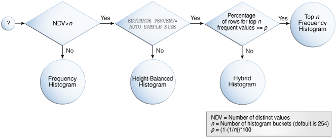
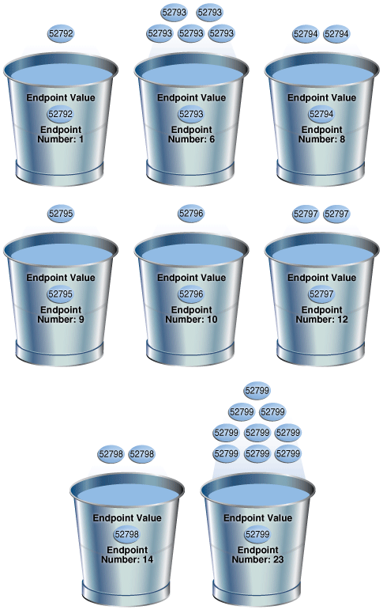
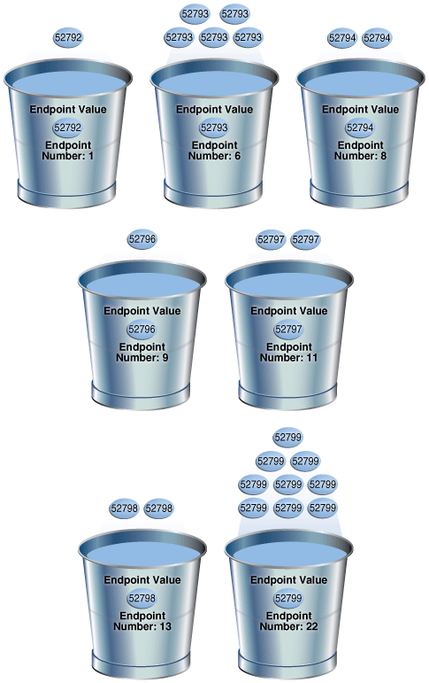
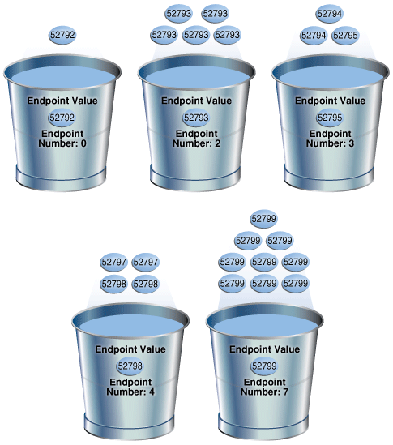
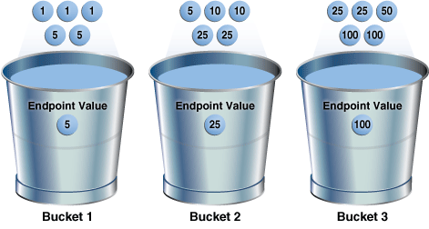
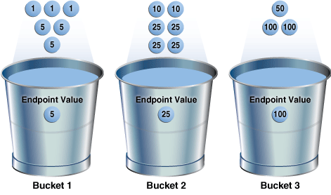
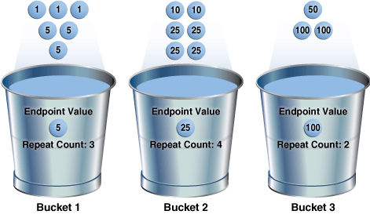

A **histogram** is a special type of column statistic that provides more detailed information about the data distribution in a table column. A histogram sorts values into "buckets," as you might sort coins into buckets.

Based on the [NDV](glossary.md) and the distribution of the data, the database chooses the type of histogram to create. (In some cases, when creating a histogram, the database samples an internally predetermined number of rows.) The types of histograms are as follows:

- Frequency histograms and top frequency histograms
- Height-Balanced histograms (legacy)
- Hybrid histograms

### 11.1 Purpose of Histograms

By default the optimizer assumes a uniform distribution of rows across the distinct values in a column.

For columns that contain [data skew](glossary.md) (a nonuniform distribution of data within the column), a histogram enables the optimizer to generate accurate [cardinality](glossary.md) estimates for filter and join predicates that involve these columns.

For example, a California-based book store ships 95% of the books to California, 4% to Oregon, and 1% to Nevada. The book orders table has 300,000 rows. A table column stores the state to which orders are shipped. A user queries the number of books shipped to Oregon. Without a histogram, the optimizer assumes an even distribution of 300000/3 (the NDV is 3), estimating cardinality at 100,000 rows. With this estimate, the optimizer chooses a [full table scan](glossary.md). With a histogram, the optimizer calculates that 4% of the books are shipped to Oregon, and chooses an index scan.

### 11.2 When Oracle Database Creates Histograms

If `DBMS_STATS` gathers statistics for a table, and if queries have referenced the columns in this table, then Oracle Database creates histograms automatically as needed according to the previous query workload.

The basic process is as follows:

1. You run `DBMS_STATS` for a table with the `METHOD_OPT` parameter set to the default `SIZE AUTO`.
2. A user queries the table.
3. The database notes the predicates in the preceding query and updates the data dictionary table `SYS.COL_USAGE$`.
4. You run `DBMS_STATS` again, causing `DBMS_STATS` to query `SYS.COL_USAGE$` to determine which columns require histograms based on the previous query workload.

Consequences of the `AUTO` feature include the following:

- As queries change over time, `DBMS_STATS` may change which statistics it gathers. For example, even if the data in a table does not change, queries and `DBMS_STATS` operations can cause the plans for queries that reference these tables to change.
- If you gather statistics for a table and do not query the table, then the database does not create histograms for columns in this table. For the database to create the histograms automatically, you must run one or more queries to populate the column usage information in `SYS.COL_USAGE$`.

Example 11-1 Automatic Histogram Creation

Assume that `sh.sh_ext` is an external table that contains the same rows as the `sh.sales` table. You create new table `sales2` and perform a bulk load using `sh_ext` as a source, which automatically creates statistics for `sales2`. You also create indexes as follows:

```
SQL> CREATE TABLE sales2 AS SELECT * FROM sh_ext;
SQL> CREATE INDEX sh_12c_idx1 ON sales2(prod_id);
SQL> CREATE INDEX sh_12c_idx2 ON sales2(cust_id,time_id);
```

You query the data dictionary to determine whether histograms exist for the `sales2` columns. Because `sales2` has not yet been queried, the database has not yet created histograms:

```
SQL> SELECT COLUMN_NAME, NOTES, HISTOGRAM 
  2  FROM   USER_TAB_COL_STATISTICS 
  3  WHERE  TABLE_NAME = 'SALES2';

COLUMN_NAME   NOTES          HISTOGRAM
------------- -------------- ---------
AMOUNT_SOLD   STATS_ON_LOAD  NONE
QUANTITY_SOLD STATS_ON_LOAD  NONE
PROMO_ID      STATS_ON_LOAD  NONE
CHANNEL_ID    STATS_ON_LOAD  NONE
TIME_ID       STATS_ON_LOAD  NONE
CUST_ID       STATS_ON_LOAD  NONE
PROD_ID       STATS_ON_LOAD  NONE
```

You query `sales2` for the number of rows for product `42`, and then gather table statistics using the `GATHER AUTO` option:

```
SQL> SELECT COUNT(*) FROM sales2 WHERE prod_id = 42;

  COUNT(*)
----------
     12116

SQL> EXEC DBMS_STATS.GATHER_TABLE_STATS(USER,'SALES2',OPTIONS=>'GATHER AUTO');
```

A query of the data dictionary now shows that the database created a histogram on the `prod_id` column based on the information gather during the preceding query:

```
SQL> SELECT COLUMN_NAME, NOTES, HISTOGRAM 
  2  FROM   USER_TAB_COL_STATISTICS 
  3  WHERE  TABLE_NAME = 'SALES2';

COLUMN_NAME   NOTES          HISTOGRAM
------------- -------------- ---------
AMOUNT_SOLD   STATS_ON_LOAD  NONE
QUANTITY_SOLD STATS_ON_LOAD  NONE
PROMO_ID      STATS_ON_LOAD  NONE
CHANNEL_ID    STATS_ON_LOAD  NONE
TIME_ID       STATS_ON_LOAD  NONE
CUST_ID       STATS_ON_LOAD  NONE
PROD_ID       HISTOGRAM_ONLY FREQUENCY
```

### 11.3 How Oracle Database Chooses the Histogram Type

Oracle Database uses several criteria to determine which histogram to create: frequency, top frequency, height-balanced, or hybrid.

The histogram formula uses the following variables:

- NDV
	This represents the number of distinct values in a column. For example, if a column only contains the values `100`, `200`, and `300`, then the NDV for this column is 3.
- n
	This variable represents the number of histogram buckets. The default is 254.
- p
	This variable represents an internal percentage threshold that is equal to (1–(1/n)) \* 100. For example, if n = 254, then p is 99.6.

An additional criterion is whether the `estimate_percent` parameter in the `DBMS_STATS` statistics gathering procedure is set to `AUTO_SAMPLE_SIZE` (default).

The following diagram shows the decision tree for histogram creation.

Figure 11-1 Decision Tree for Histogram Creation



> This graphic depicts a flow chart for the creation of a histogram type. On the left is a circle containing a question mark. It points right toward a diamond that contains “NDV>n.” This points down to a circle labeled “Frequency Histogram.” The arrow is labeled “No.” The diamond points right, with arrow labeled “Yes,” to a diamond that contains “ESTIMATE\_PERCENT=AUTO\_SAMPLE\_SIZE.” This diamond points down, with arrow labeled “No,” to a circle labeled “Height-Balanced Histogram.” The diamond points right, with arrow labeled “Yes,” to a diamond labeled “Percentage of rows for top n frequent values >= p.” The diamond points down, with arrow labeled “No,” to a circle labeled “Hybrid Histogram.” The diamond points right, with arrow labeled “Yes,” to a circle labeled “Top n Frequency Histogram.” The legend says: “NDV = Number of distinct values; n = Number of histogram buckets (default is 254)”; “p = (1–(1/n))\*100.”


### 11.4 Cardinality Algorithms When Using Histograms

For histograms, the algorithm for cardinality depends on factors such as the endpoint numbers and values, and whether column values are popular or nonpopular.

#### 11.4.1 Endpoint Numbers and Values

An **endpoint number** is a number that uniquely identifies a bucket. In frequency and hybrid histograms, the endpoint number is the cumulative frequency of all values included in the current and previous buckets.

For example, a bucket with endpoint number `100` means the total frequency of values in the current and all previous buckets is 100. In height-balanced histograms, the optimizer numbers buckets sequentially, starting at `0` or `1`. In all cases, the endpoint number is the bucket number.

An [endpoint value](glossary.md) is the highest value in the range of values in a bucket. For example, if a bucket contains only the values `52794` and `52795`, then the endpoint value is `52795`.

#### 11.4.2 Popular and Nonpopular Values

The popularity of a value in a histogram affects the cardinality estimate algorithm.

Specifically, the cardinality estimate is affected as follows:

- Popular values
	A [popular value](glossary.md) occurs as an endpoint value of multiple buckets. The optimizer determines whether a value is popular by first checking whether it is the endpoint value for a bucket. If so, then for frequency histograms, the optimizer subtracts the endpoint number of the previous bucket from the endpoint number of the current bucket. Hybrid histograms already store this information for each endpoint individually. If this value is greater than 1, then the value is popular.
	The optimizer calculates its cardinality estimate for popular values using the following formula:
	```
	cardinality of popular value = 
	  (num of rows in table) * 
	  (num of endpoints spanned by this value / total num of endpoints)
	```
- Nonpopular values
	Any value that is not popular is a [nonpopular value](glossary.md). The optimizer calculates the cardinality estimates for nonpopular values using the following formula:
	```
	cardinality of nonpopular value = 
	  (num of rows in table) * density
	```
	The optimizer calculates [density](glossary.md) using an internal algorithm based on factors such as the number of buckets and the NDV. Density is expressed as a decimal number between `0` and `1`. Values close to `1` indicate that the optimizer expects many rows to be returned by a query referencing this column in its predicate list. Values close to `0` indicate that the optimizer expects few rows to be returned.

See Also:

[Oracle Database Reference](https://docs.oracle.com/pls/topic/lookup?ctx=en/database/oracle/oracle-database/21/tgsql&id=REFRN23275) to learn about the `DBA_TAB_COL_STATISTICS.DENSITY` column

#### 11.4.3 Bucket Compression

In some cases, to reduce the total number of buckets, the optimizer compresses multiple buckets into a single bucket.

For example, the following frequency histogram indicates that the first bucket number is `1` and the last bucket number is `23`:

```
ENDPOINT_NUMBER ENDPOINT_VALUE
--------------- --------------
              1          52792
              6          52793
              8          52794 
              9          52795
             10          52796
             12          52797
             14          52798
             23          52799
```

Several buckets are "missing." Originally, buckets `2` through `6` each contained a single instance of value `52793`. The optimizer compressed all of these buckets into the bucket with the highest endpoint number (bucket `6`), which now contains 5 instances of value `52793`. This value is popular because the difference between the endpoint number of the current bucket (`6`) and the previous bucket (`1`) is 5. Thus, before compression the value `52793` was the endpoint for 5 buckets.

The following annotations show which buckets are compressed, and which values are popular:

```
ENDPOINT_NUMBER ENDPOINT_VALUE
--------------- --------------
              1          52792 -> nonpopular
              6          52793 -> buckets 2-6 compressed into 6; popular
              8          52794 -> buckets 7-8 compressed into 8; popular
              9          52795 -> nonpopular
             10          52796 -> nonpopular
             12          52797 -> buckets 11-12 compressed into 12; popular
             14          52798 -> buckets 13-14 compressed into 14; popular
             23          52799 -> buckets 15-23 compressed into 23; popular
```

### 11.5 Frequency Histograms

In a **frequency histogram**, each distinct column value corresponds to a single bucket of the histogram. Because each value has its own dedicated bucket, some buckets may have many values, whereas others have few.

An analogy to a frequency histogram is sorting coins so that each individual coin initially gets its own bucket. For example, the first penny is in bucket 1, the second penny is in bucket 2, the first nickel is in bucket 3, and so on. You then consolidate all the pennies into a single penny bucket, all the nickels into a single nickel bucket, and so on with the remainder of the coins.

#### 11.5.1 Criteria For Frequency Histograms

Frequency histograms depend on the number of requested histogram buckets.

As shown in the logic diagram in " How Oracle Database Chooses the Histogram Type ", the database creates a frequency histogram when the following criteria are met:

- NDV is less than or equal to n, where n is the number of histogram buckets (default `254`).
	For example, the `sh.countries.country_subregion_id` column has 8 distinct values, ranging sequentially from `52792` to `52799`. If n is the default of `254`, then the optimizer creates a frequency histogram because `8 <= 254`.
- The `estimate_percent` parameter in the `DBMS_STATS` statistics gathering procedure is set to either a user-specified value or to `AUTO_SAMPLE_SIZE`.

Starting in Oracle Database 12c, if the sampling size is the default of `AUTO_SAMPLE_SIZE`, then the database creates frequency histograms from a full table scan. For all other sampling percentage specifications, the database derives frequency histograms from a sample. In releases earlier than Oracle Database 12c, the database gathered histograms based on a small sample, which meant that low-frequency values often did not appear in the sample. Using density in this case sometimes led the optimizer to overestimate selectivity.

See Also:

[Oracle Database PL/SQL Packages and Types Reference](https://docs.oracle.com/pls/topic/lookup?ctx=en/database/oracle/oracle-database/21/tgsql&id=ARPLS68490) to learn about `AUTO_SAMPLE_SIZE`

#### 11.5.2 Generating a Frequency Histogram

This scenario shows how to generate a frequency histogram using the sample schemas.

Assumptions

This scenario assumes that you want to generate a frequency histogram on the `sh.countries.country_subregion_id` column. This table has 23 rows.

The following query shows that the `country_subregion_id` column contains 8 distinct values (sample output included) that are unevenly distributed:

```
SELECT country_subregion_id, count(*)
FROM   sh.countries
GROUP BY country_subregion_id
ORDER BY 1;
 
COUNTRY_SUBREGION_ID   COUNT(*)
-------------------- ----------
               52792          1
               52793          5
               52794          2
               52795          1
               52796          1
               52797          2
               52798          2
               52799          9
```

To generate a frequency histogram:

1. Gather statistics for `sh.countries` and the `country_subregion_id` column, letting the number of buckets default to 254.
	For example, execute the following PL/SQL anonymous block:
	```
	BEGIN
	  DBMS_STATS.GATHER_TABLE_STATS ( 
	    ownname    => 'SH'
	,   tabname    => 'COUNTRIES'
	,   method_opt => 'FOR COLUMNS COUNTRY_SUBREGION_ID'
	);
	END;
	```
2. Query the histogram information for the `country_subregion_id` column.
	For example, use the following query (sample output included):
	```
	SELECT TABLE_NAME, COLUMN_NAME, NUM_DISTINCT, HISTOGRAM
	FROM   USER_TAB_COL_STATISTICS
	WHERE  TABLE_NAME='COUNTRIES'
	AND    COLUMN_NAME='COUNTRY_SUBREGION_ID';
	 
	TABLE_NAME COLUMN_NAME          NUM_DISTINCT HISTOGRAM
	---------- -------------------- ------------ ---------------
	COUNTRIES  COUNTRY_SUBREGION_ID            8 FREQUENCY
	```
	The optimizer chooses a frequency histogram because n or fewer distinct values exist in the column, where n defaults to `254`.
3. Query the endpoint number and endpoint value for the `country_subregion_id` column.
	For example, use the following query (sample output included):
	```
	SELECT ENDPOINT_NUMBER, ENDPOINT_VALUE
	FROM   USER_HISTOGRAMS
	WHERE  TABLE_NAME='COUNTRIES'
	AND    COLUMN_NAME='COUNTRY_SUBREGION_ID';
	 
	ENDPOINT_NUMBER ENDPOINT_VALUE
	--------------- --------------
	              1          52792
	              6          52793
	              8          52794
	              9          52795
	             10          52796
	             12          52797
	             14          52798
	             23          52799
	```
	Figure 11-2 is a graphical illustration of the 8 buckets in the histogram. Each value is represented as a coin that is dropped into a bucket.
	Figure 11-2 Frequency Histogram
	

> This graphic shows 8 buckets. The 1st bucket has an Endpoint Value of 52792. The Endpoint Number is 1. The coin 52792 appears over the bucket. Bucket 2 has an Endpoint Value of 52793 and an Endpoint Number of 6. 5 coins appear above the bucket, all with the value 52793. Bucket 3 has the Endpoint Value 52794. The Endpoint Number is 8. 2 coins appear above the bucket, both the values 52794. Bucket 4 has the Endpoint Value 52795. The Endpoint Number is 9. 1 coin appears above the bucket with the value 52795. Bucket 5 has the Endpoint Value 52798. The Endpoint Number is 10. The coin above the bucket has the value 52798. Bucket 6 has the Endpoint Value 52797. The Endpoint Number is 12. The 2 coins above the bucket have the values 52797. Bucket 7 has the Endpoint Value 52798. The Endpoint Number is 14. The 2 coins above the bucket have the values 52798. Bucket 8 has the Endpoint Value 52799. The Endpoint Number is 23. The 9 coins above the bucket have the values 52799.

	As shown in Figure 11-2, each distinct value has its own bucket. Because this is a frequency histogram, the endpoint number is the cumulative frequency of endpoints. For `52793`, the endpoint number `6` indicates that the value appears 5 times (6 - 1). For `52794`, the endpoint number `8` indicates that the value appears 2 times (8 - 6).
	Every bucket whose endpoint is at least 2 greater than the previous endpoint contains a popular value. Thus, buckets `6`, `8`, `12`, `14`, and `23` contain popular values. The optimizer calculates their cardinality based on endpoint numbers. For example, the optimizer calculates the cardinality (`C`) of value `52799` using the following formula, where the number of rows in the table is 23:
	```
	C = 23 * ( 9 / 23 )
	```
	Buckets `1`, `9`, and `10` contain nonpopular values. The optimizer estimates their cardinality based on density.

See Also:

- [Oracle Database PL/SQL Packages and Types Reference](https://docs.oracle.com/pls/topic/lookup?ctx=en/database/oracle/oracle-database/21/tgsql&id=ARPLS-GUID-CA6A56B9-0540-45E9-B1D7-D78769B7714C) to learn about the `DBMS_STATS.GATHER_TABLE_STATS` procedure
- [Oracle Database Reference](https://docs.oracle.com/pls/topic/lookup?ctx=en/database/oracle/oracle-database/21/tgsql&id=REFRN-GUID-4FF4364B-29D0-4365-AA0F-ABD17CE298EC) to learn about the `USER_TAB_COL_STATISTICS` view
- [Oracle Database Reference](https://docs.oracle.com/pls/topic/lookup?ctx=en/database/oracle/oracle-database/21/tgsql&id=REFRN-GUID-582FAF05-FA3B-45D6-BDD3-B35C5E209368) to learn about the `USER_HISTOGRAMS` view

### 11.6 Top Frequency Histograms

A **top frequency histogram** is a variation on a frequency histogram that ignores nonpopular values that are statistically insignificant.

For example, if a pile of 1000 coins contains only a single penny, then you can ignore the penny when sorting the coins into buckets. A top frequency histogram can produce a better histogram for highly popular values.

#### 11.6.1 Criteria For Top Frequency Histograms

If a small number of values occupies most of the rows, then creating a frequency histogram on this small set of values is useful even when the NDV is greater than the number of requested histogram buckets. To create a better quality histogram for popular values, the optimizer ignores the nonpopular values and creates a top frequency histogram.

As shown in the logic diagram in " How Oracle Database Chooses the Histogram Type ", the database creates a top frequency histogram when the following criteria are met:

- NDV is greater than n, where n is the number of histogram buckets (default `254`).
- The percentage of rows occupied by the top n frequent values is equal to or greater than threshold p, where p is `(1-(1/` `n``))*100`.
- The `estimate_percent` parameter in the `DBMS_STATS` statistics gathering procedure is set to `AUTO_SAMPLE_SIZE`.

See Also:

[Oracle Database PL/SQL Packages and Types Reference](https://docs.oracle.com/pls/topic/lookup?ctx=en/database/oracle/oracle-database/21/tgsql&id=ARPLS68490) to learn about `AUTO_SAMPLE_SIZE`

#### 11.6.2 Generating a Top Frequency Histogram

This scenario shows how to generate a top frequency histogram using the sample schemas.

Assumptions

This scenario assumes that you want to generate a top frequency histogram on the `sh.countries.country_subregion_id` column. This table has 23 rows.

The following query shows that the `country_subregion_id` column contains 8 distinct values (sample output included) that are unevenly distributed:

```
SELECT country_subregion_id, count(*)
FROM   sh.countries
GROUP BY country_subregion_id
ORDER BY 1;
 
COUNTRY_SUBREGION_ID   COUNT(*)
-------------------- ----------
               52792          1
               52793          5
               52794          2
               52795          1
               52796          1
               52797          2
               52798          2
               52799          9
```

To generate a top frequency histogram:

1. Gather statistics for `sh.countries` and the `country_subregion_id` column, specifying fewer buckets than distinct values.
	For example, enter the following command to specify 7 buckets:
	```
	BEGIN
	  DBMS_STATS.GATHER_TABLE_STATS (
	    ownname    => 'SH'
	,   tabname    => 'COUNTRIES'
	,   method_opt => 'FOR COLUMNS COUNTRY_SUBREGION_ID SIZE 7'
	);
	END;
	```
2. Query the histogram information for the `country_subregion_id` column.
	For example, use the following query (sample output included):
	```
	SELECT TABLE_NAME, COLUMN_NAME, NUM_DISTINCT, HISTOGRAM
	FROM   USER_TAB_COL_STATISTICS
	WHERE  TABLE_NAME='COUNTRIES'
	AND    COLUMN_NAME='COUNTRY_SUBREGION_ID';
	 
	TABLE_NAME COLUMN_NAME          NUM_DISTINCT HISTOGRAM
	---------- -------------------- ------------ ---------------
	COUNTRIES  COUNTRY_SUBREGION_ID            7 TOP-FREQUENCY
	```
	The `sh.countries.country_subregion_id` column contains 8 distinct values, but the histogram only contains 7 buckets, making n `=7`. In this case, the database can only create a top frequency or hybrid histogram. In the `country_subregion_id` column, the top 7 most frequent values occupy 95.6% of the rows, which exceeds the threshold of 85.7%, generating a top frequency histogram.
3. Query the endpoint number and endpoint value for the column.
	For example, use the following query (sample output included):
	```
	SELECT ENDPOINT_NUMBER, ENDPOINT_VALUE
	FROM   USER_HISTOGRAMS
	WHERE  TABLE_NAME='COUNTRIES'
	AND    COLUMN_NAME='COUNTRY_SUBREGION_ID';
	 
	ENDPOINT_NUMBER ENDPOINT_VALUE
	--------------- --------------
	              1          52792
	              6          52793
	              8          52794
	              9          52796
	             11          52797
	             13          52798
	             22          52799
	```
	Figure 11-3 is a graphical illustration of the 7 buckets in the top frequency histogram. The values are represented in the diagram as coins.
	Figure 11-3 Top Frequency Histogram
	

> This graphic shows 8 buckets. The 1st bucket has an Endpoint Value of 52792. The Endpoint Number is 1. The coin 52792 appears over the bucket. Bucket 2 has an Endpoint Value of 52793 and an Endpoint Number of 6. 5 coins appear above the bucket, all with the value 52793. Bucket 3 has the Endpoint Value 52794. The Endpoint Number is 8. 2 coins appear above the bucket, both the values 52794. Bucket 4 has the Endpoint Value 52796. The Endpoint Number is 9. 1 coin appears above the bucket with the value 52796. Bucket 5 has the Endpoint Value 52797. The Endpoint Number is 11. The 2 coins above the bucket have the value 52797.
>
> Bucket 6 has the Endpoint Value 52798. The Endpoint Number is 13. The 2 coins above the bucket have the values 52798. Bucket 7 has the Endpoint Value 52799. The Endpoint Number is 22. The 9 coins above the bucket have the values 52799.

	As shown in Figure 11-3, each distinct value has its own bucket except for `52795`, which is excluded from the histogram because it is nonpopular and statistically insignificant. As in a standard frequency histogram, the endpoint number represents the cumulative frequency of values.

See Also:

- " Criteria For Frequency Histograms "
- [Oracle Database PL/SQL Packages and Types Reference](https://docs.oracle.com/pls/topic/lookup?ctx=en/database/oracle/oracle-database/21/tgsql&id=ARPLS-GUID-CA6A56B9-0540-45E9-B1D7-D78769B7714C) to learn about the `DBMS_STATS.GATHER_TABLE_STATS` procedure
- [Oracle Database Reference](https://docs.oracle.com/pls/topic/lookup?ctx=en/database/oracle/oracle-database/21/tgsql&id=REFRN-GUID-4FF4364B-29D0-4365-AA0F-ABD17CE298EC) to learn about the `USER_TAB_COL_STATISTICS` view
- [Oracle Database Reference](https://docs.oracle.com/pls/topic/lookup?ctx=en/database/oracle/oracle-database/21/tgsql&id=REFRN-GUID-582FAF05-FA3B-45D6-BDD3-B35C5E209368) to learn about the `USER_HISTOGRAMS` view

### 11.7 Height-Balanced Histograms (Legacy)

In a legacy height-balanced histogram, column values are divided into buckets so that each bucket contains approximately the same number of rows.

For example, if you have 99 coins to distribute among 4 buckets, each bucket contains about 25 coins. The histogram shows where the endpoints fall in the range of values.

#### 11.7.1 Criteria for Height-Balanced Histograms

Before Oracle Database 12c, the database created a height-balanced histogram when the NDV was greater than n. This type of histogram was useful for range predicates, and equality predicates on values that appear as endpoints in at least two buckets.

As shown in the logic diagram in " How Oracle Database Chooses the Histogram Type ", the database creates a height-balanced histogram when the following criteria are met:

- NDV is greater than n, where n is the number of histogram buckets (default `254`).
- The `estimate_percent` parameter in the `DBMS_STATS` statistics gathering procedure is not set to `AUTO_SAMPLE_SIZE`.

It follows that if Oracle Database 12c creates new histograms, and if the sampling percentage is `AUTO_SAMPLE_SIZE`, then the histograms are either top frequency or hybrid, but not height-balanced.

If you upgrade Oracle Database 11g to Oracle Database 12c, then any height-based histograms created before the upgrade remain in use. However, if you refresh statistics on the table on which the histogram was created, then the database replaces existing height-balanced histograms on this table. The type of replacement histogram depends on both the NDV and the following criteria:

- If the sampling percentage is `AUTO_SAMPLE_SIZE`, then the database creates either hybrid or frequency histograms.
- If the sampling percentage is not `AUTO_SAMPLE_SIZE`, then the database creates either height-balanced or frequency histograms.

#### 11.7.2 Generating a Height-Balanced Histogram

This scenario shows how to generate a height-balanced histogram using the sample schemas.

Assumptions

This scenario assumes that you want to generate a height-balanced histogram on the `sh.countries.country_subregion_id` column. This table has 23 rows.

The following query shows that the `country_subregion_id` column contains 8 distinct values (sample output included) that are unevenly distributed:

```
SELECT country_subregion_id, count(*)
FROM   sh.countries
GROUP BY country_subregion_id
ORDER BY 1;
 
COUNTRY_SUBREGION_ID   COUNT(*)
-------------------- ----------
               52792          1
               52793          5
               52794          2
               52795          1
               52796          1
               52797          2
               52798          2
               52799          9
```

To generate a height-balanced histogram:

1. Gather statistics for `sh.countries` and the `country_subregion_id` column, specifying fewer buckets than distinct values.
	Note:
	To simulate Oracle Database 11g behavior, which is necessary to create a height-based histogram, set `estimate_percent` to a nondefault value. If you specify a nondefault percentage, then the database creates frequency or height-balanced histograms.
	For example, enter the following command:
	```
	BEGIN  DBMS_STATS.GATHER_TABLE_STATS ( 
	    ownname          => 'SH'
	,   tabname          => 'COUNTRIES'
	,   method_opt       => 'FOR COLUMNS COUNTRY_SUBREGION_ID SIZE 7'
	,   estimate_percent => 100 
	);
	END;
	```
2. Query the histogram information for the `country_subregion_id` column.
	For example, use the following query (sample output included):
	```
	SELECT TABLE_NAME, COLUMN_NAME, NUM_DISTINCT, HISTOGRAM
	FROM   USER_TAB_COL_STATISTICS
	WHERE  TABLE_NAME='COUNTRIES'
	AND    COLUMN_NAME='COUNTRY_SUBREGION_ID';
	 
	TABLE_NAME COLUMN_NAME          NUM_DISTINCT HISTOGRAM
	---------- -------------------- ------------ ---------------
	COUNTRIES  COUNTRY_SUBREGION_ID            8 HEIGHT BALANCED
	```
	The optimizer chooses a height-balanced histogram because the number of distinct values (8) is greater than the number of buckets (7), and the `estimate_percent` value is nondefault.
3. Query the number of rows occupied by each distinct value.
	For example, use the following query (sample output included):
	```
	SELECT COUNT(country_subregion_id) AS NUM_OF_ROWS, country_subregion_id 
	FROM   countries 
	GROUP BY country_subregion_id 
	ORDER BY 2;
	 
	NUM_OF_ROWS COUNTRY_SUBREGION_ID
	----------- --------------------
	          1                52792
	          5                52793
	          2                52794
	          1                52795
	          1                52796
	          2                52797
	          2                52798
	          9                52799
	```
4. Query the endpoint number and endpoint value for the `country_subregion_id` column.
	For example, use the following query (sample output included):
	```
	SELECT ENDPOINT_NUMBER, ENDPOINT_VALUE
	FROM   USER_HISTOGRAMS
	WHERE  TABLE_NAME='COUNTRIES'
	AND    COLUMN_NAME='COUNTRY_SUBREGION_ID';
	 
	ENDPOINT_NUMBER ENDPOINT_VALUE
	--------------- --------------
	              0          52792
	              2          52793
	              3          52795
	              4          52798
	              7          52799
	```
	The following illustration represents a height-balanced histogram. The values are represented in the diagram as coins.
	Figure 11-4 Height-Balanced Histogram
	

> This graphic shows 5 buckets.
>
> The 1st bucket has an Endpoint Value of 52792. The Endpoint Number is 0. The coin 52792 appears over the bucket.
>
> Bucket 2 has an Endpoint Value of 52793 and an Endpoint Number of 2. 5 coins appear above the bucket, all with the value 52793.
>
> Bucket 3 has the Endpoint Value 52795. The Endpoint Number is 3. 3 coins appear above the bucket, one with the value 52795, and the others with the value 52794.
>
> Bucket 4 has the Endpoint Value 52798. The Endpoint Number is 4. 4 coins appear above the bucket with the values 52797, 52797, 52798, 52798.
>
> Bucket 5 has the Endpoint Value 52799. The Endpoint Number is 7. The 9 coins above the bucket all have the value 52799.

	The bucket number is identical to the endpoint number. The optimizer records the value of the last row in each bucket as the endpoint value, and then checks to ensure that the minimum value is the endpoint value of the first bucket, and the maximum value is the endpoint value of the last bucket. In this example, the optimizer adds bucket `0` so that the minimum value `52792` is the endpoint of a bucket.
	The optimizer must evenly distribute 23 rows into the 7 specified histogram buckets, so each bucket contains approximately 3 rows. However, the optimizer compresses buckets with the same endpoint. So, instead of bucket `1` containing 2 instances of value `52793`, and bucket `2` containing 3 instances of value `52793`, the optimizer puts all 5 instances of value `52793` into bucket `2`. Similarly, instead of having buckets `5`, `6`, and `7` contain 3 values each, with the endpoint of each bucket as `52799`, the optimizer puts all 9 instances of value `52799` into bucket `7`.
	In this example, buckets `3` and `4` contain nonpopular values because the difference between the current endpoint number and previous endpoint number is 1. The optimizer calculates cardinality for these values based on density. The remaining buckets contain popular values. The optimizer calculates cardinality for these values based on endpoint numbers.

See Also:

- [Oracle Database PL/SQL Packages and Types Reference](https://docs.oracle.com/pls/topic/lookup?ctx=en/database/oracle/oracle-database/21/tgsql&id=ARPLS-GUID-CA6A56B9-0540-45E9-B1D7-D78769B7714C) to learn about the `DBMS_STATS.GATHER_TABLE_STATS` procedure
- Oracle Database Reference to learn about the [`USER_TAB_COL_STATISTICS`](https://docs.oracle.com/pls/topic/lookup?ctx=en/database/oracle/oracle-database/21/tgsql&id=REFRN-GUID-4FF4364B-29D0-4365-AA0F-ABD17CE298EC) and [`USER_HISTOGRAMS`](https://docs.oracle.com/pls/topic/lookup?ctx=en/database/oracle/oracle-database/21/tgsql&id=REFRN-GUID-582FAF05-FA3B-45D6-BDD3-B35C5E209368) views

### 11.8 Hybrid Histograms

A **hybrid histogram** combines characteristics of both height-based histograms and frequency histograms. This "best of both worlds" approach enables the optimizer to obtain better selectivity estimates in some situations.

The height-based histogram sometimes produces inaccurate estimates for values that are almost popular. For example, a value that occurs as an endpoint value of only one bucket but almost occupies two buckets is not considered popular.

To solve this problem, a hybrid histogram distributes values so that no value occupies more than one bucket, and then stores the [endpoint repeat count](glossary.md) value, which is the number of times the endpoint value is repeated, for each endpoint (bucket) in the histogram. By using the repeat count, the optimizer can obtain accurate estimates for almost popular values.

#### 11.8.1 How Endpoint Repeat Counts Work

The analogy of coins distributed among buckets illustrate show endpoint repeat counts work.

The following figure illustrates a `coins` column that sorts values from low to high.

Figure 11-5 Coins


> This graphic shows 15 coins in a row: 1, 1, 1, 5, 5, 5, 10, 10, 25, 25, 25, 25, 50, 100, 100.
>
> [  
> Copyright © 2013, 2023, Oracle and/or its affiliates.](https://docs.oracle.com/en/database/oracle/oracle-database/dcommon/html/cpyr.htm)


You gather statistics for this table, setting the `method_opt` argument of `DBMS_STATS.GATHER_TABLE_STATS` to `FOR ALL COLUMNS SIZE 3`. In this case, the optimizer initially groups the values in the `coins` column into three buckets, as shown in the following figure.

Figure 11-6 Initial Distribution of Values



> This graphic shows three buckets. Bucket 1 contains the text "Endpoint Value 5." Above the bucket are 5 coins with values 1, 1, 1, 5, 5. Bucket contains the text "Endpoint Value 25." Above the bucket are 5 coins, with values 5, 10, 10, 25, 25. Bucket 3 has the text "Endpoint Value 100." Above the buckets are 5 coins, with values 25, 25, 50, 100, 100.


If a bucket border splits a value so that some occurrences of the value are in one bucket and some in another, then the optimizer shifts the bucket border (and all other following bucket borders) forward to include all occurrences of the value. For example, the optimizer shifts value `5` so that it is now wholly in the first bucket, and the value `25` is now wholly in the second bucket.

Figure 11-7 Redistribution of Values



> This graphic shows three buckets. Bucket 1 contains the text "Endpoint Value 5." Above the bucket are 5 coins with values 1, 1, 1, 5, 5. Bucket 2 contains the text "Endpoint Value 25." Above the bucket are 5 coins, with values 10, 10, 25, 25, 25, 25. Bucket 3 has the text "Endpoint Value 100." Above the buckets are coins with values 50, 100, 100.


The endpoint repeat count measures the number of times that the corresponding bucket endpoint, which is the value at the right bucket border, repeats itself. For example, in the first bucket, the value `5` is repeated 3 times, so the endpoint repeat count is `3`.

Figure 11-8 Endpoint Repeat Count



> This graphic shows three buckets. Bucket 1 contains the text "Endpoint Value 5, Repeat Count: 3." Above the bucket are coins with values 1, 1, 1, 5, 5, 5. Bucket 2 contains the text "Endpoint Value 25, Repeat Count: 4." Above the bucket are 5 coins, with values 10, 10, 25, 25, 25, 25. Bucket 3 has the text "Endpoint Value 100, Repeat Count: 2." Above the buckets are coins with values 50, 100, 100.


Height-balanced histograms do not store as much information as hybrid histograms. By using repeat counts, the optimizer can determine exactly how many occurrences of an endpoint value exist. For example, the optimizer knows that the value `5` appears 3 times, the value `25` appears 4 times, and the value `100` appears 2 times. This frequency information helps the optimizer to generate better cardinality estimates.

#### 11.8.2 Criteria for Hybrid Histograms

The only differentiating criterion for hybrid histograms as compared to top frequency histograms is that the top n frequent values is less than internal threshold p.

As shown in the logic diagram in " How Oracle Database Chooses the Histogram Type ", the database creates a hybrid histogram when the following criteria are met:

- NDV is greater than n, where n is the number of histogram buckets (default is `254`).
- The criteria for top frequency histograms do not apply.
	This is another way to stating that the percentage of rows occupied by the top n frequent values is less than threshold p, where p is `(1-(1/` `n``))*100`.
- The `estimate_percent` parameter in the `DBMS_STATS` statistics gathering procedure is set to `AUTO_SAMPLE_SIZE`.
	If users specify their own percentage, then the database creates frequency or height-balanced histograms.

See Also:

- " Criteria For Top Frequency Histograms."
- " Height-Balanced Histograms (Legacy) "
- [Oracle Database PL/SQL Packages and Types Reference](https://docs.oracle.com/pls/topic/lookup?ctx=en/database/oracle/oracle-database/21/tgsql&id=ARPLS-GUID-CA6A56B9-0540-45E9-B1D7-D78769B7714C) to learn more about the `estimate_percent` parameter

#### 11.8.3 Generating a Hybrid Histogram

This scenario shows how to generate a hybrid histogram using the sample schemas.

Assumptions

This scenario assumes that you want to generate a hybrid histogram on the `sh.products.prod_subcategory_id` column. This table has 72 rows. The `prod_subcategory_id` column contains 22 distinct values.

To generate a hybrid histogram:

1. Gather statistics for `sh.products` and the `prod_subcategory_id` column, specifying 10 buckets.
	For example, enter the following command:
	```
	BEGIN  DBMS_STATS.GATHER_TABLE_STATS ( 
	    ownname     => 'SH'
	,   tabname     => 'PRODUCTS'
	,   method_opt  => 'FOR COLUMNS PROD_SUBCATEGORY_ID SIZE 10'
	);
	END;
	```
2. Query the number of rows occupied by each distinct value.
	For example, use the following query (sample output included):
	```
	SELECT COUNT(prod_subcategory_id) AS NUM_OF_ROWS, prod_subcategory_id
	FROM   products
	GROUP BY prod_subcategory_id
	ORDER BY 1 DESC;
	 
	NUM_OF_ROWS PROD_SUBCATEGORY_ID
	----------- -------------------
	          8                2014
	          7                2055
	          6                2032
	          6                2054
	          5                2056
	          5                2031
	          5                2042
	          5                2051
	          4                2036
	          3                2043
	          2                2033
	          2                2034
	          2                2013
	          2                2012
	          2                2053
	          2                2035
	          1                2022
	          1                2041
	          1                2044
	          1                2011
	          1                2021
	          1                2052
	 
	22 rows selected.
	```
	The column contains 22 distinct values. Because the number of buckets (10) is less than 22, the optimizer cannot create a frequency histogram. The optimizer considers both hybrid and top frequency histograms. To qualify for a top frequency histogram, the percentage of rows occupied by the top 10 most frequent values must be equal to or greater than threshold p, where p is (1-(1/10))\*100, or 90%. However, in this case the top 10 most frequent values occupy 54 rows out of 72, which is only 75% of the total. Therefore, the optimizer chooses a hybrid histogram because the criteria for a top frequency histogram do not apply.
3. Query the histogram information for the `country_subregion_id` column.
	For example, use the following query (sample output included):
	```
	SELECT TABLE_NAME, COLUMN_NAME, NUM_DISTINCT, HISTOGRAM
	FROM   USER_TAB_COL_STATISTICS
	WHERE  TABLE_NAME='PRODUCTS'
	AND    COLUMN_NAME='PROD_SUBCATEGORY_ID';
	TABLE_NAME COLUMN_NAME         NUM_DISTINCT HISTOGRAM
	---------- ------------------- ------------ ---------
	PRODUCTS   PROD_SUBCATEGORY_ID 22           HYBRID
	```
4. Query the endpoint number, endpoint value, and endpoint repeat count for the `country_subregion_id` column.
	For example, use the following query (sample output included):
	```
	SELECT ENDPOINT_NUMBER, ENDPOINT_VALUE, ENDPOINT_REPEAT_COUNT
	FROM   USER_HISTOGRAMS
	WHERE  TABLE_NAME='PRODUCTS'
	AND    COLUMN_NAME='PROD_SUBCATEGORY_ID'
	ORDER BY 1;
	 
	ENDPOINT_NUMBER ENDPOINT_VALUE ENDPOINT_REPEAT_COUNT
	--------------- -------------- ---------------------
	              1           2011                     1
	             13           2014                     8
	             26           2032                     6
	             36           2036                     4
	             45           2043                     3
	             51           2051                     5
	             52           2052                     1
	             54           2053                     2
	             60           2054                     6
	             72           2056                     5
	 
	10 rows selected.
	```
	In a height-based histogram, the optimizer would evenly distribute 72 rows into the 10 specified histogram buckets, so that each bucket contains approximately 7 rows. Because this is a hybrid histogram, the optimizer distributes the values so that no value occupies more than one bucket. For example, the optimizer does not put some instances of value `2036` into one bucket and some instances of this value into another bucket: all instances are in bucket `36`.
	The endpoint repeat count shows the number of times the highest value in the bucket is repeated. By using the endpoint number and repeat count for these values, the optimizer can estimate cardinality. For example, bucket `36` contains instances of values `2033`, `2034`, `2035`, and `2036`. The endpoint value `2036` has an endpoint repeat count of `4`, so the optimizer knows that 4 instances of this value exist. For values such as `2033`, which are not endpoints, the optimizer estimates cardinality using density.

See Also:

- [Oracle Database PL/SQL Packages and Types Reference](https://docs.oracle.com/pls/topic/lookup?ctx=en/database/oracle/oracle-database/21/tgsql&id=ARPLS-GUID-CA6A56B9-0540-45E9-B1D7-D78769B7714C) to learn about the `DBMS_STATS.GATHER_TABLE_STATS` procedure
- [Oracle Database Reference](https://docs.oracle.com/pls/topic/lookup?ctx=en/database/oracle/oracle-database/21/tgsql&id=REFRN-GUID-4FF4364B-29D0-4365-AA0F-ABD17CE298EC) to learn about the `USER_TAB_COL_STATISTICS` view
- [Oracle Database Reference](https://docs.oracle.com/pls/topic/lookup?ctx=en/database/oracle/oracle-database/21/tgsql&id=REFRN-GUID-582FAF05-FA3B-45D6-BDD3-B35C5E209368) to learn about the `USER_HISTOGRAMS` view