### 9.1 About Joins

A **join** combines the output from exactly two row sources, such as tables or views, and returns one row source. The returned row source is the data set.

A join is characterized by multiple tables in the `WHERE` (non-ANSI) or `FROM ... JOIN` (ANSI) clause of a SQL statement. Whenever multiple tables exist in the `FROM` clause, Oracle Database performs a join.

A [join condition](glossary.md) compares two row sources using an expression. The join condition defines the relationship between the tables. If the statement does not specify a join condition, then the database performs a Cartesian join, matching every row in one table with every row in the other table.

See Also:

- " Cartesian Joins "
- [Oracle Database SQL Language Reference](https://docs.oracle.com/pls/topic/lookup?ctx=en/database/oracle/oracle-database/21/tgsql&id=SQLRF30046) for a concise discussion of joins in Oracle SQL

#### 9.1.1 Join Trees

Typically, a join tree is represented as an upside-down tree structure.

As shown in the following graphic, `table1` is the left table, and `table2` is the right table. The optimizer processes the join from left to right. For example, if this graphic depicted a nested loops join, then `table1` is the outer loop, and `table2` is the inner loop.

Figure 9-1 Join Tree

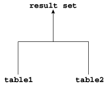

> This graphic depicts an upside down join tree. The left input is table1. The right input is table2. The top of the tree is the result set.
>
> [  
> Copyright © 2013, 2023, Oracle and/or its affiliates.](https://docs.oracle.com/en/database/oracle/oracle-database/dcommon/html/cpyr.htm)


The input of a join can be the result set from a previous join. If the right child of every internal node of a join tree is a table, then the tree is a [left deep join tree](glossary.md), as shown in the following example. Most join trees are left deep joins.

Figure 9-2 Left Deep Join Tree

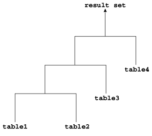

> This graphic depicts an upside down join tree. The left input of the bottom join is table1. The right input is table2. The result becomes the left input of a higher join tree, whose right input of this tree is table3. The result of this join is the left input of a higher join tree, whose right input is table4.


If the left child of every internal node of a join tree is a table, then the tree is called a [right deep join tree](glossary.md), as shown in the following diagram.

Figure 9-3 Right Deep Join Tree

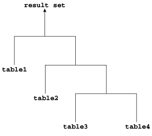

> This graphic depicts an upside down join tree. The left input of the bottom join is table3. The right input is table4. The result becomes the right input of a higher join tree, whose left input of this tree is table2. The result of this join is the right input of a higher join tree, whose left input is table1.


If the left or the right child of an internal node of a join tree can be a join node, then the tree is called a [bushy join tree](glossary.md). In the following example, `table4` is a right child of a join node, `table1` is the left child of a join node, and `table2` is the left child of a join node.

Figure 9-4 Bushy Join Tree

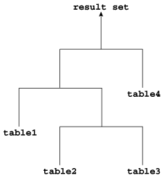

> This graphic depicts an upside down join tree. The left input of the bottom join is table2. The right input is table3. The result becomes the right input of a higher join tree, whose left input of this tree is table1. The result of this join is the left input of a higher join tree, whose right input is table4.


In yet another variation, both inputs of a join are the results of a previous join.

#### 9.1.2 How the Optimizer Executes Join Statements

The database joins pairs of row sources. When multiple tables exist in the `FROM` clause, the optimizer must determine which join operation is most efficient for each pair.

The optimizer must make the interrelated decisions shown in the following table.

Table 9-1 Join Operations

| Operation | Explanation | To Learn More |
| --- | --- | --- |
| Access paths | As for simple statements, the optimizer must choose an [access path](glossary.md) to retrieve data from each table in the join statement. For example, the optimizer might choose between a full table scan or an index scan.. | " [Optimizer Access Paths](optimizer-access-paths.md) " |
| Join methods | To join each pair of row sources, Oracle Database must decide how to do it. The "how" is the join method. The possible join methods are nested loop, sort merge, and hash joins. A Cartesian join requires one of the preceding join methods. Each join method has specific situations in which it is more suitable than the others. | " Join Methods " |
| Join types | The join condition determines the join type. For example, an inner join retrieves only rows that match the join condition. An outer join retrieves rows that do not match the join condition. | " Join Types " |
| Join order | To execute a statement that joins more than two tables, Oracle Database joins two tables and then joins the resulting row source to the next table. This process continues until all tables are joined into the result. For example, the database joins two tables, and then joins the result to a third table, and then joins this result to a fourth table, and so on. | N/A |

#### 9.1.3 How the Optimizer Chooses Execution Plans for Joins

When determining the join order and method, the optimizer goal is to reduce the number of rows early so it performs less work throughout the execution of the SQL statement.

The optimizer generates a set of execution plans, according to possible join orders, join methods, and available access paths. The optimizer then estimates the cost of each plan and chooses the one with the lowest cost. When choosing an execution plan, the optimizer considers the following factors:

- The optimizer first determines whether joining two or more tables results in a row source containing at most one row.
	The optimizer recognizes such situations based on `UNIQUE` and `PRIMARY KEY` constraints on the tables. If such a situation exists, then the optimizer places these tables first in the join order. The optimizer then optimizes the join of the remaining set of tables.
- For join statements with [outer join](glossary.md) conditions, the table with the outer join operator typically comes after the other table in the condition in the join order.
	In general, the optimizer does not consider join orders that violate this guideline, although the optimizer overrides this ordering condition in certain circumstances. Similarly, when a subquery has been converted into an [antijoin](glossary.md) or [semijoin](glossary.md), the tables from the subquery must come after those tables in the outer query block to which they were connected or correlated. However, hash antijoins and semijoins are able to override this ordering condition in certain circumstances.

The optimizer estimates the cost of a query plan by computing the estimated I/Os and CPU. These I/Os have specific costs associated with them: one cost for a single block I/O, and another cost for multiblock I/Os. Also, different functions and expressions have CPU costs associated with them. The optimizer determines the total cost of a query plan using these metrics. These metrics may be influenced by many initialization parameter and session settings at compile time, such as the `DB_FILE_MULTI_BLOCK_READ_COUNT` setting, system statistics, and so on.

For example, the optimizer estimates costs in the following ways:

- The cost of a [nested loops join](glossary.md) depends on the cost of reading each selected row of the [outer table](glossary.md) and each of its matching rows of the [inner table](glossary.md) into memory. The optimizer estimates these costs using statistics in the data dictionary.
- The cost of a [sort merge join](glossary.md) depends largely on the cost of reading all the sources into memory and sorting them.
- The cost of a [hash join](glossary.md) largely depends on the cost of building a hash table on one of the input sides to the join and using the rows from the other side of the join to probe it.

Example 9-1 Estimating Costs for Join Order and Method

Conceptually, the optimizer constructs a matrix of join orders and methods and the cost associated with each. For example, the optimizer must determine how best to join the `date_dim` and `lineorder` tables in a query. The following table shows the possible variations of methods and orders, and the cost for each. In this example, a nested loops join in the order `date_dim`, `lineorder` has the lowest cost.

Table 9-2 Sample Costs for Join of date\_dim and lineorder Tables

| Join Method | Cost of date\_dim, lineorder | Cost of lineorder, date\_dim |
| --- | --- | --- |
| Nested Loops | 39,480 | 6,187,540 |
| Hash Join | 187,528 | 194,909 |
| Sort Merge | 217,129 | 217,129 |

See Also:

- " [Introduction to Optimizer Statistics](optimizer-statistics-concepts.md) "
- " [Influencing the Optimizer](influencing-the-optimizer.md) " for more information about optimizer hints
- [Oracle Database Reference](https://docs.oracle.com/pls/topic/lookup?ctx=en/database/oracle/oracle-database/21/tgsql&id=REFRN10037) to learn about `DB_FILE_MULTIBLOCK_READ_COUNT`

### 9.2 Join Methods

A join method is the mechanism for joining two row sources.

Depending on the statistics, the optimizer chooses the method with the lowest estimated cost. As shown in Figure 9-5, each join method has two children: the driving (also called outer) row source and the driven-to (also called inner) row source.

Figure 9-5 Join Method

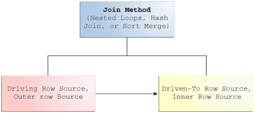

> This graphic shows that each join method has two children: the driving row source, and the driven-to row source.
>
> [  
> Copyright © 2013, 2023, Oracle and/or its affiliates.](https://docs.oracle.com/en/database/oracle/oracle-database/dcommon/html/cpyr.htm)


#### 9.2.1 Nested Loops Joins

Nested loops join an outer data set to an inner data set.

For each row in the outer data set that matches the single-table predicates, the database retrieves all rows in the inner data set that satisfy the join predicate. If an index is available, then the database can use it to access the inner data set by rowid.

##### 9.2.1.1 When the Optimizer Considers Nested Loops Joins

Nested loops joins are useful when the database joins small subsets of data, the database joins large sets of data with the optimizer mode set to `FIRST_ROWS`, or the join condition is an efficient method of accessing the inner table.

Note:

The number of rows expected from the join is what drives the optimizer decision, not the size of the underlying tables. For example, a query might join two tables of a billion rows each, but because of the filters the optimizer expects data sets of 5 rows each.

In general, nested loops joins work best on small tables with indexes on the join conditions. If a row source has only one row, as with an equality lookup on a primary key value (for example, `WHERE employee_id=101`), then the join is a simple lookup. The optimizer always tries to put the smallest row source first, making it the driving table.

Various factors enter into the optimizer decision to use nested loops. For example, the database may read several rows from the outer row source in a batch. Based on the number of rows retrieved, the optimizer may choose either a nested loop or a hash join to the inner row source. For example, if a query joins `departments` to driving table `employees`, and if the predicate specifies a value in `employees.last_name`, then the database might read enough entries in the index on `last_name` to determine whether an internal threshold is passed. If the threshold is not passed, then the optimizer picks a nested loop join to `departments`, and if the threshold is passed, then the database performs a hash join, which means reading the rest of `employees`, hashing it into memory, and then joining to `departments`.

If the access path for the inner loop is not dependent on the outer loop, then the result can be a Cartesian product: for every iteration of the outer loop, the inner loop produces the same set of rows. To avoid this problem, use other join methods to join two independent row sources.

See Also:

- " [Table 19-2](influencing-the-optimizer.md) "
- " [Adaptive Query Plans](query-optimizer-concepts.md) "

##### 9.2.1.2 How Nested Loops Joins Work

Conceptually, nested loops are equivalent to two nested `for` loops.

For example, if a query joins `employees` and `departments`, then a nested loop in pseudocode might be:

```
FOR erow IN (select * from employees where X=Y) LOOP
  FOR drow IN (select * from departments where erow is matched) LOOP
    output values from erow and drow
  END LOOP
END LOOP
```

The inner loop is executed for every row of the outer loop. The `employees` table is the "outer" data set because it is in the exterior `for` loop. The outer table is sometimes called a driving table. The `departments` table is the "inner" data set because it is in the interior `for` loop.

A nested loops join involves the following basic steps:

1. The optimizer determines the driving row source and designates it as the outer loop.
	The outer loop produces a set of rows for driving the join condition. The row source can be a table accessed using an index scan, a full table scan, or any other operation that generates rows.
	The number of iterations of the inner loop depends on the number of rows retrieved in the outer loop. For example, if 10 rows are retrieved from the outer table, then the database must perform 10 lookups in the inner table. If 10,000,000 rows are retrieved from the outer table, then the database must perform 10,000,000 lookups in the inner table.
2. The optimizer designates the other row source as the inner loop.
	The outer loop appears before the inner loop in the execution plan, as follows:
	```
	NESTED LOOPS 
	  outer_loop
	  inner_loop
	```
3. For every fetch request from the client, the basic process is as follows:
	1. Fetch a row from the outer row source
		2. Probe the inner row source to find rows that match the predicate criteria
		3. Repeat the preceding steps until all rows are obtained by the fetch request
	Sometimes the database sorts rowids to obtain a more efficient buffer access pattern.

##### 9.2.1.3 Nested Nested Loops

The outer loop of a nested loop can itself be a row source generated by a different nested loop.

The database can nest two or more outer loops to join as many tables as needed. Each loop is a data access method. The following template shows how the database iterates through three nested loops:

```
SELECT STATEMENT
  NESTED LOOPS 3
    NESTED LOOPS 2          - Row source becomes OUTER LOOP 3.1
      NESTED LOOPS 1        - Row source becomes OUTER LOOP 2.1
        OUTER LOOP 1.1
        INNER LOOP 1.2  
      INNER LOOP 2.2
    INNER LOOP 3.2
```

The database orders the loops as follows:

1. The database iterates through `NESTED LOOPS 1`:
	```
	NESTED LOOPS 1 
	  OUTER LOOP 1.1
	  INNER LOOP 1.2
	```
	The output of `NESTED LOOP 1` is a row source.
2. The database iterates through `NESTED LOOPS 2`, using the row source generated by `NESTED LOOPS 1` as its outer loop:
	```
	NESTED LOOPS 2       
	  OUTER LOOP 2.1         - Row source generated by NESTED LOOPS 1
	  INNER LOOP 2.2
	```
	The output of `NESTED LOOPS 2` is another row source.
3. The database iterates through `NESTED LOOPS 3`, using the row source generated by `NESTED LOOPS 2` as its outer loop:
	```
	NESTED LOOPS 3      
	  OUTER LOOP 3.1         - Row source generated by NESTED LOOPS 2
	  INNER LOOP 3.2
	```

Example 9-2 Nested Nested Loops Join

Suppose you join the `employees` and `departments` tables as follows:

```
SELECT /*+ ORDERED USE_NL(d) */ e.last_name, e.first_name, d.department_name
FROM   employees e, departments d
WHERE  e.department_id=d.department_id
AND    e.last_name like 'A%';
```

The plan reveals that the optimizer chose two nested loops (Step 1 and Step 2) to access the data:

```
SQL_ID  ahuavfcv4tnz4, child number 0
-------------------------------------
SELECT /*+ ORDERED USE_NL(d) */ e.last_name, d.department_name FROM
employees e, departments d WHERE  e.department_id=d.department_id AND
 e.last_name like 'A%'
 
Plan hash value: 1667998133
 
----------------------------------------------------------------------------------
|Id| Operation                             |Name      |Rows|Bytes|Cost(%CPU)|Time|
----------------------------------------------------------------------------------
| 0| SELECT STATEMENT                      |             |  |   |5 (100)|        |
| 1|  NESTED LOOPS                         |             |  |   |       |        |
| 2|   NESTED LOOPS                        |             | 3|102|5   (0)|00:00:01|
| 3|    TABLE ACCESS BY INDEX ROWID BATCHED| EMPLOYEES   | 3| 54|2   (0)|00:00:01|
|*4|     INDEX RANGE SCAN                  | EMP_NAME_IX | 3|   |1   (0)|00:00:01|
|*5|    INDEX UNIQUE SCAN                  | DEPT_ID_PK  | 1|   |0   (0)|        |
| 6|   TABLE ACCESS BY INDEX ROWID         | DEPARTMENTS | 1| 16|1   (0)|00:00:01|
----------------------------------------------------------------------------------
 
Predicate Information (identified by operation id):
---------------------------------------------------
 
   4 - access("E"."LAST_NAME" LIKE 'A%')
       filter("E"."LAST_NAME" LIKE 'A%')
   5 - access("E"."DEPARTMENT_ID"="D"."DEPARTMENT_ID")
```

In this example, the basic process is as follows:

1. The database begins iterating through the inner nested loop (Step 2) as follows:
	1. The database searches the `emp_name_ix` for the rowids for all last names that begins with `A` (Step 4).
		For example:
		```
		Abel,employees_rowid
		Ande,employees_rowid
		Atkinson,employees_rowid
		Austin,employees_rowid
		```
		2. Using the rowids from the previous step, the database retrieves a batch of rows from the `employees` table (Step 3). For example:
		```
		Abel,Ellen,80
		Abel,John,50
		```
		These rows become the outer row source for the innermost nested loop.
		The batch step is typically part of adaptive execution plans. To determine whether a nested loop is better than a hash join, the optimizer needs to determine many rows come back from the row source. If too many rows are returned, then the optimizer switches to a different join method.
		3. For each row in the outer row source, the database scans the `dept_id_pk` index to obtain the rowid in `departments` of the matching department ID (Step 5), and joins it to the `employees` rows. For example:
		```
		Abel,Ellen,80,departments_rowid
		Ande,Sundar,80,departments_rowid
		Atkinson,Mozhe,50,departments_rowid
		Austin,David,60,departments_rowid
		```
		These rows become the outer row source for the outer nested loop (Step 1).
2. The database iterates through the outer nested loop as follows:
	1. The database reads the first row in outer row source.
		For example:
		```
		Abel,Ellen,80,departments_rowid
		```
		2. The database uses the `departments` rowid to retrieve the corresponding row from `departments` (Step 6), and then joins the result to obtain the requested values (Step 1).
		For example:
		```
		Abel,Ellen,80,Sales
		```
		3. The database reads the next row in the outer row source, uses the `departments` rowid to retrieve the corresponding row from `departments` (Step 6), and iterates through the loop until all rows are retrieved.
		The result set has the following form:
		```
		Abel,Ellen,80,Sales
		Ande,Sundar,80,Sales
		Atkinson,Mozhe,50,Shipping
		Austin,David,60,IT
		```

##### 9.2.1.4 Current Implementation for Nested Loops Joins

Oracle Database 11g introduced a new implementation for nested loops that reduces overall latency for physical I/O.

When an index or a table block is not in the buffer cache and is needed to process the join, a physical I/O is required. The database can batch multiple physical I/O requests and process them using a vector I/O (array) instead of one at a time. The database sends an array of rowids to the operating system, which performs the read.

As part of the new implementation, two `NESTED LOOPS` join row sources might appear in the execution plan where only one would have appeared in prior releases. In such cases, Oracle Database allocates one `NESTED LOOPS` join row source to join the values from the table on the outer side of the join with the index on the inner side. A second row source is allocated to join the result of the first join, which includes the rowids stored in the index, with the table on the inner side of the join.

Consider the query in " Original Implementation for Nested Loops Joins ". In the current implementation, the execution plan for this query might be as follows:

```
-------------------------------------------------------------------------------------
| Id | Operation                    | Name              |Rows|Bytes|Cost%CPU| Time  |
-------------------------------------------------------------------------------------
|  0 | SELECT STATEMENT             |                   | 19 | 722 |  3 (0)|00:00:01|
|  1 |  NESTED LOOPS                |                   |    |     |       |        |
|  2 |   NESTED LOOPS               |                   | 19 | 722 |  3 (0)|00:00:01|
|* 3 |    TABLE ACCESS FULL         | DEPARTMENTS       |  2 |  32 |  2 (0)|00:00:01|
|* 4 |    INDEX RANGE SCAN          | EMP_DEPARTMENT_IX | 10 |     |  0 (0)|00:00:01|
|  5 |   TABLE ACCESS BY INDEX ROWID| EMPLOYEES         | 10 | 220 |  1 (0)|00:00:01|
-------------------------------------------------------------------------------------
 
Predicate Information (identified by operation id):
---------------------------------------------------
   3 - filter("D"."DEPARTMENT_NAME"='Marketing' OR "D"."DEPARTMENT_NAME"='Sales')
   4 - access("E"."DEPARTMENT_ID"="D"."DEPARTMENT_ID")
```

In this case, rows from the `hr.departments` table form the outer row source (Step 3) of the inner nested loop (Step 2). The index `emp_department_ix` is the inner row source (Step 4) of the inner nested loop. The results of the inner nested loop form the outer row source (Row 2) of the outer nested loop (Row 1). The `hr.employees` table is the outer row source (Row 5) of the outer nested loop.

For each fetch request, the basic process is as follows:

1. The database iterates through the inner nested loop (Step 2) to obtain the rows requested in the fetch:
	1. The database reads the first row of `departments` to obtain the department IDs for departments named `Marketing` or `Sales` (Step 3). For example:
		```
		Marketing,20
		```
		This row set is the outer loop. The database caches the data in the PGA.
		2. The database scans `emp_department_ix`, which is an index on the `employees` table, to find `employees` rowids that correspond to this department ID (Step 4), and then joins the result (Step 2).
		The result set has the following form:
		```
		Marketing,20,employees_rowid
		Marketing,20,employees_rowid
		Marketing,20,employees_rowid
		```
		3. The database reads the next row of `departments`, scans `emp_department_ix` to find `employees` rowids that correspond to this department ID, and then iterates through the loop until the client request is satisfied.
		In this example, the database only iterates through the outer loop twice because only two rows from `departments` satisfy the predicate filter. Conceptually, the result set has the following form:
		```
		Marketing,20,employees_rowid
		Marketing,20,employees_rowid
		Marketing,20,employees_rowid
		.
		.
		.
		Sales,80,employees_rowid
		Sales,80,employees_rowid
		Sales,80,employees_rowid
		.
		.
		.
		```
		These rows become the outer row source for the outer nested loop (Step 1). This row set is cached in the PGA.
2. The database organizes the rowids obtained in the previous step so that it can more efficiently access them in the cache.
3. The database begins iterating through the outer nested loop as follows:
	1. The database retrieves the first row from the row set obtained in the previous step, as in the following example:
		```
		Marketing,20,employees_rowid
		```
		2. Using the rowid, the database retrieves a row from `employees` to obtain the requested values (Step 1), as in the following example:
		```
		Michael,Hartstein,13000,Marketing
		```
		3. The database retrieves the next row from the row set, uses the rowid to probe `employees` for the matching row, and iterates through the loop until all rows are retrieved.
		The result set has the following form:
		```
		Michael,Hartstein,13000,Marketing
		Pat,Fay,6000,Marketing
		John,Russell,14000,Sales
		Karen,Partners,13500,Sales
		Alberto,Errazuriz,12000,Sales
		.
		.
		.
		```

In some cases, a second join row source is not allocated, and the execution plan looks the same as it did before Oracle Database 11g. The following list describes such cases:

- All of the columns needed from the inner side of the join are present in the index, and there is no table access required. In this case, Oracle Database allocates only one join row source.
- The order of the rows returned might be different from the order returned in releases earlier than Oracle Database 12c. Thus, when Oracle Database tries to preserve a specific ordering of the rows, for example to eliminate the need for an `ORDER BY` sort, Oracle Database might use the original implementation for nested loops joins.
- The `OPTIMIZER_FEATURES_ENABLE` initialization parameter is set to a release before Oracle Database 11g. In this case, Oracle Database uses the original implementation for nested loops joins.

##### 9.2.1.5 Original Implementation for Nested Loops Joins

In the current release, both the new and original implementation of nested loops are possible.

For an example of the original implementation, consider the following join of the `hr.employees` and `hr.departments` tables:

```
SELECT e.first_name, e.last_name, e.salary, d.department_name
FROM   hr.employees e, hr.departments d
WHERE  d.department_name IN ('Marketing', 'Sales')
AND    e.department_id = d.department_id;
```

In releases before Oracle Database 11g, the execution plan for this query might appear as follows:

```
-------------------------------------------------------------------------------------------
| Id  | Operation                   | Name              | Rows | Bytes |Cost (%CPU)|Time  |
-------------------------------------------------------------------------------------------
|   0 | SELECT STATEMENT            |                   |   19 |   722 | 3  (0)| 00:00:01 |
|   1 |  TABLE ACCESS BY INDEX ROWID| EMPLOYEES         |   10 |   220 | 1  (0)| 00:00:01 |
|   2 |   NESTED LOOPS              |                   |   19 |   722 | 3  (0)| 00:00:01 |
|*  3 |    TABLE ACCESS FULL        | DEPARTMENTS       |    2 |    32 | 2  (0)| 00:00:01 |
|*  4 |    INDEX RANGE SCAN         | EMP_DEPARTMENT_IX |   10 |       | 0  (0)| 00:00:01 |
-------------------------------------------------------------------------------------------
 
Predicate Information (identified by operation id):
---------------------------------------------------
   3 - filter("D"."DEPARTMENT_NAME"='Marketing' OR "D"."DEPARTMENT_NAME"='Sales')
   4 - access("E"."DEPARTMENT_ID"="D"."DEPARTMENT_ID")
```

For each fetch request, the basic process is as follows:

1. The database iterates through the loop to obtain the rows requested in the fetch:
	1. The database reads the first row of `departments` to obtain the department IDs for departments named `Marketing` or `Sales` (Step 3). For example:
		```
		Marketing,20
		```
		This row set is the outer loop. The database caches the row in the PGA.
		2. The database scans `emp_department_ix`, which is an index on the `employees.department_id` column, to find `employees` rowids that correspond to this department ID (Step 4), and then joins the result (Step 2).
		Conceptually, the result set has the following form:
		```
		Marketing,20,employees_rowid
		Marketing,20,employees_rowid
		Marketing,20,employees_rowid
		```
		3. The database reads the next row of `departments`, scans `emp_department_ix` to find `employees` rowids that correspond to this department ID, and iterates through the loop until the client request is satisfied.
		In this example, the database only iterates through the outer loop twice because only two rows from `departments` satisfy the predicate filter. Conceptually, the result set has the following form:
		```
		Marketing,20,employees_rowid
		Marketing,20,employees_rowid
		Marketing,20,employees_rowid
		.
		.
		.
		Sales,80,employees_rowid
		Sales,80,employees_rowid
		Sales,80,employees_rowid
		.
		.
		.
		```
2. Depending on the circumstances, the database may organize the cached rowids obtained in the previous step so that it can more efficiently access them.
3. For each `employees` rowid in the result set generated by the nested loop, the database retrieves a row from `employees` to obtain the requested values (Step 1).
	Thus, the basic process is to read a rowid and retrieve the matching `employees` row, read the next rowid and retrieve the matching `employees` row, and so on. Conceptually, the result set has the following form:
	```
	Michael,Hartstein,13000,Marketing
	Pat,Fay,6000,Marketing
	John,Russell,14000,Sales
	Karen,Partners,13500,Sales
	Alberto,Errazuriz,12000,Sales
	.
	.
	.
	```

##### 9.2.1.6 Nested Loops Controls

You can add the `USE_NL` hint to instruct the optimizer to join each specified table to another row source with a nested loops join, using the specified table as the inner table.

The related hint `USE_NL_WITH_INDEX(table index)` hint instructs the optimizer to join the specified table to another row source with a nested loops join using the specified table as the inner table. The index is optional. If no index is specified, then the nested loops join uses an index with at least one join predicate as the index key.

Example 9-3 Nested Loops Hint

Assume that the optimizer chooses a hash join for the following query:

```
SELECT e.last_name, d.department_name
FROM   employees e, departments d
WHERE  e.department_id=d.department_id;
```

The plan looks as follows:

```
---------------------------------------------------------------------------
|Id | Operation          | Name        | Rows| Bytes |Cost(%CPU)| Time    |
---------------------------------------------------------------------------
| 0 | SELECT STATEMENT   |             |     |       |  5 (100)|          |
|*1 |  HASH JOIN         |             | 106 |  2862 |  5  (20)| 00:00:01 |
| 2 |   TABLE ACCESS FULL| DEPARTMENTS |  27 |   432 |  2   (0)| 00:00:01 |
| 3 |   TABLE ACCESS FULL| EMPLOYEES   | 107 |  1177 |  2   (0)| 00:00:01 |
---------------------------------------------------------------------------
```

To force a nested loops join using `departments` as the inner table, add the `USE_NL` hint as in the following query:

```
SELECT /*+ ORDERED USE_NL(d) */ e.last_name, d.department_name
FROM   employees e, departments d
WHERE  e.department_id=d.department_id;
```

The plan looks as follows:

```
---------------------------------------------------------------------------
| Id | Operation          | Name        | Rows |Bytes |Cost (%CPU)|Time   |
---------------------------------------------------------------------------
|  0 | SELECT STATEMENT   |             |     |      | 34 (100)|          |
|  1 |  NESTED LOOPS      |             | 106 | 2862 | 34   (3)| 00:00:01 |
|  2 |   TABLE ACCESS FULL| EMPLOYEES   | 107 | 1177 |  2   (0)| 00:00:01 |
|* 3 |   TABLE ACCESS FULL| DEPARTMENTS |   1 |   16 |  0   (0)|          |
---------------------------------------------------------------------------

Predicate Information (identified by operation id):
---------------------------------------------------
 
   3 - filter("E"."DEPARTMENT_ID"="D"."DEPARTMENT_ID")
```

The database obtains the result set as follows:

1. In the nested loop, the database reads `employees` to obtain the last name and department ID for an employee (Step 2). For example:
	```
	De Haan,90
	```
2. For the row obtained in the previous step, the database scans `departments` to find the department name that matches the `employees` department ID (Step 3), and joins the result (Step 1). For example:
	```
	De Haan,Executive
	```
3. The database retrieves the next row in `employees`, retrieves the matching row from `departments`, and then repeats this process until all rows are retrieved.
	The result set has the following form:
	```
	De Haan,Executive
	Kochnar,Executive
	Baer,Public Relations
	King,Executive
	.
	.
	.
	```

See Also:

- " [Guidelines for Join Order Hints](influencing-the-optimizer.md) " to learn more about the `USE_NL` hint
- [Oracle Database SQL Language Reference](https://docs.oracle.com/pls/topic/lookup?ctx=en/database/oracle/oracle-database/21/tgsql&id=SQLRF50701) to learn about the `USE_NL` hint

#### 9.2.2 Hash Joins

The database uses a **hash join** to join larger data sets.

The optimizer uses the smaller of two data sets to build a hash table on the join key in memory, using a deterministic hash function to specify the location in the hash table in which to store each row. The database then scans the larger data set, probing the hash table to find the rows that meet the join condition.

##### 9.2.2.1 When the Optimizer Considers Hash Joins

In general, the optimizer considers a hash join when a relatively large amount of data must be joined (or a large percentage of a small table must be joined), and the join is an equijoin.

A hash join is most cost effective when the smaller data set fits in memory. In this case, the cost is limited to a single read pass over the two data sets.

Because the hash table is in the PGA, Oracle Database can access rows without latching them. This technique reduces logical I/O by avoiding the necessity of repeatedly latching and reading blocks in the database buffer cache.

If the data sets do not fit in memory, then the database partitions the row sources, and the join proceeds partition by partition. This can use a lot of sort area memory, and I/O to the temporary tablespace. This method can still be the most cost effective, especially when the database uses parallel query servers.

##### 9.2.2.2 How Hash Joins Work

A hashing algorithm takes a set of inputs and applies a deterministic hash function to generate a random hash value.

In a hash join, the input values are the join keys. The output values are indexes (slots) in an array, which is the hash table.

###### 9.2.2.2.1 Hash Tables

To illustrate a hash table, assume that the database hashes `hr.departments` in a join of `departments` and `employees`. The join key column is `department_id`.

The first 5 rows of `departments` are as follows:

```
SQL> select * from departments where rownum < 6;
 
DEPARTMENT_ID DEPARTMENT_NAME                MANAGER_ID LOCATION_ID
------------- ------------------------------ ---------- -----------
           10 Administration                        200        1700
           20 Marketing                             201        1800
           30 Purchasing                            114        1700
           40 Human Resources                       203        2400
           50 Shipping                              121        1500
```

The database applies the hash function to each `department_id` in the table, generating a hash value for each. For this illustration, the hash table has 5 slots (it could have more or less). Because n is `5`, the possible hash values range from `1` to `5`. The hash functions might generate the following values for the department IDs:

```
f(10) = 4
f(20) = 1
f(30) = 4
f(40) = 2
f(50) = 5
```

Note that the hash function happens to generate the same hash value of `4` for departments `10` and `30`. This is known as a hash collision. In this case, the database puts the records for departments `10` and `30` in the same slot, using a linked list. Conceptually, the hash table looks as follows:

```
1    20,Marketing,201,1800
2    40,Human Resources,203,2400
3
4    10,Administration,200,1700 -> 30,Purchasing,114,1700
5    50,Shipping,121,1500
```

###### 9.2.2.2.2 Hash Join: Basic Steps

The optimizer uses the smaller data source to build a hash table on the join key in memory, and then scans the larger table to find the joined rows.

The basic steps are as follows:

1. The database performs a full scan of the smaller data set, called the build table, and then applies a hash function to the join key in each row to build a hash table in the PGA.
	In pseudocode, the algorithm might look as follows:
	```
	FOR small_table_row IN (SELECT * FROM small_table)
	LOOP
	  slot_number := HASH(small_table_row.join_key);
	  INSERT_HASH_TABLE(slot_number,small_table_row);
	END LOOP;
	```
2. The database probes the second data set, called the probe table, using whichever access mechanism has the lowest cost.
	Typically, the database performs a full scan of both the smaller and larger data set. The algorithm in pseudocode might look as follows:
	```
	FOR large_table_row IN (SELECT * FROM large_table)
	LOOP
	   slot_number := HASH(large_table_row.join_key);
	   small_table_row = LOOKUP_HASH_TABLE(slot_number,large_table_row.join_key);
	   IF small_table_row FOUND
	   THEN
	      output small_table_row + large_table_row;
	   END IF;
	END LOOP;
	```
	For each row retrieved from the larger data set, the database does the following:
	1. Applies the same hash function to the join column or columns to calculate the number of the relevant slot in the hash table.
		For example, to probe the hash table for department ID `30`, the database applies the hash function to `30`, which generates the hash value `4`.
		2. Probes the hash table to determine whether rows exists in the slot.
		If no rows exist, then the database processes the next row in the larger data set. If rows exist, then the database proceeds to the next step.
		3. Checks the join column or columns for a match. If a match occurs, then the database either reports the rows or passes them to the next step in the plan, and then processes the next row in the larger data set.
		If multiple rows exist in the hash table slot, the database walks through the linked list of rows, checking each one. For example, if department `30` hashes to slot `4`, then the database checks each row until it finds `30`.

Example 9-4 Hash Joins

An application queries the `oe.orders` and `oe.order_items` tables, joining on the `order_id` column.

```
SELECT o.customer_id, l.unit_price * l.quantity
FROM   orders o, order_items l
WHERE  l.order_id = o.order_id;
```

The execution plan is as follows:

```
--------------------------------------------------------------------------
| Id  | Operation            |  Name        | Rows  | Bytes | Cost (%CPU)|
--------------------------------------------------------------------------
|   0 | SELECT STATEMENT     |              |   665 | 13300 |     8  (25)|
|*  1 |  HASH JOIN           |              |   665 | 13300 |     8  (25)|
|   2 |   TABLE ACCESS FULL  | ORDERS       |   105 |   840 |     4  (25)|
|   3 |   TABLE ACCESS FULL  | ORDER_ITEMS  |   665 |  7980 |     4  (25)|
--------------------------------------------------------------------------

Predicate Information (identified by operation id):
---------------------------------------------------
   1 - access("L"."ORDER_ID"="O"."ORDER_ID")
```

Because the `orders` table is small relative to the `order_items` table, which is 6 times larger, the database hashes `orders`. In a hash join, the data set for the build table always appears first in the list of operations (Step 2). In Step 3, the database performs a full scan of the larger `order_items` later, probing the hash table for each row.

##### 9.2.2.3 How Hash Joins Work When the Hash Table Does Not Fit in the PGA

The database must use a different technique when the hash table does not fit entirely in the PGA. In this case, the database uses a temporary space to hold portions (called partitions) of the hash table, and sometimes portions of the larger table that probes the hash table.

The basic process is as follows:

1. The database performs a full scan of the smaller data set, and then builds an array of hash buckets in both the PGA and on disk.
	When the PGA hash area fills up, the database finds the largest partition within the hash table and writes it to temporary space on disk. The database stores any new row that belongs to this on-disk partition on disk, and all other rows in the PGA. Thus, part of the hash table is in memory and part of it on disk.
2. The database takes a first pass at reading the other data set.
	For each row, the database does the following:
	1. Applies the same hash function to the join column or columns to calculate the number of the relevant hash bucket.
		2. Probes the hash table to determine whether rows exist in the bucket in memory.
		If the hashed value points to a row in memory, then the database completes the join and returns the row. If the value points to a hash partition on disk, however, then the database stores this row in the temporary tablespace, using the same partitioning scheme used for the original data set.
3. The database reads each on-disk temporary partition one by one
4. The database joins each partition row to the row in the corresponding on-disk temporary partition.

##### 9.2.2.4 Hash Join Controls

The `USE_HASH` hint instructs the optimizer to use a hash join when joining two tables together.

See Also:

- " [Guidelines for Join Order Hints](influencing-the-optimizer.md) "
- [Oracle Database SQL Language Reference](https://docs.oracle.com/pls/topic/lookup?ctx=en/database/oracle/oracle-database/21/tgsql&id=SQLRF-GUID-FA1147B3-BCAA-41F9-B6A2-8DEDABF1C021) to learn about `USE_HASH`

#### 9.2.3 Sort Merge Joins

A sort merge join is a variation on a nested loops join.

If the two data sets in the join are not already sorted, then the database sorts them. These are the `SORT JOIN` operations. For each row in the first data set, the database probes the second data set for matching rows and joins them, basing its start position on the match made in the previous iteration. This is the `MERGE JOIN` operation.

Figure 9-6 Sort Merge Join

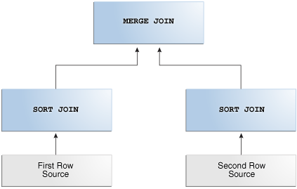

> The top of the graphic shows a MERGE JOIN box. On the left, a SORT JOIN box points to MERGE JOIN. The words "First Row Source" point to SORT JOIN. On the right, a SORT JOIN box points to MERGE JOIN. The words "Second Row Source" point to SORT JOIN.


##### 9.2.3.1 When the Optimizer Considers Sort Merge Joins

A hash join requires one hash table and one probe of this table, whereas a sort merge join requires two sorts.

The optimizer may choose a sort merge join over a hash join for joining large amounts of data when any of the following conditions is true:

- The join condition between two tables is not an equijoin, that is, uses an inequality condition such as `<`, `<=`, `>`, or `>=`.
	In contrast to sort merges, hash joins require an equality condition.
- Because of sorts required by other operations, the optimizer finds it cheaper to use a sort merge.
	If an index exists, then the database can avoid sorting the first data set. However, the database always sorts the second data set, regardless of indexes.

A sort merge has the same advantage over a nested loops join as the hash join: the database accesses rows in the PGA rather than the SGA, reducing logical I/O by avoiding the necessity of repeatedly latching and reading blocks in the database buffer cache. In general, hash joins perform better than sort merge joins because sorting is expensive. However, sort merge joins offer the following advantages over a hash join:

- After the initial sort, the merge phase is optimized, resulting in faster generation of output rows.
- A sort merge can be more cost-effective than a hash join when the hash table does not fit completely in memory.
	A hash join with insufficient memory requires both the hash table and the other data set to be copied to disk. In this case, the database may have to read from disk multiple times. In a sort merge, if memory cannot hold the two data sets, then the database writes them both to disk, but reads each data set no more than once.

##### 9.2.3.2 How Sort Merge Joins Work

As in a nested loops join, a sort merge join reads two data sets, but sorts them when they are not already sorted.

For each row in the first data set, the database finds a starting row in the second data set, and then reads the second data set until it finds a nonmatching row. In pseudocode, the high-level algorithm for sort merge might look as follows:

```
READ data_set_1 SORT BY JOIN KEY TO temp_ds1
READ data_set_2 SORT BY JOIN KEY TO temp_ds2
 
READ ds1_row FROM temp_ds1
READ ds2_row FROM temp_ds2

WHILE NOT eof ON temp_ds1,temp_ds2
LOOP
    IF ( temp_ds1.key = temp_ds2.key ) OUTPUT JOIN ds1_row,ds2_row
    ELSIF ( temp_ds1.key <= temp_ds2.key ) READ ds1_row FROM temp_ds1
    ELSIF ( temp_ds1.key => temp_ds2.key ) READ ds2_row FROM temp_ds2
END LOOP
```

For example, the following table shows sorted values in two data sets: `temp_ds1` and `temp_ds2`.

Table 9-3 Sorted Data Sets

| temp\_ds1 | temp\_ds2 |
| --- | --- |
| 10 | 20 |
| 20 | 20 |
| 30 | 40 |
| 40 | 40 |
| 50 | 40 |
| 60 | 40 |
| 70 | 40 |
| . | 60 |
| . | 70 |
| . | 70 |

As shown in the following table, the database begins by reading `10` in `temp_ds1`, and then reads the first value in `temp_ds2`. Because `20` in `temp_ds2` is higher than `10` in `temp_ds1`, the database stops reading `temp_ds2`.

Table 9-4 Start at 10 in temp\_ds1

| temp\_ds1 | temp\_ds2 | Action |
| --- | --- | --- |
| 10 \[start here\] | 20 \[start here\] \[stop here\] | 20 in temp\_ds2 is higher than 10 in temp\_ds1. Stop. Start again with next row in temp\_ds1. |
| 20 | 20 | N/A |
| 30 | 40 | N/A |
| 40 | 40 | N/A |
| 50 | 40 | N/A |
| 60 | 40 | N/A |
| 70 | 40 | N/A |
| . | 60 | N/A |
| . | 70 | N/A |
| . | 70 | N/A |

The database proceeds to the next value in `temp_ds1`, which is `20`. The database proceeds through `temp_ds2` as shown in the following table.

Table 9-5 Start at 20 in temp\_ds1

| temp\_ds1 | temp\_ds2 | Action |
| --- | --- | --- |
| 10 | 20 \[start here\] | Match. Proceed to next value in temp\_ds2. |
| 20 \[start here\] | 20 | Match. Proceed to next value in temp\_ds2. |
| 30 | 40 \[stop here\] | 40 in temp\_ds2 is higher than 20 in temp\_ds1. Stop. Start again with next row in temp\_ds1. |
| 40 | 40 | N/A |
| 50 | 40 | N/A |
| 60 | 40 | N/A |
| 70 | 40 | N/A |
| . | 60 | N/A |
| . | 70 | N/A |
| . | 70 | N/A |

The database proceeds to the next row in `temp_ds1`, which is `30`. The database starts at the number of its last match, which was `20`, and then proceeds through `temp_ds2` looking for a match, as shown in the following table.

Table 9-6 Start at 30 in temp\_ds1

| temp\_ds1 | temp\_ds2 | Action |
| --- | --- | --- |
| 10 | 20 | N/A |
| 20 | 20 \[start at last match\] | 20 in temp\_ds2 is lower than 30 in temp\_ds1. Proceed to next value in temp\_ds2. |
| 30 \[start here\] | 40 \[stop here\] | 40 in temp\_ds2 is higher than 30 in temp\_ds1. Stop. Start again with next row in temp\_ds1. |
| 40 | 40 | N/A |
| 50 | 40 | N/A |
| 60 | 40 | N/A |
| 70 | 40 | N/A |
| . | 60 | N/A |
| . | 70 | N/A |
| . | 70 | N/A |

The database proceeds to the next row in `temp_ds1`, which is `40`. As shown in the following table, the database starts at the number of its last match in `temp_ds2`, which was `20`, and then proceeds through `temp_ds2` looking for a match.

Table 9-7 Start at 40 in temp\_ds1

| temp\_ds1 | temp\_ds2 | Action |
| --- | --- | --- |
| 10 | 20 | N/A |
| 20 | 20 \[start at last match\] | 20 in temp\_ds2 is lower than 40 in temp\_ds1. Proceed to next value in temp\_ds2. |
| 30 | 40 | Match. Proceed to next value in temp\_ds2. |
| 40 \[start here\] | 40 | Match. Proceed to next value in temp\_ds2. |
| 50 | 40 | Match. Proceed to next value in temp\_ds2. |
| 60 | 40 | Match. Proceed to next value in temp\_ds2. |
| 70 | 40 | Match. Proceed to next value in temp\_ds2. |
| . | 60 \[stop here\] | 60 in temp\_ds2 is higher than 40 in temp\_ds1. Stop. Start again with next row in temp\_ds1. |
| . | 70 | N/A |
| . | 70 | N/A |

The database continues in this way until it has matched the final `70` in `temp_ds2`. This scenario demonstrates that the database, as it reads through `temp_ds1`, does not need to read every row in `temp_ds2`. This is an advantage over a nested loops join.

Example 9-5 Sort Merge Join Using Index

The following query joins the `employees` and `departments` tables on the `department_id` column, ordering the rows on `department_id` as follows:

```
SELECT e.employee_id, e.last_name, e.first_name, e.department_id, 
       d.department_name
FROM   employees e, departments d
WHERE  e.department_id = d.department_id
ORDER BY department_id;
```

A query of `DBMS_XPLAN.DISPLAY_CURSOR` shows that the plan uses a sort merge join:

```
---------------------------------------------------------------------------
|Id| Operation                    | Name      |Rows|Bytes|Cost (%CPU)|Time|
---------------------------------------------------------------------------
| 0| SELECT STATEMENT             |            |    |     |5(100)|        |
| 1|  MERGE JOIN                  |            |106 |4028 |5 (20)|00:00:01|
| 2|   TABLE ACCESS BY INDEX ROWID|DEPARTMENTS | 27 | 432 |2  (0)|00:00:01|
| 3|    INDEX FULL SCAN           |DEPT_ID_PK  | 27 |     |1  (0)|00:00:01|
|*4|   SORT JOIN                  |            |107 |2354 |3 (34)|00:00:01|
| 5|    TABLE ACCESS FULL         |EMPLOYEES   |107 |2354 |2  (0)|00:00:01|
---------------------------------------------------------------------------

Predicate Information (identified by operation id):
---------------------------------------------------

   4 - access("E"."DEPARTMENT_ID"="D"."DEPARTMENT_ID")
       filter("E"."DEPARTMENT_ID"="D"."DEPARTMENT_ID")
```

The two data sets are the `departments` table and the `employees` table. Because an index orders the `departments` table by `department_id`, the database can read this index and avoid a sort (Step 3). The database only needs to sort the `employees` table (Step 4), which is the most CPU-intensive operation.

Example 9-6 Sort Merge Join Without an Index

You join the `employees` and `departments` tables on the `department_id` column, ordering the rows on `department_id` as follows. In this example, you specify `NO_INDEX` and `USE_MERGE` to force the optimizer to choose a sort merge:

```
SELECT /*+ USE_MERGE(d e) NO_INDEX(d) */ e.employee_id, e.last_name, e.first_name, 
       e.department_id, d.department_name
FROM   employees e, departments d
WHERE  e.department_id = d.department_id
ORDER BY department_id;
```

A query of `DBMS_XPLAN.DISPLAY_CURSOR` shows that the plan uses a sort merge join:

```
---------------------------------------------------------------------------
| Id| Operation           | Name        | Rows| Bytes|Cost (%CPU)|Time    |
---------------------------------------------------------------------------
| 0 | SELECT STATEMENT    |             |     |      |   6 (100)|         |
| 1 |  MERGE JOIN         |             | 106 | 9540 |   6  (34)| 00:00:01|
| 2 |   SORT JOIN         |             |  27 |  567 |   3  (34)| 00:00:01|
| 3 |    TABLE ACCESS FULL| DEPARTMENTS |  27 |  567 |   2   (0)| 00:00:01|
|*4 |   SORT JOIN         |             | 107 | 7383 |   3  (34)| 00:00:01|
| 5 |    TABLE ACCESS FULL| EMPLOYEES   | 107 | 7383 |   2   (0)| 00:00:01|
---------------------------------------------------------------------------

Predicate Information (identified by operation id):
---------------------------------------------------

   4 - access("E"."DEPARTMENT_ID"="D"."DEPARTMENT_ID")
       filter("E"."DEPARTMENT_ID"="D"."DEPARTMENT_ID")
```

Because the `departments.department_id` index is ignored, the optimizer performs a sort, which increases the combined cost of Step 2 and Step 3 by 67% (from `3` to `5`).

##### 9.2.3.3 Sort Merge Join Controls

The `USE_MERGE` hint instructs the optimizer to use a sort merge join.

In some situations it may make sense to override the optimizer with the `USE_MERGE` hint. For example, the optimizer can choose a full scan on a table and avoid a sort operation in a query. However, there is an increased cost because a large table is accessed through an index and single block reads, as opposed to faster access through a full table scan.

See Also:

[Oracle Database SQL Language Reference](https://docs.oracle.com/pls/topic/lookup?ctx=en/database/oracle/oracle-database/21/tgsql&id=SQLRF50702) to learn about the `USE_MERGE` hint

### 9.3 Join Types

A join type is determined by the type of join condition.

#### 9.3.1 Inner Joins

An **inner join** (sometimes called a simple join) is a join that returns only rows that satisfy the join condition. Inner joins are either equijoins or nonequijoins.

##### 9.3.1.1 Equijoins

An equijoin is an inner join whose join condition contains an equality operator.

The following example is an equijoin because the join condition contains only an equality operator:

```
SELECT e.employee_id, e.last_name, d.department_name
FROM   employees e, departments d
WHERE  e.department_id=d.department_id;
```

In the preceding query, the join condition is `e.department_id=d.department_id`. If a row in the `employees` table has a department ID that matches the value in a row in the `departments` table, then the database returns the joined result; otherwise, the database does not return a result.

##### 9.3.1.2 Nonequijoins

A nonequijoin is an inner join whose join condition contains an operator that is not an equality operator.

The following query lists all employees whose hire date occurred when employee 176 (who is listed in `job_history` because they changed jobs in 2007) was working at the company:

```
SELECT e.employee_id, e.first_name, e.last_name, e.hire_date
FROM   employees e, job_history h
WHERE  h.employee_id = 176
AND    e.hire_date BETWEEN h.start_date AND h.end_date;
```

In the preceding example, the condition joining `employees` and `job_history` does not contain an equality operator, so it is a nonequijoin. Nonequijoins are relatively rare.

Note that a hash join requires at least a partial equijoin. The following SQL script contains an equality join condition (`e1.empno = e2.empno`) and a nonequality condition:

```
SET AUTOTRACE TRACEONLY EXPLAIN
SELECT *
FROM   scott.emp e1 JOIN scott.emp e2
ON     ( e1.empno = e2.empno
AND      e1.hiredate BETWEEN e2.hiredate-1 AND e2.hiredate+1 )
```

The optimizer chooses a hash join for the preceding query, as shown in the following plan:

```
Execution Plan
----------------------------------------------------------
Plan hash value: 3638257876
 
---------------------------------------------------------------------------
| Id  | Operation          | Name | Rows  | Bytes | Cost (%CPU)| Time     |
---------------------------------------------------------------------------
|   0 | SELECT STATEMENT   |      |     1 |   174 |     5  (20)| 00:00:01 |
|*  1 |  HASH JOIN         |      |     1 |   174 |     5  (20)| 00:00:01 |
|   2 |   TABLE ACCESS FULL| EMP  |    14 |  1218 |     2   (0)| 00:00:01 |
|   3 |   TABLE ACCESS FULL| EMP  |    14 |  1218 |     2   (0)| 00:00:01 |
---------------------------------------------------------------------------
 
Predicate Information (identified by operation id):
---------------------------------------------------
 
   1 - access("E1"."EMPNO"="E2"."EMPNO")
       filter("E1"."HIREDATE">=INTERNAL_FUNCTION("E2"."HIREDATE")-1 AND
              "E1"."HIREDATE"<=INTERNAL_FUNCTION("E2"."HIREDATE")+1)
```

##### 9.3.1.3 Band Joins

A **band join** is a special type of nonequijoin in which key values in one data set must fall within the specified range (“band”) of the second data set. The same table can serve as both the first and second data sets.

Starting in Oracle Database 12c Release 2 (12.2), the database evaluates band joins more efficiently. The optimization avoids the unnecessary scanning of rows that fall outside the defined bands.

The optimizer uses a cost estimate to choose the join method (hash, nested loops, or sort merge) and the parallel data distribution method. In most cases, optimized performance is comparable to an equijoin.

This following examples query employees whose salaries are between $100 less and $100 more than the salary of each employee. Thus, the band has a width of $200. The examples assume that it is permissible to compare the salary of every employee with itself. The following query includes partial sample output:

```
SELECT  e1.last_name || 
        ' has salary between 100 less and 100 more than ' || 
        e2.last_name AS "SALARY COMPARISON"
FROM    employees e1, 
        employees e2
WHERE   e1.salary 
BETWEEN e2.salary - 100 
AND     e2.salary + 100;

SALARY COMPARISON
-------------------------------------------------------------
King has salary between 100 less and 100 more than King
Kochhar has salary between 100 less and 100 more than Kochhar
Kochhar has salary between 100 less and 100 more than De Haan
De Haan has salary between 100 less and 100 more than Kochhar
De Haan has salary between 100 less and 100 more than De Haan
Russell has salary between 100 less and 100 more than Russell
Partners has salary between 100 less and 100 more than Partners
...
```

Example 9-7 Query Without Band Join Optimization

Without the band join optimization, the database uses the following query plan:

```
------------------------------------------
PLAN_TABLE_OUTPUT
------------------------------------------
------------------------------------------
| Id  | Operation            | Name      |
------------------------------------------
|   0 | SELECT STATEMENT     |           |
|   1 |  MERGE JOIN          |           |
|   2 |   SORT JOIN          |           |
|   3 |    TABLE ACCESS FULL | EMPLOYEES |
|*  4 |   FILTER             |           |
|*  5 |    SORT JOIN         |           |
|   6 |     TABLE ACCESS FULL| EMPLOYEES |
------------------------------------------

Predicate Information (identified by operation id):
---------------------------------------------------
   4 - filter("E1"."SAL"<="E2"."SAL"+100)
   5 - access(INTERNAL_FUNCTION("E1"."SAL")>="E2"."SAL"-100)
       filter(INTERNAL_FUNCTION("E1"."SAL")>="E2"."SAL"-100)
```

In this plan, Step 2 sorts the `e1` row source, and Step 5 sorts the `e2` row source. The sorted row sources are illustrated in the following table.

Table 9-8 Sorted row Sources

| e1 Sorted (Step 2 of Plan) | e2 Sorted (Step 5 of Plan) |
| --- | --- |
| 24000 (King) | 24000 (King) |
| 17000 (Kochhar) | 17000 (Kochhar) |
| 17000 (De Haan) | 17000 (De Haan) |
| 14000 (Russell) | 14000 (Russell) |
| 13500 (Partners) | 13500 (Partners) |

The join begins by iterating through the sorted input (`e1`), which is the left branch of the join, corresponding to Step 2 of the plan. The original query contains two predicates:

- `e1.sal >= e2.sal–100`, which is the Step 5 filter
- `e1.sal >= e2.sal+100`, which is the Step 4 filter

For each iteration of the sorted row source `e1`, the database iterates through row source `e2`, checking every row against Step 5 filter `e1.sal >= e2.sal–100`. If the row passes the Step 5 filter, then the database sends it to the Step 4 filter, and then proceeds to test the next row in `e2` against the Step 5 filter. However, if a row fails the Step 5 filter, then the scan of `e2` stops, and the database proceeds through the next iteration of `e1`.

The following table shows the first iteration of `e1`, which begins with `24000 (King)` in data set `e1`. The database determines that the first row in `e2`, which is `24000 (King)`, passes the Step 5 filter. The database then sends the row to the Step 4 filter, `e1.sal <= w2.sal+100`, which also passes. The database sends this row to the `MERGE` row source. Next, the database checks `17000 (Kochhar)` against the Step 5 filter, which also passes. However, the row fails the Step 4 filter, and is discarded. The database proceeds to test `17000 (De Haan)` against the Step 5 filter.

Table 9-9 First Iteration of e1: Separate SORT JOIN and FILTER

| Scan e2 | Step 5 Filter (e1.sal >= e2.sal–100) | Step 4 Filter (e1.sal <= e2.sal+100) |
| --- | --- | --- |
| 24000 (King) | Pass because 24000 >= 23900. Send to Step 4 filter. | Pass because 24000 <= 24100. Return row for merging. |
| 17000 (Kochhar) | Pass because 24000 >= 16900. Send to Step 4 filter. | Fail because 24000 <=17100 is false. Discard row. Scan next row in e2. |
| 17000 (De Haan) | Pass because 24000 >= 16900. Send to Step 4 filter. | Fail because 24000 <=17100 is false. Discard row. Scan next row in e2. |
| 14000 (Russell) | Pass because 24000 >= 13900. Send to Step 4 filter. | Fail because 24000 <=14100 is false. Discard row. Scan next row in e2. |
| 13500 (Partners) | Pass because 24000 >= 13400. Send to Step 4 filter. | Fail because 24000 <=13600 is false. Discard row. Scan next row in e2. |

As shown in the preceding table, every `e2` row necessarily passes the Step 5 filter because the `e2` salaries are sorted in descending order. Thus, the Step 5 filter always sends the row to the Step 4 filter. Because the `e2` salaries are sorted in descending order, the Step 4 filter necessarily fails every row starting with `17000 (Kochhar)`. The inefficiency occurs because the database tests every subsequent row in `e2` against the Step 5 filter, which necessarily passes, and then against the Step 4 filter, which necessarily fails.

Example 9-8 Query With Band Join Optimization

Starting in Oracle Database 12c Release 2 (12.2), the database optimizes the band join by using the following plan, which does not have a separate `FILTER` operation:

```
------------------------------------------
PLAN_TABLE_OUTPUT
------------------------------------------
| Id  | Operation            | Name      |
------------------------------------------
|   0 | SELECT STATEMENT     |           |
|   1 |  MERGE JOIN          |           |
|   2 |   SORT JOIN          |           |
|   3 |    TABLE ACCESS FULL | EMPLOYEES |
|*  4 |   SORT JOIN          |           |
|   5 |    TABLE ACCESS FULL | EMPLOYEES |
------------------------------------------

Predicate Information (identified by operation id):
---------------------------------------------------
   4 - access(INTERNAL_FUNCTION("E1"."SALARY")>="E2"."SALARY"-100)
       filter(("E1"."SALARY"<="E2"."SALARY"+100 AND
          INTERNAL_FUNCTION("E1"."SALARY")>="E2"."SALARY"-100))
```

The difference is that Step 4 uses Boolean `AND` logic for the two predicates to create a single filter. Instead of checking a row against one filter, and then sending it to a different row source for checking against a second filter, the database performs one check against one filter. If the check fails, then processing stops.

In this example, the query begins the first iteration of `e1`, which begins with `24000 (King)`. The following figure represents the range. `e2` values below 23900 and above 24100 fall outside the range.

Figure 9-7 Band Join

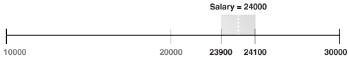

> This graphic represents a range as a horizontal line. The line has notches for 10000, 20000, 23000, 25000, and 30000. Between 23000 and 25000 is a gray box. The box is labeled “Salary = 24000.”
>
> [  
> Copyright © 2013, 2023, Oracle and/or its affiliates.](https://docs.oracle.com/en/database/oracle/oracle-database/dcommon/html/cpyr.htm)


The following table shows that the database tests the first row of `e2`, which is `24000 (King)`, against the Step 4 filter. The row passes the test, so the database sends the row to be merged. The next row in `e2` is `17000 (Kochhar)`. This row falls outside of the range (band) and thus does not satisfy the filter predicate, so the database stops testing `e2` rows in this iteration. The database stops testing because the descending sort of `e2` ensures that all subsequent rows in `e2` fail the filter test. Thus, the database can proceed to the second iteration of `e1`.

Table 9-10 First Iteration of e1: Single SORT JOIN

| Scan e2 | Filter 4 (e1.sal >= e2.sal – 100) AND (e1.sal <= e2.sal + 100) |
| --- | --- |
| 24000 (King) | Passes test because it is true that `(24000 >= 23900) AND (24000 <= 24100)`.  Send row to `MERGE`. Test next row. |
| 17000 (Kochhar) | Fails test because it is false that `(24000 >= 16900) AND (24000 <= 17100)`.  Stop scanning `e2`. Begin next iteration of `e1`. |
| 17000 (De Haan) | n/a |
| 14000 (Russell) | n/a |
| 13500 (Partners) | n/a |

In this way, the band join optimization eliminates unnecessary processing. Instead of scanning every row in `e2` as in the unoptimized case, the database scans only the minimum two rows.

#### 9.3.2 Outer Joins

An **outer join** returns all rows that satisfy the join condition and also rows from one table for which no rows from the other table satisfy the condition. Thus, the result set of an outer join is the superset of an inner join.

In ANSI syntax, the `OUTER JOIN` clause specifies an outer join. In the `FROM` clause, the [left table](glossary.md) appears to the left of the `OUTER JOIN` keywords, and the [right table](glossary.md) appears to the right of these keywords. The left table is also called the outer table, and the right table is also called the inner table. For example, in the following statement the `employees` table is the left or outer table:

```
SELECT employee_id, last_name, first_name
FROM   employees LEFT OUTER JOIN departments
ON     (employees.department_id=departments.departments_id);
```

Outer joins require the outer-joined table to be the driving table. In the preceding example, `employees` is the driving table, and `departments` is the driven-to table.

##### 9.3.2.1 Nested Loops Outer Joins

The database uses this operation to loop through an outer join between two tables. The outer join returns the outer (preserved) table rows, even when no corresponding rows are in the inner (optional) table.

In a standard nested loop, the optimizer chooses the order of tables—which is the driving table and which the driven table—based on the cost. However, in a nested loop outer join, the join condition determines the order of tables. The database uses the outer, row-preserved table to drive to the inner table.

The optimizer uses nested loops joins to process an outer join in the following circumstances:

- It is possible to drive from the outer table to the inner table.
- Data volume is low enough to make the nested loop method efficient.

For an example of a nested loop outer join, you can add the `USE_NL` hint to Example 9-9 to instruct the optimizer to use a nested loop. For example:

```
SELECT /*+ USE_NL(c o) */ cust_last_name,
       SUM(NVL2(o.customer_id,0,1)) "Count"
FROM   customers c, orders o
WHERE  c.credit_limit > 1000
AND    c.customer_id = o.customer_id(+)
GROUP BY cust_last_name;
```

##### 9.3.2.2 Hash Join Outer Joins

The optimizer uses hash joins for processing an outer join when either the data volume is large enough to make a hash join efficient, or it is impossible to drive from the outer table to the inner table.

The cost determines the order of tables. The outer table, including preserved rows, may be used to build the hash table, or it may be used to probe the hash table.

Example 9-9 Hash Join Outer Joins

This example shows a typical hash join outer join query, and its execution plan. In this example, all the customers with credit limits greater than 1000 are queried. An outer join is needed so that the query captures customers who have no orders.

- The outer table is `customers`.
- The inner table is `orders`.
- The join preserves the `customers` rows, including those rows without a corresponding row in `orders`.

You could use a `NOT EXISTS` subquery to return the rows. However, because you are querying all the rows in the table, the hash join performs better (unless the `NOT EXISTS` subquery is not nested).

```
SELECT cust_last_name, SUM(NVL2(o.customer_id,0,1)) "Count"
FROM   customers c, orders o
WHERE  c.credit_limit > 1000
AND    c.customer_id = o.customer_id(+)
GROUP BY cust_last_name;

---------------------------------------------------------------------------
| Id  | Operation          | Name      |Rows  |Bytes|Cost (%CPU)|Time     |
---------------------------------------------------------------------------
|  0 | SELECT STATEMENT    |           |      |       | 7 (100)|          |
|  1 |  HASH GROUP BY      |           |  168 |  3192 | 7  (29)| 00:00:01 |
|* 2 |   HASH JOIN OUTER   |           |  318 |  6042 | 6  (17)| 00:00:01 |
|* 3 |    TABLE ACCESS FULL| CUSTOMERS |  260 |  3900 | 3   (0)| 00:00:01 |
|* 4 |    TABLE ACCESS FULL| ORDERS    |  105 |   420 | 2   (0)| 00:00:01 |
---------------------------------------------------------------------------
 
Predicate Information (identified by operation id):
---------------------------------------------------
 
   2 - access("C"."CUSTOMER_ID"="O"."CUSTOMER_ID")
 
PLAN_TABLE_OUTPUT
--------------------------------------------------------------------------
   3 - filter("C"."CREDIT_LIMIT">1000)
   4 - filter("O"."CUSTOMER_ID">0)
```

The query looks for customers which satisfy various conditions. An outer join returns `NULL` for the inner table columns along with the outer (preserved) table rows when it does not find any corresponding rows in the inner table. This operation finds all the `customers` rows that do not have any `orders` rows.

In this case, the outer join condition is the following:

```
customers.customer_id = orders.customer_id(+)
```

The components of this condition represent the following:

Example 9-10 Outer Join to a Multitable View

In this example, the outer join is to a multitable view. The optimizer cannot drive into the view like in a normal join or push the predicates, so it builds the entire row set of the view.

```
SELECT c.cust_last_name, sum(revenue)
FROM   customers c, v_orders o
WHERE  c.credit_limit > 2000
AND    o.customer_id(+) = c.customer_id
GROUP BY c.cust_last_name;

---------------------------------------------------------------------------
| Id  | Operation              |  Name        | Rows | Bytes | Cost (%CPU)|
---------------------------------------------------------------------------
|   0 | SELECT STATEMENT       |              |  144 |  4608 |    16  (32)|
|   1 |  HASH GROUP BY         |              |  144 |  4608 |    16  (32)|
|*  2 |   HASH JOIN OUTER      |              |  663 | 21216 |    15  (27)|
|*  3 |    TABLE ACCESS FULL   | CUSTOMERS    |  195 |  2925 |     6  (17)|
|   4 |    VIEW                | V_ORDERS     |  665 | 11305 |            |
|   5 |     HASH GROUP BY      |              |  665 | 15960 |     9  (34)|
|*  6 |      HASH JOIN         |              |  665 | 15960 |     8  (25)|
|*  7 |       TABLE ACCESS FULL| ORDERS       |  105 |   840 |     4  (25)|
|   8 |       TABLE ACCESS FULL| ORDER_ITEMS  |  665 | 10640 |     4  (25)|
---------------------------------------------------------------------------

Predicate Information (identified by operation id):
---------------------------------------------------
   2 - access("O"."CUSTOMER_ID"(+)="C"."CUSTOMER_ID")
   3 - filter("C"."CREDIT_LIMIT">2000)
   6 - access("O"."ORDER_ID"="L"."ORDER_ID")
   7 - filter("O"."CUSTOMER_ID">0)
```

The view definition is as follows:

```
CREATE OR REPLACE view v_orders AS
SELECT l.product_id, SUM(l.quantity*unit_price) revenue, 
       o.order_id, o.customer_id
FROM   orders o, order_items l
WHERE  o.order_id = l.order_id
GROUP BY l.product_id, o.order_id, o.customer_id;
```

##### 9.3.2.3 Sort Merge Outer Joins

When an outer join cannot drive from the outer (preserved) table to the inner (optional) table, it cannot use a hash join or nested loops joins.

In this case, it uses the sort merge outer join.

The optimizer uses sort merge for an outer join in the following cases:

- A nested loops join is inefficient. A nested loops join can be inefficient because of data volumes.
- The optimizer finds it is cheaper to use a sort merge over a hash join because of sorts required by other operations.

##### 9.3.2.4 Full Outer Joins

A **full outer join** is a combination of the left and right outer joins.

In addition to the inner join, rows from both tables that have not been returned in the result of the inner join are preserved and extended with nulls. In other words, full outer joins join tables together, yet show rows with no corresponding rows in the joined tables.

Example 9-11 Full Outer Join

The following query retrieves all departments and all employees in each department, but also includes:

- Any employees without departments
- Any departments without employees
```
SELECT d.department_id, e.employee_id
FROM   employees e FULL OUTER JOIN departments d
ON     e.department_id = d.department_id
ORDER BY d.department_id;
```

The statement produces the following output:

```
DEPARTMENT_ID EMPLOYEE_ID
------------- -----------
           10         200
           20         201
           20         202
           30         114
           30         115
           30         116
...
          270
          280
                      178
                      207

125 rows selected.
```

Example 9-12 Execution Plan for a Full Outer Join

Starting with Oracle Database 11g, Oracle Database automatically uses a native execution method based on a hash join for executing full outer joins whenever possible. When the database uses the new method to execute a full outer join, the execution plan for the query contains `HASH JOIN FULL OUTER`. The query in Example 9-11 uses the following execution plan:

```
---------------------------------------------------------------------------
| Id| Operation               | Name       |Rows|Bytes |Cost (%CPU)|Time  |
---------------------------------------------------------------------------
| 0 | SELECT STATEMENT        |            |122 | 4758 | 6  (34)|00:0 0:01|
| 1 |  SORT ORDER BY          |            |122 | 4758 | 6  (34)|00:0 0:01|
| 2 |   VIEW                  | VW_FOJ_0   |122 | 4758 | 5  (20)|00:0 0:01|
|*3 |    HASH JOIN FULL OUTER |            |122 | 1342 | 5  (20)|00:0 0:01|
| 4 |     INDEX FAST FULL SCAN| DEPT_ID_PK | 27 |  108 | 2   (0)|00:0 0:01|
| 5 |     TABLE ACCESS FULL   | EMPLOYEES  |107 |  749 | 2   (0)|00:0 0:01|
---------------------------------------------------------------------------
 
Predicate Information (identified by operation id):
---------------------------------------------------
   3 - access("E"."DEPARTMENT_ID"="D"."DEPARTMENT_ID")
```

`HASH JOIN FULL OUTER` is included in the preceding plan (Step 3), indicating that the query uses the hash full outer join execution method. Typically, when the full outer join condition between two tables is an equijoin, the hash full outer join execution method is possible, and Oracle Database uses it automatically.

To instruct the optimizer to consider using the hash full outer join execution method, apply the `NATIVE_FULL_OUTER_JOIN` hint. To instruct the optimizer not to consider using the hash full outer join execution method, apply the `NO_NATIVE_FULL_OUTER_JOIN` hint. The `NO_NATIVE_FULL_OUTER_JOIN` hint instructs the optimizer to exclude the native execution method when joining each specified table. Instead, the full outer join is executed as a union of left outer join and an antijoin.

##### 9.3.2.5 Multiple Tables on the Left of an Outer Join

In Oracle Database 12c, multiple tables may exist on the left side of an outer-joined table.

This enhancement enables Oracle Database to merge a view that contains multiple tables and appears on the left of the outer join. In releases before Oracle Database 12c, a query such as the following was invalid, and would trigger an `ORA-01417` error message:

```
SELECT t1.d, t3.c
FROM   t1, t2, t3
WHERE  t1.z = t2.z 
AND    t1.x = t3.x (+) 
AND    t2.y = t3.y (+);
```

Starting in Oracle Database 12c, the preceding query is valid.

#### 9.3.3 Semijoins

A **semijoin** is a join between two data sets that returns a row from the first set when a matching row exists in the subquery data set.

The database stops processing the second data set at the first match. Thus, optimization does not duplicate rows from the first data set when multiple rows in the second data set satisfy the subquery criteria.

Note:

Semijoins and antijoins are considered join types even though the SQL constructs that cause them are subqueries. They are internal algorithms that the optimizer uses to flatten subquery constructs so that they can be resolved in a join-like way.

##### 9.3.3.1 When the Optimizer Considers Semijoins

A semijoin avoids returning a huge number of rows when a query only needs to determine whether a match exists.

With large data sets, this optimization can result in significant time savings over a nested loops join that must loop through every record returned by the inner query for every row in the outer query. The optimizer can apply the semijoin optimization to nested loops joins, hash joins, and sort merge joins.

The optimizer may choose a semijoin in the following circumstances:

- The statement uses either an `IN` or `EXISTS` clause.
- The statement contains a subquery in the `IN` or `EXISTS` clause.
- The `IN` or `EXISTS` clause is not contained inside an `OR` branch.

##### 9.3.3.2 How Semijoins Work

The semijoin optimization is implemented differently depending on what type of join is used.

The following pseudocode shows a semijoin for a nested loops join:

```
FOR ds1_row IN ds1 LOOP
  match := false;
  FOR ds2_row IN ds2_subquery LOOP
    IF (ds1_row matches ds2_row) THEN
      match := true;
      EXIT -- stop processing second data set when a match is found
    END IF
  END LOOP
  IF (match = true) THEN 
    RETURN ds1_row
  END IF
END LOOP
```

In the preceding pseudocode, `ds1` is the first data set, and `ds2_subquery` is the subquery data set. The code obtains the first row from the first data set, and then loops through the subquery data set looking for a match. The code exits the inner loop as soon as it finds a match, and then begins processing the next row in the first data set.

Example 9-13 Semijoin Using WHERE EXISTS

The following query uses a `WHERE EXISTS` clause to list only the departments that contain employees:

```
SELECT department_id, department_name 
FROM   departments
WHERE EXISTS (SELECT 1
              FROM   employees 
              WHERE  employees.department_id = departments.department_id)
```

The execution plan reveals a `NESTED LOOPS SEMI` operation in Step 1:

```
---------------------------------------------------------------------------
| Id| Operation          | Name              |Rows|Bytes|Cost (%CPU)|Time |
---------------------------------------------------------------------------
| 0 | SELECT STATEMENT   |                   |   |     | 2 (100)|         |
| 1 |  NESTED LOOPS SEMI |                   |11 | 209 | 2   (0)|00:00:01 |
| 2 |   TABLE ACCESS FULL| DEPARTMENTS       |27 | 432 | 2   (0)|00:00:01 |
|*3 |   INDEX RANGE SCAN | EMP_DEPARTMENT_IX |44 | 132 | 0   (0)|         |
---------------------------------------------------------------------------
```

For each row in `departments`, which forms the outer loop, the database obtains the department ID, and then probes the `employees.department_id` index for matching entries. Conceptually, the index looks as follows:

```
10,rowid
10,rowid
10,rowid
10,rowid
30,rowid
30,rowid
30,rowid
...
```

If the first entry in the `departments` table is department `30`, then the database performs a range scan of the index until it finds the first `30` entry, at which point it stops reading the index and returns the matching row from `departments`. If the next row in the outer loop is department `20`, then the database scans the index for a `20` entry, and not finding any matches, performs the next iteration of the outer loop. The database proceeds in this way until all matching rows are returned.

Example 9-14 Semijoin Using IN

The following query uses a `IN` clause to list only the departments that contain employees:

```
SELECT department_id, department_name
FROM   departments
WHERE  department_id IN 
       (SELECT department_id 
        FROM   employees);
```

The execution plan reveals a `NESTED LOOPS SEMI` operation in Step 1:

```
---------------------------------------------------------------------------
| Id| Operation          | Name              |Rows|Bytes|Cost (%CPU)|Time |
---------------------------------------------------------------------------
| 0 | SELECT STATEMENT   |                   |   |     | 2 (100)|         |
| 1 |  NESTED LOOPS SEMI |                   |11 | 209 | 2   (0)|00:00:01 |
| 2 |   TABLE ACCESS FULL| DEPARTMENTS       |27 | 432 | 2   (0)|00:00:01 |
|*3 |   INDEX RANGE SCAN | EMP_DEPARTMENT_IX |44 | 132 | 0   (0)|         |
---------------------------------------------------------------------------
```

The plan is identical to the plan in Example 9-13.

#### 9.3.4 Antijoins

An **antijoin** is a join between two data sets that returns a row from the first set when a matching row does not exist in the subquery data set.

Like a semijoin, an antijoin stops processing the subquery data set when the first match is found. Unlike a semijoin, the antijoin only returns a row when no match is found.

##### 9.3.4.1 When the Optimizer Considers Antijoins

An antijoin avoids unnecessary processing when a query only needs to return a row when a match does not exist.

With large data sets, this optimization can result in significant time savings over a nested loops join. The latter join must loop through every record returned by the inner query for every row in the outer query. The optimizer can apply the antijoin optimization to nested loops joins, hash joins, and sort merge joins.

The optimizer may choose an antijoin in the following circumstances:

- The statement uses either the `NOT IN` or `NOT EXISTS` clause.
- The statement has a subquery in the `NOT IN` or `NOT EXISTS` clause.
- The `NOT IN` or `NOT EXISTS` clause is not contained inside an `OR` branch.
- The statement performs an outer join and applies an `IS NULL` condition to a join column, as in the following example:
	```
	SET AUTOTRACE TRACEONLY EXPLAIN
	SELECT emp.*
	FROM   emp, dept
	WHERE  emp.deptno = dept.deptno(+)
	AND    dept.deptno IS NULL
	Execution Plan
	----------------------------------------------------------
	Plan hash value: 1543991079
	 
	------------------------------------------------------------------------
	| Id  | Operation          | Name | Rows  | Bytes |Cost (%CPU)|Time    |
	------------------------------------------------------------------------
	|   0 | SELECT STATEMENT   |      |    14 |  1400 |  5  (20)| 00:00:01 |
	|*  1 |  HASH JOIN ANTI    |      |    14 |  1400 |  5  (20)| 00:00:01 |
	|   2 |   TABLE ACCESS FULL| EMP  |    14 |  1218 |  2   (0)| 00:00:01 |
	|   3 |   TABLE ACCESS FULL| DEPT |     4 |    52 |  2   (0)| 00:00:01 |
	------------------------------------------------------------------------
	 
	Predicate Information (identified by operation id):
	---------------------------------------------------
	 
	   1 - access("EMP"."DEPTNO"="DEPT"."DEPTNO")
	 
	Note
	-----
	   - dynamic statistics used: dynamic sampling (level=2)
	```

##### 9.3.4.2 How Antijoins Work

The antijoin optimization is implemented differently depending on what type of join is used.

The following pseudocode shows an antijoin for a nested loops join:

```
FOR ds1_row IN ds1 LOOP
  match := true;
  FOR ds2_row IN ds2 LOOP
    IF (ds1_row matches ds2_row) THEN
      match := false;
      EXIT -- stop processing second data set when a match is found
    END IF
  END LOOP
  IF (match = true) THEN 
    RETURN ds1_row
  END IF
END LOOP
```

In the preceding pseudocode, `ds1` is the first data set, and `ds2` is the second data set. The code obtains the first row from the first data set, and then loops through the second data set looking for a match. The code exits the inner loop as soon as it finds a match, and begins processing the next row in the first data set.

Example 9-15 Semijoin Using WHERE EXISTS

The following query uses a `WHERE EXISTS` clause to list only the departments that contain employees:

```
SELECT department_id, department_name 
FROM   departments
WHERE EXISTS (SELECT 1
              FROM   employees 
              WHERE  employees.department_id = departments.department_id)
```

The execution plan reveals a `NESTED LOOPS SEMI` operation in Step 1:

```
---------------------------------------------------------------------------
| Id| Operation          | Name              |Rows|Bytes |Cost(%CPU)|Time |
---------------------------------------------------------------------------
| 0 | SELECT STATEMENT   |                   |   |     | 2 (100)|         |
| 1 |  NESTED LOOPS SEMI |                   |11 | 209 | 2   (0)|00:00:01 |
| 2 |   TABLE ACCESS FULL| DEPARTMENTS       |27 | 432 | 2   (0)|00:00:01 |
|*3 |   INDEX RANGE SCAN | EMP_DEPARTMENT_IX |44 | 132 | 0   (0)|         |
---------------------------------------------------------------------------
```

For each row in `departments`, which forms the outer loop, the database obtains the department ID, and then probes the `employees.department_id` index for matching entries. Conceptually, the index looks as follows:

```
10,rowid
10,rowid
10,rowid
10,rowid
30,rowid
30,rowid
30,rowid
...
```

If the first record in the `departments` table is department `30`, then the database performs a range scan of the index until it finds the first `30` entry, at which point it stops reading the index and returns the matching row from `departments`. If the next row in the outer loop is department `20`, then the database scans the index for a `20` entry, and not finding any matches, performs the next iteration of the outer loop. The database proceeds in this way until all matching rows are returned.

##### 9.3.4.3 How Antijoins Handle Nulls

For semijoins, `IN` and `EXISTS` are functionally equivalent. However, `NOT IN` and `NOT EXISTS` are not functionally equivalent because of nulls.

If a null value is returned to a `NOT IN` operator, then the statement returns no records. To see why, consider the following `WHERE` clause:

```
WHERE department_id NOT IN (null, 10, 20)
```

The database tests the preceding expression as follows:

```
WHERE (department_id != null) 
AND   (department_id != 10) 
AND   (department_id != 20)
```

For the entire expression to be `true`, each individual condition must be `true`. However, a null value cannot be compared to another value, so the `department_id !=null` condition cannot be `true`, and thus the whole expression is always `false`. The following techniques enable a statement to return records even when nulls are returned to the `NOT IN` operator:

- Apply an `NVL` function to the columns returned by the subquery.
- Add an `IS NOT NULL` predicate to the subquery.
- Implement `NOT NULL` constraints.

In contrast to `NOT IN`, the `NOT EXISTS` clause only considers predicates that return the existence of a match, and ignores any row that does not match or could not be determined because of nulls. If at least one row in the subquery matches the row from the outer query, then `NOT EXISTS` returns `false`. If no tuples match, then `NOT EXISTS ` returns `true`. The presence of nulls in the subquery does not affect the search for matching records.

In releases earlier than Oracle Database 11g, the optimizer could not use an antijoin optimization when nulls could be returned by a subquery. However, starting in Oracle Database 11g, the `ANTI NA` (and `ANTI SNA`) optimizations described in the following sections enable the optimizer to use an antijoin even when nulls are possible.

Example 9-16 Antijoin Using NOT IN

Suppose that a user issues the following query with a `NOT IN` clause to list the departments that contain no employees:

```
SELECT department_id, department_name
FROM   departments
WHERE  department_id NOT IN 
       (SELECT department_id 
        FROM   employees);
```

The preceding query returns no rows even though several departments contain no employees. This result, which was not intended by the user, occurs because the `employees.department_id` column is nullable.

The execution plan reveals a `NESTED LOOPS ANTI SNA` operation in Step 2:

```
---------------------------------------------------------------------------
| Id| Operation             | Name            |Rows|Bytes|Cost (%CPU)|Time|
---------------------------------------------------------------------------
| 0| SELECT STATEMENT       |                   |   |    | 4(100)|        |
|*1|  FILTER                |                   |   |    |       |        |
| 2|   NESTED LOOPS ANTI SNA|                   |17 |323 | 4 (50)|00:00:01|
| 3|    TABLE ACCESS FULL   | DEPARTMENTS       |27 |432 | 2  (0)|00:00:01|
|*4|    INDEX RANGE SCAN    | EMP_DEPARTMENT_IX |41 |123 | 0  (0)|        |
|*5|   TABLE ACCESS FULL    | EMPLOYEES         | 1 |  3 | 2  (0)|00:00:01|
---------------------------------------------------------------------------
 
PLAN_TABLE_OUTPUT
---------------------------------------------------------------------------
 
Predicate Information (identified by operation id):
---------------------------------------------------
   1 - filter( IS NULL)
   4 - access("DEPARTMENT_ID"="DEPARTMENT_ID")
   5 - filter("DEPARTMENT_ID" IS NULL)
```

The `ANTI SNA` stands for "single null-aware antijoin." `ANTI NA` stands for "null-aware antijoin." The null-aware operation enables the optimizer to use the antijoin optimization even on a nullable column. In releases earlier than Oracle Database 11g, the database could not perform antijoins on `NOT IN` queries when nulls were possible.

Suppose that the user rewrites the query by applying an `IS NOT NULL` condition to the subquery:

```
SELECT department_id, department_name
FROM   departments
WHERE  department_id NOT IN 
       (SELECT department_id 
        FROM   employees
        WHERE  department_id IS NOT NULL);
```

The preceding query returns 16 rows, which is the expected result. Step 1 in the plan shows a standard `NESTED LOOPS ANTI` join instead of an `ANTI NA` or `ANTI SNA` join because the subquery cannot returns nulls:

```
---------------------------------------------------------------------------
|Id| Operation          | Name              |Rows|Bytes |Cost (%CPU)|Time |
---------------------------------------------------------------------------
| 0| SELECT STATEMENT   |                   |    |     | 2 (100)|         |
| 1|  NESTED LOOPS ANTI |                   | 17 | 323 | 2   (0)|00:00:01 |
| 2|   TABLE ACCESS FULL| DEPARTMENTS       | 27 | 432 | 2   (0)|00:00:01 |
|*3|   INDEX RANGE SCAN | EMP_DEPARTMENT_IX | 41 | 123 | 0   (0)|         |
---------------------------------------------------------------------------
 
PLAN_TABLE_OUTPUT
---------------------------------------------------------------------------
Predicate Information (identified by operation id):
---------------------------------------------------
 
   3 - access("DEPARTMENT_ID"="DEPARTMENT_ID")
       filter("DEPARTMENT_ID" IS NOT NULL)
```

Example 9-17 Antijoin Using NOT EXISTS

Suppose that a user issues the following query with a `NOT EXISTS` clause to list the departments that contain no employees:

```
SELECT department_id, department_name
FROM   departments d
WHERE  NOT EXISTS
       (SELECT null
        FROM   employees e
        WHERE  e.department_id = d.department_id)
```

The preceding query avoids the null problem for `NOT IN` clauses. Thus, even though `employees.department_id` column is nullable, the statement returns the desired result.

Step 1 of the execution plan reveals a `NESTED LOOPS ANTI` operation, not the `ANTI NA` variant, which was necessary for `NOT IN` when nulls were possible:

```
---------------------------------------------------------------------------
| Id| Operation          | Name              |Rows|Bytes| Cost (%CPU)|Time|
---------------------------------------------------------------------------
| 0 | SELECT STATEMENT   |                   |    |     | 2 (100)|        |
| 1 |  NESTED LOOPS ANTI |                   | 17 | 323 | 2   (0)|00:00:01|
| 2 |   TABLE ACCESS FULL| DEPARTMENTS       | 27 | 432 | 2   (0)|00:00:01|
|*3 |   INDEX RANGE SCAN | EMP_DEPARTMENT_IX | 41 | 123 | 0   (0)|        |
---------------------------------------------------------------------------
 
PLAN_TABLE_OUTPUT
---------------------------------------------------------------------------
Predicate Information (identified by operation id):
---------------------------------------------------
 
   3 - access("E"."DEPARTMENT_ID"="D"."DEPARTMENT_ID")
```

#### 9.3.5 Cartesian Joins

The database uses a **Cartesian join** when one or more of the tables does not have any join conditions to any other tables in the statement.

The optimizer joins every row from one data source with every row from the other data source, creating the Cartesian product of the two sets. Therefore, the total number of rows resulting from the join is calculated using the following formula, where `rs1` is the number of rows in first row set and `rs2` is the number of rows in the second row set:

```
rs1 X rs2 = total rows in result set
```

##### 9.3.5.1 When the Optimizer Considers Cartesian Joins

The optimizer uses a Cartesian join for two row sources only in specific circumstances.

Typically, the situation is one of the following:

- No join condition exists.
	In some cases, the optimizer could pick up a common [filter condition](glossary.md) between the two tables as a possible join condition.
	Note:
	If a Cartesian join appears in a query plan, it could be caused by an inadvertently omitted join condition. In general, if a query joins n tables, then n-1 join conditions are required to avoid a Cartesian join.
- A Cartesian join is an efficient method.
	For example, the optimizer may decide to generate a Cartesian product of two very small tables that are both joined to the same large table.
- The `ORDERED` hint specifies a table before its join table is specified.

##### 9.3.5.2 How Cartesian Joins Work

A Cartesian join uses nested `FOR` loops.

At a high level, the algorithm for a Cartesian join looks as follows, where `ds1` is typically the smaller data set, and `ds2` is the larger data set:

```
FOR ds1_row IN ds1 LOOP
  FOR ds2_row IN ds2 LOOP
    output ds1_row and ds2_row
  END LOOP
END LOOP
```

Example 9-18 Cartesian Join

In this example, a user intends to perform an inner join of the `employees` and `departments` tables, but accidentally leaves off the join condition:

```
SELECT e.last_name, d.department_name
FROM   employees e, departments d
```

The execution plan is as follows:

```
---------------------------------------------------------------------------
| Id| Operation             | Name        | Rows | Bytes |Cost (%CPU)|Time|
---------------------------------------------------------------------------
| 0| SELECT STATEMENT       |             |      |      |11 (100)|        |
| 1|  MERGE JOIN CARTESIAN  |             | 2889 |57780 |11   (0)|00:00:01|
| 2|   TABLE ACCESS FULL    | DEPARTMENTS |   27 |  324 | 2   (0)|00:00:01|
| 3|   BUFFER SORT          |             |  107 |  856 | 9   (0)|00:00:01|
| 4|    INDEX FAST FULL SCAN| EMP_NAME_IX |  107 |  856 | 0   (0)|        |
---------------------------------------------------------------------------
```

In Step 1 of the preceding plan, the `CARTESIAN` keyword indicates the presence of a Cartesian join. The number of rows (2889) is the product of 27 and 107.

In Step 3, the `BUFFER SORT` operation indicates that the database is copying the data blocks obtained by the scan of `emp_name_ix` from the SGA to the PGA. This strategy avoids multiple scans of the same blocks in the database buffer cache, which would generate many logical reads and permit resource contention.

##### 9.3.5.3 Cartesian Join Controls

The `ORDERED` hint instructs the optimizer to join tables in the order in which they appear in the `FROM` clause. By forcing a join between two row sources that have no direct connection, the optimizer must perform a Cartesian join.

Example 9-19 ORDERED Hint

In the following example, the `ORDERED` hint instructs the optimizer to join `employees` and `locations`, but no join condition connects these two row sources:

```
SELECT /*+ORDERED*/ e.last_name, d.department_name, l.country_id, l.state_province
FROM   employees e, locations l, departments d
WHERE  e.department_id = d.department_id
AND    d.location_id = l.location_id
```

The following execution plan shows a Cartesian product (Step 3) between `locations` (Step 6) and `employees` (Step 4), which is then joined to the `departments` table (Step 2):

```
---------------------------------------------------------------------------
| Id| Operation             | Name        |Rows | Bytes |Cost (%CPU)|Time |
---------------------------------------------------------------------------
| 0 | SELECT STATEMENT      |             |     |      |37 (100)|         |
|*1 |  HASH JOIN            |             | 106 | 4664 |37   (6)|00:00:01 |
| 2 |   TABLE ACCESS FULL   | DEPARTMENTS |  27 |  513 | 2   (0)|00:00:01 |
| 3 |   MERGE JOIN CARTESIAN|             |2461 |61525 |34   (3)|00:00:01 |
| 4 |    TABLE ACCESS FULL  | EMPLOYEES   | 107 | 1177 | 2   (0)|00:00:01 |
| 5 |    BUFFER SORT        |             |  23 |  322 |32   (4)|00:00:01 |
| 6 |     TABLE ACCESS FULL | LOCATIONS   |  23 |  322 | 0   (0)|         |
---------------------------------------------------------------------------
```

See Also:

[Oracle Database SQL Language Reference](https://docs.oracle.com/pls/topic/lookup?ctx=en/database/oracle/oracle-database/21/tgsql&id=SQLRF50601) to learn about the `ORDERED` hint

### 9.4 Join Optimizations

Join optimizations enable joins to be more efficient.

#### 9.4.1 Bloom Filters

A **Bloom filter**, named after its creator Burton Bloom, is a low-memory data structure that tests membership in a set.

A Bloom filter correctly indicates when an element is not in a set, but can incorrectly indicate when an element is in a set. Thus, false negatives are impossible but false positives are possible.

##### 9.4.1.1 Purpose of Bloom Filters

A Bloom filter tests one set of values to determine whether they are members another set.

For example, one set is (10,20,30,40) and the second set is (10,30,60,70). A Bloom filter can determine that 60 and 70 are guaranteed to be excluded from the first set, and that 10 and 30 are probably members. Bloom filters are especially useful when the amount of memory needed to store the filter is small relative to the amount of data in the data set, and when most data is expected to fail the membership test.

Oracle Database uses Bloom filters to various specific goals, including the following:

- Reduce the amount of data transferred to child processes in a parallel query, especially when the database discards most rows because they do not fulfill a join condition
- Eliminate unneeded partitions when building a partition access list in a join, known as partition pruning
- Test whether data exists in the server result cache, thereby avoiding a disk read
- Filter members in Exadata cells, especially when joining a large fact table and small dimension tables in a star schema

Bloom filters can occur in both parallel and serial processing.

##### 9.4.1.2 How Bloom Filters Work

A Bloom filter uses an array of bits to indicate inclusion in a set.

For example, 8 elements (an arbitrary number used for this example) in an array are initially set to `0`:

```
e1 e2 e3 e4 e5 e6 e7 e8
 0  0  0  0  0  0  0  0
```

This array represents a set. To represent an input value i in this array, three separate hash functions (three is arbitrary) are applied to i, each generating a hash value between `1` and `8`:

```
f1(i) = h1
f2(i) = h2
f3(i) = h3
```

For example, to store the value `17` in this array, the hash functions set i to `17`, and then return the following hash values:

```
f1(17) = 5
f2(17) = 3
f3(17) = 5
```

In the preceding example, two of the hash functions happened to return the same value of `5`, known as a hash collision. Because the distinct hash values are `5` and `3`, the 5th and 3rd elements in the array are set to `1`:

```
e1 e2 e3 e4 e5 e6 e7 e8
 0  0  1  0  1  0  0  0
```

Testing the membership of `17` in the set reverses the process. To test whether the set excludes the value `17`, element `3` or element `5` must contain a `0`. If a `0` is present in either element, then the set cannot contain `17`. No false negatives are possible.

To test whether the set includes `17`, both element `3` and element `5` must contain `1` values. However, if the test indicates a `1` for both elements, then it is still possible for the set not to include `17`. False positives are possible. For example, the following array might represent the value `22`, which also has a `1` for both element `3` and element `5`:

```
e1 e2 e3 e4 e5 e6 e7 e8
 1  0  1  0  1  0  0  0
```

##### 9.4.1.3 Bloom Filter Controls

The optimizer automatically determines whether to use Bloom filters.

To override optimizer decisions, use the hints `PX_JOIN_FILTER` and `NO_PX_JOIN_FILTER`.

See Also:

[Oracle Database SQL Language Reference](https://docs.oracle.com/pls/topic/lookup?ctx=en/database/oracle/oracle-database/21/tgsql&id=SQLRF50585) to learn more about the bloom filter hints

##### 9.4.1.4 Bloom Filter Metadata

`V$` views contain metadata about Bloom filters.

You can query the following views:

- `V$SQL_JOIN_FILTER`
	This view shows the number of rows filtered out (`FILTERED` column) and tested (`PROBED` column) by an active Bloom filter.
- `V$PQ_TQSTAT `
	This view displays the number of rows processed through each parallel execution server at each stage of the execution tree. You can use it to monitor how much Bloom filters have reduced data transfer among parallel processes.

In an execution plan, a Bloom filter is indicated by keywords `JOIN FILTER` in the `Operation` column, and the prefix `:BF` in the `Name` column, as in the 9th step of the following plan snippet:

```
---------------------------------------------------------------------------
| Id  | Operation                 | Name     |    TQ  |IN-OUT| PQ Distrib |
---------------------------------------------------------------------------
...
|   9 |      JOIN FILTER CREATE   | :BF0000  |  Q1,03 | PCWP |            |
```

In the `Predicate Information` section of the plan, filters that contain functions beginning with the string `SYS_OP_BLOOM_FILTER` indicate use of a Bloom filter.

##### 9.4.1.5 Bloom Filters: Scenario

In this example, a parallel query joins the `sales` fact table to the `products` and `times` dimension tables, and filters on fiscal week `18`.

```
SELECT /*+ parallel(s) */ p.prod_name, s.quantity_sold
FROM   sh.sales s, sh.products p, sh.times t 
WHERE  s.prod_id = p.prod_id
AND    s.time_id = t.time_id
AND    t.fiscal_week_number = 18;
```

Querying `DBMS_XPLAN.DISPLAY_CURSOR` provides the following output:

```
SELECT * FROM
  TABLE(DBMS_XPLAN.DISPLAY_CURSOR(format => 'BASIC,+PARALLEL,+PREDICATE'));

EXPLAINED SQL STATEMENT:
------------------------
SELECT /*+ parallel(s) */ p.prod_name, s.quantity_sold FROM sh.sales s,
sh.products p, sh.times t WHERE s.prod_id = p.prod_id AND s.time_id =
t.time_id AND t.fiscal_week_number = 18
 
Plan hash value: 1183628457
 
---------------------------------------------------------------------------
| Id | Operation                  | Name     |    TQ  |IN-OUT| PQ Distrib |
---------------------------------------------------------------------------
|  0 | SELECT STATEMENT           |          |        |      |            |
|  1 |  PX COORDINATOR            |          |        |      |            |
|  2 |   PX SEND QC (RANDOM)      | :TQ10003 |  Q1,03 | P->S | QC (RAND)  |
|* 3 |    HASH JOIN BUFFERED      |          |  Q1,03 | PCWP |            |
|  4 |     PX RECEIVE             |          |  Q1,03 | PCWP |            |
|  5 |      PX SEND BROADCAST     | :TQ10001 |  Q1,01 | S->P | BROADCAST  |
|  6 |       PX SELECTOR          |          |  Q1,01 | SCWC |            |
|  7 |        TABLE ACCESS FULL   | PRODUCTS |  Q1,01 | SCWP |            |
|* 8 |     HASH JOIN              |          |  Q1,03 | PCWP |            |
|  9 |      JOIN FILTER CREATE    | :BF0000  |  Q1,03 | PCWP |            |
| 10 |       BUFFER SORT          |          |  Q1,03 | PCWC |            |
| 11 |        PX RECEIVE          |          |  Q1,03 | PCWP |            |
| 12 |         PX SEND HYBRID HASH| :TQ10000 |        | S->P | HYBRID HASH|
|*13 |          TABLE ACCESS FULL | TIMES    |        |      |            |
| 14 |      PX RECEIVE            |          |  Q1,03 | PCWP |            |
| 15 |       PX SEND HYBRID HASH  | :TQ10002 |  Q1,02 | P->P | HYBRID HASH|
| 16 |        JOIN FILTER USE     | :BF0000  |  Q1,02 | PCWP |            |
| 17 |         PX BLOCK ITERATOR  |          |  Q1,02 | PCWC |            |
|*18 |          TABLE ACCESS FULL | SALES    |  Q1,02 | PCWP |            |
---------------------------------------------------------------------------
 
Predicate Information (identified by operation id):
---------------------------------------------------
 
   3 - access("S"."PROD_ID"="P"."PROD_ID")
   8 - access("S"."TIME_ID"="T"."TIME_ID")
  13 - filter("T"."FISCAL_WEEK_NUMBER"=18)
  18 - access(:Z>=:Z AND :Z<=:Z)
       filter(SYS_OP_BLOOM_FILTER(:BF0000,"S"."TIME_ID"))
```

A single server process scans the `times` table (Step 13), and then uses a hybrid hash distribution method to send the rows to the parallel execution servers (Step 12). The processes in set `Q1,03` create a bloom filter (Step 9). The processes in set `Q1,02` scan `sales` in parallel (Step 18), and then use the Bloom filter to discard rows from `sales` (Step 16) before sending them on to set `Q1,03` using hybrid hash distribution (Step 15). The processes in set `Q1,03` hash join the `times` rows to the filtered `sales` rows (Step 8). The processes in set `Q1,01` scan `products` (Step 7), and then send the rows to `Q1,03` (Step 5). Finally, the processes in `Q1,03` join the `products` rows to the rows generated by the previous hash join (Step 3).

The following figure illustrates the basic process.

Figure 9-8 Bloom Filter

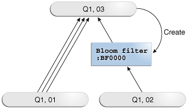

> The top of this graphic shows an oval containing "Q1, Q3." On the left, the oval "Q1,01" points to "Q1,03" using three arrows. On the right, the oval "Q1,02" points to a box labeled "Bloom filter: BF0000" using three arrows. This box points to the "Q1,03" box.
>
> [  
> Copyright © 2013, 2023, Oracle and/or its affiliates.](https://docs.oracle.com/en/database/oracle/oracle-database/dcommon/html/cpyr.htm)


#### 9.4.2 Partition-Wise Joins

A **partition-wise join** is an optimization that divides a large join of two tables, one of which must be partitioned on the join key, into several smaller joins.

Partition-wise joins are either of the following:

- Full partition-wise join
	Both tables must be equipartitioned on their join keys, or use reference partitioning (that is, be related by referential constraints). The database divides a large join into smaller joins between two partitions from the two joined tables.
- Partial partition-wise joins
	Only one table is partitioned on the join key. The other table may or may not be partitioned.

See Also:

[Oracle Database VLDB and Partitioning Guide](https://docs.oracle.com/pls/topic/lookup?ctx=en/database/oracle/oracle-database/21/tgsql&id=VLDBG00402) explains partition-wise joins in detail

##### 9.4.2.1 Purpose of Partition-Wise Joins

Partition-wise joins reduce query response time by minimizing the amount of data exchanged among parallel execution servers when joins execute in parallel.

This technique significantly reduces response time and improves the use of CPU and memory. In Oracle Real Application Clusters (Oracle RAC) environments, partition-wise joins also avoid or at least limit the data traffic over the interconnect, which is the key to achieving good scalability for massive join operations.

##### 9.4.2.2 How Partition-Wise Joins Work

When the database serially joins two partitioned tables without using a partition-wise join, a single server process performs the join.

In the following illustration, the join is not partition-wise because the server process joins every partition of table `t1` to every partition of table `t2`.

Figure 9-9 Join That Is Not Partition-Wise

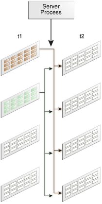

> This graphic shows two tables, t1 and t2. Each table consists of four vertically stacked boxes that represent the partitions. t1 and t2 both point to a box labeled "Server Process."
>
> [  
> Copyright © 2013, 2023, Oracle and/or its affiliates.](https://docs.oracle.com/en/database/oracle/oracle-database/dcommon/html/cpyr.htm)


###### 9.4.2.2.1 How a Full Partition-Wise Join Works

The database performs a full partition-wise join either serially or in parallel.

The following graphic shows a full partition-wise join performed in parallel. In this case, the granule of parallelism is a partition. Each parallel execution server joins the partitions in pairs. For example, the first parallel execution server joins the first partition of `t1` to the first partition of `t2`. The parallel execution coordinator then assembles the result.

Figure 9-10 Full Partition-Wise Join in Parallel

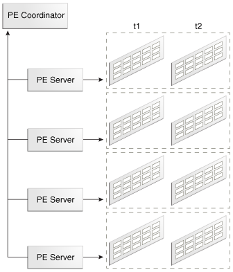

> This graphic shows two tables, t1 and t2. Each consists of four vertically stacked boxes that represent the partitions. A box surrounds each pair of partitions from t1 and t2. A parallel execution server points to each of these boxes. A PE coordinator box is on top of the PE Server boxes.


A full partition-wise join can also join partitions to subpartitions, which is useful when the tables use different partitioning methods. For example, `customers` is partitioned by hash, but `sales` is partitioned by range. If you subpartition `sales` by hash, then the database can perform a full partition-wise join between the hash partitions of the `customers` and the hash subpartitions of `sales`.

In the execution plan, the presence of a partition operation before the join signals the presence of a full partition-wise join, as in the following snippet:

```
|   8 |         PX PARTITION HASH ALL|
|*  9 |          HASH JOIN           |
```

See Also:

[Oracle Database VLDB and Partitioning Guide](https://docs.oracle.com/pls/topic/lookup?ctx=en/database/oracle/oracle-database/21/tgsql&id=VLDBG1241) explains full partition-wise joins in detail, and includes several examples

###### 9.4.2.2.2 How a Partial Partition-Wise Join Works

Partial partition-wise joins, unlike their full partition-wise counterpart, must execute in parallel.

The following graphic shows a partial partition-wise join between `t1`, which is partitioned, and `t2`, which is not partitioned.

Figure 9-11 Partial Partition-Wise Join

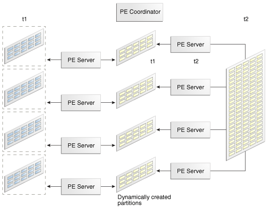

> The graphic shows an unpartitioned table t2 and a partitioned table t1. The graphics shows four PE server processes dividing t2 into four partitions. A different set of four PE server processes join the partitions of t1 with the partitions generated from t2. A PE coordinator oversees the operation.
>
> [  
> Copyright © 2013, 2023, Oracle and/or its affiliates.](https://docs.oracle.com/en/database/oracle/oracle-database/dcommon/html/cpyr.htm)


Because `t2` is not partitioned, a set of parallel execution servers must generate partitions from `t2` as needed. A different set of parallel execution servers then joins the `t1` partitions to the dynamically generated partitions. The parallel execution coordinator assembles the result.

In the execution plan, the operation `PX SEND PARTITION (KEY)` signals a partial partition-wise join, as in the following snippet:

```
|  11 |            PX SEND PARTITION (KEY)    |
```

See Also:

[Oracle Database VLDB and Partitioning Guide](https://docs.oracle.com/pls/topic/lookup?ctx=en/database/oracle/oracle-database/21/tgsql&id=VLDBG1247) explains full partition-wise joins in detail, and includes several examples

#### 9.4.3 In-Memory Join Groups

A join group is a user-created object that lists two or more columns that can be meaningfully joined.

In certain queries, join groups eliminate the performance overhead of decompressing and hashing column values. Join groups require an In-Memory Column Store (IM column store).

See Also:

[Oracle Database In-Memory Guide](https://docs.oracle.com/pls/topic/lookup?ctx=en/database/oracle/oracle-database/21/tgsql&id=INMEM-GUID-3E5491C4-B345-4A8E-8B1B-8DC150C8A797) to learn how to optimize In-Memory queries with join groups