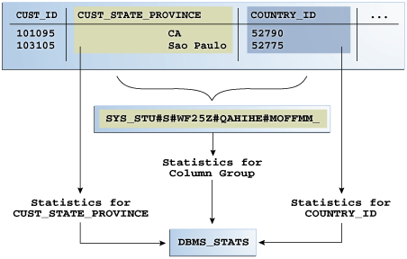
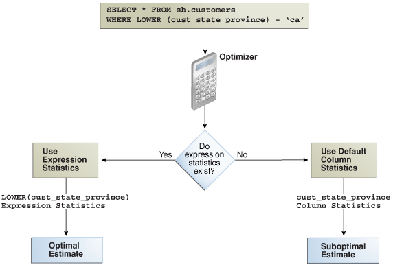

`DBMS_STATS` enables you to collect **extended statistics**, which are statistics that can improve cardinality estimates when multiple predicates exist on different columns of a table, or when predicates use expressions.

An **extension** is either a column group or an expression. Column group statistics can improve cardinality estimates when multiple columns from the same table occur together in a SQL statement. Expression statistics improves optimizer estimates when predicates use expressions, for example, built-in or user-defined functions.

Note:

You cannot create extended statistics on virtual columns.

See Also:

[Oracle Database SQL Language Reference](https://docs.oracle.com/pls/topic/lookup?ctx=en/database/oracle/oracle-database/21/tgsql&id=SQLRF54467) for a list of restrictions on virtual columns

### 14.1 Managing Column Group Statistics

A **column group** is a set of columns that is treated as a unit.

Essentially, a column group is a virtual column. By gathering statistics on a column group, the optimizer can more accurately determine the cardinality estimate when a query groups these columns together.

The following sections provide an overview of [column group statistics](glossary.md), and explain how to manage them manually.

See Also:

[Oracle Database PL/SQL Packages and Types Reference](https://docs.oracle.com/pls/topic/lookup?ctx=en/database/oracle/oracle-database/21/tgsql&id=ARPLS059) to learn about the `DBMS_STATS` package

#### 14.1.1 About Statistics on Column Groups

Individual column statistics are useful for determining the selectivity of a single predicate in a `WHERE` clause.

When the `WHERE` clause includes multiple predicates on different columns from the same table, individual column statistics do not show the relationship between the columns. This is the problem solved by a column group.

The optimizer calculates the selectivity of the predicates independently, and then combines them. However, if a correlation between the individual columns exists, then the optimizer cannot take it into account when determining a cardinality estimate, which it creates by multiplying the selectivity of each table predicate by the number of rows.

The following graphic contrasts two ways of gathering statistics on the `cust_state_province` and `country_id` columns of the `sh.customers` table. The diagram shows `DBMS_STATS` collecting statistics on each column individually and on the group. The column group has a system-generated name.

Figure 14-1 Column Group Statistics



> The top box of the graphic shows a table with three columns: CUST\_ID, CUST\_STATE\_PROVINCE, and COUNTRY\_ID. The first row contains the values 101095, CA, 5790. The second row contains the values 103105, São Paolo, 52775. The two columns point to a box that contains the name SYS\_ followed by random letters. This box points to text "Statistics for Column Group." This text points to the Optimizer icon. An arrow leads from the first column in the table to the text "Statistics for CUST\_STATE\_PROVINCE" to the Optimizer icon. An arrow leads from the third column in the table to the text "Statistics for COUNTRY\_ID" to the Optimizer icon.


Note:

The optimizer uses column group statistics for equality predicates, inlist predicates, and for estimating the `GROUP BY` cardinality.

##### 14.1.1.1 Why Column Group Statistics Are Needed: Example

This example demonstrates how column group statistics enable the optimizer to give a more accurate cardinality estimate.

The following query of the `DBA_TAB_COL_STATISTICS` table shows information about statistics that have been gathered on the columns `cust_state_province` and `country_id` from the `sh.customers` table:

```
COL COLUMN_NAME FORMAT a20
COL NDV FORMAT 999

SELECT COLUMN_NAME, NUM_DISTINCT AS "NDV", HISTOGRAM
FROM   DBA_TAB_COL_STATISTICS
WHERE  OWNER = 'SH'
AND    TABLE_NAME = 'CUSTOMERS'
AND    COLUMN_NAME IN ('CUST_STATE_PROVINCE', 'COUNTRY_ID');
```

Sample output is as follows:

```
COLUMN_NAME                 NDV HISTOGRAM
-------------------- ---------- ---------------
CUST_STATE_PROVINCE         145 FREQUENCY
COUNTRY_ID                   19 FREQUENCY
```

As shown in the following query, 3341 customers reside in California:

```
SELECT COUNT(*)
FROM   sh.customers 
WHERE  cust_state_province = 'CA';

 COUNT(*)
----------
    3341
```

Consider an explain plan for a query of customers in the state `CA` and in the country with ID `52790` (USA):

```
EXPLAIN PLAN FOR
  SELECT *
  FROM   sh.customers
  WHERE  cust_state_province = 'CA'
  AND    country_id=52790;
 
Explained.
 
sys@PROD> SELECT * FROM TABLE(DBMS_XPLAN.DISPLAY);
 
PLAN_TABLE_OUTPUT
---------------------------------------------------------------------------
Plan hash value: 1683234692
 
--------------------------------------------------------------------------
| Id  | Operation         | Name      | Rows | Bytes |Cost (%CPU)| Time  |
--------------------------------------------------------------------------
|   0 | SELECT STATEMENT  |           |  128 | 24192 | 442 (7)| 00:00:06 |
|*  1 |  TABLE ACCESS FULL| CUSTOMERS |  128 | 24192 | 442 (7)| 00:00:06 |
--------------------------------------------------------------------------
 
Predicate Information (identified by operation id):
---------------------------------------------------
 
PLAN_TABLE_OUTPUT
---------------------------------------------------------------------------
 
   1 - filter("CUST_STATE_PROVINCE"='CA' AND "COUNTRY_ID"=52790)
 
13 rows selected.
```

Based on the single-column statistics for the `country_id` and `cust_state_province` columns, the optimizer estimates that the query of California customers in the USA will return 128 rows. In fact, 3341 customers reside in California, but the optimizer does not know that the state of California is in the country of the USA, and so greatly underestimates cardinality by assuming that both predicates reduce the number of returned rows.

You can make the optimizer aware of the real-world relationship between values in `country_id` and `cust_state_province` by gathering column group statistics. These statistics enable the optimizer to give a more accurate cardinality estimate.

##### 14.1.1.2 Automatic and Manual Column Group Statistics

Oracle Database can create column group statistics either automatically or manually.

The optimizer can use SQL plan directives to generate a more optimal plan. If the `DBMS_STATS` preference `AUTO_STAT_EXTENSIONS` is set to `ON` (by default it is `OFF`), then a [SQL plan directive](glossary.md) can automatically trigger the creation of column group statistics based on usage of predicates in the workload. You can set `AUTO_STAT_EXTENSIONS` with the `SET_TABLE_PREFS`, `SET_GLOBAL_PREFS`, or `SET_SCHEMA_PREFS` procedures.

When you want to manage column group statistics manually, then use `DBMS_STATS` as follows:

- Detect column groups
- Create previously detected column groups
- Create column groups manually and gather column group statistics

See Also:

- " Detecting Useful Column Groups for a Specific Workload "
- " Creating Column Groups Detected During Workload Monitoring "
- " Creating and Gathering Statistics on Column Groups Manually "
- [Oracle Database PL/SQL Packages and Types Reference](https://docs.oracle.com/pls/topic/lookup?ctx=en/database/oracle/oracle-database/21/tgsql&id=ARPLS68491) to learn about the `DBMS_STATS` procedures for setting optimizer statistics

##### 14.1.1.3 User Interface for Column Group Statistics

Several `DBMS_STATS` program units have preferences that are relevant for column groups.

Table 14-1 DBMS\_STATS APIs Relevant for Column Groups

| Program Unit or Preference | Description |
| --- | --- |
| `SEED_COL_USAGE` Procedure | Iterates over the SQL statements in the specified workload, compiles them, and then seeds column usage information for the columns that appear in these statements.  To determine the appropriate column groups, the database must observe a representative workload. You do not need to run the queries themselves during the monitoring period. Instead, you can run `EXPLAIN PLAN` for some longer-running queries in your workload to ensure that the database is recording column group information for these queries. |
| `REPORT_COL_USAGE` Function | Generates a report that lists the columns that were seen in filter predicates, join predicates, and `GROUP BY` clauses in the workload.  You can use this function to review column usage information recorded for a specific table. |
| `CREATE_EXTENDED_STATS` Function | Creates extensions, which are either column groups or expressions. The database gathers statistics for the extension when either a user-generated or automatic statistics gathering job gathers statistics for the table. |
| `AUTO_STAT_EXTENSIONS` Preference | Controls the automatic creation of extensions, including column groups, when optimizer statistics are gathered. Set this preference using `SET_TABLE_PREFS`, `SET_SCHEMA_PREFS`, or `SET_GLOBAL_PREFS`.  When `AUTO_STAT_EXTENSIONS` is set to `OFF` (default), the database does not create column group statistics automatically. To create extensions, you must execute the `CREATE_EXTENDED_STATS` function or specify extended statistics explicitly in the `METHOD_OPT` parameter in the `DBMS_STATS` API.  When set to `ON`, a SQL plan directive can trigger the creation of column group statistics automatically based on usage of columns in the predicates in the workload. |

See Also:

- " [Setting Artificial Optimizer Statistics for a Table](controlling-the-use-of-optimizer-statistics.md) "
- [Oracle Database PL/SQL Packages and Types Reference](https://docs.oracle.com/pls/topic/lookup?ctx=en/database/oracle/oracle-database/21/tgsql&id=ARPLS059) to learn about the `DBMS_STATS` package

#### 14.1.2 Detecting Useful Column Groups for a Specific Workload

You can use `DBMS_STATS.SEED_COL_USAGE` and `REPORT_COL_USAGE` to determine which column groups are required for a table based on a specified workload.

This technique is useful when you do not know which extended statistics to create. This technique does not work for expression statistics.

Assumptions

This tutorial assumes the following:

- Cardinality estimates have been incorrect for queries of the `sh.customers_test` table (created from the `customers` table) that use predicates referencing the columns `country_id` and `cust_state_province`.
- You want the database to monitor your workload for 5 minutes (300 seconds).
- You want the database to determine which column groups are needed automatically.

To detect column groups:

1. Start SQL\*Plus or SQL Developer, and log in to the database as user `sh`.
2. Create the `customers_test` table and gather statistics for it:
	```
	DROP TABLE customers_test;
	CREATE TABLE customers_test AS SELECT * FROM customer;
	EXEC DBMS_STATS.GATHER_TABLE_STATS(user, 'customers_test');
	```
3. Enable workload monitoring.
	In a different SQL\*Plus session, connect as `SYS` and run the following PL/SQL program to enable monitoring for 300 seconds:
	```
	BEGIN
	  DBMS_STATS.SEED_COL_USAGE(null,null,300);
	END;
	/
	```
4. As user `sh`, run explain plans for two queries in the workload.
	The following examples show the explain plans for two queries on the `customers_test` table:
	```
	EXPLAIN PLAN FOR
	  SELECT *
	  FROM   customers_test
	  WHERE  cust_city = 'Los Angeles'
	  AND    cust_state_province = 'CA'
	  AND    country_id = 52790;
	 
	SELECT PLAN_TABLE_OUTPUT 
	FROM   TABLE(DBMS_XPLAN.DISPLAY('plan_table', null,'basic rows'));
	 
	EXPLAIN PLAN FOR
	  SELECT   country_id, cust_state_province, count(cust_city)
	  FROM     customers_test
	  GROUP BY country_id, cust_state_province;
	 
	SELECT PLAN_TABLE_OUTPUT 
	FROM   TABLE(DBMS_XPLAN.DISPLAY('plan_table', null,'basic rows'));
	```
	Sample output appears below:
	```
	PLAN_TABLE_OUTPUT
	------------------------------------------------------------------------
	Plan hash value: 4115398853
	 
	----------------------------------------------------
	| Id  | Operation         | Name           | Rows  |
	----------------------------------------------------
	|   0 | SELECT STATEMENT  |                |     1 |
	|   1 |  TABLE ACCESS FULL| CUSTOMERS_TEST |     1 |
	----------------------------------------------------
	 
	8 rows selected.
	 
	PLAN_TABLE_OUTPUT
	------------------------------------------------------------------------
	Plan hash value: 3050654408
	 
	-----------------------------------------------------
	| Id  | Operation          | Name           | Rows  |
	-----------------------------------------------------
	|   0 | SELECT STATEMENT   |                |  1949 |
	|   1 |  HASH GROUP BY     |                |  1949 |
	|   2 |   TABLE ACCESS FULL| CUSTOMERS_TEST | 55500 |
	-----------------------------------------------------
	 
	9 rows selected.
	```
	The first plan shows a cardinality of 1 row for a query that returns 932 rows. The second plan shows a cardinality of 1949 rows for a query that returns 145 rows.
5. Optionally, review the column usage information recorded for the table.
	Call the `DBMS_STATS.REPORT_COL_USAGE` function to generate a report:
	```
	SET LONG 100000
	SET LINES 120
	SET PAGES 0
	SELECT DBMS_STATS.REPORT_COL_USAGE(user, 'customers_test')
	FROM   DUAL;
	```
	The report appears below:
	```
	LEGEND:
	.......
	 
	EQ         : Used in single table EQuality predicate
	RANGE      : Used in single table RANGE predicate
	LIKE       : Used in single table LIKE predicate
	NULL       : Used in single table is (not) NULL predicate
	EQ_JOIN    : Used in EQuality JOIN predicate
	NONEQ_JOIN : Used in NON EQuality JOIN predicate
	FILTER     : Used in single table FILTER predicate
	JOIN       : Used in JOIN predicate
	GROUP_BY   : Used in GROUP BY expression
	........................................................................
	 
	########################################################################
	 
	COLUMN USAGE REPORT FOR SH.CUSTOMERS_TEST
	.........................................
	 
	1. COUNTRY_ID                          : EQ
	2. CUST_CITY                           : EQ
	3. CUST_STATE_PROVINCE                 : EQ
	4. (CUST_CITY, CUST_STATE_PROVINCE,
	    COUNTRY_ID)                        : FILTER
	5. (CUST_STATE_PROVINCE, COUNTRY_ID)   : GROUP_BY
	########################################################################
	```
	In the preceding report, the first three columns were used in equality predicates in the first monitored query:
	```
	...
	WHERE  cust_city = 'Los Angeles'
	AND    cust_state_province = 'CA'
	AND    country_id = 52790;
	```
	All three columns appeared in the same `WHERE` clause, so the report shows them as a group filter. In the second query, two columns appeared in the `GROUP BY` clause, so the report labels them as `GROUP_BY`. The sets of columns in the `FILTER` and `GROUP_BY` report are candidates for column groups.

See Also:

- " [Capturing Workloads in SQL Tuning Sets](managing-sql-tuning-sets.md) "
- [Oracle Database PL/SQL Packages and Types Reference](https://docs.oracle.com/pls/topic/lookup?ctx=en/database/oracle/oracle-database/21/tgsql&id=ARPLS059) to learn about the `DBMS_STATS` package

#### 14.1.3 Creating Column Groups Detected During Workload Monitoring

You can use the `DBMS_STATS.CREATE_EXTENDED_STATS` function to create column groups that were detected previously by executing `DBMS_STATS.SEED_COL_USAGE`.

Assumptions

This tutorial assumes that you have performed the steps in " Detecting Useful Column Groups for a Specific Workload ".

To create column groups:

1. Create column groups for the `customers_test` table based on the usage information captured during the monitoring window.
	For example, run the following query:
	```
	SELECT DBMS_STATS.CREATE_EXTENDED_STATS(user, 'customers_test') FROM DUAL;
	```
	Sample output appears below:
	```
	########################################################################
	EXTENSIONS FOR SH.CUSTOMERS_TEST
	................................
	1. (CUST_CITY, CUST_STATE_PROVINCE,
	    COUNTRY_ID)                     :SYS_STUMZ$C3AIHLPBROI#SKA58H_N created
	2. (CUST_STATE_PROVINCE, COUNTRY_ID):SYS_STU#S#WF25Z#QAHIHE#MOFFMM_ created
	########################################################################
	```
	The database created two column groups for `customers_test`: one column group for the filter predicate and one group for the `GROUP BY` operation.
2. Regather table statistics.
	Run `GATHER_TABLE_STATS` to regather the statistics for `customers_test`:
	```
	EXEC DBMS_STATS.GATHER_TABLE_STATS(user,'customers_test');
	```
3. As user `sh`, run explain plans for two queries in the workload.
	Check the `USER_TAB_COL_STATISTICS` view to determine which additional statistics were created by the database:
	```
	SELECT COLUMN_NAME, NUM_DISTINCT, HISTOGRAM
	FROM   USER_TAB_COL_STATISTICS
	WHERE  TABLE_NAME = 'CUSTOMERS_TEST'
	ORDER BY 1;
	```
	Partial sample output appears below:
	```
	CUST_CITY                               620 HEIGHT BALANCED
	...
	SYS_STU#S#WF25Z#QAHIHE#MOFFMM_          145 NONE
	SYS_STUMZ$C3AIHLPBROI#SKA58H_N          620 HEIGHT BALANCED
	```
	This example shows the two column group names returned from the `DBMS_STATS.CREATE_EXTENDED_STATS` function. The column group created on `CUST_CITY`, `CUST_STATE_PROVINCE`, and `COUNTRY_ID` has a height-balanced histogram.
4. Explain the plans again.
	The following examples show the explain plans for two queries on the `customers_test` table:
	```
	EXPLAIN PLAN FOR
	  SELECT *
	  FROM   customers_test
	  WHERE  cust_city = 'Los Angeles'
	  AND    cust_state_province = 'CA'
	  AND    country_id = 52790;
	 
	SELECT PLAN_TABLE_OUTPUT 
	FROM   TABLE(DBMS_XPLAN.DISPLAY('plan_table', null,'basic rows'));
	 
	EXPLAIN PLAN FOR
	  SELECT   country_id, cust_state_province, count(cust_city)
	  FROM     customers_test
	  GROUP BY country_id, cust_state_province;
	 
	SELECT PLAN_TABLE_OUTPUT 
	FROM   TABLE(DBMS_XPLAN.DISPLAY('plan_table', null,'basic rows'));
	```
	The new plans show more accurate cardinality estimates:
	```
	----------------------------------------------------
	| Id  | Operation         | Name           | Rows  |
	----------------------------------------------------
	|   0 | SELECT STATEMENT  |                |  1093 |
	|   1 |  TABLE ACCESS FULL| CUSTOMERS_TEST |  1093 |
	----------------------------------------------------
	 
	8 rows selected.
	 
	Plan hash value: 3050654408
	 
	-----------------------------------------------------
	| Id  | Operation          | Name           | Rows  |
	-----------------------------------------------------
	|   0 | SELECT STATEMENT   |                |   145 |
	|   1 |  HASH GROUP BY     |                |   145 |
	|   2 |   TABLE ACCESS FULL| CUSTOMERS_TEST | 55500 |
	-----------------------------------------------------
	9 rows selected.
	```

See Also:

[Oracle Database PL/SQL Packages and Types Reference](https://docs.oracle.com/pls/topic/lookup?ctx=en/database/oracle/oracle-database/21/tgsql&id=ARPLS059) to learn about the `DBMS_STATS` package

#### 14.1.4 Creating and Gathering Statistics on Column Groups Manually

In some cases, you may know the column group that you want to create.

The `METHOD_OPT` argument of the `DBMS_STATS.GATHER_TABLE_STATS` function can create and gather statistics on a column group automatically. You can create a new column group by specifying the group of columns using `FOR COLUMNS`.

Assumptions

This tutorial assumes the following:

- You want to create a column group for the `cust_state_province` and `country_id` columns in the `customers` table in `sh` schema.
- You want to gather statistics (including histograms) on the entire table and the new column group.

To create a column group and gather statistics for this group:

1. In SQL\*Plus, log in to the database as the `sh` user.
2. Create the column group and gather statistics.
	For example, execute the following PL/SQL program:
	```
	BEGIN
	  DBMS_STATS.GATHER_TABLE_STATS( 'sh','customers',
	  METHOD_OPT => 'FOR ALL COLUMNS SIZE SKEWONLY ' ||
	                'FOR COLUMNS SIZE SKEWONLY (cust_state_province,country_id)' );
	END;
	/
	```

See Also:

[Oracle Database PL/SQL Packages and Types Reference](https://docs.oracle.com/pls/topic/lookup?ctx=en/database/oracle/oracle-database/21/tgsql&id=ARPLS-GUID-CA6A56B9-0540-45E9-B1D7-D78769B7714C) to learn about the `DBMS_STATS.GATHER_TABLE_STATS` procedure

#### 14.1.5 Displaying Column Group Information

To obtain the name of a column group, use the `DBMS_STATS.SHOW_EXTENDED_STATS_NAME` function or a database view.

You can also use views to obtain information such as the number of distinct values, and whether the column group has a histogram.

Assumptions

This tutorial assumes the following:

- You created a column group for the `cust_state_province` and `country_id` columns in the `customers` table in `sh` schema.
- You want to determine the column group name, the number of distinct values, and whether a histogram has been created for a column group.

To monitor a column group:

1. Start SQL\*Plus and connect to the database as the `sh` user.
2. To determine the column group name, do one of the following.
	- Execute the `SHOW_EXTENDED_STATS_NAME` function.
		For example, run the following PL/SQL program:
		```
		SELECT SYS.DBMS_STATS.SHOW_EXTENDED_STATS_NAME( 'sh','customers',
		       '(cust_state_province,country_id)' ) col_group_name 
		FROM   DUAL;
		```
		The output is similar to the following:
		```
		COL_GROUP_NAME
		----------------
		SYS_STU#S#WF25Z#QAHIHE#MOFFMM_
		```
		- Query the `USER_STAT_EXTENSIONS` view.
		For example, run the following query:
		```
		SELECT EXTENSION_NAME, EXTENSION 
		FROM   USER_STAT_EXTENSIONS 
		WHERE  TABLE_NAME='CUSTOMERS';
		EXTENSION_NAME                     EXTENSION
		--------------------------------------------------------------------
		SYS_STU#S#WF25Z#QAHIHE#MOFFMM_  ("CUST_STATE_PROVINCE","COUNTRY_ID")
		```
3. Query the number of distinct values and find whether a histogram has been created for a column group.
	For example, run the following query:
	```
	SELECT e.EXTENSION col_group, t.NUM_DISTINCT, t.HISTOGRAM
	FROM   USER_STAT_EXTENSIONS e, USER_TAB_COL_STATISTICS t
	WHERE  e.EXTENSION_NAME=t.COLUMN_NAME
	AND    e.TABLE_NAME=t.TABLE_NAME
	AND    t.TABLE_NAME='CUSTOMERS';
	COL_GROUP                             NUM_DISTINCT        HISTOGRAM
	-------------------------------------------------------------------
	("COUNTRY_ID","CUST_STATE_PROVINCE")  145                 FREQUENCY
	```

See Also:

[Oracle Database PL/SQL Packages and Types Reference](https://docs.oracle.com/pls/topic/lookup?ctx=en/database/oracle/oracle-database/21/tgsql&id=ARPLS059) to learn about the `DBMS_STATS.SHOW_EXTENDED_STATS_NAME` function

#### 14.1.6 Dropping a Column Group

Use the `DBMS_STATS.DROP_EXTENDED_STATS` function to delete a column group from a table.

Assumptions

This tutorial assumes the following:

- You created a column group for the `cust_state_province` and `country_id` columns in the `customers` table in `sh` schema.
- You want to drop the column group.

To drop a column group:

1. Start SQL\*Plus and connect to the database as the `sh` user.
2. Drop the column group.
	For example, the following PL/SQL program deletes a column group from the `customers` table:
	```
	BEGIN
	  DBMS_STATS.DROP_EXTENDED_STATS( 'sh', 'customers', 
	                                  '(cust_state_province, country_id)' );
	END;
	/
	```

See Also:

[Oracle Database PL/SQL Packages and Types Reference](https://docs.oracle.com/pls/topic/lookup?ctx=en/database/oracle/oracle-database/21/tgsql&id=ARPLS059) to learn about the `DBMS_STATS.DROP_EXTENDED_STATS` function

### 14.2 Managing Expression Statistics

The type of extended statistics known as **expression statistics** improve optimizer estimates when a `WHERE` clause has predicates that use expressions.

#### 14.2.1 About Expression Statistics

For an **expression** in the form `(function(col)=constant)` applied to a `WHERE` clause column, the optimizer does not know how this function affects predicate cardinality unless a function-based index exists. However, you can gather expression statistics on the expression `(function(col)` itself.

The following graphic shows the optimizer using statistics to generate a plan for a query that uses a function. The top shows the optimizer checking statistics for the column. The bottom shows the optimizer checking statistics corresponding to the expression used in the query. The expression statistics yield more accurate estimates.

Figure 14-2 Expression Statistics



> The top box contains the text "SELECT \* FROM sh.customers WHERE LOWER (cust\_state\_province) = 'ca'". This box points down to the Optimizer icon. The optimizer points to a diamond containing the text "Do expression statistics exist?" To the left, a "Yes" arrow points to a box containing "ca 3341, fl...". This box points to the text "LOWER (cust\_state\_province\_) Expression Statistics." This text points to the box "Good Estimate." A "No" arrow leads from the diamond to a "Default Selectivity" box. This box points down to the text "CUST\_STATE\_PROVINCE Column Statistics." This text points down to a box that says "Poor Estimate."


As shown in Figure 14-2, when expression statistics are not available, the optimizer can produce suboptimal plans.

See Also:

[Oracle Database SQL Language Reference](https://docs.oracle.com/pls/topic/lookup?ctx=en/database/oracle/oracle-database/21/tgsql&id=SQLRF51173) to learn about SQL functions

##### 14.2.1.1 When Expression Statistics Are Useful: Example

The following query of the `sh.customers` table shows that 3341 customers are in the state of California:

```
sys@PROD> SELECT COUNT(*) FROM sh.customers WHERE cust_state_province='CA';
 
  COUNT(*)
----------
      3341
```

Consider the plan for the same query with the `LOWER()` function applied:

```
sys@PROD> EXPLAIN PLAN FOR
  2  SELECT * FROM sh.customers WHERE LOWER(cust_state_province)='ca';
Explained.

sys@PROD> select * from table(dbms_xplan.display);

PLAN_TABLE_OUTPUT
---------------------------------------------------------------------------
Plan hash value: 2008213504

---------------------------------------------------------------------------
|Id | Operation         | Name      | Rows | Bytes | Cost (%CPU)| Time    |
---------------------------------------------------------------------------
| 0 | SELECT STATEMENT  |           |  555 |  108K |  406   (1)| 00:00:05 |
|*1 |  TABLE ACCESS FULL| CUSTOMERS |  555 |  108K |  406   (1)| 00:00:05 |
---------------------------------------------------------------------------

Predicate Information (identified by operation id):
---------------------------------------------------

   1 - filter(LOWER("CUST_STATE_PROVINCE")='ca')
```

Because no expression statistics exist for `LOWER(cust_state_province)='ca'`, the optimizer estimate is significantly off. You can use `DBMS_STATS` procedures to correct these estimates.

#### 14.2.2 Creating Expression Statistics

You can use `DBMS_STATS` to create statistics for a user-specified expression.

You can use either of the following program units:

- `GATHER_TABLE_STATS` procedure
- `CREATE_EXTENDED_STATISTICS` function followed by the `GATHER_TABLE_STATS` procedure

Assumptions

This tutorial assumes the following:

- Selectivity estimates are inaccurate for queries of `sh.customers` that use the `UPPER(cust_state_province)` function.
- You want to gather statistics on the `UPPER(cust_state_province)` expression.

To create expression statistics:

1. Start SQL\*Plus and connect to the database as the `sh` user.
2. Gather table statistics.
	For example, run the following command, specifying the function in the `method_opt` argument:
	```
	BEGIN
	  DBMS_STATS.GATHER_TABLE_STATS( 
	    'sh'
	,   'customers'
	,   method_opt => 'FOR ALL COLUMNS SIZE SKEWONLY ' || 
	                  'FOR COLUMNS (LOWER(cust_state_province)) SIZE SKEWONLY' 
	);
	END;
	```

See Also:

[Oracle Database PL/SQL Packages and Types Reference](https://docs.oracle.com/pls/topic/lookup?ctx=en/database/oracle/oracle-database/21/tgsql&id=ARPLS-GUID-CA6A56B9-0540-45E9-B1D7-D78769B7714C) to learn about the `DBMS_STATS.GATHER_TABLE_STATS` procedure

#### 14.2.3 Displaying Expression Statistics

To obtain information about expression statistics, use the database view `DBA_STAT_EXTENSIONS` and the `DBMS_STATS.SHOW_EXTENDED_STATS_NAME` function.

You can also use views to obtain information such as the number of distinct values, and whether the column group has a histogram.

Assumptions

This tutorial assumes the following:

- You created extended statistics for the `LOWER(cust_state_province)` expression.
- You want to determine the column group name, the number of distinct values, and whether a histogram has been created for a column group.

To monitor expression statistics:

1. Start SQL\*Plus and connect to the database as the `sh` user.
2. Query the name and definition of the statistics extension.
	For example, run the following query:
	```
	COL EXTENSION_NAME FORMAT a30
	COL EXTENSION FORMAT a35
	SELECT EXTENSION_NAME, EXTENSION
	FROM   USER_STAT_EXTENSIONS
	WHERE  TABLE_NAME='CUSTOMERS';
	```
	Sample output appears as follows:
	```
	EXTENSION_NAME                 EXTENSION
	------------------------------ ------------------------------
	SYS_STUBPHJSBRKOIK9O2YV3W8HOUE (LOWER("CUST_STATE_PROVINCE"))
	```
3. Query the number of distinct values and find whether a histogram has been created for the expression.
	For example, run the following query:
	```
	SELECT e.EXTENSION expression, t.NUM_DISTINCT, t.HISTOGRAM
	FROM   USER_STAT_EXTENSIONS e, USER_TAB_COL_STATISTICS t
	WHERE  e.EXTENSION_NAME=t.COLUMN_NAME
	AND    e.TABLE_NAME=t.TABLE_NAME
	AND    t.TABLE_NAME='CUSTOMERS';
	EXPRESSION                            NUM_DISTINCT        HISTOGRAM
	-------------------------------------------------------------------
	(LOWER("CUST_STATE_PROVINCE"))        145                 FREQUENCY
	```

See Also:

- [Oracle Database PL/SQL Packages and Types Reference](https://docs.oracle.com/pls/topic/lookup?ctx=en/database/oracle/oracle-database/21/tgsql&id=ARPLS-GUID-45029036-3FFC-4B7E-BFDC-A624D42C0988) to learn about the `DBMS_STATS.SHOW_EXTENDED_STATS_NAME` procedure
- [Oracle Database Reference](https://docs.oracle.com/pls/topic/lookup?ctx=en/database/oracle/oracle-database/21/tgsql&id=REFRN-GUID-1677F9C2-1EC4-4FA5-876D-2F6B5EAB6CC6) to learn about the `DBA_STAT_EXTENSIONS` view

#### 14.2.4 Dropping Expression Statistics

To delete a column group from a table, use the `DBMS_STATS.DROP_EXTENDED_STATS` function.

Assumptions

This tutorial assumes the following:

- You created extended statistics for the `LOWER(cust_state_province)` expression.
- You want to drop the expression statistics.

To drop expression statistics:

1. Start SQL\*Plus and connect to the database as the `sh` user.
2. Drop the column group.
	For example, the following PL/SQL program deletes a column group from the `customers` table:
	```
	BEGIN
	  DBMS_STATS.DROP_EXTENDED_STATS(
	    'sh'
	,   'customers'
	,   '(LOWER(cust_state_province))'
	);
	END;
	/
	```

See Also:

[Oracle Database PL/SQL Packages and Types Reference](https://docs.oracle.com/pls/topic/lookup?ctx=en/database/oracle/oracle-database/21/tgsql&id=ARPLS-GUID-64714B2B-E5CE-4C10-9F1E-25A9F254F6B1) to learn about the `DBMS_STATS.DROP_EXTENDED_STATS` procedure