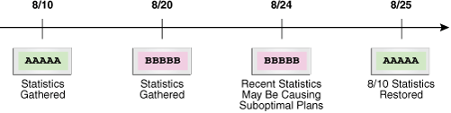
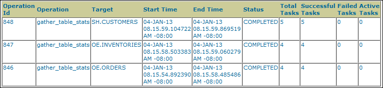
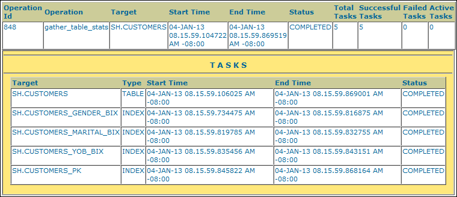

### 16.1 Restoring Optimizer Statistics

You can use `DBMS_STATS` to restore old versions of statistics that are stored in the data dictionary.

#### 16.1.1 About Restore Operations for Optimizer Statistics

Whenever statistics in the data dictionary are modified, the database automatically saves old versions of statistics. If newly collected statistics lead to suboptimal execution plans, then you may want to revert to the previous statistics.

Restoring optimizer statistics can aid in troubleshooting suboptimal plans. The following graphic illustrates a timeline for restoring statistics. In the graphic, statistics collection occurs on August 10 and August 20. On August 24, the DBA determines that the current statistics may be causing the optimizer to generate suboptimal plans. On August 25, the administrator restores the statistics collected on August 10.

Figure 16-1 Restoring Optimizer Statistics



> An arrow has marks for 8/10, 8/20, 8/24, and 8/25. The 8/10 mark has a box containing the text "AAAAA." It is labeled Statistics Gathered. The 8/20 mark has a box containing the text "BBBBB." It is labeled Statistics Gathered. The 8/24 mark has a box containing the text "BBBBB." It is labeled Recent Statistics May Be Causing Poor Plans. The 8/25 mark has a box containing the text "AAAAA." It is labeled 8/10 Statistics Restored.


#### 16.1.2 Guidelines for Restoring Optimizer Statistics

Restoring statistics is similar to importing and exporting statistics.

In general, restore statistics instead of exporting them in the following situations:

- You want to recover older versions of the statistics. For example, you want to restore the optimizer behavior to an earlier date.
- You want the database to manage the retention and purging of statistics histories.

Export statistics rather than restoring them in the following situations:

- You want to experiment with multiple sets of statistics and change the values back and forth.
- You want to move the statistics from one database to another database. For example, moving statistics from a production system to a test system.
- You want to preserve a known set of statistics for a longer period than the desired retention date for restoring statistics.

See Also:

[Oracle Database PL/SQL Packages and Types Reference](https://docs.oracle.com/pls/topic/lookup?ctx=en/database/oracle/oracle-database/21/tgsql&id=ARPLS68491) for an overview of the procedures for restoring and importing statistics

#### 16.1.3 Restrictions for Restoring Optimizer Statistics

When restoring previous versions of statistics, various limitations apply.

Restrictions include the following:

- `DBMS_STATS.RESTORE_*_STATS` procedures cannot restore user-defined statistics.
- Old versions of statistics are not stored when the `ANALYZE` command has been used for collecting statistics.
- Dropping a table removes the workload data used by the automatic histogram feature and the statistics history used by `DBMS_STATS.RESTORE_*_STATS`. Without this data, these features do not work properly. Therefore, to remove all rows from a table and repopulate it, Oracle recommends using `TRUNCATE` instead of dropping and re-creating the table.
	Note:
	If a table resides in the recycle bin, then flashing back the table also retrieves the statistics.

#### 16.1.4 Restoring Optimizer Statistics Using DBMS\_STATS

You can restore statistics using the `DBMS_STATS.RESTORE_*_STATS` procedures.

The procedures listed in the following table accept a timestamp as an argument and restore statistics as of the specified time (`as_of_timestamp`).

Table 16-1 DBMS\_STATS Restore Procedures

| Procedure | Description |
| --- | --- |
| `RESTORE_DICTIONARY_STATS` | Restores statistics of all dictionary tables (tables of `SYS`, `SYSTEM`, and `RDBMS` component schemas) as of a specified timestamp. |
| `RESTORE_FIXED_OBJECTS_STATS` | Restores statistics of all fixed tables as of a specified timestamp. |
| `RESTORE_SCHEMA_STATS` | Restores statistics of all tables of a schema as of a specified timestamp. |
| `RESTORE_SYSTEM_STATS` | Restores system statistics as of a specified timestamp. |
| `RESTORE_TABLE_STATS` | Restores statistics of a table as of a specified timestamp. The procedure also restores statistics of associated indexes and columns. If the table statistics were locked at the specified timestamp, then the procedure locks the statistics. |

Dictionary views display the time of statistics modifications. You can use the following views to determine the time stamp to be use for the restore operation:

- The `DBA_OPTSTAT_OPERATIONS` view contain history of statistics operations performed at schema and database level using `DBMS_STATS`.
- The `DBA_TAB_STATS_HISTORY` views contains a history of table statistics modifications.

Assumptions

This tutorial assumes the following:

- After the most recent statistics collection for the `oe.orders` table, the optimizer began choosing suboptimal plans for queries of this table.
- You want to restore the statistics from before the most recent statistics collection to see if the plans improve.

To restore optimizer statistics:

1. Start SQL\*Plus and connect to the database with administrator privileges.
2. Query the statistics history for `oe.orders`.
	For example, run the following query:
	```
	COL TABLE_NAME FORMAT a10
	SELECT TABLE_NAME,
	       TO_CHAR(STATS_UPDATE_TIME,'YYYY-MM-DD:HH24:MI:SS') AS STATS_MOD_TIME
	FROM   DBA_TAB_STATS_HISTORY 
	WHERE  TABLE_NAME='ORDERS'
	AND    OWNER='OE'
	ORDER BY STATS_UPDATE_TIME DESC;
	```
	Sample output is as follows:
	```
	TABLE_NAME STATS_MOD_TIME
	---------- -------------------
	ORDERS     2012-08-20:11:36:38
	ORDERS     2012-08-10:11:06:20
	```
3. Restore the optimizer statistics to the previous modification time.
	For example, restore the `oe.orders` table statistics to August 10, 2012:
	```
	BEGIN
	  DBMS_STATS.RESTORE_TABLE_STATS( 'OE','ORDERS', 
	               TO_TIMESTAMP('2012-08-10:11:06:20','YYYY-MM-DD:HH24:MI:SS') );
	END;
	/
	```
	You can specify any date between 8/10 and 8/20 because `DBMS_STATS` restores statistics as of the specified time.

See Also:

[Oracle Database PL/SQL Packages and Types Reference](https://docs.oracle.com/pls/topic/lookup?ctx=en/database/oracle/oracle-database/21/tgsql&id=ARPLS-GUID-DAF4653C-2C8F-462E-9509-6BA3E6AE768F) to learn more about the `DBMS_STATS.RESTORE_TABLE_STATS` procedure

### 16.2 Managing Optimizer Statistics Retention

By default, the database retains optimizer statistics for 31 days, after which time the statistics are scheduled for purging.

You can use the `DBMS_STATS` package to determine the retention period, change the period, and manually purge old statistics.

#### 16.2.1 Obtaining Optimizer Statistics History

You can use `DBMS_STATS` procedures to obtain historical information for optimizer statistics.

Historical information is useful when you want to determine how long the database retains optimizer statistics, and how far back these statistics can be restored. You can use the following procedure to obtain information about the optimizer statistics history:

- `GET_STATS_HISTORY_RETENTION`
	This function can retrieve the current statistics history retention value.
- `GET_STATS_HISTORY_AVAILABILITY`
	This function retrieves the oldest time stamp when statistics history is available. Users cannot restore statistics to a time stamp older than the oldest time stamp.

To obtain optimizer statistics history information:

1. Start SQL\*Plus and connect to the database with the necessary privileges.
2. Execute the following PL/SQL program:
	```
	DECLARE
	  v_stats_retn  NUMBER;
	  v_stats_date  DATE;
	BEGIN
	  v_stats_retn := DBMS_STATS.GET_STATS_HISTORY_RETENTION;
	  DBMS_OUTPUT.PUT_LINE('The retention setting is ' || 
	    v_stats_retn || '.');
	  v_stats_date := DBMS_STATS.GET_STATS_HISTORY_AVAILABILITY;
	  DBMS_OUTPUT.PUT_LINE('Earliest restore date is ' ||
	    v_stats_date || '.');
	END;
	/
	```

See Also:

[Oracle Database PL/SQL Packages and Types Reference](https://docs.oracle.com/pls/topic/lookup?ctx=en/database/oracle/oracle-database/21/tgsql&id=ARPLS-GUID-03065EEA-54F1-4B69-9D3E-EB9EEAD27103) to learn about the `DBMS_STATS.GET_STATS_HISTORY_RETENTION` procedure

#### 16.2.2 Changing the Optimizer Statistics Retention Period

You can configure the retention period using the `DBMS_STATS.ALTER_STATS_HISTORY_RETENTION` procedure. The default is 31 days.

Prerequisites

To run this procedure, you must have either the `SYSDBA` privilege, or both the `ANALYZE ANY DICTIONARY` and `ANALYZE ANY` system privileges.

Assumptions

This tutorial assumes the following:

- The current retention period for optimizer statistics is 31 days.
- You run queries annually as part of an annual report. To keep the statistics history for more than 365 days so that you have access to last year's plan (in case a suboptimal plan occurs now), you set the retention period to 366 days.
- You want to create a PL/SQL procedure `set_opt_stats_retention` that you can use to change the optimizer statistics retention period.

To change the optimizer statistics retention period:

1. Start SQL\*Plus and connect to the database with the necessary privileges.
2. Create a procedure that changes the retention period.
	For example, create the following procedure:
	```
	CREATE OR REPLACE PROCEDURE set_opt_stats_retention
	  ( p_stats_retn   IN NUMBER )
	IS
	  v_stats_retn NUMBER;
	BEGIN
	  v_stats_retn := DBMS_STATS.GET_STATS_HISTORY_RETENTION;
	  DBMS_OUTPUT.PUT_LINE('Old retention setting is ' ||
	    v_stats_retn || '.');
	  DBMS_STATS.ALTER_STATS_HISTORY_RETENTION(p_stats_retn);
	  v_stats_retn := DBMS_STATS.GET_STATS_HISTORY_RETENTION;
	  DBMS_OUTPUT.PUT_LINE('New retention setting is ' ||
	    v_stats_retn || '.');
	END;
	/
	```
3. Change the retention period to 366 days.
	For example, execute the procedure that you created in the previous step (sample output included):
	```
	SQL> EXECUTE set_opt_stats_retention(366)
	The old retention setting is 31.
	The new retention setting is 366.
	 
	PL/SQL procedure successfully completed.
	```

See Also:

[Oracle Database PL/SQL Packages and Types Reference](https://docs.oracle.com/pls/topic/lookup?ctx=en/database/oracle/oracle-database/21/tgsql&id=ARPLS-GUID-A04AE1C0-5DE1-4AFC-91F8-D35D41DF98A2) to learn about the `DBMS_STATS.ALTER_STATS_HISTORY_RETENTION` procedure

#### 16.2.3 Purging Optimizer Statistics

Automatic purging is enabled when the `STATISTICS_LEVEL` initialization parameter is set to `TYPICAL` or `ALL`.

The database purges all history older than the older of (current time - the `ALTER_STATS_HISTORY_RETENTION` setting) and (time of the most recent statistics gathering - 1).

You can purge old statistics manually using the `PURGE_STATS` procedure. If you do not specify an argument, then this procedure uses the automatic purging policy. If you specify the `before_timestamp` parameter, then the database purges statistics saved before the specified timestamp.

Prerequisites

To run this procedure, you must have either the `SYSDBA` privilege, or both the `ANALYZE ANY DICTIONARY` and `ANALYZE ANY` system privileges.

Assumptions

This tutorial assumes that you want to purge statistics more than one week old.

To purge optimizer statistics:

1. In SQL\*Plus, log in to the database with the necessary privileges.
2. Execute the `DBMS_STATS.PURGE_STATS` procedure.
	For example, execute the procedure as follows:
	```
	EXEC DBMS_STATS.PURGE_STATS( SYSDATE-7 );
	```

See Also:

[Oracle Database PL/SQL Packages and Types Reference](https://docs.oracle.com/pls/topic/lookup?ctx=en/database/oracle/oracle-database/21/tgsql&id=ARPLS-GUID-8E6413D5-F827-4F57-9FAD-7EC56362A98C) to learn about the `DBMS_STATS.PURGE_STATS` procedure

### 16.3 Reporting on Past Statistics Gathering Operations

You can use `DBMS_STATS` functions to report on a specific statistics gathering operation or on operations that occurred during a specified time.

Different operations from different PDBs may have the same operation ID. If a PDB ID is not provided, then the report may contain multiple operations.

Table 16-2 lists the functions.

Table 16-2 DBMS\_STATS Reporting Functions

| Function | Description |
| --- | --- |
| `REPORT_STATS_OPERATIONS` | Generates a report of all statistics operations that occurred between two points in time. You can narrow the scope of the report to include only automatic statistics gathering runs. You can also use `container_ids` to provide a set of container IDs so that the database reports only statistics operations from the specified PDBs. |
| `REPORT_SINGLE_STATS_OPERATION` | Generates a report of the specified operation. You can use `container_id` to specify a particular PDB. |

Assumptions

This tutorial assumes that you want to generate HTML reports of the following:

- All statistics gathering operations within the last day
- The most recent statistics gathering operation

To report on all operations in the past day:

1. Start SQL\*Plus and connect to the database with administrator privileges.
2. Run the `DBMS_STATS.REPORT_STATS_OPERATIONS` function.
	For example, run the following commands:
	```
	SET LINES 200 PAGES 0
	SET LONG 100000
	COLUMN REPORT FORMAT A200
	VARIABLE my_report CLOB;
	BEGIN
	  :my_report := DBMS_STATS.REPORT_STATS_OPERATIONS (
	     since        => SYSDATE-1
	,    until        => SYSDATE 
	,    detail_level => 'TYPICAL' 
	,    format       => 'HTML'      
	);
	END;
	/
	```
	The following graphic shows a sample report:
	

> This graphic shows a partial HTML report. The columns are Id, Operation, Target, Start Time, End Time, Status, Total tasks, Successful Tasks, Failed Tasks, Active Tasks. The first row has values 1146, gather\_table\_stats, OE.orders, 22-OCT-12, 22-OCT-12, COMPLETED, 4, 4, 0, 0. The following two rows are similar.
>
> [  
> Copyright © 2013, 2023, Oracle and/or its affiliates.](https://docs.oracle.com/en/database/oracle/oracle-database/dcommon/html/cpyr.htm)

3. Run the `DBMS_STATS.REPORT_SINGLE_STATS_OPERATION` function for an individual operation.
	For example, run the following program to generate a report of operation `848`:
	```
	BEGIN
	  :my_report :=DBMS_STATS.REPORT_SINGLE_STATS_OPERATION (
	     OPID    => 848
	,    FORMAT  => 'HTML'
	);
	END;
	```

The following graphic shows a sample report:



> This graphic shows a partial HTML report. The columns are Id, Operation, Target, Start Time, End Time, Status, Total tasks, Successful Tasks, Failed Tasks, Active Tasks. The first row has values 1146, gather\_table\_stats, OE.orders, 22-OCT-12, 22-OCT-12, COMPLETED, 4, 4, 0, 0.
>
> Underneath the top table is a TASKS table. The columns are Target, Type, Start Time, End Time, Status. The first row has values OE.ORDERS, TABLE, 22-OCT-12, 22-OCT-12, COMPLETED. The other rows are similar.


See Also:

- " [Graphical Interface for Optimizer Statistics Management](options-for-optimizer-statistics-gathering.md) " to learn about the Cloud Control GUI for statistics management
- [Oracle Database PL/SQL Packages and Types Reference](https://docs.oracle.com/pls/topic/lookup?ctx=en/database/oracle/oracle-database/21/tgsql&id=ARPLS059) to learn more about `DBMS_STATS`