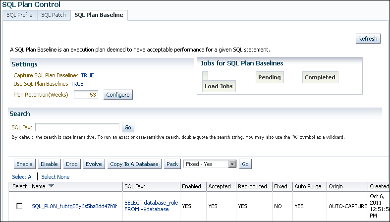
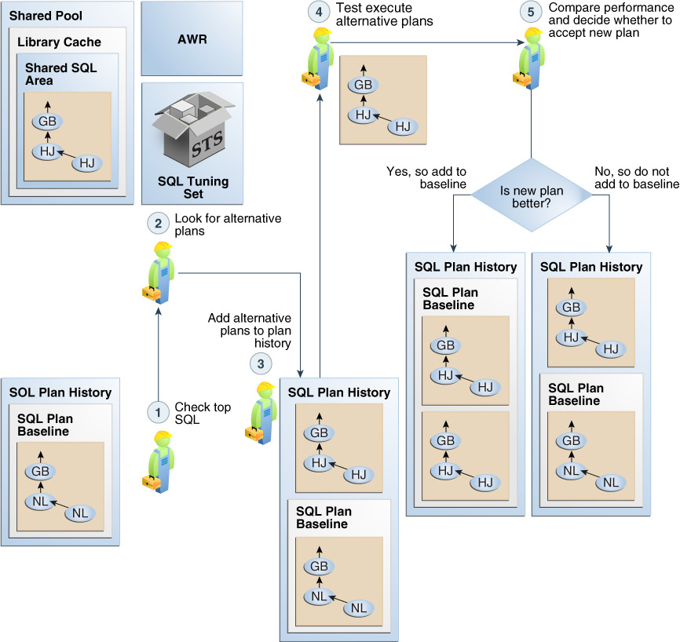
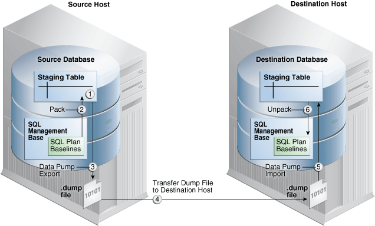
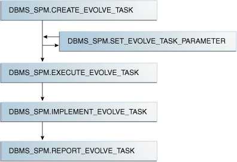

This chapter explains the concepts and tasks relating to SQL plan management using the `DBMS_SPM` package.

See Also:

- " [Migrating Stored Outlines to SQL Plan Baselines](migrating-stored-outlines.md) "
- [Oracle Database PL/SQL Packages and Types Reference](https://docs.oracle.com/pls/topic/lookup?ctx=en/database/oracle/oracle-database/21/tgsql&id=ARPLS-GUID-D6EC284C-053D-417D-B887-94422BCB4E3A) to learn more about `DBMS_SPM`

### 29.1 About Managing SQL Plan Baselines

This topic describes the available interfaces and basic tasks for SQL plan management.

#### 29.1.1 User Interfaces for SQL Plan Management

You can access the `DBMS_SPM` package through Cloud Control or through the command line.

##### 29.1.1.1 Accessing the SQL Plan Baseline Page in Cloud Control

The SQL Plan Control page in Cloud Control is a GUI that shows information about SQL profiles, SQL patches, and SQL plan baselines.

To access the SQL Plan Baseline page:

1. Log in to Cloud Control with the appropriate credentials.
2. Under the Targets menu, select Databases.
3. In the list of database targets, select the target for the Oracle Database instance that you want to administer.
4. If prompted for database credentials, then enter the minimum credentials necessary for the tasks you intend to perform.
5. From the Performance menu, select SQL, then SQL Plan Control.
	The SQL Plan Control page appears.
6. Click Files to view the SQL Plan Baseline subpage, shown in Figure 29-1.
	Figure 29-1 SQL Plan Baseline Subpage
	

> This screen shot has the title SQL Plan Control. It has three tables: SQL Profile, SQL Patch, and SQL Plan Baseline (selected). A Refresh button is in the upper right. Below this button is the following text: "A SQL Plan Baseline is an execution plan deemed to have acceptable performance for a given SQL statement."
>
> In the Settings section, next to Capture SQL Plan Baselines, is the value TRUE. Next to Use SQL Plan Baselines is the value TRUE. Next to Plan Retention (Weeks) is a text box containing the value 53. Next to this box is a Configure button. In the Jobs for SQL Plan Baselines section are three boxes: Load Jobs, Pending, and Completed.
>
> In the Search section is a SQL Text box. To the right of this box is the Go button. Below this text box is the following text: "By default, the search is case insensitive. To run an exact or case-sensitive search, double-quote the search string. You may also use the '%' symbol as a wildcard."
>
> Below the Search section are the following buttons: Enable, Disable, Drop, Evolve, Copy To A Database, Pack. To the right is a list showing the value Fixed - Yes. To the right of the list is the Go button.
>
> At the bottom of the screen shot is a table with the following columns: Select, Name, SQL Test, Enabled, Accepted, Reproduced, Fixed, Auto Purge, Origin, Created. The table contains one row with the following values: (checkbox), SQL\_PLAN\_fubtg..., SELECT database\_role FROM v$database, YES, YES, YES, NO, YES, AUTO-CAPTURE, Oct 6 2011.

	You can perform most SQL plan management tasks in this page or in pages accessed through this page.

See Also:

- Cloud Control context-sensitive online help to learn about the options on the SQL Plan Baseline subpage
- " Managing the SPM Evolve Advisor Task "

##### 29.1.1.2 DBMS\_SPM Package

On the command line, use the `DBMS_SPM` and `DBMS_XPLAN` PL/SQL packages to perform most SQL plan management tasks.

The following table describes the most relevant `DBMS_SPM` procedures and functions for creating, dropping, and loading SQL plan baselines.

Table 29-1 DBMS\_SPM Procedures and Functions

| Procedure or Function | Description |
| --- | --- |
| `CONFIGURE` | This procedure changes configuration options for the SMB in name/value format. |
| `CREATE_STGTAB_BASELINE` | This procedure creates a staging table that enables you to transport SQL plan baselines from one database to another. |
| `DROP_SQL_PLAN_BASELINE` | This function drops some or all plans in a plan baseline. |
| `LOAD_PLANS_FROM_CURSOR_CACHE` | This function loads plans in the shared SQL area (also called the cursor cache) into SQL plan baselines. |
| `LOAD_PLANS_FROM_SQLSET` | This function loads plans in an STS into SQL plan baselines. |
| `LOAD_PLANS_FROM_AWR` | This function loads plans from AWR into SQL plan baselines. |
| `PACK_STGTAB_BASELINE` | This function packs SQL plan baselines, which means that it copies them from the SMB into a staging table. |
| `UNPACK_STGTAB_BASELINE` | This function unpacks SQL plan baselines, which means that it copies SQL plan baselines from a staging table into the SMB. |

Also, you can use `DBMS_XPLAN.DISPLAY_SQL_PLAN_BASELINE` to show one or more execution plans for the SQL statement identified by SQL handle.

See Also:

- " About the DBMS\_SPM Evolve Functions " describes the functions related to SQL plan evolution.
- [Oracle Database PL/SQL Packages and Types Reference](https://docs.oracle.com/pls/topic/lookup?ctx=en/database/oracle/oracle-database/21/tgsql&id=ARPLS150) to learn about the `DBMS_SPM` and `DBMS_XPLAN` packages

#### 29.1.2 Basic Tasks in SQL Plan Management

This topic explains the basic tasks in using SQL plan management to prevent performance regressions and enable the optimizer to consider new execution plans.

The tasks are as follows:

### 29.2 Configuring SQL Plan Management

You can configure the capture and use of SQL plan baselines, and the SPM Evolve Advisor task.

#### 29.2.1 Configuring the Capture and Use of SQL Plan Baselines

You control SQL plan management with the initialization parameters `OPTIMIZER_CAPTURE_SQL_PLAN_BASELINES` and `OPTIMIZER_USE_SQL_PLAN_BASELINES`.

The default values are as follows:

- `OPTIMIZER_CAPTURE_SQL_PLAN_BASELINES=false`
	For any repeatable SQL statement that does not already exist in the plan history, the database does not automatically create an initial SQL plan baseline for the statement.
	If `OPTIMIZER_CAPTURE_SQL_PLAN_BASELINES=true`, then you can use the `DBMS_SPM.CONFIGURE` procedure to configure filters that determine which statements are eligible for plan capture. By default, no filters are configured, which means that all repeatable statements are eligible for plan capture.
- `OPTIMIZER_USE_SQL_PLAN_BASELINES=true`
	For any SQL statement that has an existing SQL plan baseline, the database automatically adds new plans to the SQL plan baseline as unaccepted plans.

Note:

The settings of the preceding parameters are independent of each other. For example, if `OPTIMIZER_CAPTURE_SQL_PLAN_BASELINES` is `true`, then the database creates initial plan baselines for new statements even if `OPTIMIZER_USE_SQL_PLAN_BASELINES` is `false`.

If the default behavior is what you intend, then skip this section.

The following sections explain how to change the default parameter settings from the command line. If you use Cloud Control, then set these parameters in the SQL Plan Baseline subpage.

See Also:

- " Figure 29-1 "
- " [Automatic Initial Plan Capture](overview-of-sql-plan-management.md) "
- " [Plan Selection](overview-of-sql-plan-management.md) "

##### 29.2.1.1 Enabling Automatic Initial Plan Capture for SQL Plan Management

Setting the `OPTIMIZER_CAPTURE_SQL_PLAN_BASELINES` initialization parameter to `true` is all that is necessary for the database to automatically create an initial SQL plan baseline for any eligible SQL statement not already in the plan history.

By default, the database considers all repeatable SQL statements as eligible for capture, with the following exceptions:

- `CREATE TABLE` when the `AS SELECT` clause is not specified
- `DROP TABLE`
- `INSERT INTO ... VALUES`

Caution:

By default, when automatic baseline capture is enabled, the database creates a SQL plan baseline for every eligible repeatable statement, including all recursive SQL and monitoring SQL. Thus, automatic capture may result in the creation of an extremely large number of plan baselines. To limit the statements that are eligible for plan baselines, configure filters using the `DBMS_SPM.CONFIGURE` procedure.

The `OPTIMIZER_CAPTURE_SQL_PLAN_BASELINES` parameter does not control the automatic addition of newly discovered plans to a previously created SQL plan baseline.

To enable automatic initial plan capture for SQL plan management:

1. In SQL\*Plus, log in to the database with the necessary privileges.
2. Show the current settings for SQL plan management.
	For example, connect SQL\*Plus to the database with administrator privileges and execute the following command (sample output included):
	```
	SHOW PARAMETER SQL_PLAN
	```
	The following sample output shows that automatic initial plan capture is disabled:
	```
	NAME                                 TYPE        VALUE
	------------------------------------ ----------- -----
	optimizer_capture_sql_plan_baselines boolean     FALSE
	optimizer_use_sql_plan_baselines     boolean     TRUE
	```
	If the parameters are set as you intend, then skip the remaining steps.
3. To enable the automatic recognition of repeatable SQL statements and the generation of SQL plan baselines for these statements, enter the following statement:
	```
	ALTER SYSTEM SET OPTIMIZER_CAPTURE_SQL_PLAN_BASELINES=true;
	```

See Also:

[Oracle Database Reference](https://docs.oracle.com/pls/topic/lookup?ctx=en/database/oracle/oracle-database/21/tgsql&id=GUID-A562069E-BD44-4ABB-A987-0A13078F4E90) to learn more about `OPTIMIZER_CAPTURE_SQL_PLAN_BASELINES`

##### 29.2.1.2 Configuring Filters for Automatic Plan Capture

If `OPTIMIZER_CAPTURE_SQL_PLAN_BASELINES=true`, then you can use the `DBMS_SPM.CONFIGURE` procedure to create an **automatic capture filter** for repeatable statements.

An automatic filter enables you to capture only statements that you want, and exclude noncritical statements. This technique saves space in the `SYSAUX` tablespace.

The following table describes the relevant parameters of the `DBMS_SPM.CONFIGURE` procedure.

Table 29-2 DBMS\_SPM.CONFIGURE Parameters

| Parameter | Description |
| --- | --- |
| `parameter_name` | The type of filter for automatic capture.  Possible values are `AUTO_CAPTURE_SQL_TEXT`, `AUTO_CAPTURE_PARSING_SCHEMA_NAME`, `AUTO_CAPTURE_MODULE`, and `AUTO_CAPTURE_ACTION`. |
| `parameter_value` | The search criteria for the automatic capture filter.  When `parameter_name` is set to `AUTO_CAPTURE_SQL_TEXT`, the search pattern depends on the `allow` setting:  - `LIKE` 	The parameter uses this pattern when `allow=>true`. - `NOT LIKE` 	The parameter uses this pattern when `allow=>false`.  For all other non-null `parameter_name` values, the search pattern depends on the `allow` setting:  - `=` 	The parameter uses this pattern when `allow=>true`. - `<>` 	The parameter uses this pattern when `allow=>false`.  A null value removes the filter for `parameter_name` entirely. |
| `allow` | Whether to include (`true`) or exclude (`false`) matching SQL statements and plans. If null, then the procedure ignores the specified parameter. |

You can configure multiple parameters of different types. Also, you can specify multiple values for the same parameter in separate statements, which the database combines. The settings are additive: one parameter setting does not override a previous setting. For example, the following filter captures SQL in the parsing schema `SYS` or `SYSTEM`:

```
EXEC DBMS_SPM.CONFIGURE('AUTO_CAPTURE_PARSING_SCHEMA_NAME','SYS',true);
EXEC DBMS_SPM.CONFIGURE('AUTO_CAPTURE_PARSING_SCHEMA_NAME','SYSTEM',true);
```

However, you cannot configure multiple values for the same parameter in the same procedure. For example, you cannot specify multiple SQL text strings for `AUTO_CAPTURE_SQL_TEXT`.

The `DBA_SQL_MANAGEMENT_CONFIG` view shows the current parameter values.

This tutorial assumes the following:

- The `OPTIMIZER_CAPTURE_SQL_PLAN_BASELINES` initialization parameter is set to `true`.
- You want to include only statements parsed in the `sh` schema to be eligible for baselines.
- You want to exclude statements that contain the text `TEST_ONLY`.

To filter out all statements except those parsed in the sh schema:

1. Connect SQL\*Plus to the database with the appropriate privileges.
2. To remove any existing filters for parsing schema and SQL text, execute the following PL/SQL programs:
	```
	EXEC DBMS_SPM.CONFIGURE('AUTO_CAPTURE_PARSING_SCHEMA_NAME',null,true);
	EXEC DBMS_SPM.CONFIGURE('AUTO_CAPTURE_SQL_TEXT',null,true);
	```
3. Include only statements parsed in the `sh` schema for consideration for automatic capture:
	```
	EXEC DBMS_SPM.CONFIGURE('AUTO_CAPTURE_PARSING_SCHEMA_NAME','sh',true);
	```
4. Exclude any statement that contains the text `TEST_ONLY` from consideration for automatic capture:
	```
	EXEC DBMS_SPM.CONFIGURE('AUTO_CAPTURE_SQL_TEXT','%TEST_ONLY%',false);
	```
5. Optionally, to confirm the filters, query `DBA_SQL_MANAGEMENT_CONFIG`.
	For example, use the following query (sample output included):
	```
	COL PARAMETER_NAME FORMAT a32
	COL PARAMETER_VALUE FORMAT a32
	SELECT PARAMETER_NAME, PARAMETER_VALUE 
	FROM   DBA_SQL_MANAGEMENT_CONFIG 
	WHERE  PARAMETER_NAME LIKE '%AUTO%';
	PARAMETER_NAME                   PARAMETER_VALUE
	-------------------------------- --------------------------------
	AUTO_CAPTURE_PARSING_SCHEMA_NAME parsing_schema IN (SH)
	AUTO_CAPTURE_MODULE
	AUTO_CAPTURE_ACTION
	AUTO_CAPTURE_SQL_TEXT            (sql_text NOT LIKE %TEST_ONLY%)
	```

See Also:

- " [Automatic Initial Plan Capture](overview-of-sql-plan-management.md) "
- [Oracle Database PL/SQL Packages and Types Reference](https://docs.oracle.com/pls/topic/lookup?ctx=en/database/oracle/oracle-database/21/tgsql&id=ARPLS-GUID-D855D4B9-D071-4BB2-A554-38479867DE76) to learn more about the `DBMS_SPM.CONFIGURE` procedure
- [Oracle Database Reference](https://docs.oracle.com/pls/topic/lookup?ctx=en/database/oracle/oracle-database/21/tgsql&id=REFRN-GUID-4E9C3D2A-93B8-49C5-9169-C54A9EB7431C) to learn more about the `DBA_SQL_MANAGEMENT_CONFIG` view

##### 29.2.1.3 Disabling All SQL Plan Baselines

When you set the `OPTIMIZER_USE_SQL_PLAN_BASELINES` initialization parameter to `false`, the database does not use any plan baselines in the database.

Typically, you might want to disable one or two plan baselines, but not all of them. A possible use case might be testing the benefits of SQL plan management.

To disable all SQL plan baselines in the database:

1. Connect SQL\*Plus to the database with the appropriate privileges, and then show the current settings for SQL plan management.
	For example, connect SQL\*Plus to the database with administrator privileges and execute the following command (sample output included):
	```
	SQL> SHOW PARAMETER SQL_PLAN
	 
	NAME                                 TYPE        VALUE
	------------------------------------ ----------- -----
	optimizer_capture_sql_plan_baselines boolean     FALSE
	optimizer_use_sql_plan_baselines     boolean     TRUE
	```
	If the parameters are set as you intend, then skip the remaining steps.
2. To ignore all existing plan baselines enter the following statement:
	```
	SQL> ALTER SYSTEM SET OPTIMIZER_USE_SQL_PLAN_BASELINES=false
	```

See Also:

[Oracle Database Reference](https://docs.oracle.com/pls/topic/lookup?ctx=en/database/oracle/oracle-database/21/tgsql&id=REFRN10292) to learn about the SQL plan baseline initialization parameters

#### 29.2.2 Managing the SPM Evolve Advisor Task

SPM Evolve Advisor is a SQL advisor that evolves plans that have recently been added to the SQL plan baseline. The advisor simplifies plan evolution by eliminating the requirement to do it manually.

##### 29.2.2.1 About the SPM Evolve Advisor Task

By default, `SYS_AUTO_SPM_EVOLVE_TASK` runs daily in the scheduled maintenance window. Optionally, you can configure it to run hourly.

A SQL plan baseline prevents performance regressions caused by suboptimal plans. If a SQL statement does not have a SQL plan baseline, and if the `alternate_plan_baseline` parameter is set to `AUTO`, then SQM Evolve Advisor can sometimes resolve such performance regressions automatically. The advisor compares all available plans and chooses the best-performing plan as the baseline.

The following figure shows the workflow for Automatic SPM Evolve Advisor:

Figure 29-2 Automatic SPM Evolve Advisor



> The graphic depicts the workflow of SPM Evolve Advisor:
>
> 1. Checks AWR for top SQL
> 	AWR stores the most resource-intensive SQL statements. AWR guides SPM Evolve Advisor, allowing it to identify plans that are most likely to benefit from SQL plan baselines. The overall goal is to prevent plan performance regressions.
> 2. Looks for alternate plans in all available sources
> 	By default, the automatic task searches the shared SQL area, AWR repository, and SQL tuning sets for plans that are not yet in the SMB plan history.
> 3. Adds unaccepted plans to plan history
> 	These plans are not yet in the SQL plan baseline for any statement.
> 4. Performs test executions of as many plans as possible during the maintenance window
> 	For each alternate plan, the database test executes the statement and records the performance statistics. The goal is to use a cost-based algorithm to compare the performance of each current plan to each alternate plan.
> 5. Depending on whether the alternative plan performs better then the current plan, SPM Evolve Advisor does the following:
> 	- If better, then SPM Evolve Advisor accepts the plan. The alternate plan is now in the baseline.
> 		- If worse, then SPM Evolve Advisor does not add the plan to the baseline. The plan remains in the statement history only.


Whenever it runs in the maintenance window, SPM Evolve Advisor performs the following tasks:

1. Checks AWR for top SQL
	AWR stores the most resource-intensive SQL statements. SPM Evolve Advisor searches AWR for statements that are most likely to benefit from SQL plan baselines, and then adds plans for these statements to the baselines.
2. Looks for alternative plans in all available sources
	By default (`alternate_plan_source=AUTO`), the automatic task searches all available repositories for plans that are not yet in the SMB plan history. The setting for `alternate_plan_source` is shown in the `DBA_ADVISORS_PARAMETERS` view.
3. Adds unaccepted plans to the plan history
	These plans are not yet in the SQL plan baseline for any SQL statement.
4. Tests the execution of as many plans as possible during the maintenance window
	For every alternative plan, the database test executes the statement and records the performance statistics. The goal is to use a cost-based algorithm to compare the performance of every alternative plan with the plan that the optimizer would otherwise choose.
5. Performs either of the following actions, depending on whether the alternative plan performs better than the current plan:
	- If performance is better, then SPM Evolve Advisor accepts the plan. The alternative plan is now in the baseline.
		- If performance is worse, then the plan remains in the statement history, but not the baseline.

Example 29-1 Out-of-Range Query

Assume that an application issues a new, long-running query of `sh.products`. The query references the `prod_list_price` column using a bind variable. The database performs the following steps:

1. The optimizer chooses an optimal plan for this query based on fresh statistics, which show `prod_list_price` with a maximum list price of $1299.99. The optimal plan resides in AWR.
2. An application adds more products to the `sh.products` table, and changes the list prices of many products.
3. The application issues the original query, which the optimizer reparses.
	In this execution of the query, the bind variable sets the list price to $1500, which is higher than the $1299.99 maximum value recorded in the table statistics. This is known as an out-of-range query.
4. The optimizer chooses a suboptimal plan for the out-of-range query, causing a performance regression.
	The optimizer attempts to avoid performance regressions by allowing for out-of-range conditions, but is sometimes unsuccessful, as in this example. The result is a suboptimal plan.
5. The database resolves the performance regression as follows:
	- SPM Evolve Advisor identifies the long-running query as a candidate for a SQL plan baseline.
		- SPM Evolve Advisor finds both plans, the original plan in AWR and the suboptimal plan for the out-of-range query, and determines that the original plan performs better.
		- SQL plan management adds the original plan for the query to the SQL plan baseline. Consequently, the optimizer will not use the regressed plan.

See Also:

- [Oracle Database Licensing Information User Manual](https://docs.oracle.com/pls/topic/lookup?ctx=en/database/oracle/oracle-database/21/tgsql&id=DBLIC-GUID-0F9EB85D-4610-4EDF-89C2-4916A0E7AC87) for details on which features are supported for different editions and services
- [Oracle Database PL/SQL Packages and Types Reference](https://docs.oracle.com/pls/topic/lookup?ctx=en/database/oracle/oracle-database/21/tgsql&id=ARPLS-GUID-E95C833E-9352-457A-A360-8D7E567EF2F5) to learn more about the `DBMS_SPM.SET_EVOLVE_TASK_PARAMETER` procedure

##### 29.2.2.2 Enabling and Disabling the Automatic SPM Evolve Advisor Task

No separate scheduler client exists for the Automatic SPM Evolve Advisor task.

One client controls both Automatic SQL Tuning Advisor and Automatic SPM Evolve Advisor. Thus, the same task enables or disables both. You can also disable it using `DBMS_SPM.SET_EVOLVE_TASK_PARAMETER`.

To disable the Automatic SPM Evolve Advisor task:

1. Log in to the database with the appropriate privileges.
2. Set the `ALTERNATE_PLAN_BASELINE` parameter to null:
	```
	BEGIN
	   DBMS_SPM.SET_EVOLVE_TASK_PARAMETER(
	      task_name => 'SYS_AUTO_SPM_EVOLVE_TASK',
	      parameter => 'ALTERNATE_PLAN_BASELINE',
	      value => '');
	END;
	/
	```
3. Set the `ALTERNATE_PLAN_SOURCE` parameter to an empty string:
	```
	BEGIN
	   DBMS_SPM.SET_EVOLVE_TASK_PARAMETER(
	      task_name => 'SYS_AUTO_SPM_EVOLVE_TASK',
	      parameter => 'ALTERNATE_PLAN_SOURCE',
	      value => '');
	END;
	/
	```

See Also:

" [Enabling and Disabling the Automatic SQL Tuning Task](sql-tuning-advisor.md) " to learn how to enable and disable Automatic SPM Evolve Advisor

##### 29.2.2.3 Configuring the Automatic SPM Evolve Advisor Task

Configure automatic plan evolution by using the `DBMS_SPM` package.

Overview of the Automatic SPM Evolve Advisor Task

Specify the automatic task parameters using the `SET_EVOLVE_TASK_PARAMETER` procedure. The following table describes some procedure parameters.

Table 29-3 DBMS\_SPM.SET\_EVOLVE\_TASK\_PARAMETER Parameters

| Parameter | Description | Default |
| --- | --- | --- |
| `alternate_plan_source` | Determines which sources to search for additional plans:  - `AUTO` (the database selects the source automatically) - `AUTOMATIC_WORKLOAD_REPOSITORY` - `CURSOR_CACHE` - `SQL_TUNING_SET`  You can combine multiple values with the plus sign (`+`). | The default depends on whether the SPM Evolve Advisor task is automated or manual:  - If automated, the default is `AUTO`. - If manual, the default is `CURSOR_CACHE+AUTOMATIC_WORKLOAD_REPOSITORY`. |
| `alternate_plan_baseline` | Determines which alternative plans should be loaded:  - `AUTO` lets Autonomous Database choose whether to load plans for statements with or without baselines. - `EXISTING` loads alternate plans with for statements with existing baselines. - `NEW` loads alternative plans for statements without a baseline, in which case a new baseline is created.  You can combine multiple values with the plus sign (`+`), as in `EXISTING+NEW`. | `EXISTING` |
| `alternate_plan_limit` | Specifies the maximum number of plans to load in total (that is, not the limit for each SQL statement). | The default depends on whether the SPM Evolve Advisor task is automated or manual:  - If automated, the default is `UNLIMITED`. - If manual, the default is `10`. |
| `accept_plans` | Specifies whether to accept recommended plans automatically.  When `ACCEPT_PLANS` is `true`, SQL plan management automatically accepts all plans recommended by the task.  When `ACCEPT_PLANS` is `false`, the task verifies the plans and generates a report of its findings, but does not evolve the plans automatically. You can use a report to identify new SQL plan baselines and accept them manually. | `true` (regardless of whether the advisor is run automatically or manually) |
| `time_limit` | Global time limit in seconds. This is the total time allowed for the task. | The default depends on whether the SPM Evolve Advisor task is automated or manual:  - If automated, the default is `3600`. - If manual, the default is `2147483646`. |

Note:

See [Oracle Database Licensing Information User Manual](https://docs.oracle.com/pls/topic/lookup?ctx=en/database/oracle/oracle-database/21/tgsql&id=DBLIC-GUID-0F9EB85D-4610-4EDF-89C2-4916A0E7AC87) for details on which features are supported for different editions and services

Assumptions

The tutorial in this section assumes the following:

- You can log in to the database as `SYS`. Because the `SYS_AUTO_SPM_EVOLVE_TASK` task is owned by `SYS`, only `SYS` can set task parameters.
- You want the database to accept plans automatically.
- You want the task to time out after 1200 seconds per execution.
- You want the evolve task to look for up to a maximum of 500 plans in the shared SQL area and AWR repository

To set automatic evolution task parameters:

1. Start SQL\*Plus, and then log in to the database as `SYS`.
2. Query the current parameter settings for `SYS_AUTO_SPM_EVOLVE_TASK`.
	For example, connect SQL\*Plus to the database with administrator privileges and execute the following query:
	```
	COL PARAMETER_NAME FORMAT a25
	COL VALUE FORMAT a42
	SELECT PARAMETER_NAME, PARAMETER_VALUE AS "VALUE"
	FROM   DBA_ADVISOR_PARAMETERS
	WHERE  ( (TASK_NAME = 'SYS_AUTO_SPM_EVOLVE_TASK') AND
	         ( (PARAMETER_NAME = 'ACCEPT_PLANS') OR
	           (PARAMETER_NAME LIKE '%ALT%') OR
	           (PARAMETER_NAME = 'TIME_LIMIT') ) );
	```
	Sample output appears as follows:
	```
	PARAMETER_NAME            VALUE
	------------------------- ------------------------------------------
	ALTERNATE_PLAN_LIMIT      0
	ALTERNATE_PLAN_SOURCE     CURSOR_CACHE+AUTOMATIC_WORKLOAD_REPOSITORY
	ALTERNATE_PLAN_BASELINE   EXISTING
	ACCEPT_PLANS              true
	TIME_LIMIT                3600
	```
3. Set parameters using PL/SQL code of the following form:
	```
	BEGIN
	  DBMS_SPM.SET_EVOLVE_TASK_PARAMETER(
	    task_name => 'SYS_AUTO_SPM_EVOLVE_TASK'
	,   parameter => parameter_name
	,   value     => value
	);
	END;
	/
	```
	For example, the following PL/SQL block configures the `SYS_AUTO_SPM_EVOLVE_TASK` task to automatically accept plans, seek up a maximum of 500 plans in the shared SQL area and AWR repository, and time out after 20 minutes:
	```
	BEGIN
	  DBMS_SPM.SET_EVOLVE_TASK_PARAMETER(
	    task_name => 'SYS_AUTO_SPM_EVOLVE_TASK'
	,   parameter => 'TIME_LIMIT'
	,   value     => '1200'
	);
	  DBMS_SPM.SET_EVOLVE_TASK_PARAMETER(
	    task_name => 'SYS_AUTO_SPM_EVOLVE_TASK'
	,   parameter => 'ACCEPT_PLANS'
	,   value     => 'true'
	);
	  DBMS_SPM.SET_EVOLVE_TASK_PARAMETER(
	    task_name => 'SYS_AUTO_SPM_EVOLVE_TASK'
	,   parameter => 'ALTERNATE_PLAN_LIMIT'
	,   value     => '500'
	);
	END;
	/
	```
4. Optionally, confirm your changes by querying the current parameter settings for `SYS_AUTO_SPM_EVOLVE_TASK`.
	For example, execute the following query:
	```
	SELECT PARAMETER_NAME, PARAMETER_VALUE AS "VALUE"
	FROM   DBA_ADVISOR_PARAMETERS
	WHERE  ( (TASK_NAME = 'SYS_AUTO_SPM_EVOLVE_TASK') AND
	         ( (PARAMETER_NAME = 'ACCEPT_PLANS') OR
	           (PARAMETER_NAME LIKE '%ALT%') OR
	           (PARAMETER_NAME = 'TIME_LIMIT') ) );
	```
	Sample output appears as follows:
	```
	PARAMETER_NAME            VALUE
	------------------------- ------------------------------------------
	ALTERNATE_PLAN_LIMIT      500
	ALTERNATE_PLAN_SOURCE     CURSOR_CACHE+AUTOMATIC_WORKLOAD_REPOSITORY
	ALTERNATE_PLAN_BASELINE   EXISTING
	ACCEPT_PLANS              true
	TIME_LIMIT                1200
	```

See Also:

- [Oracle Database PL/SQL Packages and Types Reference](https://docs.oracle.com/pls/topic/lookup?ctx=en/database/oracle/oracle-database/21/tgsql&id=ARPLS68398) for complete reference information for `DBMS_SPM.SET_EVOLVE_TASK_PARAMETER`
- [Oracle Database Reference](https://docs.oracle.com/pls/topic/lookup?ctx=en/database/oracle/oracle-database/21/tgsql&id=GUID-B1D969D7-E8B6-4DEE-9B6D-0B9E9E66D764) to learn more about the `DBA_ADVISOR_PARAMETERS` view

##### 29.2.2.4 Configuring the High-Frequency Automatic SPM Evolve Advisor Task

You can configure automatic plan evolution to occur more frequently.

See Also:

[Oracle Database Licensing Information User Manual](https://docs.oracle.com/pls/topic/lookup?ctx=en/database/oracle/oracle-database/21/tgsql&id=DBLIC-GUID-0F9EB85D-4610-4EDF-89C2-4916A0E7AC87) for details on which features are supported for different editions and services

###### 29.2.2.4.1 About the High-Frequency Automatic SPM Evolve Advisor Task

The high-frequency SPM Evolve Advisor task complements the standard Automatic SPM Evolve Advisor task.

By default, `SYS_AUTO_SPM_EVOLVE_TASK` runs daily in the scheduled AutoTask maintenance window. If data changes frequently between two consecutive task executions, then the optimizer may choose suboptimal plans. For example, if product list prices change more frequently than executions of `SYS_AUTO_SPM_EVOLVE_TASK`, then more out-of-range queries may occur, possibly leading to suboptimal plans.

When you enable the high-frequency Automatic SPM Evolve Advisor task, `SYS_AUTO_SPM_EVOLVE_TASK` runs more frequently, performing the same operations during every execution. The high-frequency task runs every hour and runs for no longer than 30 minutes. These settings are not configurable. The frequent executions mean that the optimizer has more opportunities to find and evolve better performing plans.

Both the standard Automatic SPM Evolve Advisor task and high-frequency task have the same name: `SYS_AUTO_SPM_EVOLVE_TASK`. In `DBA_ADVISOR_EXECUTIONS`, the two tasks are distinguished by execution name. The name of the standard task execution has the form `EXEC_number`, whereas the name of the high-frequency execution has the form `SYS_SPM_timestamp`.

`DBMS_SPM.CONFIGURE` enables the high-frequency task, but has no dependency on the SPM Evolve Advisor. The standard task and high-frequency task are independent and are scheduled through two different frameworks.

See Also:

- [Oracle Database Licensing Information User Manual](https://docs.oracle.com/pls/topic/lookup?ctx=en/database/oracle/oracle-database/21/tgsql&id=DBLIC-GUID-0F9EB85D-4610-4EDF-89C2-4916A0E7AC87) for details on which features are supported for different editions and services
- [Oracle Database PL/SQL Packages and Types Reference](https://docs.oracle.com/pls/topic/lookup?ctx=en/database/oracle/oracle-database/21/tgsql&id=ARPLS-GUID-D855D4B9-D071-4BB2-A554-38479867DE76) to learn more about the `DBMS_SPM.CONFIGURE` procedure

###### 29.2.2.4.2 Enabling the High-Frequency Automatic SPM Evolve Advisor Task: Tutorial

To enable and disable the high-frequency Automatic SPM Evolve Advisor task, use the `DBMS_SPM.CONFIGURE` procedure.

You can set `auto_spm_evolve_task` to any of the following values:

- `ON` — Enables the high-frequency SPM Evolve Advisor task.
- `OFF` — Disables the high-frequency SPM Evolve Advisor task. This is the default.
- `AUTO` — Allows the database to determine when to execute the high-frequency SPM Evolve Advisor task. In this release, `AUTO` is equivalent to `OFF`.

Note that the task interval and runtime are fixed and cannot be adjusted by the user.

To enable the high-frequency SPM Evolve Advisor task:

1. Log in to the database as `SYS`.
2. Query the current setting for `DBMS_SPM.CONFIGURE` (sample output included):
	```
	COL PARAMETER_NAME FORMAT a32 
	COL PARAMETER_VALUE FORMAT a32 
	SELECT PARAMETER_NAME, PARAMETER_VALUE 
	FROM   DBA_SQL_MANAGEMENT_CONFIG 
	WHERE  PARAMETER_NAME LIKE '%SPM%';
	PARAMETER_NAME                   PARAMETER_VALUE
	-------------------------------- --------------------------------
	AUTO_SPM_EVOLVE_TASK             OFF
	AUTO_SPM_EVOLVE_TASK_INTERVAL    3600
	AUTO_SPM_EVOLVE_TASK_MAX_RUNTIME 1800
	```
3. Enable the task.
	Execute the following PL/SQL code:
	```
	EXEC DBMS_SPM.CONFIGURE('AUTO_SPM_EVOLVE_TASK', 'ON');
	```
4. To confirm that the task is enabled, query the current setting for `AUTO_SPM_EVOLVE_TASK` (sample output included):
	```
	COL PARAMETER_NAME FORMAT a32 
	COL PARAMETER_VALUE FORMAT a32 
	SELECT PARAMETER_NAME, PARAMETER_VALUE 
	FROM   DBA_SQL_MANAGEMENT_CONFIG 
	WHERE  PARAMETER_NAME = 'AUTO_SPM_EVOLVE_TASK';
	PARAMETER_NAME                   PARAMETER_VALUE
	-------------------------------- --------------------------------
	AUTO_SPM_EVOLVE_TASK             ON
	```
5. Optionally, wait a few hours, and then query the status of the task executions:
	```
	SET LINESIZE 150
	COL TASK_NAME FORMAT a30
	COL EXECUTION_NAME FORMAT a30
	SELECT TASK_NAME, EXECUTION_NAME, STATUS 
	FROM   DBA_ADVISOR_EXECUTIONS 
	WHERE  TASK_NAME LIKE '%SPM%' 
	AND    (EXECUTION_NAME LIKE 'SYS_SPM%' OR EXECUTION_NAME LIKE 'EXEC_%') 
	ORDER BY EXECUTION_END;
	TASK_NAME                      EXECUTION_NAME                 STATUS
	------------------------------ ------------------------------ ---------
	SYS_AUTO_SPM_EVOLVE_TASK       SYS_SPM_2019-06-03/13:15:26    COMPLETED
	SYS_AUTO_SPM_EVOLVE_TASK       SYS_SPM_2019-06-03/14:16:04    COMPLETED
	SYS_AUTO_SPM_EVOLVE_TASK       EXEC_6                         COMPLETED
	SYS_AUTO_SPM_EVOLVE_TASK       SYS_SPM_2019-06-03/15:16:32    COMPLETED
	SYS_AUTO_SPM_EVOLVE_TASK       SYS_SPM_2019-06-03/16:17:00    COMPLETED
	...
	```
	In the preceding output, `EXEC_6` is the execution name of the standard SPM Automatic Advisor task. The other executions are of the high-frequency task.

### 29.3 Displaying Plans in a SQL Plan Baseline

To view the plans stored in the SQL plan baseline for a specific statement, use the `DBMS_XPLAN.DISPLAY_SQL_PLAN_BASELINE` function.

This function uses plan information stored in the plan history to display the plans. The following table describes the relevant parameters for `DBMS_XPLAN.DISPLAY_SQL_PLAN_BASELINE`.

Table 29-4 DBMS\_XPLAN.DISPLAY\_SQL\_PLAN\_BASELINE Parameters

| Function Parameter | Description |
| --- | --- |
| `sql_handle` | SQL handle of the statement. Retrieve the SQL handle by joining the `V$SQL.SQL_PLAN_BASELINE` and `DBA_SQL_PLAN_BASELINES` views on the `PLAN_NAME` columns. |
| `plan_name` | Name of the plan for the statement. |

This section explains how to show plans in a baseline from the command line. If you use Cloud Control, then display plan baselines from the SQL Plan Baseline subpage shown in Figure 29-1.

To display plans in a SQL plan baselines:

1. Connect SQL\*Plus to the database with the appropriate privileges, and then obtain the SQL ID of the query whose plan you want to display.
	For example, assume that a SQL plan baseline exists for a `SELECT` statement with the SQL ID `31d96zzzpcys9`.
2. Query the plan by SQL ID.
	The following query displays execution plans for the statement with the SQL ID `31d96zzzpcys9`:
	```
	SELECT PLAN_TABLE_OUTPUT
	FROM   V$SQL s, DBA_SQL_PLAN_BASELINES b, 
	       TABLE(
	       DBMS_XPLAN.DISPLAY_SQL_PLAN_BASELINE(b.sql_handle,b.plan_name,'basic') 
	       ) t
	WHERE  s.EXACT_MATCHING_SIGNATURE=b.SIGNATURE
	AND    b.PLAN_NAME=s.SQL_PLAN_BASELINE
	AND    s.SQL_ID='31d96zzzpcys9';
	```
	The sample query results are as follows:
	```
	PLAN_TABLE_OUTPUT
	------------------------------------------------------------------------
	 
	------------------------------------------------------------------------
	SQL handle: SQL_513f7f8a91177b1a
	SQL text: select * from hr.employees where employee_id=100
	------------------------------------------------------------------------
	------------------------------------------------------------------------
	Plan name: SQL_PLAN_52gvzja8jfysuc0e983c6         Plan id: 3236529094
	Enabled: YES     Fixed: NO      Accepted: YES     Origin: AUTO-CAPTURE
	------------------------------------------------------------------------
	 
	Plan hash value: 3236529094
	 
	-----------------------------------------------------
	| Id  | Operation                   | Name          |
	-----------------------------------------------------
	|   0 | SELECT STATEMENT            |               |
	|   1 |  TABLE ACCESS BY INDEX ROWID| EMPLOYEES     |
	|   2 |   INDEX UNIQUE SCAN         | EMP_EMP_ID_PK |
	-----------------------------------------------------
	```
	The results show that the plan for SQL ID `31d96zzzpcys` is named `SQL_PLAN_52gvzja8jfysuc0e983c6` and was captured automatically.

### 29.4 Loading SQL Plan Baselines

Using `DBMS_SPM`, you can initiate the bulk load of a set of existing plans into a SQL plan baseline.

#### 29.4.1 About Loading SQL Plan Baselines

The `DBMS_SPM` package enables you to load plans from multiple sources.

The goal of this task is to load plans from the following sources:

- AWR
	Load plans from Automatic Workload Repository (AWR) snapshots. You must specify the beginning and ending of the snapshot range. Optionally, you can apply a filter to load only plan that meet specified criteria. By default, the optimizer uses the loaded plans the next time that the database executes the SQL statements.
- Shared SQL area
	Load plans for statements directly from the shared SQL area, which is in the shared pool of the SGA. By applying a filter on the module name, the schema, or the SQL ID you identify the SQL statement or set of SQL statements to capture. The optimizer uses the plans the next time that the database executes the SQL statements.
	Loading plans directly from the shared SQL area is useful when application SQL has been hand-tuned using hints. Because you probably cannot change the SQL to include the hint, populating the SQL plan baseline ensures that the application SQL uses optimal plans.
- SQL tuning set (STS)
	Capture the plans for a SQL workload into an STS, and then load the plans into the SQL plan baselines. The optimizer uses the plans the next time that the database executes the SQL statements. Bulk loading execution plans from an STS is an effective way to prevent plan regressions after a database upgrade.
- Staging table
	Use the `DBMS_SPM` package to define a staging table, `DBMS_SPM.PACK_STGTAB_BASELINE` to copy the baselines into a staging table, and Oracle Data Pump to transfer the table to another database. On the destination database, use `DBMS_SPM.UNPACK_STGTAB_BASELINE` to unpack the plans from the staging table and put the baselines into the SMB.
	A use case is the introduction of new SQL statements into the database from a new application module. A vendor can ship application software with SQL plan baselines for the new SQL. In this way, the new SQL uses plans that are known to give optimal performance under a standard test configuration. Alternatively, if you develop or test an application in-house, export the correct plans from the test database and import them into the production database.
- Stored outline
	Migrate stored outlines to SQL plan baselines. After the migration, you maintain the same plan stability that you had using stored outlines while being able to use the more advanced features provided by SQL Plan Management, such as plan evolution. See.

See Also:

- " [Migrating Stored Outlines to SQL Plan Baselines](migrating-stored-outlines.md) "
- [Oracle Database PL/SQL Packages and Types Reference](https://docs.oracle.com/pls/topic/lookup?ctx=en/database/oracle/oracle-database/21/tgsql&id=ARPLS68172) to learn about the `DBMS_SPM.PACK_STGTAB_BASELINE` Function

#### 29.4.2 Loading Plans from AWR

This topic explains how to load plans from AWR using PL/SQL.

Load plans with the `LOAD_PLANS_FROM_AWR` function of the `DBMS_SPM` package. The following table describes some function parameters.

Table 29-5 LOAD\_PLANS\_FROM\_AWR Parameters

| Function Parameter | Description |
| --- | --- |
| `begin_snap` | Number of the beginning snapshot in the range. Required. |
| `end_snap` | Number of the ending snapshot in the range. Required. |
| `basic_filter` | A filter applied to AWR to select only qualifying plans to be loaded. The default null means that all plans in AWR are selected. The filter can take the form of any `WHERE` clause predicate that can be specified against the column `DBA_HIST_SQLTEXT.SQL_TEXT`. An example is `basic_filter => 'sql_text like ''SELECT /*LOAD_STS*/%'''`. |
| `fixed` | Default `NO` means the loaded plans are used as nonfixed plans. `YES` means the loaded plans are fixed plans. " [Plan Selection](overview-of-sql-plan-management.md) " explains that the optimizer chooses a fixed plan in the plan baseline over a nonfixed plan. |

This section explains how to load plans using the command line. In Cloud Control, go to the SQL Plan Baseline subpage (shown in Figure 29-1) and click Load to load plan baselines from AWR.

This tutorial assumes the following:

- You want to load plans for the following query into the SMB:
	```
	SELECT /*LOAD_AWR*/ *
	FROM   sh.sales
	WHERE  quantity_sold > 40
	ORDER BY prod_id;
	```
- You want the loaded plans to be nonfixed.
- The user `sh` has privileges to query `DBA_HIST_SNAPSHOT` and `DBA_SQL_PLAN_BASELINES`, execute `DBMS_WORKLOAD_REPOSITORY.CREATE_SNAPSHOT`, and execute `DBMS_SPM.LOAD_PLANS_FROM_AWR`.

To load plans from the shared SQL area:

1. Log in to the database with the appropriate privileges, and then query the most recent 3 AWR snapshots.
	For example, query `DBA_HIST_SNAPSHOT` as follows:
	```
	SELECT *
	FROM   (SELECT SNAP_ID, SNAP_LEVEL, 
	               TO_CHAR(BEGIN_INTERVAL_TIME, 'DD/MM/YY HH24:MI:SS') BEGIN
	        FROM   DBA_HIST_SNAPSHOT
	        ORDER BY SNAP_ID DESC)
	WHERE   ROWNUM <= 3;
	   SNAP_ID SNAP_LEVEL BEGIN
	---------- ---------- -----------------
	       212        1 10/12/15 06:00:02
	       211        1 10/12/15 05:00:11
	       210        1 10/12/15 04:00:59
	```
2. Query `sh.sales`, using the `LOAD_AWR` tag to identify the SQL statement.
	For example, use the following query:
	```
	SELECT /*LOAD_AWR*/ *
	FROM   sh.sales
	WHERE  quantity_sold > 40
	ORDER BY prod_id;
	```
3. Take a new AWR snapshot.
	For example, use the following program:
	```
	EXEC DBMS_WORKLOAD_REPOSITORY.CREATE_SNAPSHOT;
	```
4. Query the most recent 3 AWR snapshots to confirm that a new snapshot was taken.
	For example, query `DBA_HIST_SNAPSHOT` as follows:
	```
	SELECT *
	FROM   (SELECT SNAP_ID, SNAP_LEVEL, 
	               TO_CHAR(BEGIN_INTERVAL_TIME, 'DD/MM/YY HH24:MI:SS') BEGIN
	        FROM   DBA_HIST_SNAPSHOT
	        ORDER BY SNAP_ID DESC)
	WHERE   ROWNUM <= 3;
	   SNAP_ID SNAP_LEVEL BEGIN
	---------- ---------- -----------------
	       213        1 10/12/15 06:24:53
	       212        1 10/12/15 06:00:02
	       211        1 10/12/15 05:00:11
	```
5. Load the plans for the most recent 2 snapshots from AWR.
	For example, execute the `LOAD_PLANS_FROM_AWR` function in SQL\*Plus to load the plans from snapshot `212` to `213`:
	```
	VARIABLE v_plan_cnt NUMBER
	EXEC :v_plan_cnt := DBMS_SPM.LOAD_PLANS_FROM_AWR(begin_snap => 212, end_snap => 213);
	```
	In the preceding example, the variable `v_plan_cnt` contains the number of plans that were loaded.
6. Query the data dictionary to ensure that the plans were loaded into the baseline for the `LOAD_AWR` statement.
	The following statement queries `DBA_SQL_PLAN_BASELINES` (sample output included):
	```
	COL SQL_HANDLE FORMAT a20
	COL SQL_TEXT FORMAT a20
	COL PLAN_NAME FORMAT a30
	COL ORIGIN FORMAT a20
	SELECT SQL_HANDLE, SQL_TEXT, PLAN_NAME,
	       ORIGIN, ENABLED, ACCEPTED
	FROM   DBA_SQL_PLAN_BASELINES
	WHERE SQL_TEXT LIKE '%LOAD_AWR%';
	SQL_HANDLE           SQL_TEXT          PLAN_NAME                  ORIGIN       ENA ACC
	-------------------- ----------------- -------------------------- -----------  --- ---
	SQL_495d29c5f4612cda SELECT /*LOAD_AWR SQL_PLAN_4kr99sru62b6u54bc MANUAL-LOAD- YES YES
	                     */ * FROM         8843                       FROM-AWR 
	                     sh.sales WHERE  
	                     quantity_sold 
	                     > 40
	                     ORDER BY prod_id
	```
	The output shows that the plan is accepted, which means that it is in the plan baseline for the statement. Also, the origin is `MANUAL-LOAD-FROM-AWR`, which means that the statement was loaded manually from AWR rather than automatically captured.

See Also:

- " [Fixed Plans](overview-of-sql-plan-management.md) "
- [Oracle Database PL/SQL Packages and Types Reference](https://docs.oracle.com/pls/topic/lookup?ctx=en/database/oracle/oracle-database/21/tgsql&id=ARPLS150) to learn how to use the `DBMS_SPM.LOAD_PLANS_FROM_AWR` function
- [Oracle Database Reference](https://docs.oracle.com/pls/topic/lookup?ctx=en/database/oracle/oracle-database/21/tgsql&id=REFRN23714) to learn more about the `DBA_SQL_PLAN_BASELINES` view

#### 29.4.3 Loading Plans from the Shared SQL Area

This topic explains how to load plans from the shared SQL area, also called the cursor cache, using PL/SQL.

Load plans with the `LOAD_PLANS_FROM_CURSOR_CACHE` function of the `DBMS_SPM` package. The following table describes some function parameters.

Table 29-6 LOAD\_PLANS\_FROM\_CURSOR\_CACHE Parameters

| Function Parameter | Description |
| --- | --- |
| `sql_id` | SQL statement identifier. Identifies a SQL statement in the shared SQL area. |
| `fixed` | Default `NO` means the loaded plans are used as nonfixed plans. `YES` means the loaded plans are fixed plans. " [Plan Selection](overview-of-sql-plan-management.md) " explains that the optimizer chooses a fixed plan in the plan baseline over a nonfixed plan. |

This section explains how to load plans using the command line. In Cloud Control, go to the SQL Plan Baseline subpage (shown in Figure 29-1) and click Load to load plan baselines from the shared SQL area.

This tutorial assumes the following:

- You have executed the following query:
	```
	SELECT /*LOAD_CC*/ *
	FROM   sh.sales
	WHERE  quantity_sold > 40
	ORDER BY prod_id;
	```
- You want the loaded plans to be nonfixed.

To load plans from the shared SQL area:

1. Connect SQL\*Plus to the database with the appropriate privileges, and then determine the SQL IDs of the relevant statements in the shared SQL area.
	For example, query `V$SQL` for the SQL ID of the `sh.sales` query (sample output included):
	```
	SELECT   SQL_ID, CHILD_NUMBER AS "Child Num",
	         PLAN_HASH_VALUE AS "Plan Hash",
	         OPTIMIZER_ENV_HASH_VALUE AS "Opt Env Hash"
	FROM     V$SQL
	WHERE    SQL_TEXT LIKE 'SELECT /*LOAD_CC*/%';
	 
	SQL_ID         Child Num  Plan Hash Opt Env Hash
	------------- ---------- ---------- ------------
	27m0sdw9snw59          0 1421641795   3160571937
	```
	The preceding output shows that the SQL ID of the statement is `27m0sdw9snw59`.
2. Load the plans for the specified statements into the SQL plan baseline.
	For example, execute the `LOAD_PLANS_FROM_CURSOR_CACHE` function in SQL\*Plus to load the plan for the statement with the SQL ID `27m0sdw9snw59`:
	```
	VARIABLE v_plan_cnt NUMBER
	BEGIN
	  :v_plan_cnt:=DBMS_SPM.LOAD_PLANS_FROM_CURSOR_CACHE( 
	    sql_id => '27m0sdw9snw59');
	END;
	```
	In the preceding example, the variable `v_plan_cnt` contains the number of plans that were loaded.
3. Query the data dictionary to ensure that the plans were loaded into the baseline for the statement.
	The following statement queries `DBA_SQL_PLAN_BASELINES` (sample output included):
	```
	SELECT SQL_HANDLE, SQL_TEXT, PLAN_NAME,
	       ORIGIN, ENABLED, ACCEPTED
	FROM   DBA_SQL_PLAN_BASELINES;
	 
	SQL_HANDLE            SQL_TEXT             PLAN_NAME      ORIGIN              ENA ACC
	--------------------- -------------------- -------------- ------------------- --- ---
	SQL_a8632bd857a4a25e  SELECT /*LOAD_CC*/   SQL_PLAN_gdkvz MANUAL-LOAD-FROM-CC YES YES
	                      *                    fhrgkda71694fc
	                      FROM sh.sales        6b
	                      WHERE quantity_sold
	                      > 40                           
	                      ORDER BY prod_id
	```
	The output shows that the plan is accepted, which means that it is in the plan baseline for the statement. Also, the origin is `MANUAL-LOAD-FROM-CC`, which means that the statement was loaded manually from the shared SQL area rather than automatically captured.

See Also:

- " [Fixed Plans](overview-of-sql-plan-management.md) "
- [Oracle Database PL/SQL Packages and Types Reference](https://docs.oracle.com/pls/topic/lookup?ctx=en/database/oracle/oracle-database/21/tgsql&id=ARPLS150) to learn how to use the `DBMS_SPM.LOAD_PLANS_FROM_CURSOR_CACHE` function
- [Oracle Database Reference](https://docs.oracle.com/pls/topic/lookup?ctx=en/database/oracle/oracle-database/21/tgsql&id=REFRN23714) to learn more about the `DBA_SQL_PLAN_BASELINES` view

#### 29.4.4 Loading Plans from a SQL Tuning Set

A **SQL tuning set** (STS) is a database object that includes one or more SQL statements, execution statistics, and execution context. This topic explains how to load plans from an STS.

Load plans with the `DBMS_SPM.LOAD_PLANS_FROM_SQLSET` function or using Cloud Control. The following table describes some function parameters.

Table 29-7 LOAD\_PLANS\_FROM\_SQLSET Parameters

| Function Parameter | Description |
| --- | --- |
| `sqlset_name` | Name of the STS from which the plans are loaded into SQL plan baselines. |
| `basic_filter` | A filter applied to the STS to select only qualifying plans to be loaded. The filter can take the form of any `WHERE` clause predicate that can be specified against the view `DBA_SQLSET_STATEMENTS`. An example is `basic_filter => 'sql_text like ''SELECT /*LOAD_STS*/%'''`. |
| `fixed` | Default `NO` means the loaded plans are used as nonfixed plans. `YES` means the loaded plans are fixed plans. " [Plan Selection](overview-of-sql-plan-management.md) " explains that the optimizer chooses a fixed plan in the plan baseline over a nonfixed plan. |

This section explains how to load plans from the command line. In Cloud Control, go to the SQL Plan Baseline subpage (shown in Figure 29-1) and click Load to load plan baselines from SQL tuning sets.

Assumptions

This tutorial assumes the following:

- You want the loaded plans to be nonfixed.
- You have executed the following query:
	```
	SELECT /*LOAD_STS*/ *
	FROM   sh.sales
	WHERE  quantity_sold > 40
	ORDER BY prod_id;
	```
- You have loaded the plan from the shared SQL area into the SQL tuning set named `SPM_STS`, which is owned by user `SPM`.
- After the operation, you want to drop the STS using `DBMS_SQLTUNE.DROP_SQLSET` rather than the equivalent D `BMS_SQLSET.DROP_SQLSET`.

To load plans from a SQL tuning set:

1. Connect SQL\*Plus to the database with the appropriate privileges, and then verify which plans are in the SQL tuning set.
	For example, query `DBA_SQLSET_STATEMENTS` for the STS name (sample output included):
	```
	SELECT SQL_TEXT
	FROM   DBA_SQLSET_STATEMENTS
	WHERE  SQLSET_NAME = 'SPM_STS';
	 
	SQL_TEXT
	--------------------
	SELECT /*LOAD_STS*/
	*
	FROM sh.sales
	WHERE quantity_sold
	> 40
	ORDER BY prod_id
	```
	The output shows that the plan for the `select /*LOAD_STS*/` statement is in the STS.
2. Load the plan from the STS into the SQL plan baseline.
	For example, in SQL\*Plus execute the function as follows:
	```
	VARIABLE v_plan_cnt NUMBER
	EXECUTE :v_plan_cnt := DBMS_SPM.LOAD_PLANS_FROM_SQLSET( -
	           sqlset_name  => 'SPM_STS', -
	           basic_filter => 'sql_text like ''SELECT /*LOAD_STS*/%''' );
	```
	The `basic_filter` parameter specifies a `WHERE` clause that loads only the plans for the queries of interest. The variable `v_plan_cnt` stores the number of plans loaded from the STS.
3. Query the data dictionary to ensure that the plan was loaded into the baseline for the statement.
	The following statement queries the `DBA_SQL_PLAN_BASELINES` view (sample output included).
	```
	SQL> SELECT SQL_HANDLE, SQL_TEXT, PLAN_NAME,
	  2         ORIGIN, ENABLED, ACCEPTED
	  3  FROM   DBA_SQL_PLAN_BASELINES;
	SQL_HANDLE            SQL_TEXT        PLAN_NAME        ORIGIN               ENA ACC
	--------------------- --------------- ---------------- -------------------- --- ---
	SQL_a8632bd857a4a25e  SELECT          SQL_PLAN_ahstb   MANUAL-LOAD-FROM-STS YES YES
	                      /*LOAD_STS*/*   v1bu98ky1694fc6b
	                      FROM sh.sales
	                      WHERE 
	                      quantity_sold 
	                      > 40 ORDER BY                    
	                      prod_id
	```
	The output shows that the plan is accepted, which means that it is in the plan baseline. Also, the origin is `MANUAL-LOAD-FROM-STS`, which means that the plan was loaded manually from a SQL tuning set rather than automatically captured.
4. Optionally, drop the STS.
	For example, execute `DBMS_SQLTUNE.DROP_SQLSET` to drop the `SPM_STS` tuning set as follows:
	```
	EXEC SYS.DBMS_SQLTUNE.DROP_SQLSET( sqlset_name  => 'SPM_STS', -
	                                   sqlset_owner => 'SPM' );
	```

See Also:

- " [Command-Line Interface to SQL Tuning Sets](managing-sql-tuning-sets.md) "
- [Oracle Database Reference](https://docs.oracle.com/pls/topic/lookup?ctx=en/database/oracle/oracle-database/21/tgsql&id=REFRN23470) to learn about the `DBA_SQL_PLAN_BASELINES` view
- [Oracle Database PL/SQL Packages and Types Reference](https://docs.oracle.com/pls/topic/lookup?ctx=en/database/oracle/oracle-database/21/tgsql&id=ARPLS68170) to learn about the `DBMS_SPM.LOAD_PLANS_FROM_SQLSET` function

#### 29.4.5 Loading Plans from a Staging Table

You may want to transfer optimal plans from a source database to a different destination database.

For example, you may have investigated a set of plans on a test database and confirmed that they have performed well. You may then want to load these plans into a production database.

A staging table is a table that, for the duration of its existence, stores plans so that the plans do not disappear from the table while you are unpacking them. Use the `DBMS_SPM.CREATE_STGTAB_BASELINE` procedure to create a staging table. To pack (insert row into) and unpack (extract rows from) the staging table, use the `PACK_STGTAB_BASELINE` and `UNPACK_STGTAB_BASELINE` functions of the `DBMS_SPM` package. Oracle Data Pump Import and Export enable you to copy the staging table to a different database.

Figure 29-3 Loading Plans from a Staging Table



> This graphic shows two computers: Source Host and Destination Host. The former contains a cylinder labeled Source Database. This database contains a Staging Table icon labeled with the number 1. Beneath it is an icon labeled SQL Management Base. Instead this box is a box labeled SQL Plan Baselines. It points up to the Staging Table, with the arrow marked with the number 2 and the label "Pack." The Staging Table points down to an icon of a dump file. The arrow is labeled 3 and also has the label Data Pump Export. The dump file points right to the dump file on the Destination Host. The arrow is labeled with the number 4 and also the label "Transfer Dump File to Destination Host." The icons in Destination Host are identical to the icons in Source Host, with the following differences: the direction of the arrows is reversed, "Pack" is "Unpack," "Export" is "Import," the number 3 is a 5, the number 2 is a 6, and the number 1 does not appear.


Export plans with the `PACK_STGTAB_BASELINE` function of the `DBMS_SPM` package, and then import them with `UNPACK_STGTAB_BASELINE`. The following table describes some function parameters.

Table 29-8 PACK\_STGTAB\_BASELINE and UNPACK\_STGTAB\_BASELINE Parameters

| Function Parameter | Description |
| --- | --- |
| `table_name` | Specifies the table to be imported or exported. |
| `origin` | Origin of SQL plan baseline. These procedures accept all possible values of `DBA_SQL_PLAN_BASELINES.ORIGIN` as the `origin` argument. For example, the `origin` parameter permits `MANUAL-LOAD-FROM-STS`, `MANUAL-LOAD-FROM-AWR`, and `MANUAL-LOAD-FROM-CC`. |

This tutorial assumes the following:

- You want to create a staging table named `stage1` in the source database.
- You want to load all plans owned by user `spm` into the staging table.
- You want to transfer the staging table to a destination database.
- You want to load the plans in `stage1` as fixed plans.

To transfer a set of SQL plan baselines from one database to another:

1. Connect SQL\*Plus to the source database with the appropriate privileges, and then create a staging table using the `CREATE_STGTAB_BASELINE` procedure.
	The following example creates a staging table named `stage1`:
	```
	BEGIN
	  DBMS_SPM.CREATE_STGTAB_BASELINE (
	    table_name => 'stage1');
	END;
	/
	```
2. On the source database, pack the SQL plan baselines you want to export from the SQL management base into the staging table.
	The following example packs enabled plan baselines created by user `spm` into staging table `stage1`. Select SQL plan baselines using the plan name (`plan_name`), SQL handle (`sql_handle`), or any other plan criteria. The `table_name` parameter is mandatory.
	```
	DECLARE
	  v_plan_cnt NUMBER;
	BEGIN
	  v_plan_cnt := DBMS_SPM.PACK_STGTAB_BASELINE (
	    table_name => 'stage1'
	,   enabled    => 'yes'
	,   creator    => 'spm'
	);
	END;
	/
	```
3. Export the staging table `stage1` into a dump file using Oracle Data Pump Export.
4. Transfer the dump file to the host of the destination database.
5. On the destination database, import the staging table `stage1` from the dump file using the Oracle Data Pump Import utility.
6. On the destination database, unpack the SQL plan baselines from the staging table into the SQL management base.
	The following example unpacks all fixed plan baselines stored in the staging table `stage1`:
	```
	DECLARE
	  v_plan_cnt NUMBER;
	BEGIN
	  v_plan_cnt := DBMS_SPM.UNPACK_STGTAB_BASELINE (
	    table_name => 'stage1'
	,   fixed      => 'yes'
	);
	END;
	/
	```

See Also:

- [Oracle Database PL/SQL Packages and Types Reference](https://docs.oracle.com/pls/topic/lookup?ctx=en/database/oracle/oracle-database/21/tgsql&id=ARPLS150) for more information about using the `DBMS_SPM` package
- [Oracle Database Reference](https://docs.oracle.com/pls/topic/lookup?ctx=en/database/oracle/oracle-database/21/tgsql&id=REFRN23714) to learn more about the `DBA_SQL_PLAN_BASELINES` view
- [Oracle Database Utilities](https://docs.oracle.com/pls/topic/lookup?ctx=en/database/oracle/oracle-database/21/tgsql&id=SUTIL100) for detailed information about using the Data Pump Export and Import utilities

### 29.5 Evolving SQL Plan Baselines Manually

You can use PL/SQL or Cloud Control to manually evolve an unaccepted plan to determine whether it performs better than any plan currently in the plan baseline.

See Also:

" Managing the SPM Evolve Advisor Task "

#### 29.5.1 About the DBMS\_SPM Evolve Functions

This topic describes the most relevant `DBMS_SPM` functions for managing plan evolution. Execute evolution tasks manually or schedule them to run automatically.

Table 29-9 DBMS\_SPM Functions and Procedures for Managing Plan Evolution Tasks

| Procedure or Function | Description |
| --- | --- |
| `ACCEPT_SQL_PLAN_BASELINE` | This function accepts one recommendation to evolve a single plan into a SQL plan baseline. |
| `CREATE_EVOLVE_TASK` | This function creates an advisor task to prepare the [plan evolution](glossary.md) of one or more plans for a specified SQL statement. The input parameters can be a [SQL handle](glossary.md), plan name or a list of plan names, time limit, task name, and description. |
| `EXECUTE_EVOLVE_TASK` | This function executes an evolution task. The input parameters can be the task name, execution name, and execution description. If not specified, the advisor generates the name, which is returned by the function. |
| `IMPLEMENT_EVOLVE_TASK` | This function implements all recommendations for an evolve task. Essentially, this function is equivalent to using `ACCEPT_SQL_PLAN_BASELINE` for all recommended plans. Input parameters include task name, plan name, owner name, and execution name. |
| `REPORT_EVOLVE_TASK` | This function displays the results of an evolve task as a `CLOB`. Input parameters include the task name and section of the report to include. |
| `SET_EVOLVE_TASK_PARAMETER` | This function updates the value of an evolve task parameter. |

Oracle recommends that you configure SPM Evolve Advisor to run automatically. You can also evolve SQL plan baselines manually. The following graphic shows the basic workflow for managing SQL plan management tasks.

Figure 29-4 Evolving SQL Plan Baselines



> This flowchart diagram shows the SQL Tuning Sets APIs.
>
> The following SQL Tuning Set API procedures are shown: `CREATE_SQLSET`, `DROP_SQLSET`, `LOAD_SQLSET`, `UNPACK_STQTAB_SQLSET`, and `PACK_STQTAB_SQLSET`. All procedures either lead into or from the SQL Tuning Set (STS).
>
> Three input sources are shown leading into the `LOAD_SQLSET` procedure: cursor cache, AWR, and another STS.
>
> End of image description.


Typically, you manage SQL plan evolution tasks in the following sequence:

1. Create an evolve task
2. Optionally, set evolve task parameters
3. Execute the evolve task
4. Implement the recommendations in the task
5. Report on the task outcome

See Also:

- " Configuring the Automatic SPM Evolve Advisor Task " to learn about `SET_EVOLVE_TASK_PARAMETER`
- [Oracle Database PL/SQL Packages and Types Reference](https://docs.oracle.com/pls/topic/lookup?ctx=en/database/oracle/oracle-database/21/tgsql&id=ARPLS150) for more information about the `DBMS_SPM` package

#### 29.5.2 Managing an Evolve Task

This topic describes a typical use case in which you create and execute a task, and then implement its recommendations.

The following table describes some parameters of the `CREATE_EVOLVE_TASK` function.

Table 29-10 DBMS\_SPM.CREATE\_EVOLVE\_TASK Parameters

| Function Parameter | Description |
| --- | --- |
| `sql_handle` | SQL handle of the statement. The default `NULL` considers all SQL statements with unaccepted plans. |
| `plan_name` | Plan identifier. The default `NULL` means consider all unaccepted plans of the specified SQL handle or all SQL statements if the SQL handle is `NULL`. |
| `time_limit` | Time limit in number of minutes. The time limit for first unaccepted plan equals the input value. The time limit for the second unaccepted plan equals the input value minus the time spent in first plan verification, and so on. The default `DBMS_SPM.AUTO_LIMIT` means let the system choose an appropriate time limit based on the number of plan verifications required to be done. |
| `task_name` | User-specified name of the evolution task. |

This section explains how to evolve plan baselines from the command line. In Cloud Control, from the SQL Plan Baseline subpage, select a plan, and then click Evolve.

This tutorial assumes the following:

- You do not have the automatic evolve task enabled.
- You want to create a SQL plan baseline for the following query:
	```
	SELECT /* q1_group_by */ prod_name, sum(quantity_sold)
	FROM   products p, sales s
	WHERE  p.prod_id = s.prod_id
	AND    p.prod_category_id =203
	GROUP BY prod_name;
	```
- You want to create two indexes to improve the query performance, and then evolve the plan that uses these indexes if it performs better than the plan currently in the plan baseline.

To evolve a specified plan:

1. Perform the initial setup as follows:
	1. Connect SQL\*Plus to the database with administrator privileges, and then prepare for the tutorial by flushing the shared pool and the buffer cache:
		```
		ALTER SYSTEM FLUSH SHARED_POOL;
		ALTER SYSTEM FLUSH BUFFER_CACHE;
		```
		2. Enable the automatic capture of SQL plan baselines.
		For example, enter the following statement:
		```
		ALTER SYSTEM SET OPTIMIZER_CAPTURE_SQL_PLAN_BASELINES=true;
		```
		3. Connect to the database as user `sh`, and then set SQL\*Plus display parameters:
		```
		CONNECT sh
		-- enter password
		SET PAGES 10000 LINES 140
		SET SERVEROUTPUT ON
		COL SQL_TEXT FORMAT A20
		COL SQL_HANDLE FORMAT A20
		COL PLAN_NAME FORMAT A30
		COL ORIGIN FORMAT A12
		SET LONGC 60535
		SET LONG 60535
		SET ECHO ON
		```
2. Execute the `SELECT` statements so that SQL plan management captures them:
	1. Execute the `SELECT /* q1_group_by */` statement for the first time.
		Because the database only captures plans for repeatable statements, the plan baseline for this statement is empty.
		2. Query the data dictionary to confirm that no plans exist in the plan baseline.
		For example, execute the following query (sample output included):
		```
		SELECT SQL_HANDLE, SQL_TEXT, PLAN_NAME, ORIGIN, ENABLED, 
		       ACCEPTED, FIXED, AUTOPURGE
		FROM   DBA_SQL_PLAN_BASELINES
		WHERE  SQL_TEXT LIKE '%q1_group%';
		no rows selected
		```
		SQL plan management only captures repeatable statements, so this result is expected.
		3. Execute the `SELECT /* q1_group_by */` statement for the second time.
3. Query the data dictionary to ensure that the plans were loaded into the plan baseline for the statement.
	The following statement queries `DBA_SQL_PLAN_BASELINES` (sample output included):
	```
	SELECT SQL_HANDLE, SQL_TEXT, PLAN_NAME,
	       ORIGIN, ENABLED, ACCEPTED, FIXED 
	FROM   DBA_SQL_PLAN_BASELINES
	WHERE  SQL_TEXT LIKE '%q1_group%';
	SQL_HANDLE           SQL_TEXT         PLAN_NAME              ORIGIN       ENA ACC FIX
	-------------------- ---------------- ---------------------- ------------ --- --- ---
	SQL_07f16c76ff893342 SELECT /* q1_gro SQL_PLAN_0gwbcfvzskcu2 AUTO-CAPTURE YES YES NO
	                     up_by */ prod_na 42949306
	                     me, sum(quantity
	                     _sold) FROM 
	                     products p, 
	                     sales s WHERE 
	                     p.prod_id = 
	                     s.prod_id AND
	                     p.prod_category
	                     _id =203 GROUP
	                     BY prod_name
	```
	The output shows that the plan is accepted, which means that it is in the plan baseline for the statement. Also, the origin is `AUTO-CAPTURE`, which means that the statement was automatically captured and not manually loaded.
4. Explain the plan for the statement and verify that the optimizer is using this plan.
	For example, explain the plan as follows, and then display it:
	```
	EXPLAIN PLAN FOR  
	  SELECT /* q1_group_by */ prod_name, sum(quantity_sold)
	  FROM   products p, sales s
	  WHERE  p.prod_id = s.prod_id
	  AND    p.prod_category_id =203
	  GROUP BY prod_name;
	SELECT * FROM TABLE(DBMS_XPLAN.DISPLAY(null, null, 'basic +note'));
	```
	Sample output appears below:
	```
	Plan hash value: 1117033222
	 
	------------------------------------------
	| Id  | Operation             | Name     |
	------------------------------------------
	|   0 | SELECT STATEMENT      |          |
	|   1 |  HASH GROUP BY        |          |
	|   2 |   HASH JOIN           |          |
	|   3 |    TABLE ACCESS FULL  | PRODUCTS |
	|   4 |    PARTITION RANGE ALL|          |
	|   5 |     TABLE ACCESS FULL | SALES    |
	------------------------------------------
	 
	Note
	-----
	   - SQL plan baseline "SQL_PLAN_0gwbcfvzskcu242949306" used for this statement
	```
	The note indicates that the optimizer is using the plan shown with the plan name listed in the previous step.
5. Create two indexes to improve the performance of the `SELECT /* q1_group_by */` statement.
	For example, use the following statements:
	```
	CREATE INDEX ind_prod_cat_name 
	  ON products(prod_category_id, prod_name, prod_id);
	CREATE INDEX ind_sales_prod_qty_sold 
	  ON sales(prod_id, quantity_sold);
	```
6. Execute the `select /* q1_group_by */` statement again.
	Because automatic capture is enabled, the plan baseline is populated with the new plan for this statement.
7. Query the data dictionary to ensure that the plan was loaded into the SQL plan baseline for the statement.
	The following statement queries `DBA_SQL_PLAN_BASELINES` (sample output included).
	```
	SELECT SQL_HANDLE, SQL_TEXT, PLAN_NAME, ORIGIN, ENABLED, ACCEPTED
	FROM   DBA_SQL_PLAN_BASELINES
	WHERE  SQL_HANDLE IN ('SQL_07f16c76ff893342')
	ORDER BY SQL_HANDLE, ACCEPTED;
	SQL_HANDLE           SQL_TEXT             PLAN_NAME              ORIGIN       ENA ACC
	-------------------- -------------------- ---------------------- ------------ --- ---
	SQL_07f16c76ff893342 SELECT /* q1_group_b SQL_PLAN_0gwbcfvzskcu2 AUTO-CAPTURE YES NO
	                     y */ prod_name, sum( 0135fd6c
	                     quantity_sold)
	                     FROM   products p, s
	                     ales s
	                     WHERE  p.prod_id = s
	                     .prod_id
	                     AND    p.prod_catego
	                     ry_id =203
	                     GROUP BY prod_name
	 
	SQL_07f16c76ff893342 SELECT /* q1_group_b SQL_PLAN_0gwbcfvzskcu2 AUTO-CAPTURE YES YES
	                     y */ prod_name, sum( 42949306
	                     quantity_sold)
	                     FROM   products p, s
	                     ales s
	                     WHERE  p.prod_id = s
	                     .prod_id
	                     AND    p.prod_catego
	                     ry_id =203
	                     GROUP BY prod_name
	```
	The output shows that the new plan is unaccepted, which means that it is in the statement history but not the SQL plan baseline.
8. Explain the plan for the statement and verify that the optimizer is using the original unindexed plan.
	For example, explain the plan as follows, and then display it:
	```
	EXPLAIN PLAN FOR
	  SELECT /* q1_group_by */ prod_name, sum(quantity_sold)
	  FROM   products p, sales s
	  WHERE  p.prod_id = s.prod_id
	  AND    p.prod_category_id =203
	  GROUP BY prod_name;
	SELECT * FROM TABLE(DBMS_XPLAN.DISPLAY(null, null, 'basic +note'));
	```
	Sample output appears below:
	```
	Plan hash value: 1117033222
	 
	------------------------------------------
	| Id  | Operation             | Name     |
	------------------------------------------
	|   0 | SELECT STATEMENT      |          |
	|   1 |  HASH GROUP BY        |          |
	|   2 |   HASH JOIN           |          |
	|   3 |    TABLE ACCESS FULL  | PRODUCTS |
	|   4 |    PARTITION RANGE ALL|          |
	|   5 |     TABLE ACCESS FULL | SALES    |
	------------------------------------------
	 
	Note
	-----
	   - SQL plan baseline "SQL_PLAN_0gwbcfvzskcu242949306" used for this statement
	```
	The note indicates that the optimizer is using the plan shown with the plan name listed in Step 3.
9. Connect as an administrator, and then create an evolve task that considers all SQL statements with unaccepted plans.
	For example, execute the `DBMS_SPM.CREATE_EVOLVE_TASK` function and then obtain the name of the task:
	```
	CONNECT / AS SYSDBA
	VARIABLE cnt NUMBER
	VARIABLE tk_name VARCHAR2(50)
	VARIABLE exe_name VARCHAR2(50)
	VARIABLE evol_out CLOB
	 
	EXECUTE :tk_name := DBMS_SPM.CREATE_EVOLVE_TASK( 
	  sql_handle => 'SQL_07f16c76ff893342', 
	  plan_name  => 'SQL_PLAN_0gwbcfvzskcu20135fd6c');
	 
	SELECT :tk_name FROM DUAL;
	```
	The following sample output shows the name of the task:
	```
	:EVOL_OUT
	------------------------------------------------------------------------
	TASK_11
	```
	Now that the task has been created and has a unique name, execute the task.
10. Execute the task.
	For example, execute the `DBMS_SPM.EXECUTE_EVOLVE_TASK` function (sample output included):
	```
	EXECUTE :exe_name :=DBMS_SPM.EXECUTE_EVOLVE_TASK(task_name=>:tk_name); 
	SELECT :exe_name FROM DUAL;
	:EXE_NAME
	------------------------------------------------------------------------
	EXEC_1
	```
11. View the report.
	For example, execute the `DBMS_SPM.REPORT_EVOLVE_TASK` function (sample output included):
	```
	EXECUTE :evol_out := DBMS_SPM.REPORT_EVOLVE_TASK( task_name=>:tk_name, execution_name=>:exe_name );
	SELECT :evol_out FROM DUAL;
	GENERAL INFORMATION SECTION
	------------------------------------------------------------------------
	 
	 Task Information:
	 ---------------------------------------------
	 Task Name            : TASK_11
	 Task Owner           : SYS
	 Execution Name       : EXEC_1
	 Execution Type       : SPM EVOLVE
	 Scope                : COMPREHENSIVE
	 Status               : COMPLETED
	 Started              : 01/09/2012 12:21:27
	 Finished             : 01/09/2012 12:21:29
	 Last Updated         : 01/09/2012 12:21:29
	 Global Time Limit    : 2147483646
	 Per-Plan Time Limit  : UNUSED
	 Number of Errors     : 0
	------------------------------------------------------------------------
	 
	SUMMARY SECTION
	------------------------------------------------------------------------
	  Number of plans processed  : 1
	  Number of findings         : 1
	  Number of recommendations  : 1
	  Number of errors           : 0
	------------------------------------------------------------------------
	 
	DETAILS SECTION
	------------------------------------------------------------------------
	 Object ID         : 2
	 Test Plan Name    : SQL_PLAN_0gwbcfvzskcu20135fd6c
	 Base Plan Name    : SQL_PLAN_0gwbcfvzskcu242949306
	 SQL Handle        : SQL_07f16c76ff893342
	 Parsing Schema    : SH
	 Test Plan Creator : SH
	 SQL Text          : SELECT /*q1_group_by*/ prod_name, 
	                     sum(quantity_sold) 
	                     FROM products p, sales s 
	                     WHERE p.prod_id=s.prod_id AND p.prod_category_id=203 
	                     GROUP BY prod_name
	 
	Execution Statistics:
	-----------------------------
	                    Base Plan                     Test Plan
	                    ----------------------------  ---------
	 Elapsed Time (s):  .044336                       .012649
	 CPU Time (s):      .044003                       .012445
	 Buffer Gets:       360                           99
	 Optimizer Cost:    924                           891
	 Disk Reads:        341                           82
	 Direct Writes:     0                             0
	 Rows Processed:    4                             2
	 Executions:        5                             9
	 
	 
	FINDINGS SECTION
	------------------------------------------------------------------------
	 
	Findings (1):
	-----------------------------
	 1. The plan was verified in 2.18 seconds. It passed the benefit 
	    criterion because its verified performance was 2.01 times 
	    better than that of the baseline plan.
	 
	Recommendation:
	-----------------------------
	 Consider accepting the plan. Execute
	 dbms_spm.accept_sql_plan_baseline(task_name => 'TASK_11', 
	 object_id => 2, task_owner => 'SYS');
	 
	EXPLAIN PLANS SECTION
	------------------------------------------------------------------------
	 
	Baseline Plan
	-----------------------------
	 Plan Id          : 1
	 Plan Hash Value  : 1117033222
	 
	-----------------------------------------------------------------------
	| Id| Operation               | Name   | Rows | Bytes   |Cost | Time  |
	-----------------------------------------------------------------------
	| 0 | SELECT STATEMENT        |        |   21 |     861 |924| 00:00:12|
	| 1 |   HASH GROUP BY         |        |   21 |     861 |924| 00:00:12|
	| *2|    HASH JOIN            |        |267996|10987836 |742| 00:00:09|
	| *3|     TABLE ACCESS FULL   |PRODUCTS|   21 |     714 |  2| 00:00:01|
	| 4 |     PARTITION RANGE ALL |        |918843| 6431901 |662| 00:00:08|
	| 5 |      TABLE ACCESS FULL  |SALES   |918843| 6431901 |662| 00:00:08|
	-----------------------------------------------------------------------
	 
	Predicate Information (identified by operation id):
	------------------------------------------
	* 2 - access("P"."PROD_ID"="S"."PROD_ID")
	* 3 - filter("P"."PROD_CATEGORY_ID"=203)
	  
	Test Plan
	-----------------------------
	 Plan Id          : 2
	 Plan Hash Value  : 20315500
	 
	------------------------------------------------------------------------
	|Id| Operation            | Name             | Rows |Bytes |Cost| Time |
	------------------------------------------------------------------------
	| 0|SELECT STATEMENT      |                  |   21|   861|891|00:00:11|
	| 1|  SORT GROUP BY NOSORT|                  |   21|   861|891|00:00:11|
	| 2|   NESTED LOOPS       |                  |267K |10987K|891|00:00:11|
	|*3|    INDEX RANGE SCAN  |IND_PROD_CAT_NAME |   21|   714|  1|00:00:01|
	|*4|    INDEX RANGE SCAN  |IND_SALES_PROD_QTY|12762|  9334| 42|00:00:01|
	------------------------------------------------------------------------
	 
	Predicate Information (identified by operation id):
	------------------------------------------
	* 3 - access("P"."PROD_CATEGORY_ID"=203)
	* 4 - access("P"."PROD_ID"="S"."PROD_ID")
	```
	This report indicates that the new execution plan, which uses the two new indexes, performs better than the original plan.
12. Implement the recommendations of the evolve task.
	For example, execute the `IMPLEMENT_EVOLVE_TASK` function:
	```
	BEGIN 
	  :cnt := DBMS_SPM.IMPLEMENT_EVOLVE_TASK( 
	    task_name=>:tk_name, execution_name=>:exe_name );
	END;
	```
13. Query the data dictionary to ensure that the new plan is accepted.
	The query provides the following sample output:
	```
	SELECT SQL_HANDLE, SQL_TEXT, PLAN_NAME, ORIGIN, ENABLED, ACCEPTED
	FROM   DBA_SQL_PLAN_BASELINES
	WHERE  SQL_HANDLE IN ('SQL_07f16c76ff893342')
	ORDER BY SQL_HANDLE, ACCEPTED;
	SQL_HANDLE           SQL_TEXT             PLAN_NAME              ORIGIN       ENA ACC
	-------------------- -------------------- ---------------------- ------------ --- ---
	SQL_07f16c76ff893342 SELECT /* q1_group_b SQL_PLAN_0gwbcfvzskcu2 AUTO-CAPTURE YES YES
	                     y */ prod_name, sum( 0135fd6c
	                     quantity_sold)
	                     FROM   products p, s
	                     ales s
	                     WHERE  p.prod_id = s
	                     .prod_id
	                     AND    p.prod_catego
	                     ry_id =203
	                     GROUP BY prod_name
	 
	SQL_07f16c76ff893342 SELECT /* q1_group_b SQL_PLAN_0gwbcfvzskcu2 AUTO-CAPTURE YES YES
	                     y */ prod_name, sum( 42949306
	                     quantity_sold)
	                     FROM   products p, s
	                     ales s
	                     WHERE  p.prod_id = s
	                     .prod_id
	                     AND    p.prod_catego
	                     ry_id =203
	                     GROUP BY prod_name
	```
	The output shows that the new plan is accepted.
14. Clean up after the example.
	For example, enter the following statements:
	```
	EXEC :cnt := DBMS_SPM.DROP_SQL_PLAN_BASELINE('SQL_07f16c76ff893342');
	EXEC :cnt := DBMS_SPM.DROP_SQL_PLAN_BASELINE('SQL_9049245213a986b3');
	EXEC :cnt := DBMS_SPM.DROP_SQL_PLAN_BASELINE('SQL_bb77077f5f90a36b');
	EXEC :cnt := DBMS_SPM.DROP_SQL_PLAN_BASELINE('SQL_02a86218930bbb20');
	DELETE FROM SQLLOG$;
	CONNECT sh
	-- enter password
	DROP INDEX IND_SALES_PROD_QTY_SOLD;
	DROP INDEX IND_PROD_CAT_NAME;
	```

See Also:

- " Managing the SPM Evolve Advisor Task "
- [Oracle Database PL/SQL Packages and Types Reference](https://docs.oracle.com/pls/topic/lookup?ctx=en/database/oracle/oracle-database/21/tgsql&id=ARPLS150) to learn more about the `DBMS_SPM` evolve functions

### 29.6 Dropping SQL Plan Baselines

You can remove some or all plans from a SQL plan baseline. This technique is sometimes useful when testing SQL plan management.

Drop plans with the `DBMS_SPM.DROP_SQL_PLAN_BASELINE` function. This function returns the number of dropped plans. The following table describes input parameters.

Table 29-11 DROP\_SQL\_PLAN\_BASELINE Parameters

| Function Parameter | Description |
| --- | --- |
| `sql_handle` | SQL statement identifier. |
| `plan_name` | Name of a specific plan. Default `NULL` drops all plans associated with the SQL statement identified by `sql_handle`. |

This section explains how to drop baselines from the command line. In Cloud Control, from the SQL Plan Baseline subpage, select a plan, and then click Drop.

This tutorial assumes that you want to drop all plans for the following SQL statement, effectively dropping the SQL plan baseline:

```
SELECT /* repeatable_sql */ COUNT(*) FROM hr.jobs;
```

To drop a SQL plan baseline:

1. Connect SQL\*Plus to the database with the appropriate privileges, and then query the data dictionary for the plan baseline.
	The following statement queries `DBA_SQL_PLAN_BASELINES` (sample output included):
	```
	SQL> SELECT SQL_HANDLE, SQL_TEXT, PLAN_NAME, ORIGIN,
	  2         ENABLED, ACCEPTED
	  3  FROM   DBA_SQL_PLAN_BASELINES
	  4  WHERE  SQL_TEXT LIKE 'SELECT /* repeatable_sql%';
	SQL_HANDLE           SQL_TEXT             PLAN_NAME              ORIGIN       ENA ACC
	-------------------- -------------------- ---------------------- ------------ --- ---
	SQL_b6b0d1c71cd1807b SELECT /* repeatable SQL_PLAN_bdc6jswfd303v AUTO-CAPTURE YES YES
	                     _sql */ count(*)     2f1e9c20
	                     from hr.jobs
	```
2. Drop the SQL plan baseline for the statement.
	The following example drops the plan baseline with the SQL handle `SQL_b6b0d1c71cd1807b`, and returns the number of dropped plans. Specify plan baselines using the plan name (`plan_name`), SQL handle (`sql_handle`), or any other plan criteria. The `table_name` parameter is mandatory.
	```
	DECLARE
	  v_dropped_plans number;
	BEGIN
	  v_dropped_plans := DBMS_SPM.DROP_SQL_PLAN_BASELINE (
	     sql_handle => 'SQL_b6b0d1c71cd1807b'
	);
	  DBMS_OUTPUT.PUT_LINE('dropped ' || v_dropped_plans || ' plans');
	END;
	/
	```
3. Confirm that the plans were dropped.
	For example, execute the following query:
	```
	SELECT SQL_HANDLE, SQL_TEXT, PLAN_NAME, ORIGIN,
	       ENABLED, ACCEPTED
	FROM   DBA_SQL_PLAN_BASELINES
	WHERE  SQL_TEXT LIKE 'SELECT /* repeatable_sql%';
	 
	no rows selected
	```

See Also:

[Oracle Database PL/SQL Packages and Types Reference](https://docs.oracle.com/pls/topic/lookup?ctx=en/database/oracle/oracle-database/21/tgsql&id=ARPLS68164) to learn about the `DROP_SQL_PLAN_BASELINE` function

### 29.7 Managing the SQL Management Base

The SQL management base is a part of the data dictionary that resides in the `SYSAUX` tablespace. It stores statement logs, plan histories, SQL plan baselines, and SQL profiles.

#### 29.7.1 About Managing the SMB

Use the `DBMS_SPM.CONFIGURE` procedure to set configuration options for the SMB and the maintenance of SQL plan baselines.

The `DBA_SQL_MANAGEMENT_CONFIG` view shows the current configuration settings for the SMB. The following table describes the parameters in the `PARAMETER_NAME` column.

Table 29-12 Parameters in DBA\_SQL\_MANAGEMENT\_CONFIG.PARAMETER\_NAME

| Parameter | Description |
| --- | --- |
| `SPACE_BUDGET_PERCENT` | Maximum percent of `SYSAUX` space that the SQL management base can use. The default is 10. The allowable range for this limit is between 1% and 50%. |
| `PLAN_RETENTION_WEEKS` | Number of weeks to retain unused plans before they are purged. The default is 53. |
| `AUTO_CAPTURE_PARSING_SCHEMA_NAME` | A list of the form `(% LIKE a OR % LIKE b ...) AND (% NOT LIKE c AND % NOT LIKE d ...)`, which is the internal representation of the parsing schema name filter. If no parsing schema filters exist, then one side of the outer conjunction will be absent. |
| `AUTO_CAPTURE_MODULE` | A list of the form `(% LIKE a OR % LIKE b ...) AND (% NOT LIKE c AND % NOT LIKE d ...)`, which is the internal representation of the module filter. If no module filters exist, then one side of the outer conjunction will be absent. |
| `AUTO_CAPTURE_ACTION` | A list of the form `(% LIKE a OR % LIKE b ...) AND (% NOT LIKE c AND % NOT LIKE d ...)`, which is the internal representation of the action filter. If no action filters exist, then one side of the outer conjunction will be absent. |
| `AUTO_CAPTURE_SQL_TEXT` | A list of the form `(% LIKE a OR % LIKE b ...) AND (% NOT LIKE c AND % NOT LIKE d ...)`, which is the internal representation of the SQL text filter. If no SQL text filters exist, then one side of the outer conjunction will be absent. |

See Also:

- " [Eligibility for Automatic Initial Plan Capture](overview-of-sql-plan-management.md) "
- [Oracle Database Reference](https://docs.oracle.com/pls/topic/lookup?ctx=en/database/oracle/oracle-database/21/tgsql&id=REFRN-GUID-4E9C3D2A-93B8-49C5-9169-C54A9EB7431C) to learn more about `DBA_SQL_MANAGEMENT_CONFIG`
- [Oracle Database PL/SQL Packages and Types Reference](https://docs.oracle.com/pls/topic/lookup?ctx=en/database/oracle/oracle-database/21/tgsql&id=ARPLS-GUID-D855D4B9-D071-4BB2-A554-38479867DE76) to learn more about `DBMS_SPM.CONFIGURE`

#### 29.7.2 Changing the Disk Space Limit for the SMB

A weekly background process measures the total space occupied by the SMB.

When the defined limit is exceeded, the process writes a warning to the alert log. The database generates alerts weekly until either the SMB space limit is increased, the size of the `SYSAUX` tablespace is increased, or the disk space used by the SMB is decreased by purging SQL management objects (SQL plan baselines or SQL profiles). This task explains how to change the limit with the `DBMS_SPM.CONFIGURE` procedure.

Assumptions

This tutorial assumes the following:

- The current SMB space limit is the default of 10%.
- You want to change the percentage limit to 30%

To change the percentage limit of the SMB:

1. Connect SQL\*Plus to the database with the appropriate privileges, and then query the data dictionary to see the current space budget percent.
	For example, execute the following query (sample output included):
	```
	SELECT PARAMETER_NAME, PARAMETER_VALUE AS "%_LIMIT", 
	       ( SELECT sum(bytes/1024/1024) FROM DBA_DATA_FILES 
	         WHERE TABLESPACE_NAME = 'SYSAUX' ) AS SYSAUX_SIZE_IN_MB,
	       PARAMETER_VALUE/100 * 
	       ( SELECT sum(bytes/1024/1024) FROM DBA_DATA_FILES 
	         WHERE TABLESPACE_NAME = 'SYSAUX' ) AS "CURRENT_LIMIT_IN_MB"
	FROM DBA_SQL_MANAGEMENT_CONFIG
	WHERE PARAMETER_NAME = 'SPACE_BUDGET_PERCENT';
	PARAMETER_NAME          %_LIMIT SYSAUX_SIZE_IN_MB CURRENT_LIMIT_IN_MB
	-------------------- ---------- ----------------- -------------------
	SPACE_BUDGET_PERCENT         10          211.4375            21.14375
	```
2. Change the percentage setting.
	For example, execute the following command to change the setting to 30%:
	```
	EXECUTE DBMS_SPM.CONFIGURE('space_budget_percent',30);
	```
3. Query the data dictionary to confirm the change.
	For example, execute the following join (sample output included):
	```
	SELECT PARAMETER_NAME, PARAMETER_VALUE AS "%_LIMIT", 
	       ( SELECT sum(bytes/1024/1024) FROM DBA_DATA_FILES 
	         WHERE TABLESPACE_NAME = 'SYSAUX' ) AS SYSAUX_SIZE_IN_MB,
	       PARAMETER_VALUE/100 * 
	       ( SELECT sum(bytes/1024/1024) FROM DBA_DATA_FILES 
	         WHERE TABLESPACE_NAME = 'SYSAUX' ) AS "CURRENT_LIMIT_IN_MB"
	FROM   DBA_SQL_MANAGEMENT_CONFIG
	WHERE  PARAMETER_NAME = 'SPACE_BUDGET_PERCENT';
	PARAMETER_NAME          %_LIMIT SYSAUX_SIZE_IN_MB CURRENT_LIMIT_IN_MB
	-------------------- ---------- ----------------- -------------------
	SPACE_BUDGET_PERCENT         30          211.4375            63.43125
	```

See Also:

[Oracle Database PL/SQL Packages and Types Reference](https://docs.oracle.com/pls/topic/lookup?ctx=en/database/oracle/oracle-database/21/tgsql&id=ARPLS68159) to learn more about the `DBMS_SPM.CONFIGURE` procedure

#### 29.7.3 Changing the Plan Retention Policy in the SMB

A weekly scheduled purging task manages disk space used by SQL plan management.

The task runs as an automated task in the maintenance window. The database purges plans that have not been used for longer than the plan retention period, as identified by the `LAST_EXECUTED` timestamp stored in the SMB for that plan. The default retention period is 53 weeks. The period can range between 5 and 523 weeks.

This task explains how to change the plan retention period with the `DBMS_SPM.CONFIGURE` procedure. In Cloud Control, set the plan retention policy in the SQL Plan Baseline subpage (shown in Figure 29-1).

To change the plan retention period for the SMB:

1. Connect SQL\*Plus to the database with the appropriate privileges, and then query the data dictionary to see the current plan retention period.
	For example, execute the following query (sample output included):
	```
	SQL> SELECT PARAMETER_NAME, PARAMETER_VALUE
	  2  FROM   DBA_SQL_MANAGEMENT_CONFIG
	  3  WHERE  PARAMETER_NAME = 'PLAN_RETENTION_WEEKS';
	 
	PARAMETER_NAME                 PARAMETER_VALUE
	------------------------------ ---------------
	PLAN_RETENTION_WEEKS                        53
	```
2. Change the retention period.
	For example, execute the `CONFIGURE` procedure to change the period to 105 weeks:
	```
	EXECUTE DBMS_SPM.CONFIGURE('plan_retention_weeks',105);
	```
3. Query the data dictionary to confirm the change.
	For example, execute the following query:
	```
	SQL> SELECT PARAMETER_NAME, PARAMETER_VALUE
	  2  FROM   DBA_SQL_MANAGEMENT_CONFIG
	  3  WHERE  PARAMETER_NAME = 'PLAN_RETENTION_WEEKS';
	 
	PARAMETER_NAME                 PARAMETER_VALUE
	------------------------------ ---------------
	PLAN_RETENTION_WEEKS                       105
	```

See Also:

[Oracle Database PL/SQL Packages and Types Reference](https://docs.oracle.com/pls/topic/lookup?ctx=en/database/oracle/oracle-database/21/tgsql&id=ARPLS68159) to learn more about the `CONFIGURE` procedure