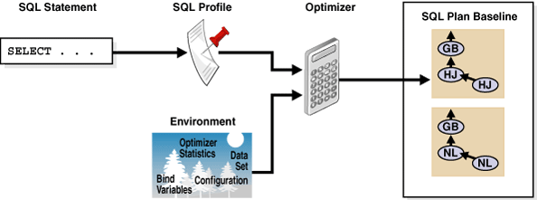
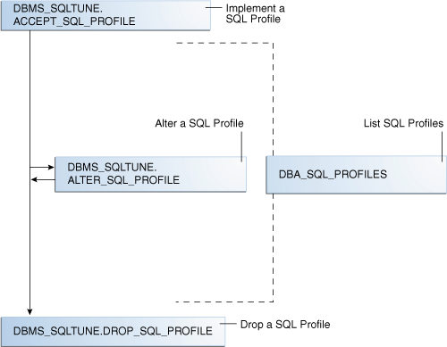
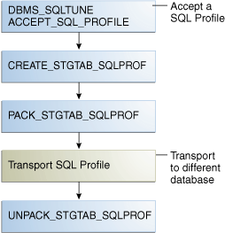

When warranted, SQL Tuning Advisor recommends a SQL profile. You can use `DBMS_SQLTUNE` to implement, alter, drop, and transport SQL profiles.

### 27.1 About SQL Profiles

A **SQL profile** is a database object that contains auxiliary statistics specific to a SQL statement.

Conceptually, a SQL profile is to a SQL statement what object-level statistics are to a table or index. SQL profiles are created when a DBA invokes SQL Tuning Advisor.

See Also:

" [About SQL Tuning Advisor](sql-tuning-advisor.md) "

#### 27.1.1 Purpose of SQL Profiles

When profiling a SQL statement, SQL Tuning Advisor uses a specific set of bind values as input.

The advisor compares the optimizer estimate with values obtained by executing fragments of the statement on a data sample. When significant variances are found, SQL Tuning Advisor bundles corrective actions together in a SQL profile, and then recommends its acceptance.

The corrected statistics in a SQL profile can improve optimizer [cardinality](glossary.md) estimates, which in turn leads the optimizer to select better plans. SQL profiles provide the following benefits over other techniques for improving plans:

- Unlike hints and stored outlines, SQL profiles do not tie the optimizer to a specific plan or subplan. SQL profiles fix incorrect estimates while giving the optimizer the flexibility to pick the best plan in different situations.
- Unlike hints, no changes to application source code are necessary when using SQL profiles. The use of SQL profiles by the database is transparent to the user.

See Also:

- " [Influencing the Optimizer with Hints](influencing-the-optimizer.md) "
- " [Analyzing SQL with SQL Tuning Advisor](sql-tuning-advisor.md) "

#### 27.1.2 Concepts for SQL Profiles

A SQL profile is a collection of auxiliary statistics on a query, including all tables and columns referenced in the query.

The profile is stored in an internal format in the data dictionary. The user interface is the `DBA_SQL_PROFILES` dictionary view. The optimizer uses this information during optimization to determine the most optimal plan.

See Also:

[Oracle Database Reference](https://docs.oracle.com/pls/topic/lookup?ctx=en/database/oracle/oracle-database/21/tgsql&id=REFRN-GUID-1F27F94F-B567-42E1-8AC4-C015F8327610) to learn more about `DBA_SQL_PROFILES`

##### 27.1.2.1 Statistics in SQL Profiles

A SQL profile contains, among other statistics, a set of cardinality adjustments.

The cardinality measure is based on sampling the `WHERE` clause rather than on statistical projection. A profile uses parts of the query to determine whether the estimated cardinalities are close to the actual cardinalities and, if a mismatch exists, uses the corrected cardinalities. For example, if a SQL profile exists for `SELECT * FROM t WHERE x=5 AND y=10`, then the profile stores the actual number of rows returned.

Starting in Oracle Database 18c, SQL Tuning Advisor can recommend an Exadata-aware SQL profile. On Oracle Exadata Database Machine, the cost of smart scans depends on the system statistics I/O seek time (`ioseektim`), multiblock read count (`mbrc`), and I/O transfer speed (`iotfrspeed`). The values of these statistics usually differ on Exadata and can thus influence the choice of plan. If system statistics are stale, and if gathering them improves performance, then SQL Tuning Advisor recommends accepting an Exadata-aware SQL profile.

See Also:

- " [Permanent Table Statistics](optimizer-statistics-concepts.md) "
- [Oracle Database Performance Tuning Guide](https://docs.oracle.com/pls/topic/lookup?ctx=en/database/oracle/oracle-database/21/tgsql&id=TGSQL-GUID-AC23D691-5C54-4EF9-BF9F-65121F2AFC31) to learn about system statistics
- [Oracle Exadata Database Machine System Overview](https://docs.oracle.com/pls/topic/lookup?ctx=en/database/oracle/oracle-database/21/tgsql&id=DBMSO-GUID-B978FAD1-5E8D-4518-8BAA-2A06DB3F0883)

##### 27.1.2.2 SQL Profiles and Execution Plans

The SQL profile contains supplemental statistics for the entire statement, not individual plans. The profile does not itself determine a specific plan.

Internally, a SQL profile is implemented using hints that address different types of problems. These hints do not specify any particular plan. Rather, the hints correct errors in the optimizer estimation algorithm that lead to suboptimal plans. For example, a profile may use the `TABLE_STATS` hint to set object statistics for tables when the statistics are missing or stale.

When choosing plans, the optimizer has the following sources of information:

- The environment, which contains the database configuration, system statistics, [bind variable](glossary.md) values, [optimizer statistics](glossary.md), data set, and so on
- The supplemental statistics in the SQL profile

The following figure shows the relationship between a SQL statement and the SQL profile for this statement. The optimizer uses the SQL profile and the environment to generate an execution plan. In this example, the plan is in the [SQL plan baseline](glossary.md) for the statement.

Figure 27-1 SQL Profile



> The graphic shows a SELECT statement pointing to a SQL profile. The profile, along with an icon representing the environment, points to the optimizer. The optimizer icon points to a plan in the SQL plan baseline.
>
> [  
> Copyright © 2013, 2023, Oracle and/or its affiliates.](https://docs.oracle.com/en/database/oracle/oracle-database/dcommon/html/cpyr.htm)


If either the optimizer environment or SQL profile changes, then the optimizer can create a new plan. As tables grow, or as indexes are created or dropped, the plan for a SQL profile can change. The profile continues to be relevant even if the data distribution or access path of the corresponding statement changes.

In general, you do not need to refresh SQL profiles. Over time, however, profile content can become outdated. In this case, performance of the SQL statement may degrade. The statement may appear as high-load or top SQL. In this case, the Automatic SQL Tuning task again captures the statement as high-load SQL. You can implement a new SQL profile for the statement.

See Also:

- " [Differences Between SQL Plan Baselines and SQL Profiles](overview-of-sql-plan-management.md) "
- " [Introduction to Optimizer Statistics](optimizer-statistics-concepts.md) "
- [Oracle Database SQL Language Reference](https://docs.oracle.com/pls/topic/lookup?ctx=en/database/oracle/oracle-database/21/tgsql&id=SQLRF-GUID-D316D545-89E2-4D54-977F-FC97815CD62E) to learn about SQL hints

##### 27.1.2.3 SQL Profile Recommendations

SQL Tuning Advisor invokes Automatic Tuning Optimizer to generate SQL profile recommendations.

Recommendations to implement SQL profiles occur in a finding, which appears in a separate section of the SQL Tuning Advisor report. When you implement (or accept) a SQL profile, the database creates the profile and stores it persistently in the data dictionary. However, the SQL profile information is not exposed through regular dictionary views.

Example 27-1 SQL Profile Recommendation

In this example, the database found a better plan for a `SELECT` statement that uses several expensive joins. The database recommends running `DBMS_SQLTUNE.ACCEPT_SQL_PROFILE` to implement the profile, which enables the statement to run 98.53% faster.

```
---------------------------------------------------------------------------
FINDINGS SECTION (2 findings)
---------------------------------------------------------------------------
 
1- SQL Profile Finding (see explain plans section below)
--------------------------------------------------------
  A potentially better execution plan was found for this statement. Choose
  one of the following SQL profiles to implement.
 
  Recommendation (estimated benefit: 99.45%)
  ------------------------------------------
  - Consider accepting the recommended SQL profile.
    execute dbms_sqltune.accept_sql_profile(task_name => 'my_task',
            object_id => 3, task_owner => 'SH', replace => TRUE);
 
  Validation results
  ------------------
  The SQL profile was tested by executing both its plan and the original 
  plan and measuring their respective execution statistics. A plan may 
  have been only partially executed if the other could be run to 
  completion in less time.
 
                           Original Plan  With SQL Profile  % Improved
                           -------------  ----------------  ----------
  Completion Status:             PARTIAL          COMPLETE
  Elapsed Time(us):            15467783            226902      98.53 %
  CPU Time(us):                15336668            226965      98.52 %
  User I/O Time(us):                  0                 0
  Buffer Gets:                  3375243             18227      99.45 %
  Disk Reads:                         0                 0
  Direct Writes:                      0                 0
  Rows Processed:                     0               109
  Fetches:                            0               109
  Executions:                         0                 1
 
  Notes
  -----
  1. The SQL profile plan was first executed to warm the buffer cache.
  2. Statistics for the SQL profile plan were averaged over next 3 executions.
```

Sometimes SQL Tuning Advisor may recommend implementing a profile that uses the Automatic Degree of Parallelism (Auto DOP) feature. A parallel query profile is only recommended when the original plan is serial and when parallel execution can significantly reduce the elapsed time for a long-running query.

When it recommends a profile that uses Auto DOP, SQL Tuning Advisor gives details about the performance overhead of using parallel execution for the SQL statement in the report. For parallel execution recommendations, SQL Tuning Advisor may provide two SQL profile recommendations, one using serial execution and one using parallel.

The following example shows a parallel query recommendation. In this example, a degree of parallelism of 7 improves response time significantly at the cost of increasing resource consumption by almost 25%. You must decide whether the reduction in database throughput is worth the increase in response time.

```
Recommendation (estimated benefit: 99.99%)
------------------------------------------
- Consider accepting the recommended SQL profile to use parallel 
  execution for this statement.
  execute dbms_sqltune.accept_sql_profile(task_name => 'gfk_task',
          object_id => 3, task_owner => 'SH', replace => TRUE,
          profile_type => DBMS_SQLTUNE.PX_PROFILE);

Executing this query parallel with DOP 7 will improve its response time
82.22% over the SQL profile plan. However, there is some cost in enabling
parallel execution. It will increase the statement's resource 
consumption by an estimated 24.43% which may result in a reduction of 
system throughput. Also, because these resources are consumed over a
much   smaller duration, the response time of concurrent statements 
might be negatively impacted if sufficient hardware capacity is not 
available.

The following data shows some sampled statistics for this SQL from the
past week and projected weekly values when parallel execution is enabled.

                               Past week sampled statistics for this SQL
                               -----------------------------------------
Number of executions                                                   0
Percent of total activity                                            .29
Percent of samples with #Active Sessions > 2*CPU                       0
Weekly DB time (in sec)                                            76.51

                            Projected statistics with Parallel Execution
                            --------------------------------------------
Weekly DB time (in sec)                                            95.21
```

See Also:

- " [SQL Profiling](sql-tuning-advisor.md) "
- [Oracle Database VLDB and Partitioning Guide](https://docs.oracle.com/pls/topic/lookup?ctx=en/database/oracle/oracle-database/21/tgsql&id=VLDBG0103) to learn more about Auto DOP
- [Oracle Database PL/SQL Packages and Types Reference](https://docs.oracle.com/pls/topic/lookup?ctx=en/database/oracle/oracle-database/21/tgsql&id=ARPLS68398) to learn about the `DBMS_SQLTUNE.ACCEPT_SQL_PROFILE` procedure

##### 27.1.2.4 SQL Profiles and SQL Plan Baselines

You can use SQL profiles with or without SQL plan management.

No strict relationship exists between the SQL profile and a SQL plan baseline. If a statement has multiple plans in a SQL plan baseline, then a SQL profile is useful because it enables the optimizer to choose the lowest-cost plan in the baseline.

See Also:

" [Overview of SQL Plan Management](overview-of-sql-plan-management.md) "

#### 27.1.3 User Interfaces for SQL Profiles

Oracle Enterprise Manager Cloud Control (Cloud Control) usually handles SQL profiles as part of automatic SQL tuning.

On the command line, you can manage SQL profiles with the `DBMS_SQLTUNE` package. To use the APIs, you must have the `ADMINISTER SQL MANAGEMENT OBJECT` privilege.

See Also:

- [Oracle Database PL/SQL Packages and Types Reference](https://docs.oracle.com/pls/topic/lookup?ctx=en/database/oracle/oracle-database/21/tgsql&id=ARPLS220) for information about the `DBMS_SQLTUNE` package
- [Oracle Database 2 Day + Performance Tuning Guide](https://docs.oracle.com/pls/topic/lookup?ctx=en/database/oracle/oracle-database/21/tgsql&id=TDPPT163) to learn how to manage SQL profiles with Cloud Control

#### 27.1.4 Basic Tasks for SQL Profiles

Basic tasks include accepting (implementing) a SQL profile, altering it, listing it, and dropping it.

The following graphic shows the basic workflow.

Figure 27-2 Managing SQL Profiles



> This flowchart diagram shows the SQL Tuning Sets APIs.
>
> The following SQL Tuning Set API procedures are shown: `CREATE_SQLSET`, `DROP_SQLSET`, `LOAD_SQLSET`, `UNPACK_STQTAB_SQLSET`, and `PACK_STQTAB_SQLSET`. All procedures either lead into or from the SQL Tuning Set (STS).
>
> Three input sources are shown leading into the `LOAD_SQLSET` procedure: cursor cache, AWR, and another STS.
>
> End of image description.


Typically, you manage SQL profiles in the following sequence:

1. Implement a recommended SQL profile.
	" Implementing a SQL Profile " describes this task.
2. Obtain information about SQL profiles stored in the database.
	" Listing SQL Profiles " describes this task.
3. Optionally, modify the implemented SQL profile.
	" Altering a SQL Profile " describes this task.
4. Drop the implemented SQL profile when it is no longer needed.
	" Dropping a SQL Profile " describes this task.

To tune SQL statements on another database, you can transport both a SQL tuning set and a SQL profile to a separate database. " Transporting a SQL Profile " describes this task.

See Also:

[Oracle Database PL/SQL Packages and Types Reference](https://docs.oracle.com/pls/topic/lookup?ctx=en/database/oracle/oracle-database/21/tgsql&id=ARPLS220) for information about the `DBMS_SQLTUNE` package

### 27.2 Implementing a SQL Profile

Implementing a SQL profile means storing it persistently in the database.

Implementing a profile is the same as accepting it. A profile must be accepted before the optimizer can use it as input when generating plans.

#### 27.2.1 About SQL Profile Implementation

As a rule of thumb, implement a SQL profile recommended by SQL Tuning Advisor.

If the database recommends both an index and a SQL profile, then either use both or use the SQL profile only. If you create an index, then the optimizer may need the profile to pick the new index.

In some situations, SQL Tuning Advisor may find an improved serial plan in addition to an even better parallel plan. In this case, the advisor recommends both a standard and a parallel SQL profile, enabling you to choose between the best serial and best parallel plan for the statement. Implement a parallel plan only if the increase in response time is worth the decrease in throughput.

To implement a SQL profile, execute the `DBMS_SQLTUNE.ACCEPT_SQL_PROFILE` procedure. Some important parameters are as follows:

- `profile_type`
	Set this parameter to `REGULAR_PROFILE` for a SQL profile without a change to parallel execution, or `PX_PROFLE` for a SQL profile with a change to parallel execution.
- `force_match`
	This parameter controls statement matching. Typically, an accepted SQL profile is associated with the SQL statement through a [SQL signature](glossary.md) that is generated using a hash function. This hash function changes the SQL statement to upper case and removes all extra whitespace before generating the signature. Thus, the same SQL profile works for all SQL statements in which the only difference is case and white spaces.
	By setting `force_match` to `true`, the SQL profile additionally targets all SQL statements that have the same text after the literal values in the `WHERE` clause have been replaced by bind variables. This setting may be useful for applications that use only literal values because it enables SQL with text differing only in its literal values to share a SQL profile. If both literal values and bind variables are in the SQL text, or if `force_match` is set to `false` (default), then the literal values in the `WHERE` clause are not replaced by bind variables.

See Also:

[Oracle Database PL/SQL Packages and Types Reference](https://docs.oracle.com/pls/topic/lookup?ctx=en/database/oracle/oracle-database/21/tgsql&id=ARPLS220) for information about the `ACCEPT_SQL_PROFILE` procedure

#### 27.2.2 Implementing a SQL Profile

To implement a SQL profile, use the `DBMS_SQLTUNE.ACCEPT_SQL_PROFILE` procedure.

Assumptions

This tutorial assumes the following:

- The SQL Tuning Advisor task `STA_SPECIFIC_EMP_TASK` includes a recommendation to create a SQL profile.
- The name of the SQL profile is `my_sql_profile`.
- The PL/SQL block accepts a profile that uses parallel execution (`profile_type`).
- The profile uses force matching.

To implement a SQL profile:

1. In SQL\*Plus or SQL Developer, log in to the database as a user with the necessary privileges.
2. Execute the `ACCEPT_SQL_PROFILE` function.
	For example, execute the following PL/SQL:
	```
	DECLARE
	  my_sqlprofile_name VARCHAR2(30);
	BEGIN
	  my_sqlprofile_name := DBMS_SQLTUNE.ACCEPT_SQL_PROFILE ( 
	    task_name    => 'STA_SPECIFIC_EMP_TASK'
	,   name         => 'my_sql_profile'
	,   profile_type => DBMS_SQLTUNE.PX_PROFILE
	,   force_match  => true 
	);
	END;
	/
	```

See Also:

[Oracle Database PL/SQL Packages and Types Reference](https://docs.oracle.com/pls/topic/lookup?ctx=en/database/oracle/oracle-database/21/tgsql&id=ARPLS68398) to learn about the `DBMS_SQLTUNE.ACCEPT_SQL_PROFILE` procedure

### 27.3 Listing SQL Profiles

The data dictionary view `DBA_SQL_PROFILES` stores SQL profiles persistently in the database.

The profile statistics are in an Oracle Database internal format, so you cannot query profiles directly. However, you can list profiles.

To list SQL profiles:

1. In SQL\*Plus or SQL Developer, log in to the database as a user with the necessary privileges.
2. Query the `DBA_SQL_PROFILES` view.
	For example, execute the following query:
	```
	COLUMN category FORMAT a10
	COLUMN sql_text FORMAT a20
	SELECT NAME, SQL_TEXT, CATEGORY, STATUS
	FROM   DBA_SQL_PROFILES;
	```
	Sample output appears below:
	```
	NAME                           SQL_TEXT             CATEGORY   STATUS
	------------------------------ -------------------- ---------- --------
	SYS_SQLPROF_01285f6d18eb0000   select promo_name, c DEFAULT    ENABLED
	                               ount(*) c from promo
	                               tions p, sales s whe
	                               re s.promo_id = p.pr
	                               omo_id and p.promo_c
	                               ategory = 'internet'
	                                group by p.promo_na
	                               me order by c desc
	```

See Also:

[Oracle Database Reference](https://docs.oracle.com/pls/topic/lookup?ctx=en/database/oracle/oracle-database/21/tgsql&id=REFRN23477) to learn about the `DBA_SQL_PROFILES` view

### 27.4 Altering a SQL Profile

You can alter attributes of an existing SQL profile using the `attribute_name` parameter of the `ALTER_SQL_PROFILE` procedure.

The `CATEGORY` attribute determines which sessions can apply a profile. View the `CATEGORY` attribute by querying `DBA_SQL_PROFILES.CATEGORY`. By default, all profiles are in the `DEFAULT` category, which means that all sessions in which the `SQLTUNE_CATEGORY` initialization parameter is set to `DEFAULT` can use the profile.

By altering the category of a SQL profile, you determine which sessions are affected by profile creation. For example, by setting the category to `DEV`, only sessions in which the `SQLTUNE_CATEGORY` initialization parameter is set to `DEV` can use the profile. Other sessions do not have access to the SQL profile and execution plans for SQL statements are not impacted by the SQL profile. This technique enables you to test a profile in a restricted environment before making it available to other sessions.

The example in this section assumes that you want to change the category of the SQL profile so it is used only by sessions with the SQL profile category set to `TEST`, run the SQL statement, and then change the profile category back to `DEFAULT`.

To alter a SQL profile:

1. In SQL\*Plus or SQL Developer, log in to the database as a user with the necessary privileges.
2. Use the `ALTER_SQL_PROFILE` procedure to set the `attribute_name`.
	For example, execute the following code to set the attribute `CATEGORY` to `TEST`:
	```
	VARIABLE pname my_sql_profile
	BEGIN DBMS_SQLTUNE.ALTER_SQL_PROFILE ( 
	   name            =>  :pname
	,  attribute_name  =>  'CATEGORY'
	,  value           =>  'TEST'      
	);
	END;
	```
3. Change the initialization parameter setting in the current database session.
	For example, execute the following SQL:
	```
	ALTER SESSION SET SQLTUNE_CATEGORY = 'TEST';
	```
4. Test the profiled SQL statement.
5. Use the `ALTER_SQL_PROFILE` procedure to set the `attribute_name`.
	For example, execute the following code to set the attribute `CATEGORY` to `DEFAULT`:
	```
	VARIABLE pname my_sql_profile
	BEGIN 
	  DBMS_SQLTUNE.ALTER_SQL_PROFILE ( 
	     name            =>  :pname
	,    attribute_name  =>  'CATEGORY'
	,    value           =>  'DEFAULT'   
	);
	END;
	```

See Also:

- [Oracle Database Reference](https://docs.oracle.com/pls/topic/lookup?ctx=en/database/oracle/oracle-database/21/tgsql&id=REFRN10257) to learn about the `SQLTUNE_CATEGORY` initialization parameter
- [Oracle Database PL/SQL Packages and Types Reference](https://docs.oracle.com/pls/topic/lookup?ctx=en/database/oracle/oracle-database/21/tgsql&id=ARPLS68402) to learn about the `ALTER_SQL_PROFILE` procedure

### 27.5 Dropping a SQL Profile

You can drop a SQL profile with the `DROP_SQL_PROFILE` procedure.

Assumptions

This section assumes the following:

- You want to drop `my_sql_profile`.
- You want to ignore errors raised if the name does not exist.

To drop a SQL profile:

1. In SQL\*Plus or SQL Developer, log in to the database as a user with the necessary privileges.
2. Use the `DBMS_SQLTUNE.DROP_SQL_PROFILE` procedure.
	The following example drops the profile named `my_sql_profile`:
	```
	BEGIN
	  DBMS_SQLTUNE.DROP_SQL_PROFILE ( 
	    name => 'my_sql_profile' 
	);
	END;
	/
	```

See Also:

- [Oracle Database PL/SQL Packages and Types Reference](https://docs.oracle.com/pls/topic/lookup?ctx=en/database/oracle/oracle-database/21/tgsql&id=ARPLS68418) to learn about the `DROP_SQL_PROFILE` procedure
- [Oracle Database Reference](https://docs.oracle.com/pls/topic/lookup?ctx=en/database/oracle/oracle-database/21/tgsql&id=REFRN10257) to learn about the `SQLTUNE_CATEGORY` initialization parameter

### 27.6 Transporting a SQL Profile

You can export a SQL profile from the `SYS` schema in one database to a staging table, and then import it from the staging table into another database. You can transport a SQL profile to any Oracle database created in the same release or later.

Table 27-1 shows the main procedures and functions for managing SQL profiles.

Table 27-1 APIs for Transporting SQL Profiles

| Procedure or Function | Description |
| --- | --- |
| `CREATE_STGTAB_SQLPROF` | Creates the staging table used for copying SQL profiles from one system to another. |
| `PACK_STGTAB_SQLPROF` | Moves profile data out of the `SYS` schema into the staging table. |
| `UNPACK_STGTAB_SQLPROF` | Uses the profile data stored in the staging table to create profiles on this system. |

The following graphic shows the basic workflow of transporting SQL profiles.

Figure 27-3 Transporting SQL Profiles



> This graphic shows a series of vertical text boxes, with each box pointing down to the box beneath it. The first box is DBMS\_SQLTUNE.ACCEPT\_SQL\_PROFILE. It is labeled "Accept a SQL Profile." The second box is CREATE\_STGTAB\_SQLPROF. The third box is PACK\_STGTAB\_SQLPROF. The fourth box is Transport SQL Profile, which is labeled "Transport to different database." The final box is UNPACK\_STGTAB\_SQLPROF.


Assumptions

This tutorial assumes the following:

- You want to transport `my_profile` from a production database to a test database.
- You want to create the staging table in the `dba1` schema.

To transport a SQL profile:

1. Connect SQL\*Plus to the database with the appropriate privileges, and then use the `CREATE_STGTAB_SQLPROF` procedure to create a staging table to hold the SQL profiles.
	The following example creates `my_staging_table` in the `dba1` schema:
	```
	BEGIN
	  DBMS_SQLTUNE.CREATE_STGTAB_SQLPROF ( 
	    table_name  => 'my_staging_table'
	,   schema_name => 'dba1' 
	);
	END;
	/
	```
2. Use the `PACK_STGTAB_SQLPROF` procedure to export SQL profiles into the staging table.
	The following example populates `dba1.my_staging_table` with the SQL profile `my_profile`:
	```
	BEGIN
	  DBMS_SQLTUNE.PACK_STGTAB_SQLPROF (  
	    profile_name         => 'my_profile'
	,   staging_table_name   => 'my_staging_table'
	,   staging_schema_owner => 'dba1' 
	);
	END;
	/
	```
3. Move the staging table to the database where you plan to unpack the SQL profiles.
	Move the table using your utility of choice. For example, use Oracle Data Pump or a database link.
4. On the database where you plan to import the SQL profiles, use `UNPACK_STGTAB_SQLPROF` to unpack SQL profiles from the staging table.
	The following example shows how to unpack SQL profiles in the staging table:
	```
	BEGIN
	  DBMS_SQLTUNE.UNPACK_STGTAB_SQLPROF(
	     replace            => true
	,    staging_table_name => 'my_staging_table'
	);
	END;
	/
	```

See Also:

- [Oracle Database PL/SQL Packages and Types Reference](https://docs.oracle.com/pls/topic/lookup?ctx=en/database/oracle/oracle-database/21/tgsql&id=ARPLS220) for complete reference information about `DBMS_SQLTUNE`
- [Oracle Database Utilities](https://docs.oracle.com/pls/topic/lookup?ctx=en/database/oracle/oracle-database/21/tgsql&id=SUTIL100) to learn how to use Oracle Data Pump