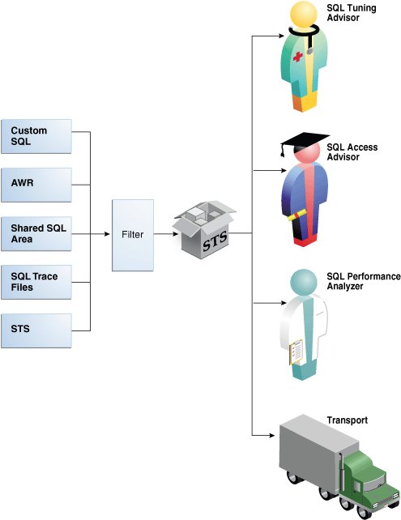
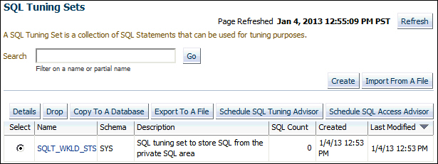
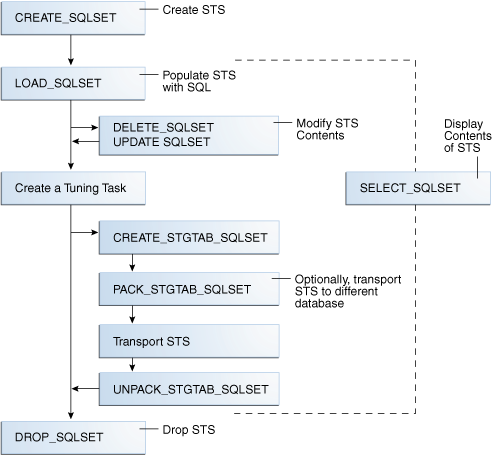
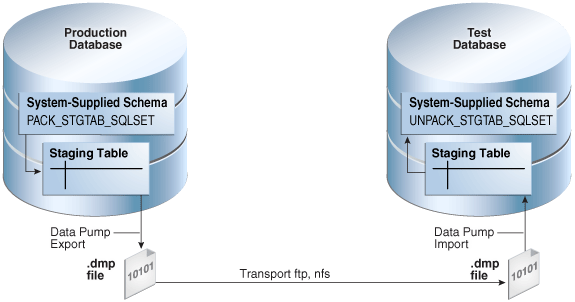

A SQL tuning set is a mechanism to collect, maintain, and access SQL workload data for SQL performance monitoring and tuning.

### 24.1 About SQL Tuning Sets

A **SQL tuning set (STS)** is a database object that you can use as input to tuning tools.

An STS includes the following components:

- A set of SQL statements
- Associated execution context, such as user schema, application module name and action, list of bind values, and the environment for [SQL compilation](glossary.md) of the cursor
- Associated basic execution statistics, such as elapsed time, CPU time, buffer gets, disk reads, rows processed, cursor fetches, the number of executions, the number of complete executions, optimizer cost, and the command type
- Associated execution plans and row source statistics for each SQL statement (optional)

Note:

Data visibility and privilege requirements may differ when using an STS with pluggable databases.

#### 24.1.1 Purpose of SQL Tuning Sets

An STS enables you to group SQL statements and related metadata in a single database object, which you can use to meet your tuning goals.

Specifically, SQL tuning sets achieve the following goals:

- Providing input to the performance tuning advisors
	You can use an STS as input to multiple database advisors, including SQL Tuning Advisor, SQL Access Advisor, and SQL Performance Analyzer.
- Transporting SQL between databases
	You can export SQL tuning sets from one database to another, enabling transfer of SQL workloads between databases for remote performance diagnostics and tuning. When suboptimally performing SQL statements occur on a production database, developers may not want to investigate and tune directly on the production database. The DBA can transport the problematic SQL statements to a test database where the developers can safely analyze and tune them.

#### 24.1.2 Concepts for SQL Tuning Sets

To create an STS, you must load SQL statements into an STS from a source.

As shown in the following figure, the source can be the Automatic Workload Repository (AWR), [shared SQL area](glossary.md), customized SQL provided by the user, trace files, or another STS.

Figure 24-1 SQL Tuning Sets



> This graphic shows five boxes in a vertical line: Custom SQL, AWR, Shared SQL Area, SQL Trace Files, and STS. These boxes point right to a Filter box. This box points right toward an icon depicting a box. This icon is labeled "STS." The STS box points right to a vertical column of four icons. The top icon is a person labeled "SQL Tuning Advisor"; the next icon is a person labeled "SQL Access Advisor"; the next icon is a person labeled "SQL Performance Analyzer"; the bottom icon is a truck labeled "Transport."


SQL tuning sets can do the following:

- Filter SQL statements using the application module name and action, or any execution statistics
- Rank SQL statements based on any combination of execution statistics
- Serve as input to the advisors or transport it to a different database

See Also:

[Oracle Database Performance Tuning Guide](https://docs.oracle.com/pls/topic/lookup?ctx=en/database/oracle/oracle-database/21/tgsql&id=TGDBA169) to learn about AWR

#### 24.1.3 User Interfaces for SQL Tuning Sets

You can use either Oracle Enterprise Manager Cloud Control (Cloud Control) or PL/SQL packages to manage SQL tuning sets. Oracle recommends Cloud Control.

##### 24.1.3.1 Accessing the SQL Tuning Sets Page in Cloud Control

The SQL Tuning Sets page in Cloud Control is the starting page from which you can perform most operations relating to SQL tuning sets.

To access the SQL Tuning Sets page:

1. Log in to Cloud Control with the appropriate credentials.
2. Under the Targets menu, select Databases.
3. In the list of database targets, select the target for the Oracle Database instance that you want to administer.
4. If prompted for database credentials, then enter the minimum credentials necessary for the tasks you intend to perform.
5. From the Performance menu, select SQL, then SQL Tuning Sets.
	The SQL Tuning Sets page appears, as shown in Figure 24-2.
	Figure 24-2 SQL Tuning Sets
	

> This screen shot shows a section of a Cloud Control page. The heading is "SQL Tuning Sets." Below and to the right is the Refresh button. Below and to the left is the following text: "A SQL Tuning Set is a collection of SQL Statements that can be used for tuning purposes." Below is a Search box with a Go button to the right. Below the search box is the text "Filter on a name or partial name." Below and to the right are the buttons "Create," and "Import From A File." Underneath is the following row of buttons: Details, Drop, Copy To A Database, Export To A File, Schedule SQL Tuning Advisor, Schedule SQL Access Advisor. Underneath is a table with the following columns: Select, Name, Schema, Description, SQL Count, Created, and Lost Modified. The first row is: (selected), SQLT\_WKLD\_STS, SH, (null), 5, 10/4/12 12:53 PM, 10/4/12 12:53 PM.


See Also:

[Oracle Database 2 Day + Performance Tuning Guide](https://docs.oracle.com/pls/topic/lookup?ctx=en/database/oracle/oracle-database/21/tgsql&id=TDPPT164)

##### 24.1.3.2 Command-Line Interface to SQL Tuning Sets

On the command line, you can use the `DBMS_SQLTUNE` or `DBMS_SQLSET` packages to manage SQL tuning sets.

You must have the `ADMINISTER SQL TUNING SET` system privilege to manage SQL tuning sets that you own, or the `ADMINISTER ANY SQL TUNING SET` system privilege to manage any SQL tuning sets.

The traditional package for managing SQL tuning sets is `DBMS_SQLTUNE`, which requires the Oracle Tuning Pack. Starting in Oracle Database 18c, you can perform the same tasks with `DBMS_SQLSET`, which does not require the Oracle Tuning Pack. In most cases, the name of the subprogram in `DBMS_SQLSET` is identical to the name of the equivalent subprogram in `DBMS_SQLTUNE`. The following table shows only the subprograms whose names differ.

Table 24-1 Naming Differences for SQL Tuning Set Subprograms

| DBMS\_SQLTUNE | DBMS\_SQLSET |
| --- | --- |
| `ADD_SQLSET_REFERENCE` | `ADD_REFERENCE` |
| `CAPTURE_CURSOR_CACHE_SQLSET` | `CAPTURE_CURSOR_CACHE` |
| `CREATE_STGTAB_SQLSET` | `CREATE_STGTAB` |
| `PACK_STGTAB_SQLSET` | `PACK_STGTAB` |
| `REMAP_STGTAB_SQLSET` | `REMAP_STGTAB` |
| `REVOVE_SQLSET_REFERENCE` | `REMOVE_REFERENCE` |
| `UNPACK_STGTAB_SQLSET` | `UNPACK_STGTAB` |

See Also:

Oracle Database PL/SQL Packages and Types Reference to learn about [`DBMS_SQLTUNE`](https://docs.oracle.com/pls/topic/lookup?ctx=en/database/oracle/oracle-database/21/tgsql&id=ARPLS220) and [`DBMS_SQLSET`](https://docs.oracle.com/pls/topic/lookup?ctx=en/database/oracle/oracle-database/21/tgsql&id=GUID-DFF30D13-6724-46FC-B711-91C0A59EB1E1)

#### 24.1.4 Basic Tasks for Managing SQL Tuning Sets

You can use `DBMS_SQLTUNE` or `DBMS_SQLSET` to create, use, and delete SQL tuning sets. In most cases, the relevant subprograms in these packages have identical names.

The following graphic shows the basic workflow.

Figure 24-3 SQL Tuning Sets APIs



> This flowchart diagram shows the SQL Tuning Sets APIs.
>
> The following SQL Tuning Set API procedures are shown: `CREATE_SQLSET`, `DROP_SQLSET`, `LOAD_SQLSET`, `UNPACK_STQTAB_SQLSET`, and `PACK_STQTAB_SQLSET`. All procedures either lead into or from the SQL Tuning Set (STS).
>
> Three input sources are shown leading into the `LOAD_SQLSET` procedure: cursor cache, AWR, and another STS.
>
> End of image description.


Typically, you perform STS operations in the following sequence:

See Also:

" Command-Line Interface to SQL Tuning Sets " for the names of the equivalent `DBMS_SQLSET` subprograms

### 24.2 Creating a SQL Tuning Set Using CREATE\_SQLSET

Use the `CREATE_SQLSET` procedure in `DBMS_SQLTUNE` or `DBMS_SQLSET` to create an empty STS in the database.

Using the function instead of the procedure causes the database to generate a name for the STS. The following table describes some procedure parameters.

Table 24-2 DBMS\_SQLSET.CREATE\_SQLSET Parameters

| Parameter | Description |
| --- | --- |
| `sqlset_name` | Name of the STS |
| `description` | Optional description of the STS |

Assumptions

This tutorial assumes that

- You want to create an STS named `SQLT_WKLD_STS`.
- You use `DBMS_SQLTUNE` instead of `DBMS_SQLSET`.

To create an STS:

1. In SQL\*Plus or SQL Developer, log in to the database as a user with the necessary privileges.
2. Use the `DBMS_SQLSET.CREATE_SQLSET` procedure.
	For example, execute the following PL/SQL program:
	```
	BEGIN
	  DBMS_SQLSET.CREATE_SQLSET (
	    sqlset_name  => 'SQLT_WKLD_STS' 
	,   description  => 'STS to store SQL from the private SQL area' 
	);
	END;
	```
3. Optionally, confirm that the STS was created.
	The following example queries the status of all SQL tuning sets owned by the current user:
	```
	COLUMN NAME FORMAT a20
	COLUMN COUNT FORMAT 99999
	COLUMN DESCRIPTION FORMAT a11
	SELECT NAME, STATEMENT_COUNT AS "SQLCNT", DESCRIPTION
	FROM   USER_SQLSET;
	```
	Sample output appears below:
	```
	NAME                 SQLCNT DESCRIPTION
	-------------------- ------ -----------
	SQLT_WKLD_STS             2 SQL Cache
	```

See Also:

[Oracle Database PL/SQL Packages and Types Reference](https://docs.oracle.com/pls/topic/lookup?ctx=en/database/oracle/oracle-database/21/tgsql&id=ARPLS68408) for complete reference information

### 24.3 Loading a SQL Tuning Set Using LOAD\_SQLSET

To load an STS with SQL statements, use the `LOAD_SQLSET` procedure in the `DBMS_SQLTUNE` or `DBMS_SQLSET` package.

The standard sources for populating an STS are AWR, another STS, or the shared SQL area. For both the workload repository and SQL tuning sets, predefined table functions can select columns from the source to populate a new STS.

The following table describes some `DBMS_SQLSET.LOAD_SQLSET` procedure parameters.

Table 24-3 DBMS\_SQLSET.LOAD\_SQLSET Parameters

| Parameter | Description |
| --- | --- |
| `populate_cursor` | Specifies the cursor reference from which to populate the STS. |
| `load_option` | Specifies how the statements are loaded into the STS. The possible values are `INSERT` (default), `UPDATE`, and `MERGE`. |

The `DBMS_SQLSET.SELECT_CURSOR_CACHE` function collects SQL statements from the shared SQL area according to the specified filter. This function returns one `SQLSET_ROW` per SQL ID or `PLAN_HASH_VALUE` pair found in each data source.

Use the `DBMS_SQLSET.CAPTURE_CURSOR_CACHE_SQLSET` function (or the equivalent `DBMS_SQLSET.CAPTURE_CURSOR_CACHE`) to repeatedly poll the shared SQL area over a specified interval. This function is more efficient than repeatedly calling the `SELECT_CURSOR_CACHE` and `LOAD_SQLSET` procedures. This function effectively captures the entire workload, as opposed to the AWR, which only captures the workload of high-load SQL statements, or the `LOAD_SQLSET` procedure, which accesses the data source only once.

Prerequisites

This tutorial has the following prerequisites:

- Filters provided to the `SELECT_CURSOR_CACHE` function are evaluated as part of SQL statements run by the current user. As such, they are executed with that user's security privileges and can contain any constructs and subqueries that user can access, but no more.
- The current user must have privileges on the shared SQL area views.

Assumptions

This tutorial assumes the following:

- You want to load the SQL tuning set named `SQLT_WKLD_STS` with statements from the shared SQL area.
- You want to use `DBMS_SQLSET` rather than `DBMS_SQLTUNE` to load the STS.

To load an STS:

1. In SQL\*Plus or SQL Developer, log in to the database as a user with the necessary privileges.
2. Run the `DBMS_SQLSET.LOAD_SQLSET` procedure.
	For example, execute the following PL/SQL program to populate a SQL tuning set with all cursor cache statements that belong to the `sh` schema:
	```
	DECLARE
	  c_sqlarea_cursor DBMS_SQLSET.SQLSET_CURSOR;
	BEGIN
	 OPEN c_sqlarea_cursor FOR
	   SELECT VALUE(p)
	   FROM   TABLE( 
	            DBMS_SQLSET.SELECT_CURSOR_CACHE(
	            ' module = ''SQLT_WKLD'' AND parsing_schema_name = ''SH'' ')
	          ) p;
	-- load the tuning set
	  DBMS_SQLSET.LOAD_SQLSET (  
	    sqlset_name     => 'SQLT_WKLD_STS'
	,   populate_cursor =>  c_sqlarea_cursor 
	);
	END;
	/
	```

See Also:

[Oracle Database PL/SQL Packages and Types Reference](https://docs.oracle.com/pls/topic/lookup?ctx=en/database/oracle/oracle-database/21/tgsql&id=ARPLS68430) for complete reference information.

### 24.4 Querying a SQL Tuning Set

To read the contents of an STS after it has been created and populated, use the `SELECT_SQLSET` function of `DBMS_SQLTUNE` or `DBMS_SQLSET`, optionally using filtering criteria.

Select the output of `SELECT_SQLSET` using a PL/SQL [pipelined table function](glossary.md), which accepts a collection of rows as input. You invoke the table function as the operand of the table operator in the `FROM` list of a `SELECT` statement. The following table describes some `SELECT_SQLSET` function parameters.

Table 24-4 DBMS\_SQLTUNE.SELECT\_SQLSET Parameters

| Parameter | Description |
| --- | --- |
| `basic_filter` | The SQL predicate to filter the SQL from the STS defined on attributes of the `SQLSET_ROW` |
| `object_filter` | Specifies the objects that exist in the object list of selected SQL from the shared SQL area |

The following table describes some attributes of the `SQLSET_ROW` object. These attributes appears as columns when you query `TABLE(DBMS_SQLTUNE.SELECT_SQLSET())`.

Table 24-5 SQLSET\_ROW Attributes

| Parameter | Description |
| --- | --- |
| `parsing_schema_name` | Schema in which the SQL is parsed |
| `elapsed_time` | Sum of the total number of seconds elapsed for this SQL statement |
| `buffer_gets` | Total number of buffer gets (number of times the database accessed a block) for this SQL statement |

Assumptions

This tutorial assumes the following:

- You want to display the contents of an STS named `SQLT_WKLD_STS`.
- You are using `DBMS_SQLTUNE` instead of `DBMS_SQLSET`.

To display the contents of an STS:

1. In SQL\*Plus or SQL Developer, log in to the database as a user with the necessary privileges.
2. Query the STS contents using the `TABLE` function.
	For example, execute the following query:
	```
	COLUMN SQL_TEXT FORMAT a30   
	COLUMN SCH FORMAT a3
	COLUMN ELAPSED FORMAT 999999999
	SELECT SQL_ID, PARSING_SCHEMA_NAME AS "SCH", SQL_TEXT, 
	       ELAPSED_TIME AS "ELAPSED", BUFFER_GETS
	FROM   TABLE( DBMS_SQLTUNE.SELECT_SQLSET( 'SQLT_WKLD_STS' ) );
	```
	Sample output appears below:
	```
	SQL_ID        SCH SQL_TEXT                          ELAPSED BUFFER_GETS
	------------- --- ------------------------------ ---------- -----------
	79f8shn041a1f SH  select * from sales where quan    8373148       24016
	                  tity_sold < 5 union select * f
	                  rom sales where quantity_sold
	                  > 500
	 
	2cqsw036j5u7r SH  select promo_name, count(*) c     3557373         309
	                  from promotions p, sales s whe
	                  re s.promo_id = p.promo_id and
	                   p.promo_category = 'internet'
	                   group by p.promo_name order b
	                  y c desc
	 
	fudq5z56g642p SH  select sum(quantity_sold) from    4787891       12118
	                   sales s, products p where s.p
	                  rod_id = p.prod_id and s.amoun
	                  t_sold > 20000 and p.prod_name
	                   = 'Linen Big Shirt'
	 
	bzmnj0nbvmz8t SH  select * from sales where amou     442355       15281
	                  nt_sold = 4
	```
3. Optionally, filter the results based on user-specific criteria.
	The following example displays statements with a disk reads to buffer gets ratio greater than or equal to 50%:
	```
	COLUMN SQL_TEXT FORMAT a30   
	COLUMN SCH FORMAT a3
	COLUMN BUF_GETS FORMAT 99999999
	COLUMN DISK_READS FORMAT 99999999
	COLUMN %_DISK FORMAT 9999.99
	SELECT sql_id, parsing_schema_name as "SCH", sql_text, 
	       buffer_gets as "B_GETS",
	       disk_reads as "DR", ROUND(disk_reads/buffer_gets*100,2) "%_DISK"
	FROM TABLE( DBMS_SQLTUNE.SELECT_SQLSET( 
	            'SQLT_WKLD_STS',
	            '(disk_reads/buffer_gets) >= 0.50' ) );
	```
	Sample output appears below:
	```
	SQL_ID        SCH SQL_TEXT                       B_GETS DR      %_DISK
	------------- --- ------------------------------ ------ ------- -------
	79f8shn041a1f SH  select * from sales where quan  24016   17287  71.98
	                  tity_sold < 5 union select * f
	                  rom sales where quantity_sold
	                  > 500
	 
	fudq5z56g642p SH  select sum(quantity_sold) from  12118    6355  52.44
	                   sales s, products p where s.p
	                  rod_id = p.prod_id and s.amoun
	                  t_sold > 20000 and p.prod_name
	                   = 'Linen Big Shirt'
	```

See Also:

[Oracle Database PL/SQL Packages and Types Reference](https://docs.oracle.com/pls/topic/lookup?ctx=en/database/oracle/oracle-database/21/tgsql&id=ARPLS68458) for complete reference information

### 24.5 Modifying a SQL Tuning Set Using UPDATE\_SQLSET

Use the `UPDATE_SQLSET` procedure in `DBMS_SQLTUNE` or `DBMS_SQLSET` to delete SQL statements from an STS.

You can use the `UPDATE_SQLSET` procedure to update the attributes of SQL statements (such as `PRIORITY` or `OTHER`) in an existing STS identified by STS name and SQL ID.

Assumptions

This tutorial assumes that you want to modify `SQLT_WKLD_STS` as follows:

- You want to delete all SQL statements with fetch counts over 100.
- You want to change the priority of the SQL statement with ID `fudq5z56g642p` to `1`. You can use priority as a ranking criteria when running SQL Tuning Advisor.
- You use `DBMS_SQLSET` instead of `DBMS_SQLTUNE`.

To modify the contents of an STS:

1. In SQL\*Plus or SQL Developer, log in to the database as a user with the necessary privileges.
2. Optionally, query the STS contents using the `TABLE` function.
	For example, execute the following query:
	```
	SELECT SQL_ID, ELAPSED_TIME, FETCHES, EXECUTIONS
	FROM   TABLE(DBMS_SQLSET.SELECT_SQLSET('SQLT_WKLD_STS'));
	```
	Sample output appears below:
	```
	SQL_ID        ELAPSED_TIME    FETCHES EXECUTIONS
	------------- ------------ ---------- ----------
	2cqsw036j5u7r      3407459          2          1
	79f8shn041a1f      9453965      61258          1
	bzmnj0nbvmz8t       401869          1          1
	fudq5z56g642p      5300264          1          1
	```
3. Delete SQL statements based on user-specified criteria.
	Use the `basic_filter` predicate to filter the SQL from the STS defined on attributes of the `SQLSET_ROW`. The following example deletes all statements in the STS with fetch counts over 100:
	```
	BEGIN
	  DBMS_SQLSET.DELETE_SQLSET (
	      sqlset_name  => 'SQLT_WKLD_STS'
	,     basic_filter => 'fetches > 100'
	);
	END;
	/
	```
4. Set attribute values for SQL statements.
	The following example sets the priority of statement `2cqsw036j5u7r` to `1`:
	```
	BEGIN
	  DBMS_SQLSET.UPDATE_SQLSET ( 
	      sqlset_name     => 'SQLT_WKLD_STS'    
	,     sql_id          => '2cqsw036j5u7r'    
	,     attribute_name  => 'PRIORITY'         
	,     attribute_value =>  1
	);
	END;
	/
	```
5. Optionally, query the STS to confirm that the intended modifications were made.
	For example, execute the following query:
	```
	SELECT SQL_ID, ELAPSED_TIME, FETCHES, EXECUTIONS, PRIORITY
	FROM   TABLE(DBMS_SQLSET.SELECT_SQLSET('SQLT_WKLD_STS'));
	```
	Sample output appears below:
	```
	SQL_ID        ELAPSED_TIME    FETCHES EXECUTIONS   PRIORITY
	------------- ------------ ---------- ---------- ----------
	2cqsw036j5u7r      3407459          2          1          1
	bzmnj0nbvmz8t       401869          1          1
	fudq5z56g642p      5300264          1          1
	```

See Also:

[Oracle Database PL/SQL Packages and Types Reference](https://docs.oracle.com/pls/topic/lookup?ctx=en/database/oracle/oracle-database/21/tgsql&id=ARPLS68416) for more information

### 24.6 Transporting a SQL Tuning Set

You can transport an STS to any database created in Oracle Database 10g Release 2 (10.2) or later. This technique is useful when using SQL Performance Analyzer to tune regressions on a test database.

#### 24.6.1 About Transporting SQL Tuning Sets

Transporting SQL tuning sets between databases means copying the SQL tuning sets to and from a staging table, and then using other tools to move the staging table to the destination database. The most common tools are Oracle Data Pump or a database link.

##### 24.6.1.1 Basic Steps for Transporting SQL Tuning Sets

Transporting SQL tuning sets requires exporting the STS, transporting the dump file, and then importing the dump file.

The following graphic shows the process using Oracle Data Pump and `ftp`.

Figure 24-4 Transporting SQL Tuning Sets



> This graphic depicts two cylinders: Production Database, and Test Database. Production Database contains a box with the following contents: System-Supplied Schema, PACK\_STGTAB\_SQLSET. An arrow points from this box to another box that contains the text "Staging Table" and two intersecting lines. The Staging Table box points outside of the cylinder to a binary file labeled ".dump file." The arrow is labeled "Data Pump Export." An arrow points from the.dump file to an identical.dump file below the Test Database cylinder. The arrow is labeled "Transport ftp, nfs." The Test Database is identical to the production Database with the following exceptions: the arrows point in the opposite direction; the procedure is named UNPACK\_STGTAB\_SQLSET.


As shown in Figure 24-4, the steps are as follows:

1. In the production database, pack the STS into a staging table using `DBMS_SQLTUNE.PACK_STGTAB_SQLSET` or `DBMS_SQLSET.PACK_STGTAB`.
2. Export the STS from the staging table to a `.dmp` file using Oracle Data Pump.
3. Transfer the `.dmp` file from the production host to the test host using a transfer tool such as `ftp`.
4. In the test database, import the STS from the `.dmp` file to a staging table using Oracle Data Pump.
5. Unpack the STS from the staging table using `DBMS_SQLTUNE.UNPACK_STGTAB_SQLSET` or `DBMS_SQLSET.UNPACK_STGTAB`.

##### 24.6.1.2 Basic Steps for Transporting SQL Tuning Sets When the CON\_DBID Values Differ

When transporting an STS, you must remap the `con_dbid` of each SQL statement in the STS when the `con_dbid` of the source database and the destination database are different.

Situations that cause the `con_dbid` value to differ include the following:

- A single-instance database whose instance has been restarted
- Different instances of an Oracle RAC database
- Different PDBs

The basic steps for remapping are as follows:

1. Pack the STS into a staging table using `DBMS_SQLTUNE.PACK_STGTAB_SQLSET` or `DBMS_SQLSET.PACK_STGTAB`.
2. Remap each `con_dbid` in the staging table using `DBMS_SQLTUNE.REMAP_STGTAB_SQLSET` or `DBMS_SQLSET.REMAP_STGTAB`.
3. Export the STS.
4. Unpack the STS in the destination CDB.

Example 24-1 Remapping a CON\_DBID When Transporting an STS from one PDB to Another

In this example, you intend to transport an STS named `STS_for_transport` from one PDB to a different PDB. On the source PDB, you have already packed the STS into source staging table `src_stg_tbl` using the `DBMS_SQLTUNE.PACK_STGTAB_SQLSET` procedure. The container ID of the destination PDB is `12345`.

In the source PDB, you execute the following commands:

```
VARIABLE con_dbid_src NUMBER;

EXEC SELECT UNIQUE con_dbid INTO :con_dbid_src FROM src_stg_tbl;

BEGIN
  DBMS_SQLTUNE.REMAP_STGTAB_SQLSET (
    staging_table_name   => 'src_stg_tbl'
,   staging_schema_owner => 'dba1'
,   old_sqlset_name      => 'STS_for_transport'
,   old_con_dbid         => :con_dbid_src
,   new_con_dbid         => 12345);
END;
```

You can now export the contents of the staging table, and then continue using the normal transport procedure.

See Also:

[Oracle Database PL/SQL Packages and Types Reference](https://docs.oracle.com/pls/topic/lookup?ctx=en/database/oracle/oracle-database/21/tgsql&id=ARPLS68438) to learn about `REMAP_STGTAB_SQLSET`

#### 24.6.2 Transporting SQL Tuning Sets with DBMS\_SQLTUNE

You can transport SQL tuning sets using three subprograms in the `DBMS_SQLTUNE` or `DBMS_SQLSET` package.

The following table describes the procedures relevant for transporting SQL tuning sets.

Table 24-6 Procedures for Transporting SQL Tuning Sets

| DBMS\_SQLTUNE Procedure | Equivalent DBMS\_SQLSET Procedure | Description |
| --- | --- | --- |
| `CREATE_STGTAB_SQLSET` | `CREATE_STGTAB` | Create a staging table to hold the exported SQL tuning sets |
| `PACK_STGTAB_SQLSET` | `PACK_STGTAB` | Populate a staging table with SQL tuning sets |
| `UNPACK_STGTAB_SQLSET` | `UNPACK_STGTAB` | Copy the SQL tuning sets from the staging table into a database |

Assumptions

This tutorial assumes the following:

- An STS with regressed SQL resides in a production database created in the current release.
- You run SQL Performance Analyzer trials on a remote test database created in Oracle Database 11g Release 2 (11.2).
- You want to copy the STS from the production database to the test database and tune the regressions from the SQL Performance Analyzer trials.
- You want to use Oracle Database Pump to transfer the SQL tuning sets between database hosts.
- You use `DBMS_SQLTUNE` rather than `DBMS_SQLSET`.

To transport an STS:

1. In SQL\*Plus or SQL Developer, log in to the database as a user with administrative privileges.
2. Use the `CREATE_STGTAB_SQLSET` procedure to create a staging table to hold the exported SQL tuning sets.
	The following example creates `my_11g_staging_table` in the `dba1` schema and specifies the format of the staging table as 11.2:
	```
	BEGIN
	  DBMS_SQLTUNE.CREATE_STGTAB_SQLSET ( 
	    table_name  => 'my_10g_staging_table'
	,   schema_name => 'dba1'
	,   db_version  => DBMS_SQLTUNE.STS_STGTAB_11_2_VERSION 
	);
	END;
	/
	```
3. Use the `PACK_STGTAB_SQLSET` procedure to populate the staging table with SQL tuning sets.
	The following example populates `dba1.my_11g_staging_table` with the STS `my_sts` owned by `hr`:
	```
	BEGIN
	  DBMS_SQLTUNE.PACK_STGTAB_SQLSET (      
	    sqlset_name         => 'sqlt_wkld_sts'
	,   sqlset_owner        => 'sh'
	,   staging_table_name  => 'my_11g_staging_table'
	,   staging_schema_owner => 'dba1'
	,   db_version          => DBMS_SQLTUNE.STS_STGTAB_11_2_VERSION 
	);
	END;
	/
	```
4. If necessary, remap the container ID values for the statements in the STS as described in " Basic Steps for Transporting SQL Tuning Sets When the CON\_DBID Values Differ ".
5. Use Oracle Data Pump to export the contents of the staging table.
	For example, run the `expdp` command at the operating system prompt:
	```
	expdp dba1 DIRECTORY=dpump_dir1 DUMPFILE=sts.dmp TABLES=my_11g_staging_table
	```
6. Transfer the dump file to the test database host.
7. Log in to the test host as an administrator, and then use Oracle Data Pump to import the contents of the staging table.
	For example, run the `impdp` command at the operating system prompt:
	```
	impdp dba1 DIRECTORY=dpump_dir1 DUMPFILE=sts.dmp TABLES=my_11g_staging_table
	```
8. On the test database, execute the `UNPACK_STGTAB_SQLSET` procedure to copy the SQL tuning sets from the staging table into the database.
	The following example shows how to unpack the SQL tuning sets:
	```
	BEGIN
	  DBMS_SQLTUNE.UNPACK_STGTAB_SQLSET (
	    sqlset_name        => '%'
	,   replace            => true
	,   staging_table_name => 'my_11g_staging_table');
	END;
	/
	```

See Also:

[Oracle Database PL/SQL Packages and Types Reference](https://docs.oracle.com/pls/topic/lookup?ctx=en/database/oracle/oracle-database/21/tgsql&id=ARPLS68412) to learn more about `DBMS_SQLTUNE.UNPACK_STGTAB_SQLSET`

### 24.7 Dropping a SQL Tuning Set Using DROP\_SQLSET

To drop an STS from the database, use the `DROP_SQLSET` procedure in the `DBMS_SQLTUNE` or `DBMS_SQLSET` package.

Prerequisites

Ensure that no tuning task is currently using the STS to be dropped. If an existing tuning task is using this STS, then drop the task before dropping the STS. Otherwise, the database issues an `ORA-13757` error.

Assumptions

This tutorial assumes the following:

- You want to drop an STS named `SQLT_WKLD_STS`.
- You use `DBMS_SQLSET` instead of `DBMS_SQLTUNE`.

To drop an STS:

1. In SQL\*Plus or SQL Developer, log in to the database as a user with the necessary privileges.
2. Use the `DBMS_SQLSET.DROP_SQLSET` procedure.
	For example, execute the following PL/SQL program:
	```
	BEGIN
	  DBMS_SQLSET.DROP_SQLSET( sqlset_name => 'SQLT_WKLD_STS' );
	END;
	/
	```
3. Optionally, confirm that the STS was deleted.
	The following example counts the number of SQL tuning sets named `SQLT_WKLD_STS` owned by the current user (sample output included):
	```
	SELECT COUNT(*) 
	FROM   USER_SQLSET 
	WHERE  NAME = 'SQLT_WKLD_STS';
	  COUNT(*)
	----------
	         0
	```

See Also:

[Oracle Database PL/SQL Packages and Types Reference](https://docs.oracle.com/pls/topic/lookup?ctx=en/database/oracle/oracle-database/21/tgsql&id=ARPLS68420) to learn about the STS procedures in `DBMS_SQLSET`