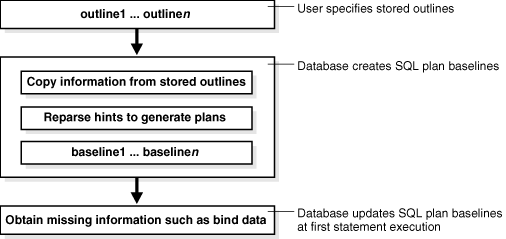

**Stored outline migration** is the user-initiated process of converting stored outlines to SQL plan baselines. A SQL plan baseline is a set of plans proven to provide optimal performance.

Note:

Starting in Oracle Database 12c, stored outlines are deprecated. See " Migrating Stored Outlines to SQL Plan Baselines " for an alternative.

This chapter explains the concepts and tasks relating to stored outline migration.

### 30.1 About Stored Outline Migration

A **stored outline** is a set of hints for a SQL statement.

The hints direct the optimizer to choose a specific plan for the statement. A stored outline is a legacy technique for providing plan stability.

#### 30.1.1 Purpose of Stored Outline Migration

If you rely on stored outlines to maintain plan stability and prevent performance regressions, then you can safely migrate from stored outlines to SQL plan baselines. After the migration, you can maintain the same plan stability while benefiting from the features provided by the SQL Plan Management framework.

Stored outlines have the following disadvantages:

- Stored outlines cannot automatically evolve over time. Consequently, a stored outline may be optimal when you create it, but become a suboptimal plan after a database change, leading to performance degradation.
- Hints in a stored outline can become invalid, as with an index hint on a dropped index. In such cases, the database still uses the outlines but excludes the invalid hints, producing a plan that is often worse than the original plan or the current best-cost plan generated by the optimizer.
- For a SQL statement, the optimizer can only choose the plan defined in the stored outline in the currently specified category. The optimizer cannot choose from other stored outlines in different categories or the current cost-based plan even if they improve performance.
- Stored outlines are a reactive tuning technique, which means that you only use a stored outline to address a performance problem after it has occurred. For example, you may implement a stored outline to correct the plan of a SQL statement that became high-load. In this case, you used stored outlines instead of proactively tuning the statement before it became high-load.

The stored outline migration PL/SQL API helps solve the preceding problems in the following ways:

- SQL plan baselines enable the optimizer to use the same optimal plan and allow this plan to evolve over time.
	For a specified SQL statement, you can add new plans as SQL plan baselines after they are verified not to cause performance regressions.
- SQL plan baselines prevent plans from becoming unreproducible because of invalid hints.
	If hints stored in a plan baseline become invalid, then the plan may not be reproducible by the optimizer. In this case, the optimizer selects an alternative reproducible plan baseline or the current best-cost plan generated by optimizer.
- For a specific SQL statement, the database can maintain multiple plan baselines.
	The optimizer can choose from a set of optimal plans for a specific SQL statement instead of being restricted to a single plan per category, as required by stored outlines.

#### 30.1.2 How Stored Outline Migration Works

Stored outline migration is a user-initiated process that goes through multiple stages.

This section explains how the database migrates stored outlines to SQL plan baselines. This information is important for performing the task of migrating stored outlines.

##### 30.1.2.1 Stages of Stored Outline Migration

To migrate stored outlines, you specify the stores outlines. The database then creates and updates SQL plan baselines.

Figure 30-1 Stages of Stored Outline Migration



> This graphic shows a vertical flow chart as a stack of boxes. Each box points to a box beneath it.
>
> At the top of the chart is a box that says: outline1... outlinen.
>
> The next box says: Copy information from outlines.
>
> The next box says: Reparse hints to generate plans.
>
> The next box says: baseline1... baselinen.
>
> The next box says: Obtain missing information such as bind data.
>
> The first box is labeled: User specifies outlines.
>
> The next three boxes are labeled: Database creates baselines.
>
> The last box is labeled: Database updates baselines at first statement execution.


The migration process has the following stages:

1. The user invokes a function that specifies which outlines to migrate.
2. The database processes the outlines as follows:
	1. The database copies information in the outline needed by the plan baseline.
		The database copies it directly or calculates it based on information in the outline. For example, the text of the SQL statement exists in both schemas, so the database can copy the text from outline to baseline.
		2. The database reparses the hints to obtain information not in the outline.
		The plan hash value and plan cost cannot be derived from the existing information in the outline, which necessitates reparsing the hints.
		3. The database creates the baselines.
3. The database obtains missing information when it chooses the SQL plan baseline for the first time to execute the SQL statement.
	The compilation environment and execution statistics are only available during execution when the plan baseline is parsed and compiled.

The migration is complete only after the preceding phases complete.

##### 30.1.2.2 Outline Categories and Baseline Modules

An outline is a set of hints, whereas a SQL plan baseline is a set of plans.

Because they are different technologies, some functionality of outlines does not map exactly to functionality of baselines. For example, a single SQL statement can have multiple outlines, each of which is in a different outline category, but the only category that currently exists for baselines is `DEFAULT`.

The equivalent of a category for an outline is a module for a SQL plan baseline. Table 30-1 explains how outline categories map to modules.

Table 30-1 Outline Categories

| Concept | Description | Default Value |
| --- | --- | --- |
| Outline Category | Specifies a user-defined grouping for a set of stored outlines.  You can use categories to maintain different stored outlines for a SQL statement. For example, a single statement can have an outline in the `OLTP` category and the `DW` category.  Each SQL statement can have one or more stored outlines. Each stored outline is in one and only one outline category. A statement can have multiple stored outlines in different categories, but only one stored outline exists for each category of each statement.  During migration, the database maps each outline category to a SQL plan baseline module. | `DEFAULT` |
| Baseline Module | Specifies a high-level function being performed.  A SQL plan baseline can belong to one and only one module. | After an outline is migrated to a SQL plan baseline, the module name defaults to outline category name. |
| Baseline Category | Only one SQL plan baseline category exists. This category is named `DEFAULT`. During stored outline migration, the module name of the SQL plan baseline is set to the category name of the stored outline.  A statement can have multiple SQL plan baselines in the `DEFAULT` category. | `DEFAULT` |

When migrating stored outlines to SQL plan baselines, Oracle Database maps every outline category to a SQL plan baseline module with the same name. As shown in the following diagram, the outline category `OLTP` is mapped to the baseline module `OLTP`. After migration, `DEFAULT` is a super-category that contains all SQL plan baselines.

Figure 30-2 DEFAULT Category


> On the left of the graphic are two SELECT statements.
>
> The top SELECT points to outline emp1 in category OLTP. This statement also points to outline emp2 in category DW.
>
> The bottom SELECT points to outline dept2 in category DW.
>
> emp1 points to baseline emp1. This baseline is in module OLTP.
>
> emp2 points to baseline emp2. dept points to baseline dept. Both of these baselines are in module DW.
>
> All modules are in category DEFAULT.


#### 30.1.3 User Interface for Stored Outline Migration

You can use the `DBMS_SPM` package to perform the stored outline migration.

Table 30-2 DBMS\_SPM Functions Relating to Stored Outline Migration

| DBMS\_SPM Function | Description |
| --- | --- |
| `MIGRATE_STORED_OUTLINE` | Migrates existing stored outlines to plan baselines.  Use either of the following formats:  - Specify outline name, SQL text, outline category, or all stored outlines. - Specify a list of outline names. |
| `ALTER_SQL_PLAN_BASELINE` | Changes an attribute of a single plan or all plans associated with a SQL statement. |
| `DROP_MIGRATED_STORED_OUTLINE` | Drops stored outlines that have been migrated to SQL plan baselines.  The function finds stored outlines marked as `MIGRATED` in the `DBA_OUTLINES` view, and then drops these outlines from the database. |

You can control stored outline and plan baseline behavior with initialization and session parameters. Table 30-3 describes the relevant parameters. See Table 30-5 and Table 30-6 for an explanation of how these parameter settings interact.

Table 30-3 Parameters Relating to Stored Outline Migration

| Initialization or Session Parameter | Description | Parameter Type |
| --- | --- | --- |
| `CREATE_STORED_OUTLINES` | Determines whether Oracle Database automatically creates and stores an outline for each query submitted during the session. | Initialization parameter |
| `OPTIMIZER_CAPTURE_SQL_PLAN_BASELINES` | Enables or disables the automatic recognition of repeatable SQL statement and the generation of SQL plan baselines for these statements. | Initialization parameter |
| `OPTIMIZER_USE_SQL_PLAN_BASELINES` | Enables or disables the use of SQL plan baselines stored in SQL Management Base. | Initialization parameter |
| `USE_STORED_OUTLINES` | Determines whether the optimizer uses stored outlines to generate execution plans.  Note: This is a session parameter, not an initialization parameter. | Session |

You can use database views to access information relating to stored outline migration. Table 30-4 describes the following main views.

Table 30-4 Views Relating to Stored Outline Migration

| View | Description |
| --- | --- |
| `DBA_OUTLINES` | Describes all stored outlines in the database.  The `MIGRATED` column is important for outline migration and shows one of the following values: `NOT-MIGRATED` and `MIGRATED`. When `MIGRATED`, the stored outline has been migrated to a plan baseline and is not usable. |
| `DBA_SQL_PLAN_BASELINES` | Displays information about the SQL plan baselines currently created for specific SQL statements.  The `ORIGIN` column indicates how the plan baseline was created. The value `STORED-OUTLINE` indicates the baseline was created by migrating an outline. |

See Also:

- [Oracle Database PL/SQL Packages and Types Reference](https://docs.oracle.com/pls/topic/lookup?ctx=en/database/oracle/oracle-database/21/tgsql&id=ARPLS150) to learn about the `DBMS_SPM` package
- [Oracle Database Reference](https://docs.oracle.com/pls/topic/lookup?ctx=en/database/oracle/oracle-database/21/tgsql&id=GUID-896CCB6B-6FBC-46B9-93DB-71AD1013E6D5) to learn about the `CREATE_STORED_OUTLINES` initialization parameter

#### 30.1.4 Basic Steps in Stored Outline Migration

The basic process is to prepare, migrate, and then clean up.

The basic steps are as follows:

1. Prepare for stored outline migration.
	Review the migration prerequisites and determine how you want the migrated plan baselines to behave.
	See " Preparing for Stored Outline Migration ".
2. Perform either of the following tasks:
	- Migrate to baselines to use SQL Plan Management features.
		See " Migrating Outlines to Utilize SQL Plan Management Features ".
		- Migrate to baselines while exactly preserving the behavior of the stored outlines.
		See " Migrating Outlines to Preserve Stored Outline Behavior ".
3. Perform post-migration confirmation and cleanup.
	See " Performing Follow-Up Tasks After Stored Outline Migration ".

### 30.2 Preparing for Stored Outline Migration

The goal is preparation is determining which stored outlines are eligible for migration.

To prepare for stored outline migration:

1. Connect SQL\*Plus to the database with `SYSDBA` privileges or the `EXECUTE` privilege on the `DBMS_SPM` package.
2. Query the stored outlines in the database.
	The following example queries all stored outlines that have not been migrated to SQL plan baselines:
	```
	SELECT NAME, CATEGORY, SQL_TEXT
	FROM   DBA_OUTLINES
	WHERE  MIGRATED = 'NOT-MIGRATED';
	```
3. Determine which stored outlines meet the following prerequisites for migration eligibility:
	- The statement must not be a run-time `INSERT AS SELECT` statement.
		- The statement must not reference a remote object.
		- This statement must not be a private stored outline.
4. Decide whether to migrate all outlines, specified stored outlines, or outlines belonging to a specified outline category.
	If you do not decide to migrate all outlines, then identify the outlines or categories that you intend to migrate.
5. Decide whether the stored outlines migrated to SQL plan baselines use **fixed plans** or **nonfixed plans**:
	- Fixed plans
		A fixed plan is frozen. If a fixed plan is reproducible using the hints stored in plan baseline, then the optimizer always chooses the lowest-cost fixed plan baseline over plan baselines that are not fixed. Essentially, a fixed plan baseline acts as a stored outline with valid hints.
		A fixed plan is reproducible when the database can parse the statement based on the hints stored in the plan baseline and create a plan with the same plan hash value as the one in the plan baseline. If one of more of the hints become invalid, then the database may not be able to create a plan with the same plan hash value. In this case, the plan is nonreproducible.
		If a fixed plan cannot be reproduced when parsed using its hints, then the optimizer chooses a different plan, which can be either of the following:
		- Another plan for the SQL plan baseline
				- The current cost-based plan created by the optimizer
		In some cases, a performance regression occurs because of the different plan, requiring SQL tuning.
		- Nonfixed plans
		If a plan baseline does not contain fixed plans, then SQL Plan Management considers the plans equally when picking a plan for a SQL statement.
6. Before beginning the actual migration, ensure that the Oracle database meets the following prerequisites:
	- The database must be Enterprise Edition.
		- The database must be open and not in a suspended state.
		- The database must not be in restricted access (DBA), read-only, or migrate mode.
		- Oracle Call Interface (OCI) must be available.

See Also:

- [Oracle Database Administrator’s Guide](https://docs.oracle.com/pls/topic/lookup?ctx=en/database/oracle/oracle-database/21/tgsql&id=ADMIN11046) to learn about administrator privileges
- [Oracle Database Reference](https://docs.oracle.com/pls/topic/lookup?ctx=en/database/oracle/oracle-database/21/tgsql&id=REFRN23153) to learn about the `DBA_OUTLINES` views

### 30.3 Migrating Outlines to Utilize SQL Plan Management Features

You can migrate stored outline to SQL plan baselines.

The goals of this task are as follows:

- To allow SQL Plan Management to select from all plans in a plan baseline for a SQL statement instead of applying the same fixed plan after migration
- To allow the SQL plan baseline to evolve in the face of database changes by adding new plans to the baseline

Assumptions

This tutorial assumes the following:

- You migrate all outlines.
	To migrate specific outlines, use the `DBMS_SPM.MIGRATE_STORED_OUTLINE` function.
- You want the module names of the baselines to be identical to the category names of the migrated outlines.
- You do not want the SQL plans to be fixed.
	By default, generated plans are not fixed and SQL Plan Management considers all plans equally when picking a plan for a SQL statement. This situation permits the advanced feature of plan evolution to capture new plans for a SQL statement, verify their performance, and accept these new plans into the plan baseline.

To migrate stored outlines to SQL plan baselines:

1. Connect SQL\*Plus to the database with the appropriate privileges.
2. Call PL/SQL function `MIGRATE_STORED_OUTLINE`.
	The following sample PL/SQL block migrates all stored outlines to fixed baselines:
	```
	DECLARE
	  my_report CLOB;
	BEGIN
	  my_outlines := DBMS_SPM.MIGRATE_STORED_OUTLINE( 
	                   attribute_name => 'all' );
	END;
	/
	```

See Also:

- [Oracle Database PL/SQL Packages and Types Reference](https://docs.oracle.com/pls/topic/lookup?ctx=en/database/oracle/oracle-database/21/tgsql&id=ARPLS150) to learn about the `DBMS_SPM` package
- [Oracle Database SQL Language Reference](https://docs.oracle.com/pls/topic/lookup?ctx=en/database/oracle/oracle-database/21/tgsql&id=SQLRF00902) to learn about the `ALTER SYSTEM` statement

### 30.4 Migrating Outlines to Preserve Stored Outline Behavior

You can migrate stored outlines to SQL plan baselines and preserve the original behavior of the stored outlines by creating fixed plan baselines.

A fixed plan has higher priority over other plans for the same SQL statement. If a plan is fixed, then the plan baseline cannot be evolved. The database does not add new plans to a plan baseline that contains a fixed plan.

Assumptions

This tutorial assumes the following:

- You want to migrate only the stored outlines in the category named `firstrow`.
- You want the module names of the baselines to be identical to the category names of the migrated outlines.

To migrate stored outlines to plan baselines:

1. Connect SQL\*Plus to the database with the appropriate privileges.
2. Call PL/SQL function `MIGRATE_STORED_OUTLINE`.
	The following sample PL/SQL block migrates stored outlines in the category `firstrow` to fixed baselines:
	```
	DECLARE
	  my_report CLOB;
	BEGIN
	  my_outlines := DBMS_SPM.MIGRATE_STORED_OUTLINE( 
	    attribute_name => 'category', 
	    attribute_value => 'firstrow',
	    fixed => 'YES' );
	END;
	/
	```
	After migration, the SQL plan baselines is in module `firstrow` and category `DEFAULT`.

See Also:

- [Oracle Database PL/SQL Packages and Types Reference](https://docs.oracle.com/pls/topic/lookup?ctx=en/database/oracle/oracle-database/21/tgsql&id=ARPLS150) for syntax and semantics of the `DBMS_SPM.MIGRATE_STORED_OUTLINE` function
- [Oracle Database SQL Language Reference](https://docs.oracle.com/pls/topic/lookup?ctx=en/database/oracle/oracle-database/21/tgsql&id=SQLRF00902) to learn about the `ALTER SYSTEM` statement

### 30.5 Performing Follow-Up Tasks After Stored Outline Migration

After migrating outlines to SQL plan baselines, you must perform some follow-up work.

The goals of this task are as follows:

- To configure the database to use plan baselines instead of stored outlines for stored outlines that have been migrated to SQL plan baselines
- To create SQL plan baselines instead of stored outlines for future SQL statements
- To drop the stored outlines that have been migrated to SQL plan baselines

This section explains how to set initialization parameters relating to stored outlines and plan baselines. The `OPTIMIZER_CAPTURE_SQL_PLAN_BASELINES` and `CREATE_STORED_OUTLINES` initialization parameters determine how and when the database creates stored outlines and SQL plan baselines. Table 30-5 explains the interaction between these parameters.

Table 30-5 Creation of Outlines and Baselines

| CREATE\_STORED\_OUTLINES Initialization Parameter | OPTIMIZER\_CAPTURE\_SQL\_PLAN\_BASELINES Initialization Parameter | Database Behavior |
| --- | --- | --- |
| `false` | `false` | When executing a SQL statement, the database does not create stored outlines or SQL plan baselines. |
| `false` | `true` | The automatic recognition of repeatable SQL statements and the generation of SQL plan baselines for these statements is enabled. When executing a SQL statement, the database creates only new SQL plan baselines (if they do not exist) with the category name `DEFAULT` for the statement. |
| `true` | `false` | Oracle Database automatically creates and stores an outline for each query submitted during the session. When executing a SQL statement, the database creates only new stored outlines (if they do not exist) with the category name `DEFAULT` for the statement. |
| `category` | `false` | When executing a SQL statement, the database creates only new stored outlines (if they do not exist) with the specified category name for the statement. |
| `true` | `true` | Oracle Database automatically creates and stores an outline for each query submitted during the session. The automatic recognition of repeatable SQL statements and the generation of SQL plan baselines for these statements is also enabled.  When executing a SQL statement, the database creates both stored outlines and SQL plan baselines with the category name `DEFAULT`. |
| `category` | `true` | Oracle Database automatically creates and stores an outline for each query submitted during the session. The automatic recognition of repeatable SQL statements and the generation of SQL plan baselines for these statements is also enabled.  When executing a SQL statement, the database creates stored outlines with the specified category name and SQL plan baselines with the category name `DEFAULT`. |

The `USE_STORED_OUTLINES` session parameter (it is not an initialization parameter) and `OPTIMIZER_USE_SQL_PLAN_BASELINES` initialization parameter determine how the database uses stored outlines and plan baselines. Table 30-6 explains how these parameters interact.

Table 30-6 Use of Stored Outlines and SQL Plan Baselines

| USE\_STORED\_OUTLINES Session Parameter | OPTIMIZER\_USE\_SQL\_PLAN\_BASELINES Initialization Parameter | Database Behavior |
| --- | --- | --- |
| `false` | `false` | When choosing a plan for a SQL statement, the database does not use stored outlines or plan baselines. |
| `false` | `true` | When choosing a plan for a SQL statement, the database uses only SQL plan baselines. |
| `true` | `false` | When choosing a plan for a SQL statement, the database uses stored outlines with the category name `DEFAULT`. |
| `category` | `false` | When choosing a plan for a SQL statement, the database uses stored outlines with the specified category name.  If a stored outline with the specified category name does not exist, then the database uses a stored outline in the `DEFAULT` category if it exists. |
| `true` | `true` | When choosing a plan for a SQL statement, stored outlines take priority over plan baselines.  If a stored outline with the category name `DEFAULT` exists for the statement and is applicable, then the database applies the stored outline. Otherwise, the database uses SQL plan baselines. However, if the stored outline has the property `MIGRATED`, then the database does not use the outline and uses the corresponding SQL plan baseline instead (if it exists). |
| `category` | `true` | When choosing a plan for a SQL statement, stored outlines take priority over plan baselines.  If a stored outline with the specified category name or the `DEFAULT` category exists for the statement and is applicable, then the database applies the stored outline. Otherwise, the database uses SQL plan baselines. However, if the stored outline has the property `MIGRATED`, then the database does not use the outline and uses the corresponding SQL plan baseline instead (if it exists). |

Assumptions

This tutorial assumes the following:

- You have completed the basic steps in the stored outline migration.
- Some stored outlines may have been created before Oracle Database 10g.
	Hints in releases before Oracle Database 10g use a local hint format. After migration, hints stored in a plan baseline use the global hints format introduced in Oracle Database 10g.

To place the database in the proper state after the migration:

1. Connect SQL\*Plus to the database with the appropriate privileges, and then check that SQL plan baselines have been created as the result of migration.
	Ensure that the plans are enabled and accepted. For example, enter the following query (partial sample output included):
	```
	SELECT SQL_HANDLE, PLAN_NAME, ORIGIN, ENABLED, ACCEPTED, FIXED, MODULE
	FROM   DBA_SQL_PLAN_BASELINES;
	SQL_HANDLE                PLAN_NAME  ORIGIN         ENA ACC FIX MODULE
	------------------------- ---------- -------------- --- --- --- ------
	SYS_SQL_f44779f7089c8fab  STMT01     STORED-OUTLINE YES YES NO  DEFAULT
	.
	.
	.
	```
2. Optionally, change the attributes of the SQL plan baselines.
	For example, the following statement changes the status of the baseline for the specified SQL statement to `fixed`:
	```
	DECLARE
	  v_cnt PLS_INTEGER;
	BEGIN 
	  v_cnt := DBMS_SPM.ALTER_SQL_PLAN_BASELINE(               
	                           sql_handle=>'SYS_SQL_f44779f7089c8fab', 
	                           attribute_name=>'FIXED', 
	                           attribute_value=>'NO');
	  DBMS_OUTPUT.PUT_LINE('Plans altered: ' || v_cnt);
	END;
	/
	```
3. Check the status of the original stored outlines.
	For example, enter the following query (partial sample output included):
	```
	SELECT NAME, OWNER, CATEGORY, USED, MIGRATED 
	FROM   DBA_OUTLINES
	ORDER BY NAME;
	NAME       OWNER      CATEGORY   USED   MIGRATED
	---------- ---------- ---------- ------ ------------
	STMT01     SYS        DEFAULT    USED   MIGRATED
	STMT02     SYS        DEFAULT    USED   MIGRATED
	.
	.
	.
	```
4. Drop all stored outlines that have been migrated to SQL plan baselines.
	For example, the following statements drops all stored outlines with status `MIGRATED` in `DBA_OUTLINES`:
	```
	DECLARE
	  v_cnt PLS_INTEGER;
	BEGIN 
	  v_cnt := DBMS_SPM.DROP_MIGRATED_STORED_OUTLINE();
	  DBMS_OUTPUT.PUT_LINE('Migrated stored outlines dropped: ' || v_cnt);
	END;
	/
	```
5. Set initialization parameters so that:
	- When executing a SQL statement, the database creates plan baselines but does not create stored outlines.
		- The database only uses stored outlines when the equivalent SQL plan baselines do not exist.
	For example, the following SQL statements instruct the database to create SQL plan baselines instead of stored outlines when a SQL statement is executed. The example also instructs the database to apply a stored outline in category `allrows` or `DEFAULT` only if it exists and has not been migrated to a SQL plan baseline. In other cases, the database applies SQL plan baselines instead.
	```
	ALTER SYSTEM 
	  SET CREATE_STORED_OUTLINE = false SCOPE = BOTH;
	ALTER SYSTEM 
	  SET OPTIMIZER_CAPTURE_SQL_PLAN_BASELINES = true SCOPE = BOTH;
	ALTER SYSTEM 
	   SET OPTIMIZER_USE_SQL_PLAN_BASELINES = true SCOPE = BOTH;
	ALTER SESSION
	   SET USE_STORED_OUTLINES = allrows SCOPE = BOTH;
	```

See Also:

- " Basic Steps in Stored Outline Migration "
- [Oracle Database PL/SQL Packages and Types Reference](https://docs.oracle.com/pls/topic/lookup?ctx=en/database/oracle/oracle-database/21/tgsql&id=ARPLS150) to learn about the `DBMS_SPM` package
- [Oracle Database Reference](https://docs.oracle.com/pls/topic/lookup?ctx=en/database/oracle/oracle-database/21/tgsql&id=GUID-896CCB6B-6FBC-46B9-93DB-71AD1013E6D5) to learn about the `CREATE_STORED_OUTLINES` initialization parameter