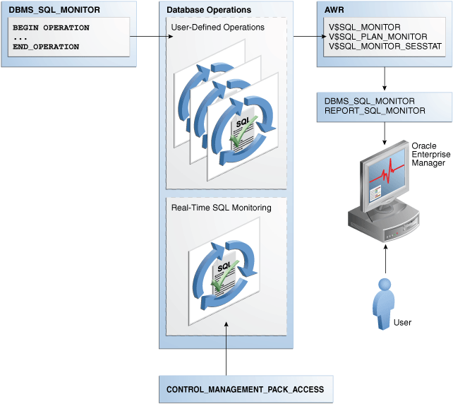
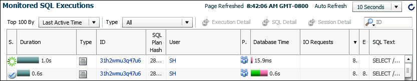
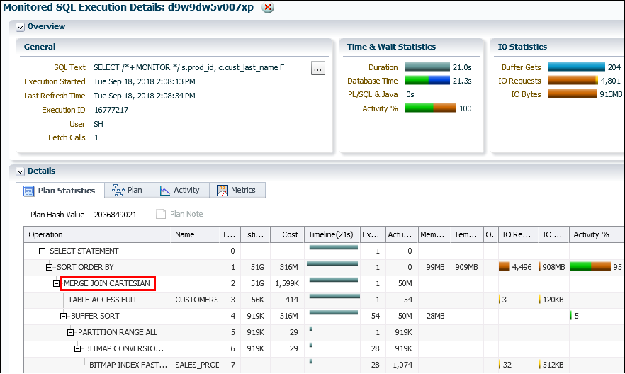
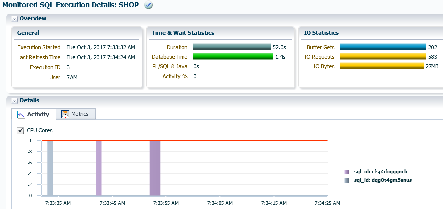

### 21.1 About Monitoring Database Operations

The SQL monitoring feature is enabled by default when the `STATISTICS_LEVEL` initialization parameter is either set to `TYPICAL` (the default value) or `ALL`.

See Also:

[Oracle Database Concepts](https://docs.oracle.com/pls/topic/lookup?ctx=en/database/oracle/oracle-database/21/tgsql&id=CNCPT89228) for a brief conceptual overview of database operations

#### 21.1.1 About Database Operations

A database operation is a set of database tasks. A typical task might be a batch job or Extraction, Transformation, and Loading (ETL) processing job.

Database operations are either simple or composite.

Simple Database Operation

A **simple database operation** is a single SQL statement or PL/SQL subprogram. When the SQL Monitor feature is enabled, the database monitors simple database operations automatically when any of the following conditions is true:

- A SQL statement or PL/SQL subprogram has consumed at least 5 seconds of CPU or I/O time in a single execution.
- A SQL statement executes in parallel.
- A SQL statement specifies the `/*+ MONITOR */` hint.
- The event `sql_monitor` specifies a list of SQL IDs for the statements to be monitored. For example, the following statement forces instance-level monitoring for SQL IDs `5hc07qvt8v737` and `9ht3ba3arrzt3`:
	```
	ALTER SYSTEM SET EVENTS 'sql_monitor [sql: 5hc07qvt8v737|sql: 9ht3ba3arrzt3] force=true'
	```

At each step of the SQL execution plan, the database tracks statistics by performance metrics such as elapsed time, CPU time, number of reads and writes, and I/O wait time. These metrics are available in a graphical and interactive report called the SQL monitor active report.

Composite Database Operation

A **composite database operation** is defined by the user. It includes all SQL statements or PL/SQL subprograms that execute within a database session, with the beginning and end points defined using the procedures `DBMS_SQL_MONITOR.BEGIN_OPERATION` and `DBMS_SQL_MONITOR.END_OPERATION`. A composite database operation is uniquely identified by its name and execution ID, and can be executed multiple times.

Note:

A database session can participate in at most one database operation at a time.

Oracle Database automatically monitors a composite operation when either of the following conditions is true:

- The operation has consumed at least 5 seconds of CPU or I/O time.
- Tracking for the operations is forced by setting `FORCED_TRACKING` to `Y` in `DBMS_SQL_MONITOR.BEGIN_OPERATION`.

Note:

" [Getting the Most Out of SQL Monitor](https://sqlmaria.com/2017/08/01/getting-the-most-out-of-oracle-sql-monitor/) " for a brief overview of SQL Monitor

#### 21.1.2 Purpose of Monitoring Database Operations

For simple operations, Real-Time SQL Monitoring helps determine where a statement is spending its time.

You can also see the breakdown of time and resource usage for recently completed statements. In this way, you can better determine why a particular operation is expensive. Use cases for Real-Time SQL Monitoring include the following:

- A frequently executed SQL statement is executing more slowly than normal. You must identify the root cause of this problem.
- A database session is experiencing slow performance.
- A parallel SQL statement is taking a long time. You want to determine how the server processes are dividing the work.

In OLTP and data warehouse environments, a job often logically groups related SQL statements. The job can span multiple concurrent sessions. Database operations extend Real-Time SQL Monitoring by enabling you to treat a set of statements or procedures as a named, uniquely identified, and re-executable unit. Use cases for monitoring operations include the following:

- A periodic batch job containing many SQL statements must complete in a certain number of hours, but took longer than expected.
- After a database upgrade, the execution time of an important batch job increased. To resolve this problem, you must collect enough relevant statistical data from the batch job before and after the upgrade, compare the two sets of data, and then identify the changes.
- Packing a [SQL tuning set (STS)](glossary.md) took far longer than anticipated. To diagnose the problem, you need to know what was being executed over time. Because this issue cannot be easily reproduced, you need to monitor the process while it is running.

#### 21.1.3 How Database Monitoring Works

Real-Time SQL Monitoring is a built-in database infrastructure that helps you identify performance problems with long-running and parallel SQL statements.

The following figure gives an overview of the architecture for Real-Time SQL Monitoring.

Figure 21-1 Architecture for Database Operations Monitoring



> The Database Operations box contains two boxes: User-Defined Operations and REal-Time SQL Monitoring. A DBMS\_MONITOR box points to User-Defined Operations. CONTROL\_MANAGEMENT\_PACK\_ACCESS points to Real-Time SQL Monitoring. Database Management points to an AWR box that contains the views V$SQL\_MONITOR, V$SQL\_PLAN\_MONITOR, and V$SQL\_MONITOR\_SESSTAT. The AWR box points down to a box that contains the views DBMS\_SQL\_MONITOR and REPORT\_SQL\_MONITOR. This box points down to an Oracle Enterprise Manager icon. A User icon points up to the Enterprise Manager icon.


As shown in the preceding graphic, the `DBMS_SQL_MONITOR` package defines database operations. After monitoring is initiated, the database stores metadata about the database operations in AWR, and the data in AWR and ASH. The database refreshes monitoring statistics in close to real time as each monitored statement executes, typically once every second. The database stores the operational data (the statements and metadata) in the SGA. After an operation completes, the database writes the SQL Monitor report to disk, where it can be queried using the `DBA_HIST_REPORTS` view.

Every monitored database operation has an entry in the `V$SQL_MONITOR` view. This entry tracks key performance metrics collected for the execution, including the elapsed time, CPU time, number of reads and writes, I/O wait time, and various other wait times. The `V$SQL_PLAN_MONITOR` view includes monitoring statistics for each operation in the execution plan of the SQL statement being monitored. You can access reports by using `DBMS_SQL_MONITOR.REPORT_SQL_MONITOR`, Oracle Enterprise Manager Cloud Control (Cloud Control).

See Also:

- " Generating and Accessing SQL Monitor Reports "
- Oracle Database Reference to learn about [`V$SQL_MONITOR`](https://docs.oracle.com/pls/topic/lookup?ctx=en/database/oracle/oracle-database/21/tgsql&id=GUID-79E97A84-9C27-4A5E-AC0D-C12CB3E748E6), [`V$SQL_PLAN_MONITOR`](https://docs.oracle.com/pls/topic/lookup?ctx=en/database/oracle/oracle-database/21/tgsql&id=GUID-85354ECB-7E2E-4D4B-AE78-243A4BB6E523), and [`CONTROL_MANAGEMENT_PACK_ACCESS`](https://docs.oracle.com/pls/topic/lookup?ctx=en/database/oracle/oracle-database/21/tgsql&id=GUID-A5CA11BA-AE1F-4A2E-9C59-A98BA1F4E5C2)
- [Oracle Database PL/SQL Packages and Types Reference](https://docs.oracle.com/pls/topic/lookup?ctx=en/database/oracle/oracle-database/21/tgsql&id=ARPLS-GUID-13874A73-369E-42CD-9C43-A12F1B3BDEC6) to learn about the `DBMS_SQL_MONITOR` package

#### 21.1.4 User Interfaces for Database Operations Monitoring

Real-Time SQL Monitoring is a feature of the Oracle Database Tuning Pack. Database operations are enabled when the `CONTROL_MANAGEMENT_PACK_ACCESS` initialization parameter is set to `DIAGNOSTIC+TUNING` (default).

##### 21.1.4.1 Monitored SQL Executions Page in Cloud Control

The Monitored SQL Executions page in Cloud Control, also known as SQL Monitor, displays details of SQL execution. SQL Monitor is the recommended interface for reporting on database operations.

Statistics at each step of the execution plan are tracked by key performance metrics, including elapsed time, CPU time, number of reads and writes, I/O wait time, and various other wait times. These metrics enable DBAs to analyze SQL execution in depth and decide on the most appropriate tuning strategies for monitored SQL statements.

SQL Monitor Active Reports provide a flash-based interactive report that enables you to save data in an HTML file. You can save this file and view it offline.

###### 21.1.4.1.1 Accessing the Monitored SQL Executions Page

The Monitored SQL Executions shows information such as the SQL ID, database time, and I/O requests.

To access the Monitored SQL Executions page:

1. Log in to Cloud Control with the appropriate credentials.
2. Under the Targets menu, select Databases.
3. In the list of database targets, select the target for the Oracle Database instance that you want to administer.
4. If prompted for database credentials, then enter the minimum credentials necessary for the tasks you intend to perform.
5. From the Performance menu, select SQL Monitoring.
	The Monitored SQL Executions page appears.
	Figure 21-2 Monitored SQL Executions
	

> This screenshot shows the Monitored SQL Executions page, which contains a table. Above the columns are an Active in last 5 minutes drop-down list, a Refresh list that shows Manual, and a Refresh button. The columns are: S..., Duration, S..., U..., P..., Database Time, IO Requests, S..., E..., SQL Text. The first row has: star icon, bar with 21.0s, 21, SH, null, bar with 0.0s, bar with 26, 1:5, null, SELECT. The second row contains: check mark, 48.0s, a9, SH, null, bar with 1.8s, bar with 1.265, 1.4, 1.4, SELECT.


##### 21.1.4.2 DBMS\_SQL\_MONITOR Package

The `DBMS_SQL_MONITOR` package defines the beginning and ending of a composite database operation, and generates a report of the database operations.

Table 21-1 DBMS\_SQL\_MONITOR

| Subprogram | Description |
| --- | --- |
| `BEGIN_OPERATION` | This function starts a database operation in the current session.  This function associates a session with a database operation. Starting in Oracle Database 12c Release 2 (12.2), you can use `session_id` and `session_num` to indicate the session in which to start monitoring. |
| `END_OPERATION` | This function ends a database operation in the current session. If the specified database operation does not exist, then this function has no effect. |
| `REPORT_SQL_MONITOR` | This function builds a detailed report with monitoring information for a SQL statement, PL/SQL block, or database operation.  For each operation, it gives key information and associated global statistics. Use this function to get detailed monitoring information for a database operation.  The target database operation for this report can be:  - The last database operation monitored by Oracle Database (default, no parameter). - The last database operation executed in the specified session and monitored by Oracle Database. The session is identified by its session ID and optionally its serial number (`-1` is current session). - The last execution of a specific database operation identified by its `sql_id`. - A specific execution of a database operation identified by the combination `sql_id`, `sql_exec_start`, and `sql_exec_id`. - The last execution of a specific database operation identified by `dbop_name`. - The specific execution of a database operation identified by the combination `dbop_name`, `dbop_exec_id`.  Use the `type` parameter to specify the output type: `TEXT` (default), `HTML`, `ACTIVE`, or `XML`. |
| `REPORT_SQL_MONITOR_XML` | This function is identical to the `REPORT_SQL_MONITOR` function, except that the return type is `XMLType`. |
| `REPORT_SQL_MONITOR_LIST` | This function builds a report for all or a subset of database operations that have been monitored by Oracle Database. |
| `REPORT_SQL_MONITOR_LIST_XML` | This function is identical to the `REPORT_SQL_MONITOR_LIST` function, except that it returns `XMLType`. |

##### 21.1.4.3 Attributes of composite Database Operations

The `DBMS_SQL_MONITOR.BEGIN_OPERATION` function defines a database operation.

A composite database operation is uniquely identified by the following information:

- Database operation name
	This is a user-created name such as `daily_sales_report`. The operation name is the same for a job even if it is executed concurrently by different sessions or on different databases. Database operation names do not reside in different namespaces.
- Database operation execution ID
	Two or more occurrences of the same database operation can run at the same time, with the same name but different execution IDs. This numeric ID uniquely identifies different executions of the same database operation.
	The database automatically creates an execution ID when you begin a database operation. You can also specify a user-created execution ID.

Optionally, you can specify the session ID and session serial number in which to start the database operations. Thus, one database session can start a database operation defined in a different database session.

The database uses the following triplet of values to identify each SQL and PL/SQL statement monitored in the `V$SQL_MONITOR` view, regardless of whether the statement is included in a database operation:

- SQL identifier to identify the SQL statement (`SQL_ID`)
- Start execution timestamp (`SQL_EXEC_START`)
- An internally generated identifier to ensure that this primary key is truly unique (`SQL_EXEC_ID`)

You can use zero or more additional attributes to describe and identify the characteristics of a composite database operation. Every attribute has a name and value. For example, for database operation `daily_sales_report`, you might define the attribute `db_name` and assign it the value `prod`.

##### 21.1.4.4 MONITOR and NO\_MONITOR Hints

You can use the MONITOR and NO\_MONITOR hints to control tracking for individual statements.

The `MONITOR` hint forces real-time SQL monitoring for the query, even if the statement is not long-running. This hint is valid only when the parameter `CONTROL_MANAGEMENT_PACK_ACCESS` is set to `DIAGNOSTIC+TUNING`. The following query forces SQL Monitor to enable tracking:

```
SELECT /*+ MONITOR */  prod_id, AVG(amount_sold), AVG(quantity_sold) 
FROM   sales
GROUP BY prod_id
ORDER BY prod_id;
```

The `NO_MONITOR` hint disables real-time SQL monitoring for the query, even if the query is long running. The following query forces SQL Monitor to disable tracking:

```
SELECT /*+ NO_MONITOR */  prod_id, AVG(amount_sold), AVG(quantity_sold) 
FROM   sales
GROUP BY prod_id
ORDER BY prod_id;
```

Note:

[Oracle Database SQL Language Reference](https://docs.oracle.com/pls/topic/lookup?ctx=en/database/oracle/oracle-database/21/tgsql&id=GUID-CD628749-C7E0-4EBB-A989-E9C10325EDF7) to learn about the `MONITOR` and `NO_MONITOR` hints

##### 21.1.4.5 Views for Monitoring and Reporting on Database Operations

You can obtain the statistics for database operations using `V$` and data dictionary view.

The following table summarizes these views.

Table 21-2 Views for Database Operations Monitoring

| View | Description |
| --- | --- |
| [`DBA_HIST_REPORTS`](https://docs.oracle.com/pls/topic/lookup?ctx=en/database/oracle/oracle-database/21/tgsql&id=REFRN23881) | This view displays metadata about XML reports captured in Automatic Workload Repository (AWR). Each XML report contains details about some activity of a component. For example, a SQL Monitor report contains a detailed report about a particular database operation.  Important columns include:  - The `REPORT_SUMMARY` column contains the summary of the report. - The `COMPONENT_NAME` column accepts the value `sqlmonitor`. - The `REPORT_ID` column provides the ID of the report, which you can specify in the `RID` parameter of `DBMS_AUTO_REPORT.REPORT_REPOSITORY_DETAIL` when generating the report. - The `KEY1` column is the is the SQL ID for the statement. - The `KEY2` column is the SQL execution ID for the statement  AWR controls the retention period for SQL Monitor reports. Every SQL Monitor report in `DBA_HIST_REPORTS` is associated with an AWR `SNAP_ID`. Note that SQL Monitor reports are not exported or imported when you export or import the corresponding AWR data. |
| [`DBA_HIST_REPORTS_DETAILS`](https://docs.oracle.com/pls/topic/lookup?ctx=en/database/oracle/oracle-database/21/tgsql&id=REFRN23882) | This view displays details about each report captured in AWR. Metadata for each report appears in the `DBA_HIST_REPORTS` view, whereas the actual report is available in the `DBA_HIST_REPORTS_DETAILS` view. |
| [`V$SQL_MONITOR`](https://docs.oracle.com/pls/topic/lookup?ctx=en/database/oracle/oracle-database/21/tgsql&id=GUID-79E97A84-9C27-4A5E-AC0D-C12CB3E748E6) | This view contains global, high-level information about simple and composite database operations.  For simple database operations, monitoring statistics are not cumulative over several executions. In this case, one entry in `V$SQL_MONITOR` is dedicated to a single execution of a SQL statement. If the database monitors two executions of the same SQL statement, then each execution has a separate entry in `V$SQL_MONITOR`.  For simple database operations, `V$SQL_MONITOR` has one entry for the parallel execution coordinator process and one entry for each parallel execution server process. Each entry has corresponding entries in `V$SQL_PLAN_MONITOR`. Because the processes allocated for the parallel execution of a SQL statement are cooperating for the same execution, these entries share the same execution key (the combination of `SQL_ID`, `SQL_EXEC_START`, and `SQL_EXEC_ID`).  For composite database operations, each row contains an operation whose statistics are accumulated over the SQL statements and PL/SQL subprograms that run in the same session as part of the operation. The primary key is the combination of the columns `DBOP_NAME` and `DBOP_EXEC_ID`. |
| [`V$SQL_MONITOR_SESSTAT`](https://docs.oracle.com/pls/topic/lookup?ctx=en/database/oracle/oracle-database/21/tgsql&id=GUID-F1C68683-4048-44FD-8B7A-F30FDCB751CA) | This view contains the statistics for all sessions involved in the database operation.  Most of the statistics are cumulative. The database stores the statistics in XML format instead of using each column for each statistic. This view is primarily intended for the report generator. Oracle recommends that you use `V$SESSTAT` instead of `V$SQL_MONITOR_SESSTAT`. |
| [`V$SQL_PLAN_MONITOR`](https://docs.oracle.com/pls/topic/lookup?ctx=en/database/oracle/oracle-database/21/tgsql&id=GUID-85354ECB-7E2E-4D4B-AE78-243A4BB6E523) | This view contains monitoring statistics for each step in the execution plan of the monitored SQL statement.  The database updates statistics in `V$SQL_PLAN_MONITOR` every second while the SQL statement is executing. Multiple entries exist in `V$SQL_PLAN_MONITOR` for every monitored SQL statement. Each entry corresponds to a step in the execution plan of the statement. |

You can use the preceding `V$` views with the following views to get additional information about the monitored execution:

- `V$ACTIVE_SESSION_HISTORY`
- `V$SESSION`
- `V$SESSION_LONGOPS`
- `V$SQL`
- `V$SQL_PLAN`

See Also:

[Oracle Database Reference](https://docs.oracle.com/pls/topic/lookup?ctx=en/database/oracle/oracle-database/21/tgsql&id=GUID-8C5690B0-DE10-4460-86DF-80111869CF4C) to learn about the `V$` views for database operations monitoring

#### 21.1.5 Basic Tasks in Database Operations Monitoring

This section explains the basic tasks in database operations monitoring.

Basic tasks are as follows:

- " Enabling and Disabling Monitoring of Database Operations "
	This task explains how you can enable automatic monitoring of database operations at the system and statement level.
- " Defining a Composite Database Operation "
	This section explains how you can define the beginning and end of a database operation using PL/SQL.
- " Generating and Accessing SQL Monitor Reports "
	This section explains how you can generate and interpret reports on a database operation.

### 21.2 Enabling and Disabling Monitoring of Database Operations

Use initialization parameters to enable or disable monitoring.

#### 21.2.1 Enabling Monitoring of Database Operations at the System Level

The SQL monitoring feature is enabled by default when the `STATISTICS_LEVEL` initialization parameter is either set to `TYPICAL` (the default value) or `ALL`. SQL monitoring starts automatically for all long-running queries.

Prerequisites

Because SQL monitoring is a feature of the Oracle Database Tuning Pack, the `CONTROL_MANAGEMENT_PACK_ACCESS` initialization parameter must be set to `DIAGNOSTIC+TUNING` (the default value).

Assumptions

This tutorial assumes the following:

- The `STATISTICS_LEVEL` initialization parameter is set to `BASIC`.
- You want to enable automatic monitoring of database operations.

To enable monitoring of database operations:

1. Connect SQL\*Plus to the database with the appropriate privileges, and then query the current database operations settings.
	For example, run the following SQL\*Plus command:
	```
	SQL> SHOW PARAMETER statistics_level
	 
	NAME                                TYPE        VALUE
	----------------------------------- ----------- -----
	statistics_level                    string      BASIC
	```
2. Set the statistics level to `TYPICAL`.
	For example, run the following SQL statement:
	```
	SQL> ALTER SYSTEM SET STATISTICS_LEVEL='TYPICAL';
	```

See Also:

[Oracle Database Reference](https://docs.oracle.com/pls/topic/lookup?ctx=en/database/oracle/oracle-database/21/tgsql&id=REFRN10141) to learn about the `STATISTICS_LEVEL` and `CONTROL_MANAGEMENT_PACK_ACCESS` initialization parameter

#### 21.2.2 Enabling and Disabling Monitoring of Database Operations at the Statement Level

When the `CONTROL_MANAGEMENT_PACK_ACCESS` initialization parameter is set to `DIAGNOSTIC+TUNING`, you can use hints to enable or disable monitoring of specific SQL statements.

The database monitors SQL statements or PL/SQL subprograms automatically when they have consumed at least 5 seconds of CPU or I/O time in a single execution. The `MONITOR` hint is useful to enforce monitoring of statements or subprograms that do not meet the time criteria.

Two statement-level hints are available to force or prevent the database from monitoring a SQL statement. To force SQL monitoring, use the `MONITOR` hint:

```
SELECT /*+ MONITOR */ SYSDATE FROM DUAL;
```

This hint is effective only when the `CONTROL_MANAGEMENT_PACK_ACCESS` parameter is set to `DIAGNOSTIC+TUNING`. To prevent the hinted SQL statement from being monitored, use the `NO_MONITOR` reverse hint.

Assumptions

This tutorial assumes the following:

- Database monitoring is currently enabled at the system level.
- You want to disable automatic monitoring for the statement `SELECT * FROM sales ORDER BY time_id`.

To disable monitoring of database operations for a SQL statement:

1. Execute the query with the `NO_MONITOR` hint.
	For example, run the following statement:
	```
	SQL> SELECT * /*+NO_MONITOR*/ FROM sales ORDER BY time_id;
	```

See Also:

[Oracle Database SQL Language Reference](https://docs.oracle.com/pls/topic/lookup?ctx=en/database/oracle/oracle-database/21/tgsql&id=SQLRF00219) for information about using the `MONITOR` and `NO_MONITOR` hints

### 21.3 Defining a Composite Database Operation

Defining a database operation involves supplying a name and specifying its beginning and end times.

Start a database operation by using the `DBMS_SQL_MONITOR.BEGIN_OPERATION` function, and end it by using the `DBMS_SQL_MONITOR.END_OPERATION` procedure.

To begin the operation in a different session, specify the combination of `session_id` and `serial_num`. The `BEGIN_OPERATION` function returns the database operation execution ID. If `dbop_exec_id` is null, then the database generates a unique value.

A single namespace exists for database operations, which means that name collisions are possible. Oracle recommends the following naming convention: `component_name.subcomponent_name.operation name`. For operations inside the database, Oracle recommends using `ORA` for the component name. For example, a materialized view refresh could be named `ORA.MV.refresh`. An E-Business Suite payroll function could be named `EBIZ.payroll`.

To create a database operation in the current session:

1. In SQL\*Plus or SQL Developer, log in to the database as a user with the necessary privileges.
2. Start the operation by using `DBMS_SQL_MONITOR.BEGIN_OPERATION`.
	This function returns the database operation execution ID. The following example creates the operation named `ORA.sales.agg`, and stores the execution ID in a SQL\*Plus variable:
	```
	VARIABLE exec_id NUMBER; 
	BEGIN 
	  :exec_id := DBMS_SQL_MONITOR.BEGIN_OPERATION ( dbop_name => 'ORA.sales.agg' ); 
	END; 
	/
	```
3. Execute the SQL statements or PL/SQL programs that you want to monitor.
4. End the operation by using `DBMS_SQL_MONITOR.END_OPERATION`.
	The following example ends operation `ORA.sales.agg`:
	```
	BEGIN
	  DBMS_SQL_MONITOR.END_OPERATION ( dbop_name => 'ORA.sales.agg', dbop_eid => :exec_id );
	END;
	/
	```

Example 21-1 Creating a Database Operation

The following example illustrates how to use the `DBMS_SQL_MONITOR` package to begin and end a database operation in a different session. This example assumes the following:

- You are an administrator and want to monitor statements in a session started by user `sh`.
- You want to monitor queries of the `sh.sales` table and `sh.customers` table.
- You want these two queries to be monitored as a database operation named `sh_count`.

Table 21-3 Creating a Database Operation

| SYSTEM Session | SH Session | DESCRIPTION |
| --- | --- | --- |
| ``` SQL> CONNECT SYSTEM Enter password: ********* Connected. ``` | n/a | Start SQL\*Plus and connect as a user with the administrator privileges. |
| n/a | ``` SQL> CONNECT sh Enter password: ****** Connected. ``` | In a different terminal, start SQL\*Plus and connect as a user as user `sh`. |
| ``` SELECT SID, SERIAL#  FROM   V$SESSION  WHERE  USERNAME = 'SH';         SID    SERIAL# ---------- ----------        121      13397 ``` | n/a | In the `SYSTEM` session, query the session ID and serial number of the `sh` session. |
| ``` VARIABLE eid NUMBER  BEGIN :eid:=DBMS_SQL_MONITOR.BEGIN_OPERATION       ('sh_count', null, null,        null, '121', '13397'); END; /  PRINT eid         EID ----------          2 ``` | n/a | In the `SYSTEM` session, begin a database operation, specifying the session ID and serial number for the `sh` session. |
| n/a | ``` SELECT count(*)  FROM   sh.sales;     COUNT(*) ----------     918843  SELECT COUNT(*)  FROM   sh.customers;     COUNT(*) ----------      55500 ``` | In the `sh` session, query the `sales` and `customers` tables. These SQL queries are part of the `sh_count` operation. |
| ``` BEGIN    DBMS_SQL_MONITOR.END_OPERATION         ('sh_count',:eid); END; / ``` | n/a | End the database operation by specifying the operation name and execution ID. |
| ``` COL DBOP_NAME FORMAT a10 COL STATUS FORMAT a10 COL ID FORMAT 999  SELECT DBOP_NAME, DBOP_EXEC_ID AS ID,        STATUS, CPU_TIME, BUFFER_GETS FROM   V$SQL_MONITOR  WHERE DBOP_NAME IS NOT NULL       ORDER BY DBOP_EXEC_ID;  DBOP_NAME  ID     STATUS CPU_TIME GETS ---------- -- ---------- -------- ---- sh_count    1  EXECUTING    24997   65 ``` | n/a | Query the metadata for the `sh_count` database operation. The status of the operation is `EXECUTING` because the session has not picked up the new session status. |
| n/a | ``` SELECT SYSDATE FROM DUAL; ``` | To collect changed session information, execute a query that performs a round trip to the database. |
| ``` COL DBOP_NAME FORMAT a10 COL STATUS FORMAT a10 COL ID FORMAT 999  SELECT DBOP_NAME, DBOP_EXEC_ID AS ID,        STATUS, CPU_TIME, BUFFER_GETS FROM   V$SQL_MONITOR  WHERE DBOP_NAME IS NOT NULL       ORDER BY DBOP_EXEC_ID;  DBOP_NAME  ID     STATUS CPU_TIME GETS ---------- -- ---------- -------- ---- sh_count    1       DONE    24997   65 ``` | n/a | The status of the operation is now updated to `DONE`. |

### 21.4 Generating and Accessing SQL Monitor Reports

By default, AWR automatically captures SQL monitoring reports in XML format.

The reports capture only SQL statements that are not executing or queued and have finished execution since the last capture cycle. AWR captures reports only for the most expensive statements according to elapsed execution time. The SQL Monitor retention policy is controlled by the AWR policy. You can change the retention policy using the `DBMS_WORKLOAD_REPOSITORY.MODIFY_SNAPSHOT_SETTINGS` procedure.

The Monitored SQL Executions page in Enterprise Manager Cloud Control (Cloud Control) summarizes the activity for monitored statements. You can use this page to drill down and obtain additional details about particular statements. The Monitored SQL Executions Details page uses data from several views, including the following:

- `GV$SQL_MONITOR`
- `GV$SQL_PLAN_MONITOR`
- `GV$SQL_MONITOR_SESSTAT`
- `GV$SQL`
- `GV$SQL_PLAN`
- `GV$ACTIVE_SESSION_HISTORY`
- `GV$SESSION_LONGOPS`
- `DBA_HIST_REPORTS`
- `DBA_HIST_REPORTS_DETAILS`

Note:

Starting in Oracle Database 19c, Oracle Database includes undocumented `V$` views that enable a database user without the `SELECT_CATALOG_ROLE` to see the plans and statistics for simple database operations (individual SQL and PL/SQL statements) executed within the session. A user without `SELECT_CATALOG_ROLE` cannot see SQL execution statistics and details for other users.

Assumptions

This tutorial assumes the following:

- The user `sh` is executing the following long-running parallel query of the sales made to each customer:
	```
	SELECT c.cust_id, c.cust_last_name, c.cust_first_name, 
	       s.prod_id, p.prod_name, s.time_id
	FROM   sales s, customers c, products p
	WHERE  s.cust_id = c.cust_id
	AND    s.prod_id = p.prod_id
	ORDER BY c.cust_id, s.time_id;
	```
- You want to ensure that the preceding query does not consume excessive resources. While the statement executes, you want to determine basic statistics about the database operation, such as the level of parallelism, the total database time, and number of I/O requests.
- You use Cloud Control to monitor statement execution.
	Note:
	To generate the SQL monitor report from the command line, run the `REPORT_SQL_MONITOR` function in the `DBMS_SQLTUNE` package, as in the following sample SQL\*Plus script:
	```
	VARIABLE my_rept CLOB
	BEGIN
	  :my_rept :=DBMS_SQLTUNE.REPORT_SQL_MONITOR();
	END;
	/
	PRINT :my_rept
	```

### 21.5 Monitoring Database Operations: Scenarios

In these scenarios, you report on both simple and composite database operations.

#### 21.5.1 Reporting on a Simple Database Operation: Scenario

In this scenario, a query is expected to complete in seconds, but is continuing to execute.

In this example, assume that you log in to the database as user `sh`, and then run the following query:

```
SELECT /*+ MONITOR */ s.prod_id, c.cust_last_name FROM sales s, customers c ORDER BY prod_id
```

The query is not completing. Starting in Oracle Database 19c, low-privileged users such as `sh` can generate a SQL Monitor report for simple database operations (individual SQL and PL/SQL statements) in their session. To identify the source of the problem, you use SQL Monitor for diagnosis as follows:

1. Cancel the query.
2. Obtain a text report by invoking `DBMS_SQL_MONITOR.REPORT_SQL_MONITOR`:
	```
	SET LONG 1000000
	VARIABLE my_rept CLOB;
	BEGIN
	  :my_rept := DBMS_SQL_MONITOR.REPORT_SQL_MONITOR(
	                report_level => 'ALL', 
	                TYPE         => 'text');
	END;
	/
	PRINT :my_rept
	```
	Partial sample output appears below:
	```
	SQL Text
	------------------------------
	SELECT /*+ MONITOR */ s.prod_id, c.cust_last_name FROM sales s, customers c 
	ORDER BY prod_id
	Global Information
	------------------------------
	 Status              :  DONE (ERROR)
	 Instance ID         :  1
	 Session             :  SH (42:3617)
	 SQL ID              :  d9w9dw5v007xp
	 SQL Execution ID    :  16777217
	 Execution Started   :  09/18/2018 14:08:13
	 First Refresh Time  :  09/18/2018 14:08:13
	 Last Refresh Time   :  09/18/2018 14:08:34
	MY_REPT
	------------------------------------------------------------------------
	 Duration            :  21s
	 Module/Action       :  SQL*Plus/-
	 Service             :  SYS$USERS
	 Program             :  sqlplus@slc16iva (TNS V1-V3)
	 Fetch Calls         :  1
	Global Stats
	MY_REPT
	------------------------------------------------------------------------
	| Time(s)|Time(s)|Waits(s) |Calls | Gets |Reqs | Bytes | Reqs  | Bytes |
	========================================================================
	|   21 |   11 |     10 |     1 |    204 |  233 |   3MB |  4568 | 909MB |
	========================================================================
	SQL Plan Monitoring Details (Plan Hash Value=2036849021)
	========================================================================
	MY_REPT
	------------------------------------------------------------------------
	========================================================================
	| Id |             Operation              |      Name      |  Rows   | Cost |
	Time    | Start  | Execs |   Rows   | Read | Read  | Write | Write |  Mem  | Tem
	p  | Activity | Activity Detail |
	|    |                                    |                | (Estim) |      | Ac
	tive(s) | Active |       | (Actual) | Reqs | Bytes | Reqs  | Bytes | (Max) | (Ma
	x) |   (%)    |   (# samples)   |
	================================================================================
	================================================================================
	=================================
	MY_REPT
	--------------------------------------------------------------------------------
	| 0 | SELECT STATEMENT                   |                |        |     |
	     19 |     +2 |     1 |        0 |      |       |       |       |     . |
	 . |          |         |
	| 1 |   SORT ORDER BY                    |                |    51G |316M |
	     20 |     +1 |     1 |        0 |      |       |  4496 | 908MB |  99MB | 909
	MB |          |         |
	| 2 |    MERGE JOIN CARTESIAN            |                |    51G |  2M |
	     19 |     +2 |     1 |      50M |      |       |       |       |     . |
	 . |          |         |
	| 3 |     TABLE ACCESS FULL              | CUSTOMERS      |  55500 | 414 |
	     20 |     +2 |     1 |       54 |    3 | 120KB |       |       |     . |
	 . |          |         |
	| 4 |     BUFFER SORT                    |                |   919K |316M |
	     19 |     +2 |    54 |      50M |      |       |       |       |  28MB |
	 . |          |         |
	| 5 |      PARTITION RANGE ALL           |                |   919K |  29 |
	      1 |     +2 |     1 |     919K |      |       |       |       |     . |
	 . |          |         |
	| 6 |       BITMAP CONVERSION TO ROWIDS  |                |   919K |  29 |
	      1 |     +2 |    28 |     919K |      |       |       |       |     . |
	 . |          |         |
	| 7 |        BITMAP INDEX FAST FULL SCAN | SALES_PROD_BIX |        |     |
	      1 |     +2 |    28 |     1074 |   32 | 512KB |       |       |     . |
	 . |          |         |
	================================================================================
	```
	Because of the formatting, the preceding output is difficult to read. You decide to create an active SQL Monitor report, which is graphical.
3. Create a SQL script containing the following commands:
	```
	SET FEEDBACK OFF
	SET TERMOUT OFF
	SET TRIMSPOOL ON
	SET TRIM ON
	SET PAGES 0
	SET LINESIZE 1000
	SET LONG 1000000
	SET LONGCHUNKSIZE 1000000
	SPOOL /tmp/long_sql.htm
	SELECT DBMS_SQL_MONITOR.REPORT_SQL_MONITOR(
	         report_level => 'ALL', 
	         TYPE         => 'active') 
	FROM   DUAL;
	SPOOL OFF
	```
4. In SQL\*Plus, run the SQL script that you created in the preceding step.
5. Open the output HTML file in a browser, and then review the report:
	

> This graphic depicts part of the active report. The title is: Monitored SQL Execution Details: 580raccr7yywg. The Overview section has components labeled General, Time & Wait Statistics, IO Statistics, and Details.
>
> [  
> Copyright © 2013, 2023, Oracle and/or its affiliates.](https://docs.oracle.com/en/database/oracle/oracle-database/dcommon/html/cpyr.htm)

	The cause of the performance problem is shown in Line 2: a Cartesian join. The author of the query inadvertently left off the `WHERE` clause. Instead of returning around 1 million rows as it would for an inner join of `sales` and `customers`, the query returned 50 million rows before it was canceled. Sorting the joined data from the two tables is consuming most of the DB time (Line 1).

#### 21.5.2 Reporting on Composite Database Operation: Scenario

This scenario uses `DBMS_SQL_MONITOR` to define a database operation and generates an active report.

Your goal is to group four queries of tables in the `sh` schema into an operation, and then generate a report.

1. In SQL\*Plus, log on as an administrative user `SAM`. Begin an operation named `SHOP` (specifying `forced_tracking` to ensure that SQL Monitor tracks the SQL), run four queries, and then end the operation as follows:
	```
	VARIABLE exec_id NUMBER;
	BEGIN
	  :exec_id := DBMS_SQL_MONITOR.BEGIN_OPERATION ( dbop_name => 'SHOP', forced_tracking => 'Y' );
	END;
	/
	SELECT COUNT(*) FROM sh.sales;
	SELECT COUNT(*) FROM sh.customers;
	SELECT prod_id, cust_id 
	FROM   sh.sales 
	WHERE  prod_id < 26 
	ORDER BY prod_id;
	SELECT cust_id, cust_first_name, cust_last_name, cust_city 
	FROM   sh.customers 
	WHERE  cust_id < 30000 
	ORDER BY cust_id;
	BEGIN
	  DBMS_SQL_MONITOR.END_OPERATION ( dbop_name => 'SHOP', dbop_eid => :exec_id );
	END;
	/
	```
2. To obtain metadata about the operation, including its status and metadata, query `V$SQL_MONITOR` (sample output included):
	```
	COL STATUS FORMAT a10
	COL DBOP_NAME FORMAT a10
	COL CON_NAME FORMAT a5
	SELECT STATUS, SQL_ID, DBOP_NAME, DBOP_EXEC_ID,
	       TO_CHAR(ELAPSED_TIME/1000000,'000.00') AS ELA_SEC 
	FROM   V$SQL_MONITOR
	WHERE  DBOP_NAME = 'SHOP';
	STATUS     SQL_ID        DBOP_NAME  DBOP_EXEC_ID ELA_SEC
	---------- ------------- ---------- ------------ -------
	DONE                     SHOP                  3  001.34
	```
3. To obtain metadata about the SQL Monitor report, call `DBMS_SQL_MONITOR.REPORT_SQL_MONITOR` (sample output included):
	```
	SET LONG 10000000
	SET LONGCHUNKSIZE 10000000 
	SET PAGES 0
	SELECT DBMS_SQL_MONITOR.REPORT_SQL_MONITOR( 
	  dbop_name => 'SHOP', type => 'TEXT', report_level => 'ALL') AS rpt
	FROM DUAL;
	SQL Monitoring Report
	Global Information
	------------------------------
	 Status              :  DONE
	 Instance ID         :  1
	 Session             :  SAM (87:6406)
	 DBOP Name           :  SHOP
	 DBOP Execution ID   :  3
	 First Refresh Time  :  10/03/2017 07:33:32
	 Last Refresh Time   :  10/03/2017 07:34:24
	 Duration            :  52s
	 Module/Action       :  sqlplus@myhost (TNS V1-V3)/-
	 Service             :  MYSERVICE
	 Program             :  sqlplus@myhost (TNS V1-V3)
	Global Stats
	========================================================
	| Elapsed |   Cpu   |    IO    | Buffer | Read | Read  |
	| Time(s) | Time(s) | Waits(s) |  Gets  | Reqs | Bytes |
	========================================================
	|    1.36 |    1.34 |     0.02 |    202 |  583 |  27MB |
	========================================================
	```
4. To generate an active HTML report, pass the name of the operation to `DBMS_SQL_MONITOR.REPORT_SQL_MONITOR`:
	```
	SET TRIMSPOOL ON
	SET TRIM ON
	SET PAGES 0
	SET LINESIZE 1000
	SET LONG 1000000
	SET LONGCHUNKSIZE 1000000
	SPOOL /tmp/shop.htm
	SELECT DBMS_SQL_MONITOR.REPORT_SQL_MONITOR(dbop_name=>'SHOP',report_level=>'ALL',TYPE=>'active') 
	FROM   DUAL;
	SPOOL OFF
	```
	The following graphic shows the active report:
	Figure 21-3 SQL Monitor Report
	

> This graphic depicts the active report. The General section shows the execution start time, refresh time, execution ID, and user ID. The Time and Wait Statistics section shows the duration, database time, PL/SQL & Java, and Activity %. The IO Statistics show the Buffer Gets, IO Requests, and IO Bytes. The Details section shows the Activity and Metrics tabs.


See Also:

[Oracle Database PL/SQL Packages and Types Reference](https://docs.oracle.com/pls/topic/lookup?ctx=en/database/oracle/oracle-database/21/tgsql&id=ARPLS74779) to learn more about `DBMS_SQL_MONITOR`