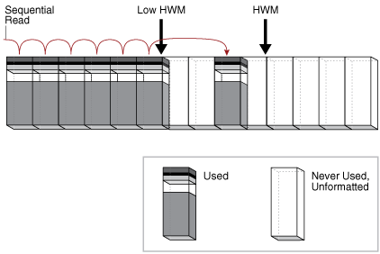
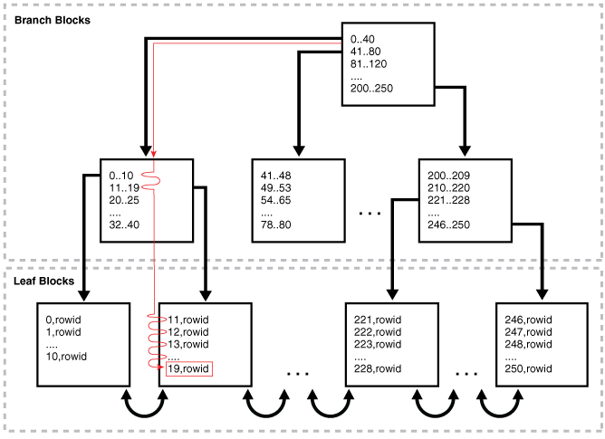
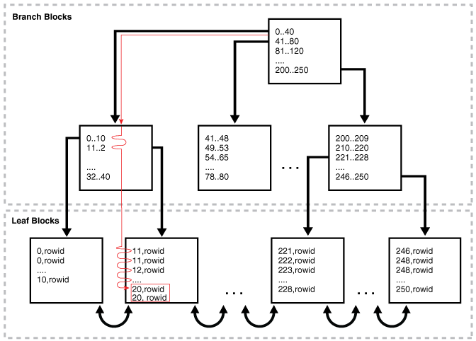
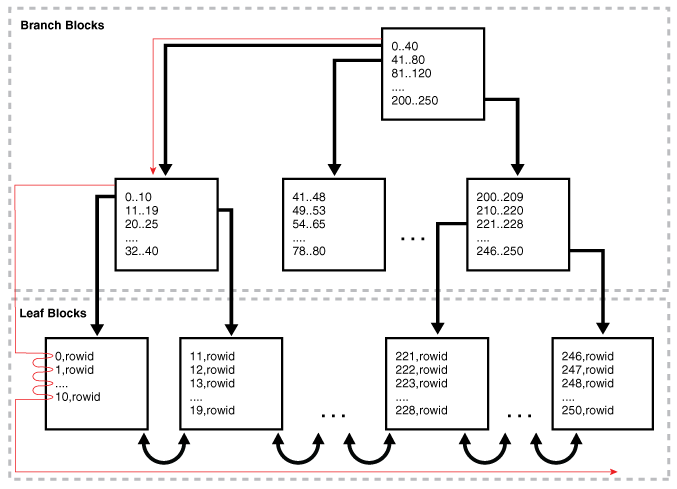

An **access path** is a technique used by a query to retrieve rows from a row source.

### 8.1 Introduction to Access Paths

A **row source** is a set of rows returned by a step in an execution plan. A row source can be a table, view, or result of a join or grouping operation.

A unary operation such as an [access path](glossary.md), which is a technique used by a query to retrieve rows from a row source, accepts a single row source as input. For example, a full table scan is the retrieval of rows of a single row source. In contrast, a join is binary and receives inputs from exactly two row sources

The database uses different access paths for different relational data structures. The following table summarizes common access paths for the major data structures.

Table 8-1 Data Structures and Access Paths

| Access Path | Heap-Organized Tables | B-Tree Indexes and IOTs | Bitmap Indexes | Table Clusters |
| --- | --- | --- | --- | --- |
| Full Table Scans | x |  |  |  |
| Table Access by Rowid | x |  |  |  |
| Sample Table Scans | x |  |  |  |
| Index Unique Scans |  | x |  |  |
| Index Range Scans |  | x |  |  |
| Index Full Scans |  | x |  |  |
| Index Fast Full Scans |  | x |  |  |
| [Index Skip Scans](https://docs.oracle.com/en/database/oracle/oracle-database/21/tgsql/optimizer-access-paths.html#GUID-B7C62F0F-EB7C-422C-919D-D86456A74A60 "An index skip scan occurs when the initial column of a composite index is \"skipped\" or not specified in the query.") |  | x |  |  |
| Index Join Scans |  | x |  |  |
| Bitmap Index Single Value |  |  | x |  |
| Bitmap Index Range Scans |  |  | x |  |
| Bitmap Merge |  |  | x |  |
| Bitmap Index Range Scans |  |  | x |  |
| Cluster Scans |  |  |  | x |
| Hash Scans |  |  |  | x |

The optimizer considers different possible execution plans, and then assigns each plan a [cost](glossary.md). The optimizer chooses the plan with the lowest cost. In general, index access paths are more efficient for statements that retrieve a small subset of table rows, whereas full table scans are more efficient when accessing a large portion of a table.

See Also:

- " [Joins](joins.md) "
- " [Cost-Based Optimization](query-optimizer-concepts.md) "
- [Oracle Database Concepts](https://docs.oracle.com/pls/topic/lookup?ctx=en/database/oracle/oracle-database/21/tgsql&id=CNCPT88798) for an overview of these structures

### 8.2 Table Access Paths

A table is the basic unit of data organization in an Oracle database.

Relational tables are the most common table type. Relational tables have with the following organizational characteristics:

- A [heap-organized table](glossary.md) does not store rows in any particular order.
- An [index-organized table](glossary.md) orders rows according to the primary key values.
- An [external table](glossary.md) is a read-only table whose metadata is stored in the database but whose data is stored outside the database.

See Also:

- [Oracle Database Concepts](https://docs.oracle.com/pls/topic/lookup?ctx=en/database/oracle/oracle-database/21/tgsql&id=CNCPT211) for an overview of tables
- [Oracle Database Administrator’s Guide](https://docs.oracle.com/pls/topic/lookup?ctx=en/database/oracle/oracle-database/21/tgsql&id=ADMIN015) to learn how to manage tables

#### 8.2.1 About Heap-Organized Table Access

By default, a table is organized as a heap, which means that the database places rows where they fit best rather than in a user-specified order.

As users add rows, the database places the rows in the first available free space in the data segment. Rows are not guaranteed to be retrieved in the order in which they were inserted.

##### 8.2.1.1 Row Storage in Data Blocks and Segments: A Primer

The database stores rows in data blocks. In tables, the database can write a row anywhere in the bottom part of the block. Oracle Database uses the block overhead, which contains the row directory and table directory, to manage the block itself.

An extent is made up of logically contiguous data blocks. The blocks may not be physically contiguous on disk. A segment is a set of extents that contains all the data for a logical storage structure within a tablespace. For example, Oracle Database allocates one or more extents to form the data segment for a table. The database also allocates one or more extents to form the index segment for a table.

By default, the database uses automatic segment space management (ASSM) for permanent, locally managed tablespaces. When a session first inserts data into a table, the database formats a bitmap block. The bitmap tracks the blocks in the segment. The database uses the bitmap to find free blocks and then formats each block before writing to it. ASSM spread out inserts among blocks to avoid concurrency issues.

The high water mark (HWM) is the point in a segment beyond which data blocks are unformatted and have never been used. Below the HWM, a block may be formatted and written to, formatted and empty, or unformatted. The low high water mark (low HWM) marks the point below which all blocks are known to be formatted because they either contain data or formerly contained data.

During a full table scan, the database reads all blocks up to the low HWM, which are known to be formatted, and then reads the segment bitmap to determine which blocks between the HWM and low HWM are formatted and safe to read. The database knows not to read past the HWM because these blocks are unformatted.

See Also:

[Oracle Database Concepts](https://docs.oracle.com/pls/topic/lookup?ctx=en/database/oracle/oracle-database/21/tgsql&id=CNCPT302) to learn about data block storage

##### 8.2.1.2 Importance of Rowids for Row Access

Every row in a heap-organized table has a rowid unique to this table that corresponds to the physical address of a row piece. A rowid is a 10-byte physical address of a row.

The rowid points to a specific file, block, and row number. For example, in the rowid `AAAPecAAFAAAABSAAA`, the final `AAA` represents the row number. The row number is an index into a row directory entry. The row directory entry contains a pointer to the location of the row on the block.

The database can sometimes move a row in the bottom part of the block. For example, if row movement is enabled, then the row can move because of partition key updates, Flashback Table operations, shrink table operations, and so on. If the database moves a row within a block, then the database updates the row directory entry to modify the pointer. The rowid stays constant.

Oracle Database uses rowids internally for the construction of indexes. For example, each key in a B-tree index is associated with a rowid that points to the address of the associated row. Physical rowids provide the fastest possible access to a table row, enabling the database to retrieve a row in as little as a single I/O.

See Also:

[Oracle Database Concepts](https://docs.oracle.com/pls/topic/lookup?ctx=en/database/oracle/oracle-database/21/tgsql&id=CNCPT1130) to learn about rowids

##### 8.2.1.3 Direct Path Reads

In a **direct path read**, the database reads buffers from disk directly into the PGA, bypassing the SGA entirely.

The following figure shows the difference between scattered and sequential reads, which store buffers in the SGA, and direct path reads.

Figure 8-1 Direct Path Reads


> This illustration depicts data from a buffer being read into the SGA Buffer Cache and the Process PGA.
>
> The data being read into the SGA Buffer Cache is acquired either by a db sequential read or a db scattered read.
>
> The data being read into the Process PGA is acquired by a direct path read.
>
> End of image description.


Situations in which Oracle Database may perform direct path reads include:

- Execution of a `CREATE TABLE AS SELECT` statement
- Execution of an `ALTER REBUILD` or `ALTER MOVE` statement
- Reads from a temporary tablespace
- Parallel queries
- Reads from a LOB segment

See Also:

[Oracle Database Performance Tuning Guide](https://docs.oracle.com/pls/topic/lookup?ctx=en/database/oracle/oracle-database/21/tgsql&id=TGDBA-GUID-2833BD11-FDF6-4134-A0DD-62E8CB32AE2C) to learn about wait events for direct path reads

#### 8.2.2 Full Table Scans

A **full table scan** reads all rows from a table, and then filters out those rows that do not meet the selection criteria.

##### 8.2.2.1 When the Optimizer Considers a Full Table Scan

In general, the optimizer chooses a full table scan when it cannot use a different access path, or another usable access path is higher cost.

The following table shows typical reasons for choosing a full table scan.

Table 8-2 Typical Reasons for a Full Table Scan

| Reason | Explanation | To Learn More |
| --- | --- | --- |
| No index exists. | If no index exists, then the optimizer uses a full table scan. | [Oracle Database Concepts](https://docs.oracle.com/pls/topic/lookup?ctx=en/database/oracle/oracle-database/21/tgsql&id=CNCPT-GUID-DE7A95BC-6E4A-47EA-9FC5-B85B54F8CF41) |
| The query predicate applies a function to the indexed column. | Unless the index is a function-based index, the database indexes the values of the column, not the values of the column with the function applied. A typical application-level mistake is to index a character column, such as `char_col`, and then query the column using syntax such as `WHERE char_col=1`. The database implicitly applies a `TO_NUMBER` function to the constant number `1`, which prevents use of the index. | [Oracle Database Development Guide](https://docs.oracle.com/pls/topic/lookup?ctx=en/database/oracle/oracle-database/21/tgsql&id=GUID-44AD4D28-A056-4977-B2F7-AC1BC50EDC87) |
| A `SELECT COUNT(*)` query is issued, and an index exists, but the indexed column contains nulls. | The optimizer cannot use the index to count the number of table rows because the index cannot contain null entries. | " B-Tree Indexes and Nulls " |
| The query predicate does not use the leading edge of a B-tree index. | For example, an index might exist on `employees(first_name,last_name)`. If a user issues a query with the predicate `WHERE last_name='KING'`, then the optimizer may not choose an index because column `first_name` is not in the predicate. However, in this situation the optimizer may choose to use an index skip scan. | " [Index Skip Scans](https://docs.oracle.com/en/database/oracle/oracle-database/21/tgsql/optimizer-access-paths.html#GUID-B7C62F0F-EB7C-422C-919D-D86456A74A60 "An index skip scan occurs when the initial column of a composite index is \"skipped\" or not specified in the query.") " |
| The query is [unselective](glossary.md). | If the optimizer determines that the query requires most of the blocks in the table, then it uses a full table scan, even though indexes are available. Full table scans can use larger I/O calls. Making fewer large I/O calls is cheaper than making many smaller calls. | " [Selectivity](query-optimizer-concepts.md) " |
| The table statistics are stale. | For example, a table was small, but now has grown large. If the table statistics are stale and do not reflect the current size of the table, then the optimizer does not know that an index is now most efficient than a full table scan. | " [Introduction to Optimizer Statistics](optimizer-statistics-concepts.md) " |
| The table is small. | If a table contains fewer than n blocks under the high water mark, where n equals the setting for the `DB_FILE_MULTIBLOCK_READ_COUNT` initialization parameter, then a full table scan may be cheaper than an index range scan. The scan may be less expensive regardless of the fraction of tables being accessed or indexes present. | [Oracle Database Reference](https://docs.oracle.com/pls/topic/lookup?ctx=en/database/oracle/oracle-database/21/tgsql&id=REFRN-GUID-69E45087-14DF-492B-B55A-8F2E936947A5) |
| The table has a high degree of parallelism. | A high degree of parallelism for a table skews the optimizer toward full table scans over range scans. Query the value in the `ALL_TABLES.DEGREE` column to determine the degree of parallelism. | [Oracle Database Reference](https://docs.oracle.com/pls/topic/lookup?ctx=en/database/oracle/oracle-database/21/tgsql&id=REFRN-GUID-6823CD28-0681-468E-950B-966C6F71325D) |
| The query uses a full table scan hint. | The hint ``FULL(`table` `alias`)`` instructs the optimizer to use a full table scan. | [Oracle Database SQL Language Reference](https://docs.oracle.com/pls/topic/lookup?ctx=en/database/oracle/oracle-database/21/tgsql&id=SQLRF-GUID-581F6C91-1395-4ED0-81DE-59AE168FE183) |

##### 8.2.2.2 How a Full Table Scan Works

In a full table scan, the database sequentially reads every formatted block under the high water mark. The database reads each block only once.

The following graphic depicts a scan of a table segment, showing how the scan skips unformatted blocks below the high water mark.

Figure 8-2 High Water Mark



> This graphic shows a horizontal series of blocks. The first 6 blocks are gray. The right edge of the last gray block is labeled "Low HWM." The next 2 are empty, followed by one gray block, and then followed by 1 empty block. The right edge of the empty block is labeled "Low HWM." The next 4 blocks are empty. The legend indicates that an empty block is "Never Used, Unformatted." A gray block is "Used." An arrow goes left to right, touching down on each used block, and then stopping at the high water mark.


Because the blocks are adjacent, the database can speed up the scan by making I/O calls larger than a single block, known as a [multiblock read](glossary.md). The size of a read call ranges from one block to the number of blocks specified by the `DB_FILE_MULTIBLOCK_READ_COUNT` initialization parameter. For example, setting this parameter to `4` instructs the database to read up to 4 blocks in a single call.

The algorithms for caching blocks during full table scans are complex. For example, the database caches blocks differently depending on whether tables are small or large.

See Also:

- " [Table 19-2](influencing-the-optimizer.md) "
- [Oracle Database Concepts](https://docs.oracle.com/pls/topic/lookup?ctx=en/database/oracle/oracle-database/21/tgsql&id=CNCPT1224) for an overview of the default caching mode
- [Oracle Database Reference](https://docs.oracle.com/pls/topic/lookup?ctx=en/database/oracle/oracle-database/21/tgsql&id=REFRN10037) to learn about the `DB_FILE_MULTIBLOCK_READ_COUNT` initialization parameter

##### 8.2.2.3 Full Table Scan: Example

This example scans the `hr.employees` table.

The following statement queries monthly salaries over $4000:

```
SELECT salary 
FROM   hr.employees 
WHERE  salary > 4000;
```

Example 8-1 Full Table Scan

The following plan was retrieved using the `DBMS_XPLAN.DISPLAY_CURSOR` function. Because no index exists on the `salary` column, the optimizer cannot use an index range scan, and so uses a full table scan.

```
SQL_ID  54c20f3udfnws, child number 0
-------------------------------------
select salary from hr.employees where salary > 4000
 
Plan hash value: 3476115102
 
---------------------------------------------------------------------------
| Id| Operation         | Name      | Rows | Bytes |Cost (%CPU)| Time     |
---------------------------------------------------------------------------
|  0| SELECT STATEMENT  |           |      |       |    3 (100)|          |
|* 1|  TABLE ACCESS FULL| EMPLOYEES |   98 |  6762 |    3   (0)| 00:00:01 |
---------------------------------------------------------------------------
 
Predicate Information (identified by operation id):
---------------------------------------------------
 
   1 - filter("SALARY">4000)
```

#### 8.2.3 Table Access by Rowid

A **rowid** is an internal representation of the storage location of data.

The rowid of a row specifies the data file and data block containing the row and the location of the row in that block. Locating a row by specifying its rowid is the fastest way to retrieve a single row because it specifies the exact location of the row in the database.

Note:

Rowids can change between versions. Accessing data based on position is not recommended because rows can move.

See Also:

[Oracle Database Development Guide](https://docs.oracle.com/pls/topic/lookup?ctx=en/database/oracle/oracle-database/21/tgsql&id=GUID-E8E35A33-F4CF-49CB-B2F2-45754F1082DA) to learn more about rowids

##### 8.2.3.1 When the Optimizer Chooses Table Access by Rowid

In most cases, the database accesses a table by rowid after a scan of one or more indexes.

However, table access by rowid need not follow every index scan. If the index contains all needed columns, then access by rowid might not occur.

##### 8.2.3.2 How Table Access by Rowid Works

To access a table by rowid, the database performs multiple steps.

The database does the following:

1. Obtains the rowids of the selected rows, either from the statement `WHERE` clause or through an index scan of one or more indexes
	Table access may be needed for columns in the statement not present in the index.
2. Locates each selected row in the table based on its rowid

##### 8.2.3.3 Table Access by Rowid: Example

This example demonstrates rowid access of the `hr.employees` table.

Assume that you run the following query:

```
SELECT * 
FROM   employees 
WHERE  employee_id > 190;
```

Step 2 of the following plan shows a range scan of the `emp_emp_id_pk` index on the `hr.employees` table. The database uses the rowids obtained from the index to find the corresponding rows from the `employees` table, and then retrieve them. The `BATCHED` access shown in Step 1 means that the database retrieves a few rowids from the index, and then attempts to access rows in block order to improve the clustering and reduce the number of times that the database must access a block.

```
--------------------------------------------------------------------------------
|Id| Operation                           | Name     |Rows|Bytes|Cost(%CPU)|Time|
--------------------------------------------------------------------------------
| 0| SELECT STATEMENT                    |             |  |    |2(100)|        |
| 1|  TABLE ACCESS BY INDEX ROWID BATCHED|EMPLOYEES    |16|1104|2  (0)|00:00:01|
|*2|   INDEX RANGE SCAN                  |EMP_EMP_ID_PK|16|    |1  (0)|00:00:01|
--------------------------------------------------------------------------------
 
Predicate Information (identified by operation id):
---------------------------------------------------
 
   2 - access("EMPLOYEE_ID">190)
```

#### 8.2.4 Sample Table Scans

A **sample table scan** retrieves a random sample of data from a simple table or a complex `SELECT` statement, such as a statement involving joins and views.

##### 8.2.4.1 When the Optimizer Chooses a Sample Table Scan

The database uses a sample table scan when a statement `FROM` clause includes the `SAMPLE` keyword.

The `SAMPLE` clause has the following forms:

- `SAMPLE` `(``sample_percent``)`
	The database reads a specified percentage of rows in the table to perform a sample table scan.
- `SAMPLE BLOCK` `(``sample_percent``)`
	The database reads a specified percentage of table blocks to perform a sample table scan.

The sample\_percent specifies the percentage of the total row or block count to include in the sample. The value must be in the range `.000001` up to, but not including, `100`. This percentage indicates the probability of each row, or each cluster of rows in block sampling, being selected for the sample. It does not mean that the database retrieves exactly sample\_percent of the rows.

Note:

Block sampling is possible only during full table scans or index fast full scans. If a more efficient execution path exists, then the database does not sample blocks. To guarantee block sampling for a specific table or index, use the `FULL` or `INDEX_FFS` hint.

See Also:

- " [Influencing the Optimizer with Hints](influencing-the-optimizer.md) "
- [Oracle Database SQL Language Reference](https://docs.oracle.com/pls/topic/lookup?ctx=en/database/oracle/oracle-database/21/tgsql&id=SQLRF55293) to learn about the `SAMPLE` clause

##### 8.2.4.2 Sample Table Scans: Example

This example uses a sample table scan to access 1% of the `employees` table, sampling by blocks instead of rows.

Example 8-2 Sample Table Scan

```
SELECT * FROM hr.employees SAMPLE BLOCK (1);
```

The `EXPLAIN PLAN` output for this statement might look as follows:

```
-------------------------------------------------------------------------
| Id  | Operation            |  Name       | Rows  | Bytes | Cost (%CPU)|
-------------------------------------------------------------------------
|   0 | SELECT STATEMENT     |             |     1 |    68 |     3  (34)|
|   1 |  TABLE ACCESS SAMPLE | EMPLOYEES   |     1 |    68 |     3  (34)|
-------------------------------------------------------------------------
```

#### 8.2.5 In-Memory Table Scans

An **In-Memory scan** retrieves rows from the In-Memory Column Store (IM column store).

The IM column store is an optional SGA area that stores copies of tables and partitions in a special columnar format optimized for rapid scans.

See Also:

[Oracle Database In-Memory Guide](https://docs.oracle.com/pls/topic/lookup?ctx=en/database/oracle/oracle-database/21/tgsql&id=INMEM-GUID-BFA53515-7643-41E5-A296-654AB4A9F9E7) for an introduction to the IM column store

##### 8.2.5.1 When the Optimizer Chooses an In-Memory Table Scan

The optimizer cost model is aware of the content of the IM column store.

When a user executes a query that references a table in the IM column store, the optimizer calculates the cost of all possible access methods—including the In-Memory table scan—and selects the access method with the lowest cost.

##### 8.2.5.2 In-Memory Query Controls

You can control In-Memory queries using initialization parameters.

The following database initialization parameters affect the In-Memory features:

- `INMEMORY_QUERY`
	This parameter enables or disables In-Memory queries for the database at the session or system level. This parameter is helpful when you want to test workloads with and without the use of the IM column store.
- `OPTIMIZER_INMEMORY_AWARE`
	This parameter enables (`TRUE`) or disables (`FALSE`) all of the In-Memory enhancements made to the optimizer cost model, table expansion, bloom filters, and so on. Setting the parameter to `FALSE` causes the optimizer to ignore the In-Memory property of tables during the optimization of SQL statements.
- `OPTIMIZER_FEATURES_ENABLE`
	When set to values lower than `12.1.0.2`, this parameter has the same effect as setting `OPTIMIZER_INMEMORY_AWARE` to `FALSE`.

To enable or disable In-Memory queries, you can specify the `INMEMORY` or `NO_INMEMORY` hints, which are the per-query equivalent of the `INMEMORY_QUERY` initialization parameter. If a SQL statement uses the `INMEMORY` hint, but the object it references is not already loaded in the IM column store, then the database does not wait for the object to be populated in the IM column store before executing the statement. However, initial access of the object triggers the object population in the IM column store.

See Also:

- [Oracle Database Reference](https://docs.oracle.com/pls/topic/lookup?ctx=en/database/oracle/oracle-database/21/tgsql&id=REFRN10351) to learn more about the `INMEMORY_QUERY`, `OPTIMIZER_INMEMORY_AWARE`, and `OPTIMIZER_FEATURES_ENABLE` initialization parameters
- [Oracle Database SQL Language Reference](https://docs.oracle.com/pls/topic/lookup?ctx=en/database/oracle/oracle-database/21/tgsql&id=SQLRF56788) to learn more about the `INMEMORY` hints

##### 8.2.5.3 In-Memory Table Scans: Example

This example shows an execution plan that includes the `TABLE ACCESS INMEMORY` operation.

The following example shows a query of the `oe.product_information` table, which has been altered with the `INMEMORY HIGH` option.

Example 8-3 In-Memory Table Scan

```
SELECT * 
FROM   oe.product_information
WHERE  list_price > 10 
ORDER BY product_id
```

The plan for this statement might look as follows, with the `INMEMORY` keyword in Step 2 indicating that some or all of the object was accessed from the IM column store:

```
SQL> SELECT * FROM TABLE(DBMS_XPLAN.DISPLAY_CURSOR);

SQL_ID  2mb4h57x8pabw, child number 0
-------------------------------------
select * from oe.product_information where list_price > 10 order byproduct_id

Plan hash value: 2256295385
-------------------------------------------------------------------------------------------
|Id| Operation                   | Name                |Rows|Bytes|TempSpc|Cost(%CPU)|Time|
-------------------------------------------------------------------------------------------
| 0| SELECT STATEMENT            |                     |   |      |     |21 (100)|        |
| 1|  SORT ORDER BY              |                     |285| 62415|82000|21   (5)|00:00:01|
|*2|   TABLE ACCESS INMEMORY FULL| PRODUCT_INFORMATION |285| 62415|     | 5   (0)|00:00:01|
-------------------------------------------------------------------------------------------

Predicate Information (identified by operation id):
---------------------------------------------------
   2 - inmemory("LIST_PRICE">10)
       filter("LIST_PRICE">10)
```

### 8.3 B-Tree Index Access Paths

An **index** is an optional structure, associated with a table or table cluster, that can sometimes speed data access.

By creating an index on one or more columns of a table, you gain the ability in some cases to retrieve a small set of randomly distributed rows from the table. Indexes are one of many means of reducing disk I/O.

See Also:

- [Oracle Database Concepts](https://docs.oracle.com/pls/topic/lookup?ctx=en/database/oracle/oracle-database/21/tgsql&id=CNCPT1170) for an overview of indexes
- [Oracle Database Administrator’s Guide](https://docs.oracle.com/pls/topic/lookup?ctx=en/database/oracle/oracle-database/21/tgsql&id=ADMIN016) to learn more about automatic and manual index creation

#### 8.3.1 About B-Tree Index Access

B-trees, short for balanced trees, are the most common type of database index.

A [B-tree index](glossary.md) is an ordered list of values divided into ranges. By associating a key with a row or range of rows, B-trees provide excellent retrieval performance for a wide range of queries, including exact match and range searches.

##### 8.3.1.1 B-Tree Index Structure

A B-tree index has two types of blocks: branch blocks for searching and leaf blocks that store values.

The following graphic illustrates the logical structure of a B-tree index. Branch blocks store the minimum key prefix needed to make a branching decision between two keys. The leaf blocks contain every indexed data value and a corresponding rowid used to locate the actual row. Each index entry is sorted by (key, rowid). The leaf blocks are doubly linked.

Figure 8-3 B-Tree Index Structure


> The graphic is divided into two boxes with dotted borders, one on top of the other. The top is labeled "Branch Blocks" and the lower "Leaf Blocks." The graphic contains a tree of boxes. At the top is a box with the following values: 0-40, 41-90, and so on. Three arrows point to a second row of branch blocks. One block in this row has values 1-10, 11-19, 20-25, and so on. An adjacent block has values 41-48, 49-53, and so on. The last black has values 200-209, 210-220, and so on.
>
> The leftmost and rightmost blocks each has a pair of arrows pointing down. The leftmost arrow points to a leaf block containing the following values: 0,rowid, 0,rowid, 10,rowid, and so on. The block to the right contains the following values: 11,rowid, 11,rowid, and so on. The next block contains values: 221,rowid, 222,rowid, and so on. The rightmost block contains the following values: 246,rowid, 248,rowid, and so on. With the exception of the leftmost and rightmost block, each of the leaf blocks in the bottom row is linked by a double-headed arrow to the block on either side.


##### 8.3.1.2 How Index Storage Affects Index Scans

Bitmap index blocks can appear anywhere in the index segment.

Figure 8-3 shows the leaf blocks as adjacent to each other. For example, the `1-10` block is next to and before the `11-19` block. This sequencing illustrates the linked lists that connect the index entries. However, index blocks need not be stored in order within an index segment. For example, the `246-250` block could appear anywhere in the segment, including directly before the `1-10` block. For this reason, ordered index scans must perform single-block I/O. The database must read an index block to determine which index block it must read next.

The index block body stores the index entries in a heap, just like table rows. For example, if the value `10` is inserted first into a table, then the index entry with key `10` might be inserted at the bottom of the index block. If `0` is inserted next into the table, then the index entry for key `0` might be inserted on top of the entry for `10`. Thus, the index entries in the block body are not stored in key order. However, within the index block, the row header stores records in key order. For example, the first record in the header points to the index entry with key `0`, and so on sequentially up to the record that points to the index entry with key `10`. Thus, index scans can read the row header to determine where to begin and end range scans, avoiding the necessity of reading every entry in the block.

See Also:

[Oracle Database Concepts](https://docs.oracle.com/pls/topic/lookup?ctx=en/database/oracle/oracle-database/21/tgsql&id=CNCPT89223) to learn about index blocks

##### 8.3.1.3 Unique and Nonunique Indexes

In a nonunique index, the database stores the rowid by appending it to the key as an extra column. The entry adds a length byte to make the key unique.

For example, the first index key in the nonunique index shown in Figure 8-3 is the pair `0,rowid` and not simply `0`. The database sorts the data by index key values and then by rowid ascending. For example, the entries are sorted as follows:

```
0,AAAPvCAAFAAAAFaAAa
0,AAAPvCAAFAAAAFaAAg
0,AAAPvCAAFAAAAFaAAl
2,AAAPvCAAFAAAAFaAAm
```

In a unique index, the index key does not include the rowid. The database sorts the data only by the index key values, such as `0`, `1`, `2`, and so on.

See Also:

[Oracle Database Concepts](https://docs.oracle.com/pls/topic/lookup?ctx=en/database/oracle/oracle-database/21/tgsql&id=CNCPT1157) for an overview of unique and nonunique indexes

##### 8.3.1.4 B-Tree Indexes and Nulls

B-tree indexes never store completely null keys, which is important for how the optimizer chooses access paths. A consequence of this rule is that single-column B-tree indexes never store nulls.

An example helps illustrate. The `hr.employees` table has a primary key index on `employee_id`, and a unique index on `department_id`. The `department_id` column can contain nulls, making it a nullable column, but the `employee_id` column cannot.

```
SQL> SELECT COUNT(*) FROM employees WHERE department_id IS NULL;
 
  COUNT(*)
----------
         1
 
SQL> SELECT COUNT(*) FROM employees WHERE employee_id IS NULL;
 
  COUNT(*)
----------
         0
```

The following example shows that the optimizer chooses a full table scan for a query of all department IDs in `hr.employees`. The optimizer cannot use the index on `employees.department_id` because the index is not guaranteed to include entries for every row in the table.

```
SQL> EXPLAIN PLAN FOR SELECT department_id FROM employees;
 
Explained.
 
SQL> SELECT PLAN_TABLE_OUTPUT FROM TABLE(DBMS_XPLAN.DISPLAY());
 
PLAN_TABLE_OUTPUT
---------------------------------------------------------------------------
Plan hash value: 3476115102
 
---------------------------------------------------------------------------
|Id | Operation         | Name      | Rows| Bytes | Cost (%CPU)| Time     |
---------------------------------------------------------------------------
| 0 | SELECT STATEMENT  |           | 107 |   321 |     2   (0)| 00:00:01 |
| 1 |  TABLE ACCESS FULL| EMPLOYEES | 107 |   321 |     2   (0)| 00:00:01 |
---------------------------------------------------------------------------
```

The following example shows the optimizer can use the index on `department_id` for a query of a specific department ID because all non-null rows are indexed.

```
SQL> EXPLAIN PLAN FOR SELECT department_id FROM employees WHERE department_id=10;
 
Explained.
 
SQL> SELECT PLAN_TABLE_OUTPUT FROM TABLE(DBMS_XPLAN.DISPLAY());
 
PLAN_TABLE_OUTPUT
---------------------------------------------------------------------------
Plan hash value: 67425611
 
---------------------------------------------------------------------------
|Id| Operation        | Name              |Rows|Bytes|Cost (%CPU)| Time   |
---------------------------------------------------------------------------
| 0| SELECT STATEMENT |                   | 1 |   3 |   1   (0)| 00:0 0:01|
|*1|  INDEX RANGE SCAN| EMP_DEPARTMENT_IX | 1 |   3 |   1   (0)| 00:0 0:01|
---------------------------------------------------------------------------
 
Predicate Information (identified by operation id):
   1 - access("DEPARTMENT_ID"=10)
```

The following example shows that the optimizer chooses an index scan when the predicate excludes null values:

```
SQL> EXPLAIN PLAN FOR SELECT department_id FROM employees 
WHERE department_id IS NOT NULL;

Explained.

SQL> SELECT PLAN_TABLE_OUTPUT FROM TABLE(DBMS_XPLAN.DISPLAY());
 
PLAN_TABLE_OUTPUT
---------------------------------------------------------------------------
Plan hash value: 1590637672
 
---------------------------------------------------------------------------
| Id| Operation        | Name              |Rows|Bytes| Cost (%CPU)| Time |
---------------------------------------------------------------------------
| 0| SELECT STATEMENT |                   |106| 318 |   1   (0)| 00:0 0:01|
|*1|  INDEX FULL SCAN | EMP_DEPARTMENT_IX |106| 318 |   1   (0)| 00:0 0:01|
---------------------------------------------------------------------------

Predicate Information (identified by operation id): 
   1 - filter("DEPARTMENT_ID" IS NOT NULL)
```

#### 8.3.2 Index Unique Scans

An **index unique scan** returns at most 1 rowid.

##### 8.3.2.1 When the Optimizer Considers Index Unique Scans

An index unique scan requires an equality predicate.

Specifically, the database performs a unique scan only when a query predicate references all columns in a unique index key using an equality operator, such as `WHERE prod_id=10`.

A unique or primary key constraint is insufficient by itself to produce an index unique scan because a non-unique index on the column may already exist. Consider the following example, which creates the `t_table` table and then creates a non-unique index on `numcol`:

```
SQL> CREATE TABLE t_table(numcol INT);
SQL> CREATE INDEX t_table_idx ON t_table(numcol);
SQL> SELECT UNIQUENESS FROM USER_INDEXES WHERE INDEX_NAME = 'T_TABLE_IDX';

UNIQUENES
---------
NONUNIQUE
```

The following code creates a primary key constraint on a column with a non-unique index, resulting in an index range scan rather than an index unique scan:

```
SQL> ALTER TABLE t_table ADD CONSTRAINT t_table_pk PRIMARY KEY(numcol);
SQL> SET AUTOTRACE TRACEONLY EXPLAIN
SQL> SELECT * FROM t_table WHERE numcol = 1;
 
Execution Plan
----------------------------------------------------------
Plan hash value: 868081059
 
---------------------------------------------------------------------------
| Id | Operation        | Name        |Rows  |Bytes |Cost (%CPU)|Time     |
---------------------------------------------------------------------------
|  0 | SELECT STATEMENT |             |    1 |   13 |    1   (0)|00:00:01 |
|* 1 |  INDEX RANGE SCAN| T_TABLE_IDX |    1 |   13 |    1   (0)|00:00:01 |
---------------------------------------------------------------------------
 
Predicate Information (identified by operation id):
---------------------------------------------------
    1 - access("NUMCOL"=1)
```

You can use the `INDEX(``alias index_name``)` hint to specify the index to use, but not a specific type of index access path.

See Also:

- [Oracle Database Concepts](https://docs.oracle.com/pls/topic/lookup?ctx=en/database/oracle/oracle-database/21/tgsql&id=CNCPT010) for more details on index structures and for detailed information on how a B-tree is searched
- [Oracle Database SQL Language Reference](https://docs.oracle.com/pls/topic/lookup?ctx=en/database/oracle/oracle-database/21/tgsql&id=SQLRF50409) to learn more about the `INDEX` hint

##### 8.3.2.2 How Index Unique Scans Work

The scan searches the index in order for the specified key. An index unique scan stops processing as soon as it finds the first record because no second record is possible. The database obtains the rowid from the index entry, and then retrieves the row specified by the rowid.

The following figure illustrates an index unique scan. The statement requests the record for product ID `19` in the `prod_id` column, which has a primary key index.

Figure 8-4 Index Unique Scan



> The graphic is divided into two boxes with dotted borders, one on top of the other. The top is labeled "Branch Blocks" and the lower "Leaf Blocks." The graphic contains a tree of boxes. At the top is a box with the following values: 0-40, 41-90, and so on. Three arrows point to a second row of branch blocks. One block in this row has values 1-10, 11-19, 20-25, and so on. An adjacent block has values 41-48, 49.53, and so on. The last black has values 200-209, 210-220, and so on.
>
> The leftmost and rightmost blocks each has a pair of arrows pointing down. The leftmost arrow points to a leaf block containing the following values: 0,rowid, 0,rowid, 10,rowid, and so on. The block to the right contains the following values: 11,rowid, 11,rowid, and so on. The next block contains values: 221,rowid, 222,rowid, and so on. The rightmost block contains the following values: 246,rowid, 248,rowid, and so on. With the exception of the leftmost and rightmost block, each of the leaf blocks in the bottom row is linked by a double-headed arrow to the block on either side.


##### 8.3.2.3 Index Unique Scans: Example

This example uses a unique scan to retrieve a row from the `products` table.

The following statement queries the record for product `19` in the `sh.products` table:

```
SELECT * 
FROM   sh.products 
WHERE  prod_id = 19;
```

Because a primary key index exists on the `products.prod_id` column, and the `WHERE` clause references all of the columns using an equality operator, the optimizer chooses a unique scan:

```
SQL_ID  3ptq5tsd5vb3d, child number 0
-------------------------------------
select * from sh.products where prod_id = 19
 
Plan hash value: 4047888317
 
---------------------------------------------------------------------------
| Id| Operation                   | Name   |Rows|Bytes|Cost (%CPU)|Time   |
---------------------------------------------------------------------------
|  0| SELECT STATEMENT            |             |  |     |1 (100)|        |
|  1|  TABLE ACCESS BY INDEX ROWID| PRODUCTS    |1 | 173 |1   (0)|00:00:01|
|* 2|   INDEX UNIQUE SCAN         | PRODUCTS_PK |1 |     |0   (0)|        |
---------------------------------------------------------------------------
 
Predicate Information (identified by operation id):
---------------------------------------------------
 
   2 - access("PROD_ID"=19)
```

#### 8.3.3 Index Range Scans

An **index range scan** is an ordered scan of values.

The range in the scan can be bounded on both sides, or unbounded on one or both sides. The optimizer typically chooses a range scan for queries with high [selectivity](glossary.md).

By default, the database stores indexes in ascending order, and scans them in the same order. For example, a query with the predicate `department_id >= 20` uses a range scan to return rows sorted by index keys `20`, `30`, `40`, and so on. If multiple index entries have identical keys, then the database returns them in ascending order by rowid, so that `0,AAAPvCAAFAAAAFaAAa` is followed by `0,AAAPvCAAFAAAAFaAAg`, and so on.

An [index range scan descending](glossary.md) is identical to an index range scan except that the database returns rows in descending order. Usually, the database uses a descending scan when ordering data in a descending order, or when seeking a value less than a specified value.

##### 8.3.3.1 When the Optimizer Considers Index Range Scans

For an index range scan, multiple values must be possible for the index key.

Specifically, the optimizer considers index range scans in the following circumstances:

- One or more leading columns of an index are specified in conditions.
	A condition specifies a combination of one or more expressions and logical (Boolean) operators and returns a value of `TRUE`, `FALSE`, or `UNKNOWN`. Examples of conditions include:
	- `department_id = :id`
		- `department_id < :id`
		- `department_id > :id`
		- `AND ` combination of the preceding conditions for leading columns in the index, such as `department_id > :low AND department_id < :hi`.
		Note:
		For the optimizer to consider a range scan, wild-card searches of the form `col1 LIKE '%ASD'` must not be in a leading position.
- 0, 1, or more values are possible for an index key.

Tip:

If you require sorted data, then use the `ORDER` `BY` clause, and do not rely on an index. If an index can satisfy an `ORDER` `BY` clause, then the optimizer uses this option and thereby avoids a sort.

The optimizer considers an index range scan descending when an index can satisfy an `ORDER BY DESCENDING` clause.

If the optimizer chooses a full table scan or another index, then a hint may be required to force this access path. The `INDEX(``tbl_alias` `ix_name``)` and `INDEX_DESC(``tbl_alias` `ix_name``)` hints instruct the optimizer to use a specific index.

See Also:

[Oracle Database SQL Language Reference](https://docs.oracle.com/pls/topic/lookup?ctx=en/database/oracle/oracle-database/21/tgsql&id=SQLRF50405) to learn more about the `INDEX` and `INDEX_DESC` hints

##### 8.3.3.2 How Index Range Scans Work

During an index range scan, Oracle Database proceeds from root to branch.

In general, the scan algorithm is as follows:

1. Read the root block.
2. Read the branch block.
3. Alternate the following steps until all data is retrieved:
	1. Read a leaf block to obtain a rowid.
		2. Read a table block to retrieve a row.
	Note:
	In some cases, an index scan reads a set of index blocks, sorts the rowids, and then reads a set of table blocks.

Thus, to scan the index, the database moves backward or forward through the leaf blocks. For example, a scan for IDs between 20 and 40 locates the first leaf block that has the lowest key value that is 20 or greater. The scan proceeds horizontally through the linked list of leaf nodes until it finds a value greater than 40, and then stops.

The following figure illustrates an index range scan using ascending order. A statement requests the `employees` records with the value `20` in the `department_id` column, which has a nonunique index. In this example, 2 index entries for department `20` exist.

Figure 8-5 Index Range Scan



> The graphic is divided into two boxes with dotted borders, one on top of the other. The top is labeled "Branch Blocks" and the lower "Leaf Blocks." The graphic contains a tree of boxes. At the top is a box with the following values: 0-40, 41-90, and so on. Three arrows point to a second row of branch blocks. One block in this row has values 1-10, 11-19, 20-25, and so on. An adjacent block has values 41-48, 49-53, and so on. The last black has values 200-209, 210-220, and so on.
>
> The leftmost and rightmost blocks each has a pair of arrows pointing down. The leftmost arrow points to a leaf block containing the following values: 0,rowid, 0,rowid, 10,rowid, and so on. The block to the right contains the following values: 11,rowid, 11,rowid, and so on. The next block contains values: 221,rowid, 222,rowid, and so on. The rightmost block contains the following values: 246,rowid, 248,rowid, and so on. With the exception of the leftmost and rightmost block, each of the leaf blocks in the bottom row is linked by a double-headed arrow to the block on either side.


##### 8.3.3.3 Index Range Scan: Example

This example retrieves a set of values from the `employees` table using an index range scan.

The following statement queries the records for employees in department `20` with salaries greater than `1000`:

```
SELECT * 
FROM   employees 
WHERE  department_id = 20
AND    salary > 1000;
```

The preceding query has low cardinality (returns few rows), so the query uses the index on the `department_id` column. The database scans the index, fetches the records from the employees table, and then applies the `salary > 1000` filter to these fetched records to generate the result.

```
SQL_ID  brt5abvbxw9tq, child number 0
-------------------------------------
SELECT * FROM   employees WHERE  department_id = 20 AND    salary > 1000
 
Plan hash value: 2799965532
 
-------------------------------------------------------------------------------------------
|Id | Operation                           | Name             |Rows|Bytes|Cost(%CPU)| Time |
-------------------------------------------------------------------------------------------
| 0 | SELECT STATEMENT                    |                  |    |     | 2 (100)|        |
|*1 |  TABLE ACCESS BY INDEX ROWID BATCHED| EMPLOYEES        |  2 | 138 | 2   (0)|00:00:01|
|*2 |   INDEX RANGE SCAN                  | EMP_DEPARTMENT_IX|  2 |     | 1   (0)|00:00:01|
-------------------------------------------------------------------------------------------
 
Predicate Information (identified by operation id):
---------------------------------------------------
 
   1 - filter("SALARY">1000)
   2 - access("DEPARTMENT_ID"=20)
```

##### 8.3.3.4 Index Range Scan Descending: Example

This example uses an index to retrieve rows from the `employees` table in sorted order.

The following statement queries the records for employees in department `20` in descending order:

```
SELECT *
FROM   employees
WHERE  department_id < 20
ORDER BY department_id DESC;
```

This preceding query has low cardinality, so the query uses the index on the `department_id` column.

```
SQL_ID  8182ndfj1ttj6, child number 0
-------------------------------------
SELECT * FROM employees WHERE department_id<20 ORDER BY department_id DESC
 
Plan hash value: 1681890450
---------------------------------------------------------------------------
|Id| Operation                    | Name      |Rows|Bytes|Cost(%CPU)|Time |
---------------------------------------------------------------------------
| 0| SELECT STATEMENT             |                 | |   |2(100)|        |
| 1|  TABLE ACCESS BY INDEX ROWID |EMPLOYEES        |2|138|2  (0)|00:00:01|
|*2|   INDEX RANGE SCAN DESCENDING|EMP_DEPARTMENT_IX|2|   |1  (0)|00:00:01|
---------------------------------------------------------------------------
 
Predicate Information (identified by operation id):
---------------------------------------------------
 
   2 - access("DEPARTMENT_ID"<20)
```

The database locates the first index leaf block that contains the highest key value that is `20` or less. The scan then proceeds horizontally to the left through the linked list of leaf nodes. The database obtains the rowid from each index entry, and then retrieves the row specified by the rowid.

#### 8.3.4 Index Full Scans

An **index full scan** reads the entire index in order. An index full scan can eliminate a separate sorting operation because the data in the index is ordered by index key.

##### 8.3.4.1 When the Optimizer Considers Index Full Scans

The optimizer considers an index full scan in a variety of situations.

The situations include the following:

- A predicate references a column in the index. This column need not be the leading column.
- No predicate is specified, but all of the following conditions are met:
	- All columns in the table and in the query are in the index.
		- At least one indexed column is not null.
- A query includes an `ORDER BY` on indexed non-nullable columns.

##### 8.3.4.2 How Index Full Scans Work

The database reads the root block, and then navigates down the left hand side of the index (or right if doing a descending full scan) until it reaches a leaf block.

Then the database reaches a leaf block, the scan proceeds across the bottom of the index, one block at a time, in sorted order. The database uses single-block I/O rather than multiblock I/O.

The following graphic illustrates an index full scan. A statement requests the `departments` records ordered by `department_id`.

Figure 8-6 Index Full Scan



> The graphic is divided into two boxes with dotted borders, one on top of the other. The top is labeled "Branch Blocks" and the lower "Leaf Blocks." The graphic contains a tree of boxes. At the top is a box with the following values: 0-40, 41-90, and so on. Three arrows point to a second row of branch blocks. One block in this row has values 1-10, 11-19, 20-25, and so on. An adjacent block has values 41-48, 49-53, and so on. The last black has values 200.209, 210-220, and so on.
>
> The leftmost and rightmost blocks each has a pair of arrows pointing down. The leftmost arrow points to a leaf block containing the following values: 0,rowid, 0,rowid, 10,rowid, and so on. The block to the right contains the following values: 11,rowid, 11,rowid, and so on. The next block contains values: 221,rowid, 222,rowid, and so on. The rightmost block contains the following values: 246,rowid, 248,rowid, and so on. With the exception of the leftmost and rightmost block, each of the leaf blocks in the bottom row is linked by a double-headed arrow to the block on either side.


##### 8.3.4.3 Index Full Scans: Example

This example uses an index full scan to satisfy a query with an `ORDER BY` clause.

The following statement queries the ID and name for departments in order of department ID:

```
SELECT department_id, department_name
FROM   departments
ORDER BY department_id;
```

The following plan shows that the optimizer chose an index full scan:

```
SQL_ID  94t4a20h8what, child number 0
-------------------------------------
select department_id, department_name from departments order by department_id

Plan hash value: 4179022242

------------------------------------------------------------------------
|Id | Operation                 | Name     |Rows|Bytes|Cost(%CPU)|Time |
------------------------------------------------------------------------
|0| SELECT STATEMENT            |            |   |   |2 (100)|         |
|1|  TABLE ACCESS BY INDEX ROWID|DEPARTMENTS |27 |432|2   (0)|00:00:01 |
|2|   INDEX FULL SCAN           |DEPT_ID_PK  |27 |   |1   (0)|00:00:01 |
------------------------------------------------------------------------
```

The database locates the first index leaf block, and then proceeds horizontally to the right through the linked list of leaf nodes. For each index entry, the database obtains the rowid from the entry, and then retrieves the table row specified by the rowid. Because the index is sorted on `department_id`, the database avoids a separate operation to sort the retrieved rows.

#### 8.3.5 Index Fast Full Scans

An **index fast full scan** reads the index blocks in unsorted order, as they exist on disk. This scan does not use the index to probe the table, but reads the index instead of the table, essentially using the index itself as a table.

##### 8.3.5.1 When the Optimizer Considers Index Fast Full Scans

The optimizer considers this scan when a query only accesses attributes in the index.

Note:

Unlike a full scan, a fast full scan cannot eliminate a sort operation because it does not read the index in order.

The `INDEX_FFS(table_name index_name)` hint forces a fast full index scan.

See Also:

[Oracle Database SQL Language Reference](https://docs.oracle.com/pls/topic/lookup?ctx=en/database/oracle/oracle-database/21/tgsql&id=SQLRF50409) to learn more about the `INDEX` hint

##### 8.3.5.2 How Index Fast Full Scans Work

The database uses multiblock I/O to read the root block and all of the leaf and branch blocks. The databases ignores the branch and root blocks and reads the index entries on the leaf blocks.

##### 8.3.5.3 Index Fast Full Scans: Example

This examples uses a fast full index scan as a result of an optimizer hint.

The following statement queries the ID and name for departments in order of department ID:

```
SELECT /*+ INDEX_FFS(departments dept_id_pk) */ COUNT(*)
FROM   departments;
```

The following plan shows that the optimizer chose a fast full index scan:

```
SQL_ID  fu0k5nvx7sftm, child number 0
-------------------------------------
select /*+ index_ffs(departments dept_id_pk) */ count(*) from departments

Plan hash value: 3940160378
--------------------------------------------------------------------------
| Id | Operation             | Name       | Rows  |Cost (%CPU)| Time     |
--------------------------------------------------------------------------
|  0 | SELECT STATEMENT      |            |       |    2 (100)|          |
|  1 |  SORT AGGREGATE       |            |     1 |           |          |
|  2 |   INDEX FAST FULL SCAN| DEPT_ID_PK |    27 |    2   (0)| 00:00:01 |
--------------------------------------------------------------------------
```

#### 8.3.6 Index Skip Scans

An **index skip scan** occurs when the initial column of a composite index is "skipped" or not specified in the query.

See Also:

[Oracle Database Concepts](https://docs.oracle.com/pls/topic/lookup?ctx=en/database/oracle/oracle-database/21/tgsql&id=CNCPT88842)

##### 8.3.6.1 When the Optimizer Considers Index Skip Scans

Often, skip scanning index blocks is faster than scanning table blocks, and faster than performing full index scans.

The optimizer considers a skip scan when the following criteria are met:

- The leading column of a composite index is not specified in the query predicate.
	For example, the query predicate does not reference the `cust_gender` column, and the composite index key is `(cust_gender,cust_email)`.
- Many distinct values exist in the nonleading key of the index and relatively few distinct values exist in the leading key.
	For example, if the composite index key is `(cust_gender,cust_email)`, then the `cust_gender` column has only two distinct values, but `cust_email` has thousands.

##### 8.3.6.2 How Index Skip Scans Work

An index skip scan logically splits a composite index into smaller subindexes.

The number of distinct values in the leading columns of the index determines the number of logical subindexes. The lower the number, the fewer logical subindexes the optimizer must create, and the more efficient the scan becomes. The scan reads each logical index separately, and "skips" index blocks that do not meet the filter condition on the non-leading column.

##### 8.3.6.3 Index Skip Scans: Example

This example uses an index skip scan to satisfy a query of the `sh.customers` table.

The `customers` table contains a column `cust_gender` whose values are either `M` or `F`. While logged in to the database as user `sh`, you create a composite index on the columns (`cust_gender, cust_email`) as follows:

```
CREATE INDEX cust_gender_email_ix
  ON sh.customers (cust_gender, cust_email);
```

Conceptually, a portion of the index might look as follows, with the gender value of `F` or `M` as the leading edge of the index.

```
F,Wolf@company.example.com,rowid
F,Wolsey@company.example.com,rowid
F,Wood@company.example.com,rowid
F,Woodman@company.example.com,rowid
F,Yang@company.example.com,rowid
F,Zimmerman@company.example.com,rowid
M,Abbassi@company.example.com,rowid
M,Abbey@company.example.com,rowid
```

You run the following query for a customer in the `sh.customers` table:

```
SELECT * 
FROM   sh.customers 
WHERE  cust_email = 'Abbey@company.example.com';
```

The database can use a skip scan of the `customers_gender_email` index even though `cust_gender` is not specified in the `WHERE` clause. In the sample index, the leading column `cust_gender` has two possible values: `F` and `M`. The database logically splits the index into two. One subindex has the key `F`, with entries in the following form:

```
F,Wolf@company.example.com,rowid
F,Wolsey@company.example.com,rowid
F,Wood@company.example.com,rowid
F,Woodman@company.example.com,rowid
F,Yang@company.example.com,rowid
F,Zimmerman@company.example.com,rowid
```

The second subindex has the key `M`, with entries in the following form:

```
M,Abbassi@company.example.com,rowid
M,Abbey@company.example.com,rowid
```

When searching for the record for the customer whose email is `Abbey@company.example.com`, the database searches the subindex with the leading value `F` first, and then searches the subindex with the leading value `M`. Conceptually, the database processes the query as follows:

```
( SELECT * 
  FROM   sh.customers 
  WHERE  cust_gender = 'F' 
  AND    cust_email = 'Abbey@company.example.com' )
UNION ALL
( SELECT * 
  FROM   sh.customers 
  WHERE  cust_gender = 'M'
  AND    cust_email = 'Abbey@company.example.com' )
```

The plan for the query is as follows:

```
SQL_ID  d7a6xurcnx2dj, child number 0
-------------------------------------
SELECT * FROM   sh.customers WHERE  cust_email = 'Abbey@company.example.com'
 
Plan hash value: 797907791
 
-----------------------------------------------------------------------------------------
|Id| Operation                          | Name               |Rows|Bytes|Cost(%CPU)|Time|
-----------------------------------------------------------------------------------------
| 0|SELECT STATEMENT                    |                      |  |    |10(100)|        |
| 1| TABLE ACCESS BY INDEX ROWID BATCHED| CUSTOMERS            |33|6237|  10(0)|00:00:01|
|*2|  INDEX SKIP SCAN                   | CUST_GENDER_EMAIL_IX |33|    |   4(0)|00:00:01|
-----------------------------------------------------------------------------------------
 
Predicate Information (identified by operation id):
---------------------------------------------------
 
   2 - access("CUST_EMAIL"='Abbey@company.example.com')
       filter("CUST_EMAIL"='Abbey@company.example.com')
```

See Also:

[Oracle Database Concepts](https://docs.oracle.com/pls/topic/lookup?ctx=en/database/oracle/oracle-database/21/tgsql&id=CNCPT88842) to learn more about skip scans

#### 8.3.7 Index Join Scans

An index join scan is a hash join of multiple indexes that together return all columns requested by a query. The database does not need to access the table because all data is retrieved from the indexes.

##### 8.3.7.1 When the Optimizer Considers Index Join Scans

In some cases, avoiding table access is the most cost efficient option.

The optimizer considers an index join in the following circumstances:

- A hash join of multiple indexes retrieves all data requested by the query, without requiring table access.
- The cost of retrieving rows from the table is higher than reading the indexes without retrieving rows from the table. An index join is often expensive. For example, when scanning two indexes and joining them, it is often less costly to choose the most selective index, and then probe the table.

You can specify an index join with the `INDEX_JOIN(table_name)` hint.

See Also:

[Oracle Database SQL Language Reference](https://docs.oracle.com/pls/topic/lookup?ctx=en/database/oracle/oracle-database/21/tgsql&id=SQLRF50408)

##### 8.3.7.2 How Index Join Scans Work

An index join involves scanning multiple indexes, and then using a hash join on the rowids obtained from these scans to return the rows.

In an index join scan, table access is always avoided. For example, the process for joining two indexes on a single table is as follows:

1. Scan the first index to retrieve rowids.
2. Scan the second index to retrieve rowids.
3. Perform a hash join by rowid to obtain the rows.

##### 8.3.7.3 Index Join Scans: Example

This example queries the last name and email for employees whose last name begins with `A`, specifying an index join.

```
SELECT /*+ INDEX_JOIN(employees) */ last_name, email
FROM   employees
WHERE  last_name like 'A%';
```

Separate indexes exist on the `(last_name,first_name)` and `email` columns. Part of the `emp_name_ix` index might look as follows:

```
Banda,Amit,AAAVgdAALAAAABSABD
Bates,Elizabeth,AAAVgdAALAAAABSABI
Bell,Sarah,AAAVgdAALAAAABSABc
Bernstein,David,AAAVgdAALAAAABSAAz
Bissot,Laura,AAAVgdAALAAAABSAAd
Bloom,Harrison,AAAVgdAALAAAABSABF
Bull,Alexis,AAAVgdAALAAAABSABV
```

The first part of the `emp_email_uk` index might look as follows:

```
ABANDA,AAAVgdAALAAAABSABD
ABULL,AAAVgdAALAAAABSABV
ACABRIO,AAAVgdAALAAAABSABX
AERRAZUR,AAAVgdAALAAAABSAAv
AFRIPP,AAAVgdAALAAAABSAAV
AHUNOLD,AAAVgdAALAAAABSAAD
AHUTTON,AAAVgdAALAAAABSABL
```

The following example retrieves the plan using the `DBMS_XPLAN.DISPLAY_CURSOR` function. The database retrieves all rowids in the `emp_email_uk` index, and then retrieves rowids in `emp_name_ix` for last names that begin with `A`. The database uses a hash join to search both sets of rowids for matches. For example, rowid `AAAVgdAALAAAABSABD` occurs in both sets of rowids, so the database probes the `employees` table for the record corresponding to this rowid.

Example 8-4 Index Join Scan

```
SQL_ID  d2djchyc9hmrz, child number 0
-------------------------------------
SELECT /*+ INDEX_JOIN(employees) */ last_name, email FROM   employees
WHERE  last_name like 'A%'

Plan hash value: 3719800892
-------------------------------------------------------------------------------------------
| Id  | Operation              | Name             | Rows  | Bytes | Cost (%CPU)| Time     |
-------------------------------------------------------------------------------------------
|   0 | SELECT STATEMENT       |                  |       |       |     3 (100)|          |
|*  1 |  VIEW                  | index$_join$_001 |     3 |    48 |     3  (34)| 00:00:01 |
|*  2 |   HASH JOIN            |                  |       |       |            |          |
|*  3 |    INDEX RANGE SCAN    | EMP_NAME_IX      |     3 |    48 |     1   (0)| 00:00:01 |
|   4 |    INDEX FAST FULL SCAN| EMP_EMAIL_UK     |     3 |    48 |     1   (0)| 00:00:01 |
-------------------------------------------------------------------------------------------

Predicate Information (identified by operation id):
---------------------------------------------------
   1 - filter("LAST_NAME" LIKE 'A%')
   2 - access(ROWID=ROWID)
   3 - access("LAST_NAME" LIKE 'A%')
```

### 8.4 Bitmap Index Access Paths

Bitmap indexes combine the indexed data with a rowid range.

#### 8.4.1 About Bitmap Index Access

In a conventional B-tree index, one index entry points to a single row. In a bitmap index, the key is the combination of the indexed data and the rowid range.

The database stores at least one bitmap for each index key. Each value in the bitmap, which is a series of `1` and `0` values, points to a row within a rowid range. Thus, in a bitmap index, one index entry points to a set of rows rather than a single row.

##### 8.4.1.1 Differences Between Bitmap and B-Tree Indexes

A bitmap index uses a different key from a B-tree index, but is stored in a B-tree structure.

The following table shows the differences among types of index entries.

Table 8-3 Index Entries for B-Trees and Bitmaps

| Index Entry | Key | Data | Example |
| --- | --- | --- | --- |
| Unique B-tree | Indexed data only | Rowid | In an entry of the index on the `employees.employee_id` column, employee ID `101` is the key, and the rowid `AAAPvCAAFAAAAFaAAa` is the data:  ``` 101,AAAPvCAAFAAAAFaAAa ``` |
| Nonunique B-tree | Indexed data combined with rowid | None | In an entry of the index on the `employees.last_name` column, the name and rowid combination `Smith,AAAPvCAAFAAAAFaAAa` is the key, and there is no data:  ``` Smith,AAAPvCAAFAAAAFaAAa ``` |
| Bitmap | Indexed data combined with rowid range | Bitmap | In an entry of the index on the `customers.cust_gender` column, the `M,``low-rowid,high-rowid` part is the key, and the series of `1` and `0` values is the data:  ``` M,low-rowid,high-rowid,1000101010101010 ``` |

The database stores a bitmap index in a B-tree structure. The database can search the B-tree quickly on the first part of the key, which is the set of attributes on which the index is defined, and then obtain the corresponding rowid range and bitmap.

See Also:

- " Bitmap Storage "
- [Oracle Database Concepts](https://docs.oracle.com/pls/topic/lookup?ctx=en/database/oracle/oracle-database/21/tgsql&id=CNCPT1182) for an overview of bitmap indexes
- [Oracle Database Data Warehousing Guide](https://docs.oracle.com/pls/topic/lookup?ctx=en/database/oracle/oracle-database/21/tgsql&id=GUID-76BAA645-A219-4FF5-AFD4-B6FA8C1473FB) for more information about bitmap indexes

##### 8.4.1.2 Purpose of Bitmap Indexes

Bitmap indexes are typically suitable for infrequently modified data with a low or medium number of distinct values (NDV).

In general, B-tree indexes are suitable for columns with high NDV and frequent DML activity. For example, the optimizer might choose a B-tree index for a query of a `sales.amount` column that returns few rows. In contrast, the `customers.state` and `customers.county` columns are candidates for bitmap indexes because they have few distinct values, are infrequently updated, and can benefit from efficient `AND` and `OR` operations.

Bitmap indexes are a useful way to speed ad hoc queries in a data warehouse. They are fundamental to star transformations. Specifically, bitmap indexes are useful in queries that contain the following:

- Multiple conditions in the `WHERE` clause
	Before the table itself is accessed, the database filters out rows that satisfy some, but not all, conditions.
- `AND`, `OR`, and `NOT` operations on columns with low or medium NDV
	Combining bitmap indexes makes these operations more efficient. The database can merge bitmaps from bitmap indexes very quickly. For example, if bitmap indexes exist on the `customers.state` and `customers.county` columns, then these indexes can enormously improve the performance of the following query:
	```
	SELECT * 
	FROM   customers 
	WHERE  state = 'CA' 
	AND    county = 'San Mateo'
	```
	The database can convert `1` values in the merged bitmap into rowids efficiently.
- The `COUNT` function
	The database can scan the bitmap index without needing to scan the table.
- Predicates that select for null values
	Unlike B-tree indexes, bitmap indexes can contain nulls. Queries that count the number of nulls in a column can use the bitmap index without scanning the table.
- Columns that do not experience heavy DML
	The reason is that one index key points to many rows. If a session modifies the indexed data, then the database cannot lock a single bit in the bitmap: rather, the database locks the entire index entry, which in practice locks the rows pointed to by the bitmap. For example, if the county of residence for a specific customer changes from `San Mateo` to `Alameda`, then the database must get exclusive access to the `San Mateo` index entry and `Alameda` index entry in the bitmap. Rows containing these two values cannot be modified until `COMMIT`.

See Also:

- " [Star Transformation](query-transformations.md) "
- [Oracle Database SQL Language Reference](https://docs.oracle.com/pls/topic/lookup?ctx=en/database/oracle/oracle-database/21/tgsql&id=SQLRF00624) to learn about the `COUNT` function

##### 8.4.1.3 Bitmaps and Rowids

For a particular value in a bitmap, the value is `1` if the row values match the bitmap condition, and `0` if it does not. Based on these values, the database uses an internal algorithm to map bitmaps onto rowids.

The bitmap entry contains the indexed value, the rowid range (start and end rowids), and a bitmap. Each `0` or `1` value in the bitmap is an offset into the rowid range, and maps to a potential row in the table, even if the row does not exist. Because the number of possible rows in a block is predetermined, the database can use the range endpoints to determine the rowid of an arbitrary row in the range.

Note:

The Hakan factor is an optimization used by the bitmap index algorithms to limit the number of rows that Oracle Database assumes can be stored in a single block. By artificially limiting the number of rows, the database reduces the size of the bitmaps.

Table 8-4 shows part of a sample bitmap for the `sh.customers.cust_marital_status` column, which is nullable. The actual index has 12 distinct values. Only 3 are shown in the sample: null, `married`, and `single`.

Table 8-4 Bitmap Index Entries

| Column Value for cust\_marital\_status | Start Rowid in Range | End Rowid in Range | 1st Row in Range | 2nd Row in Range | 3rd Row in Range | 4th Row in Range | 5th Row in Range | 6th Row in Range |
| --- | --- | --- | --- | --- | --- | --- | --- | --- |
| (null) | `AAA ...` | `CCC ...` | 0 | 0 | 0 | 0 | 0 | 1 |
| `married` | `AAA ...` | `CCC ...` | 1 | 0 | 1 | 1 | 1 | 0 |
| `single` | `AAA ...` | `CCC ...` | 0 | 1 | 0 | 0 | 0 | 0 |
| `single` | `DDD ...` | `EEE ...` | 1 | 0 | 1 | 0 | 1 | 1 |

As shown in Table 8-4, bitmap indexes can include keys that consist entirely of null values, unlike B-tree indexes. In Table 8-4, the null has a value of `1` for the 6th row in the range, which means that the `cust_marital_status` value is null for the 6th row in the range. Indexing nulls can be useful for some SQL statements, such as queries with the aggregate function `COUNT`.

See Also:

[Oracle Database Concepts](https://docs.oracle.com/pls/topic/lookup?ctx=en/database/oracle/oracle-database/21/tgsql&id=CNCPT89008) to learn about rowid formats

##### 8.4.1.4 Bitmap Join Indexes

A bitmap join index is a bitmap index for the join of two or more tables.

The optimizer can use a bitmap join index to reduce or eliminate the volume of data that must be joined during plan execution. Bitmap join indexes can be much more efficient in storage than materialized join views.

The following example creates a bitmap index on the `sh.sales` and `sh.customers` tables:

```
CREATE BITMAP INDEX cust_sales_bji ON sales(c.cust_city) 
  FROM sales s, customers c 
  WHERE c.cust_id = s.cust_id LOCAL;
```

The `FROM` and `WHERE` clause in the preceding `CREATE` statement represent the join condition between the tables. The `customers.cust_city` column is the index key.

Each key value in the index represents a possible city in the `customers` table. Conceptually, key values for the index might look as follows, with one bitmap associated with each key value:

```
San Francisco   0 0 0 1 0 1 0 0 0 1 0 0 0 0 0 . . .
San Mateo       0 1 0 0 0 0 0 0 1 0 0 0 0 0 1 . . .
Smithville      1 0 0 0 1 0 0 1 0 0 1 0 1 0 0 . . .
.
.
.
```

Each bit in a bitmap corresponds to one row in the `sales` table. In the `Smithville` key, the value `1` means that the first row in the `sales` table corresponds to a product sold to a Smithville customer, whereas the value `0` means that the second row corresponds to a product not sold to a Smithville customer.

Consider the following query of the number of separate sales to Smithville customers:

```
SELECT COUNT (*)
FROM   sales s, customers c
WHERE  c.cust_id = s.cust_id
AND    c.cust_city = 'Smithville';
```

The following plan shows that the database reads the `Smithville` bitmap to derive the number of Smithville sales (Step 4), thereby avoiding a join of the `customers` and `sales` tables.

```
SQL_ID  57s100mh142wy, child number 0
-------------------------------------
SELECT COUNT (*) FROM sales s, customers c WHERE c.cust_id = s.cust_id 
AND c.cust_city = 'Smithville'
 
Plan hash value: 3663491772
 
------------------------------------------------------------------------------------
|Id| Operation                    | Name |Rows|Bytes|Cost (%CPU)| Time|Pstart|Pstop|
------------------------------------------------------------------------------------
| 0| SELECT STATEMENT             |              |     |    |29 (100)|        | |  |
| 1|  SORT AGGREGATE              |              |   1 |   5|        |        | |  |
| 2|   PARTITION RANGE ALL        |              | 1708|8540|29   (0)|00:00:01|1|28|
| 3|    BITMAP CONVERSION COUNT   |              | 1708|8540|29   (0)|00:00:01| |  |
|*4|     BITMAP INDEX SINGLE VALUE|CUST_SALES_BJI|     |    |        |        |1|28|
------------------------------------------------------------------------------------
 
Predicate Information (identified by operation id):
---------------------------------------------------
 
   4 - access("S"."SYS_NC00008$"='Smithville')
```

See Also:

[Oracle Database Concepts](https://docs.oracle.com/pls/topic/lookup?ctx=en/database/oracle/oracle-database/21/tgsql&id=SQLRF01209) to learn about the `CREATE INDEX` statement

##### 8.4.1.5 Bitmap Storage

A bitmap index resides in a B-tree structure, using branch blocks and leaf blocks just as in a B-tree.

For example, if the `customers.cust_marital_status` column has 12 distinct values, then one branch block might point to the keys `married,rowid-range` and `single,rowid-range`, another branch block might point to the `widowed,rowid-range` key, and so on. Alternatively, a single branch block could point to a leaf block containing all 12 distinct keys.

Each indexed column value may have one or more bitmap pieces, each with its own rowid range occupying a contiguous set of rows in one or more extents. The database can use a [bitmap piece](glossary.md) to break up an index entry that is large relative to the size of a block. For example, the database could break a single index entry into three pieces, with the first two pieces in separate blocks in the same extent, and the last piece in a separate block in a different extent.

To conserve space, Oracle Database can compression consecutive ranges of `0` values.

#### 8.4.2 Bitmap Conversion to Rowid

A bitmap conversion translates between an entry in the bitmap and a row in a table. The conversion can go from entry to row (`TO ROWID`), or from row to entry (`FROM ROWID`).

##### 8.4.2.1 When the Optimizer Chooses Bitmap Conversion to Rowid

The optimizer uses a conversion whenever it retrieves a row from a table using a bitmap index entry.

##### 8.4.2.2 How Bitmap Conversion to Rowid Works

Conceptually, a bitmap can be represented as table.

For example, Table 8-4 represents the bitmap as a table with `customers` row numbers as columns and `cust_marital_status` values as rows. Each field in Table 8-4 has the value `1` or `0`, and represents a column value in a row. Conceptually, the bitmap conversion uses an internal algorithm that says, "Field F in the bitmap corresponds to the Nth row of the Mth block of the table," or "The Nth row of the Mth block in the table corresponds to field F in the bitmap."

##### 8.4.2.3 Bitmap Conversion to Rowid: Example

In this example, the optimizer chooses a bitmap conversion operation to satisfy a query using a range predicate.

A query of the `sh.customers` table selects the names of all customers born before 1918:

```
SELECT cust_last_name, cust_first_name
FROM   customers
WHERE  cust_year_of_birth < 1918;
```

The following plan shows that the database uses a range scan to find all key values less than `1918` (Step 3), converts the `1` values in the bitmap to rowids (Step 2), and then uses the rowids to obtain the rows from the `customers` table (Step 1):

```
-------------------------------------------------------------------------------------------
|Id| Operation                           | Name             |Rows|Bytes|Cost(%CPU)| Time  |
-------------------------------------------------------------------------------------------
| 0| SELECT STATEMENT                    |                  |    |     |421 (100)|        |
| 1|  TABLE ACCESS BY INDEX ROWID BATCHED| CUSTOMERS        |3604|68476|421   (1)|00:00:01|
| 2|   BITMAP CONVERSION TO ROWIDS       |                  |    |     |         |        |
|*3|    BITMAP INDEX RANGE SCAN          | CUSTOMERS_YOB_BIX|    |     |         |        |
-------------------------------------------------------------------------------------------

Predicate Information (identified by operation id):
---------------------------------------------------
   3 - access("CUST_YEAR_OF_BIRTH"<1918)
       filter("CUST_YEAR_OF_BIRTH"<1918)
```

#### 8.4.3 Bitmap Index Single Value

This type of access path uses a bitmap index to look up a single key value.

##### 8.4.3.1 When the Optimizer Considers Bitmap Index Single Value

The optimizer considers this access path when the predicate contains an equality operator.

##### 8.4.3.2 How Bitmap Index Single Value Works

The query scans a single bitmap for positions containing a `1` value. The database converts the `1` values into rowids, and then uses the rowids to find the rows.

The database only needs to process a single bitmap. For example, the following table represents the bitmap index (in two bitmap pieces) for the value `widowed` in the `sh.customers.cust_marital_status` column. To satisfy a query of customers with the status `widowed`, the database can search for each `1` value in the `widowed` bitmap and find the rowid of the corresponding row.

Table 8-5 Bitmap Index Entries

| Column Value | Start Rowid in Range | End Rowid in Range | 1st Row in Range | 2nd Row in Range | 3rd Row in Range | 4th Row in Range | 5th Row in Range | 6th Row in Range |
| --- | --- | --- | --- | --- | --- | --- | --- | --- |
| `widowed` | `AAA ...` | `CCC ...` | 0 | 1 | 0 | 0 | 0 | 0 |
| `widowed` | `DDD ...` | `EEE ...` | 1 | 0 | 1 | 0 | 1 | 1 |

##### 8.4.3.3 Bitmap Index Single Value: Example

In this example, the optimizer chooses a bitmap index single value operation to satisfy a query that uses an equality predicate.

A query of the `sh.customers` table selects all widowed customers:

```
SELECT * 
FROM   customers 
WHERE  cust_marital_status = 'Widowed';
```

The following plan shows that the database reads the entry with the `Widowed` key in the `customers` bitmap index (Step 3), converts the `1` values in the bitmap to rowids (Step 2), and then uses the rowids to obtain the rows from the `customers` table (Step 1):

```
SQL_ID  ff5an2xsn086h, child number 0
-------------------------------------
SELECT * FROM customers WHERE cust_marital_status = 'Widowed'
 
Plan hash value: 2579015045
-------------------------------------------------------------------------------------------
|Id| Operation                          | Name               |Rows|Bytes|Cost (%CPU)| Time|
-------------------------------------------------------------------------------------------
| 0|SELECT STATEMENT                    |                     |    |    |412(100)|        |
| 1| TABLE ACCESS BY INDEX ROWID BATCHED|CUSTOMERS            |3461|638K|412  (2)|00:00:01|
| 2|  BITMAP CONVERSION TO ROWIDS       |                     |    |    |        |        |
|*3|   BITMAP INDEX SINGLE VALUE        |CUSTOMERS_MARITAL_BIX|    |    |        |        |
-------------------------------------------------------------------------------------------
 
Predicate Information (identified by operation id):
---------------------------------------------------
 
   3 - access("CUST_MARITAL_STATUS"='Widowed')
```

#### 8.4.4 Bitmap Index Range Scans

This type of access path uses a bitmap index to look up a range of values.

##### 8.4.4.1 When the Optimizer Considers Bitmap Index Range Scans

The optimizer considers this access path when the predicate selects a range of values.

The range in the scan can be bounded on both sides, or unbounded on one or both sides. The optimizer typically chooses a range scan for selective queries.

See Also:

" Index Range Scans "

##### 8.4.4.2 How Bitmap Index Range Scans Work

This scan works similarly to a B-tree range scan.

For example, the following table represents three values in the bitmap index for the `sh.customers.cust_year_of_birth` column. If a query requests all customers born before 1917, then the database can scan this index for values lower than `1917`, and then obtain the rowids for rows that have a `1`.

Table 8-6 Bitmap Index Entries

| Column Value | Start Rowid in Range | End Rowid in Range | 1st Row in Range | 2nd Row in Range | 3rd Row in Range | 4th Row in Range | 5th Row in Range | 6th Row in Range |
| --- | --- | --- | --- | --- | --- | --- | --- | --- |
| `1913` | `AAA ...` | `CCC ...` | 0 | 0 | 0 | 0 | 0 | 1 |
| `1917` | `AAA ...` | `CCC ...` | 1 | 0 | 1 | 1 | 1 | 0 |
| `1918` | `AAA ...` | `CCC ...` | 0 | 1 | 0 | 0 | 0 | 0 |
| `1918` | `DDD ...` | `EEE ...` | 1 | 0 | 1 | 0 | 1 | 1 |

See Also:

" Index Range Scans "

##### 8.4.4.3 Bitmap Index Range Scans: Example

This example uses a range scan to select customers born before a single year.

A query of the `sh.customers` table selects the names of customers born before 1918:

```
SELECT cust_last_name, cust_first_name
FROM   customers
WHERE  cust_year_of_birth < 1918
```

The following plan shows that the database obtains all bitmaps for `cust_year_of_birth` keys lower than `1918` (Step 3), converts the bitmaps to rowids (Step 2), and then fetches the rows (Step 1):

```
SQL_ID  672z2h9rawyjg, child number 0
-------------------------------------
SELECT cust_last_name, cust_first_name FROM   customers WHERE
cust_year_of_birth < 1918

Plan hash value: 4198466611
-------------------------------------------------------------------------------------------
|Id| Operation                           | Name             |Rows|Bytes|Cost(%CPU)|Time   |
-------------------------------------------------------------------------------------------
| 0| SELECT STATEMENT                    |                  |    |     |421 (100)|        |
| 1|  TABLE ACCESS BY INDEX ROWID BATCHED|CUSTOMERS         |3604|68476|421   (1)|00:00:01|
| 2|   BITMAP CONVERSION TO ROWIDS       |                  |    |     |         |        |
|*3|    BITMAP INDEX RANGE SCAN          |CUSTOMERS_YOB_BIX |    |     |         |        |
-------------------------------------------------------------------------------------------

Predicate Information (identified by operation id):
---------------------------------------------------
   3 - access("CUST_YEAR_OF_BIRTH"<1918)
       filter("CUST_YEAR_OF_BIRTH"<1918)
```

#### 8.4.5 Bitmap Merge

This access path merges multiple bitmaps, and returns a single bitmap as a result.

A bitmap merge is indicated by the `BITMAP MERGE` operation in an execution plan.

##### 8.4.5.1 When the Optimizer Considers Bitmap Merge

The optimizer typically uses a bitmap merge to combine bitmaps generated from a bitmap index range scan.

##### 8.4.5.2 How Bitmap Merge Works

A merge uses a Boolean `OR` operation between two bitmaps. The resulting bitmap selects all rows from the first bitmap, plus all rows from every subsequent bitmap.

A query might select all customers born before 1918. The following example shows sample bitmaps for three `customers.cust_year_of_birth` keys: `1917`, `1916`, and `1915`. If any position in any bitmap has a `1`, then the merged bitmap has a `1` in the same position. Otherwise, the merged bitmap has a `0`.

```
1917     1 0 1 0 0 0 0 0 0 0 0 0 0 1
1916     0 1 0 0 0 0 0 0 0 0 0 0 0 0
1915     0 0 0 0 0 0 0 0 1 0 0 0 0 0
------------------------------------
merged:  1 1 1 0 0 0 0 0 1 0 0 0 0 1
```

The `1` values in resulting bitmap correspond to rows that contain the values `1915`, `1916`, or `1917`.

##### 8.4.5.3 Bitmap Merge: Example

This example shows how the database merges bitmaps to optimize a query using a range predicate.

A query of the `sh.customers` table selects the names of female customers born before 1918:

```
SELECT cust_last_name, cust_first_name
FROM   customers
WHERE  cust_gender = 'F'
AND    cust_year_of_birth < 1918
```

The following plan shows that the database obtains all bitmaps for `cust_year_of_birth` keys lower than `1918` (Step 6), and then merges these bitmaps using `OR` logic to create a single bitmap (Step 5). The database obtains a single bitmap for the `cust_gender` key of `F` (Step 4), and then performs an `AND` operation on these two bitmaps. The result is a single bitmap that contains `1` values for the requested rows (Step 3).

```
SQL_ID  1xf59h179zdg2, child number 0
-------------------------------------
select cust_last_name, cust_first_name from customers where cust_gender
= 'F' and cust_year_of_birth < 1918

Plan hash value: 49820847
-------------------------------------------------------------------------------------------
|Id| Operation                          | Name               |Rows|Bytes|Cost(%CPU)|Time  |
-------------------------------------------------------------------------------------------
| 0|SELECT STATEMENT                    |                    |    |     |288(100)|        |
| 1| TABLE ACCESS BY INDEX ROWID BATCHED|CUSTOMERS           |1802|37842|288  (1)|00:00:01|
| 2|  BITMAP CONVERSION TO ROWIDS       |                    |    |     |        |        |
| 3|   BITMAP AND                       |                    |    |     |        |        |
|*4|    BITMAP INDEX SINGLE VALUE       |CUSTOMERS_GENDER_BIX|    |     |        |        |
| 5|    BITMAP MERGE                    |                    |    |     |        |        |
|*6|     BITMAP INDEX RANGE SCAN        |CUSTOMERS_YOB_BIX   |    |     |        |        |
-------------------------------------------------------------------------------------------

Predicate Information (identified by operation id):
---------------------------------------------------
   4 - access("CUST_GENDER"='F')
   6 - access("CUST_YEAR_OF_BIRTH"<1918)
       filter("CUST_YEAR_OF_BIRTH"<1918)
```

### 8.5 Table Cluster Access Paths

A **table cluster** is a group of tables that share common columns and store related data in the same blocks. When tables are clustered, a single data block can contain rows from multiple tables.

See Also:

[Oracle Database Concepts](https://docs.oracle.com/pls/topic/lookup?ctx=en/database/oracle/oracle-database/21/tgsql&id=CNCPT608) for an overview of table clusters

#### 8.5.1 Cluster Scans

An **index cluster** is a table cluster that uses an index to locate data.

The cluster index is a B-tree index on the cluster key. A [cluster scan](glossary.md) retrieves all rows that have the same cluster key value from a table stored in an indexed cluster.

##### 8.5.1.1 When the Optimizer Considers Cluster Scans

The database considers a cluster scan when a query accesses a table in an indexed cluster.

##### 8.5.1.2 How a Cluster Scan Works

In an indexed cluster, the database stores all rows with the same cluster key value in the same data block.

For example, if the `hr.employees2` and `hr.departments2` tables are clustered in `emp_dept_cluster`, and if the cluster key is `department_id`, then the database stores all employees in department `10` in the same block, all employees in department `20` in the same block, and so on.

The B-tree cluster index associates the cluster key value with the database block address (DBA) of the block containing the data. For example, the index entry for key `30` shows the address of the block that contains rows for employees in department `30`:

```
30,AADAAAA9d
```

When a user requests rows in the cluster, the database scans the index to obtain the DBAs of the blocks containing the rows. Oracle Database then locates the rows based on these DBAs.

##### 8.5.1.3 Cluster Scans: Example

This example clusters the `employees` and `departments` tables on the `department_id` column, and then queries the cluster for a single department.

As user `hr`, you create a table cluster, cluster index, and tables in the cluster as follows:

```
CREATE CLUSTER employees_departments_cluster
   (department_id NUMBER(4)) SIZE 512;

CREATE INDEX idx_emp_dept_cluster
   ON CLUSTER employees_departments_cluster;

CREATE TABLE employees2
   CLUSTER employees_departments_cluster (department_id)
   AS SELECT * FROM employees;
 CREATE TABLE departments2
   CLUSTER employees_departments_cluster (department_id)
   AS SELECT * FROM departments;
```

You query the employees in department `30` as follows:

```
SELECT * 
FROM   employees2 
WHERE  department_id = 30;
```

To perform the scan, Oracle Database first obtains the rowid of the row describing department 30 by scanning the cluster index (Step 2). Oracle Database then locates the rows in `employees2` using this rowid (Step 1).

```
SQL_ID  b7xk1jzuwdc6t, child number 0
-------------------------------------
SELECT * FROM employees2 WHERE department_id = 30

Plan hash value: 49826199

---------------------------------------------------------------------------
|Id| Operation            | Name               |Rows|Bytes|Cost(%CPU)|Time|
---------------------------------------------------------------------------
| 0| SELECT STATEMENT     |                    |   |    | 2 (100)|        |
| 1|  TABLE ACCESS CLUSTER| EMPLOYEES2         | 6 |798 | 2   (0)|00:00:01|
|*2|   INDEX UNIQUE SCAN  |IDX_EMP_DEPT_CLUSTER| 1 |    | 1   (0)|00:00:01|
---------------------------------------------------------------------------

Predicate Information (identified by operation id):
---------------------------------------------------

   2 - access("DEPARTMENT_ID"=30)
```

See Also:

[Oracle Database Concepts](https://docs.oracle.com/pls/topic/lookup?ctx=en/database/oracle/oracle-database/21/tgsql&id=CNCPT-GUID-CC31365B-83B0-4E09-A047-BF1B79AC887A) to learn about indexed clusters

#### 8.5.2 Hash Scans

A **hash cluster** is like an indexed cluster, except the index key is replaced with a hash function. No separate cluster index exists.

In a hash cluster, the data is the index. The database uses a [hash scan](glossary.md) to locate rows in a hash cluster based on a hash value.

##### 8.5.2.1 When the Optimizer Considers a Hash Scan

The database considers a hash scan when a query accesses a table in a hash cluster.

##### 8.5.2.2 How a Hash Scan Works

In a hash cluster, all rows with the same hash value are stored in the same data block.

To perform a hash scan of the cluster, Oracle Database first obtains the hash value by applying a hash function to a cluster key value specified by the statement. Oracle Database then scans the data blocks containing rows with this hash value.

##### 8.5.2.3 Hash Scans: Example

This example hashes the `employees` and `departments` tables on the `department_id` column, and then queries the cluster for a single department.

You create a hash cluster and tables in the cluster as follows:

```
CREATE CLUSTER employees_departments_cluster
   (department_id NUMBER(4)) SIZE 8192 HASHKEYS 100;
 
CREATE TABLE employees2
   CLUSTER employees_departments_cluster (department_id) 
   AS SELECT * FROM employees;
 
CREATE TABLE departments2 
   CLUSTER employees_departments_cluster (department_id) 
   AS SELECT * FROM departments;
```

You query the employees in department `30` as follows:

```
SELECT *
FROM   employees2
WHERE  department_id = 30
```

To perform a hash scan, Oracle Database first obtains the hash value by applying a hash function to the key value `30`, and then uses this hash value to scan the data blocks and retrieve the rows (Step 1).

```
SQL_ID  919x7hyyxr6p4, child number 0
-------------------------------------
SELECT * FROM employees2 WHERE department_id = 30

Plan hash value: 2399378016

----------------------------------------------------------------
| Id  | Operation         | Name       | Rows  | Bytes | Cost  |
----------------------------------------------------------------
|   0 | SELECT STATEMENT  |            |       |       |     1 |
|*  1 |  TABLE ACCESS HASH| EMPLOYEES2 |    10 |  1330 |       |
----------------------------------------------------------------

Predicate Information (identified by operation id):
---------------------------------------------------

   1 - access("DEPARTMENT_ID"=30)
```

See Also:

[Oracle Database Concepts](https://docs.oracle.com/pls/topic/lookup?ctx=en/database/oracle/oracle-database/21/tgsql&id=CNCPT609) to learn about hash clusters