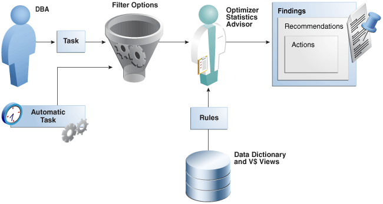
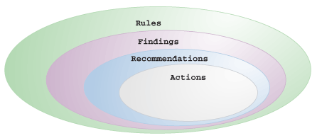
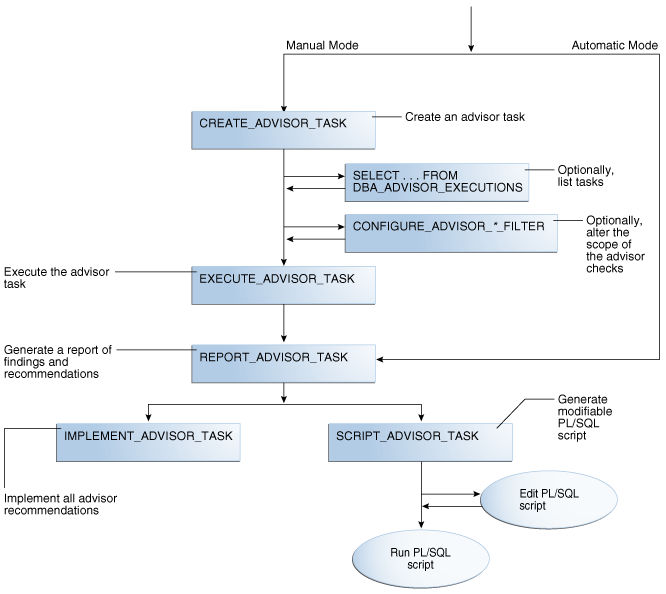

### 18.1 About Optimizer Statistics Advisor

Optimizer Statistics Advisor is built-in diagnostic software that analyzes the quality of statistics and statistics-related tasks.

The advisor task runs automatically in the maintenance window, but you can also run it on demand. You can then view the advisor report. If the advisor makes recommendations, then in some cases you can run system-generated scripts to implement them.

The following figure provides a conceptual overview of Optimizer Statistics Advisor.

Figure 18-1 Optimizer Statistics Advisor



> This is the start of your graphic description.
>
> [  
> Copyright © 2013, 2023, Oracle and/or its affiliates.](https://docs.oracle.com/en/database/oracle/oracle-database/dcommon/html/cpyr.htm)


#### 18.1.1 Purpose of Optimizer Statistics Advisor

Optimizer Statistics Advisor inspects how optimizer statistics are gathered.

The advisor automatically diagnoses problems in the existing practices for gathering statistics. The advisor does not gather a new or alternative set of optimizer statistics. The output of the advisor is a report of findings and recommendations, which helps you follow best practices for gathering statistics.

Optimizer statistics play a significant part in determining the execution plan for queries. Therefore, it is critical for the optimizer to gather and maintain accurate and up-to-date statistics. The optimizer provides the `DBMS_STATS` package, which evolves from release to release, for this purpose. Typically, users develop their own strategies for gathering statistics based on specific workloads, and then use homegrown scripts to implement these strategies.

##### 18.1.1.1 Problems with a Traditional Script-Based Approach

The advantage of the scripted approach is that the scripts are typically tested and reviewed. However, the owner of suboptimal legacy scripts may not change them for fear of causing plan changes.

The traditional approach has the following problems:

- Legacy scripts may not keep pace with new best practices, which can change from release to release.
	Frequently, successive releases add enhancements to histograms, sampling, workload monitoring, concurrency, and other optimizer-related features. For example, starting in Oracle Database 12c, Oracle recommends setting `AUTO_SAMPLE_SIZE` instead of a percentage. However, legacy scripts typically specify a sampling percentage, which may lead to suboptimal execution plans.
- Resources are wasted on unnecessary statistics gathering.
	A script may gather statistics multiple times each day on the same table.
- Automatic statistics gathering jobs do not guarantee accurate and up-to-date statistics.
	For example, sometimes the automatic statistics gathering job is not running because an initialization parameter combination disables it, or the job is terminated. Moreover, sometimes the automatic job maintenance window is insufficient because of resource constraints, or because too many objects require statistics collection. Jobs that stop running before gathering all statistics cause either no statistics or stale statistics for some objects, which can in turn cause suboptimal plans.
- Statistics can sometimes be missing, stale, or incorrect.
	For example, statistics may be inconsistent between a table and its index, or between tables with a primary key-foreign key relationship. Alternatively, a statistics gathering job may have been disabled by accident, or you may be unaware that a script has failed.
- Lack of knowledge of the problem can be time-consuming and resource-intensive.
	For example, a service request might seek a resolution to a problem, unaware that the problem is caused by suboptimal statistics. The diagnosis might require a great deal of time emailing scripts of the problematic queries, enabling traces, and investigating traces.
- Recommended fixes may not be feasible.
	Performance engineers may recommend changing the application code that maintains statistics. In some organizations, this requirement may be difficult or impossible to satisfy.

##### 18.1.1.2 Advantages of Optimizer Statistics Advisor

An advisor-based approach offers better scalability and maintainability than the traditional approach.

If best practices change in a new release, then Optimizer Statistics Advisor encodes these practices in its rules. In this way, the advisor always provides the most up-to-date recommendations.

The advisor analyzes how you are currently gathering statistics (using manual scripts, explicitly setting parameters, and so on), the effectiveness of existing statistics gathering jobs, and the quality of the gathered statistics. Optimizer Statistics Advisor does not gather a new or alternative set of optimizer statistics, and so does not affect the workload. Rather, Optimizer Statistics Advisor analyzes information stored in the data dictionary, and then stores the findings and recommendations in the database.

Optimizer Statistics Advisor provides the following advantages over the traditional approach:

- Provides easy-to-understand reports
	The advisor applies rules to generate findings, recommendations, and actions.
- Supplies scripts to implement necessary fixes without requiring changes to application code
	When you implement a recommended action, benefit accrues to every execution of the improved statements. For example, if you set a global preference so that the sample size is `AUTO_SAMPLE_SIZE` rather than a suboptimal percentage, then every plan based on the improved statistics can benefit from this change.
- Runs a predefined task named `AUTO_STATS_ADVISOR_TASK` once every day in the maintenance window
	For the automated job to run, the `STATISTICS_LEVEL` initialization parameter must be set to `TYPICAL` or `ALL`.
- Supplies an API in the `DBMS_STATS` package that enables you to create and run tasks manually, store findings and recommendations in data dictionary views, generate reports for the tasks, and implement corrections when necessary
- Integrates with existing tools
	The advisor integrates with SQL Tuning Advisor and AWR, which summarize the Optimizer Statistics Advisor results.

#### 18.1.2 Optimizer Statistics Advisor Concepts

Optimizer Statistics Advisor uses the same advisor framework as Automatic Database Diagnostic Monitor (ADDM), SQL Performance Analyzer, and other advisors.

##### 18.1.2.1 Components of Optimizer Statistics Advisor

The Optimizer Statistics Optimizer framework stores its metadata in data dictionary and dynamic performance views.

The following Venn diagram shows the relationships among rules, findings, recommendations, and actions for Optimizer Statistics Advisor. For example, all findings are derived from rules, but not all rules generate findings.

Figure 18-2 Optimizer Statistics Advisor Components



> This is the start of your graphic description.
>
> [  
> Copyright © 2013, 2023, Oracle and/or its affiliates.](https://docs.oracle.com/en/database/oracle/oracle-database/dcommon/html/cpyr.htm)


###### 18.1.2.1.1 Rules for Optimizer Statistics Advisor

An **Optimizer Statistics Advisor rule** is an Oracle-supplied standard by which Optimizer Statistics Advisor performs its checks.

The rules embody Oracle best practices based on the current feature set. If the best practices change from release to release, then the Optimizer Statistics Advisor rules also change.

The advisor organizes rules into the following classes:

- System
	This class checks the preferences for statistics collection, status of the automated statistics gathering job, use of SQL plan directives, and so on. Rules in this class have the value `SYSTEM` in `V$STATS_ADVISOR_RULES.RULE_TYPE`.
- Operation
	This class checks whether statistics collection uses the defaults, test statistics are created using the `SET_*_STATS` procedures, and so on. Rules in this class have the value `OPERATION` in `V$STATS_ADVISOR_RULES.RULE_TYPE`.
- Object
	This class checks for the quality of the statistics, staleness of statistics, unnecessary collection of statistics, and so on. Rules in this class have the value `OBJECT` in `V$STATS_ADVISOR_RULES.RULE_TYPE`.

The rules check for the following problems:

- How to gather statistics
	For example, one rule might specify the recommended setting for an initialization parameter. Another rule might specify that statistics should be gathered at the schema level.
- When to gather statistics
	For example, the advisor may recommend that the maintenance window for the automatic statistics gathering job should be enabled, or that the window should be extended.
- How to improve the efficiency of statistics gathering
	For example, a rule might specify that default parameters should be used in `DBMS_STATS`, or that statistics should not be set manually.

In `V$STATS_ADVISOR_RULES`, each rule has a unique string ID that is usable in the `DBMS_STATS` procedures and reports. You can use a [rule filter](glossary.md) to specify rules that Optimizer Statistics Advisor should check. However, you cannot write new rules.

Example 18-1 Listing Rules in V$STATS\_ADVISOR\_RULES

The following query, with sample output, lists a subset of the rules in `V$STATS_ADVISOR_RULES`. The rules may change from release to release.

```
SET LINESIZE 208
SET PAGESIZE 100
COL ID FORMAT 99
COL NAME FORMAT a33
COL DESCRIPTION FORMAT a62

SELECT RULE_ID AS ID, NAME, RULE_TYPE, DESCRIPTION 
FROM   V$STATS_ADVISOR_RULES 
WHERE  RULE_ID BETWEEN 1 AND 12
ORDER BY RULE_ID;

ID NAME                            RULE_TYPE DESCRIPTION
-- ------------------------------- --------- ------------------------------------------
 1 UseAutoJob                      SYSTEM    Use Auto Job for Statistics Collection
 2 CompleteAutoJob                 SYSTEM    Auto Statistics Gather Job should complete 
                                             successfully
 3 MaintainStatsHistory            SYSTEM    Maintain Statistics History
 4 UseConcurrent                   SYSTEM    Use Concurrent preference for Statistics
                                             Collection
 5 UseDefaultPreference            SYSTEM    Use Default Preference for Stats Collection
 6 TurnOnSQLPlanDirective          SYSTEM    SQL Plan Directives should not be disabled
 7 AvoidSetProcedures              OPERATION Avoid Set Statistics Procedures
 8 UseDefaultParams                OPERATION Use Default Parameters in Statistics 
                                             Collection Proc.
 9 UseGatherSchemaStats            OPERATION Use gather_schema_stats procedure
10 AvoidInefficientStatsOprSeq     OPERATION Avoid inefficient statistics operation
                                             sequences
11 AvoidUnnecessaryStatsCollection OBJECT    Avoid unnecessary statistics collection
12 AvoidStaleStats                 OBJECT    Avoid objects with stale or no statistics

12 rows selected.
```

See Also:

[Oracle Database Reference](https://docs.oracle.com/pls/topic/lookup?ctx=en/database/oracle/oracle-database/21/tgsql&id=REFRN-GUID-C19D0FE4-3D40-45E3-B695-F5862CBF42C4) to learn more about `V$STATS_ADVISOR_RULES`

###### 18.1.2.1.2 Findings for Optimizer Statistics Advisor

A finding results when Optimizer Statistics Advisor examines the evidence stored in the database and concludes that the rules were not followed.

To generate findings, Optimizer Statistics Advisor executes a task, which is invoked either automatically or manually. This task analyzes the statistics history stored in the data dictionary, the statistics operation log, and the current statistics footprint that exists in `SYSAUX`. For example, the advisor queries `DBA_TAB_STATISTICS` and `DBA_IND_STATISTICS` to determine whether statistics are stale, or whether a discrepancy exists between the numbers of rows.

Typically, Optimizer Statistics Advisor generates a finding when a specific rule is not followed or is violated, although some findings—such as object staleness—provide only information. For example, a finding may show that `DBMS_STATS.GATHER_TABLE_STATS` has used `ESTIMATE_PERCENT=>0.01`, which violates the `ESTIMATE_PERCENT=>AUTO_SAMPLE_SIZE` rule.

A finding corresponds to exactly one rule. However, a rule can generate many findings.

See Also:

- [Oracle Database PL/SQL Packages and Types Reference](https://docs.oracle.com/pls/topic/lookup?ctx=en/database/oracle/oracle-database/21/tgsql&id=ARPLS-GUID-01FAB8ED-E4A3-4C3E-8FE2-88717DCDDA06) to learn more about `DBMS_STATS`
- [Oracle Database Reference](https://docs.oracle.com/pls/topic/lookup?ctx=en/database/oracle/oracle-database/21/tgsql&id=REFRN-GUID-C567F729-3748-4DFE-A22C-115CB7575D63) to learn more about `ALL_TAB_STATISTICS`

###### 18.1.2.1.3 Recommendations for Optimizer Statistics Advisor

Based on each finding, Optimizer Statistics Advisor makes recommendations on how to achieve better statistics.

For example, the advisor might discover a violation to the rule of not using sampling when gathering statistics, and recommend specifying `AUTO_SAMPLE_SIZE` instead. The advisor stores the recommendations in `DBA_ADVISOR_RECOMMENDATIONS`.

Multiple recommendations may exist for a single finding. In this case, you must investigate to determine which recommendation to follow. Each recommendation includes one or more rationales that explain why Optimizer Statistics Advisor makes its recommendation. In some cases, findings may not generate recommendations.

See Also:

- " [Guideline for Setting the Sample Size](gathering-optimizer-statistics.md) " to learn the guideline for the sample size
- [Oracle Database Reference](https://docs.oracle.com/pls/topic/lookup?ctx=en/database/oracle/oracle-database/21/tgsql&id=REFRN-GUID-A6E04D5A-5F3E-4DB7-AD7C-AB109439A80A) to learn about `DBA_ADVISOR_RECOMMENDATIONS`

###### 18.1.2.1.4 Actions for Optimizer Statistics Advisor

An Optimizer Statistics Advisor action is a SQL or PL/SQL script that implements recommendations. When feasible, recommendations have corresponding actions. The advisor stores actions in `DBA_ADVISOR_ACTIONS`.

For example, Optimizer Statistics Advisor executes a task that performs the following steps:

1. Checks rules
	The advisor checks conformity to the rule that stale statistics should be avoided.
2. Generates finding
	The advisor discovers that a number of objects have no statistics.
3. Generates recommendation
	The advisor recommends gathering statistics on the objects with no statistics.
4. Generates action
	The advisor generates a PL/SQL script that executes `DBMS_STATS.GATHER_DATABASE_STATS`, supplying a list of objects that need to have statistics gathered.

See Also:

- " [Statistics Preference Overrides](options-for-optimizer-statistics-gathering.md) " to learn how to override statistics gathering preferences
- " [Guideline for Setting the Sample Size](gathering-optimizer-statistics.md) " to learn more about `AUTO_SAMPLE_SIZE`
- [Oracle Database Reference](https://docs.oracle.com/pls/topic/lookup?ctx=en/database/oracle/oracle-database/21/tgsql&id=REFRN-GUID-1D63E30C-4B9B-44A6-B03A-8D983906CB3F) to learn about `DBA_ADVISOR_ACTIONS`

##### 18.1.2.2 Operational Modes for Optimizer Statistics Advisor

Optimizer Statistics Advisor supports both an automated and manual mode.

- Automated
	The predefined task `AUTO_STATS_ADVISOR_TASK` runs automatically in the maintenance window once per day. The task runs as part of the automatic optimizer statistics collection client. The automated task generates findings and recommendations, but does not implement actions automatically.
	As for any other task, you can configure the automated task, and generate reports. If the report recommends actions, then you can implement the actions manually.
- Manual
	You can create your own task using the `DBMS_STATS.CREATE_ADVISOR_TASK` function, and then run it at any time using the `EXECUTE_ADVISOR_TASK` procedure.
	Unlike the automated task, the manual task can implement actions automatically. Alternatively, you can configure the task to generate a PL/SQL script, which you can then run manually.

See Also:

- " [Configuring Automatic Optimizer Statistics Collection](gathering-optimizer-statistics.md) "
- [Oracle Database PL/SQL Packages and Types Reference](https://docs.oracle.com/pls/topic/lookup?ctx=en/database/oracle/oracle-database/21/tgsql&id=GUID-FD355A10-E6FA-47A3-9228-A269905A156D) to learn more about `DBMS_STATS.CREATE_ADVISOR_TASK`

#### 18.1.3 Command-Line Interface to Optimizer Statistics Advisor

Perform Optimizer Statistics Advisor tasks using the `DBMS_STATS` PL/SQL package.

Table 18-1 DBMS\_STATS APIs for Task Creation and Deletion

| PL/SQL Procedure or Function | Description |
| --- | --- |
| `CREATE_ADVISOR_TASK` | Creates an advisor task for Optimizer Statistics Advisor. If the task name is already specified, then the advisor uses the specified task name; otherwise, the advisor automatically generates a new task name. |
| `DROP_ADVISOR_TASK` | Deletes an Optimizer Statistics Advisor task and all its result data. |

Table 18-2 DBMS\_STATS APIs for Task Execution

| PL/SQL Procedure or Function | Description |
| --- | --- |
| `EXECUTE_ADVISOR_TASK` | Executes a previously created Optimizer Statistics Advisor task. |
| `INTERRUPT_ADVISOR_TASK` | Interrupts a currently executing Optimizer Statistics Advisor task. The task ends its operations as it would in a normal exit, enabling you to access intermediate results. You can resume the task later. |
| `CANCEL_ADVISOR_TASK` | Cancels an Optimizer Statistics Advisor task execution, and removes all intermediate results of the current execution. |
| `RESET_ADVISOR_TASK` | Resets an Optimizer Statistics Advisor task execution to its initial state. Call this procedure on a task that is not currently executing. |
| `RESUME_ADVISOR_TASK` | Resumes the Optimizer Statistics Advisor task execution that was most recently interrupted. |

Table 18-3 DBMS\_STATS APIs for Advisor Reports

| PL/SQL Procedure or Function | Description |
| --- | --- |
| `REPORT_STATS_ADVISOR_TASK` | Reports the results of an Optimizer Statistics Advisor task. |
| `GET_ADVISOR_RECS` | Generates a recommendation report on the given item. |

Table 18-4 DBMS\_STATS APIs for Task and Filter Configuration

| PL/SQL Procedure or Function | Description |
| --- | --- |
| `CONFIGURE_ADVISOR_TASK` | Configures the Optimizer Statistics Advisor lists for the execution, reporting, script generation, and implementation of an advisor task. |
| `GET_ADVISOR_OPR_FILTER` | Creates an operation filter for a statistics operation. |
| `CONFIGURE_ADVISOR_RULE_FILTER` | Configures the rule filter for an Optimizer Statistics Advisor task. |
| `CONFIGURE_ADVISOR_OPR_FILTER` | Configures the operation filter for an Optimizer Statistics Advisor task. |
| `CONFIGURE_ADVISOR_OBJ_FILTER` | Configures the object filter for an Optimizer Statistics Advisor task. |
| `SET_ADVISOR_TASK_PARAMETER` | Updates the value of an Optimizer Statistics Advisor task parameter. Valid parameters are `TIME_LIMIT` and `OP_START_TIME`. |

Table 18-5 DBMS\_STATS APIs for Implementation of Recommended Actions

| PL/SQL Procedure or Function | Description |
| --- | --- |
| `SCRIPT_ADVISOR_TASK` | Gets the script that implements the recommended actions for the problems found by the advisor. You can check this script, and then choose which actions to execute. |
| `IMPLEMENT_ADVISOR_TASK` | Implements the actions recommended by the advisor based on results from a specified Optimizer Statistics Advisor execution. |

See Also:

[Oracle Database PL/SQL Packages and Types Reference](https://docs.oracle.com/pls/topic/lookup?ctx=en/database/oracle/oracle-database/21/tgsql&id=ARPLS150) to learn about the `DBMS_STATS` package

### 18.2 Basic Tasks for Optimizer Statistics Advisor

This section explains the basic workflow for using Optimizer Statistics Advisor. All procedures and functions are in the `DBMS_STATS` package.

The following figure shows the automatic and manual paths in the workflow. If `AUTO_STATS_ADVISOR_TASK` runs automatically in the maintenance window, then your workflow begins by querying the report. In the manual workflow, you must use PL/SQL to create and execute the tasks.

Figure 18-3 Basic Tasks for Optimizer Statistics Advisor



> This graphic depicts a flow chart. At the top is CREATE\_ADVISOR\_TASK. An arrow points downward to EXECUTE\_ADVISOR\_TASK. On the right, between CREATE\_ADVISOR\_TASK and EXECUTE\_ADVISOR\_TASK, is CONFIGURE\_ADVISOR\_\*\_FILTER, which points toward the downward arrow. EXECUTE\_ADVISOR\_TASK points downward to REPORT\_ADVISOR\_TASK, which branches left to IMPLEMENT\_ADVISOR\_TASK and right to SCRIPT\_ADVISOR\_TASK. The latter points down to a circle that contains “Run PL/SQL script.” Between SCRIPT\_ADVISOR\_TASK and the “Run PL/SQL script” circle is a circle “Edit PL/SQL script,” which has arrows leading to and away from the downward arrow.


Typically, you perform Optimizer Statistics Advisor steps in the sequence shown in the following table.

Table 18-6 Optimizer Statistics Advisor Workflow

| Step | Description | To Learn More |
| --- | --- | --- |
| 1 | Create an Optimizer Advisor task using `DBMS_STATS.CREATE_ADVISOR_TASK` (manual workflow only). | " Creating an Optimizer Statistics Advisor Task " |
| 2 | Optionally, list executions of advisor tasks by querying `DBA_ADVISOR_EXECUTIONS`. | " Listing Optimizer Statistics Advisor Tasks " |
| 3 | Optionally, configure a filter for the task using the `DBMS_STATS.CONFIGURE_ADVISOR_*_FILTER` procedures. | " Creating Filters for an Optimizer Advisor Task " |
| 4 | Execute the advisor task using `DBMS_STATS.EXECUTE_ADVISOR_TASK` (manual workflow only). | " Executing an Optimizer Statistics Advisor Task " |
| 5 | Generate an advisor report. | " Generating a Report for an Optimizer Statistics Advisor Task " |
| 6 | Implement the recommendations in either of following ways:  - Implement all recommendations automatically using `DBMS_STATS.IMPLEMENT_ADVISOR_TASK`. - Generate a PL/SQL script that implements recommendations using `DBMS_STATS.SCRIPT_ADVISOR_TASK`, edit this script, and then run it manually. | " Implementing Actions Recommended by Optimizer Statistics Advisor " and " Generating a Script Using Optimizer Statistics Advisor " |

Example 18-2 Basic Script for Optimizer Statistics Advisor in Manual Workflow

This script illustrates a basic Optimizer Statistics Advisor session. It creates a task, executes it, generates a report, and then implements the recommendations.

```
DECLARE
  v_tname   VARCHAR2(128) := 'my_task';
  v_ename   VARCHAR2(128) := NULL;
  v_report  CLOB := null;
  v_script  CLOB := null;
  v_implementation_result CLOB;
BEGIN
  -- create a task
  v_tname := DBMS_STATS.CREATE_ADVISOR_TASK(v_tname);

  -- execute the task
  v_ename := DBMS_STATS.EXECUTE_ADVISOR_TASK(v_tname);

  -- view the task report
  v_report := DBMS_STATS.REPORT_ADVISOR_TASK(v_tname);
  DBMS_OUTPUT.PUT_LINE(v_report);

  -- implement all recommendations
  v_implementation_result := DBMS_STATS.IMPLEMENT_ADVISOR_TASK(v_tname);
END;
```

See Also:

[Oracle Database PL/SQL Packages and Types Reference](https://docs.oracle.com/pls/topic/lookup?ctx=en/database/oracle/oracle-database/21/tgsql&id=ARPLS150) to learn about the `DBMS_STATS` package

#### 18.2.1 Creating an Optimizer Statistics Advisor Task

The `DBMS_STATS.CREATE_ADVISOR_TASK` function creates a task for Optimizer Statistics Advisor. If you do not specify a task name, then Optimizer Statistics Advisor generates one automatically.

Prerequisites

To execute this subprogram, you must have the `ADVISOR` privilege.

Note:

This subprogram executes using invoker's rights.

To create an Optimizer Statistics Advisor task:

1. In SQL\*Plus, log in to the database as a user with the necessary privileges.
2. Execute the `DBMS_STATS.CREATE_ADVISOR_TASK` function in the following form, where `tname` is the name of the task and `ret` is the variable that contains the returned output:
	```
	EXECUTE ret := DBMS_STATS.CREATE_ADVISOR_TASK('tname');
	```
	For example, to create the task `opt_adv_task1`, use the following code:
	```
	DECLARE
	  v_tname VARCHAR2(32767);
	  v_ret   VARCHAR2(32767);
	BEGIN
	  v_tname := 'opt_adv_task1';
	  v_ret := DBMS_STATS.CREATE_ADVISOR_TASK(v_tname);
	END;
	/
	```
3. Optionally, query `USER_ADVISOR_TASKS`:
	```
	SELECT TASK_NAME, ADVISOR_NAME, CREATED, STATUS FROM USER_ADVISOR_TASKS;
	```
	Sample output appears below:
	```
	TASK_NAME       ADVISOR_NAME         CREATED   STATUS
	--------------- -------------------- --------- -----------
	OPT_ADV_TASK1   Statistics Advisor   05-SEP-16 INITIAL
	```

See Also:

[Oracle Database PL/SQL Packages and Types Reference](https://docs.oracle.com/pls/topic/lookup?ctx=en/database/oracle/oracle-database/21/tgsql&id=ARPLS-GUID-B930CE9B-7461-4691-8AA9-7E424C3C2C8C) to learn more about `CREATE_ADVISOR_TASK`

#### 18.2.2 Listing Optimizer Statistics Advisor Tasks

The `DBA_ADVISOR_EXECUTIONS` view lists executions of Optimizer Statistics Advisor tasks.

To list Optimizer Statistics Advisor tasks:

1. In SQL\*Plus, log in to the database as a user with administrator privileges.
2. Query `DBA_ADVISOR_EXECUTIONS` as follows:
	```
	COL EXECUTION_NAME FORMAT a14
	SELECT EXECUTION_NAME, EXECUTION_END, STATUS
	FROM   DBA_ADVISOR_EXECUTIONS
	WHERE  TASK_NAME = 'AUTO_STATS_ADVISOR_TASK'
	ORDER BY 2;
	```
	The following sample output shows 8 executions:
	```
	EXECUTION_NAME EXECUTION STATUS
	-------------- --------- -----------
	EXEC_1         27-AUG-16 COMPLETED
	EXEC_17        28-AUG-16 COMPLETED
	EXEC_42        29-AUG-16 COMPLETED
	EXEC_67        30-AUG-16 COMPLETED
	EXEC_92        01-SEP-16 COMPLETED
	EXEC_117       02-SEP-16 COMPLETED
	EXEC_142       03-SEP-16 COMPLETED
	EXEC_167       04-SEP-16 COMPLETED
	8 rows selected.
	```

See Also:

[Oracle Database Reference](https://docs.oracle.com/pls/topic/lookup?ctx=en/database/oracle/oracle-database/21/tgsql&id=GUID-7DFD27C0-C995-4C6F-A56E-706C90DE74D7) to learn more about `DBA_ADVISOR_EXECUTIONS`

#### 18.2.3 Creating Filters for an Optimizer Advisor Task

Filters enable you to include or exclude objects, rules, and operations from Optimizer Statistics Advisor tasks.

##### 18.2.3.1 About Filters for Optimizer Statistics Advisor

A filter is the use of `DBMS_STATS` to restrict an Optimizer Statistics Advisor task to a user-specified set of rules, schemas, or operations.

Filters are useful for including or excluding a specific set of results. For example, you can configure an advisor task to include only recommendations for the `sh` schema. Also, you can exclude all violations of the rule for stale statistics. The primary advantage of filters is the ability to ignore recommendations that you are not interested in, and reduce the overhead of the advisor task.

The simplest way to create filters is to use the following `DBMS_STATS` procedures either individually or in combination:

- `CONFIGURE_ADVISOR_OBJ_FILTER`
	Use this procedure to include or exclude the specified database schemas or objects. The object filter takes in an owner name and an object name, with wildcards (`%`) supported.
- `CONFIGURE_ADVISOR_RULE_FILTER`
	Use this procedure to include or exclude the specified rules. Obtain the names of rules by querying `V$STATS_ADVISOR_RULES`.
- `CONFIGURE_ADVISOR_OPR_FILTER`
	Use this procedure to include or exclude the specified `DBMS_STATS` operations. Obtain the IDs and names for operations by querying `DBA_OPTSTAT_OPERATIONS`.

For the preceding functions, you can specify the type of operation to which the filter applies: `EXECUTE`, `REPORT`, `SCRIPT`, and `IMPLEMENT`. You can also combine types, as in `EXECUTE + REPORT`. Null indicates that the filter applies to all types of advisor operations.

See Also:

- [Oracle Database Reference](https://docs.oracle.com/pls/topic/lookup?ctx=en/database/oracle/oracle-database/21/tgsql&id=REFRN-GUID-C19D0FE4-3D40-45E3-B695-F5862CBF42C4) to learn more about `V$STATS_ADVISOR_RULES`
- [Oracle Database PL/SQL Packages and Types Reference](https://docs.oracle.com/pls/topic/lookup?ctx=en/database/oracle/oracle-database/21/tgsql&id=ARPLS-GUID-01FAB8ED-E4A3-4C3E-8FE2-88717DCDDA06) to learn more about `DBMS_STATS`

##### 18.2.3.2 Creating an Object Filter for an Optimizer Advisor Task

The `DBMS_STATS.CONFIGURE_ADVISOR_OBJ_FILTER` function creates a rule filter for a specified Optimizer Statistics Advisor task. The function returns a CLOB that contains the updated values of the filter.

You can use either of the following basic strategies:

- Include findings for all objects (by default, all objects are considered), and then exclude findings for specified objects.
- Exclude findings for all objects, and then include findings only for specified objects.

Prerequisites

To use the `DBMS_STATS.CONFIGURE_ADVISOR_OBJ_FILTER` function, you must meet the following prerequisites:

- To execute this subprogram, you must have the `ADVISOR` privilege.
- You must be the owner of the task.

Note:

This subprogram executes using invoker's rights.

To create an object filter:

1. In SQL\*Plus or SQL Developer, log in to the database as a user with the necessary privileges.
2. Either exclude or include objects for a specified task using the `DBMS_STATS.CONFIGURE_ADVISOR_OBJ_FILTER` function.
	Invoke the function in the following form, where the placeholders are defined as follows:
	- `report` is the CLOB variable that contains the returned XML.
		- `tname` is the name of the task.
		- `opr_type` is the type of operation to perform.
		- `rule` is the name of the rule.
		- `owner` is the schema for the objects.
		- `table` is the name of the table.
		- `action` is the name of the action: `ENABLE`, `DISABLE`, `DELETE`, or `SHOW`.
	```
	BEGIN
	  report := DBMS_STATS.CONFIGURE_ADVISOR_OBJ_FILTER(
	    task_name          => 'tname'
	  , stats_adv_opr_type => 'opr_type'
	  , rule_name          => 'rule'
	  , ownname            => 'owner'
	  , tabname            => 'table'
	  , action             => 'action' );
	END;
	```

Example 18-3 Including Only Objects in a Single Schema

In this example, for the task named `opt_adv_task1`, your goal is to disable recommendations for all objects except those in the `sh` schema. User account `sh` has been granted `ADVISOR` and `READ ANY TABLE` privileges. You perform the following steps:

1. Log in to the database as `sh`.
2. Drop any existing task named `opt_adv_task1`.
	```
	DECLARE
	  v_tname VARCHAR2(32767);
	BEGIN
	  v_tname := 'opt_adv_task1';
	  DBMS_STATS.DROP_ADVISOR_TASK(v_tname);
	END;
	/
	```
3. Create a procedure named `sh_obj_filter` that restricts a specified task to objects in the `sh` schema.
	```
	CREATE OR REPLACE PROCEDURE sh_obj_filter(p_tname IN VARCHAR2) IS
	   v_retc CLOB;
	BEGIN
	   -- Filter out all objects that are not in the sh schema
	   v_retc := DBMS_STATS.CONFIGURE_ADVISOR_OBJ_FILTER(
	               task_name          => p_tname
	             , stats_adv_opr_type => 'EXECUTE'
	             , rule_name          => NULL
	             , ownname            => NULL
	             , tabname            => NULL
	             , action             => 'DISABLE' );
	   v_retc := DBMS_STATS.CONFIGURE_ADVISOR_OBJ_FILTER(
	               task_name          => p_tname
	             , stats_adv_opr_type => 'EXECUTE'
	             , rule_name          => NULL
	             , ownname            => 'SH'
	             , tabname            => NULL
	             , action             => 'ENABLE' );
	END;
	/
	SHOW ERRORS
	```
4. Create a task named `opt_adv_task1`, and then execute the `sh_obj_filter` procedure for this task.
	```
	DECLARE
	  v_tname VARCHAR2(32767);
	  v_ret VARCHAR2(32767);
	BEGIN
	  v_tname := 'opt_adv_task1';
	  v_ret   := DBMS_STATS.CREATE_ADVISOR_TASK(v_tname);
	  sh_obj_filter(v_tname);
	END;
	/
	```
5. Execute the task `opt_adv_task1`.
	```
	DECLARE
	  v_tname VARCHAR2(32767);
	  v_ret   VARCHAR2(32767);
	begin
	  v_tname := 'opt_adv_task1';
	  v_ret   := DBMS_STATS.EXECUTE_ADVISOR_TASK(v_tname);
	END;
	/
	```

See Also:

[Oracle Database PL/SQL Packages and Types Reference](https://docs.oracle.com/pls/topic/lookup?ctx=en/database/oracle/oracle-database/21/tgsql&id=ARPLS-GUID-01FAB8ED-E4A3-4C3E-8FE2-88717DCDDA06) to learn more about `DBMS_STATS.CONFIGURE_ADVISOR_OBJ_FILTER`

##### 18.2.3.3 Creating a Rule Filter for an Optimizer Advisor Task

The `DBMS_STATS.CONFIGURE_ADVISOR_RULE_FILTER` function creates a rule filter for a specified Optimizer Statistics Advisor task. The function returns a CLOB that contains the updated values of the filter.

You can use either of the following basic strategies:

- Enable all rules (by default, all rules are enabled), and then disable specified rules.
- Disable all rules, and then enable only specified rules.

Prerequisites

To use the `DBMS_STATS.CONFIGURE_ADVISOR_RULE_FILTER` function, you must meet the following prerequisites:

- To execute this subprogram, you must have the `ADVISOR` privilege.
- You must be the owner of the task.

Note:

This subprogram executes using invoker's rights.

To create a rule filter:

1. In SQL\*Plus or SQL Developer, log in to the database as a user with the necessary privileges.
2. Obtain the names of the advisor rules by querying `V$STATS_ADVISOR_RULES`.
	For example, query the view as follows (partial sample output included):
	```
	SET LINESIZE 200
	SET PAGESIZE 100
	COL ID FORMAT 99
	COL NAME FORMAT a27
	COL DESCRIPTION FORMAT a54
	SELECT RULE_ID AS ID, NAME, RULE_TYPE, DESCRIPTION 
	FROM   V$STATS_ADVISOR_RULES
	ORDER BY RULE_ID;
	ID NAME                        RULE_TYPE DESCRIPTION
	-- --------------------------- --------- ------------------------------------------
	 1 UseAutoJob                  SYSTEM    Use Auto Job for Statistics Collection
	 2 CompleteAutoJob             SYSTEM    Auto Statistics Gather Job should complete
	                                         successfully
	 3 MaintainStatsHistory        SYSTEM    Maintain Statistics History
	 4 UseConcurrent               SYSTEM    Use Concurrent preference for Statistics
	                                         Collection
	...
	```
3. Either exclude or include rules for a specified task using the `DBMS_STATS.CONFIGURE_ADVISOR_RULE_FILTER` function.
	Invoke the function in the following form, where the placeholders are defined as follows:
	- `tname` is the name of the task.
		- `report` is the CLOB variable that contains the returned XML.
		- `opr_type` is the type of operation to perform.
		- `rule` is the name of the rule.
		- `action` is the name of the action: `ENABLE`, `DISABLE`, `DELETE`, or `SHOW`.
	```
	BEGIN
	  report := DBMS_STATS.DBMS_STATS.CONFIGURE_ADVISOR_RULE_FILTER(
	    task_name          => 'tname'
	  , stats_adv_opr_type => 'opr_type'
	  , rule_name          => 'rule'
	  , action             => 'action' );
	END;
	```

Example 18-4 Excluding the Rule for Stale Statistics

In this example, you know that statistics are stale because the automated statistics job did not run. You want to generate a report for the task named `opt_adv_task1`, but do not want to clutter it with recommendations about stale statistics.

1. You query `V$STATS_ADVISOR_RULES` for rules that deal with stale statistics (sample output included):
	```
	COL NAME FORMAT a15
	SELECT RULE_ID AS ID, NAME, RULE_TYPE, DESCRIPTION 
	FROM   V$STATS_ADVISOR_RULES
	WHERE  DESCRIPTION LIKE '%tale%'
	ORDER BY RULE_ID;
	 ID NAME            RULE_TYPE DESCRIPTION
	--- --------------- --------- -----------------------------------------
	 12 AvoidStaleStats OBJECT    Avoid objects with stale or no statistics
	```
2. You configure a filter using `CONFIGURE_ADVISOR_RULE_FILTER`, specifying that task execution should exclude the rule `AvoidStaleStats`, but honor all other rules:
	```
	VARIABLE b_ret CLOB
	BEGIN
	   :b_ret := DBMS_STATS.CONFIGURE_ADVISOR_RULE_FILTER(
	     task_name          => 'opt_adv_task1'
	,    stats_adv_opr_type => 'EXECUTE'
	,    rule_name          => 'AvoidStaleStats'
	,    action             => 'DISABLE' );
	END;
	/
	```

Example 18-5 Including Only the Rule for Avoiding Stale Statistics

This example is the inverse of the preceding example. You want to generate a report for the task named `opt_adv_task1`, but want to see only recommendations about stale statistics.

1. Query `V$STATS_ADVISOR_RULES` for rules that deal with stale statistics (sample output included):
	```
	COL NAME FORMAT a15
	SELECT RULE_ID AS ID, NAME, RULE_TYPE, DESCRIPTION 
	FROM   V$STATS_ADVISOR_RULES
	WHERE  DESCRIPTION LIKE '%tale%'
	ORDER BY RULE_ID;
	 ID NAME            RULE_TYPE DESCRIPTION
	--- --------------- --------- -----------------------------------------
	 12 AvoidStaleStats OBJECT    Avoid objects with stale or no statistics
	```
2. Configure a filter using `CONFIGURE_ADVISOR_RULE_FILTER`, specifying that task execution should exclude all rules:
	```
	VARIABLE b_ret CLOB
	BEGIN
	   :b_ret := DBMS_STATS.CONFIGURE_ADVISOR_RULE_FILTER(
	     task_name          => 'opt_adv_task1'
	,    stats_adv_opr_type => 'EXECUTE'
	,    rule_name          => null
	,    action             => 'DISABLE' );
	END;
	/
	```
3. Configure a filter that enables only the `AvoidStaleStats` rule:
	```
	BEGIN
	   :b_ret := DBMS_STATS.CONFIGURE_ADVISOR_RULE_FILTER(
	     task_name          => 'opt_adv_task1'
	,    stats_adv_opr_type => 'EXECUTE'
	,    rule_name          => 'AvoidStaleStats'
	,    action             => 'ENABLE' );
	END;
	/
	```

See Also:

- [Oracle Database Reference](https://docs.oracle.com/pls/topic/lookup?ctx=en/database/oracle/oracle-database/21/tgsql&id=REFRN-GUID-C19D0FE4-3D40-45E3-B695-F5862CBF42C4) to learn more about `V$STATS_ADVISOR_RULES`
- [Oracle Database PL/SQL Packages and Types Reference](https://docs.oracle.com/pls/topic/lookup?ctx=en/database/oracle/oracle-database/21/tgsql&id=ARPLS-GUID-B930CE9B-7461-4691-8AA9-7E424C3C2C8C) to learn more about `CONFIGURE_ADVISOR_RULE_FILTER`

##### 18.2.3.4 Creating an Operation Filter for an Optimizer Advisor Task

The `DBMS_STATS.CONFIGURE_ADVISOR_OPR_FILTER` function creates an operation filter for a specified Optimizer Statistics Advisor task. The function returns a CLOB that contains the updated values of the filter.

You can use either of the following basic strategies:

- Disable all operations, and then enable only specified operations.
- Enable all operations (by default, all operations are enabled), and then disable specified operations.

The `DBA_OPTSTAT_OPERATIONS` view contains the IDs of statistics-related operations.

Prerequisites

To use `DBMS_STATS.CONFIGURE_ADVISOR_OPR_FILTER` function, you must meet the following prerequisites:

- To execute this subprogram, you must have the `ADVISOR` privilege.
	Note:
	This subprogram executes using invoker's rights.
- You must be the owner of the task.
- To query the `DBA_OPTSTAT_OPERATIONS` view, you must have the `SELECT ANY TABLE` privilege.

To create an operation filter:

1. In SQL\*Plus or SQL Developer, log in to the database as a user with the necessary privileges.
2. Query the types of operations.
	For example, list all distinct operations in `DBA_OPTSTAT_OPERATIONS` (sample output included):
	```
	SQL> SELECT DISTINCT(OPERATION) FROM DBA_OPTSTAT_OPERATIONS ORDER BY OPERATION;
	OPERATION
	-----------------------
	gather_dictionary_stats
	gather_index_stats
	gather_schema_stats
	gather_table_stats
	purge_stats
	set_system_stats
	```
3. Obtain the IDs of the operations to be filtered by querying `DBA_OPTSTAT_OPERATIONS`.
	For example, to obtain IDs for all statistics gathering operations for tables and indexes in the `SYS` and `sh` schemas, use the following query:
	```
	SELECT ID 
	FROM   DBA_OPTSTAT_OPERATIONS
	WHERE  (  OPERATION = 'gather_table_stats'
	          OR OPERATION = 'gather_index_stats')
	AND    (  TARGET LIKE 'SH.%'
	          OR TARGET LIKE 'SYS.%');
	```
4. Exclude or include rules for a specified task using the `DBMS_STATS.CONFIGURE_ADVISOR_OPR_FILTER` function, specifying the IDs obtained in the previous step.
	Invoke the function in the following form, where the placeholders are defined as follows:
	- `report` is the CLOB variable that contains the returned XML.
		- `tname` is the name of the task.
		- `opr_type` is the type of operation to perform. This value cannot be null.
		- `rule` is the name of the rule.
		- `opr_id` is the ID (from `DBA_OPTSTAT_OPERATIONS.ID`) of the operation to perform. This value cannot be null.
		- `action` is the name of the action: `ENABLE`, `DISABLE`, `DELETE`, or `SHOW`.
	```
	BEGIN
	  report := DBMS_STATS.CONFIGURE_ADVISOR_OPR_FILTER(
	    task_name          => 'tname'
	  , stats_adv_opr_type => 'opr_type'
	  , rule_name          => 'rule'
	  , operation_id       => 'op_id'
	  , action             => 'action' );
	END;
	```

Example 18-6 Excluding Operations for Gathering Table Statistics

In this example, your goal is to exclude operations that gather table statistics in the `hr` schema. User account `stats` has been granted the `DBA` role, `ADVISOR` privilege, and `SELECT ON DBA_OPTSTAT_OPERATIONS` privilege. You perform the following steps:

1. Log in to the database as `stats`.
2. Drop any existing task named `opt_adv_task1`.
	```
	DECLARE
	  v_tname VARCHAR2(32767);
	BEGIN
	  v_tname := 'opt_adv_task1';
	  DBMS_STATS.DROP_ADVISOR_TASK(v_tname);
	END;
	/
	```
3. Create a procedure named `opr_filter` that configures a task to advise on all operations except those that gather statistics for tables in the `hr` schema.
	```
	CREATE OR REPLACE PROCEDURE opr_filter(p_tname IN VARCHAR2) IS
	   v_retc CLOB;
	BEGIN
	   -- For all rules, prevent the advisor from operating 
	   -- on the operations selected in the following query
	   FOR rec IN 
	     (SELECT ID FROM DBA_OPTSTAT_OPERATIONS WHERE OPERATION = 'gather_table_stats' AND TARGET LIKE 'HR.%')
	   LOOP
	     v_retc := DBMS_STATS.CONFIGURE_ADVISOR_OPR_FILTER(
	                 task_name          => p_tname
	               , stats_adv_opr_type => NULL
	               , rule_name          => NULL
	               , operation_id       => rec.id
	               , action             => 'DISABLE');
	   END LOOP;
	END;
	/
	SHOW ERRORS
	```
4. Create a task named `opt_adv_task1`, and then execute the `opr_filter` procedure for this task.
	```
	DECLARE
	  v_tname VARCHAR2(32767);
	  v_ret VARCHAR2(32767);
	BEGIN
	  v_tname := 'opt_adv_task1';
	  v_ret   := DBMS_STATS.CREATE_ADVISOR_TASK(v_tname);
	  opr_filter(v_tname);
	END;
	/
	```
5. Execute the task `opt_adv_task1`.
	```
	DECLARE
	  v_tname VARCHAR2(32767);
	  v_ret   VARCHAR2(32767);
	begin
	  v_tname := 'opt_adv_task1';
	  v_ret   := DBMS_STATS.EXECUTE_ADVISOR_TASK(v_tname);
	END;
	/
	```
6. Print the report.
	```
	SPOOL /tmp/rep.txt
	SET LONG 1000000
	COLUMN report FORMAT A200
	SET LINESIZE 250
	SET PAGESIZE 1000
	SELECT DBMS_STATS.REPORT_ADVISOR_TASK(
	         task_name      => 'opt_adv_task1'
	       , execution_name => NULL
	       , type           => 'TEXT'
	       , section        => 'ALL' 
	       ) AS report
	FROM   DUAL;
	SPOOL OFF
	```

See Also:

- [Oracle Database Reference](https://docs.oracle.com/pls/topic/lookup?ctx=en/database/oracle/oracle-database/21/tgsql&id=REFRN-GUID-3D13B3C5-C1D1-47E7-B852-CD1563719402) to learn more about `DBA_OPTSTAT_OPERATIONS`
- [Oracle Database PL/SQL Packages and Types Reference](https://docs.oracle.com/pls/topic/lookup?ctx=en/database/oracle/oracle-database/21/tgsql&id=GUID-0BD07210-825E-4971-87B5-EE453B354EC7) to learn more about `CONFIGURE_ADVISOR_OPR_FILTER`

#### 18.2.4 Executing an Optimizer Statistics Advisor Task

The `DBMS_STATS.EXECUTE_ADVISOR_TASK` function executes a task for Optimizer Statistics Advisor. If you do not specify an execution name, then Optimizer Statistics Advisor generates one automatically.

The results of performing this task depend on the privileges of the executing user:

- `SYSTEM` level
	Only users with both the `ANALYZE ANY` and `ANALYZE ANY DICTIONARY` privileges can perform this task on system-level rules.
- Operation level
	The results depend on the following privileges:
	- Users with both the `ANALYZE ANY` and `ANALYZE ANY DICTIONARY` privileges can perform this task for all statistics operations.
		- Users with the `ANALYZE ANY` privilege but not the `ANALYZE ANY DICTIONARY` privilege can perform this task for statistics operations related to any schema except `SYS`.
		- Users with the `ANALYZE ANY DICTIONARY` privilege but not the `ANALYZE ANY` privilege can perform this task for statistics operations related to their own schema and the `SYS` schema.
		- Users with neither the `ANALYZE ANY` nor the `ANALYZE ANY DICTIONARY` privilege can only perform this operation for statistics operations relating to their own schema.
- Object level
	Users can perform this task for any object for which they have statistics collection privileges.

Prerequisites

This task has the following prerequisites:

- To execute this subprogram, you must have the `ADVISOR` privilege.
- You must be the owner of the task.
- If you specify an execution name, then this name must not conflict with an existing execution.

Note:

This subprogram executes using invoker's rights.

To execute an Optimizer Statistics Advisor task:

1. In SQL\*Plus or SQL Developer, log in to the database as a user with the necessary privileges.
2. Execute the `DBMS_STATS.EXECUTE_ADVISOR_TASK` function in the following form, where `tname` is the name of the task, `execname` is the optional name of the execution, and `ret` is the variable that contains the returned output:
	```
	EXECUTE ret := DBMS_STATS.EXECUTE_ADVISOR_TASK('tname','execname');
	```
	For example, to execute the task `opt_adv_task1`, use the following code:
	```
	DECLARE
	  v_tname VARCHAR2(32767);
	  v_ret   VARCHAR2(32767);
	BEGIN
	  v_tname := 'opt_adv_task1';
	  v_ret := DBMS_STATS.EXECUTE_ADVISOR_TASK(v_tname);
	END;
	/
	```
3. Optionally, obtain details about the execution by querying `USER_ADVISOR_EXECUTIONS`:
	```
	SELECT TASK_NAME, EXECUTION_NAME,
	       EXECUTION_END, EXECUTION_TYPE AS TYPE, STATUS 
	FROM   USER_ADVISOR_EXECUTIONS;
	```
	Sample output appears below:
	```
	TASK_NAME       EXECUTION_NAME       EXECUTION TYPE       STATUS
	--------------- -------------------- --------- ---------- -----------
	OPT_ADV_TASK1   EXEC_136             23-NOV-15 STATISTICS COMPLETED
	```

See Also:

[Oracle Database PL/SQL Packages and Types Reference](https://docs.oracle.com/pls/topic/lookup?ctx=en/database/oracle/oracle-database/21/tgsql&id=ARPLS-GUID-B930CE9B-7461-4691-8AA9-7E424C3C2C8C) to learn more about `EXECUTE_ADVISOR_TASK`

#### 18.2.5 Generating a Report for an Optimizer Statistics Advisor Task

The `DBMS_STATS.REPORT_ADVISOR_TASK` function generates a report for an Optimizer Statistics Advisor task.

The report contains the following sections:
- General information
	This section describes the task name, execution name, creation date, and modification date.
- Summary
	This section summarizes the findings and rules violated by the findings.
- Findings
	Each finding section lists the relevant rule and findings. If the advisor has a recommendation, then the recommendation is described. In some cases, a recommendation also has a rationale.

The name of the automated Optimizer Statistics Advisor task is `AUTO_STATS_ADVISOR_TASK`. If you follow the automated workflow, then you only need to query the automatically generated report.

Prerequisites

To generate a report with the `DBMS_STATS.REPORT_ADVISOR_TASK` function, you must meet the following prerequisites:

- To execute this subprogram, you must have the `ADVISOR` privilege.
- You must be the owner of the task.

Note:

This subprogram executes using invoker's rights.

The results of performing this task depend on the privileges of the executing user:

- `SYSTEM` level
	Only users with both the `ANALYZE ANY` and `ANALYZE ANY DICTIONARY` privileges can perform this task on system-level rules.
- Operation level
	The results depend on the following privileges:
	- Users with both the `ANALYZE ANY` and `ANALYZE ANY DICTIONARY` privileges can perform this task for all statistics operations.
		- Users with the `ANALYZE ANY` privilege but not the `ANALYZE ANY DICTIONARY` privilege can perform this task for statistics operations related to any schema except `SYS`.
		- Users with the `ANALYZE ANY DICTIONARY` privilege but not the `ANALYZE ANY` privilege can perform this task for statistics operations related to their own schema and the `SYS` schema.
		- Users with neither the `ANALYZE ANY` nor the `ANALYZE ANY DICTIONARY` privilege can only perform this operation for statistics operations relating to their own schema.
- Object level
	Users can perform this task for any object for which they have statistics collection privileges.

To generate an Optimizer Statistics Advisor report:

1. In SQL\*Plus, log in to the database as a user with `ADVISOR` privileges.
2. Query the `DBMS_STATS.REPORT_ADVISOR_TASK` function output.
	Use the following query, where the placeholders have the following definitions:
	- `tname` is the name of the task.
		- `exec` is the name of the execution.
		- `type` is the type of output: `TEXT`, `HTML`, or `XML`.
		- `sect` is the section of the report: `SUMMARY`, `FINDINGS`, `ERRORS`, and `ALL`.
		- `lvl` is the format of the report: `BASIC`, `TYPICAL`, `ALL`, or `SHOW_HIDDEN`.
	```
	SET LINESIZE 3000
	SET LONG 500000
	SET PAGESIZE 0
	SET LONGCHUNKSIZE 100000
	SELECT DBMS_STATS.REPORT_ADVISOR_TASK('tname', 'exec', 'type
	', 
	       'sect
	', 'lvl
	') AS REPORT
	FROM   DUAL;
	```
	For example, to print a report for `AUTO_STATS_ADVISOR_TASK`, use the following query:
	```
	SELECT DBMS_STATS.REPORT_ADVISOR_TASK('AUTO_STATS_ADVISOR_TASK', NULL,
	       'TEXT', 'ALL', 'ALL') AS REPORT 
	FROM   DUAL;
	```
	The following sample report shows four findings:
	```
	GENERAL INFORMATION
	-------------------------------------------------------------------------------
	 Task Name        : AUTO_STATS_ADVISOR_TASK
	 Execution Name   : EXEC_136    
	 Created          : 09-05-16 02:52:34 
	 Last Modified    : 09-05-16 12:31:24 
	-------------------------------------------------------------------------------
	SUMMARY
	-------------------------------------------------------------------------------
	 For execution EXEC_136 of task AUTO_STATS_ADVISOR_TASK, the Statistics Advisor
	 has 4 findings. The findings are related to the following rules: 
	 AVOIDSETPROCEDURES, USEDEFAULTPARAMS, USEGATHERSCHEMASTATS, NOTUSEINCREMENTAL. 
	Please refer to the finding section for detailed information.
	-------------------------------------------------------------------------------
	FINDINGS
	-------------------------------------------------------------------------------
	 Rule Name:        AvoidSetProcedures
	 Rule Description:  Avoid Set Statistics Procedures                
	 Finding:  There are 5 SET_[COLUMN|INDEX|TABLE|SYSTEM]_STATS procedures being    
	           used for statistics gathering.
	 Recommendation:  Do not use SET_[COLUMN|INDEX|TABLE|SYSTEM]_STATS procedures.
	                  Gather statistics instead of setting them.            
	 Rationale:  SET_[COLUMN|INDEX|TABLE|SYSTEM]_STATS will cause bad plans due to
	             wrong or inconsistent statistics.                   
	----------------------------------------------------
	 Rule Name:        UseDefaultParams                        
	 Rule Description:  Use Default Parameters in Statistics Collection Procedures
	 Finding:  There are 367 statistics operations using nondefault parameters.
	 Recommendation:  Use default parameters for statistics operations.
	 Example:
	 -- Gathering statistics for 'SH' schema using all default parameter values:
	 BEGIN dbms_stats.gather_schema_stats('SH'); END;
	 Rationale:  Using default parameter values for statistics gathering operations
	             is more efficient.    
	----------------------------------------------------
	 Rule Name:        UseGatherSchemaStats
	 Rule Description:  Use gather_schema_stats procedure
	 Finding:  There are 318 uses of GATHER_TABLE_STATS.
	 Recommendation:  Use GATHER_SCHEMA_STATS instead of GATHER_TABLE_STATS.
	 Example:
	 -- Gather statistics for 'SH' schema:
	 BEGIN dbms_stats.gather_schema_stats('SH'); END;
	 Rationale:  GATHER_SCHEMA_STATS has more options available, including checking
	             for staleness and gathering statistics concurrently. Also it is
	             more maintainable for new tables added to the schema. If you only
	             want to gather statistics for certain tables in the schema, specify
	             them in the obj_filter_list parameter of GATHER_SCHEMA_STATS.                        
	----------------------------------------------------
	 Rule Name:        NotUseIncremental
	 Rule Description:  Statistics should not be maintained incrementally when it is not
	 Finding:  Incremental option has been turned on for 10 tables, which will not benefit
	           from using the incremental option.
	 Schema:
	 SH
	 Objects:
	 CAL_MONTH_SALES_MV    
	 CAL_MONTH_SALES_MV    
	 CHANNELS
	 COUNTRIES   
	 CUSTOMERS    
	 DIMENSION_EXCEPTIONS    
	 FWEEK_PSCAT_SALES_MV    
	 FWEEK_PSCAT_SALES_MV    
	 PRODUCTS
	 PROMOTIONS
	 SUPPLEMENTARY_DEMOGRAPHICS 
	 TIMES
	 Recommendation:  Do not use the incremental option for statistics gathering on these 
	                  objects.                        
	 Example:                                    
	 --
	 Turn off the incremental option for 'SH.SALES':
	 dbms_stats.set_table_prefs('SH', 'SALES', 'INCREMENTAL', 'FALSE');
	 Rationale:  The overhead of using the incremental option on these tables
	             outweighs the benefit of using the incremental option.
	```

See Also:

[Oracle Database PL/SQL Packages and Types Reference](https://docs.oracle.com/pls/topic/lookup?ctx=en/database/oracle/oracle-database/21/tgsql&id=ARPLS-GUID-B930CE9B-7461-4691-8AA9-7E424C3C2C8C) to learn more about `REPORT_ADVISOR_TASK`

#### 18.2.6 Implementing Optimizer Statistics Advisor Recommendations

You can either implement all recommendations automatically using `DBMS_STATS.IMPLEMENT_ADVISOR_TASK`, or generate an editable script using `DBMS_STATS.SCRIPT_ADVISOR_TASK`.

##### 18.2.6.1 Implementing Actions Recommended by Optimizer Statistics Advisor

The `DBMS_STATS.IMPLEMENT_ADVISOR_TASK` function implements the recommendations for a specified Optimizer Statistics Advisor task. If you do not specify an execution name, then Optimizer Statistics Advisor uses the most recent execution.

The simplest means of implementing recommendations is using `DBMS_STATS.IMPLEMENT_ADVISOR_TASK`. In this case, no generation of a script is necessary. You can specify that the advisor ignore the existing filters `(level=>'ALL')` or use the default, which honors the existing filters `(level=>'TYPICAL')`.

Prerequisites

To use `DBMS_STATS.IMPLEMENT_ADVISOR_TASK`, you must meet the following prerequisites:

- To execute this subprogram, you must have the `ADVISOR` privilege.
- You must be the owner of the task.

Note:

This subprogram executes using invoker's rights.

The results of performing this task depend on the privileges of the executing user:

- `SYSTEM` level
	Only users with both the `ANALYZE ANY` and `ANALYZE ANY DICTIONARY` privileges can perform this task on system-level rules.
- Operation level
	The results depend on the following privileges:
	- Users with both the `ANALYZE ANY` and `ANALYZE ANY DICTIONARY` privileges can perform this task for all statistics operations.
		- Users with the `ANALYZE ANY` privilege but not the `ANALYZE ANY DICTIONARY` privilege can perform this task for statistics operations related to any schema except `SYS`.
		- Users with the `ANALYZE ANY DICTIONARY` privilege but not the `ANALYZE ANY` privilege can perform this task for statistics operations related to their own schema and the `SYS` schema.
		- Users with neither the `ANALYZE ANY` nor the `ANALYZE ANY DICTIONARY` privilege can only perform this operation for statistics operations relating to their own schema.
- Object level
	Users can perform this task for any object for which they have statistics collection privileges.

To implement advisor actions:

1. In SQL\*Plus, log in to the database as a user with the necessary privileges.
2. Execute the `DBMS_STATS.IMPLEMENT_ADVISOR_TASK` function in the following form, where the placeholders have the following definitions:
	- `tname` is the name of the task.
		- `result` is the CLOB variable that contains a list of the recommendations that have been successfully implemented.
		- `fltr_lvl` is the level of implementation: `TYPICAL` (existing filters honored) or `ALL` (filters ignored).
	```
	BEGIN
	  result := DBMS_STATS.IMPLEMENT_ADVISOR_TASK('tname', level => fltr_lvl
	);
	END;
	```
	For example, to implement all recommendations for the task `opt_adv_task1`, use the following code:
	```
	VARIABLE b_ret CLOB
	DECLARE
	  v_tname VARCHAR2(32767);
	BEGIN
	  v_tname := 'opt_adv_task1';
	  :b_ret := DBMS_STATS.IMPLEMENT_ADVISOR_TASK(v_tname);
	END;
	/
	```
3. Optionally, print the XML output to confirm the implemented actions.
	For example, to print the XML returned in the previous step, use the following code (sample output included):
	```
	SET LONG 10000
	SELECT XMLType(:b_ret) AS imp_results FROM DUAL;
	```
	```
	IMP_RESULTS
	------------------------------------
	<implementation_results>
	  <rule NAME="AVOIDSETPROCEDURES">
	    <implemented>yes</implemented>
	  </rule>
	  <rule NAME="USEGATHERSCHEMASTATS">
	    <implemented>yes</implemented>
	  </rule>
	  <rule NAME="AVOIDSETPROCEDURES">
	    <implemented>yes</implemented>
	  </rule>
	  <rule NAME="USEGATHERSCHEMASTATS">
	    <implemented>yes</implemented>
	  </rule>
	  <rule NAME="USEDEFAULTPARAMS">
	    <implemented>no</implemented>
	  </rule>
	  <rule NAME="USEDEFAULTPARAMS">
	    <implemented>yes</implemented>
	  </rule>
	  <rule NAME="NOTUSEINCREMENTAL">
	    <implemented>yes</implemented>
	  </rule>
	</implementation_results>
	```

See Also:

[Oracle Database PL/SQL Packages and Types Reference](https://docs.oracle.com/pls/topic/lookup?ctx=en/database/oracle/oracle-database/21/tgsql&id=ARPLS-GUID-B930CE9B-7461-4691-8AA9-7E424C3C2C8C) to learn more about `DBMS_STATS.IMPLEMENT_ADVISOR_TASK`

##### 18.2.6.2 Generating a Script Using Optimizer Statistics Advisor

The `DBMS_STATS.SCRIPT_ADVISOR_TASK` function generates an editable script with recommendations for a specified Optimizer Statistics Advisor task.

Unlike `IMPLEMENT_ADVISOR_TASK`, the `SCRIPT_ADVISOR_TASK` generates a script that you can edit before execution. The output script contains both comments and executable code. As with `IMPLEMENT_ADVISOR_TASK`, you can specify that the advisor ignore the existing filters `(level=>'ALL')` or use the default, which honors the existing filters `(level=>'TYPICAL')`. You can specify that the function returns the script as a CLOB and file, or only a CLOB.

Prerequisites

To use the `DBMS_STATS.SCRIPT_ADVISOR_TASK` function, you must meet the following prerequisites:

- To execute this subprogram, you must have the `ADVISOR` privilege.
- You must be the owner of the task.

Note:

This subprogram executes using invoker's rights.

The results of performing this task depend on the privileges of the executing user:

- `SYSTEM` level
	Only users with both the `ANALYZE ANY` and `ANALYZE ANY DICTIONARY` privileges can perform this task on system-level rules.
- Operation level
	The results depend on the following privileges:
	- Users with both the `ANALYZE ANY` and `ANALYZE ANY DICTIONARY` privileges can perform this task for all statistics operations.
		- Users with the `ANALYZE ANY` privilege but not the `ANALYZE ANY DICTIONARY` privilege can perform this task for statistics operations related to any schema except `SYS`.
		- Users with the `ANALYZE ANY DICTIONARY` privilege but not the `ANALYZE ANY` privilege can perform this task for statistics operations related to their own schema and the `SYS` schema.
		- Users with neither the `ANALYZE ANY` nor the `ANALYZE ANY DICTIONARY` privilege can only perform this operation for statistics operations relating to their own schema.
- Object level
	Users can perform this task for any object for which they have statistics collection privileges.

To generate an advisor script:

1. In SQL\*Plus, log in to the database as a user with `ADVISOR` privileges.
2. Execute the `DBMS_STATS.SCRIPT_ADVISOR_TASK` function in the following form, where the placeholders have the following definitions:
	- `tname` is the name of the task.
		- `exec` is the name of the execution (default is null).
		- `dir` is the name of the directory (default is null).
		- `result` is the CLOB variable that contains a list of the recommendations that have been successfully implemented.
		- `filter_lvl` is the level of implementation: `TYPICAL` (existing filters honored) or `ALL` (filters ignored).
	```
	BEGIN
	  result := DBMS_STATS.SCRIPT_ADVISOR_TASK('tname', 
	            execution_name => 'exec', dir_name => 'dir', 
	            level => 'filter_lvl
	');
	END;
	```
	For example, to generate a script that contains recommendations for the task `opt_adv_task1`, use the following code:
	```
	VARIABLE b_script CLOB
	DECLARE
	  v_tname VARCHAR2(32767);
	BEGIN
	  v_tname := 'opt_adv_task1';
	  :b_script := DBMS_STATS.SCRIPT_ADVISOR_TASK(v_tname);
	END;
	/
	```
	Note:
	If you do not specify an execution name, then Optimizer Statistics Advisor uses the most recent execution.
3. Print the script.
	For example, to print the script returned in the previous step, use the following code (sample output included):
	```
	DECLARE
	  v_len    NUMBER(10);
	  v_offset NUMBER(10) :=1;
	  v_amount NUMBER(10) :=10000;
	BEGIN
	  v_len := DBMS_LOB.getlength(:b_script);
	  WHILE (v_offset < v_len)
	  LOOP
	    DBMS_OUTPUT.PUT_LINE(DBMS_LOB.SUBSTR(:b_script,v_amount,v_offset));
	    v_offset := v_offset + v_amount;
	  END LOOP;
	END;
	/
	```
	The following example shows a sample script:
	```
	-- Script generated for the recommendations from execution EXEC_23
	-- in the statistics advisor task OPT_ADV_TASK1
	-- Script version 12.2
	-- No scripts will be provided for the rule AVOIDSETPROCEDURES.  Please check the 
	-- report for more details.
	-- No scripts will be provided for the rule USEGATHERSCHEMASTATS. Please check the 
	-- report for more details.
	-- No scripts will be provided for the rule AVOIDINEFFICIENTSTATSOPRSEQ. Please check 
	-- the report for more details.
	-- No scripts will be provided for the rule AVOIDUNNECESSARYSTATSCOLLECTION. Please
	-- check the report for more details.
	-- No scripts will be provided for the rule GATHERSTATSAFTERBULKDML. Please check the 
	-- report for more details.
	-- No scripts will be provided for the rule AVOIDDROPRECREATE. Please check the report 
	-- for more details.
	-- No scripts will be provided for the rule AVOIDOUTOFRANGE. Please check the report 
	-- for more details.
	-- No scripts will be provided for the rule AVOIDANALYZETABLE. Please check the report 
	-- for more details.
	-- No scripts will be provided for the rule AVOIDSETPROCEDURES. Please check the 
	-- report for more details.
	-- No scripts will be provided for the rule USEGATHERSCHEMASTATS. Please check the 
	-- report for more details.
	-- No scripts will be provided for the rule AVOIDINEFFICIENTSTATSOPRSEQ. Please 
	-- check the report for more details.
	-- No scripts will be provided for the rule AVOIDUNNECESSARYSTATSCOLLECTION. Please check 
	-- the report for more details.
	-- No scripts will be provided for the rule GATHERSTATSAFTERBULKDML. Please check the 
	-- report for more details.
	-- No scripts will be provided for the rule AVOIDDROPRECREATE. Please check the report 
	-- for more details.
	-- No scripts will be provided for the rule AVOIDOUTOFRANGE. Please check the report 
	-- for more details.
	-- No scripts will be provided for the rule AVOIDANALYZETABLE. Please check the report 
	-- for more details.
	-- Scripts for rule USEDEFAULTPARAMS
	-- Rule Description: Use Default Parameters in Statistics Collection Procedures
	-- Use the default preference value for parameters
	begin dbms_stats.set_global_prefs('PREFERENCE_OVERRIDES_PARAMETER', 'TRUE'); end;
	/
	-- Scripts for rule USEDEFAULTOBJECTPREFERENCE
	-- Rule Description: Use Default Object Preference for statistics collection
	-- Setting object-level preferences to default values
	-- setting CASCADE to default value for object level preference
	-- setting ESTIMATE_PERCENT to default value for object level preference
	-- setting METHOD_OPT to default value for object level preference
	-- setting GRANULARITY to default value for object level preference
	-- setting NO_INVALIDATE to default value for object levelpreference
	-- Scripts for rule USEINCREMENTAL
	-- Rule Description: Statistics should be maintained incrementally when it is
	-- beneficial.
	-- Turn on the incremental option for those objects for which using incremental is
	-- helpful.
	-- Scripts for rule UNLOCKNONVOLATILETABLE
	-- Rule Description: Statistics for objects with non-volatile should not be locked
	-- Unlock statistics for objects that are not volatile.
	-- Scripts for rule LOCKVOLATILETABLE
	-- Rule Description: Statistics for objects with volatile data should be locked
	-- Lock statistics for volatile objects.
	-- Scripts for rule NOTUSEINCREMENTAL
	-- Rule Description: Statistics should not be maintained incrementally when it is not
	   beneficial
	-- Turn off incremental option for those objects for which using incremental is not
	-- helpful.
	begin dbms_stats.set_table_prefs('SH', 'CAL_MONTH_SALES_MV', 'INCREMENTAL', 'FALSE'); end;
	/
	begin dbms_stats.set_table_prefs('SH', 'CHANNELS', 'INCREMENTAL', 'FALSE'); end;
	/
	begin dbms_stats.set_table_prefs('SH', 'COUNTRIES', 'INCREMENTAL', 'FALSE'); end;
	/
	begin dbms_stats.set_table_prefs('SH', 'CUSTOMERS', 'INCREMENTAL', 'FALSE'); end;
	/
	begin dbms_stats.set_table_prefs('SH', 'DIMENSION_EXCEPTIONS', 'INCREMENTAL', 'FALSE'); end;
	/
	begin dbms_stats.set_table_prefs('SH', 'FWEEK_PSCAT_SALES_MV', 'INCREMENTAL', 'FALSE'); end;
	/
	begin dbms_stats.set_table_prefs('SH', 'PRODUCTS', 'INCREMENTAL', 'FALSE'); end;
	/
	begin dbms_stats.set_table_prefs('SH', 'PROMOTIONS', 'INCREMENTAL', 'FALSE'); end;
	/
	begin dbms_stats.set_table_prefs('SH', 'SUPPLEMENTARY_DEMOGRAPHICS', 'INCREMENTAL', 'FALSE'); end;
	/
	begin dbms_stats.set_table_prefs('SH', 'TIMES', 'INCREMENTAL', 'FALSE'); end;
	/
	-- Scripts for rule USEAUTODEGREE
	-- Rule Description: Use Auto Degree for statistics collection
	-- Turn on auto degree for those objects for which using auto degree is helpful.
	-- Scripts for rule AVOIDSTALESTATS
	-- Rule Description: Avoid objects with stale or no statistics
	-- Gather statistics for those objcts that are missing or have no statistics.
	-- Scripts for rule MAINTAINSTATSCONSISTENCY
	-- Rule Description: Statistics of dependent objects should be consistent
	-- Gather statistics for those objcts that are missing or have no statistics.
	```

See Also:

[Oracle Database PL/SQL Packages and Types Reference](https://docs.oracle.com/pls/topic/lookup?ctx=en/database/oracle/oracle-database/21/tgsql&id=ARPLS-GUID-B930CE9B-7461-4691-8AA9-7E424C3C2C8C) to learn more about `DBMS_STATS.SCRIPT_ADVISOR_TASK`