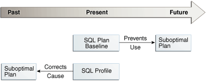
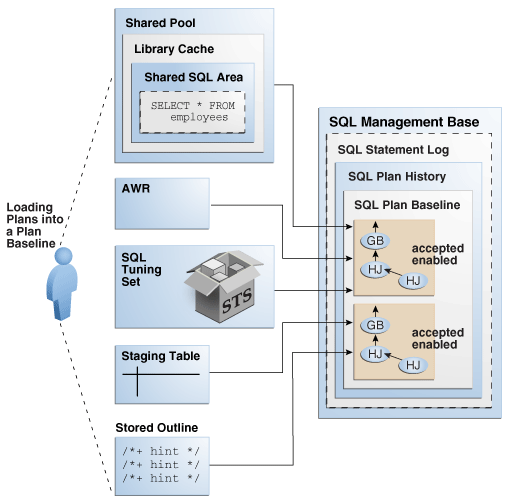
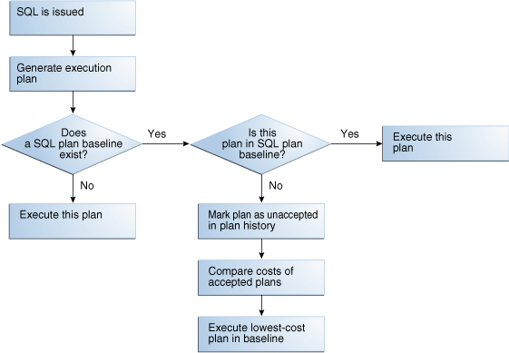
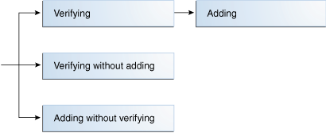
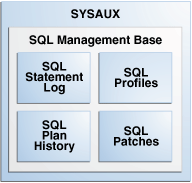
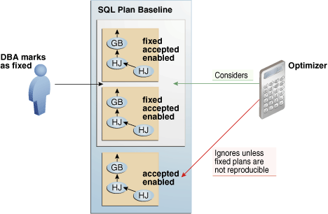

**SQL plan management** is a preventative mechanism that enables the optimizer to automatically manage execution plans, ensuring that the database uses only known or verified plans.

### 28.1 About SQL Plan Baselines

SQL plan management uses a mechanism called a **SQL plan baseline**, which is a set of accepted plans that the optimizer is allowed to use for a SQL statement.

In this context, a plan includes all plan-related information (for example, SQL plan identifier, set of hints, bind values, and optimizer environment) that the optimizer needs to reproduce an execution plan. The baseline is implemented as a set of plan rows and the outlines required to reproduce the plan. An outline is a set of optimizer hints used to force a specific plan.

The main components of SQL plan management are as follows:

- Plan capture
	This component stores relevant information about plans for a set of SQL statements.
- Plan selection
	This component is the detection by the optimizer of plan changes based on stored plan history, and the use of SQL plan baselines to select appropriate plans to avoid potential performance regressions.
- Plan evolution
	This component is the process of adding new plans to existing SQL plan baselines, either manually or automatically. In the typical use case, the database accepts a plan into the plan baseline only after verifying that the plan performs well.

### 28.2 Purpose of SQL Plan Management

SQL plan management prevents performance regressions caused by plan changes.

A secondary goal is to gracefully adapt to changes such as new optimizer statistics or indexes by verifying and accepting only plan changes that improve performance.

Note:

SQL plan baselines cannot help when an event has caused irreversible execution plan changes, such as dropping an index.

#### 28.2.1 Benefits of SQL Plan Management

SQL plan management can improve or preserve SQL performance in database upgrades and system and data changes.

Specifically, benefits include:

- A database upgrade that installs a new optimizer version usually results in plan changes for a small percentage of SQL statements.
	Most plan changes result in either improvement or no performance change. However, some plan changes may cause performance regressions. SQL plan baselines significantly minimize potential regressions resulting from an upgrade.
	When you upgrade, the database only uses plans from the plan baseline. The database puts new plans that are not in the current baseline into a holding area, and later evaluates them to determine whether they use fewer resources than the current plan in the baseline. If the plans perform better, then the database promotes them into the baseline; otherwise, the database does not promote them.
- Ongoing system and data changes can affect plans for some SQL statements, potentially causing performance regressions.
	SQL plan baselines help minimize performance regressions and stabilize SQL performance.
- Deployment of new application modules introduces new SQL statements into the database.
	The application software may use appropriate SQL execution plans developed in a standard test configuration for the new statements. If the system configuration is significantly different from the test configuration, then the database can evolve SQL plan baselines over time to produce better performance.

See Also:

[Oracle Database Upgrade Guide](https://docs.oracle.com/pls/topic/lookup?ctx=en/database/oracle/oracle-database/21/tgsql&id=UPGRD001) to learn how to upgrade an Oracle database

#### 28.2.2 Differences Between SQL Plan Baselines and SQL Profiles

Both SQL profiles and SQL plan baselines help improve the performance of SQL statements by ensuring that the optimizer uses only optimal plans.

Both profiles and baselines are internally implemented using hints. However, these mechanisms have significant differences, including the following:

- In general, SQL plan baselines are proactive, whereas SQL profiles are reactive.
	Typically, you create SQL plan baselines before significant performance problems occur. SQL plan baselines prevent the optimizer from using suboptimal plans in the future.
	The database creates SQL profiles when you invoke SQL Tuning Advisor, which you do typically only after a SQL statement has shown high-load symptoms. SQL profiles are primarily useful by providing the ongoing resolution of optimizer mistakes that have led to suboptimal plans. Because the SQL profile mechanism is reactive, it cannot guarantee stable performance as drastic database changes occur.
	Figure 28-1 SQL Plan Baselines and SQL Profiles
	

> This graphic shows a right-facing arrow labeled Past, Present, and Future. Underneath the arrow is a SQL Plan Baseline box. The box points right toward a Bad Plan text box. The arrow is labeled "Prevents Use." Underneath the SQL Plan Baseline box is a SQL Profile box. This box points right toward a Bad Plan box. The arrow is labeled "Corrects Cause."

- SQL plan baselines reproduce a specific plan, whereas SQL profiles correct optimizer cost estimates.
	A SQL plan baseline is a set of accepted plans. Each plan is implemented using a set of outline hints that fully specify a particular plan. SQL profiles are also implemented using hints, but these hints do not specify any specific plan. Rather, the hints correct miscalculations in the optimizer estimates that lead to suboptimal plans. For example, a hint may correct the cardinality estimate of a table.
	Because a profile does not constrain the optimizer to any one plan, a SQL profile is more flexible than a SQL plan baseline. For example, changes in initialization parameters and optimizer statistics enable the optimizer to choose a better plan.

Oracle recommends that you use SQL Tuning Advisor. In this way, you follow the recommendations made by the advisor for SQL profiles and plan baselines rather than trying to determine which mechanism is best for each SQL statement.

See Also:

- " [About Optimizer Hints](influencing-the-optimizer.md) "
- " [Managing SQL Profiles](managing-sql-profiles.md) "
- " [Analyzing SQL with SQL Tuning Advisor](sql-tuning-advisor.md) "

### 28.3 Plan Capture

**SQL plan capture** refers to techniques for capturing and storing relevant information about plans in the SQL Management Base for a set of SQL statements.

Capturing a plan means making SQL plan management aware of this plan. You can configure initial plan capture to occur automatically by setting an initialization parameter, or you can capture plans manually by using the `DBMS_SPM` package.

#### 28.3.1 Automatic Initial Plan Capture

When enabled, the database checks whether executed SQL statements are eligible for automatic capture.

You can enable **automatic initial plan capture** by setting `OPTIMIZER_CAPTURE_SQL_PLAN_BASELINES` to `true` (the default is `false`). Note that the initialization parameter `OPTIMIZER_USE_SQL_PLAN_BASELINES` is independent. For example, if `OPTIMIZER_CAPTURE_SQL_PLAN_BASELINES` is `true`, then the database creates initial plan baselines regardless of whether `OPTIMIZER_USE_SQL_PLAN_BASELINES` is `true` or `false`.

See Also:

- " Plan Selection "
- [Oracle Database Reference](https://docs.oracle.com/pls/topic/lookup?ctx=en/database/oracle/oracle-database/21/tgsql&id=REFRN10293) to learn about the `OPTIMIZER_USE_SQL_PLAN_BASELINES` initialization parameter

##### 28.3.1.1 Eligibility for Automatic Initial Plan Capture

To be eligible for automatic plan capture, an executed statement must be repeatable, and it must not be excluded by any capture filters.

By default, the database considers all repeatable SQL statements as eligible for capture, with the following exceptions:

- `CREATE TABLE` when the `AS SELECT` clause is not specified
- `DROP TABLE`
- `INSERT INTO ... VALUES`

The first check for eligibility is repeated execution. If a statement is executed less than twice, then the database does not consider it eligible for a SQL plan baseline. If a statement is executed at least twice, then it is by definition repeatable, and so the database considers it eligible for further checking.

Note:

SQL plan management does not protect statements that have been explained using `EXPLAIN PLAN` but have not been executed.

For repeatable statements, the `DBMS_SPM.CONFIGURE` procedure enables you to create an [automatic capture filter](glossary.md). Thus, you can capture only statements that you want, and exclude noncritical statements, thereby saving space in the `SYSAUX` tablespace. Noncritical queries often have the following characteristics:

- Not executed often enough to be significant
- Not resource-intensive
- Not sufficiently complex to benefit from SQL plan management

For a specified parameter, a filter either includes (`allow=>TRUE`) or excludes (`allow=>FALSE`) plans for statements with the specified values. To be eligible for capture, a repeatable statement must not be excluded by any filter. The `DBMS_SPM.CONFIGURE` procedure supports filters for SQL text, parsing schema name, module, and action.

A null value for any parameter removes the filter. By using `parameter_value=>'%'` in combination with `allow=FALSE`, you can filter out all values for a parameter, and then create a separate filter to include only specified values. The `DBA_SQL_MANAGEMENT_CONFIG` view shows the current filters.

See Also:

- " [Configuring Filters for Automatic Plan Capture](managing-sql-plan-baselines.md) "
- [Oracle Database PL/SQL Packages and Types Reference](https://docs.oracle.com/pls/topic/lookup?ctx=en/database/oracle/oracle-database/21/tgsql&id=ARPLS-GUID-D855D4B9-D071-4BB2-A554-38479867DE76) to learn more about the `DBMS_SPM.CONFIGURE` procedure
- [Oracle Database Reference](https://docs.oracle.com/pls/topic/lookup?ctx=en/database/oracle/oracle-database/21/tgsql&id=REFRN-GUID-4E9C3D2A-93B8-49C5-9169-C54A9EB7431C) to learn more about the `DBA_SQL_MANAGEMENT_CONFIG` view

##### 28.3.1.2 Plan Matching for Automatic Initial Plan Capture

If the database executes a repeatable SQL statement, and if this statement passes through the `DBMS_SPM.CONFIGURE` filters, then the database attempts to match a plan in the SQL plan baseline.

For automatic initial plan capture, the plan matching algorithm is as follows:

- If a SQL plan baseline does not exist, then the optimizer creates a plan history and SQL plan baseline for the statement, marking the initial plan for the statement as accepted and adding it to the SQL plan baseline.
- If a SQL plan baseline exists, then the optimizer behavior depends on the cost-based plan derived at parse time:
	- If this plan does not match a plan in the SQL plan baseline, then the optimizer marks the new plan as unaccepted and adds it to the SQL plan baseline.
		- If this plan does match a plan in the SQL plan baseline, then nothing is added to the SQL plan baseline.

#### 28.3.2 Manual Plan Capture

In SQL plan management, **manual plan capture** refers to the user-initiated bulk load of existing plans into a SQL plan baseline.

Use Cloud Control or PL/SQL to load the execution plans for SQL statements from [AWR](glossary.md), a [SQL tuning set (STS)](glossary.md), the [shared SQL area](glossary.md), a staging table, or a [stored outline](glossary.md).

Figure 28-2 Loading Plans into a SQL Plan Baseline



> This graphic shows the SYSAUX tablespace. Inside this tablespace is the SQL Management Base. Inside the SQL Management Base are the SQL Statement Log and SQL Profiles. The tablespace corresponds to two data files.
>
> [  
> Copyright © 2013, 2023, Oracle and/or its affiliates.](https://docs.oracle.com/en/database/oracle/oracle-database/dcommon/html/cpyr.htm)


The loading behavior varies depending on whether a SQL plan baseline exists for each statement represented in the bulk load:

- If a baseline for the statement does not exist, then the database does the following:
	1. Creates a plan history and plan baseline for the statement
		2. Marks the initial plan for the statement as accepted
		3. Adds the plan to the new baseline
- If a baseline for the statement exists, then the database does the following:
	1. Marks the loaded plan as accepted
		2. Adds the plan to the plan baseline for the statement without verifying the plan's performance

Manually loaded plans are always marked accepted because the optimizer assumes that any plan loaded manually by the administrator has acceptable performance. You can load plans without enabling them by setting the `enabled` parameter to `NO` in the `DBMS_SPM.LOAD_PLANS_FROM_%` functions.

See Also:

[Oracle Database PL/SQL Packages and Types Reference](https://docs.oracle.com/pls/topic/lookup?ctx=en/database/oracle/oracle-database/21/tgsql&id=GUID-74594B3C-6D36-4008-8E2E-20EEB278D0BB) to learn more about the `DBMS_SPM.LOAD_PLANS_FROM_%` functions

### 28.4 Plan Selection

SQL plan selection is the optimizer ability to detect plan changes based on stored plan history, and the use of SQL plan baselines to select plans to avoid potential performance regressions.

When the database performs a [hard parse](glossary.md) of a SQL statement, the optimizer generates a best-cost plan. By default, the optimizer then attempts to find a matching plan in the SQL plan baseline for the statement. If no plan baseline exists, then the database runs the statement with the best-cost plan.

If a plan baseline exists, then the optimizer behavior depends on whether the newly generated plan is in the plan baseline:

- If the new plan is in the baseline, then the database executes the statement using the found plan.
- If the new plan is not in the baseline, then the optimizer marks the newly generated plan as unaccepted and adds it to the plan history. Optimizer behavior depends on the contents of the plan baseline:
	- If fixed plans exist in the plan baseline, then the optimizer uses the fixed plan with the lowest cost.
		- If no fixed plans exist in the plan baseline, then the optimizer uses the baseline plan with the lowest cost.
		- If no reproducible plans exist in the plan baseline, which could happen if every plan in the baseline referred to a dropped index, then the optimizer uses the newly generated cost-based plan.

Figure 28-3 Decision Tree for SQL Plan Selection



> This graphic shows a flow chart. The "SQL is issued" box points down to the "Generate execution plan" box, which points down to the "Does a SQL plan baseline exist?" diamond. The diamond has a "No" arrow that points down to the "Execute this plan" box. The diamond has a "Yes" arrows that points right to the "Is this plan in SQL plan baseline?" diamond. The "No" arrow points down to the "Mark plan as unaccepted in plan history" box, which points down to the "compare costs of accepted plans" box, which points down to the "Execute lowest-cost plan in baseline" box. The diamond has a "Yes" arrow that points right to the "Execute this plan" box.


See Also:

" Fixed Plans "

### 28.5 Plan Evolution

In general, SQL **plan evolution** is the process by which the optimizer verifies new plans and adds them to an existing SQL plan baseline.

#### 28.5.1 Purpose of Plan Evolution

Typically, a SQL plan baseline for a statement starts with one accepted plan.

However, some SQL statements perform well when executed with different plans under different conditions. For example, a SQL statement with bind variables whose values result in different selectivities may have several optimal plans. Creating a materialized view or an index or repartitioning a table may make current plans more expensive than other plans.

If new plans were never added to SQL plan baselines, then the performance of some SQL statements might degrade. Thus, it is sometimes necessary to evolve newly accepted plans into SQL plan baselines. Plan evolution prevents performance regressions by verifying the performance of a new plan before including it in a SQL plan baseline.

#### 28.5.2 How Plan Evolution Works

Plan evolution involves both verifying and adding plans.

Specifically, plan evolution consists of the following distinct steps:

1. Verifying
	The optimizer ensures that unaccepted plans perform at least as well as accepted plans in a SQL plan baseline (known as [plan verification](glossary.md)).
2. Adding
	After the database has proved that unaccepted plans perform as well as accepted plans, the database adds the plans to the baseline.

In the standard case of plan evolution, the optimizer performs the preceding steps sequentially, so that a new plan is not usable by SQL plan management until the optimizer verifies plan performance relative to the SQL plan baseline. However, you can configure SQL plan management to perform one step without performing the other. The following graphic shows the possible paths for plan evolution.

Figure 28-4 Plan Evolution



> This graphic shows a flow chart. An arrow points right and splits into three arrows. The top points to the Verifying box, which points right to the Adding box; the middle arrow points right to the Verifying without adding box; the lower arrow points right to the Adding without verifying box.


#### 28.5.3 PL/SQL Subprograms for Plan Evolution

The `DBMS_SPM` package provides procedures and functions for plan evolution.

These subprograms use the task infrastructure. For example, `CREATE_EVOLVE_TASK` creates an evolution task, whereas `EXECUTE_EVOLVE_TASK` executes it. All task evolution subprograms have the string `EVOLVE_TASK` in the name.

Use the evolve procedures on demand, or configure the subprograms to run automatically. The automatic maintenance task `SYS_AUTO_SPM_EVOLVE_TASK` executes daily in the scheduled maintenance window. The task perform the following actions automatically:

1. Selects and ranks unaccepted plans for verification
2. Accepts each plan if it satisfies the performance threshold

See Also:

- " [Managing the SPM Evolve Advisor Task](managing-sql-plan-baselines.md) "
- " [Evolving SQL Plan Baselines Manually](managing-sql-plan-baselines.md) "
- [Oracle Database PL/SQL Packages and Types Reference](https://docs.oracle.com/pls/topic/lookup?ctx=en/database/oracle/oracle-database/21/tgsql&id=ARPLS150) to learn about the `DBMS_SPM` package

### 28.6 Storage Architecture for SQL Plan Management

The SQL plan management infrastructure records the signatures of parsed statements, and both accepted and unaccepted plans.

#### 28.6.1 SQL Management Base

The **SQL management base (SMB)** is a logical repository in the data dictionary.

The SMB contains the following:

- SQL statement log, which contains only SQL IDs
- SQL plan history, which includes the SQL plan baselines
- SQL profiles
- SQL patches

The SMB stores information that the optimizer can use to maintain or improve SQL performance.

The SMB resides in the `SYSAUX` tablespace and uses automatic segment-space management. Because the SMB is located entirely within the `SYSAUX` tablespace, the database does not use SQL plan management and SQL tuning features when this tablespace is unavailable.

Figure 28-5 SMB Architecture



> This graphic shows the SYSAUX tablespace. Inside this tablespace is the SQL Management Base. Inside the SQL Management Base are the SQL Statement Log and SQL Profiles. The tablespace corresponds to two data files.
>
> [  
> Copyright © 2013, 2023, Oracle and/or its affiliates.](https://docs.oracle.com/en/database/oracle/oracle-database/dcommon/html/cpyr.htm)


SMB data related to a PDB is stored in the PDB, and is included if the PDB is unplugged. A common user whose current container is the CDB root can view SMB data for PDBs. A user whose current container is a PDB can view the SMB data for the PDB only.

See Also:

[Oracle Database Administrator’s Guide](https://docs.oracle.com/pls/topic/lookup?ctx=en/database/oracle/oracle-database/21/tgsql&id=ADMIN00203) to learn about the `SYSAUX` tablespace

#### 28.6.2 SQL Statement Log

When automatic SQL plan capture is enabled, the **SQL statement log** contains the signature of statements that the optimizer has evaluated over time.

A [SQL signature](glossary.md) is a numeric hash value computed using a SQL statement text that has been normalized for case insensitivity and white space. When the optimizer parses a statement, it creates signature.

During automatic capture, the database matches this signature against the SQL statement log (`SQLLOG$`) to determine whether the signature has been observed before. If it has not, then the database adds the signature to the log. If the signature is already in the log, then the database has confirmation that the statement is a [repeatable SQL statement](glossary.md).

Note:

If a filter excludes a statement, then its signature is also excluded from the log.

Example 28-1 Logging SQL Statements

This example illustrates how the database tracks statements in the statement log and creates baselines automatically for repeatable statements. An initial query of the statement log shows no tracked SQL statements. After a query of `hr.jobs` for `AD_PRES`, the log shows one tracked statement.

```
SQL> ALTER SYSTEM SET OPTIMIZER_CAPTURE_SQL_PLAN_BASELINES=true;

System altered.

SQL> SELECT * FROM SQLLOG$;
 
no rows selected
 
SQL> SELECT job_title FROM hr.jobs WHERE job_id = 'AD_PRES';
 
JOB_TITLE
-----------------------------------
President
 
SQL> SELECT * FROM SQLLOG$;
 
 SIGNATURE     BATCH#
---------- ----------
1.8096E+19          1
```

Now the session executes a different `jobs` query. The log shows two tracked statements:

```
SQL> SELECT job_title FROM hr.jobs WHERE job_id='PR_REP';
 
JOB_TITLE
-----------------------------------
Public Relations Representative
 
SQL> SELECT * FROM SQLLOG$;
 
 SIGNATURE     BATCH#
---------- ----------
1.7971E+19          1
1.8096E+19          1
```

A query of `DBA_SQL_PLAN_BASELINES` shows that no baseline for either statement exists because neither statement is repeatable:

```
SQL> SELECT SQL_HANDLE, SQL_TEXT 
  2  FROM DBA_SQL_PLAN_BASELINES 
  3  WHERE SQL_TEXT LIKE 'SELECT job_title%';
 
no rows selected
```

The session executes the query for `job_id='PR_REP'` a second time. Because this statement is now repeatable, and because automatic SQL plan capture is enabled, the database creates a plan baseline for this statement. The query for `job_id='AD_PRES'` has only been executed once, so no plan baseline exists for it.

```
SQL> SELECT job_title FROM hr.jobs WHERE job_id='PR_REP';
 
JOB_TITLE
-----------------------------------
Public Relations Representative
 
SQL> SELECT SQL_HANDLE, SQL_TEXT 
  2  FROM DBA_SQL_PLAN_BASELINES 
  3  WHERE SQL_TEXT LIKE 'SELECT job_title%';
 
SQL_HANDLE           SQL_TEXT
-------------------- --------------------
SQL_f9676a330f972dd5 SELECT job_title FRO
                     M hr.jobs WHERE job_
                     id='PR_REP'
```

See Also:

- " Automatic Initial Plan Capture "
- [Oracle Database Reference](https://docs.oracle.com/pls/topic/lookup?ctx=en/database/oracle/oracle-database/21/tgsql&id=REFRN23714) to learn about `DBA_SQL_PLAN_BASELINES`

#### 28.6.3 SQL Plan History

The **SQL plan history** is the set of captured SQL execution plans. The history contains both SQL plan baselines and unaccepted plans.

In SQL plan management, the database detects new SQL execution plans for existing SQL plan baselines and records the new plan in the history so that they can be evolved (verified). Evolution is initiated automatically by the database or manually by the DBA.

Starting in Oracle Database 12c, the SMB stores the execution plans for all SQL statements in the SQL plan history. The `DBMS_XPLAN.DISPLAY_SQL_PLAN_BASELINE` function fetches and displays the plan from the SMB. For plans created before Oracle Database 12c, the function must compile the SQL statement and generate the plan because the SMB does not store it.

See Also:

- " [Displaying Plans in a SQL Plan Baseline](managing-sql-plan-baselines.md) "
- [Oracle Database PL/SQL Packages and Types Reference](https://docs.oracle.com/pls/topic/lookup?ctx=en/database/oracle/oracle-database/21/tgsql&id=ARPLS70138) to learn about the `DBMS_XPLAN.DISPLAY_SQL_PLAN_BASELINE` function

##### 28.6.3.1 Enabled Plans

An enabled plan is a plan that is eligible for use by the optimizer.

When plans are loaded with the `enabled` parameter set to `YES` (default), the database automatically marks the resulting SQL plan baselines as enabled, even if they are unaccepted. You can manually change an enabled plan to a [disabled plan](glossary.md), which means the optimizer can no longer use the plan even if it is accepted.

##### 28.6.3.2 Accepted Plans

An accepted plan is a plan that is in a SQL plan baseline for a SQL statement and thus available for use by the optimizer. An accepted plan contains a set of hints, a plan hash value, and other plan-related information.

The SQL plan history for a statement contains all plans, both accepted and unaccepted. After the optimizer generates the first accepted plan in a plan baseline, every subsequent [unaccepted plan](glossary.md) is added to the plan history, awaiting verification, but is not in the SQL plan baseline.

##### 28.6.3.3 Fixed Plans

A fixed plan is an accepted plan that is marked as preferred, so that the optimizer considers only the fixed plans in the baseline. Fixed plans influence the plan selection process of the optimizer.

Assume that three plans exist in the SQL plan baseline for a statement. You want the optimizer to give preferential treatment to only two of the plans. As shown in the following figure, you mark these two plans as fixed so that the optimizer uses only the best plan from these two, ignoring the other plans.

Figure 28-6 Fixed Plans



> This graphic shows the SYSAUX tablespace. Inside this tablespace is the SQL Management Base. Inside the SQL Management Base are the SQL Statement Log and SQL Profiles. The tablespace corresponds to two data files.
>
> [  
> Copyright © 2013, 2023, Oracle and/or its affiliates.](https://docs.oracle.com/en/database/oracle/oracle-database/dcommon/html/cpyr.htm)


If new plans are added to a baseline that contains at least one enabled fixed plan, then the optimizer cannot use the new plans until you manually declare them as fixed.