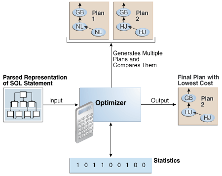
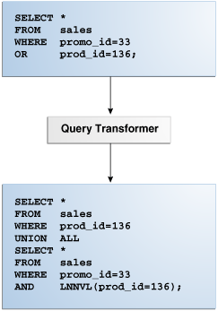
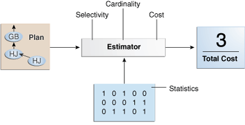
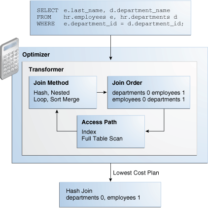
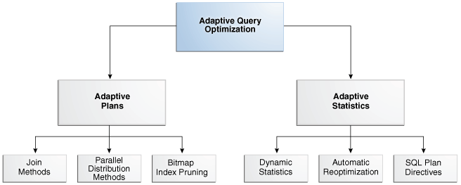
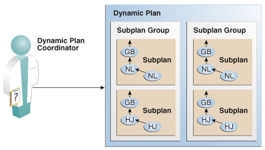
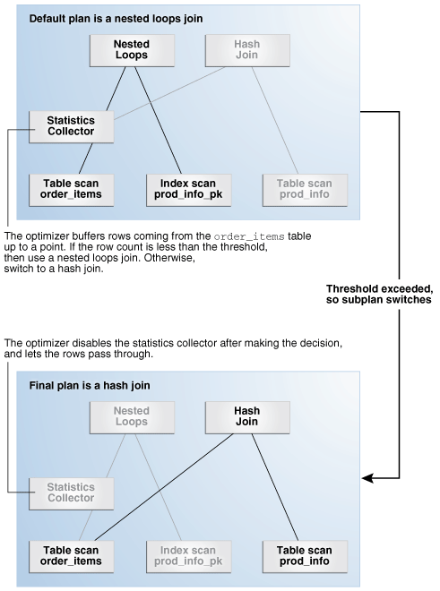
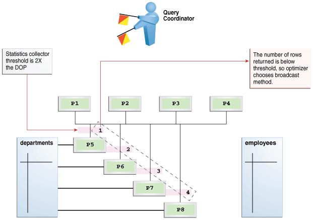

This chapter describes the most important concepts relating to the query optimizer, including its principal components.

### 4.1 Introduction to the Query Optimizer

The **query optimizer** (called simply the **optimizer**) is built-in database software that determines the most efficient method for a SQL statement to access requested data.

#### 4.1.1 Purpose of the Query Optimizer

The optimizer attempts to generate the most optimal execution plan for a SQL statement.

The optimizer choose the plan with the lowest cost among all considered candidate plans. The optimizer uses available statistics to calculate cost. For a specific query in a given environment, the cost computation accounts for factors of query execution such as I/O, CPU, and communication.

For example, a query might request information about employees who are managers. If the optimizer statistics indicate that 80% of employees are managers, then the optimizer may decide that a full table scan is most efficient. However, if statistics indicate that very few employees are managers, then reading an index followed by a table access by rowid may be more efficient than a full table scan.

Because the database has many internal statistics and tools at its disposal, the optimizer is usually in a better position than the user to determine the optimal method of statement execution. For this reason, all SQL statements use the optimizer.

#### 4.1.2 Cost-Based Optimization

**Query optimization** is the process of choosing the most efficient means of executing a SQL statement.

SQL is a nonprocedural language, so the optimizer is free to merge, reorganize, and process in any order. The database optimizes each SQL statement based on statistics collected about the accessed data. The optimizer determines the optimal plan for a SQL statement by examining multiple access methods, such as full table scan or index scans, different join methods such as nested loops and hash joins, different join orders, and possible transformations.

For a given query and environment, the optimizer assigns a relative numerical cost to each step of a possible plan, and then factors these values together to generate an overall cost estimate for the plan. After calculating the costs of alternative plans, the optimizer chooses the plan with the lowest cost estimate. For this reason, the optimizer is sometimes called the [cost-based optimizer (CBO)](glossary.md) to contrast it with the legacy rule-based optimizer (RBO).

Note:

The optimizer may not make the same decisions from one version of Oracle Database to the next. In recent versions, the optimizer might make different decision because better information is available and more optimizer transformations are possible.

#### 4.1.3 Execution Plans

An **execution plan** describes a recommended method of execution for a SQL statement.

The plan shows the combination of the steps Oracle Database uses to execute a SQL statement. Each step either retrieves rows of data physically from the database or prepares them for the user issuing the statement.

An execution plan displays the cost of the entire plan, indicated on line 0, and each separate operation. The cost is an internal unit that the execution plan only displays to allow for plan comparisons. Thus, you cannot tune or change the cost value.

In the following graphic, the optimizer generates two possible execution plans for an input SQL statement, uses statistics to estimate their costs, compares their costs, and then chooses the plan with the lowest cost.

Figure 4-1 Execution Plans



> This graphic depicts two plans, labeled Plan 1 and Plan 2. An arrow points up from a box labeled Optimizer. The arrow is labeled "Generates and Compares." The Optimizer points to the right to an image of Plan 2. The arrow is labeled Output. The optimizer has a double-headed arrow a box of 1s and 0s. The box is labeled Statistics. On the left is a box labeled Parsed Representation of SQL Statement. An arrow points to the Optimizer box. The arrow is labeled Input.


##### 4.1.3.1 Query Blocks

The input to the optimizer is a parsed representation of a SQL statement.

Each `SELECT` block in the original SQL statement is represented internally by a [query block](glossary.md). A query block can be a top-level statement, subquery, or unmerged view.

Example 4-1 Query Blocks

The following SQL statement consists of two query blocks. The subquery in parentheses is the inner query block. The outer query block, which is the rest of the SQL statement, retrieves names of employees in the departments whose IDs were supplied by the subquery. The query form determines how query blocks are interrelated.

```
SELECT first_name, last_name
FROM   hr.employees
WHERE  department_id 
IN     (SELECT department_id 
        FROM   hr.departments 
        WHERE  location_id = 1800);
```

See Also:

- " [View Merging](query-transformations.md) "
- [Oracle Database Concepts](https://docs.oracle.com/pls/topic/lookup?ctx=en/database/oracle/oracle-database/21/tgsql&id=CNCPT015) for an overview of SQL processing

##### 4.1.3.2 Query Subplans

For each query block, the optimizer generates a query subplan.

The database optimizes query blocks separately from the bottom up. Thus, the database optimizes the innermost query block first and generates a subplan for it, and then generates the outer query block representing the entire query.

The number of possible plans for a query block is proportional to the number of objects in the `FROM` clause. This number rises exponentially with the number of objects. For example, the possible plans for a join of five tables are significantly higher than the possible plans for a join of two tables.

##### 4.1.3.3 Analogy for the Optimizer

One analogy for the optimizer is an online trip advisor.

A cyclist wants to know the most efficient bicycle route from point A to point B. A query is like the directive "I need the most efficient route from point A to point B" or "I need the most efficient route from point A to point B by way of point C." The trip advisor uses an internal algorithm, which relies on factors such as speed and difficulty, to determine the most efficient route. The cyclist can influence the trip advisor's decision by using directives such as "I want to arrive as fast as possible" or "I want the easiest ride possible."

In this analogy, an execution plan is a possible route generated by the trip advisor. Internally, the advisor may divide the overall route into several subroutes (subplans), and calculate the efficiency for each subroute separately. For example, the trip advisor may estimate one subroute at 15 minutes with medium difficulty, an alternative subroute at 22 minutes with minimal difficulty, and so on.

The advisor picks the most efficient (lowest cost) overall route based on user-specified goals and the available statistics about roads and traffic conditions. The more accurate the statistics, the better the advice. For example, if the advisor is not frequently notified of traffic jams, road closures, and poor road conditions, then the recommended route may turn out to be inefficient (high cost).

### 4.2 About Optimizer Components

The optimizer contains three components: the transformer, estimator, and plan generator.

The following graphic illustrates the components.

Figure 4-2 Optimizer Components


> This illustration depicts a parsed query (from the parser) entering the Query Transformer.
>
> The transformed query is then sent to the Estimator. Statistics are retrieved from the Dictionary, then the query and estimates are sent to the Plan Generator.
>
> The plan generator either returns the plan to the estimator or sends the execution plan to the row source generator.
>
> End of image description.


A set of query blocks represents a parsed query, which is the input to the optimizer. The following table describes the optimizer operations.

Table 4-1 Optimizer Operations

| Phase | Operation | Description | To Learn More |
| --- | --- | --- | --- |
| 1 | Query Transformer | The optimizer determines whether it is helpful to change the form of the query so that the optimizer can generate a better execution plan. | " Query Transformer " |
| 2 | Estimator | The optimizer estimates the cost of each plan based on statistics in the data dictionary. | " Estimator " |
| 3 | Plan Generator | The optimizer compares the costs of plans and chooses the lowest-cost plan, known as the execution plan, to pass to the row source generator. | " Plan Generator " |

#### 4.2.1 Query Transformer

For some statements, the query transformer determines whether it is advantageous to rewrite the original SQL statement into a semantically equivalent SQL statement with a lower cost.

When a viable alternative exists, the database calculates the cost of the alternatives separately and chooses the lowest-cost alternative. The following graphic shows the query transformer rewriting an input query that uses `OR` into an output query that uses `UNION ALL`.

Figure 4-3 Query Transformer



> The top box contains the following statement:
>
> SELECT \*
>
> FROM sales
>
> WHERE promo\_id=33
>
> OR prod\_id=136;
>
> An arrow points down to a box labeled "Query Transformer." This box points down to a box containing the following SQL statement:
>
> SELECT \*
>
> FROM sales
>
> WHERE promo\_id=136
>
> UNION ALL
>
> SELECT \*
>
> FROM sales
>
> WHERE promo\_id=33
>
> AND LNNVL(prod\_id=136);


#### 4.2.2 Estimator

The **estimator** is the component of the optimizer that determines the overall cost of a given execution plan.

The estimator uses three different measures to determine cost:

- Selectivity
	The percentage of rows in the row set that the query selects, with `0` meaning no rows and `1` meaning all rows. Selectivity is tied to a query predicate, such as `WHERE last_name LIKE 'A%'`, or a combination of predicates. A predicate becomes more selective as the selectivity value approaches `0` and less selective (or more unselective) as the value approaches `1`.
	Note:
	Selectivity is an internal calculation that is not visible in the execution plans.
- Cardinality
	The cardinality is the number of rows returned by each operation in an execution plan. This input, which is crucial to obtaining an optimal plan, is common to all cost functions. The estimator can derive cardinality from the table statistics collected by `DBMS_STATS`, or derive it after accounting for effects from predicates (filter, join, and so on), `DISTINCT` or `GROUP BY` operations, and so on. The `Rows` column in an execution plan shows the estimated cardinality.
- Cost
	This measure represents units of work or resource used. The query optimizer uses disk I/O, CPU usage, and memory usage as units of work.

As shown in the following graphic, if statistics are available, then the estimator uses them to compute the measures. The statistics improve the degree of accuracy of the measures.

Figure 4-4 Estimator



> The box on the left is labeled Plan. An arrow points to a box labeled Estimator. This box has three characteristics: Cardinality, Selectivity, and Cost. An arrow points to a box on the right with the contents "Total Cost=3". A box below the Estimator box is labeled "Statistics." The box is filled with 1s and 0s.


For the query shown in Example 4-1, the estimator uses selectivity, estimated cardinality (a total return of 10 rows), and cost measures to produce its total cost estimate of 3:

```
---------------------------------------------------------------------------
|Id| Operation                    |Name         |Rows|Bytes|Cost %CPU|Time|
---------------------------------------------------------------------------
| 0| SELECT STATEMENT             |                 |10|250|3 (0)|00:00:01|
| 1|  NESTED LOOPS                |                 |  |   |     |        |
| 2|   NESTED LOOPS               |                 |10|250|3 (0)|00:00:01|
|*3|    TABLE ACCESS FULL         |DEPARTMENTS      | 1|  7|2 (0)|00:00:01|
|*4|    INDEX RANGE SCAN          |EMP_DEPARTMENT_IX|10|   |0 (0)|00:00:01|
| 5|   TABLE ACCESS BY INDEX ROWID|EMPLOYEES        |10|180|1 (0)|00:00:01|
---------------------------------------------------------------------------
```

##### 4.2.2.1 Selectivity

The selectivity represents a fraction of rows from a row set.

The row set can be a base table, a view, or the result of a join. The selectivity is tied to a query predicate, such as `last_name` = `'Smith'`, or a combination of predicates, such as `last_name = 'Smith' AND job_id = 'SH_CLERK'`.

Note:

Selectivity is an internal calculation that is not visible in execution plans.

A predicate filters a specific number of rows from a row set. Thus, the selectivity of a predicate indicates how many rows pass the predicate test. Selectivity ranges from 0.0 to 1.0. A selectivity of 0.0 means that no rows are selected from a row set, whereas a selectivity of 1.0 means that all rows are selected. A predicate becomes more selective as the value approaches 0.0 and less selective (or more unselective) as the value approaches 1.0.

The optimizer estimates selectivity depending on whether statistics are available:

- Statistics not available
	Depending on the value of the `OPTIMIZER_DYNAMIC_SAMPLING` initialization parameter, the optimizer either uses [dynamic statistics](glossary.md) or an internal default value. The database uses different internal defaults depending on the predicate type. For example, the internal default for an equality predicate (`last_name = 'Smith'`) is lower than for a range predicate (`last_name > 'Smith'`) because an equality predicate is expected to return a smaller fraction of rows.
- Statistics available
	When statistics are available, the estimator uses them to estimate selectivity. Assume there are 150 distinct employee last names. For an equality predicate `last_name = 'Smith'`, selectivity is the reciprocal of the number `n` of distinct values of `last_name`, which in this example is.006 because the query selects rows that contain 1 out of 150 distinct values.
	If a histogram exists on the `last_name` column, then the estimator uses the histogram instead of the number of distinct values. The histogram captures the distribution of different values in a column, so it yields better selectivity estimates, especially for columns that have [data skew](glossary.md).

See Also:

- " [Histograms](https://docs.oracle.com/en/database/oracle/oracle-database/21/tgsql/histograms.html#GUID-BE10EBFC-FEFC-4530-90DF-1443D9AD9B64 "A histogram is a special type of column statistic that provides more detailed information about the data distribution in a table column. A histogram sorts values into \"buckets,\" as you might sort coins into buckets.") "
- [Oracle Database Reference](https://docs.oracle.com/pls/topic/lookup?ctx=en/database/oracle/oracle-database/21/tgsql&id=REFRN-GUID-43655FC3-3C32-486B-8B11-8C20C152618D) to learn more about `OPTIMIZER_DYNAMIC_SAMPLING`

##### 4.2.2.2 Cardinality

The cardinality is the number of rows returned by each operation in an execution plan.

For example, if the optimizer estimate for the number of rows returned by a full table scan is 100, then the cardinality estimate for this operation is 100. The cardinality estimate appears in the `Rows` column of the execution plan.

The optimizer determines the cardinality for each operation based on a complex set of formulas that use both table and column level statistics, or dynamic statistics, as input. The optimizer uses one of the simplest formulas when a single equality predicate appears in a single-table query, with no histogram. In this case, the optimizer assumes a uniform distribution and calculates the cardinality for the query by dividing the total number of rows in the table by the number of distinct values in the column used in the `WHERE` clause predicate.

For example, user `hr` queries the `employees` table as follows:

```
SELECT first_name, last_name
FROM   employees
WHERE  salary='10200';
```

The `employees` table contains 107 rows. The current database statistics indicate that the number of distinct values in the `salary` column is `58`. Therefore, the optimizer estimates the cardinality of the result set as `2`, using the formula `107/58=1.84`.

Cardinality estimates must be as accurate as possible because they influence all aspects of the execution plan. Cardinality is important when the optimizer determines the cost of a join. For example, in a nested loops join of the `employees` and `departments` tables, the number of rows in `employees` determines how often the database must probe the `departments` table. Cardinality is also important for determining the cost of sorts.

##### 4.2.2.3 Cost

The optimizer cost model accounts for the machine resources that a query is predicted to use.

The [cost](glossary.md) is an internal numeric measure that represents the estimated resource usage for a plan. The cost is specific to a query in an optimizer environment. To estimate cost, the optimizer considers factors such as the following:

- System resources, which includes estimated I/O, CPU, and memory
- Estimated number of rows returned (cardinality)
- Size of the initial data sets
- Distribution of the data
- Access structures

Note:

The cost is an internal measure that the optimizer uses to compare different plans for the same query. You cannot tune or change cost.

The execution time is a function of the cost, but cost does not equate directly to time. For example, if the plan for query A has a lower cost than the plan for query B, then the following outcomes are possible:

- A executes faster than B.
- A executes slower than B.
- A executes in the same amount of time as B.

Therefore, you cannot compare the costs of different queries with one another. Also, you cannot compare the costs of semantically equivalent queries that use different optimizer modes.

#### 4.2.3 Plan Generator

The **plan generator** explores various plans for a query block by trying out different access paths, join methods, and join orders.

Many plans are possible because of the various combinations that the database can use to produce the same result. The optimizer picks the plan with the lowest cost.

The following graphic shows the optimizer testing different plans for an input query.

Figure 4-5 Plan Generator



> The top of this diagram is a box with the following query:
>
> SELECT e.last\_name, d.department\_name
>
> FROM hr.employees e, hr.departments d
>
> WHERE e.department\_id = d.department\_id;
>
> This box points down to a box labeled "Optimizer." Inside this box is a box labeled "Transformer." This box contains three boxes: Join Method, Join Order, Access Path.The Join Method box contains "Hash, Nested Loop, Sort Merge." The Join Order box contains "departments 0 employees 1" and "employees 0 departments 1." The Access Path box contains "Index" and "Full Table Scan." The Optimizer box points down to a box that contains "Hash Join" and "departments 0 employees 1." The arrow is labeled "Lowest Cost Plan."


The following snippet from an optimizer trace file shows some computations that the optimizer performs:

```
GENERAL PLANS
***************************************
Considering cardinality-based initial join order.
Permutations for Starting Table :0
Join order[1]:  DEPARTMENTS[D]#0  EMPLOYEES[E]#1
 
***************
Now joining: EMPLOYEES[E]#1
***************
NL Join
  Outer table: Card: 27.00  Cost: 2.01  Resp: 2.01  Degree: 1  Bytes: 16
Access path analysis for EMPLOYEES
. . .
  Best NL cost: 13.17
. . .
SM Join
  SM cost: 6.08
     resc: 6.08 resc_io: 4.00 resc_cpu: 2501688
     resp: 6.08 resp_io: 4.00 resp_cpu: 2501688
. . .
SM Join (with index on outer)
  Access Path: index (FullScan)
. . .
HA Join
  HA cost: 4.57
     resc: 4.57 resc_io: 4.00 resc_cpu: 678154
     resp: 4.57 resp_io: 4.00 resp_cpu: 678154
Best:: JoinMethod: Hash
       Cost: 4.57  Degree: 1  Resp: 4.57  Card: 106.00 Bytes: 27
. . .

***********************
Join order[2]:  EMPLOYEES[E]#1  DEPARTMENTS[D]#0
. . .
 
***************
Now joining: DEPARTMENTS[D]#0
***************
. . .
HA Join
  HA cost: 4.58
     resc: 4.58 resc_io: 4.00 resc_cpu: 690054
     resp: 4.58 resp_io: 4.00 resp_cpu: 690054
Join order aborted: cost > best plan cost
***********************
```

The trace file shows the optimizer first trying the `departments` table as the outer table in the join. The optimizer calculates the cost for three different join methods: nested loops join (NL), sort merge (SM), and hash join (HA). The optimizer picks the hash join as the most efficient method:

```
Best:: JoinMethod: Hash
       Cost: 4.57  Degree: 1  Resp: 4.57  Card: 106.00 Bytes: 27
```

The optimizer then tries a different join order, using `employees` as the outer table. This join order costs more than the previous join order, so it is abandoned.

The optimizer uses an internal cutoff to reduce the number of plans it tries when finding the lowest-cost plan. The cutoff is based on the cost of the current best plan. If the current best cost is large, then the optimizer explores alternative plans to find a lower cost plan. If the current best cost is small, then the optimizer ends the search swiftly because further cost improvement is not significant.

### 4.3 About Automatic Tuning Optimizer

The optimizer performs different operations depending on how it is invoked.

The database provides the following types of optimization:

- Normal optimization
	The optimizer compiles the SQL and generates an execution plan. The normal mode generates a reasonable plan for most SQL statements. Under normal mode, the optimizer operates with strict time constraints, usually a fraction of a second, during which it must find an optimal plan.
- SQL Tuning Advisor optimization
	When SQL Tuning Advisor invokes the optimizer, the optimizer is known as [Automatic Tuning Optimizer](glossary.md). In this case, the optimizer performs additional analysis to further improve the plan produced in normal mode. The optimizer output is not an execution plan, but a series of actions, along with their rationale and expected benefit for producing a significantly better plan.

See Also:

- " [Analyzing SQL with SQL Tuning Advisor](sql-tuning-advisor.md) "
- [Oracle Database 2 Day + Performance Tuning Guide](https://docs.oracle.com/pls/topic/lookup?ctx=en/database/oracle/oracle-database/21/tgsql&id=TDPPT-GUID-6B386EC1-A58F-4CFC-AEFB-9F787A112396) to learn more about SQL Tuning Advisor

### 4.4 About Adaptive Query Optimization

In Oracle Database, **adaptive query optimization** enables the optimizer to make run-time adjustments to execution plans and discover additional information that can lead to better statistics.

Adaptive optimization is helpful when existing statistics are not sufficient to generate an optimal plan. The following graphic shows the feature set for adaptive query optimization.

Figure 4-6 Adaptive Query Optimization



> This graphic shows a box labeled "Adaptive Query Optimization." This box points to two boxes in a lower level, labeled "Adaptive Plans" and "Adaptive Statistics." The Adaptive Plans box points to a box on the lower level labeled "Dynamic Plans." The Adaptive Statistics box points down to three boxes, labeled "Dynamic Statistics," "Automatic Reoptimization," and "SQL Plan Directives."


#### 4.4.1 Adaptive Query Plans

An **adaptive query plan** enables the optimizer to make a plan decision for a statement during execution.

Adaptive query plans enable the optimizer to fix some classes of problems at run time. Adaptive plans are enabled by default.

##### 4.4.1.1 About Adaptive Query Plans

An adaptive query plan contains multiple predetermined subplans, and an optimizer statistics collector. Based on the statistics collected during execution, the dynamic plan coordinator chooses the best plan at run time.

Dynamic Plans

To change plans at runtime, adaptive query plans use a [dynamic plan](glossary.md), which is represented as a set of subplan groups. A [subplan group](glossary.md) is a set of subplans. A [subplan](glossary.md) is a portion of a plan that the optimizer can switch to as an alternative at run time. For example, a nested loops join could switch to a hash join during execution.

The optimizer decides which subplan to use at run time. When notified of a new statistic value relevant to a subplan group, the coordinator dispatches it to the handler function for this subgroup.

Figure 4-7 Dynamic Plan Coordinator



> This figure shows a white-coated figured labeled “Dynamic Plan Coordinator.” An arrow points from this figure to a box labeled “Dynamic Plan.” Within this box are two boxes, each labeled “Subplan Group.” Within each subplan group are two boxes, each labeled “Subplan.”
>
> [  
> Copyright © 2013, 2023, Oracle and/or its affiliates.](https://docs.oracle.com/en/database/oracle/oracle-database/dcommon/html/cpyr.htm)


Optimizer Statistics Collector

An [optimizer statistics collector](glossary.md) is a row source inserted into a plan at key points to collect run-time statistics relating to cardinality and histograms. These statistics help the optimizer make a final decision between multiple subplans. The collector also supports optional buffering up to an internal threshold.

For parallel buffering statistics collectors, each parallel execution server collects the statistics, which the parallel query coordinator aggregates and then sends to the clients. In this context, a client is a consumer of the collected statistics, such as a dynamic plan. Each client specifies a callback function to be executed on each parallel server or on the query coordinator.

##### 4.4.1.2 Purpose of Adaptive Query Plans

The ability of the optimizer to adapt a plan, based on statistics obtained during execution, can greatly improve query performance.

Adaptive query plans are useful because the optimizer occasionally picks a suboptimal [default plan](glossary.md) because of a cardinality misestimate. The ability of the optimizer to pick the best plan at run time based on actual execution statistics results in a more optimal [final plan](glossary.md). After choosing the final plan, the optimizer uses it for subsequent executions, thus ensuring that the suboptimal plan is not reused.

##### 4.4.1.3 How Adaptive Query Plans Work

For the first execution of a statement, the optimizer uses the default plan, and then stores an adaptive plan. The database uses the adaptive plan for subsequent executions unless specific conditions are met.

During the first execution of a statement, the database performs the following steps:

1. The database begins executing the statement using the default plan.
2. The statistics collector gathers information about the in-progress execution, and buffers some rows received by the subplan.
	For parallel buffering statistics collectors, each child process collects the statistics, which the query coordinator aggregates before sending to the clients.
3. Based on the statistics gathered by the collector, the optimizer chooses a subplan.
	The dynamic plan coordinator decides which subplan to use at runtime for all such subplan groups. When notified of a new statistic value relevant to a subplan group, the coordinator dispatches it to the handler function for this subgroup.
4. The collector stops collecting statistics and buffering rows, permitting rows to pass through instead.
5. The database stores the adaptive plan in the child cursor, so that the next execution of the statement can use it.

On subsequent executions of the child cursor, the optimizer continues to use the same adaptive plan unless one of the following conditions is true, in which case it picks a new plan for the current execution:

- The current plan ages out of the shared pool.
- A different optimizer feature (for example, adaptive cursor sharing or statistics feedback) invalidates the current plan.

###### 4.4.1.3.1 Adaptive Query Plans: Join Method Example

This example shows how the optimizer can choose a different plan based on information collected at runtime.

The following query shows a join of the `order_items` and `prod_info` tables.

```
SELECT product_name  
FROM   order_items o, prod_info p  
WHERE  o.unit_price = 15 
AND    quantity > 1  
AND    p.product_id = o.product_id
```

An adaptive query plan for this statement shows two possible plans, one with a nested loops join and the other with a hash join:

```
SELECT * FROM TABLE(DBMS_XPLAN.display_cursor(FORMAT => 'ADAPTIVE'));

SQL_ID    7hj8dwwy6gm7p, child number 0
-------------------------------------
SELECT product_name FROM   order_items o, prod_info p WHERE
o.unit_price = 15 AND     quantity > 1 AND    p.product_id = o.product_id

Plan hash value: 1553478007

-----------------------------------------------------------------------------
| Id | Operation                     | Name     |Rows|Bytes|Cost (%CPU)|Time|
-----------------------------------------------------------------------------
|   0| SELECT STATEMENT              |              | |     |7(100)|        |
| * 1|  HASH JOIN                    |              |4| 128 | 7 (0)|00:00:01|
|-  2|   NESTED LOOPS                |              |4| 128 | 7 (0)|00:00:01|
|-  3|    NESTED LOOPS               |              |4| 128 | 7 (0)|00:00:01|
|-  4|     STATISTICS COLLECTOR      |              | |     |      |        |
| * 5|      TABLE ACCESS FULL        | ORDER_ITEMS  |4|  48 | 3 (0)|00:00:01|
|-* 6|     INDEX UNIQUE SCAN         | PROD_INFO_PK |1|     | 0 (0)|        |
|-  7|    TABLE ACCESS BY INDEX ROWID| PROD_INFO    |1|  20 | 1 (0)|00:00:01|
|   8|   TABLE ACCESS FULL           | PROD_INFO    |1|  20 | 1 (0)|00:00:01|
-----------------------------------------------------------------------------

Predicate Information (identified by operation id):
---------------------------------------------------

   1 - access("P"."PRODUCT_ID"="O"."PRODUCT_ID")
   5 - filter(("O"."UNIT_PRICE"=15 AND "QUANTITY">1))
   6 - access("P"."PRODUCT_ID"="O"."PRODUCT_ID")

Note
-----
   - this is an adaptive plan (rows marked '-' are inactive)
```

A nested loops join is preferable if the database can avoid scanning a significant portion of `prod_info` because its rows are filtered by the join predicate. If few rows are filtered, however, then scanning the right table in a hash join is preferable.

The following graphic shows the adaptive process. For the query in the preceding example, the adaptive portion of the default plan contains two subplans, each of which uses a different join method. The optimizer automatically determines when each join method is optimal, depending on the cardinality of the left side of the join.

The statistics collector buffers enough rows coming from the `order_items` table to determine which join method to use. If the row count is below the threshold determined by the optimizer, then the optimizer chooses the nested loops join; otherwise, the optimizer chooses the hash join. In this case, the row count coming from the `order_items` table is above the threshold, so the optimizer chooses a hash join for the final plan, and disables buffering.

Figure 4-8 Adaptive Join Methods



> The upper left box contains the words "Scan product\_information." It points right to a box that contains "Get Row Count" and "Buffer Rows." The arrow is labeled "Row Count 289." The "Get Row Count" box is labeled "Statistics Collector." It points down to a box labeled "Default Plan." This box contains another box labeled "Subplans." The Suplans box contains two boxes. One box contains the description "Row Count Above Threshold." This box contains a box labeled "Hash Join." The other box contains the description "Row Count Below Threshold." It contains a box labeled "Nested Loops Join." The Subplans box has a callout that says "Dynamic Portion." The Default Plan box points left to a box labeled "Final Plan." This box contains a box labeled "Hash Join." The arrow is labeled "Disable Buffering."


The `Note` section of the execution plan indicates whether the plan is adaptive, and which rows in the plan are inactive.

See Also:

- " [Controlling Adaptive Optimization](influencing-the-optimizer.md) "
- " [Displaying Adaptive Query Plans: Tutorial](generating-and-displaying-execution-plans.md) " for an extended example showing an adaptive query plan

###### 4.4.1.3.2 Adaptive Query Plans: Parallel Distribution Methods

Typically, parallel execution requires data redistribution to perform operations such as parallel sorts, aggregations, and joins.

Oracle Database can use many different data distributions methods. The database chooses the method based on the number of rows to be distributed and the number of parallel server processes in the operation.

For example, consider the following alternative cases:

- Many parallel server processes distribute few rows.
	The database may choose the broadcast distribution method. In this case, each parallel server process receives each row in the result set.
- Few parallel server processes distribute many rows.
	If a data skew is encountered during the data redistribution, then it could adversely affect the performance of the statement. The database is more likely to pick a hash distribution to ensure that each parallel server process receives an equal number of rows.

The [hybrid hash distribution technique](glossary.md) is an adaptive parallel data distribution that does not decide the final data distribution method until execution time. The optimizer inserts statistic collectors in front of the parallel server processes on the producer side of the operation. If the number of rows is less than a threshold, defined as twice the [degree of parallelism (DOP)](glossary.md), then the data distribution method switches from hash to broadcast. Otherwise, the distribution method is a hash.

Broadcast Distribution

The following graphic depicts a hybrid hash join between the `departments` and `employees` tables, with a query coordinator directing 8 parallel server processes: P5-P8 are producers, whereas P1-P4 are consumers. Each producer has its own consumer.

Figure 4-9 Adaptive Query with DOP of 4



> At the top of this diagram is a query coordinator icon. Below are four horizontal boxes, P1 to P4. These boxes are connected to four box arranged in the form of a downward staircase, P5 to P8. On the left is a departments icon. Each process, P5 through P8, is connected to departments by a gray line. On the right is the employees icon. Above each progress, P5 through P8, is a red box. A right arrow points from the top box to a callout that says "The number of rows returned is below threshold, so optimizer chooses broadcast method." A callout that says "Statistics collector threshold is 2X the DOP" points to the top box.


The database inserts a statistics collector in front of each producer process scanning the `departments` table. The query coordinator aggregates the collected statistics. The distribution method is based on the run-time statistics. In Figure 4-9, the number of rows is below the threshold (8), which is twice the DOP (4), so the optimizer chooses a broadcast technique for the `departments` table.

Hybrid Hash Distribution

Consider an example that returns a greater number of rows. In the following plan, the threshold is 8, or twice the specified DOP of 4. However, because the statistics collector (Step 10) discovers that the number of rows (27) is greater than the threshold (8), the optimizer chooses a hybrid hash distribution rather than a broadcast distribution.

Note:

The values for `Name` and `Time` are truncated in the following plan so that the lines can fit on the page.

```
EXPLAIN PLAN FOR 
  SELECT /*+ parallel(4) full(e) full(d) */ department_name, sum(salary)
  FROM   employees e, departments d
  WHERE  d.department_id=e.department_id
  GROUP BY department_name;

-------------------------------------------------------------------------------------------
Plan hash value: 2940813933
-------------------------------------------------------------------------------------------
|Id|Operation                          |Name  |Rows|Bytes|Cost|Time| TQ |IN-OUT|PQ Distrib|
-------------------------------------------------------------------------------------------
| 0|SELECT STATEMENT                   |DEPARTME| 27|621 |6(34)|:01|     |    |           |
| 1| PX COORDINATOR                    |        |   |    |     |   |     |    |           |
| 2|  PX SEND QC (RANDOM)              |:TQ10003| 27|621 |6(34)|:01|Q1,03|P->S| QC (RAND) |
| 3|   HASH GROUP BY                   |        | 27|621 |6(34)|:01|Q1,03|PCWP|           |
| 4|    PX RECEIVE                     |        | 27|621 |6(34)|:01|Q1,03|PCWP|           |
| 5|     PX SEND HASH                  |:TQ10002| 27|621 |6(34)|:01|Q1,02|P->P| HASH      |
| 6|      HASH GROUP BY                |        | 27|621 |6(34)|:01|Q1,02|PCWP|           |
|*7|       HASH JOIN                   |        |106|2438|5(20)|:01|Q1,02|PCWP|           |
| 8|        PX RECEIVE                 |        | 27|432 |2 (0)|:01|Q1,02|PCWP|           |
| 9|         PX SEND HYBRID HASH       |:TQ10000| 27|432 |2 (0)|:01|Q1,00|P->P|HYBRID HASH|
|10|          STATISTICS COLLECTOR     |        |   |    |     |   |Q1,00|PCWC|           |
|11|           PX BLOCK ITERATOR       |        | 27|432 |2 (0)|:01|Q1,00|PCWC|           |
|12|            TABLE ACCESS FULL      |DEPARTME| 27|432 |2 (0)|:01|Q1,00|PCWP|           |
|13|        PX RECEIVE                 |        |107|749 |2 (0)|:01|Q1,02|PCWP|           |
|14|         PX SEND HYBRID HASH (SKEW)|:TQ10001|107|749 |2 (0)|:01|Q1,01|P->P|HYBRID HASH|
|15|          PX BLOCK ITERATOR        |        |107|749 |2 (0)|:01|Q1,01|PCWC|           |
|16|           TABLE ACCESS FULL       |EMPLOYEE|107|749 |2 (0)|:01|Q1,01|PCWP|           |
-------------------------------------------------------------------------------------------

Predicate Information (identified by operation id):
---------------------------------------------------

   7 - access("D"."DEPARTMENT_ID"="E"."DEPARTMENT_ID")

Note
-----
   - Degree of Parallelism is 4 because of hint

32 rows selected.
```

See Also:

[Oracle Database VLDB and Partitioning Guide](https://docs.oracle.com/pls/topic/lookup?ctx=en/database/oracle/oracle-database/21/tgsql&id=VLDBG1382) to learn more about parallel data redistribution techniques

###### 4.4.1.3.3 Adaptive Query Plans: Bitmap Index Pruning

Adaptive plans prune indexes that do not significantly reduce the number of matched rows.

When the optimizer generates a star transformation plan, it must choose the right combination of bitmap indexes to reduce the relevant set of rowids as efficiently as possible. If many indexes exist, some indexes might not reduce the rowid set substantially, but nevertheless introduce significant processing cost during query execution. Adaptive plans can solve this problem by not using indexes that degrade performance.

Example 4-2 Bitmap Index Pruning

In this example, you issue the following star query, which joins the `cars` fact table with multiple dimension tables (sample output included):

```
SELECT /*+ star_transformation(r) */ l.color_name, k.make_name, 
       h.filter_col, count(*)
FROM   cars r, colors l, makes k, models d, hcc_tab h
WHERE  r.make_id = k.make_id
AND    r.color_id = l.color_id
AND    r.model_id = d.model_id
AND    r.high_card_col = h.high_card_col
AND    d.model_name = 'RAV4'
AND    k.make_name = 'Toyota'
AND    l.color_name = 'Burgundy'
AND    h.filter_col = 100
GROUP BY l.color_name, k.make_name, h.filter_col;

COLOR_NA MAKE_N FILTER_COL   COUNT(*)
-------- ------ ---------- ----------
Burgundy Toyota        100      15000
```

The following sample execution plan shows that the query generated no rows for the bitmap node in Step 12 and Step 17. The adaptive optimizer determined that filtering rows by using the `CAR_MODEL_IDX` and `CAR_MAKE_IDX` indexes was inefficient. The query did not use the steps in the plan that begin with a dash (`-`).

```
-----------------------------------------------------------
| Id  | Operation                         | Name           |
-----------------------------------------------------------
|   0 | SELECT STATEMENT                  |                |
|   1 |  SORT GROUP BY NOSORT             |                |
|   2 |   HASH JOIN                       |                |
|   3 |    VIEW                           | VW_ST_5497B905 |
|   4 |     NESTED LOOPS                  |                |
|   5 |      BITMAP CONVERSION TO ROWIDS  |                |
|   6 |       BITMAP AND                  |                |
|   7 |        BITMAP MERGE               |                |
|   8 |         BITMAP KEY ITERATION      |                |
|   9 |          TABLE ACCESS FULL        | COLORS         |
|  10 |          BITMAP INDEX RANGE SCAN  | CAR_COLOR_IDX  |
|- 11 |        STATISTICS COLLECTOR       |                |
|- 12 |         BITMAP MERGE              |                |
|- 13 |          BITMAP KEY ITERATION     |                |
|- 14 |           TABLE ACCESS FULL       | MODELS         |
|- 15 |           BITMAP INDEX RANGE SCAN | CAR_MODEL_IDX  |
|- 16 |        STATISTICS COLLECTOR       |                |
|- 17 |         BITMAP MERGE              |                |
|- 18 |          BITMAP KEY ITERATION     |                |
|- 19 |           TABLE ACCESS FULL       | MAKES          |
|- 20 |           BITMAP INDEX RANGE SCAN | CAR_MAKE_IDX   |
|  21 |      TABLE ACCESS BY USER ROWID   | CARS           |
|  22 |    MERGE JOIN CARTESIAN           |                |
|  23 |     MERGE JOIN CARTESIAN          |                |
|  24 |      MERGE JOIN CARTESIAN         |                |
|  25 |       TABLE ACCESS FULL           | MAKES          |
|  26 |       BUFFER SORT                 |                |
|  27 |        TABLE ACCESS FULL          | MODELS         |
|  28 |      BUFFER SORT                  |                |
|  29 |       TABLE ACCESS FULL           | COLORS         |
|  30 |     BUFFER SORT                   |                |
|  31 |      TABLE ACCESS FULL            | HCC_TAB        |
-----------------------------------------------------------

Note
-----
   - dynamic statistics used: dynamic sampling (level=2)
   - star transformation used for this statement
   - this is an adaptive plan (rows marked '-' are inactive)
```

##### 4.4.1.4 When Adaptive Query Plans Are Enabled

Adaptive query plans are enabled by default.

Adaptive plans are enabled when the following initialization parameters are set:

- `OPTIMIZER_ADAPTIVE_PLANS` is `TRUE` (default)
- `OPTIMIZER_FEATURES_ENABLE` is `12.1.0.1` or later
- `OPTIMIZER_ADAPTIVE_REPORTING_ONLY` is `FALSE` (default)

Adaptive plans control the following optimizations:

- Nested loops and hash join selection
- Star transformation bitmap pruning
- Adaptive parallel distribution method

See Also:

- " [Controlling Adaptive Optimization](influencing-the-optimizer.md) "
- [Oracle Database Reference](https://docs.oracle.com/pls/topic/lookup?ctx=en/database/oracle/oracle-database/21/tgsql&id=REFRN-GUID-58C3E867-36BA-449A-B452-4E90FE6DCF05) to learn more about `OPTIMIZER_ADAPTIVE_PLANS`

#### 4.4.2 Adaptive Statistics

The optimizer can use **adaptive statistics** when query predicates are too complex to rely on base table statistics alone. By default, adaptive statistics are disabled (`OPTIMIZER_ADAPTIVE_STATISTICS` is `false`).

##### 4.4.2.1 Dynamic Statistics

Dynamic statistics are an optimization technique in which the database executes a recursive SQL statement to scan a small random sample of a table's blocks to estimate predicate cardinalities.

During SQL compilation, the optimizer decides whether to use dynamic statistics by considering whether available statistics are sufficient to generate an optimal plan. If the available statistics are insufficient, then the optimizer uses dynamic statistics to augment the statistics. To improve the quality of optimizer decisions, the optimizer can use dynamic statistics for table scans, index access, joins, and `GROUP BY` operations.

##### 4.4.2.2 Automatic Reoptimization

In **automatic reoptimization**, the optimizer changes a plan on subsequent executions after the initial execution.

Adaptive query plans are not feasible for all kinds of plan changes. For example, a query with an inefficient join order might perform suboptimally, but adaptive query plans do not support adapting the join order during execution. At the end of the first execution of a SQL statement, the optimizer uses the information gathered during execution to determine whether automatic reoptimization has a cost benefit. If execution information differs significantly from optimizer estimates, then the optimizer looks for a replacement plan on the next execution.

The optimizer uses the information gathered during the previous execution to help determine an alternative plan. The optimizer can reoptimize a query several times, each time gathering additional data and further improving the plan.

###### 4.4.2.2.1 Reoptimization: Statistics Feedback

A form of reoptimization known as **statistics feedback** (formerly known as **cardinality feedback**) automatically improves plans for repeated queries that have cardinality misestimates.

The optimizer can estimate cardinalities incorrectly for many reasons, such as missing statistics, inaccurate statistics, or complex predicates. The basic process of reoptimization using statistics feedback is as follows:

1. During the first execution of a SQL statement, the optimizer generates an execution plan.
	The optimizer may enable monitoring for statistics feedback for the shared SQL area in the following cases:
	- Tables with no statistics
		- Multiple conjunctive or disjunctive filter predicates on a table
		- Predicates containing complex operators for which the optimizer cannot accurately compute selectivity estimates
2. At the end of the first execution, the optimizer compares its initial cardinality estimates to the actual number of rows returned by each operation in the plan during execution.
	If estimates differ significantly from actual cardinalities, then the optimizer stores the correct estimates for subsequent use. The optimizer also creates a SQL plan directive so that other SQL statements can benefit from the information obtained during this initial execution.
3. If the query executes again, then the optimizer uses the corrected cardinality estimates instead of its usual estimates.

The `OPTIMIZER_ADAPTIVE_STATISTICS` initialization parameter does not control all features of automatic reoptimization. Specifically, this parameter controls statistics feedback for join cardinality only in the context of automatic reoptimization. For example, setting `OPTIMIZER_ADAPTIVE_STATISTICS` to `FALSE` disables statistics feedback for join cardinality misestimates, but it does not disable statistics feedback for single-table cardinality misestimates.

Example 4-3 Statistics Feedback

This example shows how the database uses statistics feedback to adjust incorrect estimates.

1. The user `oe` runs the following query of the `orders`, `order_items`, and `product_information` tables:
	```
	SELECT o.order_id, v.product_name
	FROM   orders o,
	       ( SELECT order_id, product_name
	         FROM   order_items o, product_information p
	         WHERE  p.product_id = o.product_id
	         AND    list_price < 50
	         AND    min_price < 40 ) v
	WHERE  o.order_id = v.order_id
	```
2. Querying the plan in the cursor shows that the estimated rows (`E-Rows`) is far fewer than the actual rows (`A-Rows`).
	```
	--------------------------------------------------------------------------------------------------
	| Id | Operation             | Name          |Starts|E-Rows|A-Rows|A-Time|Buffers|OMem|1Mem|O/1/M|
	--------------------------------------------------------------------------------------------------
	| 0| SELECT STATEMENT      |                   |   1|     | 269 |00:00:00.14|1338|    |    |     |
	| 1|  NESTED LOOPS         |                   |   1|   1 | 269 |00:00:00.14|1338|    |    |     |
	| 2|   MERGE JOIN CARTESIAN|                   |   1|   4 |9135 |00:00:00.05|  33|    |    |     |
	|*3|    TABLE ACCESS FULL  |PRODUCT_INFORMATION|   1|   1 |  87 |00:00:00.01|  32|    |    |     |
	| 4|    BUFFER SORT        |                   |  87| 105 |9135 |00:00:00.02|   1|4096|4096|1/0/0|
	| 5|     INDEX FULL SCAN   |ORDER_PK           |   1| 105 | 105 |00:00:00.01|   1|    |    |     |
	|*6|   INDEX UNIQUE SCAN   |ORDER_ITEMS_UK     |9135|   1 | 269 |00:00:00.04|1305|    |    |     |
	--------------------------------------------------------------------------------------------------
	Predicate Information (identified by operation id):
	---------------------------------------------------
	   3 - filter(("MIN_PRICE"<40 AND "LIST_PRICE"<50))
	   6 - access("O"."ORDER_ID"="ORDER_ID" AND "P"."PRODUCT_ID"="O"."PRODUCT_ID")
	```
3. The user `oe` reruns the query in Step 1.
4. Querying the plan in the cursor shows that the optimizer used statistics feedback (shown in the `Note`) for the second execution, and also chose a different plan.
	```
	--------------------------------------------------------------------------------------------------
	|Id | Operation             | Name   | Starts |E-Rows|A-Rows|A-Time|Buffers|Reads|OMem|1Mem|O/1/M|
	--------------------------------------------------------------------------------------------------
	| 0| SELECT STATEMENT       |                   |  1|   | 269 |00:00:00.05|60|1|     |     |     |
	| 1|  NESTED LOOPS          |                   |  1|269| 269 |00:00:00.05|60|1|     |     |     |
	|*2|   HASH JOIN            |                   |  1|313| 269 |00:00:00.05|39|1|1398K|1398K|1/0/0|
	|*3|    TABLE ACCESS FULL   |PRODUCT_INFORMATION|  1| 87|  87 |00:00:00.01|15|0|     |     |     |
	| 4|    INDEX FAST FULL SCAN|ORDER_ITEMS_UK     |  1|665| 665 |00:00:00.01|24|1|     |     |     |
	|*5|   INDEX UNIQUE SCAN    |ORDER_PK           |269|  1| 269 |00:00:00.01|21|0|     |     |     |
	--------------------------------------------------------------------------------------------------
	Predicate Information (identified by operation id):
	---------------------------------------------------
	   2 - access("P"."PRODUCT_ID"="O"."PRODUCT_ID")
	   3 - filter(("MIN_PRICE"<40 AND "LIST_PRICE"<50))
	   5 - access("O"."ORDER_ID"="ORDER_ID")
	Note
	-----
	   - statistics feedback used for this statement
	```
	In the preceding output, the estimated number of rows (`269`) in Step 1 matches the actual number of rows.

###### 4.4.2.2.2 Reoptimization: Performance Feedback

Another form of reoptimization is performance feedback. This reoptimization helps improve the degree of parallelism automatically chosen for repeated SQL statements when `PARALLEL_DEGREE_POLICY` is set to `ADAPTIVE`.

The basic process of reoptimization using performance feedback is as follows:

1. During the first execution of a SQL statement, when `PARALLEL_DEGREE_POLICY` is set to `ADAPTIVE`, the optimizer determines whether to execute the statement in parallel, and if so, which degree of parallelism to use.
	The optimizer chooses the degree of parallelism based on the estimated performance of the statement. Additional performance monitoring is enabled for all statements.
2. At the end of the initial execution, the optimizer compares the following:
	- The degree of parallelism chosen by the optimizer
		- The degree of parallelism computed based on the performance statistics (for example, the CPU time) gathered during the actual execution of the statement
	If the two values vary significantly, then the database marks the statement for reparsing, and stores the initial execution statistics as feedback. This feedback helps better compute the degree of parallelism for subsequent executions.
3. If the query executes again, then the optimizer uses the performance statistics gathered during the initial execution to better determine a degree of parallelism for the statement.

Note:

Even if `PARALLEL_DEGREE_POLICY` is not set to `ADAPTIVE`, statistics feedback may influence the degree of parallelism chosen for a statement.

##### 4.4.2.3 SQL Plan Directives

A SQL plan directive is additional information that the optimizer uses to generate a more optimal plan.

The directive is a “note to self” by the optimizer that it is misestimating cardinalities of certain types of predicates, and also a reminder to `DBMS_STATS` to gather statistics needed to correct the misestimates in the future.

For example, during query optimization, when deciding whether the table is a candidate for dynamic statistics, the database queries the statistics repository for directives on a table. If the query joins two tables that have a data skew in their join columns, then a SQL plan directive can direct the optimizer to use dynamic statistics to obtain an accurate cardinality estimate.

The optimizer collects SQL plan directives on query expressions rather than at the statement level so that it can apply directives to multiple SQL statements. The optimizer not only corrects itself, but also records information about the mistake, so that the database can continue to correct its estimates even after a query—and any similar query—is flushed from the shared pool.

The database automatically creates directives, and stores them in the `SYSAUX` tablespace. You can alter, save to disk, and transport directives using the PL/SQL package `DBMS_SPD`.

See Also:

- " [SQL Plan Directives](optimizer-statistics-concepts.md) "
- " [Managing SQL Plan Directives](options-for-optimizer-statistics-gathering.md) "
- [Oracle Database PL/SQL Packages and Types Reference](https://docs.oracle.com/pls/topic/lookup?ctx=en/database/oracle/oracle-database/21/tgsql&id=ARPLS73856) to learn about the `DBMS_SPD` package

##### 4.4.2.4 When Adaptive Statistics Are Enabled

Adaptive statistics are disabled by default.

Adaptive statistics are enabled when the following initialization parameters are set:

- `OPTIMIZER_ADAPTIVE_STATISTICS` is `TRUE` (the default is `FALSE`)
- `OPTIMIZER_FEATURES_ENABLE` is `12.1.0.1` or later

Setting `OPTIMIZER_ADAPTIVE_STATISTICS` to `TRUE` enables the following features:

- SQL plan directives
- Statistics feedback for join cardinality
- Adaptive dynamic sampling

Note:

Setting `OPTIMIZER_ADAPTIVE_STATISTICS` to `FALSE` preserves statistics feedback for single-table cardinality misestimates.

See Also:

- " [Controlling Adaptive Optimization](influencing-the-optimizer.md) "
- [Oracle Database Reference](https://docs.oracle.com/pls/topic/lookup?ctx=en/database/oracle/oracle-database/21/tgsql&id=REFRN-GUID-D52B4342-3887-4054-A65C-5AEA83F69E35) to learn more about `OPTIMIZER_ADAPTIVE_STATISTICS`

### 4.5 About Approximate Query Processing

**Approximate query processing** is a set of optimization techniques that speed analytic queries by calculating results within an acceptable range of error.

Business intelligence (BI) queries heavily rely on sorts that involve aggregate functions such as `COUNT DISTINCT`, `SUM`, `RANK`, and `MEDIAN`. For example, an application generates reports showing how many distinct customers are logged on, or which products were most popular last week. It is not uncommon for BI applications to have the following requirements:

- Queries must be able to process data sets that are orders of magnitude larger than in traditional data warehouses.
	For example, the daily volumes of web logs of a popular website can reach tens or hundreds of terabytes a day.
- Queries must provide near real-time response.
	For example, a company requires quick detection and response to credit card fraud.
- Explorative queries of large data sets must be fast.
	For example, a user might want to find out a list of departments whose sales have approximately reached a specific threshold. A user would form targeted queries on these departments to find more detailed information, such as the exact sales number, the locations of these departments, and so on.

For large data sets, exact aggregation queries consume extensive memory, often spilling to temp space, and can be unacceptably slow. Applications are often more interested in a general pattern than exact results, so customers are willing to sacrifice exactitude for speed. For example, if the goal is to show a bar chart depicting the most popular products, then whether a product sold 1 million units or.999 million units is statistically insignificant.

Oracle Database implements its solution through approximate query processing. Typically, the accuracy of the approximate aggregation is over 97% (with 95% confidence), but the processing time is orders of magnitude faster. The database uses less CPU, and avoids the I/O cost of writing to temp files.

See Also:

" [NDV Algorithms: Adaptive Sampling and HyperLogLog](gathering-optimizer-statistics.md) "

#### 4.5.1 Approximate Query Initialization Parameters

You can implement approximate query processing without changing existing code by using the `APPROX_FOR_*` initialization parameters.

Set these parameters at the database or session level. The following table describes initialization parameters and SQL functions relevant to approximation techniques.

Table 4-2 Approximate Query Initialization Parameters

| Initialization Parameter | Default | Description | See Also |
| --- | --- | --- | --- |
| `APPROX_FOR_AGGREGATION` | `FALSE` | Enables (`TRUE`) or disables (`FALSE`) approximate query processing. This parameter acts as an umbrella parameter for enabling the use of functions that return approximate results. | [Oracle Database Reference](https://docs.oracle.com/pls/topic/lookup?ctx=en/database/oracle/oracle-database/21/tgsql&id=GUID-46853DF9-7688-46C7-A5BA-308B9B2DAF67) |
| `APPROX_FOR_COUNT_DISTINCT` | `FALSE` | Converts `COUNT(DISTINCT)` to `APPROX_COUNT_DISTINCT`. | [Oracle Database Reference](https://docs.oracle.com/pls/topic/lookup?ctx=en/database/oracle/oracle-database/21/tgsql&id=GUID-D2A8A53F-113A-4E6F-AC2E-37139460EF8D) |
| `APPROX_FOR_PERCENTILE` | `none` | Converts eligible exact percentile functions to their `APPROX_PERCENTILE_*` counterparts. | [Oracle Database Reference](https://docs.oracle.com/pls/topic/lookup?ctx=en/database/oracle/oracle-database/21/tgsql&id=GUID-3872A78C-9B3F-457C-AD28-4E86F71AE74D) |

See Also:

- " [About Optimizer Initialization Parameters](influencing-the-optimizer.md) "
- [Oracle Database Data Warehousing Guide](https://docs.oracle.com/pls/topic/lookup?ctx=en/database/oracle/oracle-database/21/tgsql&id=DWHSG-GUID-F7E7DEA6-B225-43E6-97ED-CB3DBE86CD54) to learn more about approximate query processing

#### 4.5.2 Approximate Query SQL Functions

Approximate query processing uses SQL functions to provide real-time responses to explorative queries where approximations are acceptable.

The following table describes SQL functions that return approximate results.

Table 4-3 Approximate Query User Interface

| SQL Function | Description | See Also |
| --- | --- | --- |
| `APPROX_COUNT` | Calculates the approximate top n most common values when used with the `APPROX_RANK` function.  Returns the approximate count of an expression. If you supply `MAX_ERROR` as the second argument, then the function returns the maximum error between the actual and approximate count.  You must use this function with a corresponding `APPROX_RANK` function in the `HAVING` clause. If a query uses `APPROX_COUNT`, `APPROX_SUM`, or `APPROX_RANK`, then the query must not use any other non-approximate aggregation functions.  The following query returns the 10 most common jobs within every department:  ``` SELECT department_id, job_id,         APPROX_COUNT(*)  FROM   employees GROUP BY department_id, job_id HAVING    APPROX_RANK (    PARTITION BY department_id    ORDER BY APPROX_COUNT(*)    DESC ) <= 10; ``` | [Oracle Database SQL Language Reference](https://docs.oracle.com/pls/topic/lookup?ctx=en/database/oracle/oracle-database/21/tgsql&id=SQLRF56901) |
| `APPROX_COUNT_DISTINCT` | Returns the approximate number of rows that contain distinct values of an expression. | [Oracle Database SQL Language Reference](https://docs.oracle.com/pls/topic/lookup?ctx=en/database/oracle/oracle-database/21/tgsql&id=SQLRF56901) |
| `APPROX_COUNT_DISTINCT_AGG` | Aggregates the precomputed approximate count distinct synopses to a higher level. | [Oracle Database SQL Language Reference](https://docs.oracle.com/pls/topic/lookup?ctx=en/database/oracle/oracle-database/21/tgsql&id=SQLRF-GUID-EEDA9388-A066-422A-B5C0-639A3076A10B) |
| `APPROX_COUNT_DISTINCT_DETAIL` | Returns the synopses of the `APPROX_COUNT_DISTINCT` function as a BLOB.  The database can persist the returned result to disk for further aggregation. | [Oracle Database SQL Language Reference](https://docs.oracle.com/pls/topic/lookup?ctx=en/database/oracle/oracle-database/21/tgsql&id=SQLRF-GUID-8FBD2881-743D-425E-A104-472A720DEF50) |
| `APPROX_MEDIAN` | Accepts a numeric or date-time value, and returns an approximate middle or approximate interpolated value that would be the middle value when the values are sorted.  This function provides an alternative to the `MEDIAN` function. | [Oracle Database SQL Language Reference](https://docs.oracle.com/pls/topic/lookup?ctx=en/database/oracle/oracle-database/21/tgsql&id=SQLRF-GUID-F6A11DF2-121A-4057-9D0B-BF1A221B5622) |
| `APPROX_PERCENTILE` | Accepts a percentile value and a sort specification, and returns an approximate interpolated value that falls into that percentile value with respect to the sort specification.  This function provides an alternative to the `PERCENTILE_CONT` function. | [Oracle Database SQL Language Reference](https://docs.oracle.com/pls/topic/lookup?ctx=en/database/oracle/oracle-database/21/tgsql&id=SQLRF-GUID-70D54091-EE2F-4283-A10B-1AB5A1242FE2) |
| `APPROX_RANK` | Returns the approximate value in a group of values.  This function takes an optional `PARTITION BY` clause followed by a mandatory `ORDER BY ... DESC` clause. The `PARTITION BY` key must be a subset of the `GROUP BY` key. The `ORDER BY` clause must include either `APPROX_COUNT` or `APPROX_SUM`. | [Oracle Database SQL Language Reference](https://docs.oracle.com/pls/topic/lookup?ctx=en/database/oracle/oracle-database/21/tgsql&id=SQLRF56901) |
| `APPROX_SUM` | Calculates the approximate top n accumulated values when used with the `APPROX_RANK` function.  If you supply `MAX_ERROR` as the second argument, then the function returns the maximum error between the actual and approximate sum.  You must use this function with a corresponding `APPROX_RANK` function in the `HAVING` clause. If a query uses `APPROX_COUNT`, `APPROX_SUM`, or `APPROX_RANK`, then the query must not use any other non-approximate aggregation functions.  The following query returns the 10 job types within every department that have the highest aggregate salary:  ``` SELECT department_id, job_id,         APPROX_SUM(salary)  FROM   employees GROUP BY department_id, job_id HAVING    APPROX_RANK (    PARTITION BY department_id    ORDER BY APPROX_SUM(salary)    DESC ) <= 10; ```  Note that `APPROX_SUM` returns an error when the input is a negative number. | [Oracle Database SQL Language Reference](https://docs.oracle.com/pls/topic/lookup?ctx=en/database/oracle/oracle-database/21/tgsql&id=SQLRF56901) |

See Also:

[Oracle Database Data Warehousing Guide](https://docs.oracle.com/pls/topic/lookup?ctx=en/database/oracle/oracle-database/21/tgsql&id=DWHSG-GUID-F7E7DEA6-B225-43E6-97ED-CB3DBE86CD54) to learn more about approximate query processing

### 4.6 About SQL Plan Management

SQL plan management enables the optimizer to automatically manage execution plans, ensuring that the database uses only known or verified plans.

SQL plan management can build a [SQL plan baseline](glossary.md), which contains one or more accepted plans for each SQL statement. The optimizer can access and manage the plan history and SQL plan baselines of SQL statements. The main objectives are as follows:

- Identify repeatable SQL statements
- Maintain plan history, and possibly SQL plan baselines, for a set of SQL statements
- Detect plans that are not in the plan history
- Detect potentially better plans that are not in the SQL plan baseline

The optimizer uses the normal cost-based search method.

See Also:

- " [Managing SQL Plan Baselines](managing-sql-plan-baselines.md) "
- [Oracle Database PL/SQL Packages and Types Reference](https://docs.oracle.com/pls/topic/lookup?ctx=en/database/oracle/oracle-database/21/tgsql&id=ARPLS-GUID-D6EC284C-053D-417D-B887-94422BCB4E3A) to learn about the `DBMS_SPM` package

### 4.7 About Quarantined SQL Plans

You can configure Oracle Database to automatically quarantine the plans for SQL statements terminated by Oracle Database Resource Manager (the Resource Manager) for exceeding resource limits.

How SQL Quarantine Works

The Resource Manager can set a maximum estimated execution time for a SQL statement, for example, 20 minutes. If a statement execution exceeds this limit, then the Resource Manager terminates the statement. However, the statement may run repeatedly before being terminated, wasting 20 minutes of resources each time it is executed.

The SQL Quarantine infrastructure (SQL Quarantine) solves the problem of repeatedly wasting resources. If a statement exceeds the specified resource limit, then the Resource Manager terminates the execution and “quarantines” the plan. To quarantine the plan means to put it on a blocklist of plans that the database will not execute for this statement. Note that the plan for a terminated statement is quarantined, not the statement itself.

The query in our example runs for 20 minutes only once, and then never again—unless the resource limit increases or the plan changes. If the limit is increased to 25 minutes, then the Resource Manager permits the statement to run again with the quarantined plan. If the statement runs for 23 minutes, which is below the new threshold, then the Resource Manager removes the plan from quarantine. If the statement runs for 26 minutes, which is above the new threshold, then the plan remains quarantined unless the limit is increased.

SQL Quarantine User Interface

The `DBMS_SQLQ` PL/SQL package enables you to manually create quarantine configurations for execution plans by specifying thresholds for consuming system resources. For example, you can enable a quarantine threshold of 10 seconds for CPU time or drop the threshold for I/O requests. You can also immediately save the quarantine information to disk or drop configurations.

To enable SQL Quarantine to create configurations automatically after the Resource Manager terminates a query, set the `OPTIMIZER_CAPTURE_SQL_QUARANTINE` initialization parameter to `true` (the default is `false`). To disable the use of existing SQL Quarantine configurations, set `OPTIMIZER_USE_SQL_QUARANTINE` to `false` (the default is `true`).

The `V$SQL.SQL_QUARANTINE` column indicates whether a plan was quarantined for a statement after the Resource Manager canceled execution. The `AVOIDED_EXECUTIONS` column indicates how often Oracle Database prevented the statement from running with the quarantined plan.

See Also:

- [Oracle Database Administrator’s Guide](https://docs.oracle.com/pls/topic/lookup?ctx=en/database/oracle/oracle-database/21/tgsql&id=ADMIN-GUID-1CF7E2B7-1BF8-4907-889E-1107CAA83E51) to learn how to configure SQL Quarantine and use `DBMS_SQLQ`
- [Oracle Database PL/SQL Packages and Types Reference](https://docs.oracle.com/pls/topic/lookup?ctx=en/database/oracle/oracle-database/21/tgsql&id=ARPLS-GUID-C9CEBBEA-9543-42B2-B318-465BAA4F832F) to learn about `DBMS_SQLQ`
- [Oracle Database Reference](https://docs.oracle.com/pls/topic/lookup?ctx=en/database/oracle/oracle-database/21/tgsql&id=REFRN-GUID-9DBBDBD3-2AA3-4627-9D3A-5330F447BEBB) to learn about `OPTIMIZER_CAPTURE_SQL_QUARANTINE`
- [Oracle Database Reference](https://docs.oracle.com/pls/topic/lookup?ctx=en/database/oracle/oracle-database/21/tgsql&id=REFRN-GUID-5DD82A22-C206-496B-BDA6-514FA80EDFAF) to learn about `OPTIMIZER_USE_SQL_QUARANTINE`
- [Oracle Database Reference](https://docs.oracle.com/pls/topic/lookup?ctx=en/database/oracle/oracle-database/21/tgsql&id=GUID-2B9340D7-4AA8-4894-94C0-D5990F67BE75) to learn about `V$SQL`
- [Oracle Database Licensing Information User Manual](https://docs.oracle.com/pls/topic/lookup?ctx=en/database/oracle/oracle-database/21/tgsql&id=DBLIC-GUID-0F9EB85D-4610-4EDF-89C2-4916A0E7AC87) for details on which features are supported for different editions and services

### 4.8 About the Expression Statistics Store (ESS)

The Expression Statistics Store (ESS) is a repository maintained by the optimizer to store statistics about expression evaluation.

When an IM column store is enabled, the database leverages the ESS for its In-Memory Expressions (IM expressions) feature. However, the ESS is independent of the IM column store. The ESS is a permanent component of the database and cannot be disabled.

The database uses the ESS to determine whether an expression is “hot” (frequently accessed), and thus a candidate for an IM expression. During a hard parse of a query, the ESS looks for active expressions in the `SELECT` list, `WHERE` clause, `GROUP BY` clause, and so on.

For each segment, the ESS maintains expression statistics such as the following:

- Frequency of execution
- Cost of evaluation
- Timestamp evaluation

The optimizer assigns each expression a weighted score based on cost and the number of times it was evaluated. The values are approximate rather than exact. More active expressions have higher scores. The ESS maintains an internal list of the most frequently accessed expressions.

The ESS resides in the SGA and also persists on disk. The database saves the statistics to disk every 15 minutes, or immediately using the `DBMS_STATS.FLUSH_DATABASE_MONITORING_INFO` procedure. The ESS statistics are visible in the `DBA_EXPRESSION_STATISTICS` view.

See Also:

- [Oracle Database In-Memory Guide](https://docs.oracle.com/pls/topic/lookup?ctx=en/database/oracle/oracle-database/21/tgsql&id=GUID-BF90E4D7-DA7B-4B2B-A0BB-AE88E0C39757) to learn more about the ESS
- [Oracle Database PL/SQL Packages and Types Reference](https://docs.oracle.com/pls/topic/lookup?ctx=en/database/oracle/oracle-database/21/tgsql&id=GUID-CA79C291-B7B4-4B35-8507-454366D83A03) to learn more about `DBMS_STATS.FLUSH_DATABASE_MONITORING_INFO`