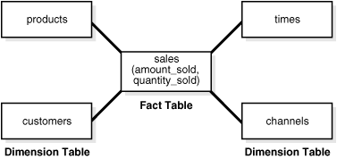

This chapter describes the most important optimizer techniques for transforming queries.

The optimizer decides whether to use an available transformation based on cost. Transformations may not be available to the optimizer for a variety of reasons, including hints or lack of constraints. For example, transformations such as subquery unnesting are not available for hybrid partitioned tables, which contain external partitions that do not support constraints.

### 5.1 OR Expansion

In `OR` expansion, the optimizer transforms a query block containing top-level disjunctions into the form of a `UNION ALL` query that contains two or more branches.

The optimizer achieves this goal by splitting the disjunction into its components, and then associating each component with a branch of a `UNION ALL` query. The optimizer can choose `OR` expansion for various reasons. For example, it may enable more efficient access paths or alternative join methods that avoid Cartesian products. As always, the optimizer performs the expansion only if the cost of the transformed statement is lower than the cost of the original statement.

In previous releases, the optimizer used the `CONCATENATION` operator to perform the `OR` expansion. Starting in Oracle Database 12c Release 2 (12.2), the optimizer uses the `UNION-ALL` operator instead. The framework provides the following enhancements:

- Enables interaction among various transformations
- Avoids sharing query structures
- Enables the exploration of various search strategies
- Provides the reuse of cost annotation
- Supports the standard SQL syntax

Example 5-1 Transformed Query: UNION ALL Condition

To prepare for this example, log in to the database as an administrator, execute the following statements to add a unique constraint to the `hr.departments.department_name` column, and then add 100,000 rows to the `hr.employees` table:

```
ALTER TABLE hr.departments ADD CONSTRAINT department_name_uk UNIQUE (department_name);
DELETE FROM hr.employees WHERE employee_id > 999;
DECLARE
v_counter NUMBER(7) := 1000;
BEGIN
 FOR i IN 1..100000 LOOP    
 INSERT INTO hr.employees
    VALUES (v_counter,null,'Doe','Doe' || v_counter || '@example.com',null,'07-JUN-02','AC_ACCOUNT',null,null,null,50);
 v_counter := v_counter + 1;
 END LOOP;
END;
/
COMMIT; 
EXEC DBMS_STATS.GATHER_TABLE_STATS ( ownname => 'hr', tabname => 'employees');
```

You then connect as the user `hr`, and execute the following query, which joins the `employees` and `departments` tables:

```
SELECT *
FROM   employees e, departments d
WHERE  (e.email='SSTILES' OR d.department_name='Treasury')
AND    e.department_id = d.department_id;
```

Without `OR` expansion, the optimizer treats `e.email='SSTILES' OR d.department_name='Treasury'` as a single unit. Consequently, the optimizer cannot use the index on either the `e.email` or `d.department_name` column, and so performs a full table scan of `employees` and `departments`.

With `OR` expansion, the optimizer breaks the disjunctive predicate into two independent predicates, as shown in the following example:

```
SELECT *
FROM   employees e, departments d
WHERE  e.email = 'SSTILES'
AND    e.department_id = d.department_id
UNION ALL
SELECT *
FROM   employees e, departments d
WHERE  d.department_name = 'Treasury'
AND    e.department_id = d.department_id;
```

This transformation enables the `e.email` and `d.department_name` columns to serve as index keys. Performance improves because the database filters data using two unique indexes instead of two full table scans, as shown in the following execution plan:

```
Plan hash value: 2512933241

-------------------------------------------------------------------------------------------
| Id| Operation                           | Name            |Rows|Bytes|Cost(%CPU)|Time   |
-------------------------------------------------------------------------------------------
| 0 |SELECT STATEMENT                     |                  |    |     |122(100)|        |
| 1 | VIEW                                |VW_ORE_19FF4E3E   |9102|1679K|122 (5) |00:00:01|
| 2 |  UNION-ALL                          |                  |    |     |        |        |
| 3 |   NESTED LOOPS                      |                  |  1 |  78 |  4 (0) |00:00:01|
| 4 |    TABLE ACCESS BY INDEX ROWID      | EMPLOYEES        |  1 |  57 |  3 (0) |00:00:01|
|*5 |     INDEX UNIQUE SCAN               | EMP_EMAIL_UK     |  1 |     |  2 (0) |00:00:01|
| 6 |    TABLE ACCESS BY INDEX ROWID      | DEPARTMENTS      |  1 |  21 |  1 (0) |00:00:01|
|*7 |     INDEX UNIQUE SCAN               | DEPT_ID_PK       |  1 |     |  0 (0) |        |
| 8 |   NESTED LOOPS                      |                  |9101| 693K|118 (5) |00:00:01|
| 9 |    TABLE ACCESS BY INDEX ROWID      | DEPARTMENTS      |  1 |  21 |  1 (0) |00:00:01|
|*10|     INDEX UNIQUE SCAN               |DEPARTMENT_NAME_UK|  1 |     |  0 (0) |        |
|*11|    TABLE ACCESS BY INDEX ROWID BATCH| EMPLOYEES        |9101| 506K|117 (5) |00:00:01|
|*12|     INDEX RANGE SCAN                |EMP_DEPARTMENT_IX |9101|     | 35 (6) |00:00:01|
-------------------------------------------------------------------------------------------

Predicate Information (identified by operation id):
---------------------------------------------------

   5 - access("E"."EMAIL"='SSTILES')
   7 - access("E"."DEPARTMENT_ID"="D"."DEPARTMENT_ID")
  10 - access("D"."DEPARTMENT_NAME"='Treasury')
  11 - filter(LNNVL("E"."EMAIL"='SSTILES'))
  12 - access("E"."DEPARTMENT_ID"="D"."DEPARTMENT_ID")

35 rows selected.
```

### 5.2 View Merging

In **view merging**, the optimizer merges the **query block** representing a view into the query block that contains it.

View merging can improve plans by enabling the optimizer to consider additional join orders, access methods, and other transformations. For example, after a view has been merged and several tables reside in one query block, a table inside a view may permit the optimizer to use [join elimination](glossary.md) to remove a table outside the view.

For certain simple views in which merging always leads to a better plan, the optimizer automatically merges the view without considering cost. Otherwise, the optimizer uses cost to make the determination. The optimizer may choose not to merge a view for many reasons, including cost or validity restrictions.

If `OPTIMIZER_SECURE_VIEW_MERGING` is `true` (default), then Oracle Database performs checks to ensure that view merging and predicate pushing do not violate the security intentions of the view creator. To disable these additional security checks for a specific view, you can grant the `MERGE VIEW` privilege to a user for this view. To disable additional security checks for all views for a specific user, you can grant the `MERGE ANY VIEW` privilege to that user.

Note:

You can use hints to override view merging rejected because of cost or heuristics, but not validity.

See Also:

- [Oracle Database SQL Language Reference](https://docs.oracle.com/pls/topic/lookup?ctx=en/database/oracle/oracle-database/21/tgsql&id=SQLRF01603) for more information about the `MERGE ANY VIEW` and `MERGE VIEW` privileges
- [Oracle Database Reference](https://docs.oracle.com/pls/topic/lookup?ctx=en/database/oracle/oracle-database/21/tgsql&id=REFRN10262) for more information about the `OPTIMIZER_SECURE_VIEW_MERGING` initialization parameter

#### 5.2.1 Query Blocks in View Merging

The optimizer represents each nested **subquery** or unmerged view by a separate query block.

The database optimizes query blocks separately from the bottom up. Thus, the database optimizes the innermost query block first, generates the part of the plan for it, and then generates the plan for the outer query block, representing the entire query.

The parser expands each view referenced in a query into a separate query block. The block essentially represents the view definition, and thus the result of a view. One option for the optimizer is to analyze the view query block separately, generate a view subplan, and then process the rest of the query by using the view subplan to generate an overall execution plan. However, this technique may lead to a suboptimal execution plan because the view is optimized separately.

View merging can sometimes improve performance. As shown in " Example 5-2 ", view merging merges the tables from the view into the outer query block, removing the inner query block. Thus, separate optimization of the view is not necessary.

#### 5.2.2 Simple View Merging

In **simple view merging**, the optimizer merges select-project-join views.

For example, a query of the `employees` table contains a subquery that joins the `departments` and `locations` tables.

Simple view merging frequently results in a more optimal plan because of the additional join orders and access paths available after the merge. A view may not be valid for simple view merging because:

- The view contains constructs not included in select-project-join views, including:
	- `GROUP BY`
		- `DISTINCT`
		- Outer join
		- `MODEL`
		- `CONNECT BY`
		- Set operators
		- Aggregation
- The view appears on the right side of a [semijoin](glossary.md) or [antijoin](glossary.md).
- The view contains subqueries in the `SELECT` list.
- The outer query block contains PL/SQL functions.
- The view participates in an outer join, and does not meet one of the several additional validity requirements that determine whether the view can be merged.

Example 5-2 Simple View Merging

The following query joins the `hr.employees` table with the `dept_locs_v` view, which returns the street address for each department. `dept_locs_v` is a join of the `departments` and `locations` tables.

```
SELECT e.first_name, e.last_name, dept_locs_v.street_address,
       dept_locs_v.postal_code
FROM   employees e,
      ( SELECT d.department_id, d.department_name, 
               l.street_address, l.postal_code
        FROM   departments d, locations l
        WHERE  d.location_id = l.location_id ) dept_locs_v
WHERE  dept_locs_v.department_id = e.department_id
AND    e.last_name = 'Smith';
```

The database can execute the preceding query by joining `departments` and `locations` to generate the rows of the view, and then joining this result to `employees`. Because the query contains the view `dept_locs_v`, and this view contains two tables, the optimizer must use one of the following join orders:

- `employees`, `dept_locs_v` (`departments`, `locations`)
- `employees`, `dept_locs_v` (`locations`, `departments`)
- `dept_locs_v` (`departments`, `locations`), `employees`
- `dept_locs_v` (`locations`, `departments`), `employees`

Join methods are also constrained. The index-based nested loops join is not feasible for join orders that begin with `employees` because no index exists on the column from this view. Without view merging, the optimizer generates the following execution plan:

```
-----------------------------------------------------------------
| Id  | Operation                    | Name        | Cost (%CPU)|
-----------------------------------------------------------------
|   0 | SELECT STATEMENT             |             |     7  (15)|
|*  1 |  HASH JOIN                   |             |     7  (15)|
|   2 |   TABLE ACCESS BY INDEX ROWID| EMPLOYEES   |     2   (0)|
|*  3 |    INDEX RANGE SCAN          | EMP_NAME_IX |     1   (0)|
|   4 |   VIEW                       |             |     5  (20)|
|*  5 |    HASH JOIN                 |             |     5  (20)|
|   6 |     TABLE ACCESS FULL        | LOCATIONS   |     2   (0)|
|   7 |     TABLE ACCESS FULL        | DEPARTMENTS |     2   (0)|
-----------------------------------------------------------------
 
Predicate Information (identified by operation id):
---------------------------------------------------
1 - access("DEPT_LOCS_V"."DEPARTMENT_ID"="E"."DEPARTMENT_ID")
3 - access("E"."LAST_NAME"='Smith')
5 - access("D"."LOCATION_ID"="L"."LOCATION_ID")
```

View merging merges the tables from the view into the outer query block, removing the inner query block. After view merging, the query is as follows:

```
SELECT e.first_name, e.last_name, l.street_address, l.postal_code
FROM   employees e, departments d, locations l
WHERE  d.location_id = l.location_id
AND    d.department_id = e.department_id
AND    e.last_name = 'Smith';
```

Because all three tables appear in one query block, the optimizer can choose from the following six join orders:

- `employees`, `departments`, `locations`
- `employees`, `locations`, `departments`
- `departments`, `employees`, `locations`
- `departments`, `locations`, `employees`
- `locations`, `employees`, `departments`
- `locations`, `departments`, `employees`

The joins to `employees` and `departments` can now be index-based. After view merging, the optimizer chooses the following more efficient plan, which uses nested loops:

```
-------------------------------------------------------------------
| Id  | Operation                      | Name        | Cost (%CPU)|
-------------------------------------------------------------------
|   0 | SELECT STATEMENT               |             |     4   (0)|
|   1 |  NESTED LOOPS                  |             |            |
|   2 |   NESTED LOOPS                 |             |     4   (0)|
|   3 |    NESTED LOOPS                |             |     3   (0)|
|   4 |     TABLE ACCESS BY INDEX ROWID| EMPLOYEES   |     2   (0)|
|*  5 |      INDEX RANGE SCAN          | EMP_NAME_IX |     1   (0)|
|   6 |     TABLE ACCESS BY INDEX ROWID| DEPARTMENTS |     1   (0)|
|*  7 |      INDEX UNIQUE SCAN         | DEPT_ID_PK  |     0   (0)|
|*  8 |    INDEX UNIQUE SCAN           | LOC_ID_PK   |     0   (0)|
|   9 |   TABLE ACCESS BY INDEX ROWID  | LOCATIONS   |     1   (0)|
-------------------------------------------------------------------
 
Predicate Information (identified by operation id):
---------------------------------------------------
 5 - access("E"."LAST_NAME"='Smith')
 7 - access("E"."DEPARTMENT_ID"="D"."DEPARTMENT_ID")
 8 - access("D"."LOCATION_ID"="L"."LOCATION_ID")
```

See Also:

The Oracle Optimizer blog at [`https://blogs.oracle.com/optimizer/`](https://docs.oracle.com/pls/topic/lookup?ctx=en/database/oracle/oracle-database/21/tgsql&id=optimizer_blog) to learn about outer join view merging, which is a special case of simple view merging

#### 5.2.3 Complex View Merging

In **view merging**, the optimizer merges views containing `GROUP BY` and `DISTINCT` views. Like simple view merging, complex merging enables the optimizer to consider additional join orders and access paths.

The optimizer can delay evaluation of `GROUP BY` or `DISTINCT` operations until after it has evaluated the joins. Delaying these operations can improve or worsen performance depending on the data characteristics. If the joins use filters, then delaying the operation until after joins can reduce the data set on which the operation is to be performed. Evaluating the operation early can reduce the amount of data to be processed by subsequent joins, or the joins could increase the amount of data to be processed by the operation. The optimizer uses cost to evaluate view merging and merges the view only when it is the lower cost option.

Aside from cost, the optimizer may be unable to perform complex view merging for the following reasons:

- The outer query tables do not have a rowid or unique column.
- The view appears in a `CONNECT BY` query block.
- The view contains `GROUPING SETS`, `ROLLUP`, or `PIVOT` clauses.
- The view or outer query block contains the `MODEL` clause.

Example 5-3 Complex View Joins with GROUP BY

The following view uses a `GROUP BY` clause:

```
CREATE VIEW cust_prod_totals_v AS
SELECT SUM(s.quantity_sold) total, s.cust_id, s.prod_id
FROM   sales s
GROUP BY s.cust_id, s.prod_id;
```

The following query finds all of the customers from the United States who have bought at least 100 fur-trimmed sweaters:

```
SELECT c.cust_id, c.cust_first_name, c.cust_last_name, c.cust_email
FROM   customers c, products p, cust_prod_totals_v
WHERE  c.country_id = 52790
AND    c.cust_id = cust_prod_totals_v.cust_id
AND    cust_prod_totals_v.total > 100
AND    cust_prod_totals_v.prod_id = p.prod_id
AND    p.prod_name = 'T3 Faux Fur-Trimmed Sweater';
```

The `cust_prod_totals_v` view is eligible for complex view merging. After merging, the query is as follows:

```
SELECT c.cust_id, cust_first_name, cust_last_name, cust_email
FROM   customers c, products p, sales s
WHERE  c.country_id = 52790
AND    c.cust_id = s.cust_id
AND    s.prod_id = p.prod_id
AND    p.prod_name = 'T3 Faux Fur-Trimmed Sweater'
GROUP BY s.cust_id, s.prod_id, p.rowid, c.rowid, c.cust_email, c.cust_last_name, 
         c.cust_first_name, c.cust_id
HAVING SUM(s.quantity_sold) > 100;
```

The transformed query is cheaper than the untransformed query, so the optimizer chooses to merge the view. In the untransformed query, the `GROUP BY` operator applies to the entire `sales` table in the view. In the transformed query, the joins to `products` and `customers` filter out a large portion of the rows from the `sales` table, so the `GROUP BY` operation is lower cost. The join is more expensive because the `sales` table has not been reduced, but it is not much more expensive because the `GROUP BY` operation does not reduce the size of the row set very much in the original query. If any of the preceding characteristics were to change, merging the view might no longer be lower cost. The final plan, which does not include a view, is as follows:

```
--------------------------------------------------------
| Id  | Operation             | Name      | Cost (%CPU)|
--------------------------------------------------------
|   0 | SELECT STATEMENT      |           |  2101  (18)|
|*  1 |  FILTER               |           |            |
|   2 |   HASH GROUP BY       |           |  2101  (18)|
|*  3 |    HASH JOIN          |           |  2099  (18)|
|*  4 |     HASH JOIN         |           |  1801  (19)|
|*  5 |      TABLE ACCESS FULL| PRODUCTS  |    96   (5)|
|   6 |      TABLE ACCESS FULL| SALES     |  1620  (15)|
|*  7 |     TABLE ACCESS FULL | CUSTOMERS |   296  (11)|
--------------------------------------------------------
Predicate Information (identified by operation id):
---------------------------------------------------
1 - filter(SUM("QUANTITY_SOLD")>100)
3 - access("C"."CUST_ID"="CUST_ID")
4 - access("PROD_ID"="P"."PROD_ID")
5 - filter("P"."PROD_NAME"='T3 Faux Fur-Trimmed Sweater')
7 - filter("C"."COUNTRY_ID"='US')
```

Example 5-4 Complex View Joins with DISTINCT

The following query of the `cust_prod_v` view uses a `DISTINCT` operator:

```
SELECT c.cust_id, c.cust_first_name, c.cust_last_name, c.cust_email
FROM   customers c, products p,
       ( SELECT DISTINCT s.cust_id, s.prod_id
         FROM   sales s) cust_prod_v
WHERE  c.country_id = 52790
AND    c.cust_id = cust_prod_v.cust_id
AND    cust_prod_v.prod_id = p.prod_id
AND    p.prod_name = 'T3 Faux Fur-Trimmed Sweater';
```

After determining that view merging produces a lower-cost plan, the optimizer rewrites the query into this equivalent query:

```
SELECT nwvw.cust_id, nwvw.cust_first_name, nwvw.cust_last_name, nwvw.cust_email
FROM   ( SELECT DISTINCT(c.rowid), p.rowid, s.prod_id, s.cust_id,
                c.cust_first_name, c.cust_last_name, c.cust_email
         FROM   customers c, products p, sales s
         WHERE  c.country_id = 52790
         AND    c.cust_id = s.cust_id
         AND    s.prod_id = p.prod_id
         AND    p.prod_name = 'T3 Faux Fur-Trimmed Sweater' ) nwvw;
```

The plan for the preceding query is as follows:

```
-------------------------------------------
| Id  | Operation             | Name      |
-------------------------------------------
|   0 | SELECT STATEMENT      |           |
|   1 |  VIEW                 | VM_NWVW_1 |
|   2 |   HASH UNIQUE         |           |
|*  3 |    HASH JOIN          |           |
|*  4 |     HASH JOIN         |           |
|*  5 |      TABLE ACCESS FULL| PRODUCTS  |
|   6 |      TABLE ACCESS FULL| SALES     |
|*  7 |     TABLE ACCESS FULL | CUSTOMERS |
-------------------------------------------
 
Predicate Information (identified by operation id):
---------------------------------------------------
  3 - access("C"."CUST_ID"="S"."CUST_ID")
  4 - access("S"."PROD_ID"="P"."PROD_ID")
  5 - filter("P"."PROD_NAME"='T3 Faux Fur-Trimmed Sweater')
  7 - filter("C"."COUNTRY_ID"='US')
```

The preceding plan contains a view named `vm_nwvw_1`, known as a [projection view](glossary.md), even after view merging has occurred. Projection views appear in queries in which a `DISTINCT` view has been merged, or a `GROUP BY` view is merged into an outer query block that also contains `GROUP BY`, `HAVING`, or aggregates. In the latter case, the projection view contains the `GROUP BY`, `HAVING`, and aggregates from the original outer query block.

In the preceding example of a projection view, when the optimizer merges the view, it moves the `DISTINCT` operator to the outer query block, and then adds several additional columns to maintain semantic equivalence with the original query. Afterward, the query can select only the desired columns in the `SELECT` list of the outer query block. The optimization retains all of the benefits of view merging: all tables are in one query block, the optimizer can permute them as needed in the final join order, and the `DISTINCT` operation has been delayed until after all of the joins complete.

### 5.3 Predicate Pushing

In **predicate pushing**, the optimizer "pushes" the relevant predicates from the containing query block into the view query block.

For views that are not merged, this technique improves the subplan of the unmerged view. The database can use the pushed-in predicates to access indexes or to use as filters.

For example, suppose you create a table `hr.contract_workers` as follows:

```
DROP TABLE contract_workers;
CREATE TABLE contract_workers AS (SELECT * FROM employees where 1=2);
INSERT INTO contract_workers VALUES (306, 'Bill', 'Jones', 'BJONES',
  '555.555.2000', '07-JUN-02', 'AC_ACCOUNT', 8300, 0,205, 110);
INSERT INTO contract_workers VALUES (406, 'Jill', 'Ashworth', 'JASHWORTH', 
  '555.999.8181', '09-JUN-05', 'AC_ACCOUNT', 8300, 0,205, 50);
INSERT INTO contract_workers VALUES (506, 'Marcie', 'Lunsford', 
  'MLUNSFORD', '555.888.2233', '22-JUL-01', 'AC_ACCOUNT', 8300, 
  0, 205, 110);
COMMIT;
CREATE INDEX contract_workers_index ON contract_workers(department_id);
```

You create a view that references `employees` and `contract_workers`. The view is defined with a query that uses the `UNION` set operator, as follows:

```
CREATE VIEW all_employees_vw AS
  ( SELECT employee_id, last_name, job_id, commission_pct, department_id
    FROM   employees )
  UNION
  ( SELECT employee_id, last_name, job_id, commission_pct, department_id
    FROM   contract_workers );
```

You then query the view as follows:

```
SELECT last_name
FROM   all_employees_vw
WHERE  department_id = 50;
```

Because the view is a `UNION` set query, the optimizer cannot merge the view's query into the accessing query block. Instead, the optimizer can transform the accessing statement by pushing its predicate, the `WHERE` clause condition `department_id=50`, into the view's `UNION` set query. The equivalent transformed query is as follows:

```
SELECT last_name
FROM   ( SELECT employee_id, last_name, job_id, commission_pct, department_id
         FROM   employees
         WHERE  department_id=50
         UNION
         SELECT employee_id, last_name, job_id, commission_pct, department_id
         FROM   contract_workers
         WHERE  department_id=50 );
```

The transformed query can now consider index access in each of the query blocks.

### 5.4 Subquery Unnesting

In **subquery unnesting**, the optimizer transforms a nested query into an equivalent join statement, and then optimizes the join.

This transformation enables the optimizer to consider the subquery tables during access path, join method, and join order selection. The optimizer can perform this transformation only if the resulting join statement is guaranteed to return the same rows as the original statement, and if subqueries do not contain aggregate functions such as `AVG`.

For example, suppose you connect as user `sh` and execute the following query:

```
SELECT * 
FROM   sales
WHERE  cust_id IN ( SELECT cust_id 
                    FROM   customers );
```

Because the `customers.cust_id` column is a primary key, the optimizer can transform the complex query into the following join statement that is guaranteed to return the same data:

```
SELECT sales.* 
FROM   sales, customers
WHERE  sales.cust_id = customers.cust_id;
```

If the optimizer cannot transform a complex statement into a join statement, it selects execution plans for the parent statement and the subquery as though they were separate statements. The optimizer then executes the subquery and uses the rows returned to execute the parent query. To improve execution speed of the overall execution plan, the optimizer orders the subplans efficiently.

### 5.5 Query Rewrite with Materialized Views

A **materialized view** is a query result stored in a table.

When the optimizer finds a user query compatible with the query associated with a materialized view, the database can rewrite the query in terms of the materialized view. This technique improves query execution because the database has precomputed most of the query result.

The optimizer looks for materialized views that are compatible with the user query, and then uses a cost-based algorithm to select materialized views to rewrite the query. The optimizer does not rewrite the query when the plan generated unless the materialized views has a lower cost than the plan generated with the materialized views.

See Also:

[Oracle Database Data Warehousing Guide](https://docs.oracle.com/pls/topic/lookup?ctx=en/database/oracle/oracle-database/21/tgsql&id=DWHSG-GUID-DB76286B-8557-446B-A6CC-BC987C378076) to learn more about query rewrite

#### 5.5.1 About Query Rewrite and the Optimizer

A query undergoes several checks to determine whether it is a candidate for query rewrite.

If the query fails any check, then the query is applied to the detail tables rather than the materialized view. The inability to rewrite can be costly in terms of response time and processing power.

The optimizer uses two different methods to determine when to rewrite a query in terms of a materialized view. The first method matches the SQL text of the query to the SQL text of the materialized view definition. If the first method fails, then the optimizer uses the more general method in which it compares joins, selections, data columns, grouping columns, and aggregate functions between the query and materialized views.

Query rewrite operates on queries and subqueries in the following types of SQL statements:

- `SELECT`
- `CREATE TABLE … AS SELECT`
- `INSERT INTO … SELECT`

It also operates on subqueries in the set operators `UNION`, `UNION ALL`, `INTERSECT`, `INTERSECT ALL`, `EXCEPT`, `EXCEPT ALL`, `MINUS`, and `MINUS ALL`, and subqueries in DML statements such as `INSERT`, `DELETE`, and `UPDATE`.

Dimensions, constraints, and rewrite integrity levels affect whether a query is rewritten to use materialized views. Additionally, query rewrite can be enabled or disabled by `REWRITE` and `NOREWRITE` hints and the `QUERY_REWRITE_ENABLED` session parameter.

The `DBMS_MVIEW.EXPLAIN_REWRITE` procedure advises whether query rewrite is possible on a query and, if so, which materialized views are used. It also explains why a query cannot be rewritten.

#### 5.5.2 About Initialization Parameters for Query Rewrite

Query rewrite behavior is controlled by certain database initialization parameters.

Table 5-1 Initialization Parameters that Control Query Rewrite Behavior

| Initialization Parameter Name | Initialization Parameter Value | Behavior of Query Rewrite |
| --- | --- | --- |
| `OPTIMIZER_MODE` | `ALL_ROWS` (default), `FIRST_ROWS`, or `FIRST_ROWS_` `n` | With `OPTIMIZER_MODE` set to `FIRST_ROWS`, the optimizer uses a mix of costs and heuristics to find a best plan for fast delivery of the first few rows. When set to `FIRST_ROWS_` `n`, the optimizer uses a cost-based approach and optimizes with a goal of best response time to return the first `n` rows (where n = 1, 10, 100, 1000). |
| `QUERY_REWRITE_ENABLED` | `TRUE` (default), `FALSE`, or `FORCE` | This option enables the query rewrite feature of the optimizer, enabling the optimizer to utilize materialized views to enhance performance. If set to `FALSE`, this option disables the query rewrite feature of the optimizer and directs the optimizer not to rewrite queries using materialized views even when the estimated query cost of the unrewritten query is lower.  If set to `FORCE`, this option enables the query rewrite feature of the optimizer and directs the optimizer to rewrite queries using materialized views even when the estimated query cost of the unrewritten query is lower. |
| `QUERY_REWRITE_INTEGRITY` | `STALE_TOLERATED`, `TRUSTED`, or `ENFORCED` (the default) | This parameter is optional. However, if it is set, the value must be one of these specified in the Initialization Parameter Value column.  By default, the integrity level is set to `ENFORCED`. In this mode, all constraints must be validated. Therefore, if you use `ENABLE NOVALIDATE RELY`, certain types of query rewrite might not work. To enable query rewrite in this environment (where constraints have not been validated), you should set the integrity level to a lower level of granularity such as `TRUSTED` or `STALE_TOLERATED`. |

#### 5.5.3 About the Accuracy of Query Rewrite

Query rewrite offers three levels of rewrite integrity that are controlled by the initialization parameter `QUERY_REWRITE_INTEGRITY`.

The values that you can set for the `QUERY_REWRITE_INTEGRITY` parameter are as follows:

- `ENFORCED`
	This is the default mode. The optimizer only uses fresh data from the materialized views and only use those relationships that are based on `ENABLED VALIDATED` primary, unique, or foreign key constraints.
- `TRUSTED`
	In `TRUSTED` mode, the optimizer trusts that the relationships declared in dimensions and `RELY` constraints are correct. In this mode, the optimizer also uses prebuilt materialized views or materialized views based on views, and it uses relationships that are not enforced as well as those that are enforced. It also trusts declared but not `ENABLED VALIDATED` primary or unique key constraints and data relationships specified using dimensions. This mode offers greater query rewrite capabilities but also creates the risk of incorrect results if any of the trusted relationships you have declared are incorrect.
- `STALE_TOLERATED`
	In `STALE_TOLERATED` mode, the optimizer uses materialized views that are valid but contain stale data as well as those that contain fresh data. This mode offers the maximum rewrite capability but creates the risk of generating inaccurate results.

If rewrite integrity is set to the safest level, `ENFORCED`, the optimizer uses only enforced primary key constraints and referential integrity constraints to ensure that the results of the query are the same as the results when accessing the detail tables directly.

If the rewrite integrity is set to levels other than `ENFORCED`, there are several situations where the output with rewrite can be different from that without it:

- A materialized view can be out of synchronization with the primary copy of the data. This generally happens because the materialized view refresh procedure is pending following bulk load or DML operations to one or more detail tables of a materialized view. At some data warehouse sites, this situation is desirable because it is not uncommon for some materialized views to be refreshed at certain time intervals.
- The relationships implied by the dimension objects are invalid. For example, values at a certain level in a hierarchy do not roll up to exactly one parent value.
- The values stored in a prebuilt materialized view table might be incorrect.
- A wrong answer can occur because of bad data relationships defined by unenforced table or view constraints.

You can set `QUERY_REWRITE_INTEGRITY` either in your initialization parameter file or using an `ALTER SYSTEM` or `ALTER SESSION` statement.

#### 5.5.4 Example of Query Rewrite

This example illustrates the power of query rewrite with materialized views.

Consider the following materialized view, `cal_month_sales_mv`, which provides an aggregation of the dollar amount sold in every month:

```
CREATE MATERIALIZED VIEW cal_month_sales_mv
ENABLE QUERY REWRITE AS
SELECT t.calendar_month_desc, SUM(s.amount_sold) AS dollars
FROM sales s, times t WHERE s.time_id = t.time_id
GROUP BY t.calendar_month_desc;
```

Let us assume that, in a typical month, the number of sales in the store is around one million. So this materialized aggregate view has the precomputed aggregates for the dollar amount sold for each month.

Consider the following query, which asks for the sum of the amount sold at the store for each calendar month:

```
SELECT t.calendar_month_desc, SUM(s.amount_sold)
FROM sales s, times t WHERE s.time_id = t.time_id
GROUP BY t.calendar_month_desc;
```

In the absence of the previous materialized view and query rewrite feature, Oracle Database must access the `sales` table directly and compute the sum of the amount sold to return the results. This involves reading many million rows from the `sales` table, which will invariably increase the query response time due to the disk access. The join in the query will also further slow down the query response as the join needs to be computed on many million rows.

In the presence of the materialized view `cal_month_sales_mv`, query rewrite will transparently rewrite the previous query into the following query:

```
SELECT calendar_month, dollars
FROM cal_month_sales_mv;
```

Because there are only a few dozen rows in the materialized view `cal_month_sales_mv` and no joins, Oracle Database returns the results instantly.

### 5.6 Star Transformation

Star transformation is an optimizer transformation that avoids full table scans of fact tables in a star schema.

#### 5.6.1 About Star Schemas

A star schema divides data into facts and dimensions.

Facts are the measurements of an event such as a sale and are typically numbers. Dimensions are the categories that identify facts, such as date, location, and product.

A fact table has a composite key made up of the primary keys of the dimension tables of the schema. Dimension tables act as lookup or reference tables that enable you to choose values that constrain your queries.

Diagrams typically show a central fact table with lines joining it to the dimension tables, giving the appearance of a star. The following graphic shows `sales` as the fact table and `products`, `times`, `customers`, and `channels` as the dimension tables.

Figure 5-1 Star Schema



> This graphic depicts five boxes. The box in the center says "sales (amount sold, quantity\_sold)" and is labeled "Fact Table." A line leads from Fact Table box to a products box in the upper left. A line leads from the Fact Table box to a times box in the upper right. A line leads from the Fact Table box to a customer box on the lower left. This box is labeled "Dimension Table." A line leads from the Fact Table to a channels box in the lower right. This box is labeled "Dimension Table."


A [snowflake schema](glossary.md) is a star schema in which the dimension tables reference other tables. A [snowstorm schema](glossary.md) is a combination of snowflake schemas.

See Also:

[Oracle Database Data Warehousing Guide](https://docs.oracle.com/pls/topic/lookup?ctx=en/database/oracle/oracle-database/21/tgsql&id=DWHSG9069) to learn more about star schemas

#### 5.6.2 Purpose of Star Transformations

In joins of fact and dimension tables, a star transformation can avoid a full scan of a fact table.

The star transformation improves performance by fetching only relevant fact rows that join to the constraint dimension rows. In some cases, queries have restrictive filters on other columns of the dimension tables. The combination of filters can dramatically reduce the data set that the database processes from the fact table.

#### 5.6.3 How Star Transformation Works

Star transformation adds subquery predicates, called bitmap semijoin predicates, corresponding to the constraint dimensions.

The optimizer performs the transformation when indexes exist on the fact join columns. By driving bitmap `AND` and `OR` operations of key values supplied by the subqueries, the database only needs to retrieve relevant rows from the fact table. If the predicates on the dimension tables filter out significant data, then the transformation can be more efficient than a full scan on the fact table.

After the database has retrieved the relevant rows from the fact table, the database may need to join these rows back to the dimension tables using the original predicates. The database can eliminate the join back of the dimension table when the following conditions are met:

- All the predicates on dimension tables are part of the semijoin subquery predicate.
- The columns selected from the subquery are unique.
- The dimension columns are not in the `SELECT` list, `GROUP BY` clause, and so on.

#### 5.6.4 Controls for Star Transformation

The `STAR_TRANSFORMATION_ENABLED` initialization parameter controls star transformations.

This parameter takes the following values:

- `true`
	The optimizer performs the star transformation by identifying the fact and constraint dimension tables automatically. The optimizer performs the star transformation only if the cost of the transformed plan is lower than the alternatives. Also, the optimizer attempts temporary table transformation automatically whenever materialization improves performance (see " Temporary Table Transformation: Scenario ").
- `false` (default)
	The optimizer does not perform star transformations.
- `TEMP_DISABLE`
	This value is identical to `true` except that the optimizer does not attempt temporary table transformation.

See Also:

[Oracle Database Reference](https://docs.oracle.com/pls/topic/lookup?ctx=en/database/oracle/oracle-database/21/tgsql&id=REFRN10213) to learn about the `STAR_TRANSFORMATION_ENABLED` initialization parameter

#### 5.6.5 Star Transformation: Scenario

This scenario demonstrates a star transformation of a star query.

Example 5-5 Star Query

The following query finds the total Internet sales amount in all cities in California for quarters Q1 and Q2 of year 1999:

```
SELECT c.cust_city, 
       t.calendar_quarter_desc, 
       SUM(s.amount_sold) sales_amount
FROM   sales s, 
       times t, 
       customers c, 
       channels ch
WHERE  s.time_id = t.time_id
AND    s.cust_id = c.cust_id
AND    s.channel_id = ch.channel_id
AND    c.cust_state_province = 'CA'
AND    ch.channel_desc = 'Internet'
AND    t.calendar_quarter_desc IN ('1999-01','1999-02')
GROUP BY c.cust_city, t.calendar_quarter_desc;
```

Sample output is as follows:

```
CUST_CITY                      CALENDA SALES_AMOUNT
------------------------------ ------- ------------
Montara                        1999-02      1618.01
Pala                           1999-01      3263.93
Cloverdale                     1999-01        52.64
Cloverdale                     1999-02       266.28
. . .
```

In this example, `sales` is the fact table, and the other tables are dimension tables. The `sales` table contains one row for every sale of a product, so it could conceivably contain billions of sales records. However, only a few products are sold to customers in California through the Internet for the specified quarters.

Example 5-6 Star Transformation

This example shows a star transformation of the query in Example 5-5. The transformation avoids a full table scan of `sales`.

```
SELECT c.cust_city, t.calendar_quarter_desc, SUM(s.amount_sold) sales_amount
FROM   sales s, times t, customers c
WHERE  s.time_id = t.time_id
AND    s.cust_id = c.cust_id
AND    c.cust_state_province = 'CA'
AND    t.calendar_quarter_desc IN ('1999-01','1999-02')
AND    s.time_id IN ( SELECT time_id
                      FROM   times 
                      WHERE  calendar_quarter_desc IN('1999-01','1999-02') )
AND    s.cust_id IN ( SELECT cust_id
                      FROM   customers
                      WHERE  cust_state_province='CA' )
AND    s.channel_id IN ( SELECT channel_id  
                         FROM   channels 
                         WHERE  channel_desc = 'Internet' )
GROUP BY c.cust_city, t.calendar_quarter_desc;
```

Example 5-7 Partial Execution Plan for Star Transformation

This example shows an edited version of the execution plan for the star transformation in Example 5-6.

Line 26 shows that the `sales` table has an index access path instead of a full table scan. For each key value that results from the subqueries of `channels` (line 14), `times` (line 19), and `customers` (line 24), the database retrieves a bitmap from the indexes on the `sales` fact table (lines 15, 20, 25).

Each bit in the bitmap corresponds to a row in the fact table. The bit is set when the key value from the subquery is same as the value in the row of the fact table. For example, in the bitmap `101000... `(the ellipses indicates that the values for the remaining rows are `0`), rows 1 and 3 of the fact table have matching key values from the subquery.

The operations in lines 12, 17, and 22 iterate over the keys from the subqueries and retrieve the corresponding bitmaps. In Example 5-6, the `customers` subquery seeks the IDs of customers whose state or province is `CA`. Assume that the bitmap `101000... `corresponds to the customer ID key value `103515` from the `customers` table subquery. Also assume that the `customers` subquery produces the key value `103516` with the bitmap `010000...`, which means that only row 2 in `sales` has a matching key value from the subquery.

The database merges (using the `OR` operator) the bitmaps for each subquery (lines 11, 16, 21). In our `customers` example, the database produces a single bitmap `111000...` for the `customers` subquery after merging the two bitmaps:

```
101000...   # bitmap corresponding to key 103515
010000...   # bitmap corresponding to key 103516
---------
111000...   # result of OR operation
```

In line 10, the database applies the `AND` operator to the merged bitmaps. Assume that after the database has performed all `OR` operations, the resulting bitmap for `channels` is `100000...` If the database performs an `AND` operation on this bitmap and the bitmap from `customers` subquery, then the result is as follows:

```
100000...   # channels bitmap after all OR operations performed
111000...   # customers bitmap after all OR operations performed
---------
100000...   # bitmap result of AND operation for channels and customers
```

In line 9, the database generates the corresponding rowids of the final bitmap. The database retrieves rows from the `sales` fact table using the rowids (line 26). In our example, the database generate only one rowid, which corresponds to the first row, and thus fetches only a single row instead of scanning the entire `sales` table.

```
---------------------------------------------------------------------------
| Id  | Operation                         | Name
---------------------------------------------------------------------------
|   0 | SELECT STATEMENT                  |    
|   1 |  HASH GROUP BY                    | 
|*  2 |   HASH JOIN                       |
|*  3 |    TABLE ACCESS FULL              | CUSTOMERS
|*  4 |    HASH JOIN                      | 
|*  5 |     TABLE ACCESS FULL             | TIMES 
|   6 |     VIEW                          | VW_ST_B1772830 
|   7 |      NESTED LOOPS                 | 
|   8 |       PARTITION RANGE SUBQUERY    |  
|   9 |        BITMAP CONVERSION TO ROWIDS|  
|  10 |         BITMAP AND                |
|  11 |          BITMAP MERGE             | 
|  12 |           BITMAP KEY ITERATION    | 
|  13 |            BUFFER SORT            |
|* 14 |             TABLE ACCESS FULL     | CHANNELS 
|* 15 |            BITMAP INDEX RANGE SCAN| SALES_CHANNEL_BIX 
|  16 |          BITMAP MERGE             | 
|  17 |           BITMAP KEY ITERATION    |
|  18 |            BUFFER SORT            |
|* 19 |             TABLE ACCESS FULL     | TIMES 
|* 20 |            BITMAP INDEX RANGE SCAN| SALES_TIME_BIX
|  21 |          BITMAP MERGE             |
|  22 |           BITMAP KEY ITERATION    | 
|  23 |            BUFFER SORT            | 
|* 24 |             TABLE ACCESS FULL     | CUSTOMERS 
|* 25 |            BITMAP INDEX RANGE SCAN| SALES_CUST_BIX 
|  26 |       TABLE ACCESS BY USER ROWID  | SALES
---------------------------------------------------------------------------

Predicate Information (identified by operation id):
---------------------------------------------------

   2 - access("ITEM_1"="C"."CUST_ID")
   3 - filter("C"."CUST_STATE_PROVINCE"='CA')
   4 - access("ITEM_2"="T"."TIME_ID")
   5 - filter(("T"."CALENDAR_QUARTER_DESC"='1999-01' 
               OR "T"."CALENDAR_QUARTER_DESC"='1999-02'))
  14 - filter("CH"."CHANNEL_DESC"='Internet')
  15 - access("S"."CHANNEL_ID"="CH"."CHANNEL_ID")
  19 - filter(("T"."CALENDAR_QUARTER_DESC"='1999-01' 
               OR "T"."CALENDAR_QUARTER_DESC"='1999-02'))
  20 - access("S"."TIME_ID"="T"."TIME_ID")
  24 - filter("C"."CUST_STATE_PROVINCE"='CA')
  25 - access("S"."CUST_ID"="C"."CUST_ID")

Note
-----
   - star transformation used for this statement
```

#### 5.6.6 Temporary Table Transformation: Scenario

In the preceding scenario, the optimizer does not join back the table `channels` to the `sales` table because it is not referenced outside and the `channel_id` is unique.

If the optimizer cannot eliminate the join back, however, then the database stores the subquery results in a temporary table to avoid rescanning the dimension table for bitmap key generation and join back. Also, if the query runs in parallel, then the database materializes the results so that each parallel execution server can select the results from the temporary table instead of executing the subquery again.

Example 5-8 Star Transformation Using Temporary Table

In this example, the database materializes the results of the subquery on `customers` into a temporary table:

```
SELECT t1.c1 cust_city, t.calendar_quarter_desc calendar_quarter_desc, 
       SUM(s.amount_sold) sales_amount
FROM   sales s, sh.times t, sys_temp_0fd9d6621_e7e24 t1 
WHERE  s.time_id=t.time_id
AND    s.cust_id=t1.c0
AND    (t.calendar_quarter_desc='1999-q1' OR t.calendar_quarter_desc='1999-q2')
AND    s.cust_id IN    ( SELECT t1.c0 
                         FROM   sys_temp_0fd9d6621_e7e24 t1 )
AND    s.channel_id IN ( SELECT ch.channel_id 
                         FROM   channels ch
                         WHERE  ch.channel_desc='internet' )
AND    s.time_id IN    ( SELECT t.time_id
                         FROM   times t
                         WHERE  t.calendar_quarter_desc='1999-q1'
                         OR     t.calendar_quarter_desc='1999-q2' )
GROUP BY t1.c1, t.calendar_quarter_desc
```

The optimizer replaces `customers` with the temporary table `sys_temp_0fd9d6621_e7e24`, and replaces references to columns `cust_id` and `cust_city` with the corresponding columns of the temporary table. The database creates the temporary table with two columns: `(c0 NUMBER, c1 VARCHAR2(30))`. These columns correspond to `cust_id` and `cust_city` of the `customers` table. The database populates the temporary table by executing the following query at the beginning of the execution of the previous query:
```
SELECT c.cust_id, c.cust_city FROM customers WHERE c.cust_state_province = 'CA'
```

Example 5-9 Partial Execution Plan for Star Transformation Using Temporary Table

The following example shows an edited version of the execution plan for the query in Example 5-8:

```
---------------------------------------------------------------------------
| Id  | Operation                          | Name
---------------------------------------------------------------------------
|   0 | SELECT STATEMENT                   |
|   1 |  TEMP TABLE TRANSFORMATION         |
|   2 |   LOAD AS SELECT                   |
|*  3 |    TABLE ACCESS FULL               | CUSTOMERS
|   4 |   HASH GROUP BY                    | 
|*  5 |    HASH JOIN                       | 
|   6 |     TABLE ACCESS FULL              | SYS_TEMP_0FD9D6613_C716F
|*  7 |     HASH JOIN                      | 
|*  8 |      TABLE ACCESS FULL             | TIMES 
|   9 |      VIEW                          | VW_ST_A3F94988 
|  10 |       NESTED LOOPS                 | 
|  11 |        PARTITION RANGE SUBQUERY    | 
|  12 |         BITMAP CONVERSION TO ROWIDS| 
|  13 |          BITMAP AND                | 
|  14 |           BITMAP MERGE             | 
|  15 |            BITMAP KEY ITERATION    |  
|  16 |             BUFFER SORT            |  
|* 17 |              TABLE ACCESS FULL     | CHANNELS 
|* 18 |             BITMAP INDEX RANGE SCAN| SALES_CHANNEL_BIX 
|  19 |           BITMAP MERGE             |  
|  20 |            BITMAP KEY ITERATION    | 
|  21 |             BUFFER SORT            |  
|* 22 |              TABLE ACCESS FULL     | TIMES 
|* 23 |             BITMAP INDEX RANGE SCAN| SALES_TIME_BIX 
|  24 |           BITMAP MERGE             |  
|  25 |            BITMAP KEY ITERATION    |  
|  26 |             BUFFER SORT            | 
|  27 |              TABLE ACCESS FULL     | SYS_TEMP_0FD9D6613_C716F 
|* 28 |             BITMAP INDEX RANGE SCAN| SALES_CUST_BIX 
|  29 |        TABLE ACCESS BY USER ROWID  | SALES 
---------------------------------------------------------------------------
 
Predicate Information (identified by operation id):
---------------------------------------------------
 
   3 - filter("C"."CUST_STATE_PROVINCE"='CA')
   5 - access("ITEM_1"="C0")
   7 - access("ITEM_2"="T"."TIME_ID")
   8 - filter(("T"."CALENDAR_QUARTER_DESC"='1999-01' OR 
               "T"."CALENDAR_QUARTER_DESC"='1999-02'))
  17 - filter("CH"."CHANNEL_DESC"='Internet')
  18 - access("S"."CHANNEL_ID"="CH"."CHANNEL_ID")
  22 - filter(("T"."CALENDAR_QUARTER_DESC"='1999-01' OR 
               "T"."CALENDAR_QUARTER_DESC"='1999-02'))
  23 - access("S"."TIME_ID"="T"."TIME_ID")
  28 - access("S"."CUST_ID"="C0")
```

Lines 1, 2, and 3 of the plan materialize the `customers` subquery into the temporary table. In line 6, the database scans the temporary table (instead of the subquery) to build the bitmap from the fact table. Line 27 scans the temporary table for joining back instead of scanning `customers`. The database does not need to apply the filter on `customers` on the temporary table because the filter is applied while materializing the temporary table.

### 5.7 In-Memory Aggregation (VECTOR GROUP BY)

The key optimization of in-memory aggregation is to aggregate while scanning.

To optimize query blocks involving aggregation and joins from a single large table to multiple small tables, such as in a typical star query, the transformation uses `KEY VECTOR` and `VECTOR GROUP BY` operations. These operations use efficient in-memory arrays for joins and aggregation, and are especially effective when the underlying tables are in-memory columnar tables.

See Also:

[Oracle Database In-Memory Guide](https://docs.oracle.com/pls/topic/lookup?ctx=en/database/oracle/oracle-database/21/tgsql&id=INMEM-GUID-2C4FA6C6-3DA8-4CEA-9EF0-294396D15077) to learn more about in-memory aggregation

### 5.8 Cursor-Duration Temporary Tables

To materialize the intermediate results of a query, Oracle Database may implicitly create a **cursor-duration temporary table** in memory during query compilation.

#### 5.8.1 Purpose of Cursor-Duration Temporary Tables

Complex queries sometimes process the same query block multiple times, which creates unnecessary performance overhead.

To avoid this scenario, Oracle Database can automatically create temporary tables for the query results and store them in memory for the duration of the cursor. For complex operations such as `WITH` clause queries, star transformations, and grouping sets, this optimization enhances the materialization of intermediate results from repetitively used subqueries. In this way, cursor-duration temporary tables improve performance and optimize I/O.

#### 5.8.2 How Cursor-Duration Temporary Tables Work

The definition of the cursor-definition temporary table resides in memory. The table definition is associated with the cursor, and is only visible to the session executing the cursor.

When using cursor-duration temporary tables, the database performs the following steps:

1. Chooses a plan that uses a cursor-duration temporary table
2. Creates the temporary table using a unique name
3. Rewrites the query to refer to the temporary table
4. Loads data into memory until no memory remains, in which case it creates temporary segments on disk
5. Executes the query, returning data from the temporary table
6. Truncates the table, releasing memory and any on-disk temporary segments

Note:

The metadata for the cursor-duration temporary table stays in memory as long as the cursor is in memory. The metadata is not stored in the data dictionary, which means it is not visible through data dictionary views. You cannot drop the metadata explicitly.

The preceding scenario depends on the availability of memory. For serial queries, the temporary tables use PGA memory.

The implementation of cursor-duration temporary tables is similar to sorts. If no more memory is available, then the database writes data to temporary segments. For cursor-duration temporary tables, the differences are as follows:

- The database releases memory and temporary segments at the end of the query rather than when the [row source](glossary.md) is no longer active.
- Data in memory stays in memory, unlike in sorts where data can move between memory and temporary segments.

When the database uses cursor-duration temporary tables, the keyword `CURSOR DURATION MEMORY` appears in the execution plan.

#### 5.8.3 Cursor-Duration Temporary Tables: Example

A `WITH` query that repeats the same subquery can sometimes benefit from a cursor-duration temporary table.

The following query uses a `WITH` clause to create three subquery blocks:

```
WITH 
  q1 AS (SELECT department_id, SUM(salary) sum_sal FROM hr.employees GROUP BY department_id),
  q2 AS (SELECT * FROM q1),
  q3 AS (SELECT department_id, sum_sal FROM q1)
SELECT * FROM q1
UNION ALL
SELECT * FROM q2
UNION ALL
SELECT * FROM q3;
```

The following sample plan shows the transformation:

```
SELECT * FROM TABLE(DBMS_XPLAN.DISPLAY_CURSOR(FORMAT=>'BASIC +ROWS +COST'));

PLAN_TABLE_OUTPUT
-------------------------------------------------------------------------------------------
| Id | Operation                                 | Name                 |Rows |Cost (%CPU)|
-------------------------------------------------------------------------------------------
|  0 | SELECT STATEMENT                          |                           |    |6 (100)|
|  1 |  TEMP TABLE TRANSFORMATION                |                           |    |       |
|  2 |   LOAD AS SELECT (CURSOR DURATION MEMORY) | SYS_TEMP_0FD9D6606_1AE004 |    |       |
|  3 |    HASH GROUP BY                          |                           | 11 | 3 (34)|
|  4 |     TABLE ACCESS FULL                     | EMPLOYEES                 |107 | 2 (0) |
|  5 |   UNION-ALL                               |                           |    |       |
|  6 |    VIEW                                   |                           | 11 | 2 (0) |
|  7 |     TABLE ACCESS FULL                     | SYS_TEMP_0FD9D6606_1AE004 | 11 | 2 (0) |
|  8 |    VIEW                                   |                           | 11 | 2 (0) |
|  9 |     TABLE ACCESS FULL                     | SYS_TEMP_0FD9D6606_1AE004 | 11 | 2 (0) |
| 10 |    VIEW                                   |                           | 11 | 2 (0) |
| 11 |     TABLE ACCESS FULL                     | SYS_TEMP_0FD9D6606_1AE004 | 11 | 2 (0) |
-------------------------------------------------------------------------------------------
```

In the preceding plan, `TEMP TABLE TRANSFORMATION` in Step 1 indicates that the database used cursor-duration temporary tables to execute the query. The `CURSOR DURATION MEMORY` keyword in Step 2 indicates that the database used memory, if available, to store the results of `SYS_TEMP_0FD9D6606_1AE004`. If memory was unavailable, then the database wrote the temporary data to disk.

### 5.9 Table Expansion

In **table expansion**, the optimizer generates a plan that uses indexes on the read-mostly portion of a partitioned table, but not on the active portion of the table.

#### 5.9.1 Purpose of Table Expansion

Index-based plans can improve performance, but index maintenance creates overhead. In many databases, DML affects only a small portion of the data.

Table expansion uses index-based plans for high-update tables. You can create an index only on the read-mostly data, eliminating index overhead on the active data. In this way, table expansion improves performance while avoiding index maintenance.

#### 5.9.2 How Table Expansion Works

Table partitioning makes table expansion possible.

If a local index exists on a partitioned table, then the optimizer can mark the index as unusable for specific partitions. In effect, some partitions are not indexed.

In table expansion, the optimizer transforms the query into a `UNION ALL` statement, with some subqueries accessing indexed partitions and other subqueries accessing unindexed partitions. The optimizer can choose the most efficient access method available for a partition, regardless of whether it exists for all of the partitions accessed in the query.

The optimizer does not always choose table expansion:

- Table expansion is cost-based.
	While the database accesses each partition of the expanded table only once across all branches of the `UNION ALL`, any tables that the database joins to it are accessed in each branch.
- Semantic issues may render expansion invalid.
	For example, a table appearing on the right side of an outer join is not valid for table expansion.

You can control table expansion with the hint `EXPAND_TABLE` hint. The hint overrides the cost-based decision, but not the semantic checks.

See Also:

- " [Influencing the Optimizer with Hints](influencing-the-optimizer.md) "
- [Oracle Database SQL Language Reference](https://docs.oracle.com/pls/topic/lookup?ctx=en/database/oracle/oracle-database/21/tgsql&id=SQLRF00219) to learn more about SQL hints

#### 5.9.3 Table Expansion: Scenario

The optimizer keeps track of which partitions must be accessed from each table, based on predicates that appear in the query. Partition pruning enables the optimizer to use table expansion to generate more optimal plans.

Assumptions

This scenario assumes the following:

- You want to run a star query against the `sh.sales` table, which is range-partitioned on the `time_id` column.
- You want to disable indexes on specific partitions to see the benefits of table expansion.

To use table expansion:

1. Log in to the database as the `sh` user.
2. Run the following query:
	```
	SELECT * 
	FROM   sales 
	WHERE  time_id >= TO_DATE('2000-01-01 00:00:00', 'SYYYY-MM-DD HH24:MI:SS') 
	AND    prod_id = 38;
	```
3. Explain the plan by querying `DBMS_XPLAN`:
	```
	SET LINESIZE 150
	SET PAGESIZE 0
	SELECT * FROM TABLE(DBMS_XPLAN.DISPLAY_CURSOR(format => 'BASIC,PARTITION'));
	```
	As shown in the `Pstart` and `Pstop` columns in the following plan, the optimizer determines from the filter that only 16 of the 28 partitions in the table must be accessed:
	```
	Plan hash value: 3087065703
	------------------------------------------------------------------------
	|Id| Operation                                  | Name    |Pstart|Pstop|
	------------------------------------------------------------------------
	| 0| SELECT STATEMENT                           |              |  |    |
	| 1|  PARTITION RANGE ITERATOR                  |              |13| 28 |
	| 2|   TABLE ACCESS BY LOCAL INDEX ROWID BATCHED| SALES        |13| 28 |
	| 3|    BITMAP CONVERSION TO ROWIDS             |              |  |    |
	|*4|     BITMAP INDEX SINGLE VALUE              |SALES_PROD_BIX|13| 28 |
	------------------------------------------------------------------------
	 
	Predicate Information (identified by operation id):
	---------------------------------------------------
	 
	   4 - access("PROD_ID"=38)
	```
	After the optimizer has determined the partitions to be accessed, it considers any index that is usable on all of those partitions. In the preceding plan, the optimizer chose to use the `sales_prod_bix` bitmap index.
4. Disable the index on the `SALES_1995` partition of the `sales` table:
	```
	ALTER INDEX sales_prod_bix MODIFY PARTITION sales_1995 UNUSABLE;
	```
	The preceding DDL disables the index on partition 1, which contains all sales from before 1996.
	Note:
	You can obtain the partition information by querying the `USER_IND_PARTITIONS` view.
5. Execute the query of sales again, and then query `DBMS_XPLAN` to obtain the plan.
	The output shows that the plan did not change:
	```
	Plan hash value: 3087065703
	------------------------------------------------------------------------
	|Id| Operation                                  | Name     |Pstart|Pstop
	------------------------------------------------------------------------
	| 0| SELECT STATEMENT                           |               |  |   |
	| 1|  PARTITION RANGE ITERATOR                  |               |13|28 |
	| 2|   TABLE ACCESS BY LOCAL INDEX ROWID BATCHED| SALES         |13|28 |
	| 3|    BITMAP CONVERSION TO ROWIDS             |               |  |   |
	|*4|     BITMAP INDEX SINGLE VALUE              | SALES_PROD_BIX|13|28 |
	------------------------------------------------------------------------
	 
	Predicate Information (identified by operation id):
	---------------------------------------------------
	 
	   4 - access("PROD_ID"=38)
	```
	The plan is the same because the disabled index partition is not relevant to the query. If all partitions that the query accesses are indexed, then the database can answer the query using the index. Because the query only accesses partitions 16 through 28, disabling the index on partition 1 does not affect the plan.
6. Disable the indexes for partition 28 (`SALES_Q4_2003`), which is a partition that the query needs to access:
	```
	ALTER INDEX sales_prod_bix MODIFY PARTITION sales_q4_2003 UNUSABLE;
	ALTER INDEX sales_time_bix MODIFY PARTITION sales_q4_2003 UNUSABLE;
	```
	By disabling the indexes on a partition that the query does need to access, the query can no longer use this index (without table expansion).
7. Query the plan using `DBMS_XPLAN`.
	As shown in the following plan, the optimizer does not use the index:
	```
	Plan hash value: 3087065703
	 
	------------------------------------------------------------------------
	| Id| Operation                              | Name        |Pstart|Pstop
	------------------------------------------------------------------------
	| 0 | SELECT STATEMENT                       |                |   |    |
	| 1 |  PARTITION RANGE ITERATOR              |                |13 | 28 |
	|*2 |   TABLE ACCESS FULL                    | SALES          |13 | 28 |
	------------------------------------------------------------------------
	 
	Predicate Information (identified by operation id):
	---------------------------------------------------
	   2 - access("PROD_ID"=38)
	```
	In the preceding example, the query accesses 16 partitions. On 15 of these partitions, an index is available, but no index is available for the final partition. Because the optimizer has to choose one access path or the other, the optimizer cannot use the index on any of the partitions.
8. With table expansion, the optimizer rewrites the original query as follows:
	```
	SELECT * 
	FROM   sales 
	WHERE  time_id >= TO_DATE('2000-01-01 00:00:00', 'SYYYY-MM-DD HH24:MI:SS') 
	AND    time_id <  TO_DATE('2003-10-01 00:00:00', 'SYYYY-MM-DD HH24:MI:SS')
	AND    prod_id = 38
	UNION ALL
	SELECT * 
	FROM   sales 
	WHERE  time_id >= TO_DATE('2003-10-01 00:00:00', 'SYYYY-MM-DD HH24:MI:SS') 
	AND    time_id < TO_DATE('2004-01-01 00:00:00', 'SYYYY-MM-DD HH24:MI:SS')
	AND    prod_id = 38;
	```
	In the preceding query, the first query block in the `UNION ALL` accesses the partitions that are indexed, while the second query block accesses the partition that is not. The two subqueries enable the optimizer to choose to use the index in the first query block, if it is more optimal than using a table scan of all of the partitions that are accessed.
9. Query the plan using `DBMS_XPLAN`.
	The plan appears as follows:
	```
	Plan hash value: 2120767686
	 
	------------------------------------------------------------------------
	|Id| Operation                                   |Name    |Pstart|Pstop|
	------------------------------------------------------------------------
	| 0|SELECT STATEMENT                             |              |  |   |
	| 1| VIEW                                        |VW_TE_2       |  |   |
	| 2|  UNION-ALL                                  |              |  |   |
	| 3|   PARTITION RANGE ITERATOR                  |              |13| 27|
	| 4|    TABLE ACCESS BY LOCAL INDEX ROWID BATCHED|SALES         |13| 27|
	| 5|     BITMAP CONVERSION TO ROWIDS             |              |  |   |
	|*6|      BITMAP INDEX SINGLE VALUE              |SALES_PROD_BIX|13| 27|
	| 7|   PARTITION RANGE SINGLE                    |              |28| 28|
	|*8|    TABLE ACCESS FULL                        |SALES         |28| 28|
	------------------------------------------------------------------------
	 
	Predicate Information (identified by operation id):
	---------------------------------------------------
	 
	   6 - access("PROD_ID"=38)
	   8 - filter("PROD_ID"=38)
	```
	As shown in the preceding plan, the optimizer uses a `UNION ALL` for two query blocks (Step 2). The optimizer chooses an index to access partitions 13 to 27 in the first query block (Step 6). Because no index is available for partition 28, the optimizer chooses a full table scan in the second query block (Step 8).

#### 5.9.4 Table Expansion and Star Transformation: Scenario

Star transformation enables specific types of queries to avoid accessing large portions of big fact tables.

Star transformation requires defining several indexes, which in an actively updated table can have overhead. With table expansion, you can define indexes on only the inactive partitions so that the optimizer can consider star transformation on only the indexed portions of the table.

Assumptions

This scenario assumes the following:

- You query the same schema used in " Star Transformation: Scenario ".
- The last partition of `sales` is actively being updated, as is often the case with time-partitioned tables.
- You want the optimizer to take advantage of table expansion.

To take advantage of table expansion in a star query:

1. Disable the indexes on the last partition as follows:
	```
	ALTER INDEX sales_channel_bix MODIFY PARTITION sales_q4_2003 UNUSABLE;
	ALTER INDEX sales_cust_bix MODIFY PARTITION sales_q4_2003 UNUSABLE;
	```
2. Execute the following star query:
	```
	SELECT t.calendar_quarter_desc, SUM(s.amount_sold) sales_amount 
	FROM   sales s, times t, customers c, channels ch
	WHERE  s.time_id = t.time_id 
	AND    s.cust_id = c.cust_id 
	AND    s.channel_id = ch.channel_id 
	AND    c.cust_state_province = 'CA' 
	AND    ch.channel_desc = 'Internet'
	AND    t.calendar_quarter_desc IN ('1999-01','1999-02') 
	GROUP BY t.calendar_quarter_desc;
	```
3. Query the cursor using `DBMS_XPLAN`, which shows the following plan:
	```
	---------------------------------------------------------------------------
	|Id| Operation                          | Name            | Pstart| Pstop |
	---------------------------------------------------------------------------
	| 0| SELECT STATEMENT                   |                 |       |       |
	| 1|  HASH GROUP BY                     |                 |       |       |
	| 2|   VIEW                             |VW_TE_14         |       |       |
	| 3|    UNION-ALL                       |                 |       |       |
	| 4|     HASH JOIN                      |                 |       |       |
	| 5|      TABLE ACCESS FULL             |TIMES            |       |       |
	| 6|      VIEW                          |VW_ST_1319B6D8   |       |       |
	| 7|       NESTED LOOPS                 |                 |       |       |
	| 8|        PARTITION RANGE SUBQUERY    |                 |KEY(SQ)|KEY(SQ)|
	| 9|         BITMAP CONVERSION TO ROWIDS|                 |       |       |
	|10|          BITMAP AND                |                 |       |       |
	|11|           BITMAP MERGE             |                 |       |       |
	|12|            BITMAP KEY ITERATION    |                 |       |       |
	|13|             BUFFER SORT            |                 |       |       |
	|14|              TABLE ACCESS FULL     |CHANNELS         |       |       |
	|15|             BITMAP INDEX RANGE SCAN|SALES_CHANNEL_BIX|KEY(SQ)|KEY(SQ)|
	|16|           BITMAP MERGE             |                 |       |       |
	|17|            BITMAP KEY ITERATION    |                 |       |       |
	|18|             BUFFER SORT            |                 |       |       |
	|19|              TABLE ACCESS FULL     |TIMES            |       |       |
	|20|             BITMAP INDEX RANGE SCAN|SALES_TIME_BIX   |KEY(SQ)|KEY(SQ)|
	|21|           BITMAP MERGE             |                 |       |       |
	|22|            BITMAP KEY ITERATION    |                 |       |       |
	|23|             BUFFER SORT            |                 |       |       |
	|24|              TABLE ACCESS FULL     |CUSTOMERS        |       |       |
	|25|             BITMAP INDEX RANGE SCAN|SALES_CUST_BIX   |KEY(SQ)|KEY(SQ)|
	|26|        TABLE ACCESS BY USER ROWID  |SALES            | ROWID | ROWID |
	|27|     NESTED LOOPS                   |                 |       |       |
	|28|      NESTED LOOPS                  |                 |       |       |
	|29|       NESTED LOOPS                 |                 |       |       |
	|30|        NESTED LOOPS                |                 |       |       |
	|31|         PARTITION RANGE SINGLE     |                 |    28 |    28 |
	|32|          TABLE ACCESS FULL         |SALES            |    28 |    28 |
	|33|         TABLE ACCESS BY INDEX ROWID|CHANNELS         |       |       |
	|34|          INDEX UNIQUE SCAN         |CHANNELS_PK      |       |       |
	|35|        TABLE ACCESS BY INDEX ROWID |CUSTOMERS        |       |       |
	|36|         INDEX UNIQUE SCAN          |CUSTOMERS_PK     |       |       |
	|37|       INDEX UNIQUE SCAN            |TIMES_PK         |       |       |
	|38|      TABLE ACCESS BY INDEX ROWID   |TIMES            |       |       |
	---------------------------------------------------------------------------
	```
	The preceding plan uses table expansion. The `UNION ALL` branch that is accessing every partition except the last partition uses star transformation. Because the indexes on partition 28 are disabled, the database accesses the final partition using a full table scan.

### 5.10 Join Factorization

In the cost-based transformation known as **join factorization**, the optimizer can factorize common computations from branches of a `UNION ALL` query.

#### 5.10.1 Purpose of Join Factorization

`UNION ALL` queries are common in database applications, especially in data integration applications.

Often, branches in a `UNION ALL` query refer to the same base tables. Without join factorization, the optimizer evaluates each branch of a `UNION ALL` query independently, which leads to repetitive processing, including data access and joins. Join factorization transformation can share common computations across the `UNION ALL` branches. Avoiding an extra scan of a large base table can lead to a huge performance improvement.

#### 5.10.2 How Join Factorization Works

Join factorization can factorize multiple tables and from more than two `UNION ALL` branches.

Join factorization is best explained through examples.

Example 5-10 UNION ALL Query

The following query shows a query of four tables (`t1`, `t2`, `t3`, and `t4`) and two `UNION ALL` branches:

```
SELECT t1.c1, t2.c2
FROM   t1, t2, t3
WHERE  t1.c1 = t2.c1 
AND    t1.c1 > 1
AND    t2.c2 = 2
AND    t2.c2 = t3.c2 
UNION ALL
SELECT t1.c1, t2.c2
FROM   t1, t2, t4
WHERE  t1.c1 = t2.c1 
AND    t1.c1 > 1
AND    t2.c3 = t4.c3
```

In the preceding query, table `t1` appears in both `UNION ALL` branches, as does the filter predicate `t1.c1 > 1` and the join predicate `t1.c1 = t2.c1`. Without any transformation, the database must perform the scan and the filtering on table `t1` twice, one time for each branch.

Example 5-11 Factorized Query

The following query uses join factorization to transform the query in Example 5-10.
```
SELECT t1.c1, VW_JF_1.item_2
FROM   t1, (SELECT t2.c1 item_1, t2.c2 item_2
            FROM   t2, t3
            WHERE  t2.c2 = t3.c2 
            AND    t2.c2 = 2                 
            UNION ALL
            SELECT t2.c1 item_1, t2.c2 item_2
            FROM   t2, t4 
            WHERE  t2.c3 = t4.c3) VW_JF_1
WHERE  t1.c1 = VW_JF_1.item_1 
AND    t1.c1 > 1
```

In this case, because table `t1` is factorized, the database performs the table scan and the filtering on `t1` only one time. If `t1` is large, then this factorization avoids the huge performance cost of scanning and filtering `t1` twice.

Note:

If the branches in a `UNION ALL` query have clauses that use the `DISTINCT` function, then join factorization is not valid.

#### 5.10.3 Factorization and Join Orders: Scenario

Join factorization can create more possibilities for join orders

Example 5-12 Query Involving Five Tables

In the following query, view `V` is same as the query as in Example 5-10:

```
SELECT *
FROM   t5, (SELECT t1.c1, t2.c2
            FROM   t1, t2, t3
            WHERE  t1.c1 = t2.c1 
            AND    t1.c1 > 1 
            AND    t2.c2 = 2 
            AND    t2.c2 = t3.c2 
            UNION ALL
            SELECT t1.c1, t2.c2
            FROM   t1, t2, t4
            WHERE  t1.c1 = t2.c1 
            AND    t1.c1 > 1 
            AND    t2.c3 = t4.c3) V
WHERE  t5.c1 = V.c1
```
Before join factorization, the database must join `t1`, `t2`, and `t3` before joining them with `t5`.

Example 5-13 Factorization of t1 from View V

If join factorization factorizes `t1` from view `V`, as shown in the following query, then the database can join `t1` with `t5`.:

```
SELECT *
FROM   t5, ( SELECT t1.c1, VW_JF_1.item_2
             FROM   t1, (SELECT t2.c1 item_1, t2.c2 item_2
                         FROM   t2, t3
                         WHERE  t2.c2 = t3.c2
                         AND    t2.c2 = 2
                         UNION ALL
                         SELECT t2.c1 item_1, t2.c2 item_2
                         FROM   t2, t4
                         WHERE  t2.c3 = t4.c3) VW_JF_1 
             WHERE  t1.c1 = VW_JF_1.item_1 
             AND    t1.c1 > 1 )
WHERE  t5.c1 = V.c1
```

The preceding query transformation opens up new join orders. However, join factorization imposes specific join orders. For example, in the preceding query, tables `t2` and `t3` appear in the first branch of the `UNION ALL` query in view `VW_JF_1`. The database must join `t2` with `t3` before it can join with `t1`, which is not defined within the `VW_JF_1` view. The imposed join order may not necessarily be the best join order. For this reason, the optimizer performs join factorization using the cost-based transformation framework. The optimizer calculates the cost of the plans with and without join factorization, and then chooses the cheapest plan.

Example 5-14 Factorization of t1 from View V with View Definition Removed

The following query is the same query in Example 5-13, but with the view definition removed so that the factorization is easier to see:

```
SELECT *
FROM   t5, (SELECT t1.c1, VW_JF_1.item_2
            FROM   t1, VW_JF_1
            WHERE  t1.c1 = VW_JF_1.item_1
            AND    t1.c1 > 1)
WHERE  t5.c1 = V.c1
```

#### 5.10.4 Factorization of Outer Joins: Scenario

The database supports join factorization of outer joins, antijoins, and semijoins, but only for the right tables in such joins.

For example, join factorization can transform the following `UNION ALL` query by factorizing `t2`:

```
SELECT t1.c2, t2.c2
FROM   t1, t2
WHERE  t1.c1 = t2.c1(+) 
AND    t1.c1 = 1
UNION ALL
SELECT t1.c2, t2.c2
FROM   t1, t2
WHERE  t1.c1 = t2.c1(+) 
AND    t1.c1 = 2
```

The following example shows the transformation. Table `t2` now no longer appears in the `UNION ALL` branches of the subquery.

```
SELECT VW_JF_1.item_2, t2.c2
FROM   t2, (SELECT t1.c1 item_1, t1.c2 item_2
            FROM   t1
            WHERE  t1.c1 = 1
            UNION ALL
            SELECT t1.c1 item_1, t1.c2 item_2
            FROM   t1
            WHERE  t1.c1 = 2) VW_JF_1
WHERE  VW_JF_1.item_1 = t2.c1(+)
```