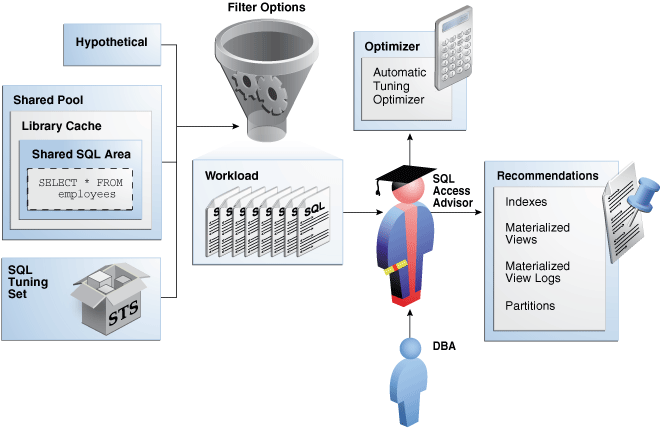
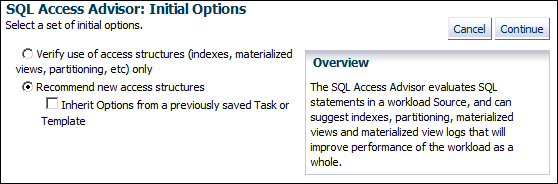
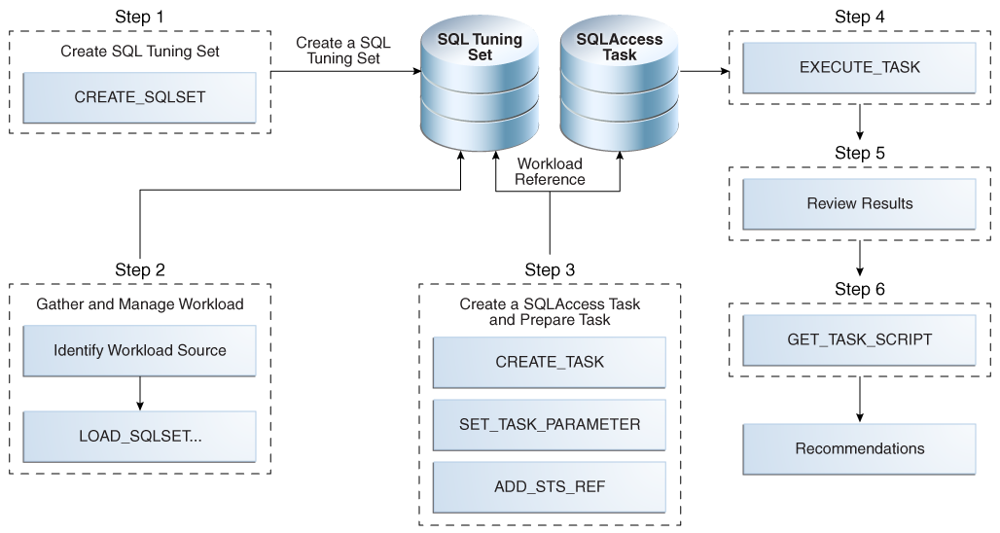

**SQL Access Advisor** is diagnostic software that identifies and helps resolve SQL performance problems by recommending indexes, materialized views, materialized view logs, or partitions to create, drop, or retain.

### 26.1 About SQL Access Advisor

SQL Access Advisor accepts input from several sources, including SQL tuning sets, and then issues recommendations.

Note:

Data visibility and privilege requirements may differ when using SQL Access Advisor with pluggable databases.

See Also:

[Oracle Database Administrator’s Guide](https://docs.oracle.com/pls/topic/lookup?ctx=en/database/oracle/oracle-database/21/tgsql&id=ADMIN13885) for a table that summarizes how manageability features work in a container database (CDB)

#### 26.1.1 Purpose of SQL Access Advisor

SQL Access Advisor recommends the proper set of materialized views, materialized view logs, partitions, and indexes for a specified workload.

Materialized views, partitions, and indexes are essential when tuning a database to achieve optimum performance for complex, data-intensive queries. SQL Access Advisor takes an actual workload as input, or derives a hypothetical workload from a schema. The advisor then recommends access structures for faster execution path. The advisor provides the following advantages:

- Does not require you to have expert knowledge
- Makes decisions based on rules that reside in the optimizer
- Covers all aspects of SQL access in a single advisor
- Provides simple, user-friendly GUI wizards in Cloud Control
- Generates scripts for implementation of recommendations

See Also:

- [Oracle Database 2 Day + Performance Tuning Guide](https://docs.oracle.com/pls/topic/lookup?ctx=en/database/oracle/oracle-database/21/tgsql&id=TDPPT170) to learn how to use SQL Access Advisor with Cloud Control
- [Oracle Database Administrator’s Guide](https://docs.oracle.com/pls/topic/lookup?ctx=en/database/oracle/oracle-database/21/tgsql&id=GUID-E4149397-FF37-4367-A12F-675433715904) to learn more about automated indexing
- [Oracle Database Licensing Information User Manual](https://docs.oracle.com/pls/topic/lookup?ctx=en/database/oracle/oracle-database/21/tgsql&id=DBLIC-GUID-0F9EB85D-4610-4EDF-89C2-4916A0E7AC87) for details on whether automated indexing is supported for different editions and services

#### 26.1.2 SQL Access Advisor Architecture

Automatic Tuning Optimizer is the central tool used by SQL Access Advisor.

The advisor can receive SQL statements as input from the sources shown in Figure 26-1, analyze these statements using the optimizer, and then make recommendations.

Figure 26-1 shows the basic architecture of SQL Access Advisor.

Figure 26-1 SQL Access Advisor Architecture



> This graphic shows a DBA icon pointing up to a SQL Access Advisor icon. The advisor points right to a Recommendations box. Inside the box are the following recommendations: Indexes, Materialized Views, Materialized View Logs, Partitions. Tacked to the box is a piece of paper. The advisor points up to an Optimizer box that contains the text "Automated Tuning Optimizer." A calculator is attached to the box. The advisor points left to a Workload box that contains several SQL statements. Above the Workload box is a filter icon labeled "Filter Options." An arrow points right to Filter Operations. The arrow has three sources: a Hypothetical box; a Shared Pool box; a SQL Tuning Set box. The Shared Pool contains a Library Cache box, which contains a Shared SQL Area box, which contains a dotted-line box that contains the text "SELECT \* FROM employees."


See Also:

" [About Automatic Tuning Optimizer](query-optimizer-concepts.md) "

##### 26.1.2.1 Input to SQL Access Advisor

SQL Access Advisor requires a workload, which consists of one or more SQL statements, plus statistics and attributes that fully describe each statement.

A full workload contains all SQL statements from a target business application. A partial workload contains a subset of SQL statements.

As shown in Figure 26-1, SQL Access Advisor input can come from the following sources:

- Shared SQL area
	The database uses the [shared SQL area](glossary.md) to analyze recent SQL statements that are currently in `V$SQL`.
- SQL tuning set
	A [SQL tuning set (STS)](glossary.md) is a database object that stores SQL statements along with their execution context. When a set of SQL statements serve as input, the database must first construct and use an STS.
	Note:
	For best results, provide a workload as a SQL tuning set. The `DBMS_SQLTUNE` package provides helper functions that can create SQL tuning sets from common workload sources, such as the SQL cache, a user-defined workload stored in a table, and a hypothetical workload.
- Hypothetical workload
	You can create a hypothetical workload from a schema by analyzing dimensions and constraints. This option is useful when you are initially designing your application.

See Also:

- " [About SQL Tuning Sets](managing-sql-tuning-sets.md) "
- [Oracle Database Concepts](https://docs.oracle.com/pls/topic/lookup?ctx=en/database/oracle/oracle-database/21/tgsql&id=CNCPT1228) to learn about the shared SQL area

##### 26.1.2.2 Filter Options for SQL Access Advisor

You can apply a filter to a workload to restrict what is analyzed.

For example, specify that the advisor look at only the 30 most resource-intensive statements in the workload, based on optimizer cost. This restriction can generate different sets of recommendations based on different workload scenarios.

SQL Access Advisor parameters control the recommendation process and customization of the workload. These parameters control various aspects of the process, such as the type of recommendation required and the naming conventions for what it recommends.

To set these parameters, use the `DBMS_ADVISOR.SET_TASK_PARAMETER` procedure. Parameters are persistent in that they remain set for the life span of the task. When a parameter value is set using `DBMS_ADVISOR.SET_TASK_PARAMETER`, the value does not change until you make another call to this procedure.

See Also:

[Oracle Database PL/SQL Packages and Types Reference](https://docs.oracle.com/pls/topic/lookup?ctx=en/database/oracle/oracle-database/21/tgsql&id=ARPLS65151) to learn about the `DBMS_ADVISOR.SET_TASK_PARAMETER` procedure

##### 26.1.2.3 SQL Access Advisor Recommendations

A task recommendation can range from a simple to a complex solution.

The advisor can recommend that you create database objects such as the following:

- Indexes
	SQL Access Advisor index recommendations include bitmap, function-based, and B-tree indexes. A bitmap index offers a reduced response time for many types of ad hoc queries and reduced storage requirements compared to other indexing techniques. B-tree indexes are most commonly used in a data warehouse to index unique or near-unique keys. SQL Access Advisor materialized view recommendations include fast refreshable and full refreshable materialized views, for either general rewrite or exact text match rewrite.
- Materialized views
	SQL Access Advisor, using the `TUNE_MVIEW` procedure, also recommends how to optimize materialized views so that they can be fast refreshable and take advantage of general query rewrite.
- Materialized view logs
	A materialized view log is a table at the materialized view's primary site or primary materialized view site that records all DML changes to the primary table or primary materialized view. A fast refresh of a materialized view is possible only if the materialized view's primary has a materialized view log.
- Partitions
	SQL Access Advisor can recommend partitioning on an existing unpartitioned base table to improve performance. Furthermore, it may recommend new indexes and materialized views that are themselves partitioned.
	While creating new partitioned indexes and materialized view is no different from the unpartitioned case, partition existing base tables with care. This is especially true when indexes, views, constraints, or triggers are defined on the table.

To make recommendations, SQL Access Advisor relies on structural statistics about table and index cardinalities of dimension level columns, `JOIN KEY` columns, and fact table key columns. You can gather exact or estimated statistics with the `DBMS_STATS` package.

Because gathering statistics is time-consuming and full statistical accuracy is not required, it is usually preferable to estimate statistics. Without gathering statistics on a specified table, queries referencing this table are marked as invalid in the workload, resulting in no recommendations for these queries. It is also recommended that all existing indexes and materialized views have been analyzed.

See Also:

- " [About Manual Statistics Collection with DBMS\_STATS](gathering-optimizer-statistics.md) "
- [Oracle Database Data Warehousing Guide](https://docs.oracle.com/pls/topic/lookup?ctx=en/database/oracle/oracle-database/21/tgsql&id=DWHSG0081) to learn more about materialized views
- [Oracle Database VLDB and Partitioning Guide](https://docs.oracle.com/pls/topic/lookup?ctx=en/database/oracle/oracle-database/21/tgsql&id=VLDBG00101) to learn more about partitions

##### 26.1.2.4 SQL Access Advisor Actions

In general, each recommendation provides a benefit for a set of queries.

All individual actions in a recommendation must be implemented together to achieve the full benefit. Recommendations can share actions.

For example, a `CREATE INDEX` statement could provide a benefit for several queries, but some queries might benefit from an additional `CREATE MATERIALIZED VIEW` statement. In that case, the advisor would generate two recommendations: one for the set of queries that require only the index, and another one for the set of queries that require both the index and the materialized view.

###### 26.1.2.4.1 Types of Actions

SQL Access Advisor makes several different types of recommendations.

Recommendations include the following types of actions:

- `PARTITION BASE TABLE`
	This action partitions an existing unpartitioned base table.
- `CREATE|DROP|RETAIN {MATERIALIZED VIEW|MATERIALIZED VIEW LOG|INDEX}`
	The `CREATE` actions corresponds to new access structures. `RETAIN` recommends keeping existing access structures. SQL Access Advisor only recommends `DROP` when the `WORKLOAD_SCOPE` parameter is set to `FULL`.
- `GATHER STATS`
	This action generates a call to a `DBMS_STATS` procedure to gather statistics on a newly generated access structure.

Multiple recommendations may refer to the same action. However, when generating a script for the recommendation, you only see each action once.

See Also:

- " [About Manual Statistics Collection with DBMS\_STATS](gathering-optimizer-statistics.md) "
- " Viewing SQL Access Advisor Task Results " to learn how to view actions and recommendations

###### 26.1.2.4.2 Guidelines for Interpreting Partitioning Recommendations

When SQL Access Advisor determines that partitioning a base table would improve performance, the advisor adds a partition action to every recommendation containing a query referencing the table. In this way, index and materialized view recommendations are implemented on the correctly partitioned tables.

SQL Access Advisor may recommend partitioning an existing nonpartitioned base table. When the advisor implementation script contains partition recommendations, note the following issues:

- Partitioning an existing table is a complex and extensive operation, which may take considerably longer than implementing a new index or materialized view. Sufficient time should be reserved for implementing this recommendation.
- While index and materialized view recommendations are easy to reverse by deleting the index or view, a table, after being partitioned, cannot easily be restored to its original state. Therefore, ensure that you back up the database before executing a script containing partition recommendations.
- While repartitioning a base table, SQL Access Advisor scripts make a temporary copy of the original table, which occupies the same amount of space as the original table. Therefore, the repartitioning process requires sufficient free disk space for another copy of the largest table to be repartitioned. Ensure that such space is available before running the implementation script.
	The partition implementation script attempts to migrate dependent objects such as indexes, materialized views, and constraints. However, some object cannot be automatically migrated. For example, PL/SQL stored procedures defined against a repartitioned base table typically become invalid and must be recompiled.
- If you decide not to implement a partition recommendation, then all other recommendations on the same table in the same script (such as `CREATE INDEX` and `CREATE MATERIALIZED VIEW` recommendations) depend on the partitioning recommendation. To obtain accurate recommendations, do not simply remove the partition recommendation from the script. Rather, rerun the advisor with partitioning disabled, for example, by setting parameter `ANALYSIS_SCOPE` to a value that does not include the keyword `TABLE`.

See Also:

- [Oracle Database SQL Language Reference](https://docs.oracle.com/pls/topic/lookup?ctx=en/database/oracle/oracle-database/21/tgsql&id=SQLRF01207) for `CREATE DIRECTORY` syntax
- [Oracle Database PL/SQL Packages and Types Reference](https://docs.oracle.com/pls/topic/lookup?ctx=en/database/oracle/oracle-database/21/tgsql&id=ARPLS65121) for detailed information about the `DBMS_ADVISOR.GET_TASK_SCRIPT` function

##### 26.1.2.5 SQL Access Advisor Repository

Information required and generated by SQL Access Advisor resides in the Advisor repository, which is in the data dictionary.

The SQL Access Advisor repository has the following benefits:

- Collects a complete workload for SQL Access Advisor
- Supports historical data
- Is managed by the database

#### 26.1.3 User Interfaces for SQL Access Advisor

Oracle recommends that you use SQL Access Advisor through its GUI wizard, which is available in Cloud Control.

You can also invoke SQL Access Advisor through the `DBMS_ADVISOR` package. This chapter explains how to use the API.

See Also:

- [Oracle Database 2 Day + Performance Tuning Guide](https://docs.oracle.com/pls/topic/lookup?ctx=en/database/oracle/oracle-database/21/tgsql&id=TDPPT170) explains how to use the SQL Access Advisor wizard.
- See [Oracle Database PL/SQL Packages and Types Reference](https://docs.oracle.com/pls/topic/lookup?ctx=en/database/oracle/oracle-database/21/tgsql&id=ARPLS350) for complete semantics and syntax.

##### 26.1.3.1 Accessing the SQL Access Advisor: Initial Options Page Using Cloud Control

The SQL Access Advisor: Initial Options page in Cloud Control is the starting page for a wizard that guides you through the process of obtaining recommendations.

To access the SQL Access Advisor: Initial Options page:

1. Log in to Cloud Control with the appropriate credentials.
2. Under the Targets menu, select Databases.
3. In the list of database targets, select the target for the Oracle Database instance that you want to administer.
4. If prompted for database credentials, then enter the minimum credentials necessary for the tasks you intend to perform.
5. From the Performance menu, select SQL, then SQL Access Advisor.
	The SQL Access Advisor: Initial Options page appears., shown in Figure 26-2.
	Figure 26-2 SQL Access Advisor: Initial Options
	

> This screen shot has the title SQL Access Advisor: Initial Options. Underneath is the text "Select a set of initial options." The first option is "Verify use of access structures (indexes, materialized views, partitioning, etc.) only." The second (selected) option is "Recommend new access structures." Underneath is a check box with the text "Inherit Options from a previously saved Task or Template." The Overview text is "The SQL Access Advisor evaluates SQL statements in a workload source, and can suggest indexes, partitioning, materialized views and materialized view logs that will improve performance of the workload as a whole."

	You can perform most SQL plan management tasks in this page or in pages accessed through this page.

See Also:

- Cloud Control context-sensitive online help to learn about the options on the SQL Access Advisor: Initial Options page
- [Oracle Database 2 Day + Performance Tuning Guide](https://docs.oracle.com/pls/topic/lookup?ctx=en/database/oracle/oracle-database/21/tgsql&id=GUID-4DF1C69C-0363-44AE-A760-7C6B66EA2746) to learn how to configure and run SQL Tuning Advisor using Cloud Control

##### 26.1.3.2 Command-Line Interface to SQL Tuning Sets

On the command line, you can use the `DBMS_ADVISOR` package to manage SQL Tuning Advisor.

The `DBMS_ADVISOR` package consists of a collection of analysis and advisory functions and procedures callable from any PL/SQL program. You must have the `ADVISOR` privilege to use `DBMS_ADVISOR`.

See Also:

[Oracle Database PL/SQL Packages and Types Reference](https://docs.oracle.com/pls/topic/lookup?ctx=en/database/oracle/oracle-database/21/tgsql&id=ARPLS350) to learn about `DBMS_ADVISOR`

### 26.2 Using SQL Access Advisor: Basic Tasks

Basic tasks include creating an STS, loading it, creating a SQL Access Advisor task, and then executing the task.

The following graphic shows the basic workflow for SQL Access Advisor.

Figure 26-3 Using SQL Access Advisor



> This flowchart diagram shows the SQL Tuning Sets APIs.
>
> The following SQL Tuning Set API procedures are shown: `CREATE_SQLSET`, `DROP_SQLSET`, `LOAD_SQLSET`, `UNPACK_STQTAB_SQLSET`, and `PACK_STQTAB_SQLSET`. All procedures either lead into or from the SQL Tuning Set (STS).
>
> Three input sources are shown leading into the `LOAD_SQLSET` procedure: cursor cache, AWR, and another STS.
>
> End of image description.


Typically, you use SQL Access Advisor by performing the following steps:

1. Create a SQL tuning set
	The input workload source for SQL Access Advisor is a SQL tuning set (STS). Use `DBMS_SQLTUNE.CREATE_SQLSET` or `DBMS_SQLSET.CREATE_SQLSET` to create a SQL tuning set.
	" Creating a SQL Tuning Set as Input for SQL Access Advisor " describes this task.
2. Load the SQL tuning set
	SQL Access Advisor performs best when a workload based on actual usage is available. Use `DBMS_SQLTUNE.LOAD_SQLSET` or `DBMS_SQLSET.LOAD_SQLSET` to populate the SQL tuning set with your workload.
	" Populating a SQL Tuning Set with a User-Defined Workload " describes this task.
3. Create and configure a task
	In the task, you define what SQL Access Advisor must analyze and the location of the analysis results. Create a task using the `DBMS_ADVISOR.CREATE_TASK` procedure. You can then define parameters for the task using the `SET_TASK_PARAMETER` procedure, and then link the task to an STS by using the `DBMS_ADVISOR.ADD_STS_REF` procedure.
	" Creating and Configuring a SQL Access Advisor Task " describes this task.
4. Execute the task
	Run the `DBMS_ADVISOR.EXECUTE_TASK` procedure to generate recommendations. Each recommendation specifies one or more actions. For example, a recommendation could be to create several materialized view logs, create a materialized view, and then analyze it to gather statistics.
	" Executing a SQL Access Advisor Task " describes this task.
5. View the recommendations
	You can view the recommendations by querying data dictionary views.
	" Viewing SQL Access Advisor Task Results " describes this task.
6. Optionally, generate and execute a SQL script that implements the recommendations.
	" Generating and Executing a Task Script " that describes this task.

#### 26.2.1 Creating a SQL Tuning Set as Input for SQL Access Advisor

The input workload source for SQL Access Advisor is an STS.

Because an STS is stored as a separate entity, multiple advisor tasks can share it. Create an STS with the `DBMS_SQLTUNE.CREATE_SQLSET` or `DBMS_SQLSET.CREATE_SQLSET` procedure.

After an advisor task has referenced an STS, you cannot delete or modify the STS until all advisor tasks have removed their dependency on it. A workload reference is removed when a parent advisor task is deleted, or when you manually remove the workload reference from the advisor task.

Prerequisites

The user creating the STS must have been granted the `ADMINISTER SQL TUNING SET` privilege. To run SQL Access Advisor on SQL tuning sets owned by other users, the user must have the `ADMINISTER ANY SQL TUNING SET` privilege.

Assumptions

This tutorial assumes the following:

- You want to create an STS named `MY_STS_WORKLOAD`.
- You want to use this STS as input for a workload derived from the `sh` schema.
- You use `DBMS_SQLTUNE` rather than `DBMS_SQLSET`.

To create an STS:

1. In SQL\*Plus, log in to the database as user `sh`.
2. Set SQL\*Plus variables.
	For example, enter the following commands:
	```
	SET SERVEROUTPUT ON;
	VARIABLE task_id NUMBER;
	VARIABLE task_name VARCHAR2(255);
	VARIABLE workload_name VARCHAR2(255);
	```
3. Create the SQL tuning set.
	For example, assign a value to the `workload_name` variable and create the STS as follows:
	```
	EXECUTE :workload_name := 'MY_STS_WORKLOAD';
	EXECUTE DBMS_SQLTUNE.CREATE_SQLSET(:workload_name, 'test purpose');
	```

See Also:

- " [About SQL Tuning Sets](managing-sql-tuning-sets.md) "
- [Oracle Database PL/SQL Packages and Types Reference](https://docs.oracle.com/pls/topic/lookup?ctx=en/database/oracle/oracle-database/21/tgsql&id=ARPLS68408) to learn about `CREATE_SQLSET`

#### 26.2.2 Populating a SQL Tuning Set with a User-Defined Workload

A workload consists of one or more SQL statements, plus statistics and attributes that fully describe each statement.

A full workload contains all SQL statements from a target business application. A partial workload contains a subset of SQL statements. The difference is that for full workloads SQL Access Advisor may recommend dropping unused materialized views and indexes.

You cannot use SQL Access Advisor without a workload. SQL Access Advisor ranks the entries according to a specific statistic, business importance, or combination of the two, which enables the advisor to process the most important SQL statements first.

SQL Access Advisor performs best with a workload based on actual usage. You can store multiple workloads in the form of SQL tuning sets, so that you can view the different uses of a real-world data warehousing or OLTP environment over a long period and across the life cycle of database instance startup and shutdown.

The following table describes procedures that you can use to populate an STS with a user-defined workload.

Table 26-1 Procedures for Loading an STS

| Procedure | Description | To Learn More |
| --- | --- | --- |
| `DBMS_SQLTUNE.LOAD_SQLSET` or `DBMS_SQLSET.LOAD_SQLSET` | Populates the SQL tuning set with a set of selected SQL. You can call the procedure multiple times to add new SQL statements or replace attributes of existing statements. | [Oracle Database PL/SQL Packages and Types Reference](https://docs.oracle.com/pls/topic/lookup?ctx=en/database/oracle/oracle-database/21/tgsql&id=ARPLS68430) |
| `DBMS_ADVISOR.COPY_SQLWKLD_TO_STS` | Copies SQL workload data to a user-designated SQL tuning set. The user must have the required SQL tuning set privileges and the required `ADVISOR` privilege. | [Oracle Database PL/SQL Packages and Types Reference](https://docs.oracle.com/pls/topic/lookup?ctx=en/database/oracle/oracle-database/21/tgsql&id=ARPLS65095) |

Assumptions

This tutorial assumes that you want to do the following:

- Create a table named `sh.user_workload` to store information about SQL statements
- Load the `sh.user_workload` table with information about three queries of tables in the `sh` schema
- Populate the STS created in " Creating a SQL Tuning Set as Input for SQL Access Advisor " with the workload contained in `sh.user_workload`
- Use `DBMS_SQLTUNE.LOAD_SQLSET` instead of `DBMS_SQLSET.LOAD_SQLSET`

To populate an STS with a user-defined workload:

1. In SQL\*Plus, log in to the database as user `sh`.
2. Create the `user_workload` table.
	For example, enter the following commands:
	```
	DROP TABLE user_workload;
	CREATE TABLE user_workload
	(
	  username             varchar2(128),  /* User who executes statement */
	  module               varchar2(64),       /* Application module name */
	  action               varchar2(64),       /* Application action name */
	  elapsed_time         number,              /* Elapsed time for query */
	  cpu_time             number,                  /* CPU time for query */
	  buffer_gets          number,       /* Buffer gets consumed by query */
	  disk_reads           number,        /* Disk reads consumed by query */
	  rows_processed       number,        /* # of rows processed by query */
	  executions           number,           /* # of times query executed */
	  optimizer_cost       number,            /* Optimizer cost for query */
	  priority             number,            /* User-priority (1,2 or 3) */
	  last_execution_date  date,              /* Last time query executed */
	  stat_period          number,         /* Window exec time in seconds */
	  sql_text             clob                          /* Full SQL Text */
	);
	```
3. Load the `user_workload` table with information about queries.
	For example, execute the following statements:
	```
	-- aggregation with selection
	INSERT INTO user_workload (username, module, action, priority, sql_text)
	VALUES ('SH', 'Example1', 'Action', 2,
	'SELECT   t.week_ending_day, p.prod_subcategory, 
	          SUM(s.amount_sold) AS dollars, s.channel_id, s.promo_id
	 FROM     sales s, times t, products p 
	 WHERE    s.time_id = t.time_id
	 AND      s.prod_id = p.prod_id 
	 AND      s.prod_id > 10 
	 AND      s.prod_id < 50
	 GROUP BY t.week_ending_day, p.prod_subcategory, s.channel_id, s.promo_id')
	/
	 
	-- aggregation with selection
	INSERT INTO user_workload (username, module, action, priority, sql_text)
	VALUES ('SH', 'Example1', 'Action', 2,
	 'SELECT   t.calendar_month_desc, SUM(s.amount_sold) AS dollars
	  FROM     sales s , times t
	  WHERE    s.time_id = t.time_id
	  AND      s.time_id BETWEEN TO_DATE(''01-JAN-2000'', ''DD-MON-YYYY'')
	  AND      TO_DATE(''01-JUL-2000'', ''DD-MON-YYYY'')
	  GROUP BY t.calendar_month_desc')
	/
	 
	-- order by
	INSERT INTO user_workload (username, module, action, priority, sql_text)
	VALUES ('SH', 'Example1', 'Action', 2,
	 'SELECT   c.country_id, c.cust_city, c.cust_last_name
	  FROM     customers c
	  WHERE    c.country_id IN (52790, 52789)
	  ORDER BY c.country_id, c.cust_city, c.cust_last_name')
	/
	COMMIT;
	```
4. Execute a PL/SQL program that fills a cursor with rows from the `user_workload` table, and then loads the contents of this cursor into the STS named `MY_STS_WORKLOAD`.
	For example, execute the following PL/SQL program:
	```
	DECLARE
	  sqlset_cur DBMS_SQLTUNE.SQLSET_CURSOR;
	BEGIN
	  OPEN sqlset_cur FOR
	    SELECT SQLSET_ROW(null,null, SQL_TEXT, null, null, 'SH', module,
	                     'Action', 0, 0, 0, 0, 0, 1, 0, 1, 0, 0, null, 2, 3,
	                     sysdate, 0, 0, null, 0, null, null)
	    FROM USER_WORKLOAD;
	  DBMS_SQLTUNE.LOAD_SQLSET('MY_STS_WORKLOAD', sqlset_cur);
	END;
	/
	```

#### 26.2.3 Creating and Configuring a SQL Access Advisor Task

Use the `DBMS_ADVISOR.CREATE_TASK` procedure to create a SQL Access Advisor task.

In the SQL Access Advisor task, you define what the advisor must analyze and the location of the results. You can create multiple tasks, each with its own specialization. All are based on the same Advisor task model and share the same repository.

Configuring the task involves the following steps:

- Defining task parameters
	At the time the recommendations are generated, you can apply a filter to the workload to restrict what is analyzed. This restriction provides the ability to generate different sets of recommendations based on different workload scenarios.
	SQL Access Advisor parameters control the recommendation process and customization of the workload. These parameters control various aspects of the process, such as the type of recommendation required and the naming conventions for what it recommends.
	If parameters are not defined, then the database uses the defaults. You can set task parameters by using the `DBMS_ADVISOR.SET_TASK_PARAMETER` procedure. Parameters are persistent in that they remain set for the life span of the task. When a parameter value is set using `SET_TASK_PARAMETER`, it does not change until you make another call to this procedure.
- Linking the task to the workload
	Because the workload is independent, you must link it to a task using the `DBMS_ADVISOR.ADD_STS_REF` procedure. After this link has been established, you cannot delete or modify the workload until all advisor tasks have removed their dependency on the workload. A workload reference is removed when a user deletes a parent advisor task or manually removes the workload reference from the task by using the `DBMS_ADVISOR.DELETE_STS_REF` procedure.

Prerequisites

The user creating the task must have been granted the `ADVISOR` privilege.

Assumptions

This tutorial assumes the following:

- You want to create a task named `MYTASK`.
- You want to use this task to analyze the workload that you defined in " Populating a SQL Tuning Set with a User-Defined Workload ".
- You want to terminate the task if it takes longer than 30 minutes to execute.
- You want to SQL Access Advisor to only consider indexes.

To create and configure a SQL Access Advisor task:

1. Connect SQL\*Plus to the database as user `sh`, and then create the task.
	For example, enter the following commands:
	```
	EXEC :task_name := 'MYTASK';
	EXEC DBMS_ADVISOR.CREATE_TASK('SQL Access Advisor', :task_id, :task_name);
	```
2. Set task parameters.
	For example, execute the following statements:
	```
	EXEC DBMS_ADVISOR.SET_TASK_PARAMETER(:task_name, 'TIME_LIMIT', 30);
	EXEC DBMS_ADVISOR.SET_TASK_PARAMETER(:task_name, 'ANALYSIS_SCOPE', 'ALL');
	```
3. Link the task to the workload.
	For example, execute the following statement:
	```
	EXECUTE DBMS_ADVISOR.ADD_STS_REF(:task_name, 'SH', :workload_name);
	```

#### 26.2.4 Executing a SQL Access Advisor Task

The `DBMS_ADVISOR.EXECUTE_TASK` procedure performs SQL Access Advisor analysis or evaluation for the specified task.

Task execution is a synchronous operation, so the database does not return control to the user until the operation has completed, or the database detects a user interrupt. After the return or execution of the task, you can check the `DBA_ADVISOR_LOG` table for the execution status.

Running `EXECUTE_TASK` generates recommendations. A recommendation includes one or more actions, such as creating a materialized view log or a materialized view.

Prerequisites

When processing a workload, SQL Access Advisor attempts to validate each statement to identify table and column references. The database achieves validation by processing each statement as if it were being executed by the statement's original user.

If the user does not have `SELECT` privileges to a particular table, then SQL Access Advisor bypasses the statement referencing the table. This behavior can cause many statements to be excluded from analysis. If SQL Access Advisor excludes all statements in a workload, then the workload is invalid. SQL Access Advisor returns the following message:

```
QSM-00774, there are no SQL statements to process for task TASK_NAME
```

To avoid missing critical workload queries, the current database user must have `SELECT` privileges on the tables targeted for materialized view analysis. For these tables, these `SELECT` privileges cannot be obtained through a role.

Assumptions

This tutorial assumes that you want to execute the task you configured in " Creating and Configuring a SQL Access Advisor Task ".

To create and configure a SQL Access Advisor task:

1. In SQL\*Plus or SQL Developer, log in to the database as a user with the necessary privileges.
2. Execute the task.
	For example, execute the following statement:
	```
	EXECUTE DBMS_ADVISOR.EXECUTE_TASK(:task_name);
	```
3. Optionally, query `USER_ADVISOR_LOG` to check the status of the task.
	For example, execute the following statements (sample output included):
	```
	COL TASK_ID FORMAT 999
	COL TASK_NAME FORMAT a25
	COL STATUS_MESSAGE FORMAT a25
	SELECT TASK_ID, TASK_NAME, STATUS, STATUS_MESSAGE 
	FROM   USER_ADVISOR_LOG;
	TASK_ID TASK_NAME                 STATUS      STATUS_MESSAGE
	------- ------------------------- ----------- -------------------------
	    103 MYTASK                    COMPLETED   Access advisor execution
	                                              completed
	```

See Also:

[Oracle Database PL/SQL Packages and Types Reference](https://docs.oracle.com/pls/topic/lookup?ctx=en/database/oracle/oracle-database/21/tgsql&id=ARPLS350) to learn more about the `EXECUTE_TASK` procedure and its parameters

#### 26.2.5 Viewing SQL Access Advisor Task Results

You can view each recommendation generated by SQL Access Advisor using several data dictionary views.

The views are summarized in Table 26-2. However, it is easier to use the `DBMS_ADVISOR.GET_TASK_SCRIPT` procedure or Cloud Control, which graphically displays the recommendations and provides hyperlinks to quickly see which SQL statements benefit from a recommendation.

Each recommendation produced by SQL Access Advisor is linked to the SQL statement it benefits. Each recommendation corresponds to one or more actions. Each action has one or more attributes.

Each action has attributes pertaining to the access structure properties. The name and tablespace for each applicable access structure are in the `ATTR1` and `ATTR2` columns of `USER_ADVISOR_ATTRIBUTES`. The space occupied by each new access structure is in the `NUM_ATTR1` column. Other attributes are different for each action.

Table 26-2 Views Showing Task Results

| Data Dictionary View (DBA, USER) | Description |
| --- | --- |
| `DBA_ADVISOR_TASKS` | Displays information about advisor tasks. To see SQL Access Advisor tasks, select where `ADVISOR_NAME = 'SQL Access Advisor'.` |
| `DBA_ADVISOR_RECOMMENDATIONS` | Displays the results of an analysis of all recommendations in the database. A recommendation can have multiple actions associated with it. The `DBA_ADVISOR_ACTIONS` view describe the actions. A recommendation also points to a set of rationales that present a justification/reasoning for that recommendation. The `DBA_ADVISOR_RATIONALE` view describes the rationales. |
| `DBA_ADVISOR_ACTIONS` | Displays information about the actions associated with all recommendations in the database. Each action is specified by the `COMMAND` and `ATTR1` through `ATTR6` columns. Each command defines how to use the attribute columns. |
| `DBA_ADVISOR_RATIONALE` | Displays information about the rationales for all recommendations in the database. |
| `DBA_ADVISOR_SQLA_WK_STMTS` | Displays information about all workload objects in the database after a SQL Access Advisor analysis. The precost and postcost numbers are in terms of the estimated optimizer cost (shown in `EXPLAIN PLAN`) without and with the recommended access structure. |

Assumptions

This tutorial assumes that you want to view results of the task you executed in " Executing a SQL Access Advisor Task ".

To view the results of a SQL Access Advisor task:

1. Connect SQL\*Plus to the database with the appropriate privileges, and then query the advisor recommendations.
	For example, execute the following statements (sample output included):
	```
	VARIABLE workload_name VARCHAR2(255); 
	VARIABLE task_name VARCHAR2(255);
	EXECUTE :task_name := 'MYTASK';
	EXECUTE :workload_name := 'MY_STS_WORKLOAD'; 
	SELECT REC_ID, RANK, BENEFIT
	FROM   USER_ADVISOR_RECOMMENDATIONS 
	WHERE  TASK_NAME = :task_name
	ORDER BY RANK;
	    REC_ID       RANK    BENEFIT
	---------- ---------- ----------
	         1          1        236
	         2          2        356
	```
	The preceding output shows the recommendations (`rec_id`) produced by an SQL Access Advisor run, with their rank and total benefit. The rank is a measure of the importance of the queries that the recommendation helps. The benefit is the total improvement in execution cost (in terms of optimizer cost) of all queries using the recommendation.
2. Identify which query benefits from which recommendation.
	For example, execute the following query of `USER_ADVISOR_SQLA_WK_STMTS` (sample output included):
	```
	SELECT SQL_ID, REC_ID, PRECOST, POSTCOST,
	       (PRECOST-POSTCOST)*100/PRECOST AS PERCENT_BENEFIT
	FROM   USER_ADVISOR_SQLA_WK_STMTS
	WHERE  TASK_NAME = :task_name
	AND    WORKLOAD_NAME = :workload_name
	ORDER BY percent_benefit DESC;
	SQL_ID            REC_ID    PRECOST   POSTCOST PERCENT_BENEFIT
	------------- ---------- ---------- ---------- ---------------
	fn4bsxdm98w3u          2        578        222      61.5916955
	29bbju72rv3t2          1       5750       5514      4.10434783
	133ym38r6gbar          0        772        772               0
	```
	The precost and postcost numbers are in terms of the estimated optimizer cost (shown in `EXPLAIN` `PLAN`) both without and with the recommended access structure changes.
3. Display the number of distinct actions for this set of recommendations.
	For example, use the following query (sample output included):
	```
	SELECT 'Action Count', COUNT(DISTINCT action_id) cnt
	FROM   USER_ADVISOR_ACTIONS 
	WHERE  TASK_NAME = :task_name;
	'ACTIONCOUNT        CNT
	------------ ----------
	Action Count          4
	```
4. Display the actions for this set of recommendations.
	For example, use the following query (sample output included):
	```
	SELECT REC_ID, ACTION_ID, SUBSTR(COMMAND,1,30) AS command
	FROM   USER_ADVISOR_ACTIONS 
	WHERE  TASK_NAME = :task_name
	ORDER BY rec_id, action_id;
	    REC_ID  ACTION_ID COMMAND
	---------- ---------- ------------------------------
	         1          1 PARTITION TABLE
	         1          2 RETAIN INDEX
	         2          1 PARTITION TABLE
	         2          3 RETAIN INDEX
	         2          4 RETAIN INDEX
	```
5. Display attributes of the recommendations.
	For example, create the following PL/SQL procedure `show_recm`, and then execute it to see attributes of the actions:
	```
	CREATE OR REPLACE PROCEDURE show_recm (in_task_name IN VARCHAR2) IS 
	CURSOR curs IS
	  SELECT DISTINCT action_id, command, attr1, attr2, attr3, attr4
	  FROM user_advisor_actions
	  WHERE task_name = in_task_name
	  ORDER BY action_id;
	  v_action        number;
	  v_command     VARCHAR2(32);
	  v_attr1       VARCHAR2(4000);
	  v_attr2       VARCHAR2(4000);
	  v_attr3       VARCHAR2(4000);
	  v_attr4       VARCHAR2(4000);
	  v_attr5       VARCHAR2(4000);
	BEGIN
	  OPEN curs;
	  DBMS_OUTPUT.PUT_LINE('=========================================');
	  DBMS_OUTPUT.PUT_LINE('Task_name = ' || in_task_name);
	  LOOP
	     FETCH curs INTO  
	       v_action, v_command, v_attr1, v_attr2, v_attr3, v_attr4 ;
	   EXIT when curs%NOTFOUND;
	   DBMS_OUTPUT.PUT_LINE('Action ID: ' || v_action);
	   DBMS_OUTPUT.PUT_LINE('Command : ' || v_command);
	   DBMS_OUTPUT.PUT_LINE('Attr1 (name)      : ' || SUBSTR(v_attr1,1,30));
	   DBMS_OUTPUT.PUT_LINE('Attr2 (tablespace): ' || SUBSTR(v_attr2,1,30));
	   DBMS_OUTPUT.PUT_LINE('Attr3             : ' || SUBSTR(v_attr3,1,30));
	   DBMS_OUTPUT.PUT_LINE('Attr4             : ' || v_attr4);
	   DBMS_OUTPUT.PUT_LINE('Attr5             : ' || v_attr5);
	   DBMS_OUTPUT.PUT_LINE('----------------------------------------');  
	   END LOOP;   
	   CLOSE curs;      
	   DBMS_OUTPUT.PUT_LINE('=========END RECOMMENDATIONS============');
	END show_recm;
	/
	SET SERVEROUTPUT ON SIZE 99999
	EXECUTE show_recm(:task_name);
	```
	The following output shows attributes of actions in the recommendations:
	```
	=========================================
	Task_name = MYTASK
	Action ID: 1
	Command : PARTITION TABLE
	Attr1 (name)      : "SH"."SALES"
	Attr2 (tablespace):
	Attr3             : ("TIME_ID")
	Attr4             : INTERVAL
	Attr5             :
	----------------------------------------
	Action ID: 2
	Command : RETAIN INDEX
	Attr1 (name)      : "SH"."PRODUCTS_PK"
	Attr2 (tablespace):
	Attr3             : "SH"."PRODUCTS"
	Attr4             : BTREE
	Attr5             :
	----------------------------------------
	Action ID: 3
	Command : RETAIN INDEX
	Attr1 (name)      : "SH"."TIMES_PK"
	Attr2 (tablespace):
	Attr3             : "SH"."TIMES"
	Attr4             : BTREE
	Attr5             :
	----------------------------------------
	Action ID: 4
	Command : RETAIN INDEX
	Attr1 (name)      : "SH"."SALES_TIME_BIX"
	Attr2 (tablespace):
	Attr3             : "SH"."SALES"
	Attr4             : BITMAP
	Attr5             :
	----------------------------------------
	=========END RECOMMENDATIONS============
	```

See Also:

- " Action Attributes in the DBA\_ADVISOR\_ACTIONS View "
- [Oracle Database PL/SQL Packages and Types Reference](https://docs.oracle.com/pls/topic/lookup?ctx=en/database/oracle/oracle-database/21/tgsql&id=ARPLS020) for details regarding `Attr5` and `Attr6`

#### 26.2.6 Generating and Executing a Task Script

You can use the procedure `DBMS_ADVISOR.GET_TASK_SCRIPT` to create a script of the SQL statements for the SQL Access Advisor recommendations. The script is an executable SQL file that can contain `DROP`, `CREATE`, and `ALTER` statements.

For new objects, the names of the materialized views, materialized view logs, and indexes are automatically generated by using the user-specified name template. Review the generated SQL script before attempting to execute it.

Assumptions

This tutorial assumes that you want to save and execute a script that contains the recommendations generated in " Executing a SQL Access Advisor Task ".

To save and execute a SQL script:

1. Connect SQL\*Plus to the database as an administrator.
2. Create a directory object and grant permissions to read and write to it.
	For example, use the following statements:
	```
	CREATE DIRECTORY ADVISOR_RESULTS AS '/tmp';
	GRANT READ ON DIRECTORY ADVISOR_RESULTS TO PUBLIC;
	GRANT WRITE ON DIRECTORY ADVISOR_RESULTS TO PUBLIC;
	```
3. Connect to the database as `sh`, and then save the script to a file.
	For example, use the following statement:
	```
	EXECUTE DBMS_ADVISOR.CREATE_FILE(DBMS_ADVISOR.GET_TASK_SCRIPT('MYTASK'),
	'ADVISOR_RESULTS', 'advscript.sql');
	```
4. Use a text editor to view the contents of the script.
	The following is a fragment of a script generated by this procedure:
	```
	Rem  Username:        SH
	Rem  Task:            MYTASK
	Rem  Execution date:
	Rem
	 
	Rem
	Rem  Repartitioning table "SH"."SALES"
	Rem
	 
	SET SERVEROUTPUT ON
	SET ECHO ON
	 
	Rem
	Rem Creating new partitioned table
	Rem
	  CREATE TABLE "SH"."SALES1"
	   (    "PROD_ID" NUMBER,
	        "CUST_ID" NUMBER,
	        "TIME_ID" DATE,
	        "CHANNEL_ID" NUMBER,
	        "PROMO_ID" NUMBER,
	        "QUANTITY_SOLD" NUMBER(10,2),
	        "AMOUNT_SOLD" NUMBER(10,2)
	   ) PCTFREE 5 PCTUSED 40 INITRANS 1 MAXTRANS 255
	 NOCOMPRESS  NOLOGGING
	  TABLESPACE "EXAMPLE"
	PARTITION BY RANGE ("TIME_ID") INTERVAL( NUMTOYMINTERVAL( 1, 'MONTH')) 
	( PARTITION VALUES LESS THAN (TO_DATE(' 1998-02-01 00:00:00', 
	'SYYYY-MM-DD HH24:MI:SS', 'NLS_CALENDAR=GREGORIAN')) );
	.
	.
	.
	```
5. Optionally, in SQL\*Plus, run the SQL script.
	For example, enter the following command:
	```
	@/tmp/advscript.sql
	```

See Also:

- [Oracle Database SQL Language Reference](https://docs.oracle.com/pls/topic/lookup?ctx=en/database/oracle/oracle-database/21/tgsql&id=SQLRF01207) for `CREATE DIRECTORY` syntax
- [Oracle Database PL/SQL Packages and Types Reference](https://docs.oracle.com/pls/topic/lookup?ctx=en/database/oracle/oracle-database/21/tgsql&id=ARPLS65121) to learn more about the `GET_TASK_SCRIPT` function

### 26.3 Performing a SQL Access Advisor Quick Tune

To tune a single SQL statement, the `DBMS_ADVISOR.QUICK_TUNE` procedure accepts as its input a `task_name` and a single SQL statement.

The `DBMS_ADVISOR.QUICK_TUNE` procedure creates a task and workload and executes this task. `EXECUTE_TASK` and `QUICK_TUNE` produce the same results. However, `QUICK_TUNE` is easier when tuning a single SQL statement.

Assumptions

This tutorial assumes the following:

- You want to tune a single SQL statement.
- You want to name the task `MY_QUICKTUNE_TASK`.

To create a template and base a task on this template:

1. Connect SQL\*Plus to the database as user `sh`, and then initialize SQL\*Plus variables for the SQL statement and task name.
	For example, enter the following commands:
	```
	VARIABLE t_name VARCHAR2(255);
	VARIABLE sq VARCHAR2(4000);
	EXEC :sq := 'SELECT COUNT(*) FROM customers WHERE cust_state_province =''CA''';
	EXECUTE :t_name := 'MY_QUICKTUNE_TASK';
	```
2. Perform the quick tune.
	For example, the following statement executes `MY_QUICKTUNE_TASK`:
	```
	EXEC DBMS_ADVISOR.QUICK_TUNE(DBMS_ADVISOR.SQLACCESS_ADVISOR,:t_name,:sq);
	```

See Also:

[Oracle Database PL/SQL Packages and Types Reference](https://docs.oracle.com/pls/topic/lookup?ctx=en/database/oracle/oracle-database/21/tgsql&id=ARPLS350) to learn more about the `QUICK_TUNE` procedure and its parameters

### 26.4 Using SQL Access Advisor: Advanced Tasks

This section describes advanced tasks involving SQL Access Advisor.

#### 26.4.1 Evaluating Existing Access Structures

SQL Access Advisor operates in two modes: problem-solving and evaluation.

By default, SQL Access Advisor attempts to solve access method problems by looking for enhancements to index structures, partitions, materialized views, and materialized view logs. For example, a problem-solving run may recommend creating a new index, adding a new column to a materialized view log, and so on.

When you set the `ANALYSIS_SCOPE` parameter to `EVALUATION`, SQL Access Advisor comments only on which access structures the supplied workload uses. An evaluation-only run may only produce recommendations such as retaining an index, retaining a materialized view, and so on. The evaluation mode can be useful to see exactly which indexes and materialized views a workload is using. SQL Access Advisor does not evaluate the performance impact of existing base table partitioning.

To create a task and set it to evaluation mode:

1. Connect SQL\*Plus to the database with the appropriate privileges, and then create a task.
	For example, enter the following statement, where `t_name` is a SQL\*Plus variable set to the name of the task:
	```
	EXECUTE DBMS_ADVISOR.EXECUTE_TASK(:t_name);
	```
2. Perform the quick tune.
	For example, the following statement sets the previous task to evaluation mode:
	```
	EXECUTE DBMS_ADVISOR.SET_TASK_PARAMETER(:t_name,'ANALYSIS_SCOPE','EVALUATION');
	```

See Also:

[Oracle Database PL/SQL Packages and Types Reference](https://docs.oracle.com/pls/topic/lookup?ctx=en/database/oracle/oracle-database/21/tgsql&id=ARPLS350) to learn about the `SET_TASK_PARAMETER` procedure and its parameters

#### 26.4.2 Updating SQL Access Advisor Task Attributes

You can use the `DBMS_ADVISOR.UPDATE_TASK_ATTRIBUTES` procedure to set attributes for the task.

You can set the following attributes:

- Change the name of a task.
- Give a task a description.
- Set the task to be read-only so it cannot be changed.
- Make the task a template upon which you can define other tasks.
- Changes various attributes of a task or a task template.

Assumptions

This tutorial assumes the following:

- You want to change the name of existing task `MYTASK` to `TUNING1`.
- You want to make the task `TUNING1` read-only.

To update task attributes:

1. Connect SQL\*Plus to the database as user `sh`, and then change the name of the task.
	For example, use the following statement:
	```
	EXECUTE DBMS_ADVISOR.UPDATE_TASK_ATTRIBUTES('MYTASK', 'TUNING1');
	```
2. Set the task to read-only.
	For example, use the following statement:
	```
	EXECUTE DBMS_ADVISOR.UPDATE_TASK_ATTRIBUTES('TUNING1', 
	  read_only => 'true');
	```

See Also:

- " Creating and Using SQL Access Advisor Task Templates "
- [Oracle Database PL/SQL Packages and Types Reference](https://docs.oracle.com/pls/topic/lookup?ctx=en/database/oracle/oracle-database/21/tgsql&id=ARPLS350) for more information regarding the `UPDATE_TASK_ATTRIBUTES` procedure and its parameters

#### 26.4.3 Creating and Using SQL Access Advisor Task Templates

A **task template** is a saved configuration on which to base future tasks and workloads.

A template enables you to set up any number of tasks or workloads that can serve as starting points or templates for future task creation. By setting up a template, you can save time when performing tuning analysis. This approach also enables you to custom fit a tuning analysis to the business operation.

Physically, there is no difference between a task and a template. However, a template cannot be executed. To create a task from a template, you specify the template to be used when a new task is created. At that time, SQL Access Advisor copies the data and parameter settings from the template into the newly created task. You can also set an existing task to be a template by setting the template attribute when creating the task or later using the `UPDATE_TASK_ATTRIBUTE` procedure.

The following table describes procedures that you can use to manage task templates.

Table 26-3 DBMS\_ADVISOR Procedures for Task Templates

| Procedure | Description |
| --- | --- |
| `CREATE_TASK` | The `template` parameter is an optional task name of an existing task or task template. To specify built-in SQL Access Advisor templates, use the template name as described in Table 26-6. `is_template` is an optional parameter that enables you to set the newly created task as a template. Valid values are `true` and `false`. |
| `SET_TASK_PARAMETER` | The `INDEX_NAME_TEMPLATE` parameter specifies the method by which new index names are formed. The `MVIEW_NAME_TEMPLATE` parameter specifies the method by which new materialized view names are formed. The `PARTITION_NAME_TEMPLATE` parameter specifies the method by which new partition names are formed. |
| `UPDATE_TASK_ATTRIBUTES` | `is_template` marks the task as a template. Physically, there is no difference between a task and a template; however, a template cannot be executed. Possible values are: `true` and `false`. If the value is `NULL` or contains the value `ADVISOR_UNUSED`, then the setting is not changed. |

Assumptions

This tutorial assumes the following:

- You want to create a template named `MY_TEMPLATE`.
- You want to set naming conventions for indexes and materialized views that are recommended by tasks based on `MY_TEMPLATE`.
- You want to create task `NEWTASK` based on `MY_TEMPLATE`.

To create a template and base a task on this template:

1. Connect SQL\*Plus to the database as user `sh`, and then create a task as a template.
	For example, create a template named `MY_TEMPLATE` as follows:
	```
	VARIABLE template_id NUMBER;
	VARIABLE template_name VARCHAR2(255);
	EXECUTE :template_name := 'MY_TEMPLATE';
	BEGIN 
	  DBMS_ADVISOR.CREATE_TASK (
	    'SQL Access Advisor'
	,   :template_id
	,   :template_name
	,   is_template => 'true'
	);
	END;
	```
2. Set template parameters.
	For example, the following statements set the naming conventions for recommended indexes and materialized views:
	```
	-- set naming conventions for recommended indexes/mvs
	BEGIN 
	  DBMS_ADVISOR.SET_TASK_PARAMETER ( 
	    :template_name
	,   'INDEX_NAME_TEMPLATE'
	,   'SH_IDX$$_<SEQ>'
	);
	END;
	BEGIN 
	  DBMS_ADVISOR.SET_TASK_PARAMETER (
	    :template_name
	,   'MVIEW_NAME_TEMPLATE'
	,   'SH_MV$$_<SEQ>'
	);
	END;
	```
3. Create a task based on a preexisting template.
	For example, enter the following commands to create `NEWTASK` based on `MY_TEMPLATE`:
	```
	VARIABLE task_id NUMBER;
	VARIABLE task_name VARCHAR2(255);
	EXECUTE :task_name := 'NEWTASK';
	BEGIN 
	  DBMS_ADVISOR.CREATE_TASK (
	    'SQL Access Advisor'
	,   :task_id
	,   :task_name
	,   template=>'MY_TEMPLATE'
	);
	END;
	```

See Also:

Oracle Database PL/SQL Packages and Types Reference to learn about the [`CREATE_TASK`](https://docs.oracle.com/pls/topic/lookup?ctx=en/database/oracle/oracle-database/21/tgsql&id=ARPLS350) and [`SET_TASK_PARAMETER`](https://docs.oracle.com/pls/topic/lookup?ctx=en/database/oracle/oracle-database/21/tgsql&id=ARPLS350) procedures

#### 26.4.4 Terminating SQL Access Advisor Task Execution

SQL Access Advisor enables you to interrupt the recommendation process or allow it to complete.

An interruption signals SQL Access Advisor to stop processing and marks the task as `INTERRUPTED`. At that point, you may update recommendation attributes and generate scripts.

Intermediate results represent recommendations for the workload contents up to that point in time. If recommendations must be sensitive to the entire workload, then Oracle recommends that you let the task complete. Additionally, recommendations made by the advisor early in the recommendation process do not contain base table partitioning recommendations. The partitioning analysis requires a large part of the workload to be processed before it can determine whether partitioning would be beneficial. Therefore, if SQL Access Advisor detects a benefit, then only later intermediate results contain base table partitioning recommendations.

##### 26.4.4.1 Interrupting SQL Access Advisor Tasks

The `DBMS_ADVISOR.INTERRUPT_TASK` procedure causes a SQL Access Advisor task execution to terminate as if it had reached its normal end.

Thus, you can see any recommendations that have been formed up to the point of the interruption. An interrupted task cannot be restarted. The syntax is as follows:

```
DBMS_ADVISOR.INTERRUPT_TASK (task_name IN VARCHAR2);
```

Assumptions

This tutorial assumes the following:

- Long-running task `MYTASK` is currently executing.
- You want to interrupt this task, and then view the recommendations.

To interrupt a currently executing task:

1. Connect SQL\*Plus to the database as `sh`, and then interrupt the task.
	For example, create a template named `MY_TEMPLATE` as follows:
	```
	EXECUTE DBMS_ADVISOR.INTERRUPT_TASK ('MYTASK');
	```

See Also:

[Oracle Database PL/SQL Packages and Types Reference](https://docs.oracle.com/pls/topic/lookup?ctx=en/database/oracle/oracle-database/21/tgsql&id=ARPLS65135) to learn about the `INTERRUPT_TASK` procedure

##### 26.4.4.2 Canceling SQL Access Advisor Tasks

You can stop task execution by calling the `DBMS_ADVISOR.CANCEL_TASK` procedure and passing in the task name for this recommendation process.

SQL Access Advisor may take a few seconds to respond to this request. Because all advisor task procedures are synchronous, to cancel an operation, you must use a separate database session. If you use `CANCEL_TASK`, then SQL Access Advisor makes no recommendations.

A cancel command effective restores the task to its condition before the start of the canceled operation. Therefore, a canceled task or data object cannot be restarted. However, you can reset the task using `DBMS_ADVISOR.RESET_TASK`, and then execute it again. The `CANCEL_TASK` syntax is as follows:

```
DBMS_ADVISOR.CANCEL_TASK (task_name   IN  VARCHAR2);
```

The `RESET_TASK` procedure resets a task to its initial starting point, which has the effect of removing all recommendations and intermediate data from the task. The task status is set to `INITIAL`. The syntax is as follows:

```
DBMS_ADVISOR.RESET_TASK (task_name     IN VARCHAR2);
```

Assumptions

This tutorial assumes the following:

- Long-running task `MYTASK` is currently executing. This task is set to make partitioning recommendations.
- You want to cancel this task, and then reset it so that the task makes only index recommendations.

To cancel a currently executing task:

1. Connect SQL\*Plus to the database as user `sh`, and then cancel the task.
	For example, create a template named `MY_TEMPLATE` as follows:
	```
	EXECUTE DBMS_ADVISOR.CANCEL_TASK ('MYTASK');
	```
2. Reset the task.
	For example, execute the `RESET_TASK` procedure as follows:
	```
	EXECUTE DBMS_ADVISOR.RESET_TASK('MYTASK');
	```
3. Set task parameters.
	For example, change the analysis scope to `INDEX` as follows:
	```
	EXECUTE DBMS_ADVISOR.SET_TASK_PARAMETER(:task_name, 'ANALYSIS_SCOPE', 'INDEX');
	```
4. Execute the task.
	For example, execute `MYTASK` as follows:
	```
	EXECUTE DBMS_ADVISOR.EXECUTE_TASK ('MYTASK');
	```

See Also:

Oracle Database PL/SQL Packages and Types Reference to learn more about [`RESET_TASK`](https://docs.oracle.com/pls/topic/lookup?ctx=en/database/oracle/oracle-database/21/tgsql&id=ARPLS65143) and [`CANCEL_TASK`](https://docs.oracle.com/pls/topic/lookup?ctx=en/database/oracle/oracle-database/21/tgsql&id=ARPLS350)

#### 26.4.5 Deleting SQL Access Advisor Tasks

The `DBMS_ADVISOR.DELETE_TASK` procedure deletes existing SQL Access Advisor tasks from the repository.

The syntax for SQL Access Advisor task deletion is as follows:

```
DBMS_ADVISOR.DELETE_TASK (task_name  IN VARCHAR2);
```

If a task is linked to an STS workload, and if you want to delete the task or workload, then you must remove the link between the task and the workload using the `DELETE_STS_REF` procedure. The following example deletes the link between task `MYTASK` and the current user's SQL tuning set `MY_STS_WORKLOAD`:

```
EXECUTE DBMS_ADVISOR.DELETE_STS_REF('MYTASK', null, 'MY_STS_WORKLOAD');
```

Assumptions

This tutorial assumes the following:

- User `sh` currently owns multiple SQL Access Advisor tasks.
- You want to delete `MYTASK`.
- The task `MYTASK` is currently linked to workload `MY_STS_WORKLOAD`.

To delete a SQL Access Advisor task:

1. Connect SQL\*Plus to the database as user `sh`, and then query existing SQL Access Advisor tasks.
	For example, query the data dictionary as follows (sample output included):
	```
	SELECT TASK_NAME 
	FROM   USER_ADVISOR_TASKS 
	WHERE  ADVISOR_NAME = 'SQL Access Advisor';
	 
	TASK_NAME
	-------------------------
	MYTASK
	NEWTASK
	```
2. Delete the link between `MYTASK` and `MY_STS_WORKLOAD`.
	For example, delete the reference as follows:
	```
	EXECUTE DBMS_ADVISOR.DELETE_STS_REF('MYTASK', null, 'MY_STS_WORKLOAD');
	```
3. Delete the desired task.
	For example, delete `MYTASK` as follows:
	```
	EXECUTE DBMS_ADVISOR.DELETE_TASK('MYTASK');
	```

See Also:

[Oracle Database PL/SQL Packages and Types Reference](https://docs.oracle.com/pls/topic/lookup?ctx=en/database/oracle/oracle-database/21/tgsql&id=ARPLS65113) to learn more about the `DELETE_TASK` procedure and its parameters

#### 26.4.6 Marking SQL Access Advisor Recommendations

By default, all SQL Access Advisor recommendations are ready to be implemented. However, you can choose to skip or exclude selected recommendations by using the `DBMS_ADVISOR.MARK_RECOMMENDATION` procedure.

`MARK_RECOMMENDATION` enables you to annotate a recommendation with a `REJECT` or `IGNORE` setting, which causes the `GET_TASK_SCRIPT` to skip it when producing the implementation procedure.

If SQL Access Advisor makes a recommendation to partition one or multiple previously nonpartitioned base tables, then consider carefully before skipping this recommendation. Changing a table's partitioning scheme affects the cost of all queries, indexes, and materialized views defined on the table. Therefore, if you skip the partitioning recommendation, then the advisor's remaining recommendations on this table are no longer optimal. To see recommendations on your workload that do not contain partitioning, reset the advisor task and rerun it with the `ANALYSIS_SCOPE` parameter changed to exclude partitioning recommendations.

The syntax is as follows:

```
DBMS_ADVISOR.MARK_RECOMMENDATION (
   task_name          IN VARCHAR2
   id                 IN NUMBER,
   action             IN VARCHAR2);
```

Assumptions

This tutorial assumes the following:

- You are reviewing the recommendations as described in tutorial " Viewing SQL Access Advisor Task Results ".
- You want to reject the first recommendation, which partitions a table.

To mark a recommendation:

1. Connect SQL\*Plus to the database as user `sh`, and then mark the recommendation.
	For example, reject recommendation `1` as follows:
	```
	EXECUTE DBMS_ADVISOR.MARK_RECOMMENDATION('MYTASK', 1, 'REJECT');
	```
	This recommendation and any dependent recommendations do not appear in the script.
2. Generate the script as explained in " Generating and Executing a Task Script ".

See Also:

[Oracle Database PL/SQL Packages and Types Reference](https://docs.oracle.com/pls/topic/lookup?ctx=en/database/oracle/oracle-database/21/tgsql&id=ARPLS350) to learn more about the `MARK_RECOMMENDATIONS` procedure and its parameters

#### 26.4.7 Modifying SQL Access Advisor Recommendations

Using the `UPDATE_REC_ATTRIBUTES` procedure, SQL Access Advisor names and assigns ownership to new objects such as indexes and materialized views during analysis.

SQL Access Advisor may not necessarily choose appropriate names. In this case, you may choose to manually set the owner, name, and tablespace values for new objects. For recommendations referencing existing database objects, owner and name values cannot be changed. The syntax is as follows:

```
DBMS_ADVISOR.UPDATE_REC_ATTRIBUTES (
   task_name            IN VARCHAR2
   rec_id               IN NUMBER,
   action_id            IN NUMBER,
   attribute_name       IN VARCHAR2,
   value                IN VARCHAR2);
```

The `attribute_name` parameter can take the following values:

- `OWNER`
	Specifies the owner name of the recommended object.
- `NAME`
	Specifies the name of the recommended object.
- `TABLESPACE`
	Specifies the tablespace of the recommended object.

Assumptions

This tutorial assumes the following:

- You are reviewing the recommendations as described in tutorial " Viewing SQL Access Advisor Task Results ".
- You want to change the tablespace for recommendation 1, action 1 to `SH_MVIEWS`.

To mark a recommendation:

1. Connect SQL\*Plus to the database as user `sh`, and then update the recommendation attribute.
	For example, change the tablespace name to `SH_MVIEWS` as follows:
	```
	BEGIN 
	  DBMS_ADVISOR.UPDATE_REC_ATTRIBUTES (
	    'MYTASK'
	,   1
	,   1
	,   'TABLESPACE'
	,   'SH_MVIEWS'
	);
	END;
	```
2. Generate the script as explained in " Generating and Executing a Task Script ".

See Also:

[Oracle Database PL/SQL Packages and Types Reference](https://docs.oracle.com/pls/topic/lookup?ctx=en/database/oracle/oracle-database/21/tgsql&id=ARPLS65163) to learn more about the `UPDATE_REC_ATTRIBUTES` procedure and its parameters

### 26.5 SQL Access Advisor Examples

Oracle Database provides a script that contains several SQL Access Advisor examples that you can run on a test database.

The script is named `ORACLE_HOME/rdbms/demo/aadvdemo.sql`.

### 26.6 SQL Access Advisor Reference

You can access metadata about SQL Access Advisor using data dictionary views.

#### 26.6.1 Action Attributes in the DBA\_ADVISOR\_ACTIONS View

The DBA\_ADVISOR\_ACTIONS view displays information about the actions associated with all recommendations in the database. Each action is specified by the `COMMAND` and `ATTR1` through `ATTR6` columns.

The following table maps SQL Access Advisor actions to attribute columns in the `DBA_ADVISOR_ACTIONS` view. In the table, `MV` refers to a materialized view.

Table 26-4 SQL Access Advisor Action Attributes

| Action | ATTR1 Column | ATTR2 Column | ATTR3 Column | ATTR4 Column | ATTR5 Column | ATTR6 Column | NUM\_ATTR1 Column |
| --- | --- | --- | --- | --- | --- | --- | --- |
| `CREATE INDEX` | Index name | Index tablespace | Target table | `BITMAP` or `BTREE` | Index column list / expression | Unused | Storage size in bytes for the index |
| `CREATE MATERIALIZED VIEW` | MV name | MV tablespace | `REFRESH COMPLETE`, `REFRESH FAST`,`REFRESH FORCE`, `NEVER REFRESH` | `ENABLE QUERY REWRITE`, `DISABLE QUERY REWRITE` | SQL `SELECT` statement | Unused | Storage size in bytes for the MV |
| `CREATE MATERIALIZED VIEW LOG` | Target table name | MV log tablespace | `ROWID PRIMARY KEY`,`SEQUENCE OBJECT ID` | `INCLUDING NEW VALUES`, `EXCLUDING NEW VALUES` | Table column list | Partitioning subclauses | Unused |
| `CREATE REWRITE EQUIVALENCE` | Name of equivalence | Checksum value | Unused | Unused | Source SQL statement | Equivalent SQL statement | Unused |
| `DROP INDEX` | Index name | Unused | Unused | Unused | Index columns | Unused | Storage size in bytes for the index |
| `DROP MATERIALIZED VIEW` | MV name | Unused | Unused | Unused | Unused | Unused | Storage size in bytes for the MV |
| `DROP MATERIALIZED VIEW LOG` | Target table name | Unused | Unused | Unused | Unused | Unused | Unused |
| `PARTITION TABLE` | Table name | `RANGE`, `INTERVAL`, `LIST`, `HASH`, `RANGE-HASH`, `RANGE-LIST` | Partition key for partitioning (column name or list of column names) | Partition key for subpartitioning (column name or list of column names) | SQL `PARTITION` clause | SQL `SUBPARTITION` clause | Unused |
| `PARTITION INDEX` | Index name | `LOCAL`, `RANGE`, `HASH` | Partition key for partitioning (list of column names) | Unused | SQL `PARTITION` clause | Unused | Unused |
| `PARTITION ON MATERIALIZED VIEW` | MV name | `RANGE`, `INTERVAL`, `LIST`, `HASH`, `RANGE-HASH`, `RANGE-LIST` | Partition key for partitioning (column name or list of column names) | Partition key for subpartitioning (column name or list of column names) | SQL `SUBPARTITION` clause | SQL `SUBPARTITION` clause | Unused |
| `RETAIN INDEX` | Index name | Unused | Target table | `BITMAP` or `BTREE` | Index columns | Unused | Storage size in bytes for the index |
| `RETAIN MATERIALIZED VIEW` | MV name | Unused | `REFRESH COMPLETE` or `REFRESH FAST` | Unused | SQL `SELECT` statement | Unused | Storage size in bytes for the MV |
| `RETAIN MATERIALIZED VIEW LOG` | Target table name | Unused | Unused | Unused | Unused | Unused | Unused |

#### 26.6.2 Categories for SQL Access Advisor Task Parameters

SQL Access Advisor task parameters fall into the following categories: workload filtering, task configuration, schema attributes, and recommendation options.

The following table groups the most relevant SQL Access Advisor task parameters into categories. All task parameters for workload filtering are deprecated.

Table 26-5 Types of Advisor Task Parameters And Their Uses

| Workload Filtering | Task Configuration | Schema Attributes | Recommendation Options |
| --- | --- | --- | --- |
| `END_TIME` | `DAYS_TO_EXPIRE` | `DEF_INDEX_OWNER` | `ANALYSIS_SCOPE` |
| `INVALID_ACTION_LIST` | `JOURNALING` | `DEF_INDEX_TABLESPACE` | `COMPATIBILITY` |
| `INVALID_MODULE_LIST` | `REPORT_DATE_FORMAT` | `DEF_MVIEW_OWNER` | `CREATION_COST` |
| `INVALID_SQLSTRING_LIMIT` |  | `DEF_MVIEW_TABLESPACE` | `DML_VOLATILITY` |
| `INVALID_TABLE_LIST` |  | `DEF_MVLOG_TABLESPACE` | `LIMIT_PARTITION_SCHEMES` |
| `INVALID_USERNAME_LIST` |  | `DEF_PARTITION_TABLESPACE` | `MODE` |
| `RANKING_MEASURE` |  | `INDEX_NAME_TEMPLATE` | `PARTITIONING_TYPES` |
| `SQL_LIMIT` |  | `MVIEW_NAME_TEMPLATE` | `REFRESH_MODE` |
| `START_TIME` |  |  | `STORAGE_CHANGE` |
| `TIME_LIMIT` |  |  | `USE_SEPARATE_TABLESPACES` |
| `VALID_ACTION_LIST` |  |  | `WORKLOAD_SCOPE` |
| `VALID_MODULE_LIST` |  |  |  |
| `VALID_SQLSTRING_LIST` |  |  |  |
| `VALID_TABLE_LIST` |  |  |  |
| `VALID_USERNAME_LIST` |  |  |  |

#### 26.6.3 SQL Access Advisor Constants

`DBMS_ADVISOR` provides a number of constants.

You can use the constants shown in the following table with SQL Access Advisor.

Table 26-6 SQL Access Advisor Constants

| Constant | Description |
| --- | --- |
| `ADVISOR_ALL` | A value that indicates all possible values. For string parameters, this value is equivalent to the wildcard (`%`) character. |
| `ADVISOR_CURRENT` | Indicates the current time or active set of elements. Typically, this is used in time parameters. |
| `ADVISOR_DEFAULT` | Indicates the default value. Typically used when setting task or workload parameters. |
| `ADVISOR_UNLIMITED` | A value that represents an unlimited numeric value. |
| `ADVISOR_UNUSED` | A value that represents an unused entity. When a parameter is set to `ADVISOR_UNUSED`, it has no effect on the current operation. A typical use for this constant is to set a parameter as unused for its dependent operations. |
| `SQLACCESS_GENERAL` | Specifies the name of a default SQL Access general-purpose task template. This template sets the `DML_VOLATILITY` task parameter to `true` and `ANALYSIS_SCOPE` to `INDEX`, `MVIEW`. |
| `SQLACCESS_OLTP` | Specifies the name of a default SQL Access OLTP task template. This template sets the `DML_VOLATILITY` task parameter to `true` and `ANALYSIS_SCOPE` to `INDEX`. |
| `SQLACCESS_WAREHOUSE` | Specifies the name of a default SQL Access warehouse task template. This template sets the `DML_VOLATILITY` task parameter to `false` and `EXECUTION_TYPE` to `INDEX`, `MVIEW`. |
| `SQLACCESS_ADVISOR` | Contains the formal name of SQL Access Advisor. You can specify this name when procedures require the Advisor name as an argument. |