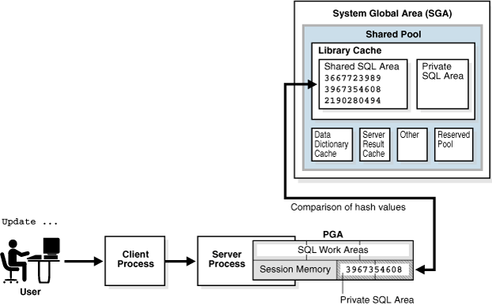

This chapter explains how database processes DDL statements to create objects, DML to modify data, and queries to retrieve data.

### 3.1 About SQL Processing

**SQL processing** is the parsing, optimization, row source generation, and execution of a SQL statement.

The following figure depicts the general stages of SQL processing. Depending on the statement, the database may omit some of these stages.

Figure 3-1 Stages of SQL Processing


> This graphic shows the stages of SQL processing, represented as five vertical boxes linked by downward-pointing arrows: SQL Statement, Parsing, Optimization, Row Source Generation, and Execution. The Parsing box is labeled "Syntax check, Semantic check." The Optimization box is labeled "Generation of multiple execution plans." The Row Source Generation box is labeled "Generation of execution plan." An arrow labeled "Soft parse" extends from the Parsing box to the Execution box.


#### 3.1.1 SQL Parsing

The first stage of SQL processing is **parsing**.

The parsing stage involves separating the pieces of a SQL statement into a data structure that other routines can process. The database parses a statement when instructed by the application, which means that only the application­, and not the database itself, can reduce the number of parses.

When an application issues a SQL statement, the application makes a [parse call](glossary.md) to the database to prepare the statement for execution. The parse call opens or creates a [cursor](glossary.md), which is a handle for the session-specific [private SQL area](glossary.md) that holds a parsed SQL statement and other processing information. The cursor and private SQL area are in the program global area (PGA).

During the parse call, the database performs checks that identify the errors that can be found before statement execution. Some errors cannot be caught by parsing. For example, the database can encounter deadlocks or errors in data conversion only during statement execution.

See Also:

[Oracle Database Concepts](https://docs.oracle.com/pls/topic/lookup?ctx=en/database/oracle/oracle-database/21/tgsql&id=CNCPT1336) to learn about deadlocks

##### 3.1.1.1 Syntax Check

Oracle Database must check each SQL statement for syntactic validity.

A statement that breaks a rule for well-formed SQL syntax fails the check. For example, the following statement fails because the keyword `FROM` is misspelled as `FORM`:

```
SQL> SELECT * FORM employees;
SELECT * FORM employees
         *
ERROR at line 1:
ORA-00923: FROM keyword not found where expected
```

##### 3.1.1.2 Semantic Check

The semantics of a statement are its meaning. A semantic check determines whether a statement is meaningful, for example, whether the objects and columns in the statement exist.

A syntactically correct statement can fail a semantic check, as shown in the following example of a query of a nonexistent table:

```
SQL> SELECT * FROM nonexistent_table;
SELECT * FROM nonexistent_table
              *
ERROR at line 1:
ORA-00942: table or view does not exist
```

##### 3.1.1.3 Shared Pool Check

During the parse, the database performs a shared pool check to determine whether it can skip resource-intensive steps of statement processing.

To this end, the database uses a hashing algorithm to generate a hash value for every SQL statement. The statement hash value is the [SQL ID](glossary.md) shown in `V$SQL.SQL_ID`. This hash value is deterministic within a version of Oracle Database, so the same statement in a single instance or in different instances has the same SQL ID.

When a user submits a SQL statement, the database searches the [shared SQL area](glossary.md) to see if an existing parsed statement has the same hash value. The hash value of a SQL statement is distinct from the following values:

- Memory address for the statement
	Oracle Database uses the SQL ID to perform a keyed read in a lookup table. In this way, the database obtains possible memory addresses of the statement.
- Hash value of an [execution plan](glossary.md) for the statement
	A SQL statement can have multiple plans in the shared pool. Typically, each plan has a different hash value. If the same SQL ID has multiple plan hash values, then the database knows that multiple plans exist for this SQL ID.

Parse operations fall into the following categories, depending on the type of statement submitted and the result of the hash check:

- Hard parse
	If Oracle Database cannot reuse existing code, then it must build a new executable version of the application code. This operation is known as a [hard parse](glossary.md), or a [library cache miss](glossary.md).
	Note:
	The database always performs a hard parse of DDL.
	During the hard parse, the database accesses the library cache and data dictionary cache numerous times to check the data dictionary. When the database accesses these areas, it uses a serialization device called a [latch](glossary.md) on required objects so that their definition does not change. Latch contention increases statement execution time and decreases concurrency.
- Soft parse
	A [soft parse](glossary.md) is any parse that is not a hard parse. If the submitted statement is the same as a reusable SQL statement in the shared pool, then Oracle Database reuses the existing code. This reuse of code is also called a [library cache hit](glossary.md).
	Soft parses can vary in how much work they perform. For example, configuring the session shared SQL area can sometimes reduce the amount of latching in the soft parses, making them "softer."
	In general, a soft parse is preferable to a hard parse because the database skips the optimization and row source generation steps, proceeding straight to execution.

The following graphic is a simplified representation of a shared pool check of an `UPDATE` statement in a dedicated server architecture.

Figure 3-2 Shared Pool Check



> This graphic shows a shared pool check. At the top are three boxes laid on top of one another, each box smaller than the one behind it. The smallest box shows hash values and is labeled Shared SQL Area. The second box is labeled Shared Pool. The outer box is labeled SGA. Below this box is another box labeled PGA. Within the PGA box is a box labeled Private SQL Area, which contains a hash value. A double-ended arrow connects the upper and lower boxes and is labeled "Comparison of hash values." To the right of the PGA box is a person icon labeled User Process. The icons are connected by a double-sided arrow. Above the User Process icon is an "Update...." statement. An arrow leads from the User Process below so the Server Process icon below.


If a check determines that a statement in the shared pool has the same hash value, then the database performs semantic and environment checks to determine whether the statements have the same meaning. Identical syntax is not sufficient. For example, suppose two different users log in to the database and issue the following SQL statements:

```
CREATE TABLE my_table ( some_col INTEGER );
SELECT * FROM my_table;
```

The `SELECT` statements for the two users are syntactically identical, but two separate schema objects are named `my_table`. This semantic difference means that the second statement cannot reuse the code for the first statement.

Even if two statements are semantically identical, an environmental difference can force a hard parse. In this context, the [optimizer environment](glossary.md) is the totality of session settings that can affect execution plan generation, such as the work area size or optimizer settings (for example, the optimizer mode). Consider the following series of SQL statements executed by a single user:

```
ALTER SESSION SET OPTIMIZER_MODE=ALL_ROWS;
ALTER SYSTEM FLUSH SHARED_POOL;               # optimizer environment 1
SELECT * FROM sh.sales;

ALTER SESSION SET OPTIMIZER_MODE=FIRST_ROWS;  # optimizer environment 2
SELECT * FROM sh.sales;

ALTER SESSION SET SQL_TRACE=true;             # optimizer environment 3
SELECT * FROM sh.sales;
```

In the preceding example, the same `SELECT` statement is executed in three different optimizer environments. Consequently, the database creates three separate shared SQL areas for these statements and forces a hard parse of each statement.

See Also:

- [Oracle Database Concepts](https://docs.oracle.com/pls/topic/lookup?ctx=en/database/oracle/oracle-database/21/tgsql&id=CNCPT007) to learn about private SQL areas and shared SQL areas
- [Oracle Database Performance Tuning Guide](https://docs.oracle.com/pls/topic/lookup?ctx=en/database/oracle/oracle-database/21/tgsql&id=TGDBA558) to learn how to configure the shared pool
- [Oracle Database Concepts](https://docs.oracle.com/pls/topic/lookup?ctx=en/database/oracle/oracle-database/21/tgsql&id=CNCPT1358) to learn about latches

#### 3.1.2 SQL Optimization

During optimization, Oracle Database must perform a hard parse at least once for every unique DML statement and performs the optimization during this parse.

The database does not optimize DDL. The only exception is when the DDL includes a DML component such as a subquery that requires optimization.

#### 3.1.3 SQL Row Source Generation

The **row source generator** is software that receives the optimal execution plan from the optimizer and produces an iterative execution plan that is usable by the rest of the database.

The iterative plan is a binary program that, when executed by the SQL engine, produces the result set. The plan takes the form of a combination of steps. Each step returns a [row set](glossary.md). The next step either uses the rows in this set, or the last step returns the rows to the application issuing the SQL statement.

A [row source](glossary.md) is a row set returned by a step in the execution plan along with a control structure that can iteratively process the rows. The row source can be a table, view, or result of a join or grouping operation.

The row source generator produces a [row source tree](glossary.md), which is a collection of row sources. The row source tree shows the following information:

- An ordering of the tables referenced by the statement
- An access method for each table mentioned in the statement
- A join method for tables affected by join operations in the statement
- Data operations such as filter, sort, or aggregation

Example 3-1 Execution Plan

This example shows the execution plan of a `SELECT` statement when `AUTOTRACE` is enabled. The statement selects the last name, job title, and department name for all employees whose last names begin with the letter `A`. The execution plan for this statement is the output of the row source generator.

```
SELECT e.last_name, j.job_title, d.department_name 
FROM   hr.employees e, hr.departments d, hr.jobs j
WHERE  e.department_id = d.department_id
AND    e.job_id = j.job_id
AND    e.last_name LIKE 'A%';
 
Execution Plan
----------------------------------------------------------
Plan hash value: 975837011

---------------------------------------------------------------------------
| Id| Operation                    | Name      |Rows|Bytes|Cost(%CPU)|Time|
---------------------------------------------------------------------------
| 0| SELECT STATEMENT              |             | 3 |189 |7(15)|00:00:01 |
|*1|  HASH JOIN                    |             | 3 |189 |7(15)|00:00:01 |
|*2|   HASH JOIN                   |             | 3 |141 |5(20)|00:00:01 |
| 3|    TABLE ACCESS BY INDEX ROWID| EMPLOYEES   | 3 | 60 |2 (0)|00:00:01 |
|*4|     INDEX RANGE SCAN          | EMP_NAME_IX | 3 |    |1 (0)|00:00:01 |
| 5|    TABLE ACCESS FULL          | JOBS        |19 |513 |2 (0)|00:00:01 |
| 6|   TABLE ACCESS FULL           | DEPARTMENTS |27 |432 |2 (0)|00:00:01 |
---------------------------------------------------------------------------
 
Predicate Information (identified by operation id):
---------------------------------------------------
 
   1 - access("E"."DEPARTMENT_ID"="D"."DEPARTMENT_ID")
   2 - access("E"."JOB_ID"="J"."JOB_ID")
   4 - access("E"."LAST_NAME" LIKE 'A%')
       filter("E"."LAST_NAME" LIKE 'A%')
```

#### 3.1.4 SQL Execution

During execution, the SQL engine executes each row source in the tree produced by the row source generator. This step is the only mandatory step in DML processing.

Figure 3-3 is an [execution tree](glossary.md), also called a parse tree, that shows the flow of row sources from one step to another in the plan in Example 3-1. In general, the order of the steps in execution is the reverse of the order in the plan, so you read the plan from the bottom up.

Each step in an execution plan has an ID number. The numbers in Figure 3-3 correspond to the `Id` column in the plan shown in Example 3-1. Initial spaces in the `Operation` column of the plan indicate hierarchical relationships. For example, if the name of an operation is preceded by two spaces, then this operation is a child of an operation preceded by one space. Operations preceded by one space are children of the `SELECT` statement itself.

Figure 3-3 Row Source Tree


> This graphic shows a tree of boxes. At the top box 1 is labeled MERGE JOIN ANTI. Box 2 to the lower left is labeled NESTED LOOPS. Box 6 to the lower right is labeled TABLE ACCESS FULL jobs. Box 3 to the lower left of Box 2 is labeled TABLE ACCESS FULL departments. Box 4 to the lower right is labeled TABLE ACCESS BY INDEX ROWID employees. Box 5 underneath Box 4 is labeled INDEX RANGE SCAN emp\_departments\_ix.


In Figure 3-3, each node of the tree acts as a row source, which means that each step of the execution plan in Example 3-1 either retrieves rows from the database or accepts rows from one or more row sources as input. The SQL engine executes each row source as follows:

- Steps indicated by the black boxes physically retrieve data from an object in the database. These steps are the access paths, or techniques for retrieving data from the database.
	- Step 6 uses a full table scan to retrieve all rows from the `departments` table.
		- Step 5 uses a full table scan to retrieve all rows from the `jobs` table.
		- Step 4 scans the `emp_name_ix` index in order, looking for each key that begins with the letter `A` and retrieving the corresponding rowid. For example, the rowid corresponding to `Atkinson` is `AAAPzRAAFAAAABSAAe`.
		- Step 3 retrieves from the `employees` table the rows whose rowids were returned by Step 4. For example, the database uses rowid `AAAPzRAAFAAAABSAAe` to retrieve the row for `Atkinson`.
- Steps indicated by the clear boxes operate on row sources.
	- Step 2 performs a [hash join](glossary.md), accepting row sources from Steps 3 and 5, joining each row from the Step 5 row source to its corresponding row in Step 3, and returning the resulting rows to Step 1.
		For example, the row for employee `Atkinson` is associated with the job name `Stock Clerk`.
		- Step 1 performs another hash join, accepting row sources from Steps 2 and 6, joining each row from the Step 6 source to its corresponding row in Step 2, and returning the result to the client.
		For example, the row for employee `Atkinson` is associated with the department named `Shipping`.

In some execution plans the steps are iterative and in others sequential. The hash join shown in Example 3-1 is sequential. The database completes the steps in their entirety based on the join order. The database starts with the index range scan of `emp_name_ix`. Using the rowids that it retrieves from the index, the database reads the matching rows in the `employees` table, and then scans the `jobs` table. After it retrieves the rows from the `jobs` table, the database performs the hash join.

During execution, the database reads the data from disk into memory if the data is not in memory. The database also takes out any locks and latches necessary to ensure data integrity and logs any changes made during the SQL execution. The final stage of processing a SQL statement is closing the cursor.

### 3.2 How Oracle Database Processes DML

Most DML statements have a query component. In a query, execution of a cursor places the results of the query into a set of rows called the **result set**.

#### 3.2.1 How Row Sets Are Fetched

Result set rows can be fetched either a row at a time or in groups.

In the fetch stage, the database selects rows and, if requested by the query, orders the rows. Each successive fetch retrieves another row of the result until the last row has been fetched.

In general, the database cannot determine for certain the number of rows to be retrieved by a query until the last row is fetched. Oracle Database retrieves the data in response to fetch calls, so that the more rows the database reads, the more work it performs. For some queries the database returns the first row as quickly as possible, whereas for others it creates the entire result set before returning the first row.

#### 3.2.2 Read Consistency

In general, a query retrieves data by using the Oracle Database read consistency mechanism, which guarantees that all data blocks read by a query are consistent to a single point in time.

Read consistency uses undo data to show past versions of data. For an example, suppose a query must read 100 data blocks in a full table scan. The query processes the first 10 blocks while DML in a different session modifies block 75. When the first session reaches block 75, it realizes the change and uses undo data to retrieve the old, unmodified version of the data and construct a noncurrent version of block 75 in memory.

See Also:

[Oracle Database Concepts](https://docs.oracle.com/pls/topic/lookup?ctx=en/database/oracle/oracle-database/21/tgsql&id=CNCPT020) to learn about multiversion read consistency

#### 3.2.3 Data Changes

DML statements that must change data use read consistency to retrieve only the data that matched the search criteria when the modification began.

Afterward, these statements retrieve the data blocks as they exist in their current state and make the required modifications. The database must perform other actions related to the modification of the data such as generating redo and undo data.

### 3.3 How Oracle Database Processes DDL

Oracle Database processes DDL differently from DML.

For example, when you create a table, the database does not optimize the `CREATE TABLE` statement. Instead, Oracle Database parses the DDL statement and carries out the command.

The database processes DDL differently because it is a means of defining an object in the data dictionary. Typically, Oracle Database must parse and execute many [recursive SQL](glossary.md) statements to execute a DDL statement. Suppose you create a table as follows:

```
CREATE TABLE mytable (mycolumn INTEGER);
```

Typically, the database would run dozens of recursive statements to execute the preceding statement. The recursive SQL would perform actions such as the following:

- Issue a `COMMIT` before executing the `CREATE TABLE` statement
- Verify that user privileges are sufficient to create the table
- Determine which tablespace the table should reside in
- Ensure that the tablespace quota has not been exceeded
- Ensure that no object in the schema has the same name
- Insert rows that define the table into the data dictionary
- Issue a `COMMIT` if the DDL statement succeeded or a `ROLLBACK` if it did not

See Also:

[Oracle Database Development Guide](https://docs.oracle.com/pls/topic/lookup?ctx=en/database/oracle/oracle-database/21/tgsql&id=ADFNS134) to learn about processing DDL, transaction control, and other types of statements