Use SQL Tuning Advisor to obtain recommendations for improving performance of high-load SQL statements, and prevent regressions by only executing optimal plans.

### 25.1 About SQL Tuning Advisor

**SQL Tuning Advisor** is SQL diagnostic software in the Oracle Database Tuning Pack.

You can submit one or more SQL statements as input to the advisor and receive advice or recommendations for how to tune the statements, along with a rationale and expected benefit.

#### 25.1.1 Purpose of SQL Tuning Advisor

SQL Tuning Advisor is a mechanism for resolving problems related to suboptimally performing SQL statements.

Use SQL Tuning Advisor to obtain recommendations for improving performance of high-load SQL statements, and prevent regressions by only executing optimal plans.

Tuning recommendations include:

- Collection of object statistics
- Creation of indexes
- Rewriting SQL statements
- Creation of SQL profiles
- Creation of SQL plan baselines

The recommendations generated by SQL Tuning Advisor help you achieve the following specific goals:

- Avoid labor-intensive manual tuning
	Identifying and tuning high-load SQL statements is challenging even for an expert. SQL Tuning Advisor uses the optimizer to tune SQL for you.
- Generate recommendations and implement SQL profiles automatically
	You can configure an Automatic SQL Tuning task to run nightly in maintenance windows. When invoked in this way, the advisor can generate recommendations and also implement SQL profiles automatically.
- Analyze database-generated statistics to achieve optimal plans
	The database contains a vast amount of statistics about its own operations. SQL Tuning Advisor can perform deep mining and analysis of internal information to improve execution plans.
- Enable developers to tune SQL on a test system instead of the production system
	When suboptimally performing SQL statements occur on a production database, developers may not want to investigate and tune directly on the production database. The DBA can transport the problematic SQL statements to a test database where the developers can safely analyze and tune them.

When tuning multiple statements, SQL Tuning Advisor does not recognize interdependencies between the statements. Instead, SQL Tuning Advisor offers a convenient way to get tuning recommendations for many statements.

Note:

A common user whose current container is the CDB root can run SQL Tuning Advisor manually for SQL statements from any PDB. When a statement is tuned, it is tuned in any container that runs the statement.

A user whose current container is a PDB can run SQL Tuning Advisor manually for SQL statements that have been run in this PDB. In this case, a statement is tuned only for the current PDB. The results related to a PDB are stored in the PDB and are included if the PDB is unplugged. When SQL Tuning Advisor is run manually by a user whose current container is a PDB, the results are only visible to a user whose current container is that PDB.

See Also:

" [Managing SQL Plan Baselines](managing-sql-plan-baselines.md) " to learn about SQL plan management

#### 25.1.2 SQL Tuning Advisor Architecture

**Automatic Tuning Optimizer** is the central tool used by SQL Tuning Advisor. The advisor can receive SQL statements as input from multiple sources, analyze these statements using the optimizer, and then make recommendations.

Invoking Automatic Tuning Optimizer for every [hard parse](glossary.md) consumes significant time and resources. Tuning mode is meant for complex and high-load SQL statements that significantly affect database performance.

Manageability advisors such as SQL tuning advisor use a common infrastructure called the advisor framework. This framework provides a common schema and interface for storing task objects. An advisor schema is a set of tables to store the data from advisors. SQL Tuning Advisor receives tuning input, and then writes to the advisor schemas by means of the advisor framework. SQL Tuning Advisor reads data from advisor schema when it produces its reports.

The following figure shows the basic architecture of SQL Tuning Advisor.

Figure 25-1 SQL Tuning Advisor Architecture

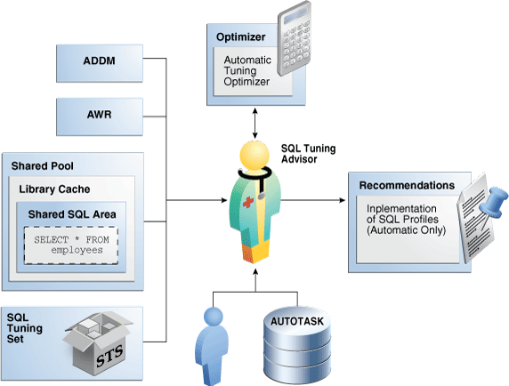

> This graphic shows an icon of a person with the label "SQL Tuning Advisor." A double-headed arrow is between SQL Tuning Advisor and a box labeled "Optimizer." Inside this box is a box labeled "Automatic Tuning Optimizer." An icon of a calculator is next to the Optimizer box. An arrow leads from SQL Tuning Advisor to the right, pointing at a box labeled "Recommendations." Within this box is a box labeled "Implementation of SQL Profiles (Automatic Only)." An icon of a tacked piece of paper is next to the Recommendations box. Two icons point up to the SQL Tuning Advisor: a person icon, and a cylinder labeled "AUTOTASK." To the left of SQL Tuning Advisor are the boxes ADDM, AWR, Shared Pool, and SQL Tuning Set. The Shared Pool box contains a Library Cache box, which contains a Shared SQL Area box, which contains a dotted box containing the statement "SELECT \* FROM employees." The SQL Tuning Set box contains an icon of an open cardboard box labeled "STS."


See Also:

" [SQL Parsing](sql-processing.md) "

##### 25.1.2.1 Input to SQL Tuning Advisor

Input for SQL Tuning Advisor can come from several sources, including ADDM, AWR, the shared SQL area, and SQL tuning sets.

SQL Tuning Advisor uses its input sources as follows:

- Automatic Database Diagnostic Monitor (ADDM)
	The primary input source for SQL Tuning Advisor is ADDM (pronounced Adam). By default, ADDM runs proactively once every hour. To identify performance problems involving high-load SQL statements, ADDM analyzes key statistics gathered by [Automatic Workload Repository (AWR)](glossary.md) over the last hour. If a high-load SQL statement is identified, then ADDM recommends running SQL Tuning Advisor on the SQL.
- AWR
	AWR takes regular snapshots of system activity, including high-load SQL statements ranked by relevant statistics, such as CPU consumption and wait time.
	You can view the AWR and manually identify high-load SQL statements. You can run SQL Tuning Advisor on these statements, although Oracle Database automatically performs this work as part of automatic SQL tuning. By default, AWR retains data for the last eight days. You can locate and tune any high-load SQL that ran within the retention period of AWR using this technique.
- Shared SQL area
	The database uses the shared SQL area to tune recent SQL statements that have yet to be captured in AWR. The shared SQL area and AWR provide the capability to identify and tune high-load SQL statements from the current time going as far back as the AWR retention allows, which by default is at least 8 days.
- SQL tuning set
	A [SQL tuning set (STS)](glossary.md) is a database object that stores SQL statements along with their execution context. An STS can include SQL statements that are yet to be deployed, with the goal of measuring their individual performance, or identifying the ones whose performance falls short of expectation. When a set of SQL statements serve as input, the database must first construct and use an STS.

See Also:

- " [About SQL Tuning Sets](managing-sql-tuning-sets.md) "
- [Oracle Database Performance Tuning Guide](https://docs.oracle.com/pls/topic/lookup?ctx=en/database/oracle/oracle-database/21/tgsql&id=TGDBA026) to learn about ADDM
- [Oracle Database Performance Tuning Guide](https://docs.oracle.com/pls/topic/lookup?ctx=en/database/oracle/oracle-database/21/tgsql&id=TGDBA169) to learn about AWR
- [Oracle Database Concepts](https://docs.oracle.com/pls/topic/lookup?ctx=en/database/oracle/oracle-database/21/tgsql&id=CNCPT1228) to learn about the shared SQL area

##### 25.1.2.2 Output of SQL Tuning Advisor

After analyzing the SQL statements, SQL Tuning Advisor publishes recommendations.

Specifically, SQL Tuning Advisor produces the following types of output:

- Advice on optimizing the execution plan
- Rationale for the proposed optimization
- Estimated performance benefit
- SQL statement to implement the advice

The benefit percentage shown for each recommendation is calculated using the following formula:

```
abnf% = (time_old - time_new)/(time_old)
```

For example, assume that before tuning the execution time was 100 seconds, and after implementing the recommendation the new execution time is expected to be 33 seconds. This benefit calculation for this performance improvement is as follows:

```
67% = (100 - 33)/(100)
```

You choose whether to accept the recommendations to optimize the SQL statements. Depending on how it is configured, Automatic SQL Tuning Advisor can implement the SQL profile recommendations to tune the statement without user intervention. When invoked on demand, SQL Tuning Advisor can recommend that the user implement a SQL profile, but can never implement it automatically.

##### 25.1.2.3 Automatic Tuning Optimizer Analyses

In tuning mode, the optimizer has more time to consider options and gather statistics. For example, Automatic Tuning Optimizer can use dynamic statistics and partial statement execution.

The following graphic depicts the different types of analysis that Automatic Tuning Optimizer performs.

Figure 25-2 Automatic Tuning Optimizer

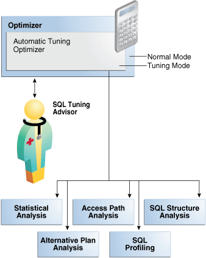

> This graphic shows a SQL Tuning Advisor icon. A double-headed arrow is between this icon and an Optimizer box that contains an Automatic Tuning Optimizer box. A calculator icon is attached to the Optimizer box. The Automatic Tuning Optimizer box has a "Tuning Mode" callout. The Optimizer box has a "Normal Mode" callout. The Automatic Tuning Optimizer box points down to five boxes: Statistical Analysis, Access Path Analysis, SQL Structure Analysis, Alternative Plan Analysis, and SQL Profiling.


See Also:

" [Query Optimizer Concepts](query-optimizer-concepts.md) "

###### 25.1.2.3.1 Statistical Analysis

The optimizer relies on statistics to generate execution plans.

If these statistics are stale or missing, then the optimizer can generate suboptimal plans. Automatic Tuning Optimizer checks for missing or stale statistics, and recommends gathering fresh statistics if needed.

- Object statistics
	The optimizer checks the statistics for each object referenced in the query.
- System statistics
	On Oracle Exadata Database Machine, the cost of smart scans depends on the system statistics I/O seek time, multiblock read count, and I/O transfer speed. The values of these system statistics are usually different on Oracle Exadata Database Machine, so an analysis to determines whether these system statistics are not up to date. If gathering these statistics would improve the plan, then SQL Tuning Advisor recommends accepting a SQL profile.

The following graphic depicts the analysis of object-level statistics.

Figure 25-3 Statistical Analysis by Automatic Tuning Optimizer

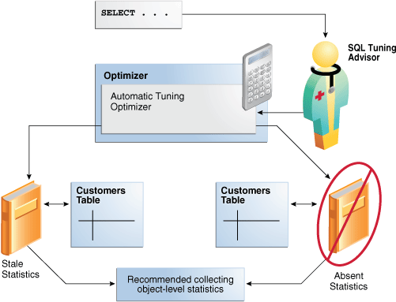

> This graphic depicts an icon of a person labeled "SQL Tuning Advisor." A box containing the text "SELECT..." points toward SQL Tuning Advisor, who in turn points left toward an Optimizer box. The Optimizer box contains an Automatic Tuning Optimizer box. An icon of a calculator is attached to this box. The Automatic Tuning Optimizer box points down to a Stale Statistics icon of a book. This icon points right to a box containing the text "Recommended collecting object-level statistics." Automatic Tuning Optimizer points right toward an icon of a book labeled "Absent Statistics." A circle with a line through it is around this book. Each book icon has a double-headed arrow between it and a Customers Table icon.


See Also:

[Oracle Exadata Database Machine System Overview](https://docs.oracle.com/pls/topic/lookup?ctx=en/database/oracle/oracle-database/21/tgsql&id=DBMSO-GUID-B978FAD1-5E8D-4518-8BAA-2A06DB3F0883)

###### 25.1.2.3.2 SQL Profiling

**SQL profiling** is the verification by the Automatic Tuning Optimizer of its own estimates.

By reviewing execution history and testing the SQL, the optimizer can ensure that it has the most accurate information available to generate execution plans. SQL profiling is related to but distinct from the steps of generating SQL Tuning Advisor recommendations and implementing these recommendations.

The following graphic shows SQL Tuning Advisor recommending a SQL profile and automatically implementing it. After creating the profile, the optimizer can use it as additional input when generating execution plans.

Figure 25-4 SQL Profile

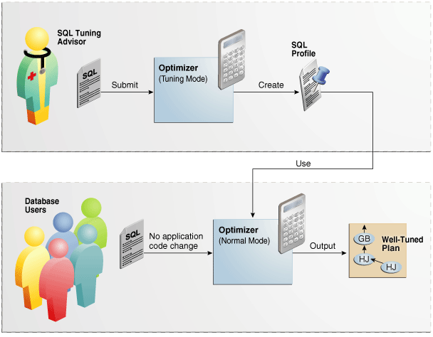

> This graphic depicts two separate boxes. In the top is a SQL Tuning Advisor icon. A page that says SQL points to an Optimizer (Tuning Mode) box. The arrow is marked "Submit." A calculator icon is next to the Optimizer box. The box points toward a page that says "SQL Profile." The arrow is labeled "Create." An arrow leads down from the SQL Profile icon to the lower box, which contains a box labeled "Optimizer (Normal Mode)." The arrow is labeled "Use." The Optimizer box points right toward a box labeled "Well-Tuned Plan." The arrow is labeled "Output." A page labeled "SQL" points right toward the Optimizer and is labeled "No application code change." To the left of the SQL page is a cluster of user icons labeled "Database Users."


See Also:

" [About SQL Profiles](managing-sql-profiles.md) "

###### 25.1.2.3.2.1 How SQL Profiling Works

The database can profile some DML and DDL statements.

Specifically, SQL Tuning Advisor can profile the following types of statement:

- DML statements (`SELECT`, `INSERT` with a `SELECT` clause, `UPDATE`, `DELETE`, and the update or insert operations of `MERGE`)
- `CREATE TABLE` statements (only with the `AS SELECT` clause)

After performing its analysis, SQL Tuning Advisor either recommends or does not recommend implementing a SQL profile.

The following graphic shows the SQL profiling process.

Figure 25-5 SQL Profiling

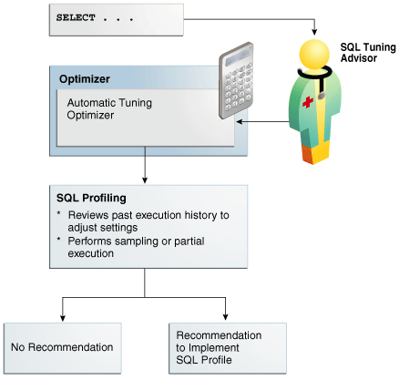

> This graphic shows a SELECT statements that points right to a SQL Tuning Advisor icon. This icon points right to an Optimizer box that contains a box labeled "Automatic Optimizer Tuning." A calculator icon is attached to the Optimizer box. The Automatic Tuning Optimizer box points down to a SQL Profiling box. This box contains the text "Reviews past execution history to adjust settings" and "Perform sampling or partial execution." An arrow points down and splits into two. One arrow points to a "No Recommendation" box, whereas the other arrow points to a "Recommendation to implement SQL profile" box.


During SQL profiling, the optimizer verifies cost, [selectivity](glossary.md), and [cardinality](glossary.md) for a statement. The optimizer uses either of the following methods:

- Samples the data and applies appropriate predicates to the sample
	The optimizer compares the new estimate to the regular estimate and, if the difference is great enough, applies a correction factor.
- Executes a fragment of the SQL statement
	This method is more efficient than the sampling method when the predicates provide efficient access paths.

The optimizer uses the past statement execution history to determine correct settings. For example, if the history indicates that a SQL statement is usually executed only partially, then the optimizer uses `FIRST_ROWS` instead of `ALL_ROWS` optimization.

See Also:

" [Choosing an Optimizer Goal](influencing-the-optimizer.md) "

###### 25.1.2.3.2.2 SQL Profile Implementation

If the optimizer generates auxiliary information during statistical analysis or SQL profiling, then the optimizer recommends implementing a SQL profile.

As shown in Figure 25-6, the following options are possible:

- When SQL Tuning Advisor is run on demand, the user must choose whether to implement the SQL profile.
- When the Automatic SQL Tuning task is configured to implement SQL profiles automatically, advisor behavior depends on the setting of the `ACCEPT_SQL_PROFILE` tuning task parameter:
	- If set to `true`, then the advisor implements SQL profiles automatically.
		- If set to `false`, then user intervention is required.
		- If set to `AUTO` (default), then the setting is `true` when at least one SQL statement exists with a SQL profile, and `false` when this condition is not satisfied.
	Note:
	The Automatic SQL Tuning task cannot automatically create SQL plan baselines or add plans to them.

Figure 25-6 Implementing SQL Profiles

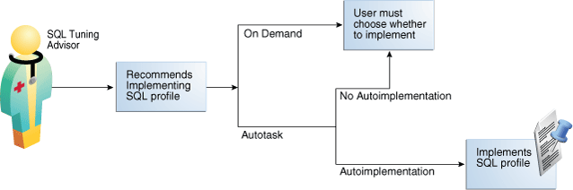

> This graphic shows a SQL Tuning Advisor icon. The icon points right to a box that contains the text "Recommends implementing SQL profile." An arrow points right and splits into two arrows, one labeled "On Demand" and the other labeled "Autotask." The On Demand arrow points right to a box that contains the text "User must choose whether to implement." The Autotask arrow splits into two arrows, one pointing up to the "User must choose" box. The arrow is labeled "No Autoimplementation." The other branch is labeled "Autoimplementation" and points right to a box labeled "Implements SQL profile." An icon of a piece of paper is thumbtacked to this box.


At any time during or after automatic SQL tuning, you can view a report. This report describes in detail the SQL statements that were analyzed, the recommendations generated, and any SQL profiles that were automatically implemented.

###### 25.1.2.3.3 Access Path Analysis

An access path is the means by which the database retrieves data.

For example, a query using an index and a query using a full table scan use different access paths. In some cases, indexes can greatly enhance the performance of a SQL statement by eliminating full table scans. The following graphic illustrates access path analysis.

Figure 25-7 Access Path Analysis

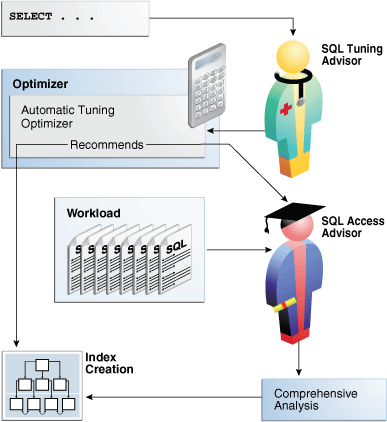

> This graphic shows an icon for SQL Tuning Advisor. A box containing the text "SELECT..." points to the advisor. The advisor points left to a box labeled "Optimizer." The Optimizer box contains a box labeled "Automatic Tuning Optimizer." A calculator icon is attached to the Optimizer box. Underneath the SQL Tuning Advisor icon is an icon for SQL Access Advisor. Inside the Automatic Tuning Optimizer box is the word "Recommends." The SQL Access Advisor points to the word "Recommend," which in turn points to a box labeled "Index Creation." A box labeled "Workload" points toward SQL Access Advisor, which points down to a box labeled "Comprehensive Analysis," which points left toward the Index Creation box.


Automatic Tuning Optimizer explores whether a new index can significantly enhance query performance and recommends either of the following:

- Creating an index
	Index recommendations are specific to the SQL statement processed by SQL Tuning Advisor. Sometimes a new index provides a quick solution to the performance problem associated with a single SQL statement.
- Running SQL Access Advisor
	Because the Automatic Tuning Optimizer does not analyze how its index recommendation can affect the entire SQL workload, it also recommends running SQL Access Advisor on the SQL statement along with a representative SQL workload. SQL Access Advisor examines the effect of creating an index on the SQL workload before making recommendations.

###### 25.1.2.3.4 SQL Structural Analysis

During structural analysis, Automatic Tuning Optimizer tries to identify syntactic, semantic, or design problems that can lead to suboptimal performance. The goal is to identify poorly written SQL statements and to advise you how to restructure them.

The following graphic illustrates structural analysis.

Figure 25-8 Structural Analysis

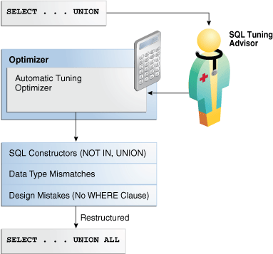

> This graphic shows a SQL Tuning Advisor icon. A box containing the text "SELECT... UNION" points to the advisor. The advisor points to an Optimizer box that contains an Automatic Tuning Optimizer (ATO) box. A calculator icon is attached to the Optimizer box. The ATO box points down to a box containing a box that contains the text: "SQL Constructors (NOT IN, UNION)," "Data Type Mismatches," "Design Mistakes (No WHERE Clause)." This box points down to a box containing the text "SELECT... UNION ALL." The arrow is labeled "Restructured."


Some syntax variations negatively affect performance. In structural analysis, the automatic tuning optimizer evaluates statements against a set of rules, identifies inefficient coding techniques, and recommends an alternative statement if possible.

As shown in Figure 25-8, Automatic Tuning Optimizer identifies the following categories of structural problems:

- Inefficient use of SQL constructors
	A suboptimally performing statement may be using `NOT IN` instead of `NOT EXISTS`, or `UNION` instead of `UNION ALL`. The `UNION` operator, as opposed to the `UNION ALL` operator, uses a unique sort to ensure that no duplicate rows are in the result set. If you know that two queries do not return duplicates, then use `UNION ALL`.
- Data type mismatches
	If the indexed column and the compared value have a data type mismatch, then the database does not use the index because of the implicit data type conversion. Also, the database must expend additional resources converting data types, and some SQL statements may fail because data values do not convert correctly. Common mistakes include columns that contain numeric data but are never used for arithmetic operations: telephone numbers, credit card numbers, and check numbers. To avoid poor cardinality estimates, suboptimal plans, and `ORA-01722` errors, developers must ensure that bind variables are type `VARCHAR2` and not numbers.
- Design mistakes
	A classic example of a design mistake is a missing join condition. If n is the number of tables in a query block, then n-1 join conditions must exist to avoid a Cartesian product.

In each case, Automatic Tuning Optimizer makes relevant suggestions to restructure the statements. The suggested alternative statement is similar, but not equivalent, to the original statement. For example, the suggested statement may use `UNION ALL` instead of `UNION`. You can then determine if the advice is sound.

###### 25.1.2.3.5 Alternative Plan Analysis

While tuning a SQL statement, SQL Tuning Advisor searches real-time and historical performance data for **alternative execution plans** for the statement.

If plans other than the original plan exist, then SQL Tuning Advisor reports an alternative plan finding. The follow graphic shows SQL Tuning Advisor finding two alternative plans and generating an alternative plan finding.

Figure 25-9 Alternative Plan Analysis

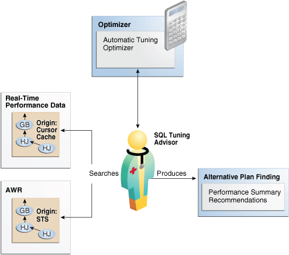

> This graphic shows a SQL Tuning Advisor. At the top is an Optimizer box that contains an Automatic Tuning Optimizer box. A calculator is attached to the box. A double-headed arrow is between the advisor and the Optimizer box. The advisor points to an Alternative Plan Finding box, which contains a Performance Summary Recommendations box. The arrow is labeled "Produces." The advisor has a double-headed arrow that points left to Real-Time Performance Data and AWR boxes. The arrow was labeled "Searches."


SQL Tuning Advisor validates the alternative execution plans and notes any plans that are not reproducible. When reproducible alternative plans are found, you can create a SQL plan baseline to instruct the optimizer to choose these plans in the future.

Example 25-1 Alternative Plan Finding

The following example shows an alternative plan finding for a `SELECT` statement:

```
2- Alternative Plan Finding
---------------------------
  Some alternative execution plans for this statement were found by searching
  the system's real-time and historical performance data.
 
  The following table lists these plans ranked by their average elapsed time.
  See section "ALTERNATIVE PLANS SECTION" for detailed information on each
  plan.
 
  id plan hash  last seen            elapsed (s)  origin          note
  -- ---------- -------------------- ------------ --------------- ----------------
   1 1378942017  2009-02-05/23:12:08        0.000 Cursor Cache    original plan
   2 2842999589  2009-02-05/23:12:08        0.002 STS
 
  Information
  -----------
  - The Original Plan appears to have the best performance, based on the
    elapsed time per execution.  However, if you know that one alternative
    plan is better than the Original Plan, you can create a SQL plan baseline
    for it. This will instruct the Oracle optimizer to pick it over any other
    choices in the future.
    execute dbms_sqltune.create_sql_plan_baseline(task_name => 'TASK_XXXXX',
            object_id => 2, task_owner => 'SYS', plan_hash => xxxxxxxx);
```

The preceding example shows that SQL Tuning Advisor found two plans, one in the shared SQL area and one in a SQL tuning set. The plan in the shared SQL area is the same as the original plan.

SQL Tuning Advisor only recommends an alternative plan if the elapsed time of the original plan is worse than alternative plans. In this case, SQL Tuning Advisor recommends that users create a SQL plan baseline on the plan with the best performance. In Example 25-1, the alternative plan did not perform as well as the original plan, so SQL Tuning Advisor did not recommend using the alternative plan.

Example 25-2 Alternative Plans Section

In this example, the alternative plans section of the SQL Tuning Advisor output includes both the original and alternative plans and summarizes their performance. The most important statistic is elapsed time. The original plan used an index, whereas the alternative plan used a full table scan, increasing elapsed time by.002 seconds.

```
Plan 1
------
 
  Plan Origin                 :Cursor Cache
  Plan Hash Value             :1378942017
  Executions                  :50
  Elapsed Time                :0.000 sec
  CPU Time                    :0.000 sec
  Buffer Gets                 :0
  Disk Reads                  :0
  Disk Writes                 :0
 
Notes:
  1. Statistics shown are averaged over multiple executions.
  2. The plan matches the original plan.
 
--------------------------------------------
| Id  | Operation            | Name        |
--------------------------------------------
|   0 | SELECT STATEMENT     |             |
|   1 |  SORT AGGREGATE      |             |
|   2 |   MERGE JOIN         |             |
|   3 |    INDEX FULL SCAN   | TEST1_INDEX |
|   4 |    SORT JOIN         |             |
|   5 |     TABLE ACCESS FULL| TEST        |
--------------------------------------------
 
Plan 2
------
 
  Plan Origin                 :STS
  Plan Hash Value             :2842999589
  Executions                  :10
  Elapsed Time                :0.002 sec
  CPU Time                    :0.002 sec
  Buffer Gets                 :3
  Disk Reads                  :0
  Disk Writes                 :0
 
Notes:
  1. Statistics shown are averaged over multiple executions.
 
-------------------------------------
| Id  | Operation           | Name  | 
-------------------------------------
|   0 | SELECT STATEMENT    |       |
|   1 |  SORT AGGREGATE     |       |
|   2 |   HASH JOIN         |       |
|   3 |    TABLE ACCESS FULL| TEST  |
|   4 |    TABLE ACCESS FULL| TEST1 |
-------------------------------------
```

To adopt an alternative plan regardless of whether SQL Tuning Advisor recommends it, call `DBMS_SQLTUNE.CREATE_SQL_PLAN_BASELINE`. You can use this procedure to create a SQL plan baseline on any existing reproducible plan.

See Also:

" [Differences Between SQL Plan Baselines and SQL Profiles](overview-of-sql-plan-management.md) "

#### 25.1.3 SQL Tuning Advisor Operation

You can run SQL Tuning Advisor automatically or on demand. You can also run the advisor on a local or remote database.

##### 25.1.3.1 Automatic and On-Demand SQL Tuning

Configure SQL Tuning Advisor to run automatically using `DBMS_AUTO_SQLTUNE`, or on demand using `DBMS_SQLTUNE`.

The methods of invocation differ as follows:

- Automatically
	You can configure SQL Tuning Advisor to run during nightly system maintenance windows. When run by `AUTOTASK`, the advisor is known as [Automatic SQL Tuning Advisor](glossary.md) and performs [automatic SQL tuning](glossary.md).
- On-Demand
	In [on-demand SQL tuning](glossary.md), you manually invoke SQL Tuning Advisor to diagnose and fix SQL-related performance problems after they have been discovered. Oracle Enterprise Manager Cloud Control (Cloud Control) is the preferred interface for tuning SQL on demand, but you can also use the `DBMS_SQLTUNE` PL/SQL package.

SQL Tuning Advisor uses Automatic Tuning Optimizer to perform its analysis. This optimization is "automatic" because the optimizer analyzes the SQL instead of the user. Do not confuse Automatic Tuning Optimizer with automatic SQL tuning, which in this document refers only to the work performed by the Automatic SQL Tuning task.

See Also:

- " Running SQL Tuning Advisor On Demand "
- " Managing the Automatic SQL Tuning Task "
- [Oracle Database PL/SQL Packages and Types Reference](https://docs.oracle.com/pls/topic/lookup?ctx=en/database/oracle/oracle-database/21/tgsql&id=ARPLS220) to learn about `DBMS_SQLTUNE`

##### 25.1.3.2 SQL Tuning on Active Data Guard Databases

You can run SQL Tuning Advisor either in a primary database or in a Data Guard Active Standby Database. In a Standby database, the SQL statement being tuned must be created in the standby database and you use a database link to write tuning details and results in the primary database.

In the simplest case, SQL Tuning Advisor accepts input, executes, and stores results within a single database. Local mode is appropriate for databases in which the performance overhead of SQL Tuning Advisor execution is acceptable.

In remote tuning, you issue SQL Tuning Advisor tasks on a standby database in order to tune individual SQL statements. The SQL statement being tuned must be created on the primary database. A private, secure standby-to-primary database link is used to write data to and read data from the primary database. The link is necessary because the standby database, which is read-only, cannot write the SQL tuning data locally.

You can do remote tuning on the standby database by manually running `DBMS_SQLTUNE` statements on the command line. Starting with Oracle Database 19c, you also can use Oracle Enterprise Manager Cloud Control on the standby to create and execute tuning tasks and implement SQL profile recommendations.

The following below the general setup for tuning a standby database workload on a primary database. This technique requires a standby-to-primary database link.

Figure 25-10 Tuning a Standby Workload on a Primary Database

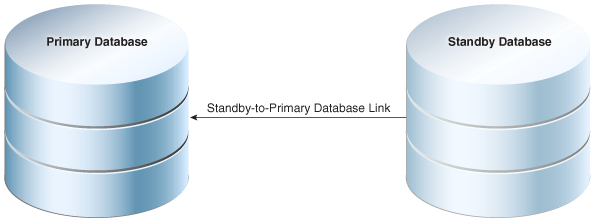

> This graphic shows two database cylinders. The cylinder on the left is labeled “Primary Database,” whereas the one on the right is labeled “Standby Database.” AAn arrow points from the right to left cylinder. The arrow is labeled “Standby-to-Primary Database Link.”
>
> [  
> Copyright © 2013, 2023, Oracle and/or its affiliates.](https://docs.oracle.com/en/database/oracle/oracle-database/dcommon/html/cpyr.htm)


See Also:

- " Configuring a SQL Tuning Task "
- [Oracle Data Guard Concepts and Administration](https://docs.oracle.com/pls/topic/lookup?ctx=en/database/oracle/oracle-database/21/tgsql&id=SBYDB-GUID-07CB190C-C248-4FF5-AB64-EAA9C6D42677) to learn how to perform remote tuning in a Data Guard environment
- [Oracle Database PL/SQL Packages and Types Reference](https://docs.oracle.com/pls/topic/lookup?ctx=en/database/oracle/oracle-database/21/tgsql&id=GUID-02C23DDE-6304-49E4-9DFC-EA39D44F943C) for details about `DBMS_SQLTUNE`.

###### 25.1.3.2.1 Using DBMS\_SQLTUNE to Tune the Primary Database Remotely

If you want to tune a SQL statement written on the primary database on the standby database, then on the standby, specify the `database_link_to` parameter in `DBMS_SQLTUNE` procedures. By default, the `database_link_to` parameter is null, which means that tuning is local.

The `database_link_to` parameter must specify a private database link. This link must be owned by `SYS` and accessed by the default privileged user `SYS$UMF`. The following sample statement creates a link named `lnk_to_pri`:

```
CREATE DATABASE LINK lnk_to_pri CONNECT TO SYS$UMF IDENTIFIED BY password USING 'inst1';
```

The following table illustrates a typical remote tuning session. You issue the SQL tuning statement on the standby database. `DBMS_SQLTUNE` uses the database link both to fetch data from the primary database, and store data in the primary database.

Table 25-1 Using DBMS\_SQLTUNE on a Standby Database to Remotely Tune the Primary Database

| Step | Statement Issued on Standby Database | Result |
| --- | --- | --- |
| 1 | `CREATE_TUNING_TASK` | `DBMS_SQLTUNE` creates the task data in the primary database using the standby-to-primary database link. |
| 2 | `EXECUTE_TUNING_TASK` | `DBMS_SQLTUNE` uses the database link to read the SQL Tuning Advisor task data stored in the primary database. The tuning analysis occurs on the standby database, but `DBMS_SQLTUNE` writes the results remotely to the primary database. |
| 3 | `REPORT_TUNING_TASK` | `DBMS_SQLTUNE` uses the database link to read the SQL Tuning Advisor report data from the primary database, and then constructs the report locally on the standby database. |
| 4 | `ACCEPT_SQL_PROFILE` | `DBMS_SQLTUNE` uses the database link to write the SQL profile data remotely to the primary database. |

###### 25.1.3.2.2 Using Enterprise Manager Cloud Control to Tune an Active Standby Query Workload

Prerequisites

- Enterprise Manager must be discovered and must be connected to an Active Data Guard Standby Database.
- The SQL tuning statement used must be created on the primary database.
- A non-public database link that points to the primary database must be created on the primary database for user `SYS$UMF`. In each case, in order to execute tuning tasks from an Active Data Guard Standby Database in a PDB, a separate database link must be created for that PDB. For example:
	```
	CREATE DATABASE LINK lnk_to_pri CONNECT TO SYS$UMF IDENTIFIED BY <password> USING \
	'(DESCRIPTION=(ADDRESS=(PROTOCOL=TCP)(HOST=<fully_qualified_hostname>)(PORT=<port_number>)) \
	(CONNECT_DATA=(SERVICE_NAME=<fully_qualified_service_name>)))';
	```
	You select this database link in SQL Tuning Advisor on the standby.
- The `SYS$UMF` account must be unlocked with password set to the same password as the database link.

Note:

In all cases in this section, the "standby" refers to an Active Data Guard Standby Database.

See Also:

[Oracle Data Guard Concepts and Administration](https://docs.oracle.com/en/database/oracle/oracle-database/19/sbydb/introduction-to-oracle-data-guard-concepts.html#GUID-5E73667D-4A56-445E-911F-1E99092DD8D7).

Steps

1. Log in to the standby database as a user with privileges to execute `DBMS_SQLTUNE` procedures, such as the `SYS` user.
2. There are several different ways to select the query you want to tune. From the Performance menu, one way is to click Performance Hub, and then Ash Analytics. Find and select the query, then click Tune SQL to bring the query into SQL Tuning Advisor. 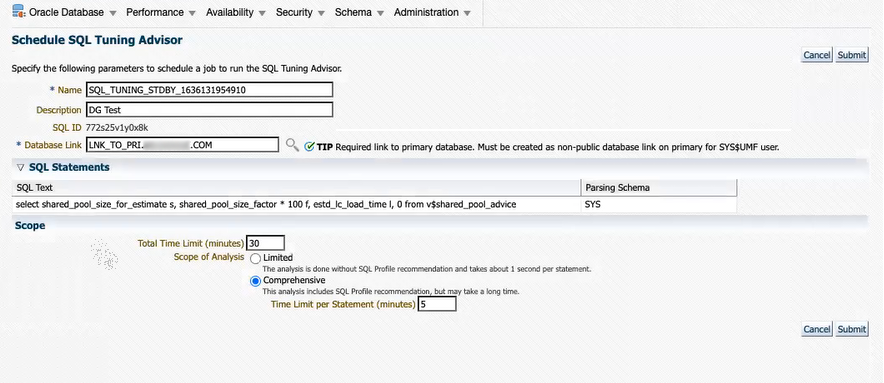

> Shows the SQL Tuning Advisor interface on a standby database.
>
> [  
> Copyright © 2013, 2023, Oracle and/or its affiliates.](https://docs.oracle.com/en/database/oracle/oracle-database/dcommon/html/cpyr.htm)

	Note:
	The Database Link field shown above appears only in SQL Tuning Advisor on the standby. It is not visible from a primary database.
3. You can either accept the default tuning task name or change it. The default name includes an " `_STDBY_` " segment so that you can distinguish tasks created on the standby from those created on the primary. If you change it, be sure to give it a name which indicates that the task was created from the standby.
4. In the Database Link field, select the database link to the primary database. This must be a `SYS$UMF` link.
5. Click Submit.
6. When the task is done, the SQL Tuning Result Summary page displays. After reviewing the results, click SQL Profile. (See Viewing the Result of a SQL Tuning Task at the end of this topic, which shows an example of a result summary.)
7. On the SQL Result Details page, click View Recommendations.
8. On the Recommendation for SQL \<ID name> page, click Implement.
9. On the Confirmation page, click Yes. ( You may choose to implement the new profile with forced matching if you want this to impact the same SQL, but with different values ).

Note:

You can access previously-created SQL tuning tasks by navigating to Advisors Home. From there, you can view all tasks that were created on both the primary database and on the standby. You can select and implement SQL Profile recommendations for tuning tasks that were created from the standby.

SQL Tuning Advisor Limitations From the Active Data Guard Standby Database

- You can only implement SQL Profile recommendations for tasks that were created on the standby. (This is why it is important that the name of a task includes some indicator that it was created on the standby.)
- You cannot implement recommendations for the `SYS_AUTO_SQL_TUNING_TASK` or any other task that was created from the primary database.
- You cannot collect optimizer statistics.
- You cannot implement index recommendations.
- A tuning task can tune only a single SQL statement (not a SQL tuning set).

The image below shows the Advisor Tasks section of Advisors Home. By default, user-created tasks include "\_STDBY\_" in the task name, as shown in this list. The tasks that do not include that segment in the name are presumed to tasks that were created from the primary database. SQL Profile recommendations for these tasks cannot be implemented from the standby database. The SYS\_AUTO\_SQL\_TUNING\_TASK also cannot be implemented from the standby database.

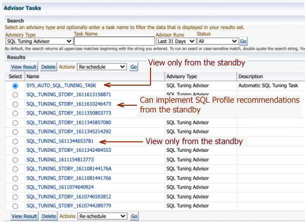

> Shows the list of previous SQL tuning tasks visible from Advisors Home. The arrows indicate whether or not a type of tuning task in the list can be implemented from the standby database.
>
> [  
> Copyright © 2013, 2023, Oracle and/or its affiliates.](https://docs.oracle.com/en/database/oracle/oracle-database/dcommon/html/cpyr.htm)


Viewing the Result of a SQL Tuning Task

The SQL Tuning Task Result Summary displays after a SQL Tuning Task completes and also when you select a tuning task from the Advisor Central page.

On an Active Data Guard Standby database you can view the result summary of a completed SQL tuning task that was executed on the same standby. You can click SQL Profiles view and implement recommended SQL profiles. The Index and Statistics links are view only.

### 25.2 Managing the Automatic SQL Tuning Task

When your goal is to identify SQL performance problems proactively, configuring SQL Tuning Advisor as an automated task is a simple solution. The task processes selected high-load SQL statements from AWR that qualify as tuning candidates.

See Also:

[Oracle Database Administrator’s Guide](https://docs.oracle.com/pls/topic/lookup?ctx=en/database/oracle/oracle-database/21/tgsql&id=ADMIN12331) to learn more about automated maintenance tasks

#### 25.2.1 About the Automatic SQL Tuning Task

By default, the Automatic SQL Tuning task runs for in a nightly maintenance window.

See Also:

[Oracle Database Administrator’s Guide](https://docs.oracle.com/pls/topic/lookup?ctx=en/database/oracle/oracle-database/21/tgsql&id=GUID-7F7C805E-BA64-43A5-9A09-FC259FFA9AA8) to learn more about automatic maintenance tasks

##### 25.2.1.1 Purpose of Automatic SQL Tuning

Configuring automatic SQL tuning instead of tuning manually decreases cost and increases manageability

Many DBAs do not have the time needed for the intensive analysis required for SQL tuning. Even when they do, SQL tuning involves several manual steps. Because several different SQL statements may be high load on any given day, DBAs may have to expend considerable effort to monitor and tune them..

The automated SQL tuning task does not process the following types of SQL:

- Ad hoc SQL statements or SQL statements that do not repeat within a week
- Parallel queries
- Queries that take too long to run after being SQL profiled, so that it is not practical for SQL Tuning Advisor to test execution
- Recursive SQL

You can run SQL Tuning Advisor on demand to tune the preceding types of SQL statements.

##### 25.2.1.2 Automatic SQL Tuning Concepts

Oracle Scheduler uses the automated maintenance tasks infrastructure (known as AutoTask) to schedules tasks to run automatically.

By default, the Automatic SQL Tuning task runs for at most one hour in a nightly maintenance window. You can customize attributes of the maintenance windows, including start and end time, frequency, and days of the week.

Automatic SQL Tuning Advisor data is stored in the CDB root and is only visible to a common user whose current container is the root. It might have results about SQL statements executed in a PDB that were analyzed by the advisor, but these results are not included if the PDB is unplugged. The results cannot be viewed when the current container is a PDB.

See Also:

- [Oracle Database Administrator’s Guide](https://docs.oracle.com/pls/topic/lookup?ctx=en/database/oracle/oracle-database/21/tgsql&id=ADMIN033) to learn about Oracle Scheduler
- [Oracle Database PL/SQL Packages and Types Reference](https://docs.oracle.com/pls/topic/lookup?ctx=en/database/oracle/oracle-database/21/tgsql&id=ARPLS032) to learn about `DBMS_AUTO_TASK_ADMIN`

##### 25.2.1.3 Command-Line Interface to SQL Tuning Advisor

On the command line, you can use PL/SQL packages to perform SQL tuning tasks.

The following table describes the most relevant packages.

Table 25-2 SQL Tuning Advisor Packages

| Package | Description |
| --- | --- |
| `DBMS_AUTO_SQLTUNE` | Enables you run SQL Tuning Advisor, manage SQL profiles, manage SQL tuning sets, and perform real-time SQL performance monitoring. To use this API, you must have the `ADVISOR` privilege. |
| `DBMS_AUTO_TASK_ADMIN` | Provides an interface to `AUTOTASK`. You can use this interface to enable and disable the Automatic SQL Tuning task. |

See Also:

[Oracle Database PL/SQL Packages and Types Reference](https://docs.oracle.com/pls/topic/lookup?ctx=en/database/oracle/oracle-database/21/tgsql&id=ARPLS150) to learn about `DBMS_SQLTUNE` ad `DBMS_AUTO_TASK_ADMIN`

##### 25.2.1.4 Basic Tasks for Automatic SQL Tuning

This section explains the basic tasks in running SQL Tuning Advisor as an automatic task.

The following graphic shows the basic workflow.

Figure 25-11 Automatic SQL Tuning APIs

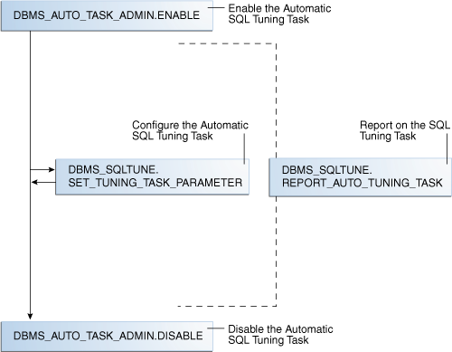

> This flowchart diagram shows the SQL Tuning Advisor APIs.
>
> The following SQL Tuning Advisor API procedures are shown: `CREATE_TUNING_TASK`, `EXECUTE_TUNING_TASK`, and `REPORT_TUNING_TASK`.
>
> Starting from the top of the diagram, STS leads to the `CREATE_TUNING_TASK` procedure, which leads to `EXECUTE_TUNING_TASK`. The `REPORT_TUNING_TASK` procedure is shown to only take place after execute and leads to four types of recommendations that user may choose to implement: store, SQL Profile, access, and rewrite.
>
> End of image description.


As shown in Figure 25-12, the basic procedure is as follows:

1. Enable the Automatic SQL Tuning task.
	See " Enabling and Disabling the Automatic SQL Tuning Task ".
2. Optionally, configure the Automatic SQL Tuning task.
	See " Configuring the Automatic SQL Tuning Task ".
3. Display the results of the Automatic SQL Tuning task.
	See " Viewing Automatic SQL Tuning Reports ".
4. Disable the Automatic SQL Tuning task.
	See " Enabling and Disabling the Automatic SQL Tuning Task ".

#### 25.2.2 Enabling and Disabling the Automatic SQL Tuning Task

You can enable or disable the Automatic SQL Tuning task using Cloud Control (preferred) or a command-line interface.

##### 25.2.2.1 Enabling and Disabling the Automatic SQL Tuning Task Using Cloud Control

You can enable and disable all automatic maintenance tasks, including the Automatic SQL Tuning task, using Cloud Control.

To enable or disable the Automatic SQL Tuning task using Cloud Control:

1. Log in to Cloud Control with the appropriate credentials.
2. Under the Targets menu, select Databases.
3. In the list of database targets, select the target for the Oracle Database instance that you want to administer.
4. If prompted for database credentials, then enter the minimum credentials necessary for the tasks you intend to perform.
5. From the Administration menu, select Oracle Scheduler, then Automated Maintenance Tasks.
	The Automated Maintenance Tasks page appears.
	This page shows the predefined tasks. You access each task by clicking the corresponding link to get more information about the task.
6. Click Automatic SQL Tuning.
	The Automatic SQL Tuning Result Summary page appears.
	The Task Status section shows whether the Automatic SQL Tuning Task is enabled or disabled. In the following graphic, the task is disabled:
	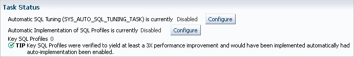

> This graphic shows a portion of a screen shot. The heading is "Task Status." The text "Automatic SQL Tuning is currently Disabled" is to the left of the Configure button. The text "Automatic Implementation of SQL Profiles is currently Disabled" is to the left of the Configure button. Below is the text "Key SQL Profiles 0." Below is the text: "TIP Key SQL Profiles were verified to yield at least a 3% performance improvement and would have been implemented automatically had auto-implementation been enabled."

7. In Automatic SQL Tuning, click Configure.
	The Automated Maintenance Tasks Configuration page appears.
	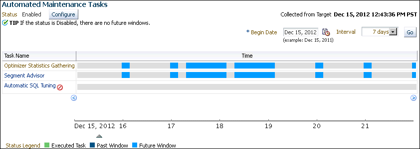

> This screen shot has the heading Automated Maintenance Tasks. Underneath the Status is Enabled. Next to the status is a Configure button. On the right is the text: "Collected from Target Dec 15, 2012 12:43:36 PM PST." Underneath is a table with the columns Task Name and Time. The first row is Optimizer Statistics Gathering. The next row is Segment Advisor. The next row is Automatic SQL Tuning with a circle with a line through it. Underneath the table is a time line that starts at 15 and goes through 22.

	By default, Automatic SQL Tuning executes in all predefined maintenance windows in `MAINTENANCE_WINDOW_GROUP`.
8. Perform the following steps:
	1. In the Task Settings for Automatic SQL Tuning, select either Enabled or Disabled to enable or disable the automated task.
		2. To disable Automatic SQL Tuning for specific days in the week, check the appropriate box next to the window name.
		3. To change the characteristics of a window, click Edit Window Group.
		4. Click Apply.

##### 25.2.2.2 Enabling and Disabling the Automatic SQL Tuning Task from the Command Line

If you do not use Cloud Control to enable and disable the Automatic SQL Tuning task, then you must use the command line.

You have the following options:

- Run the `ENABLE` or `DISABLE` procedure in the `DBMS_AUTO_TASK_ADMIN` PL/SQL package.
	This package is the recommended command-line technique. For both the `ENABLE` and `DISABLE` procedures, you can specify a particular maintenance window with the `window_name` parameter.
- Set the `STATISTICS_LEVEL` initialization parameter to `BASIC` to disable collection of all advisories and statistics, including Automatic SQL Tuning Advisor.
	Because monitoring and many automatic features are disabled, Oracle strongly recommends that you do not set `STATISTICS_LEVEL` to `BASIC`.

To enable or disable Automatic SQL Tuning using DBMS\_AUTO\_TASK\_ADMIN:

1. Connect SQL\*Plus to the database with administrator privileges, and then do one of the following:
	- To enable the automated task, execute the following PL/SQL block:
		```
		BEGIN
		  DBMS_AUTO_TASK_ADMIN.ENABLE (
		    client_name => 'sql tuning advisor'
		,   operation   => NULL
		,   window_name => NULL
		);
		END;
		/
		```
		- To disable the automated task, execute the following PL/SQL block:
		```
		BEGIN
		  DBMS_AUTO_TASK_ADMIN.DISABLE (
		    client_name => 'sql tuning advisor'
		,   operation   => NULL
		,   window_name => NULL
		);
		END;
		/
		```
2. Query the data dictionary to confirm the change.
	For example, query `DBA_AUTOTASK_CLIENT` as follows (sample output included):
	```
	COL CLIENT_NAME FORMAT a20
	SELECT CLIENT_NAME, STATUS
	FROM   DBA_AUTOTASK_CLIENT
	WHERE  CLIENT_NAME = 'sql tuning advisor';
	 
	CLIENT_NAME          STATUS
	-------------------- --------
	sql tuning advisor   ENABLED
	```

To disable collection of all advisories and statistics:

1. Connect SQL\*Plus to the database with administrator privileges, and then query the current statistics level setting.
	The following SQL\*Plus command shows that `STATISTICS_LEVEL` is set to `ALL`:
	```
	sys@PROD> SHOW PARAMETER statistics_level
	 
	NAME                                 TYPE        VALUE
	------------------------------------ ----------- -----
	statistics_level                     string      ALL
	```
2. Set `STATISTICS_LEVEL` to `BASIC` as follows:
	```
	sys@PROD> ALTER SYSTEM SET STATISTICS_LEVEL ='BASIC';
	 
	System altered.
	```

See Also:

[Oracle Database PL/SQL Packages and Types Reference](https://docs.oracle.com/pls/topic/lookup?ctx=en/database/oracle/oracle-database/21/tgsql&id=ARPLS032) for complete reference information

#### 25.2.3 Configuring the Automatic SQL Tuning Task

You can configure the Automatic SQL Tuning task using Cloud Control or the command line.

##### 25.2.3.1 Configuring the Automatic SQL Tuning Task Using Cloud Control

You can enable and disable all automatic maintenance tasks, including the Automatic SQL Tuning task, using Cloud Control. You must perform the operation as `SYS` or have the `EXECUTE` privilege on the PL/SQL package `DBMS_AUTO_SQLTUNE`.

To configure the Automatic SQL Tuning task using Cloud Control:

1. Log in to Cloud Control with the appropriate credentials.
2. Under the Targets menu, select Databases.
3. In the list of database targets, select the target for the Oracle Database instance that you want to administer.
4. If prompted for database credentials, then enter the minimum credentials necessary for the tasks you intend to perform.
5. From the Administration menu, click Oracle Scheduler, then Automated Maintenance Tasks.
	The Automated Maintenance Tasks page appears.
	This page shows the predefined tasks. You access each task by clicking the corresponding link to get more information about the task itself.
6. Click Automatic SQL Tuning.
	The Automatic SQL Tuning Result Summary page appears.
7. Under Task Settings, click Configure next to Automatic SQL Tuning (`SYS_AUTO_SQL_TUNING_TASK`).
	The Automated Maintenance Tasks Configuration page appears.
8. Under Task Settings, click Configure next to Automatic SQL Tuning.
	The Automatic SQL Tuning Settings page appears.
	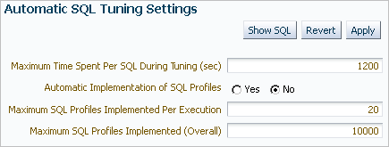

> This graphic shows a portion of a screen shot. The title is "Automatic SQL Tuning Settings." Below are three buttons: Show SQL, Revert, and Apply. Below is the text: "Maximum Time Spent Per SQL During Tuning (sec)." The value is 1200. Below is the text: "Automatic Implementation of SQL Profiles." The No button is selected. Below is the text: "Maximum SQL Profiles Implemented Per Execution." The value is 20. Below is the text: "Maximum SQL Profiles Implemented (Overall)." The value is 10000.

9. Make the desired changes and click Apply.

##### 25.2.3.2 Configuring the Automatic SQL Tuning Task Using the Command Line

The `DBMS_AUTO_SQLTUNE` package enables you to configure automatic SQL tuning by specifying the task parameters using the `SET_AUTO_TUNING_TASK_PARAMETER` procedure.

Because the task is owned by `SYS`, only `SYS` can set task parameters.

The `ACCEPT_SQL_PROFILE` tuning task parameter specifies whether to implement SQL profiles automatically (`true`) or require user intervention (`false`). The default is `AUTO`, which means `true` if at least one SQL statement exists with a SQL profile and `false` if this condition is not satisfied.

Note:

When automatic implementation is enabled, the advisor only implements recommendations to create SQL profiles. Recommendations such as creating new indexes, gathering optimizer statistics, and creating SQL plan baselines are not automatically implemented.

Assumptions

This tutorial assumes the following:

- You want the database to implement SQL profiles automatically, but to implement no more than 50 SQL profiles per execution, and no more than 50 profiles total on the database.
- You want the task to time out after 1200 seconds per execution.

To set Automatic SQL Tuning task parameters:

1. Connect SQL\*Plus to the database with the appropriate privileges, and then optionally query the current task settings.
	For example, connect SQL\*Plus to the database with administrator privileges and execute the following query:
	```
	COL PARAMETER_NAME FORMAT a25 
	COL VALUE FORMAT a10   
	SELECT PARAMETER_NAME, PARAMETER_VALUE AS "VALUE"
	FROM   DBA_ADVISOR_PARAMETERS
	WHERE  ( (TASK_NAME = 'SYS_AUTO_SQL_TUNING_TASK') AND
	         ( (PARAMETER_NAME LIKE '%PROFILE%') OR 
	           (PARAMETER_NAME = 'LOCAL_TIME_LIMIT') OR
	           (PARAMETER_NAME = 'EXECUTION_DAYS_TO_EXPIRE') ) );
	```
	Sample output appears as follows:
	```
	PARAMETER_NAME            VALUE
	------------------------- ----------
	EXECUTION_DAYS_TO_EXPIRE  30
	LOCAL_TIME_LIMIT          1000
	ACCEPT_SQL_PROFILES       FALSE
	MAX_SQL_PROFILES_PER_EXEC 20
	MAX_AUTO_SQL_PROFILES     10000
	```
2. Set parameters using PL/SQL code of the following form:
	```
	BEGIN
	  DBMS_SQLTUNE.SET_TUNING_TASK_PARAMETER (
	    task_name => 'SYS_AUTO_SQL_TUNING_TASK'
	,   parameter => parameter_name
	,   value     => value
	);
	END;
	/
	```

Example 25-3 Setting SQL Tuning Task Parameters

The following PL/SQL block sets a time limit to 20 minutes, and also automatically implements SQL profiles and sets limits for these profiles:

```
BEGIN
  DBMS_SQLTUNE.SET_TUNING_TASK_PARAMETER('SYS_AUTO_SQL_TUNING_TASK',
    'LOCAL_TIME_LIMIT', 1200);
  DBMS_SQLTUNE.SET_TUNING_TASK_PARAMETER('SYS_AUTO_SQL_TUNING_TASK',
    'ACCEPT_SQL_PROFILES', 'true');
  DBMS_SQLTUNE.SET_TUNING_TASK_PARAMETER('SYS_AUTO_SQL_TUNING_TASK',
    'MAX_SQL_PROFILES_PER_EXEC', 50);
  DBMS_SQLTUNE.SET_TUNING_TASK_PARAMETER('SYS_AUTO_SQL_TUNING_TASK',
    'MAX_AUTO_SQL_PROFILES', 10002);
END;
/
```

See Also:

[Oracle Database PL/SQL Packages and Types Reference](https://docs.oracle.com/pls/topic/lookup?ctx=en/database/oracle/oracle-database/21/tgsql&id=ARPLS68398) for complete reference information for `DBMS_AUTO_SQLTUNE`

#### 25.2.4 Viewing Automatic SQL Tuning Reports

At any time during or after the running of the Automatic SQL Tuning task, you can view a tuning report.

The tuning report contains information about all executions of the automatic SQL tuning task. Depending on the sections that were included in the report, you can view information in the following sections:

- General information
	This section has a high-level description of the automatic SQL tuning task, including information about the inputs given for the report, the number of SQL statements tuned during the maintenance, and the number of SQL profiles created.
- Summary
	This section lists the SQL statements (by their SQL identifiers) that were tuned during the maintenance window and the estimated benefit of each SQL profile, or the execution statistics after performing a test execution of the SQL statement with the SQL profile.
- Tuning findings
	This section contains the following information about each SQL statement analyzed by SQL Tuning Advisor:
	- All findings associated with each SQL statement
		- Whether the profile was implemented on the database, and why
		- Whether the SQL profile is currently enabled on the database
		- Detailed execution statistics captured when testing the SQL profile
- Explain plans
	This section shows the old and new explain plans used by each SQL statement analyzed by SQL Tuning Advisor.
- Errors
	This section lists all errors encountered by the automatic SQL tuning task.

##### 25.2.4.1 Viewing Automatic SQL Tuning Reports Using the Command Line

To generate a SQL tuning report as a `CLOB`, execute the `DBMS_SQLTUNE.REPORT_AUTO_TUNING_TASK` function.

You can store the `CLOB` in a variable and then print the variable to view the report.

Assumptions

This section assumes that you want to show all SQL statements that were analyzed in the most recent execution, including recommendations that were not implemented.

To create and access an Automatic SQL Tuning Advisor report:

1. Connect SQL\*Plus to the database with administrator privileges, and then execute the `DBMS_SQLTUNE.REPORT_AUTO_TUNING_TASK` function.
	The following example generates a text report to show all SQL statements that were analyzed in the most recent execution, including recommendations that were not implemented:
	```
	VARIABLE my_rept CLOB;
	BEGIN
	  :my_rept :=DBMS_SQLTUNE.REPORT_AUTO_TUNING_TASK (
	    begin_exec   => NULL
	,   end_exec     => NULL
	,   type         => 'TEXT'
	,   level        => 'TYPICAL'
	,   section      => 'ALL'
	,   object_id    => NULL
	,   result_limit => NULL
	);
	END;
	/
	PRINT :my_rept
	```
2. Read the general information section for an overview of the tuning execution.
	The following sample shows the Automatic SQL Tuning task analyzed 17 SQL statements in just over 7 minutes:
	```
	MY_REPT
	------------------------------------------------------------------------
	GENERAL INFORMATION SECTION
	------------------------------------------------------------------------
	Tuning Task Name                     : SYS_AUTO_SQL_TUNING_TASK
	Tuning Task Owner                    : SYS
	Workload Type                        : Automatic High-Load SQL Workload
	Execution Count                      : 6
	Current Execution                    : EXEC_170
	Execution Type                       : TUNE SQL
	Scope                                : COMPREHENSIVE
	Global Time Limit(seconds)           : 3600
	Per-SQL Time Limit(seconds)          : 1200
	Completion Status                    : COMPLETED
	Started at                           : 04/16/2012 10:00:00
	Completed at                         : 04/16/2012 10:07:11
	Number of Candidate SQLs             : 17
	Cumulative Elapsed Time of SQL (s)   : 8
	```
3. Look for findings and recommendations.
	If SQL Tuning Advisor makes a recommendation, then weigh the pros and cons of accepting it.
	The following example shows that SQL Tuning Advisor found a plan for a statement that is potentially better than the existing plan. The advisor recommends implementing a SQL profile.
	```
	------------------------------------------------------------------------
	SQLs with Findings Ordered by Maximum (Profile/Index) Benefit, Object ID
	------------------------------------------------------------------------
	ob ID  SQL ID        stats profile(benefit) index(benefit) restructure
	------ ------------- ----- ---------------- -------------- -----------
	    82 dqjcc345dd4ak                 58.03%
	    72 51bbkcd9zwsjw                                                 2
	    81 03rxjf8gb18jg
	------------------------------------------------------------------------
	DETAILS SECTION
	------------------------------------------------------------------------
	 Statements with Results Ordered by Max (Profile/Index) Benefit, Obj ID
	------------------------------------------------------------------------
	Object ID  : 82
	Schema Name: DBA1
	SQL ID     : dqjcc345dd4ak
	SQL Text   : SELECT status FROM dba_autotask_client WHERE client_name=:1
	 
	------------------------------------------------------------------------
	FINDINGS SECTION (1 finding)
	------------------------------------------------------------------------
	 
	1- SQL Profile Finding (see explain plans section below)
	--------------------------------------------------------
	  A potentially better execution plan was found for this statement.
	  The SQL profile was not automatically created because the verified
	  benefit was too low.
	 
	  Recommendation (estimated benefit: 58.03%)
	  ------------------------------------------
	  - Consider accepting the recommended SQL profile.
	    execute dbms_sqltune.accept_sql_profile(task_name =>
	         'SYS_AUTO_SQL_TUNING_TASK', object_id => 82, replace => TRUE);
	 
	  Validation results
	  ------------------
	  The SQL profile was tested by executing its plan and the original 
	  plan and measuring their respective execution statistics. A plan 
	  may have been only partially executed if the other could be run 
	  to completion in less time.
	 
	                           Original Plan  With SQL Profile  % Improved
	                           -------------  ----------------  ----------
	  Completion Status:            COMPLETE          COMPLETE
	  Elapsed Time(us):               26963              8829      67.25 %
	  CPU Time(us):                   27000              9000      66.66 %
	  User I/O Time(us):                 25                14         44 %
	  Buffer Gets:                      905               380      58.01 %
	  Physical Read Requests:             0                 0
	  Physical Write Requests:            0                 0
	  Physical Read Bytes:                0                 0
	  Physical Write Bytes:            7372              7372          0 %
	  Rows Processed:                     1                 1
	  Fetches:                            1                 1
	  Executions:                         1                 1
	 
	  Notes
	  -----
	  1. The original plan was first executed to warm the buffer cache.
	  2. Statistics for original plan were averaged over next 9 executions.
	  3. The SQL profile plan was first executed to warm the buffer cache.
	  4. Statistics for the SQL profile plan were averaged over 
	     next 9 executions.
	```

See Also:

[Oracle Database PL/SQL Packages and Types Reference](https://docs.oracle.com/pls/topic/lookup?ctx=en/database/oracle/oracle-database/21/tgsql&id=ARPLS73163) for complete reference information.

### 25.3 Running SQL Tuning Advisor On Demand

You can run SQL Tuning Advisor on demand.

#### 25.3.1 About On-Demand SQL Tuning

On-demand SQL tuning is defined as any invocation of SQL Tuning Advisor that does not result from the Automatic SQL Tuning task.

##### 25.3.1.1 Purpose of On-Demand SQL Tuning

Typically, you invoke SQL Tuning Advisor to run ADDM proactively, or to tune SQL statement reactively when users complain about suboptimal performance.

In both the proactive and reactive scenarios, running SQL Tuning Advisor is usually the quickest way to fix unexpected SQL performance problems.

##### 25.3.1.2 User Interfaces for On-Demand SQL Tuning

The recommended user interface for running SQL Tuning Advisor manually is Cloud Control.

###### 25.3.1.2.1 Accessing the SQL Tuning Advisor Using Cloud Control

Automatic Database Diagnostic Monitor (ADDM) automatically identifies high-load SQL statements. If ADDM identifies such statements, then click Schedule/Run SQL Tuning Advisor on the Recommendation Detail page to run SQL Tuning Advisor.

To tune SQL statements manually using SQL Tuning Advisor:

1. Log in to Cloud Control with the appropriate credentials.
2. Under the Targets menu, select Databases.
3. In the list of database targets, select the target for the Oracle Database instance that you want to administer.
4. If prompted for database credentials, then enter the minimum credentials necessary for the tasks you intend to perform.
5. From the Performance menu, click SQL, then SQL Tuning Advisor.
	The Schedule SQL Tuning Advisor page appears.
	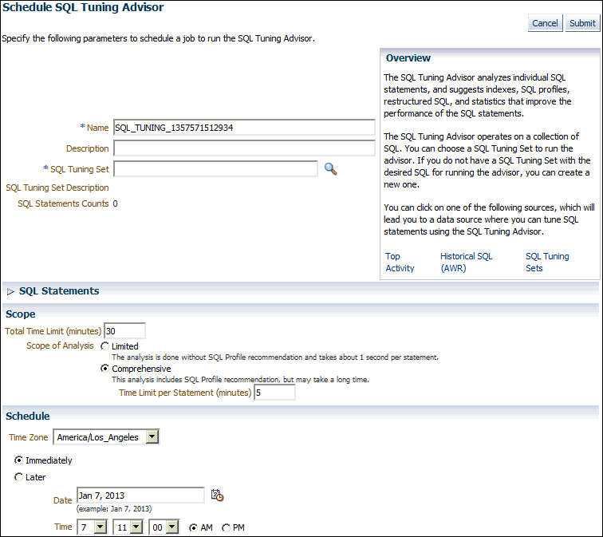

> The Schedule SQL Tuning Advisor section is shown.
>
> The Cancel and OK button appear on the upper right.
>
> The Name field has SQL\_TUNING\_1173098703162.
>
> The Description field is empty.
>
> The SQL Tuning Set field is empty. A Go button is to the right of the field.
>
> The SQL Statements Count is 0.
>
> The Scope section permits you to select Limited or Comprehensive. Comprehensive is selected. The Time Limit per Statement is 5. The Total Time Limit is 30.
>
> The Schedule section has the Time Zone set to Pacific/Pago\_Pago.
>
> The available options are IMmediately (selected) or Later.
>
> End of description.


See Also:

[Oracle Database 2 Day + Performance Tuning Guide](https://docs.oracle.com/pls/topic/lookup?ctx=en/database/oracle/oracle-database/21/tgsql&id=TDPPT161) to learn how to configure and run SQL Tuning Advisor using Cloud Control.

###### 25.3.1.2.2 Command-Line Interface to On-Demand SQL Tuning

If Cloud Control is unavailable, then you can run SQL Tuning Advisor using procedures in the `DBMS_SQLTUNE` package.

To use the APIs, the user must have the `ADVISOR` privilege.

See Also:

[Oracle Database PL/SQL Packages and Types Reference](https://docs.oracle.com/pls/topic/lookup?ctx=en/database/oracle/oracle-database/21/tgsql&id=ARPLS220) for complete reference information

##### 25.3.1.3 Basic Tasks in On-Demand SQL Tuning

This section explains the basic tasks in running SQL Tuning Advisor using the `DBMS_SQLTUNE` package.

The following graphic shows the basic workflow when using the PL/SQL APIs.

Figure 25-12 SQL Tuning Advisor APIs

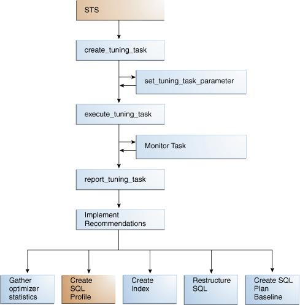

> This flowchart diagram shows the SQL Tuning Advisor APIs.
>
> The following SQL Tuning Advisor API procedures are shown: `CREATE_TUNING_TASK`, `EXECUTE_TUNING_TASK`, and `REPORT_TUNING_TASK`.
>
> Starting from the top of the diagram, STS leads to the `CREATE_TUNING_TASK` procedure, which leads to `EXECUTE_TUNING_TASK`. The `REPORT_TUNING_TASK` procedure is shown to only take place after execute and leads to four types of recommendations that user may choose to implement: store, SQL Profile, access, and rewrite.
>
> End of image description.


As shown in Figure 25-12, the basic procedure is as follows:

1. Prepare or create the input to SQL Tuning Advisor. The input can be either:
	- The text of a single SQL statement
		- A SQL tuning set that contains one or more statements
2. Create a SQL tuning task.
	See " Creating a SQL Tuning Task ".
3. Optionally, configure the SQL tuning task that you created.
	See " Configuring a SQL Tuning Task ".
4. Execute a SQL tuning task.
	See " Executing a SQL Tuning Task ".
5. Optionally, check the status or progress of a SQL tuning task.
	" Monitoring a SQL Tuning Task ".
6. Display the results of a SQL tuning task.
	" Displaying the Results of a SQL Tuning Task ".
7. Implement recommendations as appropriate.

See Also:

[Oracle Database 2 Day + Performance Tuning Guide](https://docs.oracle.com/pls/topic/lookup?ctx=en/database/oracle/oracle-database/21/tgsql&id=TDPPT161) to learn how to tune SQL using Cloud Control

#### 25.3.2 Creating a SQL Tuning Task

To create a SQL tuning task execute the `DBMS_SQLTUNE.CREATE_TUNING_TASK` function.

You can create tuning tasks from any of the following:

- The text of a single SQL statement
- A SQL tuning set containing multiple statements
- A SQL statement selected by SQL identifier from the shared SQL area
- A SQL statement selected by SQL identifier from AWR

The `scope` parameter is one of the most important for this function. You can set this parameter to the following values:

- `LIMITED`
	SQL Tuning Advisor produces recommendations based on statistical checks, access path analysis, and SQL structure analysis. SQL profile recommendations are not generated.
- `COMPREHENSIVE`
	SQL Tuning Advisor carries out all the analysis it performs under limited scope plus SQL profiling.

Assumptions

This tutorial assumes the following:

- You want to tune as user `hr`, who has the `ADVISOR` privilege.
- You want to tune the following query:
	```
	SELECT /*+ ORDERED */ * 
	FROM   employees e, locations l, departments d
	WHERE  e.department_id = d.department_id 
	AND    l.location_id = d.location_id 
	AND    e.employee_id < :bnd;
	```
- You want to pass the bind variable `100` to the preceding query.
- You want SQL Tuning Advisor to perform SQL profiling.
- You want the task to run no longer than 60 seconds.

To create a SQL tuning task:

1. Connect SQL\*Plus to the database with the appropriate privileges, and then run the `DBMS_SQLTUNE.CREATE_TUNING_TASK` function.
	For example, execute the following PL/SQL program:
	```
	DECLARE
	  my_task_name VARCHAR2(30);
	  my_sqltext   CLOB;
	BEGIN
	  my_sqltext := 'SELECT /*+ ORDERED */ * '                      ||
	                'FROM employees e, locations l, departments d ' ||
	                'WHERE e.department_id = d.department_id AND '  ||
	                      'l.location_id = d.location_id AND '      ||
	                      'e.employee_id < :bnd';
	  my_task_name := DBMS_SQLTUNE.CREATE_TUNING_TASK (
	          sql_text    => my_sqltext
	,         bind_list   => sql_binds(anydata.ConvertNumber(100))
	,         user_name   => 'HR'
	,         scope       => 'COMPREHENSIVE'
	,         time_limit  => 60
	,         task_name   => 'STA_SPECIFIC_EMP_TASK'
	,         description => 'Task to tune a query on a specified employee'
	);
	END;
	/
	```
2. Optionally, query the status of the task.
	The following example queries the status of all tasks owned by the current user, which in this example is `hr`:
	```
	COL TASK_ID FORMAT 999999
	COL TASK_NAME FORMAT a25
	COL STATUS_MESSAGE FORMAT a33
	SELECT TASK_ID, TASK_NAME, STATUS, STATUS_MESSAGE
	FROM   USER_ADVISOR_LOG;
	```
	Sample output appears below:
	```
	TASK_ID TASK_NAME                 STATUS      STATUS_MESSAGE
	------- ------------------------- ----------- --------------
	    884 STA_SPECIFIC_EMP_TASK     INITIAL
	```
	In the preceding output, the `INITIAL` status indicates that the task has not yet started execution.

See Also:

[Oracle Database PL/SQL Packages and Types Reference](https://docs.oracle.com/pls/topic/lookup?ctx=en/database/oracle/oracle-database/21/tgsql&id=ARPLS68414) to learn about the `DBMS_SQLTUNE.CREATE_TUNING_TASK` function

#### 25.3.3 Configuring a SQL Tuning Task

To change the parameters of a tuning task after it has been created, execute the `DBMS_SQLTUNE.SET_TUNING_TASK_PARAMETER` function.

This tutorial assumes the following:

- You want to tune with user account `hr`, which has been granted the `ADVISOR` privilege.
- You want to tune the `STA_SPECIFIC_EMP_TASK` created in " Creating a SQL Tuning Task ".
- You want to change the maximum time that the SQL tuning task can run to 300 seconds.

To configure a SQL tuning task:

1. Connect SQL\*Plus to the database with the appropriate privileges, and then run the `DBMS_SQLTUNE.SET_TUNING_TASK_PARAMETER` function.
	For example, execute the following PL/SQL program to change the time limit of the tuning task to 300 seconds:
	```
	BEGIN
	  DBMS_SQLTUNE.SET_TUNING_TASK_PARAMETER (
	    task_name => 'STA_SPECIFIC_EMP_TASK'
	,   parameter => 'TIME_LIMIT'
	,   value     => 300
	);
	END;
	/
	```
2. Optionally, verify that the task parameter was changed.
	The following example queries the values of all used parameters in task `STA_SPECIFIC_EMP_TASK`:
	```
	COL PARAMETER_NAME FORMAT a25 
	COL VALUE FORMAT a15   
	SELECT PARAMETER_NAME, PARAMETER_VALUE AS "VALUE"
	FROM   USER_ADVISOR_PARAMETERS
	WHERE  TASK_NAME = 'STA_SPECIFIC_EMP_TASK'
	AND    PARAMETER_VALUE != 'UNUSED'
	ORDER BY PARAMETER_NAME;
	```
	Sample output appears below:
	```
	PARAMETER_NAME            VALUE
	------------------------- ---------------
	DAYS_TO_EXPIRE            30
	DEFAULT_EXECUTION_TYPE    TUNE SQL
	EXECUTION_DAYS_TO_EXPIRE  UNLIMITED
	JOURNALING                INFORMATION
	MODE                      COMPREHENSIVE
	SQL_LIMIT                 -1
	SQL_PERCENTAGE            1
	TARGET_OBJECTS            1
	TEST_EXECUTE              AUTO
	TIME_LIMIT                300
	```

Example 25-4 Tuning a Standby Database Workload Using a Database Link

Starting in Oracle Database 12c Release 2 (12.2), you can tune a standby database workload by specifying a database link in the `database_link_to` parameter. For security reasons, Oracle recommends using a private database link. The link must be owned by `SYS` and accessed by a privileged user. Oracle Database includes a default privileged user named `SYS$UMF`.

The following program, which is issued on the standby database, shows a sample SQL tuning session for a query of `table1`. The `database_link_to` parameter specifies the name of the standby-to-primary database link.

```
VARIABLE tname VARCHAR2(30);
VARIABLE query VARCHAR2(500);

EXEC :tname := 'my_task';
EXEC :query := 'SELECT /*+ FULL(t)*/ col1 FROM table1 t WHERE col1=9000';

BEGIN 
:tname := DBMS_SQLTUNE.CREATE_TUNING_TASK(
            sql_text         => :query
          , task_name        => :tname
          , database_link_to => 'lnk_to_pri' );
END;
/

EXEC DBMS_SQLTUNE.EXECUTE_TUNING_TASK(:tname);

SELECT DBMS_SQLTUNE.REPORT_TUNING_TASK(:tname) FROM DUAL;

BEGIN
  DBMS_SQLTUNE.ACCEPT_SQL_PROFILE(
    task_name        => :tname
,   name             => 'prof'
,   task_owner       => 'SYS'
,   replace          => TRUE
,   database_link_to => 'lnk_to_pri' );
END;
/
```

Note that the `bind_list` parameter of `CREATE_TUNING_TASK` is not supported on a standby database.

See Also:

- " SQL Tuning on Active Data Guard Databases "
- [Oracle Data Guard Concepts and Administration](https://docs.oracle.com/pls/topic/lookup?ctx=en/database/oracle/oracle-database/21/tgsql&id=SBYDB-GUID-07CB190C-C248-4FF5-AB64-EAA9C6D42677) to learn how to perform remote tuning in a Data Guard environment
- [Oracle Database PL/SQL Packages and Types Reference](https://docs.oracle.com/pls/topic/lookup?ctx=en/database/oracle/oracle-database/21/tgsql&id=ARPLS68462) for `DBMS_SQLTUNE.SET_TUNING_TASK_PARAMETER` syntax and semantics

#### 25.3.4 Executing a SQL Tuning Task

To execute a SQL tuning task, use the `DBMS_SQLTUNE.EXECUTE_TUNING_TASK` function. The most important parameter is `task_name`.

Note:

You can also execute the automatic tuning task `SYS_AUTO_SQL_TUNING_TASK` using the `EXECUTE_TUNING_TASK` API. SQL Tuning Advisor performs the same analysis and actions as it would when run automatically.

Assumptions

This tutorial assumes the following:

- You want to tune as user `hr`, who has the `ADVISOR` privilege.
- You want to execute the `STA_SPECIFIC_EMP_TASK` created in " Creating a SQL Tuning Task ".

To execute a SQL tuning task:

1. Connect SQL\*Plus to the database with the appropriate privileges, and then run the `DBMS_SQLTUNE.EXECUTE_TUNING_TASK` function.
	For example, execute the following PL/SQL program:
	```
	BEGIN
	  DBMS_SQLTUNE.EXECUTE_TUNING_TASK(task_name=>'STA_SPECIFIC_EMP_TASK');
	END;
	/
	```
2. Optionally, query the status of the task.
	The following example queries the status of all tasks owned by the current user, which in this example is `hr`:
	```
	COL TASK_ID FORMAT 999999
	COL TASK_NAME FORMAT a25
	COL STATUS_MESSAGE FORMAT a33
	SELECT TASK_ID, TASK_NAME, STATUS, STATUS_MESSAGE
	FROM   USER_ADVISOR_LOG;
	```
	Sample output appears below:
	```
	TASK_ID TASK_NAME                 STATUS      STATUS_MESSAGE
	------- ------------------------- ----------- --------------
	    884 STA_SPECIFIC_EMP_TASK     COMPLETED
	```

See Also:

[Oracle Database PL/SQL Packages and Types Reference](https://docs.oracle.com/pls/topic/lookup?ctx=en/database/oracle/oracle-database/21/tgsql&id=ARPLS68424) for complete reference information about the `DBMS_SQLTUNE.EXECUTE_TUNING_TASK` function

#### 25.3.5 Monitoring a SQL Tuning Task

When you create a SQL tuning task in Cloud Control, no separate monitoring step is necessary. Cloud Control displays the status page automatically.

If you do not use Cloud Control, then you can monitor currently executing SQL tuning tasks by querying the data dictionary and dynamic performance views. The following table describes the relevant views.

Table 25-3 DBMS\_SQLTUNE.EXECUTE\_TUNING\_TASK Parameters

| View | Description |
| --- | --- |
| `USER_ADVISOR_TASKS` | Displays information about tasks owned by the current user. The view contains one row for each task. Each task has a name that is unique to the owner. Task names are just informational and no uniqueness is enforced within any other namespace. |
| `V$ADVISOR_PROGRESS` | Displays information about the progress of advisor execution. |

Assumptions

This tutorial assumes the following:

- You tune as user `hr`, who has the `ADVISOR` privilege.
- You monitor the `STA_SPECIFIC_EMP_TASK` that you executed in " Executing a SQL Tuning Task ".

To monitor a SQL tuning task:

1. Connect SQL\*Plus to the database with the appropriate privileges, and then determine whether the task is executing or completed.
	For example, query the status of `STA_SPECIFIC_EMP_TASK` as follows:
	```
	SELECT STATUS 
	FROM   USER_ADVISOR_TASKS
	WHERE  TASK_NAME = 'STA_SPECIFIC_EMP_TASK';
	```
	The following output shows that the task has completed:
	```
	STATUS
	-----------
	EXECUTING
	```
2. Determine the progress of an executing task.
	The following example queries the status of the task with task ID `884`:
	```
	VARIABLE my_tid NUMBER;  
	EXEC :my_tid := 884
	COL ADVISOR_NAME FORMAT a20
	COL SOFAR FORMAT 999
	COL TOTALWORK FORMAT 999
	SELECT TASK_ID, ADVISOR_NAME, SOFAR, TOTALWORK, 
	       ROUND(SOFAR/TOTALWORK*100,2) "%_COMPLETE"
	FROM   V$ADVISOR_PROGRESS
	WHERE  TASK_ID = :my_tid;
	```
	Sample output appears below:
	```
	TASK_ID ADVISOR_NAME         SOFAR TOTALWORK %_COMPLETE
	---------- -------------------- ----- --------- ----------
	       884 SQL Tuning Advisor       1         2         50
	```

See Also:

[Oracle Database Reference](https://docs.oracle.com/pls/topic/lookup?ctx=en/database/oracle/oracle-database/21/tgsql&id=REFRN30327) to learn about the `V$ADVISOR_PROGRESS` view

#### 25.3.6 Displaying the Results of a SQL Tuning Task

To report the results of a tuning task, use the `DBMS_SQLTUNE.REPORT_TUNING_TASK` function.

The report contains all the findings and recommendations of SQL Tuning Advisor. For each proposed recommendation, the report provides the rationale and benefit along with the SQL statements needed to implement the recommendation.

Assumptions

This tutorial assumes the following:

- You want to tune as user `hr`, who has the `ADVISOR` privilege.
- You want to access the report for the `STA_SPECIFIC_EMP_TASK` executed in " Executing a SQL Tuning Task ".

To view the report for a SQL tuning task:

1. Connect SQL\*Plus to the database with the appropriate privileges, and then run the `DBMS_SQLTUNE.REPORT_TUNING_TASK` function.
	For example, you run the following statements:
	```
	SET LONG 1000
	SET LONGCHUNKSIZE 1000
	SET LINESIZE 100
	SELECT DBMS_SQLTUNE.REPORT_TUNING_TASK( 'STA_SPECIFIC_EMP_TASK' )
	FROM   DUAL;
	```
	Truncated sample output appears below:
	```
	DBMS_SQLTUNE.REPORT_TUNING_TASK('STA_SPECIFIC_EMP_TASK')
	------------------------------------------------------------------------
	GENERAL INFORMATION SECTION
	------------------------------------------------------------------------
	Tuning Task Name   : STA_SPECIFIC_EMP_TASK
	Tuning Task Owner  : HR
	Workload Type      : Single SQL Statement
	Execution Count    : 11
	Current Execution  : EXEC_1057
	Execution Type     : TUNE SQL
	Scope              : COMPREHENSIVE
	Time Limit(seconds): 300
	Completion Status  : COMPLETED
	Started at         : 04/22/2012 07:35:49
	Completed at       : 04/22/2012 07:35:50
	 
	------------------------------------------------------------------------
	Schema Name: HR
	SQL ID     : dg7nfaj0bdcvk
	SQL Text   : SELECT /*+ ORDERED */ * FROM employees e, locations l,
	             departments d WHERE e.department_id = d.department_id AND
	             l.location_id = d.location_id AND e.employee_id < :bnd
	Bind Variables :
	 1 -  (NUMBER):100
	 
	------------------------------------------------------------------------
	FINDINGS SECTION (4 findings)
	-----------------------------------------------
	```
2. Interpret the results.

See Also:

- " Viewing Automatic SQL Tuning Reports Using the Command Line "
- [Oracle Database PL/SQL Packages and Types Reference](https://docs.oracle.com/pls/topic/lookup?ctx=en/database/oracle/oracle-database/21/tgsql&id=ARPLS68446) for complete reference information

### 25.4 The Automatic SQL Tuning Set

The Automatic SQL Tuning Set (ASTS) is a system-maintained record of SQL execution plans and SQL statement performance metrics seen by the database. It uses automatic SQL plan management to analyze this data and quickly repair SQL performance regressions.

ASTS resolves SQL statement performance regressions quickly and with minimal manual intervention. It mitigates the risks associated with database changes, system configuration changes, and upgrades. It is self-maintaining, with no configuration required. ASTS is enabled by default. Oracle recommends that you keep it enabled.

Note:

Do not disable ASTS task if you are using Automatic Indexing (which relies on ASTS). Automatic SQL plan management uses ASTS as a source of alternative SQL execution plans.

Over time, the ASTS accumulates information on all SQL statements executed on the system (including details of all execution plans).

ASTS and AWR

ASTS is complementary to AWR. Both are core manageability infrastructure components of Oracle Database.

Like AWR, the ASTS is a historic record of SQL execution plans and SQL statement performance metrics. It differs from the Automatic Workload Repository (AWR) because it is not limited to statements that consume significant system resources. Over time, ASTS will include examples of all queries seen on the system. However, it does impose a limit on the collection of non-reusable statements such as ad-hoc queries or statements that use literals instead of bind variables.

ASTS is particularly useful for diagnosing and potentially correcting SQL performance regressions in situations where the regression is caused by a plan change. In cases like this, the better plan is unlikely to be available in AWR, but it will be available in ASTS. This is significant because, for example, SQL plan management can be used to locate, test, and enforce better SQL execution plans contained in ASTS. Automatic SQL plan management implements this entire workflow without manual intervention.

Example 25-5 How to View Captured SQL statements in ASTS

```
Select sql_text
from dba_sqlset_Statements
where sqlset_name = 'SYS_AUTO_STS';
```

Example 25-6 Enabling the ASTS Task

```
Begin
   DBMS_Auto_Task_Admin.Enable(
       Client_Name => 'Auto STS Capture Task',
       Operation => NULL,
       Window_name => NULL);
End;
/
```

Example 25-7 Disabling the ASTS Task

```
Begin
   DBMS_Auto_Task_Admin.Disable(
       Client_Name => 'Auto STS Capture Task',
       Operation => NULL,
       Window_name => NULL);
End;
/
```

Example 25-8 Viewing Task Status

```
Select Task_Name, Enabled
From   DBA_AutoTask_Schedule_Control
Where  Task_Name = 'Auto STS Capture Task';
```

See Also:

The [Database Licensing Information User Manual](https://docs.oracle.com/pls/topic/lookup?ctx=en/database/oracle/oracle-database/21/tgsql&id=DBLIC-GUID-B6113390-9586-46D7-9008-DCC9EDA45AB4) for availability details.

The Oracle Database Reference for the following views.