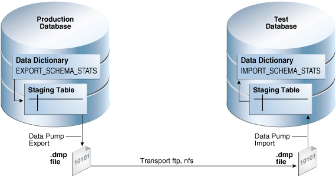

You can export and import optimizer statistics from the data dictionary to user-defined statistics tables. You can also copy statistics from one database to another database.

### 17.1 About Transporting Optimizer Statistics

When you transport optimizer statistics between databases, you must use `DBMS_STATS` to copy the statistics to and from a staging table, and tools to make the table contents accessible to the destination database.

#### 17.1.1 Purpose of Transporting Optimizer Statistics

Importing and exporting are especially useful for testing an application using production statistics.

Developers often want to tune query plans in a realistic environment before deploying applications. A typical scenario would be to use `DBMS_STATS.EXPORT_SCHEMA_STATS` to export schema statistics from a production database to a test database.

#### 17.1.2 How Transporting Optimizer Statistics Works

The typical transport operation uses a combination of `DBMS_STATS` and file transfer utilities.

The following figure illustrates the process using Oracle Data Pump and `ftp`.

Figure 17-1 Transporting Optimizer Statistics



> This graphic shows a Production Database that contains the EXPORT\_SYSTEM\_STATS view. The view points to a staging table, which then points to a.dmp file. The arrow pointing to the file is labeled "Data Pump Export." The.dmp file points to another.dmp file. The arrow is labeled "Transport ftp, nfs." The.dmp file points to a staging table, which points to the IMPORT\_SYSTEM\_STATS view. The arrow is labeled "Data Pump Import." The table is in a Test Database.


The basic steps are as follows:

1. In the production database, copy the statistics from the data dictionary to a staging table using `DBMS_STATS.EXPORT_SCHEMA_STATS`.
2. Export the statistics from the staging table to a `.dmp` file using Oracle Data Pump.
3. Transfer the `.dmp` file from the production host to the test host using a transfer tool such as `ftp`.
4. In the test database, import the statistics from the `.dmp` file to a staging table using Oracle Data Pump.
5. Copy the statistics from the staging table to the data dictionary using `DBMS_STATS.IMPORT_SCHEMA_STATS`.

#### 17.1.3 User Interface for Importing and Exporting Optimizer Statistics

`DBMS_STATS` provides the interface for importing and exporting statistics for schemas and tables.

The following subprograms in `DBMS_STATS` enable you to export schemas and different types of tables.

Table 17-1 Subprograms for Exporting Schema and Table Statistics

| Subprogram | Description |
| --- | --- |
| `EXPORT_DATABASE_STATS` | This procedure exports statistics for all objects in the database and stores them in the user statistics tables identified by `statown.stattab`. |
| `EXPORT_DICTIONARY_STATS` | This procedure exports statistics for all data dictionary schemas (`SYS`, `SYSTEM`, and RDBMS component schemas) and stores them in the user statistics table identified by `stattab`. |
| `EXPORT_FIXED_OBJECT_STATS` | This procedure exports statistics for fixed tables and stores them in the user statistics table identified by `stattab`. |
| `EXPORT_SCHEMA_STATS` | This procedure exports statistics for all objects in the schema identified by `ownname` and stores them in the user statistics tables identified by `stattab`.  By default, the `stat_category` parameter includes statistics collected during real-time statistics. The `REALTIME_STATS` value specifies only online statistics. |
| `EXPORT_TABLE_STATS` | This procedure exports statistics for a specified table (including associated index statistics) and stores them in the user statistics table identified by `stattab`.  By default, the `stat_category` parameter includes statistics collected during real-time statistics. The `REALTIME_STATS` value specifies only online statistics. |

The following subprograms in `DBMS_STATS` enable you to import schemas and different types of tables.

Table 17-2 Subprograms for Importing Optimizer Statistics

| Subprogram | Description |
| --- | --- |
| `IMPORT_DATABASE_STATS` | This procedure imports statistics for all objects in the database from the user statistics table and stores them in the data dictionary. |
| `IMPORT_DICTIONARY_STATS` | This procedure imports statistics for all data dictionary schemas (`SYS`, `SYSTEM`, and RDBMS component schemas) from the user statistics table and stores them in the dictionary. |
| `IMPORT_FIXED_OBJECT_STATS` | This procedure imports statistics for fixed tables from the user statistics table and stores them in the data dictionary. |
| `IMPORT_SCHEMA_STATS` | This procedure imports statistics for all objects in the schema identified by `ownname` from the user statistics table and stores them in the data dictionary.  By default, the `stat_category` parameter includes statistics collected during real-time statistics. The `REALTIME_STATS` value specifies only online statistics. |
| `IMPORT_TABLE_STATS` | This procedure import statistics for a specified table from the user statistics table identified by `stattab` and stores them in the data dictionary.  By default, the `stat_category` parameter includes statistics collected during real-time statistics. The `REALTIME_STATS` value specifies only online statistics. |

See Also:

[Oracle Database PL/SQL Packages and Types Reference](https://docs.oracle.com/pls/topic/lookup?ctx=en/database/oracle/oracle-database/21/tgsql&id=GUID-B930CE9B-7461-4691-8AA9-7E424C3C2C8C) to learn about `DBMS_STATS`

### 17.2 Transporting Optimizer Statistics to a Test Database: Tutorial

You can transport schema statistics from a production database to a test database using Oracle Data Pump.

Prerequisites and Restrictions

When preparing to export optimizer statistics, note the following:

- Before exporting statistics, you must create a table to hold the statistics. The procedure `DBMS_STATS.CREATE_STAT_TABLE` creates the statistics table.
- The optimizer does not use statistics stored in a user-owned table. The only statistics used by the optimizer are the statistics stored in the data dictionary. To make the optimizer use statistics in user-defined tables, import these statistics into the data dictionary using the `DBMS_STATS` import procedure.
- The Data Pump Export and Import utilities export and import optimizer statistics from the database along with the table. When a column has system-generated names, Original Export (`exp`) does not export statistics with the data, but this restriction does not apply to Data Pump Export.
	Note:
	Exporting and importing statistics using `DBMS_STATS` is a distinct operation from using Data Pump Export and Import.

Assumptions

This tutorial assumes the following:

- You want to generate representative `sh` schema statistics on a production database and use `DBMS_STATS` to import them into a test database.
- Administrative user `dba1` exists on both production and test databases.
- You intend to create table `opt_stats` to store the schema statistics.
- You intend to use Oracle Data Pump to export and import table `opt_stats`.

To generate schema statistics and import them into a separate database:

1. On the production host, start SQL\*Plus and connect to the production database as administrator `dba1`.
2. Create a table to hold the production statistics.
	For example, execute the following PL/SQL program to create user statistics table `opt_stats`:
	```
	BEGIN
	  DBMS_STATS.CREATE_STAT_TABLE ( 
	    ownname => 'dba1'
	,   stattab => 'opt_stats'
	);
	END;
	/
	```
3. Gather schema statistics.
	For example, manually gather schema statistics as follows:
	```
	-- generate representative workload
	EXEC DBMS_STATS.GATHER_SCHEMA_STATS('SH');
	```
4. Use `DBMS_STATS` to export the statistics.
	For example, retrieve schema statistics and store them in the `opt_stats` table created previously:
	```
	BEGIN
	  DBMS_STATS.EXPORT_SCHEMA_STATS (
	    ownname => 'dba1'
	,   stattab => 'opt_stats'
	);
	END;
	/
	```
5. Use Oracle Data Pump to export the contents of the statistics table.
	For example, run the `expdp` command at the operating schema prompt:
	```
	expdp dba1 DIRECTORY=dpump_dir1 DUMPFILE=stat.dmp TABLES=opt_stats
	```
6. Transfer the dump file to the test database host.
7. Log in to the test host, and then use Oracle Data Pump to import the contents of the statistics table.
	For example, run the `impdp` command at the operating schema prompt:
	```
	impdp dba1 DIRECTORY=dpump_dir1 DUMPFILE=stat.dmp TABLES=opt_stats
	```
8. On the test host, start SQL\*Plus and connect to the test database as administrator `dba1`.
9. Use `DBMS_STATS` to import statistics from the user statistics table and store them in the data dictionary.
	The following PL/SQL program imports schema statistics from table `opt_stats` into the data dictionary:
	```
	BEGIN
	  DBMS_STATS.IMPORT_SCHEMA_STATS( 
	    ownname => 'dba1'
	,   stattab => 'opt_stats' 
	);
	END;
	/
	```

See Also:

- [Oracle Database PL/SQL Packages and Types Reference](https://docs.oracle.com/pls/topic/lookup?ctx=en/database/oracle/oracle-database/21/tgsql&id=ARPLS-GUID-A323DD4F-1A05-4247-BEC6-1A7103660DAF) to learn about the `DBMS_STATS.CREATE_STAT_TABLE` function
- [Oracle Database PL/SQL Packages and Types Reference](https://docs.oracle.com/pls/topic/lookup?ctx=en/database/oracle/oracle-database/21/tgsql&id=ARPLS68491) for an overview of the statistics transfer functions
- [Oracle Database Utilities](https://docs.oracle.com/pls/topic/lookup?ctx=en/database/oracle/oracle-database/21/tgsql&id=SUTIL100) to learn about Oracle Data Pump