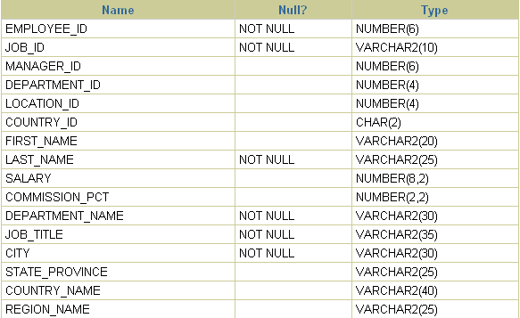
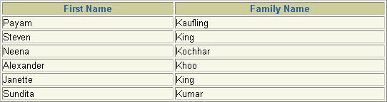

These instructions are to enable you to login and connect to a database after you have installed SQL\*Plus. You can connect to the default database you created during installation, or to another existing Oracle database.

### SQL\*Plus Resources

- Oracle Documentation Library at [`http://www.oracle.com/technetwork/`](http://www.oracle.com/technetwork/).

### SQL\*Plus Overview

SQL\*Plus is an interactive and batch query tool that is installed with every Oracle Database installation. It has a command-line user interface.

There is also the SQL\*Plus Instant Client which is a standalone command-line interface available on platforms that support the OCI Instant Client. SQL\*Plus Instant Client connects to any available Oracle database, but does not require its own Oracle database installation. See the [Oracle Call Interface Programmer's Guide](https://docs.oracle.com/pls/topic/lookup?ctx=en/database/oracle/oracle-database/21/sqpug&id=LNOCI) for more information on the OCI Instant Client.

SQL\*Plus has its own commands and environment, and it provides access to the Oracle Database. It enables you to enter and execute SQL, PL/SQL, SQL\*Plus and operating system commands to perform the following:

- Format, perform calculations on, store, and print from query results
- Examine table and object definitions
- Develop and run batch scripts
- Perform database administration

You can use SQL\*Plus to generate reports interactively, to generate reports as batch processes, and to output the results to text file, to screen, or to HTML file for browsing on the Internet. You can generate reports dynamically using the HTML output facility of SQL\*Plus.

#### Who Can Use SQL\*Plus

The SQL\*Plus, SQL, and PL/SQL command languages are powerful enough to serve the needs of users with some database experience, yet straightforward enough for new users who are just learning to work with the Oracle Database.

The SQL\*Plus language is easy to use. For example, to rename a column labeled LAST\_NAME with the heading "Family Name", enter the command:

```
COLUMN LAST_NAME HEADING 'Family Name'
```

Similarly, to list column definitions for the EMPLOYEES table, enter the command:

```
DESCRIBE EMPLOYEES
```

#### How Can I Learn SQL\*Plus

There are several sources available to assist you to learn SQL\*Plus:

- Part II of this Guide, [Using SQL\*Plus](using-SQL-Plus.md)
- Help for SQL\*Plus, Command-line help
- Oracle Database 12c: SQL Fundamentals
	An instructor-led course run by Oracle. This is a comprehensive hands-on course taking the student through all aspects of using SQL\*Plus to access Oracle Database.
- More Oracle Database 12c Training
	To find more useful Oracle courses, go to [`http://www.oracle.com/education`](http://www.oracle.com/education).

#### How to Use the SQL\*Plus Guide

This guide provides information about SQL\*Plus that applies to all operating systems. It also includes some Windows and UNIX specific information. Some aspects of SQL\*Plus may differ on each operating system. Operating system specific details are covered in the Oracle Database Installation Guide provided for your system. Use these operating system specific guides with this SQL\*Plus User's Guide and Reference.

Throughout this guide, examples showing how to enter commands use a common command syntax and a common set of sample tables. The tables are described in " About Sample Schemas and SQL\*Plus ".

#### SQL\*Plus Command-line Architecture

SQL\*Plus command-line uses a two-tier model comprising:

- Client (command-line user interface).
- Database (Oracle Database).

The two tiers may be on the same computer.

##### SQL\*Plus Client

The command-line user interface is the character-based terminal implementation.

##### Oracle Database

Oracle Database Net components provide communication between the SQL\*Plus Client and Oracle Database.

### SQL\*Plus Prerequisites

SQL\*Plus is a component of Oracle Database. SQL\*Plus is installed by default when you install the Oracle Database.

Some aspects of Oracle Database and SQL\*Plus differ from one computer and operating system to another. These topics are discussed in the Oracle Database Installation Guide for each operating system that SQL\*Plus supports.

What is necessary before you can run SQL\*Plus?

- Install Oracle Database or Oracle Client. See the Oracle Database Installation Guide for your operating system available at [`http://www.oracle.com/technetwork/`](http://www.oracle.com/technetwork/).
- Obtain an Oracle Database login username and password during installation or from your Database Administrator. See [Login Username and Password](starting-SQL-Plus.md).
- Ensure a sample database is installed and that you have a login username and password for it. See About Sample Schemas and SQL\*Plus.
- Create a default database during installation or obtain the connection identifier for the Oracle Database you want to connect to from your Database Administrator. See [About Connecting to a Database](starting-SQL-Plus.md).
- Ensure the database you want to connect to is started. See the [STARTUP](STARTUP.md) command.

#### SQL\*Plus Date Format

The default date format in SQL\*Plus is determined by the database NLS\_DATE\_FORMAT parameter and may use a date format displaying two digit years. You can use the SQL TO\_CHAR function, or the SQL\*Plus COLUMN FORMAT command in your SELECT statements to control the way dates are displayed in your report.

### Starting SQL\*Plus Command-line

The SQL\*Plus executable is usually installed in $ORACLE\_HOME/bin, which is usually included in your operating system PATH environment variable. You may need to change directory to the $ORACLE\_HOME/bin directory to start SQL\*Plus.

In the following examples, you are prompted to enter the database account password.

An example using an Easy Connection identifier to connect to the HR schema in the MYDB database running on mymachine is:

```
sqlplus hr@\"//mymachine.mydomain:port/MYDB\"
```

An example using a Net Service Name is:

```
sqlplus hr@MYDB
```

Net Service Names can be stored in several places, including Oracle Names. See the Net Services Reference Guide for more information.

If you want to use Net Service Names configured in a local Oracle Net tnsnames.ora file, then set the environment variable TNS\_ADMIN to the directory containing the tnsnames.ora file. For example, on UNIX, if your tnsnames.ora file is in /home/user1 and it defines the Net Service Name MYDB2:

```
TNS_ADMIN=/home/user1
export TNS_ADMIN
sqlplus hr@MYDB2
```

This example assumes the ORACLE\_HOME environment variable is set, and the $ORACLE\_HOME/network/admin/tnsnames.ora or ORACLE\_HOME\\network\\admin\\tnsnames.ora file defines the Net Service Name MYDB3:

```
sqlplus hr@MYDB3
```

The TWO\_TASK (on UNIX) or LOCAL (on Windows) environment variable can be set to a connection identifier. This removes the need to explicitly enter the connection identifier whenever a connection is made in SQL\*Plus or SQL\*Plus Instant Client. This UNIX example connects to the database known as MYDB4:

```
TNS_ADMIN=/home/user1
export TNS_ADMIN
TWO_TASK=MYDB4
export TWO_TASK
sqlplus hr
```

To start SQL\*Plus and connect to the default database

1. Open a UNIX or a Windows terminal and enter the SQL\*Plus command:
	```
	sqlplus
	```
2. When prompted, enter your Oracle Database username and password. If you do not know your Oracle Database username and password, ask your Database Administrator.
3. Alternatively, enter the SQL\*Plus command in the form:
	```
	sqlplus username
	```
	You are prompted to enter your password.
4. SQL\*Plus starts and connects to the default database.
	Now you can start entering and executing SQL, PL/SQL and SQL\*Plus statements and commands at the SQL> prompt.

Example - To start SQL\*Plus and connect to a database other than the default

Open a UNIX or a Windows terminal and enter the SQL\*Plus command:

```
sqlplus username@connect_identifier
```

You are prompted to enter your password.

### About Starting SQL\*Plus Instant Client

SQL\*Plus Instant Client is the SQL\*Plus command-line without the need to install Oracle Database. For information about using it, see Starting SQL\*Plus Command-line.

Because SQL\*Plus Instant Client does not include a database, it is always 'remote' from any database server. To connect to a database you must specify the database using an Oracle Net connection identifier.

If TNS\_ADMIN is not set, then an operating system dependent set of directories is examined to find tnsnames.ora. This search path includes looking in the directory specified by the ORACLE\_HOME environment variable for network/admin/tnsnames.ora. This is the only reason to set the ORACLE\_HOME environment variable for SQL\*Plus Instant Client. If ORACLE\_HOME is set when running Instant Client applications, it must be set to a directory that exists.

### About Connecting to a Different Database

From an existing command-line session, enter a CONNECT command in the form:

```
SQL> connect username@connect_identifier
```

You are prompted to enter your password.

### About Sample Schemas and SQL\*Plus

Sample schemas are no longer included with the Oracle Database. Starting from Oracle Database 21c, you need to download sample schemas from the GitHub repository. Examples in this guide use the EMP\_DETAILS\_VIEW view of the Human Resources (HR) sample schema. This schema contains personnel records for a fictitious company. To view column details for the view, EMP\_DETAILS\_VIEW, enter

```
DESCRIBE EMP_DETAILS_VIEW
```

For more information about the sample schemas, see the [Oracle Database Sample Schemas](https://docs.oracle.com/pls/topic/lookup?ctx=en/database/oracle/oracle-database/21/sqpug&id=COMSC) guide.

#### Unlocking the Sample Tables

The Human Resources (HR) Sample Schema is not installed as part of the default Oracle Database installation. Starting from Oracle Database 21c, you need to download the sample schemas from the GitHub repository. The HR account is locked by default.

You must unlock the HR account before you can use the HR sample schema. To unlock the HR account, log in as the SYSTEM user and enter the following command, where your\_password is the password you want to define for the user HR:

```
ALTER USER HR IDENTIFIED BY your_password ACCOUNT UNLOCK;
```

For further information about unlocking the HR account, see the [Oracle Database Sample Schemas](https://docs.oracle.com/pls/topic/lookup?ctx=en/database/oracle/oracle-database/21/sqpug&id=COMSC) guide. The HR user is primarily to enable you to access the HR sample schema and is necessary to enable you to run the examples in this guide.

Each table in the database is "owned" by a particular user. You may want to have your own copies of the sample tables to use as you try the examples in this guide. To get your own copies of the HR tables, see your DBA or see the [Oracle Database Sample Schemas](https://docs.oracle.com/pls/topic/lookup?ctx=en/database/oracle/oracle-database/21/sqpug&id=COMSC) guide, or you can create the HR tables with the script HR\_MAIN.SQL which is located in the following directory on UNIX:

```
$ORACLE_HOME/demo/schema/human_resources/hr_main.sql
```

And on the following directory on Windows:

```
ORACLE_HOME\DEMO\SCHEMA\HUMAN_RESOURCES\HR_MAIN.SQL
```

To create the HR tables from command-line SQL\*Plus, do the following:

1. Ask your DBA for your Oracle Database account username and password.
2. Login to SQL\*Plus.
3. On UNIX, enter the following command at the SQL\*Plus prompt:
	```
	SQL> @?/DEMO/SCHEMA/HUMAN_RESOURCES/HR_MAIN.SQL
	```
	On Windows, enter the following command at the SQL\*Plus prompt:
	```
	SQL> @?\DEMO\SCHEMA\HUMAN_RESOURCES\HR_MAIN.SQL
	```

To remove the sample tables, perform the same steps but substitute HR\_DROP.SQL for HR\_MAIN.SQL.

### Running your first Query

To describe a database object, for example, column details for EMP\_DETAILS\_VIEW, enter a DESCRIBE command like:

```
DESCRIBE EMP_DETAILS_VIEW
```

which produces the following output:



> The describe.gif image shows a HTML table of three columns, generated from iSQL\*Plus. It contains the output from the DESCRIBE command in the text prior to this image. The heading row has column headings of Name, Null? and Type. There are 16 rows of output for the EMP\_DETAILS\_VIEW table view.


To rename the column headings, and to select data from the HR sample schema view, EMP\_DETAILS\_VIEW, enter

```
COLUMN FIRST_NAME HEADING "First Name"
COLUMN LAST_NAME HEADING "Family Name"
SELECT FIRST_NAME, LAST_NAME
FROM EMP_DETAILS_VIEW
WHERE LAST_NAME LIKE 'K%';
```

which produces the following output:



> The selectout.gif image shows a HTML table of two columns, generated from iSQL\*Plus. It contains the output from the previous SELECT command described in the text prior to the image. The heading row has renamed column headings of First Name and Family Name. There are 6 rows of data found by the SELECT.


### About Exiting SQL\*Plus

To exit SQL\*Plus command-line, enter EXIT.