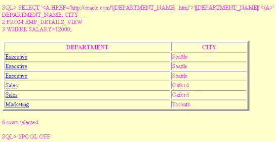
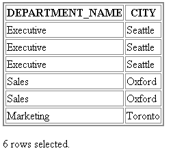

This chapter explains how to generate a HTML and CSV reports containing your query results. This chapter covers the following topics:

- About Creating Reports using Command-line SQL\*Plus

### 8.1 About Creating Reports using Command-line SQL\*Plus

In addition to plain text output, the SQL\*Plus command-line interface enables you to generate either a complete web page, HTML output which can be embedded in a web page, or data in CSV format. You can use SQLPLUS -MARKUP "HTML ON" or SET MARKUP HTML ON SPOOL ON to produce complete HTML pages automatically encapsulated with \<HTML> and \<BODY> tags. You can use SQLPLUS -MARKUP "CSV ON" or SET MARKUP CSV ON to produce reports in CSV format.

By default, data retrieved with MARKUP HTML ON is output in HTML, though you can optionally direct output to the HTML \<PRE> tag so that it displays in a web browser exactly as it appears in SQL\*Plus. See the SQLPLUS [MARKUP Options](starting-SQL-Plus.md) and the [SET](SET.md) MARKUP command for more information about these commands.

SQLPLUS -MARKUP "HTML ON" is useful when embedding SQL\*Plus in program scripts. On starting, it outputs the HTML and BODY tags before executing any commands. All subsequent output is in HTML until SQL\*Plus terminates.

The -SILENT and -RESTRICT command-line options may be effectively used with -MARKUP to suppress the display of SQL\*Plus prompt and banner information, and to restrict the use of some commands.

SET MARKUP HTML ON SPOOL ON generates an HTML page for each subsequently spooled file. The HTML tags in a spool file are closed when SPOOL OFF is executed or SQL\*Plus exits.

You can use SET MARKUP HTML ON SPOOL OFF to generate HTML output suitable for embedding in an existing web page. HTML output generated this way has no \<HTML> or \<BODY> tags.

You can enable CSV markup while logging into a user session, by using the -M\[ARKUP\] CSV ON option at the SQL\*Plus command line. For more information, see [SQL\*Plus Program Syntax](starting-SQL-Plus.md). While logged in to a user session, you can enable CSV markup by using the SET MARKUP CSV ON command.

You can specify the delimiter character by using the DELIMITER option. You can also output text without quotes by using QUOTE OFF.

You can suppress display of data returned by a query by using the ONLY option of the [SET FEEDBACK](SET-system-variable-summary.md) command. The number of rows selected and returned by the query is displayed.

#### 8.1.1 Creating HTML Reports

During a SQL\*Plus session, use the SET MARKUP command interactively to write HTML to a spool file. You can view the output in a web browser.

SET MARKUP HTML ON SPOOL ON only specifies that SQL\*Plus output will be HTML encoded, it does not create or begin writing to an output file. You must use the SQL\*Plus SPOOL command to start generation of a spool file. This file then has HTML tags including \<HTML> and \</HTML>.

When creating a HTML file, it is important and convenient to specify a.html or.htm file extension which are standard file extensions for HTML files. This enables you to easily identify the type of your output files, and also enables web browsers to identify and correctly display your HTML files. If no extension is specified, the default SQL\*Plus file extension is used.

You use SPOOL OFF or EXIT to append final HTML tags to the spool file and then close it. If you enter another SPOOL filename command, the current spool file is closed as for SPOOL OFF or EXIT, and a new HTML spool file with the specified name is created.

You can use the SET MARKUP command to enable or disable HTML output as required.



> The report.gif image shows report.html displayed in a web browser. Report.html is the output from the previous query.
>
> The query is displayed at the top of the report, followed by the output from the query in a HTML table. The heading row of the two column table contains the labels:
>
> - DEPARTMENT
> - CITY
>
> There are six more rows containing the query results. The Department column values are HTML hyperlinks identified by underlines.


In this example, the prompts and query text have not been suppressed. Depending on how you invoke a script, you can use SET ECHO OFF or command-line -SILENT options to do this.

The SQL\*Plus commands in this example contain several items of usage worth noting:

- The hyphen used to continue lines in long SQL\*Plus commands.
- The TABLE option to set table WIDTH and BORDER attributes.
- The COLUMN command to set ENTMAP OFF for the DEPARTMENT\_NAME column to enable the correct formation of HTML hyperlinks. This makes sure that any HTML special characters such as quotes and angle brackets are not replaced by their equivalent entities, &quot;, &amp;, &lt; and &gt;.
- The use of quotes and concatenation characters in the SELECT statement to create hyperlinks by concatenating string and variable elements.

View the report.html source in your web browser, or in a text editor to see that the table cells for the Department column contain fully formed hyperlinks as shown:

```
<html>
<head>
<TITLE>Department Report</TITLE>  <STYLE type="text/css">  
<!-- BODY {background: #FFFFC6} -->  </STYLE>
<meta name="generator" content="SQL*Plus 10.2.0.1">
</head>
<body TEXT="#FF00Ff">
SQL&gt; SELECT '&lt;A HREF=&quot;http://oracle.com/'
||DEPARTMENT_NAME||'.html&quot;&gt;'||DEPARTMENT_NAME
||'&lt;/A&gt;' DEPARTMENT_NAME, CITY
<br>
  2  FROM EMP_DETAILS_VIEW
<br>
  3* WHERE SALARY&gt;12000
<br>
<p>
<table WIDTH="90%" BORDER="5">
<tr><th>DEPARTMENT</th><th>CITY</th></tr>
<tr><td><A HREF="http://oracle.com/Executive.html">Executive</A></td>
<td>Seattle</td></tr>
<tr><td><A HREF="http://oracle.com/Executive.html">Executive</A></td>
<td>Seattle</td></tr>
<tr><td><A HREF="http://oracle.com/Executive.html">Executive</A></td>
<td>Seattle</td></tr>
<tr><td><A HREF="http://oracle.com/Sales.html">Sales</A></td>
<td>Oxford</td></tr>
<tr><td><A HREF="http://oracle.com/Sales.html">Sales</A></td>
<td>Oxford</td></tr>
<tr><td><A HREF="http://oracle.com/Marketing.html">Marketing</A></td>
<td>Toronto</td></tr>
</table>
<p>

6 rows selected.<br>

SQL&gt; spool off
<br>
</body>
</html>
```



> The dept.gif image shows the results of the depart.sql script displayed in a web browser. The depart.sql script is described in the text prior to the image. The heading row of the two column table contains the labels:
>
> - DEPARTMENT
> - CITY
>
> There are six more rows containing the query results. The Department column values are HTML hyperlinks identified by underlines.


The SQLPLUS command in this example contains three layers of nested quotes. From the inside out, these are:

- "2" is a quoted HTML attribute value for BORDER.
- 'BORDER="2"' is the quoted text argument for the TABLE option.
- "HTML ON TABLE 'BORDER="2"'" is the quoted argument for the -MARKUP option.

The nesting of quotes may be different in some operating systems or program scripting languages.

Example 8-1 Creating a Report Interactively

You can create HTML output in an interactive SQL\*Plus session using the SET MARKUP command. You can include an embedded style sheet, or any other valid text in the HTML \<HEAD> tag. Open a SQL\*Plus session and enter the following:

```
SET MARKUP HTML ON SPOOL ON PREFORMAT OFF ENTMAP ON -
HEAD "<TITLE>Department Report</TITLE> -
<STYLE type='text/css'> -
<!-- BODY {background: #FFFFC6} --> -
</STYLE>" -
BODY "TEXT='#FF00Ff'" -
TABLE "WIDTH='90%' BORDER='5'"
```

You use the COLUMN command to control column output. The following COLUMN commands create new heading names for the SQL query output. The first command also turns off entity mapping for the DEPARTMENT\_NAME column to allow HTML hyperlinks to be correctly created in this column of the output data:

```
COLUMN DEPARTMENT_NAME HEADING 'DEPARTMENT' ENTMAP OFF
COLUMN CITY HEADING 'CITY'
```

SET MARKUP HTML ON SPOOL ON enables SQL\*Plus to write HTML to a spool file. The following SPOOL command triggers the writing of the \<HTML> and \<BODY> tags to the named file:

```
SPOOL report.html
```

After the SPOOL command, anything entered or displayed on standard output is written to the spool file, report.html.

Enter a SQL query:

```
SELECT '<A HREF="http://oracle.com/'||DEPARTMENT_NAME||'.html">'||DEPARTMENT_NAME||'</A>' DEPARTMENT_NAME, CITY 
FROM EMP_DETAILS_VIEW 
WHERE SALARY>12000;
```

Enter the SPOOL OFF command:

```
SPOOL OFF
```

The \</BODY> and \</HTML> tags are appended to the spool file, report.html, before it is closed.

The output from report.sql is a file, report.html, that can be loaded into a web browser. Open report.html in your web browser. It should appear something like the following:

Example 8-2 Creating a Report using the SQLPLUS Command

Enter the following command at the operating system prompt:

```
SQLPLUS -S -M "HTML ON TABLE 'BORDER="2"'" HR@Ora10g @depart.sql>depart.html
```

where depart.sql contains:

```
SELECT DEPARTMENT_NAME, CITY
FROM EMP_DETAILS_VIEW
WHERE SALARY>12000;
EXIT
```

This example starts SQL\*Plus with user "HR", prompts for the HR password, sets HTML ON, sets a BORDER attribute for TABLE, and runs the script depart.sql. The output from depart.sql is a web page which, in this case, has been redirected to the file depart.html using the ">" operating system redirect command (it may be different on your operating system). It could be sent to a web browser if SQL\*Plus was called in a web server CGI script. See About Suppressing the Display of SQL\*Plus Commands in Reports for information about calling SQL\*Plus from a CGI script.

Start your web browser and enter the appropriate URL to open depart.html:

##### 8.1.1.1 HTML Entities

Certain characters, <, >, " and & have a predefined meaning in HTML. In the previous example, you may have noticed that the > character was replaced by &gt; as soon as you entered the SET MARKUP HTML ON command. To enable these characters to be displayed in your web browser, HTML provides character entities to use instead.

Table 8-1 Equivalent HTML Entities

| Character | HTML Entity | Meaning |
| --- | --- | --- |
| < | &lt; | Start HTML tag label |
| \> | &gt; | End HTML tag label |
| " | &quot; | Double quote |
| & | &amp; | Ampersand |

The web browser displays the > character, but the actual text in the HTML encoded file is the HTML entity, &gt;. The SET MARKUP option, ENTMAP, controls the substitution of HTML entities. ENTMAP is set ON by default. It ensures that the characters <, >, " and & are always replaced by the HTML entities representing these characters. This prevents web browsers from misinterpreting these characters when they occur in your SQL\*Plus commands, or in data resulting from your query.

You can set ENTMAP at a global level with SET MARKUP HTML ENTMAP ON, or at a column level with COLUMN column\_name ENTMAP ON.

#### 8.1.2 Creating CSV Reports

You can enable CSV markup while logging into a user session, by using the -M\[ARKUP\] CSV ON option at the SQL\*Plus command line. For more information, see [SQL\*Plus Program Syntax](starting-SQL-Plus.md). While logged in to a user session, you can enable CSV markup by using the SET MARKUP CSV ON command.

You can specify the delimiter character by using the DELIMITER option. You can also output text without quotes by using QUOTE OFF.

For more information about creating CSV reports, see [SET MARKUP CSV ON](SET-system-variable-summary.md).

#### 8.1.3 About Suppressing the Display of SQL\*Plus Commands in Reports

The SQLPLUS -SILENT option is particularly useful when used in combination with -MARKUP to generate embedded SQL\*Plus reports using CGI scripts or operating system scripts. It suppresses the display of SQL\*Plus commands and the SQL\*Plus banner. The HTML output shows only the data resulting from your SQL query.

You can also use SET ECHO OFF to suppress the display of each command in a script that is executed with the START command.